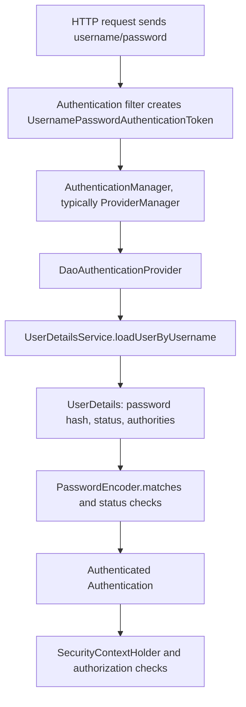
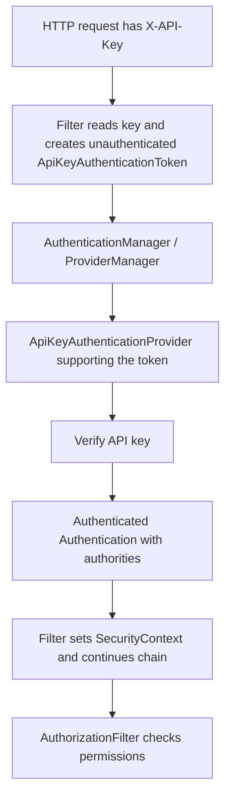

# When Do You Need an AuthenticationProvider Instead of Just Replacing UserDetailsService?

## 1. The Core Decision

In Spring Security for Servlet, **`UserDetailsService` is responsible for loading user information by username**, while **`AuthenticationProvider` is responsible for deciding whether an authentication request is valid**. The two interfaces sit at different layers:

- If you still log in with **username + password** under the usual model and only change where users are stored (database, internal service, cache, tables with a custom schema), prefer the built-in **`UserDetailsService` + `PasswordEncoder` + `DaoAuthenticationProvider`**.
- If you need to handle **a different kind of credentials** (API key, one-time signature, device attestation, specialized assertion), or **a credential verification mechanism that cannot be expressed as loading `UserDetails` and matching a password hash**, only then do you need a suitable `AuthenticationProvider`. Before writing your own, check whether Spring Security already provides a dedicated provider/filter for LDAP, OAuth2, JWT, SAML, X.509, etc.
- If you are only changing the login UI (form to JSON), changing the endpoint, or changing where sessions are stored, that **does not automatically require** a new provider. You need to check whether the `Authentication` type and verification logic actually change.

This is a **“when do you need it”** guide, so the goal is to distinguish responsibilities, make a well-founded decision, and implement one complete custom provider example. The example runs on **Java 17+, Spring Boot 3.x, Spring Security 6.x, Servlet/Spring MVC**. The corresponding WebFlux/reactive APIs have a different design; do not drop a Servlet `AuthenticationProvider` into WebFlux as a copy-paste configuration.

## 2. Where Do UserDetailsService and AuthenticationProvider Sit?

With standard username/password:



With a custom API key:



Both paths go through `AuthenticationManager` and return an authenticated `Authentication` if valid. **The difference is who understands and verifies the credentials.** A `UserDetailsService` is not designed to receive a raw password, an HTTP header, or a custom authentication token: its primary method is `loadUserByUsername(String username)`.

### Accurate Comparison

| Criterion | `UserDetailsService` | `AuthenticationProvider` |
|---|---|---|
| Core method | `loadUserByUsername(String)` | `authenticate(Authentication)` and `supports(Class<?>)` |
| Input | Username | `Authentication` containing principal/credentials/details per token type |
| Main job | Load `UserDetails`: hash, status, roles/authorities | Verify credentials according to the supported mechanism, produce authentication result |
| Checks password by default? | **No** | `DaoAuthenticationProvider` does this with `PasswordEncoder` |
| Picks HTTP headers/reads JSON itself? | No | Also shouldn't; a filter/controller turns the request into a token first |
| Typically needs a new implementation when | Users live in another DB, schema, or data service | New token type, verification by an external system, specialized flow |
| Fully interchangeable with each other? | No | A provider can **use** a `UserDetailsService` internally |
| Stores `SecurityContext` itself? | No | No; the caller of `authenticate` (filter/controller) manages context and persistence |

**`DaoAuthenticationProvider` is already an `AuthenticationProvider`.** When you only write a custom `UserDetailsService`, you are still using a provider; you just do not need to rewrite that provider.

## 3. Cases Where Only UserDetailsService Is Needed

### 3.1. Switching from In-Memory Users to a Database

Suppose the old application has in-memory accounts, while the new application has an `accounts` table containing:

- `login`: login name.
- `password_hash`: hash generated with BCrypt/Argon2 or an appropriate encoder.
- `enabled`, `locked`: account status.
- An authorities/roles table or relationship.

The flow is still username/password. The needed change is implementing `loadUserByUsername` to map the data record into `UserDetails`. `DaoAuthenticationProvider` still calls `PasswordEncoder.matches(rawPassword, storedHash)` and performs the appropriate status checks.

Here is a **standalone bean-level** configuration snippet for a demo user; it illustrates the exact information `UserDetailsService` needs to supply:

```java
@Configuration
class PasswordUserConfig {

    @Bean
    PasswordEncoder passwordEncoder() {
        return new BCryptPasswordEncoder();
    }

    @Bean
    UserDetailsService userDetailsService(PasswordEncoder encoder) {
        UserDetails alice = User.withUsername("alice")
            .password(encoder.encode("local-demo-password"))
            .roles("USER")
            .disabled(false)
            .accountLocked(false)
            .build();

        return new InMemoryUserDetailsManager(alice);
    }
}
```

The corresponding imports come from `org.springframework.context.annotation.*`, `org.springframework.security.core.userdetails.*`, `org.springframework.security.crypto.password.*`, and `org.springframework.security.provisioning.InMemoryUserDetailsManager`. The snippet above must be placed inside an application with the Spring Security starters; it is **not** a standalone `javac` program.

If data moves to JPA/JDBC, you only replace the body of `loadUserByUsername`, for example this **illustrative code depending on your application's entity/repository**:

```java
@Override
public UserDetails loadUserByUsername(String username) {
    Account account = accountRepository.findByLogin(username)
        .orElseThrow(() ->
            new UsernameNotFoundException("Account not found"));

    return User.withUsername(account.getLogin())
        .password(account.getPasswordHash())
        .disabled(!account.isEnabled())
        .accountLocked(account.isLocked())
        .authorities(account.getAuthorities().toArray(String[]::new))
        .build();
}
```

`Account` and `accountRepository` in the second snippet are **types defined by your application**; this is a mapping illustration, not a class that can run on its own. Note:

1. `passwordHash` is the hashed value; do not use plaintext from the database and do not encode the password on every user load to “make it match”.
2. `authorities(...)` takes actual authority strings, such as `ROLE_USER`. `hasRole("USER")` matches against `ROLE_USER` by default.
3. `disabled(...)` and `accountLocked(...)` are account statuses handled by the provider; having data spread across multiple tables is **not** a reason to write a custom `AuthenticationProvider`.
4. When migrating password algorithms, prefer `PasswordEncoder`/`DelegatingPasswordEncoder` and appropriate password-upgrade support rather than building a provider just to call BCrypt manually.

### 3.2. Complex Scenarios That DaoAuthenticationProvider Can Still Handle

- Looking up a user by email instead of username, if login still passes a single identifier: `loadUserByUsername` can query by email; the method name does not require the DB column to be named `username`.
- Loading authorities from multiple tables and checking disabled/locked/expired flags present in `UserDetails`.
- Swapping `PasswordEncoder` or using a delegating encoder to read multiple hash formats.
- Adding caching for `UserDetails`, with a clearly designed invalidation and credential-erasure policy.
- Using built-in Spring Security for password login while changing how data is **received** (JSON POST/controller); the controller can construct a `UsernamePasswordAuthenticationToken` and call the manager that uses `DaoAuthenticationProvider`.

Key takeaway: **“Complex user data” is different from “a different kind of authentication rule.”** Do not multiply providers when you only need to swap the user source.

## 4. Scenarios That Truly Require Another AuthenticationProvider

### 4.1. Credentials Are Not Username/Password

For example, a client sends:

```http
GET /api/me HTTP/1.1
X-API-Key: <api-key>
```

A `UserDetailsService` does not receive the raw API key, does not know how to decode/verify/enforce key revocation, and has no suitable semantics to decide which service that key represents. Let a filter create an unauthenticated `ApiKeyAuthenticationToken`; a provider supports that token, verifies the key, and returns a principal with valid authorities.

Other credential types might be internal assertions, one-time tokens, request signatures, or device-based authentication. For OAuth2/OIDC, JWT, SAML, LDAP, or X.509, prefer the built-in provider/framework if it meets the protocol; **do not write a custom provider to reimplement a standard protocol**.

### 4.2. Passwords Are Verified by Another System

Some legacy systems only expose a `verify(username, password)` API and do not return a password hash for Spring Security to match. A `UserDetailsService` can load the user/profile, but it **does not receive the input password**, so it cannot perform the verify call on its own. An appropriate provider can:

1. Read username/password from `UsernamePasswordAuthenticationToken`.
2. Call the verification service over a secure channel, with timeouts and an error policy.
3. Map the result to a principal and authorities.
4. Return an authenticated `Authentication` or throw an appropriate `AuthenticationException`.

That is a separate provider for **the credential verification method**, even though the token may still be `UsernamePasswordAuthenticationToken`. You must place the provider in the right manager and disambiguate when another `DaoAuthenticationProvider` also `supports` it to avoid unintended fallback.

If using LDAP/Active Directory, Spring Security already has built-in integration options; do not write a custom provider just because accounts reside on an LDAP server.

### 4.3. Authentication Needs Extra Data That loadUserByUsername Cannot Receive

For example, requiring `tenantId + username + password`, a one-time confirmation code, a hardware assertion, or an anti-replay challenge. For a credential set with new **semantics**, the filter/controller must package the values to be verified into an appropriate `Authentication`; the provider makes the authentication decision.

For MFA, do not return a “fully authenticated” `Authentication` right after checking only the password if policy requires a second factor. You can use the MFA support of the chosen framework version or design a multi-step flow with dedicated state, timeouts, anti-replay, and only grant the final authorities after all factors are completed.

### 4.4. When You Need Not Just Credential Checking, But Orchestration

If the problem is login success/failure responses, JSON formatting, CSRF, session fixation, cookies, rate limiting, or saving `SecurityContext`, **the provider is not the default place** to solve all of these. Those responsibilities usually belong to filters, entry points, success/failure handlers, session strategies, authorization rules, or session repositories.

Do not pass `HttpServletRequest` into `UserDetailsService` via `ThreadLocal` or query `SecurityContextHolder` to grab a raw password. Those approaches mix layers, are hard to test, and can introduce security bugs.

## 5. How Does ProviderManager Choose a Provider?

`AuthenticationManager` is an interface. `ProviderManager` is the common implementation, iterating over a list of `AuthenticationProvider` instances.

```java
public interface AuthenticationProvider {
    Authentication authenticate(Authentication authentication)
        throws AuthenticationException;

    boolean supports(Class<?> authentication);
}
```

This is a **condensed shape** of the interface to convey its meaning; the actual source has annotations and JavaDoc that vary by version.

- `supports(MyToken.class) == true`: the provider **can consider** that token type. It does not mean every instance will authenticate successfully.
- `authenticate(...)` returns an authenticated `Authentication`: the request succeeds, with the appropriate principal and authorities.
- `authenticate(...)` returns `null`: the provider cannot decide on the current instance; the manager may try the next provider.
- `authenticate(...)` throws `AuthenticationException`: authentication failed. `ProviderManager` has special rules for certain exceptions (such as account status errors), and may continue checking other providers in other cases. **Do not rely on provider ordering or arbitrary exceptions to control a fallback that risks a bypass.**
- No provider can handle it: `ProviderNotFoundException`, usually indicating that no provider supporting that token type was attached to the manager actually being used.
- `ProviderManager` normally erases credentials from a successful authentication if the object implements `CredentialsContainer`; do not keep passwords or API keys in the principal or authorities.

For example:

| Token passed to manager | Supporting provider | Meaning |
|---|---|---|
| `UsernamePasswordAuthenticationToken` | `DaoAuthenticationProvider` | Loads `UserDetails` then checks password |
| `ApiKeyAuthenticationToken` | `ApiKeyAuthenticationProvider` | Verifies API key per custom policy |
| `ApiKeyAuthenticationToken` | Only `DaoAuthenticationProvider` | No supporting provider → `ProviderNotFoundException` |
| `UsernamePasswordAuthenticationToken` | Two supporting providers | Requires explicit design of order, conditions, and fallback |

A configuration with multiple `SecurityFilterChain` beans can use different managers. Declaring a provider bean in the Spring context is not proof that **the filter receiving the request is using that exact manager**. Trace the actual path: request → chain → filter → manager → provider.

## 6. Complete Example: An AuthenticationProvider That Verifies an API Key

This hands-on exercise intentionally uses an **API key in a custom header** to show clearly why `UserDetailsService` is unsuitable. This is a server-to-server API, with no browser cookies and no sessions issued. The key is verified **on every request**.

The files belong to package `com.example.authprovider`, using Spring Boot 3.x + Spring Security 6.x on Java 17+. You need a build configured with the Spring Boot Gradle plugin or Maven equivalent.

### 6.1. Dependencies and Main Class

In `build.gradle` of a Spring Boot project with plugins and repositories configured:

```groovy
dependencies {
    implementation 'org.springframework.boot:spring-boot-starter-web'
    implementation 'org.springframework.boot:spring-boot-starter-security'

    testImplementation 'org.springframework.boot:spring-boot-starter-test'
    testImplementation 'org.springframework.security:spring-security-test'
}
```

File `src/main/java/com/example/authprovider/AuthProviderApplication.java`:

```java
package com.example.authprovider;

import org.springframework.boot.SpringApplication;
import org.springframework.boot.autoconfigure.SpringBootApplication;

@SpringBootApplication
public class AuthProviderApplication {
    public static void main(String[] args) {
        SpringApplication.run(AuthProviderApplication.class, args);
    }
}
```

### 6.2. Custom Token: Before and After Authentication

File `src/main/java/com/example/authprovider/ApiKeyAuthenticationToken.java`:

```java
package com.example.authprovider;

import java.util.Collection;
import java.util.Collections;
import org.springframework.security.authentication.AbstractAuthenticationToken;
import org.springframework.security.core.GrantedAuthority;

public final class ApiKeyAuthenticationToken
        extends AbstractAuthenticationToken {

    private final Object principal;
    private String key;

    private ApiKeyAuthenticationToken(String rawKey) {
        super(Collections.emptyList());
        this.principal = null;
        this.key = rawKey;
        super.setAuthenticated(false);
    }

    private ApiKeyAuthenticationToken(
            String clientId,
            Collection<? extends GrantedAuthority> authorities) {
        super(authorities);
        this.principal = clientId;
        this.key = null;
        super.setAuthenticated(true);
    }

    public static ApiKeyAuthenticationToken unauthenticated(
            String rawKey) {
        return new ApiKeyAuthenticationToken(rawKey);
    }

    public static ApiKeyAuthenticationToken authenticated(
            String clientId,
            Collection<? extends GrantedAuthority> authorities) {
        return new ApiKeyAuthenticationToken(clientId, authorities);
    }

    @Override
    public Object getPrincipal() {
        return principal;
    }

    @Override
    public Object getCredentials() {
        return key;
    }

    @Override
    public void setAuthenticated(boolean trusted) {
        if (trusted) {
            throw new IllegalArgumentException(
                "Only the provider may create an authenticated token");
        }
        super.setAuthenticated(false);
    }

    @Override
    public void eraseCredentials() {
        super.eraseCredentials();
        key = null;
    }
}
```

Why are there two factory methods?

- `unauthenticated(rawKey)` is for data sent by the client, with **no** authorities and `isAuthenticated() == false`.
- `authenticated(clientId, authorities)` is called only inside the provider after successful verification; credentials are set to `null`, avoiding passing the raw API key to the controller.
- Overriding `setAuthenticated(true)` prevents code outside the provider from turning an unverified token into a trusted one by flipping a flag. This pattern does not replace keeping factories/constructors within trusted boundaries and reviewing the entire token creation flow.

The token is the **input/output** of authentication; it does not verify the API key itself, does not read HTTP headers, and does not grant access on its own.

### 6.3. Provider: Verifying the Key and Creating Authentication

File `src/main/java/com/example/authprovider/ApiKeyAuthenticationProvider.java`:

```java
package com.example.authprovider;

import java.nio.charset.StandardCharsets;
import java.security.MessageDigest;
import org.springframework.beans.factory.annotation.Value;
import org.springframework.security.authentication.AuthenticationProvider;
import org.springframework.security.authentication.BadCredentialsException;
import org.springframework.security.core.Authentication;
import org.springframework.security.core.authority.AuthorityUtils;
import org.springframework.stereotype.Component;

@Component
public final class ApiKeyAuthenticationProvider
        implements AuthenticationProvider {

    private final String expectedKey;

    public ApiKeyAuthenticationProvider(
            @Value("${demo.api.key:}") String expectedKey) {
        if (expectedKey == null || expectedKey.isBlank()) {
            throw new IllegalStateException(
                "Set demo.api.key (environment: DEMO_API_KEY)");
        }
        this.expectedKey = expectedKey;
    }

    @Override
    public Authentication authenticate(Authentication authentication) {
        if (!(authentication instanceof ApiKeyAuthenticationToken token)) {
            return null;
        }

        String candidate = (String) token.getCredentials();

        if (candidate == null || candidate.isBlank()
                || candidate.length() > 256) {
            throw new BadCredentialsException("Invalid API key");
        }

        boolean matches = MessageDigest.isEqual(
            candidate.getBytes(StandardCharsets.UTF_8),
            expectedKey.getBytes(StandardCharsets.UTF_8)
        );

        if (!matches) {
            throw new BadCredentialsException("Invalid API key");
        }

        return ApiKeyAuthenticationToken.authenticated(
            "partner-example",
            AuthorityUtils.createAuthorityList("ROLE_PARTNER")
        );
    }

    @Override
    public boolean supports(Class<?> authenticationType) {
        return ApiKeyAuthenticationToken.class
            .isAssignableFrom(authenticationType);
    }
}
```

**Key learning points:**

- `supports(...)` tells `ProviderManager` which token type the provider understands. The default `DaoAuthenticationProvider` cannot verify `ApiKeyAuthenticationToken`.
- `authenticate(...)` verifies the key and returns **principal `partner-example` with `ROLE_PARTNER`**. Only the provider is allowed to produce a “trusted” result.
- Failures throw a generic `BadCredentialsException`, avoiding confirming which keys exist or which client they belong to.
- `@Value("`...`")` reads the `demo.api.key` configuration; in Spring Boot, this can be configured via the `DEMO_API_KEY` environment variable. The constructor fails fast if the key is missing, preventing accidental deployment with an empty secret.
- `MessageDigest.isEqual` compares byte arrays instead of normal string comparison, though the example still stores the **raw key in configuration** for ease of learning. Production should store an **appropriate hash/HMAC**, and support key identifiers, rotation, revocation, scopes, expiry, rate limiting, auditing, and leak-prevention mechanisms. Do not treat the demo snippet as a production API key storage model.
- `ROLE_PARTNER` is an authority granted by the provider; `hasRole("PARTNER")` in the filter chain checks that authority. Do not take roles from the client request or an external header without verification.

### 6.4. Filter: Reading the Header and Calling AuthenticationManager

File `src/main/java/com/example/authprovider/ApiKeyFilter.java`:

```java
package com.example.authprovider;

import java.io.IOException;
import jakarta.servlet.FilterChain;
import jakarta.servlet.ServletException;
import jakarta.servlet.http.HttpServletRequest;
import jakarta.servlet.http.HttpServletResponse;
import org.springframework.http.MediaType;
import org.springframework.security.authentication.AuthenticationManager;
import org.springframework.security.core.Authentication;
import org.springframework.security.core.AuthenticationException;
import org.springframework.security.core.context.SecurityContext;
import org.springframework.security.core.context.SecurityContextHolder;
import org.springframework.web.filter.OncePerRequestFilter;

public final class ApiKeyFilter extends OncePerRequestFilter {

    private final AuthenticationManager authenticationManager;

    public ApiKeyFilter(AuthenticationManager authenticationManager) {
        this.authenticationManager = authenticationManager;
    }

    @Override
    protected void doFilterInternal(
            HttpServletRequest request,
            HttpServletResponse response,
            FilterChain filterChain)
            throws ServletException, IOException {

        String rawKey = request.getHeader("X-API-Key");

        if (rawKey == null || rawKey.isBlank()) {
            filterChain.doFilter(request, response);
            return;
        }

        Authentication authenticated;
        try {
            authenticated = authenticationManager.authenticate(
                ApiKeyAuthenticationToken.unauthenticated(rawKey)
            );
        } catch (AuthenticationException ex) {
            SecurityContextHolder.clearContext();
            response.setStatus(HttpServletResponse.SC_UNAUTHORIZED);
            response.setContentType(MediaType.APPLICATION_JSON_VALUE);
            response.getWriter().write("{\"error\":\"unauthorized\"}");
            return;
        }

        SecurityContext context =
            SecurityContextHolder.createEmptyContext();
        context.setAuthentication(authenticated);
        SecurityContextHolder.setContext(context);

        try {
            filterChain.doFilter(request, response);
        } finally {
            SecurityContextHolder.clearContext();
        }
    }
}
```

The separation of responsibilities is very clear:

1. **Filter** understands HTTP and reads `X-API-Key`.
2. Filter creates an **unauthenticated** token and calls `AuthenticationManager`.
3. **Provider** knows how to verify the key and select the principal and authorities.
4. Filter places the result into `SecurityContextHolder` for the **current request**, then lets downstream filters proceed.
5. The demo is **stateless**: the next request must resend the key; it does not call `SecurityContextRepository.saveContext(...)` and does not issue a session. When you want session login or JSON login with cookies, you must design persistence separately.

The filter handles `AuthenticationException` occurring **before** `ExceptionTranslationFilter` in the chain itself; therefore, do not assume the exception will automatically turn into a JSON `401`. When the key is missing, the filter continues and authorization/entry point decides `401` for protected paths.

The snippet above creates the filter with `new ApiKeyFilter(...)` inside the chain and **does not put `@Component` on the filter**. If a filter is both an auto-registered Servlet `Filter` bean in Spring Boot and added via `addFilter...` in Spring Security, it can be invoked twice or in the wrong order.

### 6.5. Wiring the Right AuthenticationManager to the Right SecurityFilterChain

File `src/main/java/com/example/authprovider/SecurityConfig.java`:

```java
package com.example.authprovider;

import org.springframework.context.annotation.Bean;
import org.springframework.context.annotation.Configuration;
import org.springframework.http.HttpStatus;
import org.springframework.security.authentication.AuthenticationManager;
import org.springframework.security.authentication.ProviderManager;
import org.springframework.security.config.annotation.web.builders.HttpSecurity;
import org.springframework.security.config.annotation.web.configuration.EnableWebSecurity;
import org.springframework.security.config.annotation.web.configurers.AbstractHttpConfigurer;
import org.springframework.security.config.http.SessionCreationPolicy;
import org.springframework.security.web.SecurityFilterChain;
import org.springframework.security.web.authentication.HttpStatusEntryPoint;
import org.springframework.security.web.authentication.logout.LogoutFilter;
import org.springframework.security.web.context.NullSecurityContextRepository;

@Configuration
@EnableWebSecurity
public class SecurityConfig {

    @Bean
    AuthenticationManager apiKeyAuthenticationManager(
            ApiKeyAuthenticationProvider provider) {
        return new ProviderManager(provider);
    }

    @Bean
    SecurityFilterChain securityFilterChain(
            HttpSecurity http,
            AuthenticationManager apiKeyAuthenticationManager)
            throws Exception {

        http
            .csrf(AbstractHttpConfigurer::disable)
            .sessionManagement(session -> session
                .sessionCreationPolicy(SessionCreationPolicy.STATELESS))
            .securityContext(context -> context
                .securityContextRepository(
                    new NullSecurityContextRepository()))
            .authorizeHttpRequests(auth -> auth
                .requestMatchers("/health").permitAll()
                .requestMatchers("/api/**").hasRole("PARTNER")
                .anyRequest().denyAll())
            .exceptionHandling(errors -> errors
                .authenticationEntryPoint(
                    new HttpStatusEntryPoint(HttpStatus.UNAUTHORIZED)))
            .httpBasic(AbstractHttpConfigurer::disable)
            .formLogin(AbstractHttpConfigurer::disable)
            .addFilterAfter(
                new ApiKeyFilter(apiKeyAuthenticationManager),
                LogoutFilter.class);

        return http.build();
    }
}
```

Detailed explanation:

- `new ProviderManager(provider)` connects the **exact** `ApiKeyAuthenticationProvider` to the `AuthenticationManager` that the filter will call. The example only has **one** authentication type: API key. If an application also has username/password, you need to organize managers/providers/chains with the right scope rather than accidentally replacing the existing mechanism.
- `addFilterAfter(..., LogoutFilter.class)` inserts the custom authentication filter into the chain **before the authorization stage**, after essential foundational steps. For complex systems, print the Security Filters list at DEBUG level and confirm the actual order.
- `STATELESS` and `NullSecurityContextRepository` state explicitly that **login is not stored via `HttpSession`**. The API client must send the key every time.
- `/api/**` requires `ROLE_PARTNER`. No valid credentials → `401`; valid authentication but missing role → `403`.
- `httpBasic` and `formLogin` are disabled because the demo **only** accepts the custom API key.
- `csrf.disable()` in the example is intentional because this API is for server-to-server clients using a secret header that browsers do not attach automatically like session cookies. **Do not copy this configuration into a browser application with sessions/cookies**; when using authentication automatically sent by browsers, proper CSRF protection is required.

### 6.6. Controller to Observe the Result

File `src/main/java/com/example/authprovider/ExampleController.java`:

```java
package com.example.authprovider;

import java.util.Map;
import org.springframework.security.core.Authentication;
import org.springframework.web.bind.annotation.GetMapping;
import org.springframework.web.bind.annotation.RestController;

@RestController
public class ExampleController {

    @GetMapping("/health")
    public Map<String, String> health() {
        return Map.of("status", "up");
    }

    @GetMapping("/api/me")
    public Map<String, String> me(Authentication authentication) {
        return Map.of("client", authentication.getName());
    }
}
```

`authentication.getName()` is expected to receive `partner-example` from the token created by the provider; the controller does not need to read the key again. On a real endpoint, do not return secrets, access tokens, or the entire `Authentication` in the JSON response.

### 6.7. Running the Demo and Testing HTTP

The application requires `demo.api.key` to be configured. Bash example:

```bash
export DEMO_API_KEY='local-demo-key'
./gradlew bootRun
```

Windows PowerShell:

```powershell
$env:DEMO_API_KEY = "local-demo-key"
.\gradlew.bat bootRun
```

The run commands require a full Boot project with build/plugin/wrapper configured; the files above are Spring Boot application code and **do not run standalone with `javac` or `java` without dependencies**.

In another terminal:

```bash
# Public, no API key:
curl -i http://localhost:8080/health

# Protected, no API key:
curl -i http://localhost:8080/api/me

# Wrong key:
curl -i -H 'X-API-Key: wrong' http://localhost:8080/api/me

# Valid key:
curl -i -H 'X-API-Key: local-demo-key' \
  http://localhost:8080/api/me
```

| Request | Expected status | Notable body |
|---|---|---|
| `GET /health`, no header | `200` | `{"status":"up"}` |
| `GET /api/me`, no header | `401` | Depends on entry point; the demo does not require a body |
| `GET /api/me`, wrong key | `401` | `{"error":"unauthorized"}` |
| `GET /api/me`, valid key | `200` | `{"client":"partner-example"}` |

These are the expected results from the example configuration, not a guarantee of every response header order or container-generated error body. The sample API key is for local use only; in real environments, command-line history, tracing, proxy logs, and secret exposure must be properly managed.

## 7. Testing from Provider to HTTP Endpoint

Create `src/test/java/com/example/authprovider/ApiKeyAuthenticationTest.java`:

```java
package com.example.authprovider;

import org.junit.jupiter.api.Test;
import org.springframework.beans.factory.annotation.Autowired;
import org.springframework.boot.test.autoconfigure.web.servlet.AutoConfigureMockMvc;
import org.springframework.boot.test.context.SpringBootTest;
import org.springframework.http.HttpHeaders;
import org.springframework.test.web.servlet.MockMvc;
import org.springframework.security.authentication.UsernamePasswordAuthenticationToken;

import static org.junit.jupiter.api.Assertions.assertFalse;
import static org.junit.jupiter.api.Assertions.assertTrue;
import static org.springframework.test.web.servlet.request
    .MockMvcRequestBuilders.get;
import static org.springframework.test.web.servlet.result
    .MockMvcResultMatchers.jsonPath;
import static org.springframework.test.web.servlet.result
    .MockMvcResultMatchers.status;

@SpringBootTest(properties = "demo.api.key=local-test-key")
@AutoConfigureMockMvc
class ApiKeyAuthenticationTest {

    @Autowired
    MockMvc mvc;

    @Autowired
    ApiKeyAuthenticationProvider provider;

    @Test
    void providerSupportsOnlyItsTokenType() {
        assertTrue(provider.supports(ApiKeyAuthenticationToken.class));
        assertFalse(provider.supports(
            UsernamePasswordAuthenticationToken.class));
    }

    @Test
    void publicHealthDoesNotRequireKey() throws Exception {
        mvc.perform(get("/health"))
            .andExpect(status().isOk())
            .andExpect(jsonPath("$.status").value("up"));
    }

    @Test
    void missingKeyIsUnauthorized() throws Exception {
        mvc.perform(get("/api/me"))
            .andExpect(status().isUnauthorized());
    }

    @Test
    void incorrectKeyIsUnauthorized() throws Exception {
        mvc.perform(get("/api/me")
                .header("X-API-Key", "wrong"))
            .andExpect(status().isUnauthorized())
            .andExpect(jsonPath("$.error").value("unauthorized"));
    }

    @Test
    void validKeyProducesAuthenticatedPrincipal() throws Exception {
        mvc.perform(get("/api/me")
                .header("X-API-Key", "local-test-key"))
            .andExpect(status().isOk())
            .andExpect(jsonPath("$.client").value("partner-example"));
    }
}
```

Run `./gradlew test` (Windows: `.\gradlew.bat test`). `properties = "demo.api.key=local-test-key"` allows the test to run independently of environment variables on the developer's machine. These tests confirm that an `AuthenticationProvider` supports the right token and that the filter integrates with the manager, context, and authorization chain.

For a provider that verifies against an external service, you should add tests for timeouts, service unavailable, revoked keys, malformed credentials, privilege mapping, case-sensitive identity, retry policies, and distinguishing `401`/`503` errors where appropriate. Do not treat MockMvc tests as a complete verification of production security.

## 8. Design Rules and Common Pitfalls

### 8.1. Having a Provider Without a Filter Supplying the Right Token

`AuthenticationProvider` does not automatically “listen” to HTTP headers. If a request only goes through `BasicAuthenticationFilter`, it creates a `UsernamePasswordAuthenticationToken`, so a provider that only supports `ApiKeyAuthenticationToken` will **never be called**.

You need both: **a filter/controller converting credentials into a token** and **a provider/manager verifying the token**. Typical mistake:

```java
@Override
public boolean supports(Class<?> type) {
    return ApiKeyAuthenticationToken.class.isAssignableFrom(type);
}
```

Yet the client sends `Authorization: Basic ...` and there is no filter creating an API key token → the manager never receives the required token. Verify the exact `Authentication` type entering the manager before suspecting the logic inside the provider.

### 8.2. Declaring a Provider Bean May Not Be Enough

Applications can have multiple `SecurityFilterChain` beans, local/global managers, and auto-configuration beans. The provider might be created by Spring while the filter is calling a different manager.

In a custom flow, a clear approach is to inject an explicit `ProviderManager` or configure the chain's manager explicitly as in the example. Avoid creating a second provider/manager in a controller that is not shared with the filter path. When adding a provider for username/password, check whether it accidentally replaces the default password mechanism.

### 8.3. Do Not Pull Credentials from UserDetailsService

`loadUserByUsername(String)` has exactly **one identifier parameter**. If you need to verify an OTP, API key, client certificate, or request signature, do not try to fetch credentials via `SecurityContextHolder`, static/global variables, or a hidden `HttpServletRequest` in the data-access layer. Design a dedicated token and provider or use Spring Security's standard support.

### 8.4. Never Blindly Trust Client-Supplied Data

A successful provider must rely on actual credential verification, not just seeing that “the header exists”. Especially dangerous:

```java
// WRONG: raw data from client is not proof of authentication.
var trusted = UsernamePasswordAuthenticationToken.authenticated(
    incomingUsername, null, List.of(new SimpleGrantedAuthority("ROLE_ADMIN"))
);
```

This is an **anti-pattern**; do not put it in an application. Do not construct a trusted token from client-controlled claims without verifying signatures, issuer, audience, expiry, nonce/replay, and the corresponding required policies.

### 8.5. Return Results/Exceptions Per the Contract

| Behavior | Correct outcome |
|---|---|
| Token is not a type supported by the provider | `supports(...)` returns `false` |
| Provider supports the token type but cannot decide on the specific instance | `authenticate(...)` may return `null` so the manager can try another provider |
| Invalid key/password | `BadCredentialsException` or an appropriate specific `AuthenticationException` |
| Disabled/locked account | Throw the appropriate status exception while maintaining anti-enumeration policy |
| Successful authentication | Return an authenticated `Authentication` with trusted principal/authorities |
| No provider supports the token | `ProviderNotFoundException`; check wiring and token type |

Do not arbitrarily return `null` for “wrong password” if the manager has another provider that can accept the same token type: fallback can weaken security policy. Do not swallow exceptions to return a token with `isAuthenticated() == true` when credentials have not been verified.

### 8.6. Do Not Perform Authorization Inside AuthenticationProvider

A provider can grant authorities proven by the identity source; rules about “which role can access which URL” belong to the authorization layer such as `authorizeHttpRequests`, `@PreAuthorize`, or `AuthorizationManager`. Avoid hardcoding HTTP endpoints in a provider or passing the request URI through `UserDetailsService` to decide whether login is allowed.

### 8.7. SecurityContext and Sessions Do Not Belong to the Provider

The provider creates the authentication result. The filter or controller places `Authentication` into `SecurityContextHolder`. When designing session login, the login coordinator must handle `SessionAuthenticationStrategy` and `SecurityContextRepository.saveContext(...)` appropriately. When designing stateless API keys, subsequent requests must resend the key; do not create a session just to “save the provider”.

**Do not confuse** a provider returning a successful result with “login has been persisted across requests”.

### 8.8. Diagnosing Issues from the API

| Symptom | Check |
|---|---|
| `ProviderNotFoundException` | Does `supports(...)` match the token type? Is the provider in the manager actually being called? |
| Provider never runs | What token does the filter create? Is the filter ordered properly and inside the chain matching the URL? |
| Old password login stopped working | Did you replace the entire manager with one containing only the API key provider? |
| Valid key but `403` | Do the returned authorities include `ROLE_PARTNER` and match the `hasRole("PARTNER")` rule? |
| Wrong key yet request still returns `200` | Is a public matcher or fallback provider accidentally granting access? |
| Always getting `401` | Is the environment variable loaded? Does the filter send the raw key? Does the provider match with the right encoding? |
| `Authentication` exists in filter but controller does not see it | Was the context set before `AuthorizationFilter`? Was it cleared too early? |
| Two different requests accidentally share a user | Never use static variables for `SecurityContext`; the holder must be cleared per request lifecycle |
| API key leaked in logs | Mask headers, strip secrets from tracing, request dumps, and exceptions |
| JSON login needs to remember session but loses it on the next request | That is a `saveContext`/session problem, not just adding a provider |

## 9. Decision Tree for Your Project

Answer in order:

1. **Are credentials still username/password and does the server have a password hash to match against?** Keep `DaoAuthenticationProvider`; write a `UserDetailsService` to load users and a `PasswordEncoder` to verify hashes.
2. **Only changing schema/DB/cache/column names/roles?** Update the data layer and `UserDetails` mapping; do not write a new provider.
3. **Does Spring Security already have a standard implementation for the authentication mechanism?** Prefer the framework's filter/provider (LDAP, OAuth2 Resource Server JWT, SAML2, X.509, etc.) instead of building the protocol yourself.
4. **Do you have a custom token or custom credential verification rules?** Use or write an `AuthenticationProvider` supporting the appropriate token; create a filter/controller to turn the HTTP request into an unauthenticated token.
5. **Are multiple methods active at the same time?** Design `ProviderManager`/`SecurityFilterChain` with clear scopes; check `supports`, `null` cases, ordering, fallback, and entry points.
6. **Do you need to remember login across requests?** Choose the appropriate session/context persistence; this is independent of the decision to write a provider.

### Key Takeaways

- **`UserDetailsService` answers “what data does this user have?”; `AuthenticationProvider` answers “are these credentials sufficient to prove identity?”**
- `DaoAuthenticationProvider` is already the built-in provider for username/password. Changing the user source does not mean changing the provider.
- Write a provider when you need **a different authentication mechanism**, not when you only need to change the UI, JSON response, session, database, or URL.
- The provider receives an `Authentication`; the filter/controller is responsible for extracting HTTP credentials and creating an untrusted token.
- Test `supports(...)`, authentication success/failure, authorities, manager wiring, and a real request through the filter chain.

**Official references:**

- [Spring Security — Servlet Authentication Architecture](https://docs.spring.io/spring-security/reference/6.5/servlet/authentication/architecture.html)
- [Spring Security — UserDetailsService](https://docs.spring.io/spring-security/reference/6.5/servlet/authentication/passwords/user-details-service.html)
- [Spring Security — DaoAuthenticationProvider](https://docs.spring.io/spring-security/reference/6.5/servlet/authentication/passwords/dao-authentication-provider.html)
- [Spring Security — Servlet Security Filters](https://docs.spring.io/spring-security/reference/6.5/servlet/architecture.html)
- [AuthenticationProvider API](https://docs.spring.io/spring-security/site/docs/6.5.6/api/org/springframework/security/authentication/AuthenticationProvider.html)
