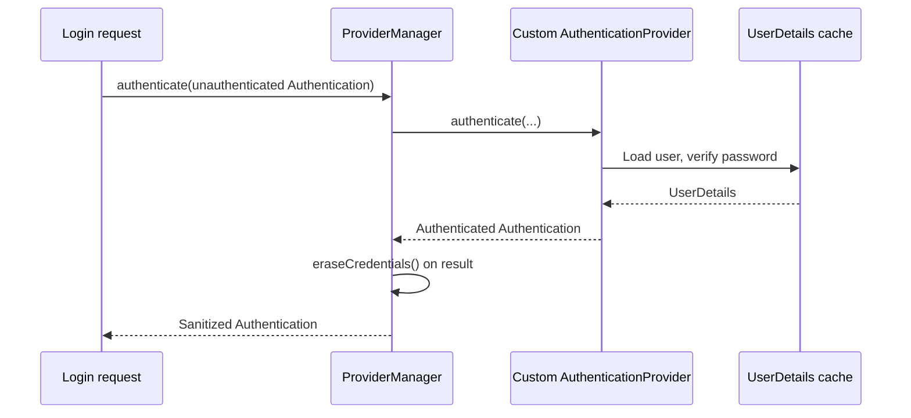
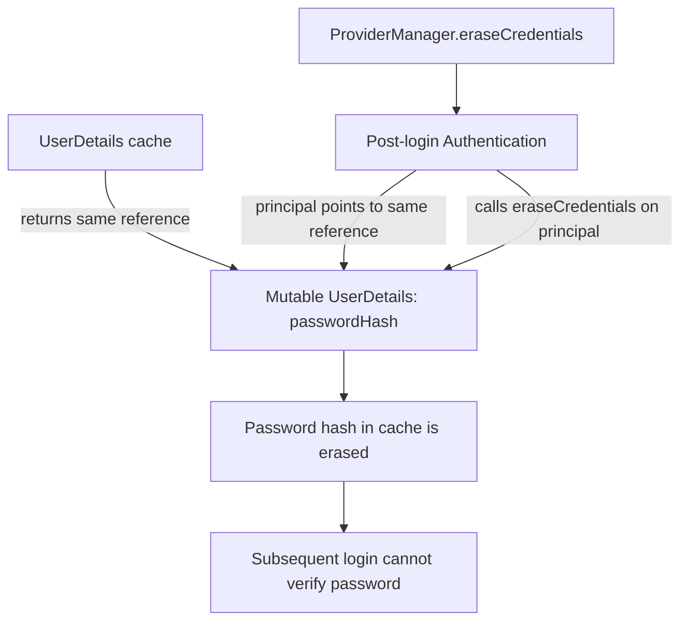

# Erasing Secrets and Avoiding Shared Mutable Objects in AuthenticationProvider

**Context:** Spring Security, specifically a custom `AuthenticationProvider` running under `ProviderManager`. After successful authentication, passwords, OTPs, API keys, or other login evidence should not linger in `Authentication`, `SecurityContext`, `HttpSession`, caches, or logs. At the same time, a successful `Authentication` must never hold a reference to a **shared mutable** user object reused across multiple authentications.

This lesson explains two risks that often appear together: **retaining secrets for too long** and **accidentally erasing secrets on a cached/reused object**.

## 1. Distinguishing Three Types of Data in the Authentication Flow

Suppose a client logs in with a username and password:

```text
Request 1 (unauthenticated)
    username = alice
    credentials = password just entered by the user
             |
             v
AuthenticationProvider
    loads UserDetails from UserDetailsService/cache
    compares entered password against encoded password
             |
             v
Authenticated Authentication
    principal = safe identity for subsequent use
    authorities = verified permissions
    credentials = null / holds no secrets
             |
             v
SecurityContext and possibly HttpSession
```

Keep these separate:

| Data | Meaning | Should it stay in a successful `Authentication` or session? |
| --- | --- | --- |
| Newly entered password, OTP, recovery code | **Input secret** to prove identity | **No**: use only during verification, avoid retaining |
| Password hash in `UserDetails` | Data used to **match** passwords on future logins | Must be protected in an appropriate store/cache; do not expose in principal/session |
| Username, user ID, authorities | Verified identity/authorization info | Can be stored as a minimal, safe, stable snapshot |
| Reference to entity/cache object | Object that can be mutated by other operations | Avoid holding directly if the object is mutable and shared |

A password hash is **not a plaintext password**, yet it is still sensitive information; it should not leak in responses/logs. Having `UserDetails.getPassword()` retain the **encoded hash** in cache so future logins work is different from storing the newly submitted user password in the session.

A post-login `Authentication` should be a “snapshot” of the identity needed for subsequent requests, not the entire account object, JPA entity, request body, or cache record containing a password hash.

## 2. Spring Security's Credential Erasure Mechanism

With `ProviderManager`, `eraseCredentialsAfterAuthentication` is enabled by default. When an `AuthenticationProvider` returns a successful authentication result, `ProviderManager` checks whether the result implements `CredentialsContainer`. If so, it calls `eraseCredentials()` before returning the result to the caller.

Common classes like Spring Security's `UsernamePasswordAuthenticationToken` and `User` support credential erasure. `UsernamePasswordAuthenticationToken.eraseCredentials()` clears the token's credentials; through `AbstractAuthenticationToken`'s mechanism, it also calls `eraseCredentials()` on `principal`, `credentials`, and `details` **if those objects implement `CredentialsContainer`**.



Example of constructing a successful token with a safe principal:

```java
return UsernamePasswordAuthenticationToken.authenticated(
        safePrincipal, null, copiedAuthorities);
```

Here `credentials` is already `null` as soon as the provider returns the result. `ProviderManager` can still run its default erasure step without any password left in the token.

**Important limitations:**

- Credential erasure **reduces how long references are held** to sensitive data; it does not guarantee physically wiping every byte from RAM. Immutable `String` instances, library-created copies, logs, heap dumps, or buffers at other layers may still hold the data.
- `ProviderManager` processes the **returned result**. If the caller still holds the **input** token or a DTO containing the password, erasing the result does not automatically wipe all those copies.
- If you call `provider.authenticate(...)` directly without going through `ProviderManager`, do not assume the manager's default erasure hook ran.
- A `Map` inside `details` containing `"password"` is not recursively scanned/cleared automatically; stuffing secrets into details/principal/custom fields is a design flaw.
- Never treat `Authentication#getCredentials() == null` as proof that **no other secret reference exists** anywhere in the entire object graph.

In a custom provider, the reliable approach is **never to put secrets into the successful result in the first place**, and to implement `CredentialsContainer` properly when creating custom token types that carry sensitive data needing cleanup.

## 3. Dangerous Bug: Principal Pointing Directly to a Cached UserDetails

Suppose `UserDetailsService` or `UserCache` returns the same object across multiple logins. The following code is easy to write yet unsafe:

```java
// ILLUSTRATION OF WRONG APPROACH: user may be a shared cached object.
UserDetails cachedUser = users.loadUserByUsername(username);
if (!encoder.matches(rawPassword, cachedUser.getPassword())) {
    throw new BadCredentialsException("Invalid credentials");
}
return UsernamePasswordAuthenticationToken.authenticated(
        cachedUser, rawPassword, cachedUser.getAuthorities());
```

What can go wrong:

1. The successful `Authentication` contains **rawPassword** and a **direct reference** to `cachedUser`.
2. `ProviderManager` calls `eraseCredentials()` on the result token.
3. If `cachedUser` implements `CredentialsContainer`, that step also calls `cachedUser.eraseCredentials()`. With Spring Security's `User`, the password value on **that exact instance** can be cleared.
4. Because the token principal and the cache point to **the same object**, the cache was just mutated; the next login fetches an object missing its hash, causing password verification to fail.
5. Even without a cache, an `Authentication` holding an entity or mutable `UserDetails` directly can leak the password hash or suffer unexpected role/state mutations while stored in a long-lived session.



This bug often surfaces only on the second authentication, or when multiple concurrent requests share the principal. Tests that only log in **once** can miss it.

Do not fix this by hastily disabling credential erasure. `ProviderManager#setEraseCredentialsAfterAuthentication(false)` exists for certain caching considerations, but re-enabling secret retention in authentication results is a major security trade-off. **Prefer separating the returned object from the cached object**.

## 4. Correct Design: Authenticate Against the Source Object, Return a Minimal Principal Snapshot

A custom provider should do four clear things:

1. Receive the inbound `Authentication` with the data to verify.
2. Fetch verification data from `UserDetailsService`/user store; match the entered password against the **encoded password** using `PasswordEncoder.matches(...)`, and check account status.
3. Create a **new principal** holding only the necessary ID/username; copy authorities into stable values. Never put passwords, password hashes, OTPs, API keys, or mutable entities into the principal.
4. Return an authenticated `Authentication` with `credentials == null`. Never store per-request state in provider fields.

With Java 17, `record` is a simple way to create a principal with `final` fields. If storing collections, use `List.copyOf`, `Set.copyOf`, or copy each mutable element. Copying only the list container is insufficient if the items inside are themselves mutable.

```java
import java.security.Principal;

record PrincipalSnapshot(String name) implements Principal {
    @Override
    public String getName() {
        return name;
    }
}
```

This is a principal with an immutable value and an explicit `getName()`. `Authentication#getName()` will return `alice` instead of the class name or `toString()` of a DTO that does not implement `Principal`.

Copying authorities:

```java
List<SimpleGrantedAuthority> copiedAuthorities = user.getAuthorities()
        .stream()
        .map(a -> new SimpleGrantedAuthority(a.getAuthority()))
        .toList();
```

Each `SimpleGrantedAuthority` holds a `String` permission name; `List#toList()` on Java 17 produces an unmodifiable list. Never let a mutable `List<GrantedAuthority>` from the cache be shared across multiple tokens. If permissions change, there must be a policy to refresh/revoke existing `Authentication` instances; an immutable snapshot does not mean permissions in active sessions update automatically.

### Providers Are Usually Singletons: Never Hold Per-Authentication State

The following design is **wrong**, especially under concurrent requests:

```java
// DO NOT use in an application:
final class LeakyProvider {
    private String lastPassword;
    private Authentication lastAuthentication;
    private UserDetails currentUser;
}
```

A singleton bean can handle multiple requests across different threads. A field like `currentUser` can be overwritten by request B while request A is authenticating; `lastPassword` retains secrets too long and increases leak risk; `lastAuthentication` can retain someone else's principal/token. `volatile`, `synchronized`, or `ThreadLocal` is not the default answer for login state; use local variables, fresh result objects, and thread-safe dependencies.

## 5. Runnable Java 17 Lab: Custom AuthenticationProvider That Does Not Corrupt the UserDetails Cache

This lab tests `ProviderManager` + custom provider directly, without starting a web server. It proves three things:

- The authenticated result **contains no credentials** and does not point to the cached `UserDetails`.
- The cache preserves the **encoded password** needed for future logins.
- A second login still succeeds; wrong passwords are rejected and never produce a valid `Authentication`.

### 5.1. `pom.xml`

Use JDK 17+ and Maven. The Spring Boot 3.3.9 baseline manages compatible Spring Security 6 versions for this example; this is a learning API reproducibility baseline, not a recommendation to pin this version in production.

```xml
<project xmlns="http://maven.apache.org/POM/4.0.0"
         xmlns:xsi="http://www.w3.org/2001/XMLSchema-instance"
         xsi:schemaLocation="http://maven.apache.org/POM/4.0.0 https://maven.apache.org/xsd/maven-4.0.0.xsd">
    <modelVersion>4.0.0</modelVersion>
    <parent>
        <groupId>org.springframework.boot</groupId>
        <artifactId>spring-boot-starter-parent</artifactId>
        <version>3.3.9</version>
        <relativePath/>
    </parent>
    <groupId>example</groupId>
    <artifactId>credential-isolation-demo</artifactId>
    <version>1.0.0</version>
    <properties>
        <java.version>17</java.version>
    </properties>
    <dependencies>
        <dependency>
            <groupId>org.springframework.security</groupId>
            <artifactId>spring-security-core</artifactId>
        </dependency>
        <dependency>
            <groupId>org.springframework.security</groupId>
            <artifactId>spring-security-crypto</artifactId>
        </dependency>
        <dependency>
            <groupId>org.springframework.boot</groupId>
            <artifactId>spring-boot-starter-test</artifactId>
            <scope>test</scope>
        </dependency>
    </dependencies>
</project>
```

Create file `src/test/java/example/CredentialIsolationTest.java`:

```java
package example;

import java.security.Principal;
import java.util.List;

import org.junit.jupiter.api.BeforeEach;
import org.junit.jupiter.api.Test;
import org.springframework.security.authentication.AuthenticationProvider;
import org.springframework.security.authentication.BadCredentialsException;
import org.springframework.security.authentication.ProviderManager;
import org.springframework.security.authentication.UsernamePasswordAuthenticationToken;
import org.springframework.security.core.Authentication;
import org.springframework.security.core.AuthenticationException;
import org.springframework.security.core.authority.SimpleGrantedAuthority;
import org.springframework.security.core.userdetails.User;
import org.springframework.security.core.userdetails.UserDetails;
import org.springframework.security.core.userdetails.UserDetailsService;
import org.springframework.security.core.userdetails.UsernameNotFoundException;
import org.springframework.security.crypto.factory.PasswordEncoderFactories;
import org.springframework.security.crypto.password.PasswordEncoder;

import static org.assertj.core.api.Assertions.assertThat;
import static org.assertj.core.api.Assertions.assertThatThrownBy;

class CredentialIsolationTest {
    private PasswordEncoder encoder;
    private UserDetails cachedUser;
    private ProviderManager manager;

    @BeforeEach
    void setUp() {
        encoder = PasswordEncoderFactories.createDelegatingPasswordEncoder();
        cachedUser = User.withUsername("alice")
                .password(encoder.encode("correct-password"))
                .roles("USER")
                .build();

        // Simulate a cache returning the SAME UserDetails instance on every lookup.
        UserDetailsService users = username -> {
            if (!"alice".equals(username)) {
                throw new UsernameNotFoundException("Unknown username");
            }
            return cachedUser;
        };

        AuthenticationProvider provider = new SafeSnapshotProvider(users, encoder);
        manager = new ProviderManager(List.of(provider));
    }

    @Test
    void loginTwiceKeepsCacheIntactAndRemovesResultCredentials() {
        String passwordHashBefore = cachedUser.getPassword();

        UsernamePasswordAuthenticationToken requestOne =
                UsernamePasswordAuthenticationToken.unauthenticated(
                        "alice", "correct-password");

        Authentication first;
        try {
            first = manager.authenticate(requestOne);
        } finally {
            // Caller-created input request is still a separate object needing cleanup.
            requestOne.eraseCredentials();
        }

        assertThat(requestOne.getCredentials()).isNull();
        assertThat(first.isAuthenticated()).isTrue();
        assertThat(first.getCredentials()).isNull();
        assertThat(first.getName()).isEqualTo("alice");
        assertThat(first.getPrincipal()).isInstanceOf(PrincipalSnapshot.class);
        assertThat(first.getPrincipal()).isNotSameAs(cachedUser);
        assertThat(first.getAuthorities())
                .extracting(a -> a.getAuthority())
                .containsExactly("ROLE_USER");

        // After ProviderManager erases result credentials,
        // the shared UserDetails still retains its hash for the second login.
        assertThat(cachedUser.getPassword()).isEqualTo(passwordHashBefore);

        Authentication second = manager.authenticate(
                UsernamePasswordAuthenticationToken.unauthenticated(
                        "alice", "correct-password"));

        assertThat(second.isAuthenticated()).isTrue();
        assertThat(second.getCredentials()).isNull();
        assertThat(second.getName()).isEqualTo("alice");
        assertThat(second.getPrincipal()).isNotSameAs(first.getPrincipal());
        assertThat(cachedUser.getPassword()).isEqualTo(passwordHashBefore);
    }

    @Test
    void wrongPasswordDoesNotProduceAuthenticatedResult() {
        String passwordHashBefore = cachedUser.getPassword();

        assertThatThrownBy(() -> manager.authenticate(
                UsernamePasswordAuthenticationToken.unauthenticated(
                        "alice", "wrong-password")))
                .isInstanceOf(BadCredentialsException.class);

        assertThat(cachedUser.getPassword()).isEqualTo(passwordHashBefore);
    }

    private record PrincipalSnapshot(String name) implements Principal {
        @Override
        public String getName() {
            return name;
        }
    }

    private static final class SafeSnapshotProvider
            implements AuthenticationProvider {

        private final UserDetailsService users;
        private final PasswordEncoder encoder;

        SafeSnapshotProvider(UserDetailsService users, PasswordEncoder encoder) {
            this.users = users;
            this.encoder = encoder;
        }

        @Override
        public Authentication authenticate(Authentication request)
                throws AuthenticationException {
            if (!(request instanceof UsernamePasswordAuthenticationToken)) {
                return null;
            }

            Object raw = request.getCredentials();
            if (!(raw instanceof String password)
                    || request.getName() == null
                    || request.getName().isBlank()) {
                throw new BadCredentialsException("Invalid credentials");
            }

            UserDetails found;
            try {
                found = users.loadUserByUsername(request.getName());
            } catch (UsernameNotFoundException ex) {
                // Do not reveal whether the username exists.
                throw new BadCredentialsException("Invalid credentials");
            }

            // Demo groups rejection reasons to avoid leaking account state.
            // Production still needs proper auditing and an explicit account-state policy.
            if (!found.isEnabled()
                    || !found.isAccountNonLocked()
                    || !found.isAccountNonExpired()
                    || !found.isCredentialsNonExpired()) {
                throw new BadCredentialsException("Invalid credentials");
            }

            String encodedPassword = found.getPassword();
            if (encodedPassword == null
                    || !encoder.matches(password, encodedPassword)) {
                throw new BadCredentialsException("Invalid credentials");
            }

            // Do not retain a reference to found or mutable authorities in the cache.
            List<SimpleGrantedAuthority> authorities = found.getAuthorities()
                    .stream()
                    .map(a -> new SimpleGrantedAuthority(a.getAuthority()))
                    .toList();

            PrincipalSnapshot principal =
                    new PrincipalSnapshot(found.getUsername());

            // Credentials are stripped BEFORE returning the result.
            return UsernamePasswordAuthenticationToken.authenticated(
                    principal, null, authorities);
        }

        @Override
        public boolean supports(Class<?> authenticationType) {
            return UsernamePasswordAuthenticationToken.class
                    .isAssignableFrom(authenticationType);
        }
    }
}
```

Run in the directory containing `pom.xml`:

```bash
mvn test
```

When dependencies download and tests run cleanly, **2 tests PASS** are expected and Maven ends with `BUILD SUCCESS`. This is the **expected outcome of the example**, not a recorded test execution log inside the lesson.

### 5.2. Reading Each Assertion Accurately

- `first.getCredentials() == null`: the successful token no longer holds the password.
- `first.getPrincipal() instanceof PrincipalSnapshot`: the principal is not the `UserDetails` object holding the hash.
- `first.getPrincipal() != cachedUser`: there is no **shared reference** between the token stored in the security context and the store/cache object.
- `cachedUser.getPassword()` stays identical before/after both logins: result erasure does not mutate the cache.
- `second` still authenticates: the next login still verifies against a valid hash.
- `second.getPrincipal() != first.getPrincipal()`: each result gets its own snapshot object.
- Wrong password throws `BadCredentialsException`: no fallback path produces a successful token.
- `requestOne.eraseCredentials()` in `finally`: shows that input and output are **two separate objects**; the input's credentials need independent lifecycle management.

The test simulates a `UserDetailsService` that always returns the **same instance**, intentionally exposing the shared-reference hazard. You do not need a real cache backend to catch this design bug.

### 5.3. Lab Limitations and Extensions

`ProviderManager` is actually invoked in the test, so `eraseCredentialsAfterAuthentication` is on the normal execution path. The test does not spin up a web `SecurityFilterChain`, `HttpSession`, Redis, or a token issuer; therefore it **proves safety at the provider/manager boundary**, not the session persistence or logout policy of a complete application.

In a real system, beyond the tests above, you must also verify that the `Authentication` stored in `SecurityContextRepository`/session has `credentials == null`, no secret fields in principal/details, and no references to mutable entities/cache entries. Use subsequent requests to confirm principal/authorities remain intact; pay attention to role updates and invalidating active sessions.

## 6. Erasing Secrets in Custom Authentication and Custom Principals

If writing a custom token type (such as an OTP or confirmation code) that actually holds sensitive data, it can implement `CredentialsContainer`. A minimal illustrative object:

```java
import java.util.Arrays;
import org.springframework.security.core.CredentialsContainer;

final class TemporaryOtp implements CredentialsContainer {
    private char[] code;

    TemporaryOtp(char[] suppliedCode) {
        this.code = suppliedCode.clone();
    }

    boolean hasCode() {
        return code != null;
    }

    @Override
    public void eraseCredentials() {
        if (code != null) {
            Arrays.fill(code, '\0');
            code = null;
        }
    }
}
```

This is an **illustrative snippet**, not a complete `AuthenticationProvider`. `clone()` avoids sharing the same `char[]` with the caller; `Arrays.fill(...)` wipes the buffer owned by the class. The caller must still clear its original buffer when done. This class may need constant-time matching, attempt limits, and OTP expiration if placed into a real application.

`CredentialsContainer` lets Spring Security invoke the hook at the right time when the object sits where credential-erasure logic traverses. It does not guarantee every deeply nested field in an arbitrary object is scanned automatically. If an authenticated token holds such an object in `principal`, `details`, or `credentials`, `AbstractAuthenticationToken` can invoke the hook; a custom-written `Authentication` must uphold an equivalent erasure contract.

**Do not force `char[]` mechanically onto every API:** `PasswordEncoder.matches` normally takes `CharSequence`; in many JSON apps, the password is already decoded into a `String` by the framework before reaching the provider. Dropping references, never logging, limiting lifetimes, and avoiding secret retention remain essential controls; never promise to wipe every `String` byte from the JVM heap.

## 7. Handling Caches and Shared Objects Properly

### 7.1. Distinguish “Cacheable Source Data” from “Safe-to-Store Principal”

The authentication source can hold password hashes, account lock status, policies, and permissions. The resulting `Authentication` should only keep the information needed after verification.

Options:

| Design | Effect on credential erasure | Assessment |
| --- | --- | --- |
| Return `cachedUser` directly as principal | Risk that `eraseCredentials()` mutates the cached object | Avoid |
| Return a copy of `UserDetails` in the result | Erases on the **copy** instead of cache; may still carry hash briefly in result | Better, but prefer minimizing the principal |
| Return a dedicated `PrincipalSnapshot` without password/hash | Does not touch cache, holds no secrets in principal | Well suited for username/role providers |
| Return a mutable JPA entity as principal | Risks unintended mutation, lazy-loading, and field leakage | Avoid; create a secure DTO/snapshot |
| Disable `eraseCredentialsAfterAuthentication` | Avoids accidental cache erasure but keeps secrets longer in result | Consider only after specific security review |

Remember that a `record` DTO can still hold references to a **mutable `List`, `Map`, entity, or array** if not copied properly. `record` only makes the field reference `final`; it does not make nested objects immutable.

Insufficiently safe example:

```java
record UnsafePrincipal(String name, List<String> roles) {}

// If caller retains mutable rolesList:
var view = new UnsafePrincipal("alice", rolesList);
// rolesList.add("ROLE_ADMIN") can mutate the data seen by view.
```

Fix:

```java
record SafePrincipal(String name, List<String> roles) {
    SafePrincipal {
        roles = List.copyOf(roles);
    }
}
```

That way, the `String` entries in the list are fixed to a snapshot at creation time. If the list contains mutable classes, copy each element or convert them to immutable values.

### 7.2. `UserDetails` Cache Needs the Hash to Verify Future Logins

Do not “clean the cache” by erasing the hash every time a user logs in: subsequent logins would no longer have data to compare against. Clean the **authentication result and temporary data**, while keeping the password hash in a store/cache protected per policy.

When combining caching with `DaoAuthenticationProvider`, check the official docs on `CachingUserDetailsService` and `UserCache` to understand credential erasure boundaries. Some cache setups require an explicit choice between object copying and erasure policy; do not copy advice to “turn off erasure” into a custom provider without evaluating secret persistence in sessions.

### 7.3. Thread Safety, Invalidation, and Permission Changes

An `AuthenticationProvider` is usually a shared dependency. Keep its fields immutable/stable, such as `final UserDetailsService users` and `final PasswordEncoder encoder`. Per-authentication data should live in local variables.

When permissions or account lock status change:

- The `UserDetails` cache must have a TTL/invalidation or sufficiently fresh status check.
- Previously created `Authentication` objects may hold a **stale permission snapshot**; decide when to refresh principal/authorities or invalidate sessions/tokens.
- Never mutate `GrantedAuthority` inside a list shared across multiple users/sessions to “sync” them; that can alter permissions out of scope.
- Across multiple application instances, you need proper invalidation/cache coherence; an immutable snapshot alone does not solve system-wide consistency.

## 8. Minimum Tests for a Custom AuthenticationProvider

Cases more important than a single “valid password returns authenticated” test:

| Test case | Condition | Expectation |
| --- | --- | --- |
| Secrets stripped from result | Successful login | `getCredentials() == null`; principal/details contain no password/OTP/token |
| Cache isolation | Two valid logins using the same cached `UserDetails` object | Both succeed; hash in cache is unchanged |
| Non-shared principal | Two consecutive authentications | Two independent principal snapshots; not references to cache/entity |
| Wrong password | Invalid input | `BadCredentialsException`; no authenticated result produced |
| Locked/disabled/expired account | `UserDetails` with invalid status | Rejected per policy; no secrets leaked in messages |
| Provider ordering | Multiple `AuthenticationProvider`s in `ProviderManager` | Provider handles only tokens it supports; never swallows errors or returns wrong types |
| Concurrency | Multiple threads logging in different users | No user/credential bleed across requests; provider fields hold no per-request state |
| Post-login auth in session | Stored authenticated `SecurityContext` | No password/hash in persisted object graph; right principal and authorities |
| Revoked session/token or changed roles | Identity-change policy | Invalidation/refresh mechanism works as designed |

For concurrency tests, use multiple usernames with different passwords and invoke the provider/manager in parallel; assert that each response's `principal.getName()` matches the right user, no secrets are retained, and the cache is unaltered. An `AtomicReference<Authentication>` or `currentUser` field inside a singleton provider is never the right way to track the “current user”; the current user belongs to the **request's `SecurityContext`** or token model.

## 9. Common Bugs and Fixes

### Bug 1: Returning the Entire Password Hash via Principal

A post-login endpoint accidentally serializing `Authentication.getPrincipal()` straight to JSON can expose fields. Safe approach: use an explicit response DTO like `{"username":"alice"}` and a minimal principal; never return the full `Authentication`, `UserDetails`, or JPA entity over an API.

### Bug 2: Assuming `ProviderManager` Erases Every Secret in the Application

The manager can only clean objects according to implemented interfaces/hooks. Request DTOs, parsed bodies, `String` copies, `Map` details, logs, or a previously saved token each have their own lifecycle. Strip secrets from persistence/response/log layers, and do not hold references longer than necessary.

### Bug 3: Disabling Erasure to Work Around Accidental Cache Erasure

This can keep plaintext passwords in results, sessions, or the heap longer. Inspect the object graph and switch to a **secret-free principal copy** first; consider disabling erasure only with a very specific reason, tests, and compensating controls.

### Bug 4: Reusing a Request Authentication After Erasing Credentials

The unauthenticated token passed to `authenticate(...)` is an object for **one authentication attempt**. After credentials are erased, do not reuse that token to “try logging in again”; create a new request from fresh input rather than restoring secrets from an old token.

### Bug 5: Using a Mutable Collection Inside a `record`

`record Principal(String id, List<String> roles)` still holds an externally mutable `List`. Use defensive copies of collections and elements when needed. For authorities, create fresh `SimpleGrantedAuthority` instances from verified authority strings.

### Bug 6: Holding Per-Request Data in Provider Fields

A singleton provider can serve Alice and Bob concurrently. Mutable fields like `password`, `currentPrincipal`, or `lastToken` create race conditions, identity mix-ups, and data leaks. Use local variables, thread-safe dependencies, and a fresh result for each authentication.

### Bug 7: Logging the Entire Authentication or Exceptions with Credentials

Logging `request`, login DTOs, full `Authentication`, or `Authorization` headers can expose passwords/OTPs/tokens. Use audit messages with user ID, timestamp, outcome, and appropriate error codes; mask secrets, check tracing/APM, and never put credentials in URLs/query strings.

### Bug 8: Treating Password Hashes and Plaintext Passwords the Same

The encoded password hash needs to remain in a secure store for future verification; the request's plaintext password must leave result objects as soon as possible. Still, password hashes are also sensitive and must not be placed into principals/sessions or logs.

### Bug 9: Assuming Immutable Tokens/Principals Auto-Update Permissions

An immutable principal snapshot prevents unintended mutations, yet it does not automatically reflect new locks or roles after a session was created. Add re-verification, invalidation, or lifetimes appropriate for security requirements.

## 10. Checklist for Applying in Real Applications

- [ ] `AuthenticationProvider#supports` accepts only the exact token type handled by the provider.
- [ ] Provider verifies passwords with `PasswordEncoder`, checks account status, and returns safe errors.
- [ ] Provider never stores `rawPassword`, OTP, token, or current user in singleton fields.
- [ ] Authenticated result has `credentials == null` and hides no secrets in `principal`, `details`, or custom fields.
- [ ] Principal is an independent, minimal snapshot, not pointing to cached `UserDetails` or mutable entities.
- [ ] Authorities are a copy of trusted values, never sharing a mutable list.
- [ ] `ProviderManager` keeps its default credential erasure mechanism unless a controlled security decision dictates otherwise.
- [ ] Cache preserves appropriate password hashes without being mutated by `eraseCredentials()` via shared references.
- [ ] Tests cover **logging in twice with the same cache**, wrong passwords, concurrent logins, and clean persisted session results.
- [ ] Request inputs/DTOs, logs, tracing, exceptions, and responses do not retain or expose secrets unnecessarily.
- [ ] Strategy exists for cache invalidation / role refresh / logout of issued principals.
- [ ] Distinguish “dropping references to secrets” from “guaranteeing physical erasure of every RAM byte”.

**Key point to remember:** In a custom provider, **use** sensitive data to authenticate, but **do not put** it into the successful `Authentication`. At the same time, never return the same mutable `UserDetails` used by a cache, because credential erasure itself or a concurrent change can corrupt shared state. Separating the **authentication source**, **temporary credentials**, and **principal snapshot** is the cleanest design.

## 11. Official Documentation

- [Spring Security — Servlet Authentication Architecture](https://docs.spring.io/spring-security/reference/servlet/authentication/architecture.html): `AuthenticationManager` → `AuthenticationProvider` → `ProviderManager` flow and credential erasure.
- [Spring Security — CredentialsContainer](https://docs.spring.io/spring-security/reference/servlet/authentication/passwords/credentials-container.html): credential erasure contract and role of custom providers.
- [Spring Security — Caching UserDetails](https://docs.spring.io/spring-security/reference/servlet/authentication/passwords/caching.html): caching risks when credentials are erased.
- [Spring Security — UserDetails](https://docs.spring.io/spring-security/reference/servlet/authentication/passwords/user-details.html): user information for authentication.
- [Spring Security — UsernamePasswordAuthenticationToken API](https://docs.spring.io/spring-security/site/docs/6.5.0/api/org/springframework/security/authentication/UsernamePasswordAuthenticationToken.html): token and `eraseCredentials()`.