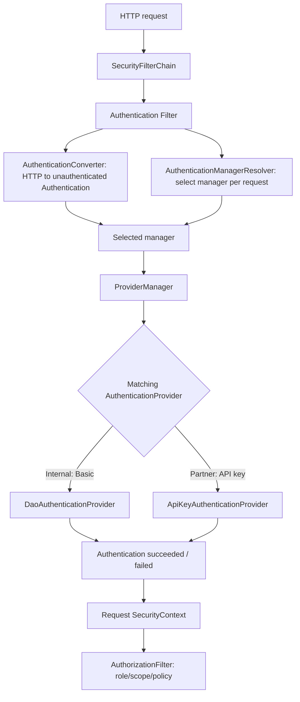

# Selecting an AuthenticationManager Per Request with AuthenticationManagerResolver

## 1. Why Does an Application Need to Select an AuthenticationManager Per Request?

A Spring Security application can receive multiple **authentication methods** at the same time:

- `/api/internal/**`: internal apps sending `Authorization: Basic ...`, verifying username/password with `DaoAuthenticationProvider`.
- `/api/partner/**`: partner systems sending `X-API-Key`, verifying API keys with a dedicated provider.
- A resource server may accept JWTs from multiple issuers, or both JWTs and opaque tokens from different token issuers.

What matters is **which request must be verified by which mechanism**. If all providers sit inside a single manager without clear boundaries, an unintended authentication method could be attempted in an area reserved for another method. `AuthenticationManagerResolver<C>` lets you select the **entire `AuthenticationManager`** based on the request context before calling `authenticate(...)`.

In the Servlet stack, the typical signature is:

```java
AuthenticationManagerResolver<HttpServletRequest> resolver =
    request -> chooseManagerFor(request);
```

This is an **illustrative snippet**, not a standalone program: `chooseManagerFor` is a function you implement yourself. Spring Security 6.x defines the interface conceptually as:

```java
@FunctionalInterface
public interface AuthenticationManagerResolver<C> {
    AuthenticationManager resolve(C context);
}
```

- `C` is the type of context provided when choosing a manager. For Servlet, it is `HttpServletRequest`.
- `resolve(request)` selects a configured `AuthenticationManager` to handle the request.
- The selected manager executes `authenticate(authentication)` on the **unauthenticated** token created by the filter/converter.
- The resolver does **not** verify passwords, signatures, or API keys itself; nor does it replace `AuthorizationManager` in deciding access permissions.

This lesson uses **Java 17+, Spring Boot 3.x with Spring Security 6.x on Servlet/Spring MVC**. For WebFlux/reactive, the corresponding mechanisms are `ReactiveAuthenticationManagerResolver<ServerWebExchange>` and `ReactiveAuthenticationManager`; do not copy Servlet code into reactive apps.

### Learning Outcomes

You will learn how to:

1. Distinguish resolver, manager, provider, filter/converter, and authorization.
2. Select a manager based on trusted URL routes and verify credentials with the right mechanism.
3. Configure **two independent managers** and a filter that queries the resolver on each request.
4. Reject silent fallbacks, tenant spoofing, or overly broad default managers.
5. Use `JwtIssuerAuthenticationManagerResolver` when bearer JWTs come from multiple valid issuers.
6. Test valid and invalid paths for each manager and distinguish 401 from 403.

## 2. Where the Resolver Fits in the Authentication Chain



This diagram illustrates the separation of responsibilities and does not claim every app uses the exact same filter. For example, OAuth2 Resource Server typically uses `BearerTokenAuthenticationFilter`, whereas the two-mechanism example in this lesson uses a custom filter designed for APIs.

| Component | Input | Decision / output |
|---|---|---|
| `SecurityFilterChain` | HTTP request, `securityMatcher` | Selects the **filter set** applied to the request |
| Authentication filter | HTTP request | Reads credentials; creates an unauthenticated `Authentication` |
| `AuthenticationConverter` | HTTP request | Converts Basic/header/bearer into the appropriate authentication token type |
| `AuthenticationManagerResolver<HttpServletRequest>` | HTTP request | Selects the **manager** to invoke for the request |
| `AuthenticationManager` | Unauthenticated `Authentication` | Coordinates verification and returns an authenticated `Authentication` or error |
| `ProviderManager` | `Authentication` | Tries the `AuthenticationProvider` instances configured in the manager |
| `AuthenticationProvider` | Specific token type | Verifies credentials and establishes principal/authorities |
| `SecurityContextHolder` | Successful `Authentication` | Stores user/authorities for processing the current request |
| `AuthorizationManager` / `AuthorizationFilter` | User and requested resource | Grants or denies access |

**One `ProviderManager` can contain multiple providers**, which differs from **having multiple `ProviderManager`s and a resolver picking one manager**:

- One manager containing `DaoAuthenticationProvider` and `JwtAuthenticationProvider` can handle multiple token types, mainly based on `supports(...)`.
- Two separate managers can isolate trust domains, tenants, verification paths, key/issuer sources, fallback behavior, and governance policies.
- The resolver chooses a manager from the **request context** before the manager inspects the token.
- Both approaches can be combined: each selected manager can itself have multiple providers.

### Both Steps Must Be Consistent

If the resolver selects a manager dedicated to checking API keys, while the converter still creates a `UsernamePasswordAuthenticationToken` from a Basic header, the manager will not understand the token or the request will be rejected. A proper design must ensure:

1. **Route → manager** is accurate.
2. **Credential format → token type → provider** matches the selected manager.

The resolver cannot fix a mismatch between the token and the provider.

## 3. When to Use AuthenticationManagerResolver?

### Suitable Scenarios

1. **Multi-tenant authentication**: each tenant has its own issuer/JWKS, user store, or authentication configuration. The manager is selected by a verified tenant or a trusted URL partition.
2. **Multiple authentication methods in one application**: area A requires Basic, area B requires an API key; or a resource server accepts JWTs and opaque tokens depending on determined request conditions.
3. **Partitioned identity sources**: requests for customer/unit A must go through manager A, and B through manager B. This avoids accidentally probing credentials against another source.
4. **Dynamic authentication routing by resource**: select a strategy based on a verified path, system-managed tenant mapping, or allowlisted issuer.

### When Not Needed

- An application only uses username/password login and changes the database: use `UserDetailsService`/`DaoAuthenticationProvider`.
- All endpoints share one manager with a few providers supporting different token types, without needing per-request manager isolation: one `ProviderManager` may suffice.
- You only need “admins can access this URL”: that is **authorization** (`authorizeHttpRequests`, `@PreAuthorize`), not the resolver's job.
- URL areas only need different filter configurations: consider **multiple `SecurityFilterChain`s with `securityMatcher` and `@Order`** first. If each chain has exactly one mechanism and a fixed manager, creating a shared resolver may be unnecessary.
- Only changing JSON responses, cookies, CSRF, or how `SecurityContext` is stored: those are not reasons to introduce a resolver.

## 4. Which Signals Are Safe for Selecting a Manager?

Common data sources:

| Selection signal | Example | Risks / conditions |
|---|---|---|
| URL path processed by router/Security matcher | `/api/internal/**` vs. `/api/partner/**` | Keep URL matching consistent across resolver, filter, and authorization; avoid discrepancies from encoding/normalization/rewriting |
| Tenant bound to an infrastructure-verified subdomain | `a.api.example.org` | Do not trust raw `Host` or `X-Forwarded-Host` if proxies have not verified them |
| JWT issuer `iss` | Issuer A/B | Only allow selecting **trusted issuers**; afterwards verify signature, issuer, timestamps, and audience |
| Client-supplied tenant header | `X-Tenant: acme` | Untrusted data; must be authenticated or bind tenant to real verified claims/identity |
| Credential type or security scheme | Bearer JWT, opaque, API key | Never treat a self-asserted header as proof; the selected provider must verify cryptographically or via an authoritative system |

**Fail-closed principle:** a request that matches no valid zone must **not** fall back to an overly privileged manager, nor return a default successful authentication. If the filter receives a request with missing/invalid credentials, authentication or authorization must reject it according to policy.

**Do not use a manager resolver as an “authorization bypass”:** after the manager finishes authenticating, `hasRole`/`hasAuthority`/tenant scoping must still be enforced. “Successfully authenticating with issuer A” does not mean “allowed to read tenant B's data”.

## 5. Hands-On Example: One Request, Two Mechanisms, Two Managers

We will build a Spring Boot API with two domains:

| URL | Credential | Manager | Provider | Required authority |
|---|---|---|---|---|
| `GET /health` | None | Not called | Not called | Public |
| `GET /api/internal/me` | `Authorization: Basic ...` | `internalManager` | `DaoAuthenticationProvider` | `ROLE_INTERNAL` |
| `GET /api/partner/me` | `X-API-Key: ...` | `partnerManager` | `ApiKeyAuthenticationProvider` | `ROLE_PARTNER` |

The demo is designed to be **stateless**: every API request must carry the appropriate credential, without creating an HTTP session to store login state. All sample endpoints are GET. The example targets server-to-server/CLI clients, not browser login flows that automatically send cookies/Basic credentials.

The goal of this section is a **self-contained local application** without requiring an external Identity Provider. Each of the two managers has its own single provider and **no parent/fallback** to the other manager. This is a training example; production API key management requires dedicated hardening steps.

### 5.1. Dependencies

In a Spring Boot **3.5.x + Spring Security 6.5.x** project with Java 17+ and the Spring Boot Gradle plugin configured, add:

```groovy
dependencies {
    implementation 'org.springframework.boot:spring-boot-starter-web'
    implementation 'org.springframework.boot:spring-boot-starter-security'

    testImplementation 'org.springframework.boot:spring-boot-starter-test'
    testImplementation 'org.springframework.security:spring-security-test'
}
```

The Java files below share package `com.example.managerresolver`. They belong to a built Spring Boot application and do not run standalone with `javac` without Spring libraries.

### 5.2. Main Class

File `src/main/java/com/example/managerresolver/ResolverDemoApplication.java`:

```java
package com.example.managerresolver;

import org.springframework.boot.SpringApplication;
import org.springframework.boot.autoconfigure.SpringBootApplication;

@SpringBootApplication
public class ResolverDemoApplication {
    public static void main(String[] args) {
        SpringApplication.run(ResolverDemoApplication.class, args);
    }
}
```

### 5.3. Creating a Dedicated Token for API Keys

File `src/main/java/com/example/managerresolver/ApiKeyAuthenticationToken.java`:

```java
package com.example.managerresolver;

import java.util.Collection;
import java.util.Collections;
import org.springframework.security.authentication.AbstractAuthenticationToken;
import org.springframework.security.core.GrantedAuthority;

public final class ApiKeyAuthenticationToken
        extends AbstractAuthenticationToken {

    private final Object principal;
    private String apiKey;

    private ApiKeyAuthenticationToken(String rawKey) {
        super(Collections.emptyList());
        this.principal = null;
        this.apiKey = rawKey;
        super.setAuthenticated(false);
    }

    private ApiKeyAuthenticationToken(
            String clientId,
            Collection<? extends GrantedAuthority> authorities) {
        super(authorities);
        this.principal = clientId;
        this.apiKey = null;
        super.setAuthenticated(true);
    }

    public static ApiKeyAuthenticationToken unauthenticated(
            String rawKey) {
        return new ApiKeyAuthenticationToken(rawKey);
    }

    public static ApiKeyAuthenticationToken authenticated(
            String clientId,
            Collection<? extends GrantedAuthority> authorities) {
        return new ApiKeyAuthenticationToken(clientId, authorities);
    }

    @Override
    public Object getPrincipal() {
        return principal;
    }

    @Override
    public Object getCredentials() {
        return apiKey;
    }

    @Override
    public void setAuthenticated(boolean authenticated) {
        if (authenticated) {
            throw new IllegalArgumentException(
                "Only the trusted provider creates authenticated tokens");
        }
        super.setAuthenticated(false);
    }

    @Override
    public void eraseCredentials() {
        super.eraseCredentials();
        this.apiKey = null;
    }
}
```

- `unauthenticated(rawKey)` holds the raw key provided by the request, has **no** identity/authority yet, and `isAuthenticated() == false`.
- `authenticated(clientId, authorities)` is called only by the provider **after successful verification**; it does not retain the raw key.
- Blocking `setAuthenticated(true)` from elsewhere prevents turning client-supplied data into “authenticated”.
- The token is just a **data type**. It does not decide which manager handles it, does not verify the key, and does not authorize URL access.

### 5.4. Provider for the API Key Mechanism

File `src/main/java/com/example/managerresolver/ApiKeyAuthenticationProvider.java`:

```java
package com.example.managerresolver;

import java.nio.charset.StandardCharsets;
import java.security.MessageDigest;
import java.security.NoSuchAlgorithmException;
import org.springframework.security.authentication.AuthenticationProvider;
import org.springframework.security.authentication.BadCredentialsException;
import org.springframework.security.core.Authentication;
import org.springframework.security.core.authority.AuthorityUtils;

public final class ApiKeyAuthenticationProvider
        implements AuthenticationProvider {

    private final byte[] expectedDigest;

    public ApiKeyAuthenticationProvider(String expectedKey) {
        if (expectedKey == null || expectedKey.isBlank()) {
            throw new IllegalStateException(
                "Set DEMO_PARTNER_KEY before starting the app");
        }
        this.expectedDigest = sha256(expectedKey);
    }

    @Override
    public Authentication authenticate(Authentication authentication) {
        if (!(authentication instanceof ApiKeyAuthenticationToken token)) {
            return null;
        }

        String candidate = (String) token.getCredentials();

        if (candidate == null || candidate.isBlank()
                || candidate.length() > 256
                || !MessageDigest.isEqual(
                    sha256(candidate), expectedDigest)) {
            throw new BadCredentialsException("Invalid API key");
        }

        return ApiKeyAuthenticationToken.authenticated(
            "partner-client",
            AuthorityUtils.createAuthorityList("ROLE_PARTNER")
        );
    }

    @Override
    public boolean supports(Class<?> tokenType) {
        return ApiKeyAuthenticationToken.class
            .isAssignableFrom(tokenType);
    }

    private static byte[] sha256(String value) {
        try {
            MessageDigest digest = MessageDigest.getInstance("SHA-256");
            return digest.digest(
                value.getBytes(StandardCharsets.UTF_8));
        } catch (NoSuchAlgorithmException ex) {
            throw new IllegalStateException("SHA-256 unavailable", ex);
        }
    }
}
```

**Why a dedicated provider?** Because `DaoAuthenticationProvider` checks username/password against `UserDetailsService`; it has no knowledge of API key semantics. `ApiKeyAuthenticationProvider` specifically supports `ApiKeyAuthenticationToken`, verifies the key, and grants `ROLE_PARTNER` upon success.

`MessageDigest.isEqual` compares digests in a way that avoids naive string comparison, though the example only demonstrates authentication logic. In production, API keys must have high entropy, be stored/compared using an appropriate hash/HMAC model, distinguish key IDs, support revocation/rotation/expiry, rate limiting, auditing, and never log secrets. Choosing `SHA-256` in the example is meant to illustrate the idea, not serve as a blueprint for storing all production secrets.

### 5.5. Filter: Converting the Request into a Token and Querying the Resolver

File `src/main/java/com/example/managerresolver/ResolvedRequestAuthFilter.java`:

```java
package com.example.managerresolver;

import java.io.IOException;
import jakarta.servlet.FilterChain;
import jakarta.servlet.ServletException;
import jakarta.servlet.http.HttpServletRequest;
import jakarta.servlet.http.HttpServletResponse;
import org.springframework.http.MediaType;
import org.springframework.security.authentication.AuthenticationManager;
import org.springframework.security.authentication.AuthenticationManagerResolver;
import org.springframework.security.authentication.AuthenticationServiceException;
import org.springframework.security.core.Authentication;
import org.springframework.security.core.AuthenticationException;
import org.springframework.security.core.context.SecurityContext;
import org.springframework.security.core.context.SecurityContextHolder;
import org.springframework.security.web.authentication.www.BasicAuthenticationConverter;
import org.springframework.web.filter.OncePerRequestFilter;

public final class ResolvedRequestAuthFilter extends OncePerRequestFilter {

    private final AuthenticationManagerResolver<HttpServletRequest> resolver;
    private final BasicAuthenticationConverter basicConverter =
        new BasicAuthenticationConverter();

    public ResolvedRequestAuthFilter(
            AuthenticationManagerResolver<HttpServletRequest> resolver) {
        this.resolver = resolver;
    }

    // Only uses the path belonging to the demo application context.
    static String applicationPath(HttpServletRequest request) {
        String uri = request.getRequestURI();
        String context = request.getContextPath();
        return uri.startsWith(context)
            ? uri.substring(context.length())
            : "";
    }

    static boolean isInternal(HttpServletRequest request) {
        return applicationPath(request).startsWith("/api/internal/");
    }

    static boolean isPartner(HttpServletRequest request) {
        return applicationPath(request).startsWith("/api/partner/");
    }

    @Override
    protected void doFilterInternal(
            HttpServletRequest request,
            HttpServletResponse response,
            FilterChain chain) throws ServletException, IOException {

        boolean internal = isInternal(request);
        boolean partner = isPartner(request);

        if (!internal && !partner) {
            chain.doFilter(request, response);
            return;
        }

        Authentication presented;
        try {
            if (internal) {
                // Basic header present -> UsernamePasswordAuthenticationToken.
                presented = basicConverter.convert(request);
            } else {
                String key = request.getHeader("X-API-Key");
                presented = key == null || key.isBlank()
                    ? null : ApiKeyAuthenticationToken.unauthenticated(key);
            }
        } catch (AuthenticationException ex) {
            unauthorized(response);
            return;
        }

        // No credentials: AuthorizationFilter + entry point will reject.
        if (presented == null) {
            chain.doFilter(request, response);
            return;
        }

        Authentication verified;
        try {
            AuthenticationManager manager = resolver.resolve(request);
            if (manager == null) {
                throw new AuthenticationServiceException(
                    "No authentication manager for request");
            }
            verified = manager.authenticate(presented);
            if (verified == null || !verified.isAuthenticated()) {
                throw new AuthenticationServiceException(
                    "Manager did not authenticate request");
            }
        } catch (AuthenticationException ex) {
            SecurityContextHolder.clearContext();
            unauthorized(response);
            return;
        }

        SecurityContext context =
            SecurityContextHolder.createEmptyContext();
        context.setAuthentication(verified);
        SecurityContextHolder.setContext(context);

        try {
            chain.doFilter(request, response);
        } finally {
            SecurityContextHolder.clearContext();
        }
    }

    private static void unauthorized(HttpServletResponse response)
            throws IOException {
        response.setStatus(HttpServletResponse.SC_UNAUTHORIZED);
        response.setContentType(MediaType.APPLICATION_JSON_VALUE);
        response.getWriter().write("{\"error\":\"unauthorized\"}");
    }
}
```

Step-by-step execution explanation:

1. The filter only applies the demo mechanism to `/api/internal/**` or `/api/partner/**`. Other requests continue through the chain and remain subject to authorization.
2. For the internal branch, Spring Security's `BasicAuthenticationConverter` converts `Authorization: Basic ...` into an unauthenticated username/password token. Malformed or invalidly encoded headers are not treated as successful logins.
3. For the partner branch, the filter reads `X-API-Key` and creates an unauthenticated `ApiKeyAuthenticationToken`.
4. **`resolver.resolve(request)` determines the manager**, rather than trying both managers in sequence.
5. Only when the manager returns a successful authentication result does the filter place `Authentication` into a fresh `SecurityContext`.
6. `AuthorizationFilter` then evaluates `ROLE_INTERNAL` or `ROLE_PARTNER`.
7. The demo does not store the context in an HTTP session; once the request finishes, the context is cleared. Clients must resend credentials on subsequent requests.

Computing the path from `requestURI` minus `contextPath` works for a local demo running under the context root. When behind a reverse proxy, with encoded paths, URL rewriting, or complex context paths, use the same verified/normalized `RequestMatcher` strategy across the filter chain and authorization, and test path variants. **Do not** let these three layers interpret URLs in three different ways.

The filter catches `AuthenticationException` during conversion/verification and returns a generic `401`. Missing credentials are left for `ExceptionTranslationFilter` and the entry point to handle. Do not catch `AuthenticationException` from the entire downstream application and pretend it is always an invalid credential.

### 5.6. Configuring Two AuthenticationManagers and the Resolver

File `src/main/java/com/example/managerresolver/SecurityConfig.java`:

```java
package com.example.managerresolver;

import jakarta.servlet.http.HttpServletRequest;
import org.springframework.beans.factory.annotation.Qualifier;
import org.springframework.beans.factory.annotation.Value;
import org.springframework.context.annotation.Bean;
import org.springframework.context.annotation.Configuration;
import org.springframework.http.HttpStatus;
import org.springframework.security.authentication.AuthenticationManager;
import org.springframework.security.authentication.AuthenticationManagerResolver;
import org.springframework.security.authentication.AuthenticationServiceException;
import org.springframework.security.authentication.ProviderManager;
import org.springframework.security.authentication.dao.DaoAuthenticationProvider;
import org.springframework.security.config.annotation.web.builders.HttpSecurity;
import org.springframework.security.config.annotation.web.configuration.EnableWebSecurity;
import org.springframework.security.config.annotation.web.configurers.AbstractHttpConfigurer;
import org.springframework.security.config.http.SessionCreationPolicy;
import org.springframework.security.core.userdetails.User;
import org.springframework.security.core.userdetails.UserDetailsService;
import org.springframework.security.crypto.bcrypt.BCryptPasswordEncoder;
import org.springframework.security.crypto.password.PasswordEncoder;
import org.springframework.security.provisioning.InMemoryUserDetailsManager;
import org.springframework.security.web.SecurityFilterChain;
import org.springframework.security.web.authentication.AnonymousAuthenticationFilter;
import org.springframework.security.web.authentication.HttpStatusEntryPoint;
import org.springframework.security.web.context.NullSecurityContextRepository;

@Configuration
@EnableWebSecurity
public class SecurityConfig {

    @Bean
    PasswordEncoder passwordEncoder() {
        return new BCryptPasswordEncoder();
    }

    @Bean("internalManager")
    AuthenticationManager internalManager(PasswordEncoder encoder) {
        UserDetailsService users = new InMemoryUserDetailsManager(
            User.withUsername("alice")
                .password(encoder.encode("alice-secret"))
                .roles("INTERNAL")
                .build()
        );

        DaoAuthenticationProvider provider =
            new DaoAuthenticationProvider(users);
        provider.setPasswordEncoder(encoder);

        return new ProviderManager(provider);
    }

    @Bean("partnerManager")
    AuthenticationManager partnerManager(
            @Value("${DEMO_PARTNER_KEY:}") String key) {
        return new ProviderManager(
            new ApiKeyAuthenticationProvider(key));
    }

    @Bean
    AuthenticationManagerResolver<HttpServletRequest> requestManagerResolver(
            @Qualifier("internalManager") AuthenticationManager internal,
            @Qualifier("partnerManager") AuthenticationManager partner) {

        return request -> {
            if (ResolvedRequestAuthFilter.isInternal(request)) {
                return internal;
            }
            if (ResolvedRequestAuthFilter.isPartner(request)) {
                return partner;
            }
            throw new AuthenticationServiceException(
                "No manager for request route");
        };
    }

    @Bean
    SecurityFilterChain securityFilterChain(
            HttpSecurity http,
            AuthenticationManagerResolver<HttpServletRequest> resolver)
            throws Exception {

        http
            .authorizeHttpRequests(auth -> auth
                .requestMatchers("/health", "/error").permitAll()
                .requestMatchers("/api/internal/**").hasRole("INTERNAL")
                .requestMatchers("/api/partner/**").hasRole("PARTNER")
                .anyRequest().denyAll()
            )
            .sessionManagement(session -> session
                .sessionCreationPolicy(SessionCreationPolicy.STATELESS)
            )
            .securityContext(context -> context
                .securityContextRepository(
                    new NullSecurityContextRepository())
            )
            .exceptionHandling(errors -> errors
                .authenticationEntryPoint(
                    new HttpStatusEntryPoint(HttpStatus.UNAUTHORIZED))
            )
            .httpBasic(AbstractHttpConfigurer::disable)
            .formLogin(AbstractHttpConfigurer::disable)
            .csrf(AbstractHttpConfigurer::disable)
            .addFilterBefore(
                new ResolvedRequestAuthFilter(resolver),
                AnonymousAuthenticationFilter.class
            );

        return http.build();
    }
}
```

**Three configuration decisions that shape the example:**

- `internalManager` is a `ProviderManager` containing **`DaoAuthenticationProvider`**. Credentials come from Basic auth and are matched against a local user; success grants `ROLE_INTERNAL`.
- `partnerManager` is a `ProviderManager` containing **`ApiKeyAuthenticationProvider`**. Credentials are an API key without using `UserDetailsService`; success grants `ROLE_PARTNER`.
- `requestManagerResolver` selects **one** of the two managers by request path. There is no default manager for out-of-scope routes; other routes are handled by the corresponding authorization policy.

The remaining parts:

- `SecurityFilterChain` has a valid filter order: the custom filter runs before `AnonymousAuthenticationFilter` and `AuthorizationFilter`, after Spring Security's basic security context creation/loading mechanism.
- `hasRole("INTERNAL")` checks `ROLE_INTERNAL`; `hasRole("PARTNER")` checks `ROLE_PARTNER`.
- `STATELESS` and `NullSecurityContextRepository` keep the example per-request without creating sessions to retain authentication.
- `httpBasic(...disable)` disables the default **BasicAuthenticationFilter** so a global Basic manager does not intercept requests outside the resolver flow. The custom filter still uses **BasicAuthenticationConverter** to parse standard Basic headers.
- `formLogin(...disable)` avoids creating an unrelated login page and form-processing filter.
- `HttpStatusEntryPoint` returns `401` for unauthenticated requests; the demo configuration does not automatically send `WWW-Authenticate: Basic realm=...`. If an HTTP Basic client needs a browser challenge, configure a per-route entry point to issue the proper challenge; that is an HTTP response responsibility, not the resolver's.
- `csrf(...disable)` is appropriate only here because the demo uses API headers sent explicitly by server clients, not automatically attached browser cookies/sessions. For browser-based web apps using Basic or cookies, analyze CSRF and typically retain appropriate protection; `STATELESS` does not eliminate CSRF by itself.

**Intentional limitations:** Alice's account and demo password are in memory only; the API key comes from an environment variable; there is no key issuance/rotation/revocation flow. These parts do not belong to manager selection.

### 5.7. Endpoint to Observe the Authenticated Principal

File `src/main/java/com/example/managerresolver/WhoAmIController.java`:

```java
package com.example.managerresolver;

import java.util.Map;
import org.springframework.security.core.Authentication;
import org.springframework.web.bind.annotation.GetMapping;
import org.springframework.web.bind.annotation.RestController;

@RestController
public class WhoAmIController {

    @GetMapping("/health")
    public Map<String, String> health() {
        return Map.of("status", "up");
    }

    @GetMapping("/api/internal/me")
    public Map<String, String> internal(Authentication authentication) {
        return Map.of(
            "kind", "internal",
            "subject", authentication.getName()
        );
    }

    @GetMapping("/api/partner/me")
    public Map<String, String> partner(Authentication authentication) {
        return Map.of(
            "kind", "partner",
            "subject", authentication.getName()
        );
    }
}
```

The controller only receives `Authentication` from SecurityContext after the filter and manager have authenticated it; it does not inspect HTTP headers directly to trust a username/partner. This cleanly separates **manager selection** from the **business endpoint**.

### 5.8. Running the Example

On Bash/Linux/macOS, set the demo API key and start the application:

```bash
export DEMO_PARTNER_KEY='partner-local-key'
./gradlew bootRun
```

On Windows PowerShell:

```powershell
$env:DEMO_PARTNER_KEY = 'partner-local-key'
.\gradlew.bat bootRun
```

In a second terminal, test each call in turn:

```bash
# Public
curl -i http://localhost:8080/health

# Internal requires Basic
curl -i http://localhost:8080/api/internal/me
curl -i -u alice:alice-secret \
  http://localhost:8080/api/internal/me

# Partner requires API key
curl -i http://localhost:8080/api/partner/me
curl -i -H 'X-API-Key: partner-local-key' \
  http://localhost:8080/api/partner/me

# Send wrong credential type for each route
curl -i -H 'X-API-Key: partner-local-key' \
  http://localhost:8080/api/internal/me
curl -i -u alice:alice-secret \
  http://localhost:8080/api/partner/me

# Invalid credentials
curl -i -u alice:wrong \
  http://localhost:8080/api/internal/me
curl -i -H 'X-API-Key: wrong' \
  http://localhost:8080/api/partner/me
```

| Call | Expected HTTP status | Evidence to observe |
|---|---|---|
| `GET /health` | `200` | JSON containing `status=up` |
| Internal without Basic | `401` | Unauthenticated |
| Internal with valid Basic | `200` | JSON containing `kind=internal` and `subject=alice` |
| Partner without key | `401` | Unauthenticated |
| Partner with valid key | `200` | JSON containing `kind=partner` and `subject=partner-client` |
| Partner key sent to internal | `401` | Resolver/filter does not switch mechanisms to accept the key |
| Internal Basic sent to partner | `401` | Basic is not used to authenticate partners |
| Wrong Basic password or wrong API key | `401` | No trusted Authentication created |

Do not assert JSON by matching **key order**: `Map.of(...)` does not guarantee serialization order. When writing tests, assert individual fields via JSONPath. Because the demo uses GET and resends credentials on every request, no `Set-Cookie` is required for login.

**Security note:** HTTP Basic only Base64-encodes username/password; running the example over plain HTTP is only acceptable on localhost for learning. Production systems must use HTTPS, avoid logging raw `Authorization`/`X-API-Key`, and avoid passing real secrets through command history.

## 6. Testing Manager Selection with Real Requests

Add `src/test/java/com/example/managerresolver/AuthenticationManagerResolverTest.java`:

```java
package com.example.managerresolver;

import org.junit.jupiter.api.Test;
import org.springframework.beans.factory.annotation.Autowired;
import org.springframework.boot.test.autoconfigure.web.servlet.AutoConfigureMockMvc;
import org.springframework.boot.test.context.SpringBootTest;
import org.springframework.test.web.servlet.MockMvc;

import static org.springframework.security.test.web.servlet.request
    .SecurityMockMvcRequestPostProcessors.httpBasic;
import static org.springframework.test.web.servlet.request
    .MockMvcRequestBuilders.get;
import static org.springframework.test.web.servlet.result
    .MockMvcResultMatchers.jsonPath;
import static org.springframework.test.web.servlet.result
    .MockMvcResultMatchers.status;

@SpringBootTest(properties = "DEMO_PARTNER_KEY=test-partner-key")
@AutoConfigureMockMvc
class AuthenticationManagerResolverTest {

    @Autowired
    MockMvc mvc;

    @Test
    void internalRouteUsesPasswordManager() throws Exception {
        mvc.perform(get("/api/internal/me")
                .with(httpBasic("alice", "alice-secret")))
            .andExpect(status().isOk())
            .andExpect(jsonPath("$.subject").value("alice"))
            .andExpect(jsonPath("$.kind").value("internal"));
    }

    @Test
    void partnerRouteUsesApiKeyManager() throws Exception {
        mvc.perform(get("/api/partner/me")
                .header("X-API-Key", "test-partner-key"))
            .andExpect(status().isOk())
            .andExpect(jsonPath("$.subject").value("partner-client"))
            .andExpect(jsonPath("$.kind").value("partner"));
    }

    @Test
    void apiKeyCannotEnterInternalRoute() throws Exception {
        mvc.perform(get("/api/internal/me")
                .header("X-API-Key", "test-partner-key"))
            .andExpect(status().isUnauthorized());
    }

    @Test
    void basicCannotEnterPartnerRoute() throws Exception {
        mvc.perform(get("/api/partner/me")
                .with(httpBasic("alice", "alice-secret")))
            .andExpect(status().isUnauthorized());
    }

    @Test
    void invalidCredentialsAreRejected() throws Exception {
        mvc.perform(get("/api/internal/me")
                .with(httpBasic("alice", "wrong")))
            .andExpect(status().isUnauthorized());

        mvc.perform(get("/api/partner/me")
                .header("X-API-Key", "wrong"))
            .andExpect(status().isUnauthorized());
    }

    @Test
    void missingCredentialsAreRejected() throws Exception {
        mvc.perform(get("/api/internal/me"))
            .andExpect(status().isUnauthorized());

        mvc.perform(get("/api/partner/me"))
            .andExpect(status().isUnauthorized());
    }

    @Test
    void publicHealthDoesNotNeedCredentials() throws Exception {
        mvc.perform(get("/health"))
            .andExpect(status().isOk())
            .andExpect(jsonPath("$.status").value("up"));
    }
}
```

Run `./gradlew test` or `.\gradlew.bat test` on Windows. `spring-security-test` provides `httpBasic(...)` to generate Basic headers in MockMvc. The most important test for a resolver **is not only** that “valid credentials return 200”, but that **valid credentials for mechanism A cannot unlock resources meant for mechanism B**.

Additional tests needed before going to production:

- Special URLs: trailing slashes, encoded paths, path traversal/canonicalization, nested servlet contexts, reverse proxy rewriting.
- Requests carrying both credential types simultaneously or duplicate headers, oversized headers, empty/malformed keys.
- When multiple `SecurityFilterChain`s exist: which chain matches the route, which filter runs, which manager is selected.
- Users with multiple authorities: `403` for resources beyond their permissions, even when authentication succeeds.
- Session/anonymous context: no identity leakage to another request in the thread pool.
- Default fallback configuration must be fail-closed; never “fall back” to a manager with a broader trust domain.

## 7. Standard Spring Security Variant: JWTs from Multiple Issuers

The previous example built a custom filter to make the `resolve(...)` call visible. However, for OAuth2 Resource Server, **Spring Security already provides `BearerTokenAuthenticationFilter` using `AuthenticationManagerResolver<HttpServletRequest>`**, so you normally do not need to write a new filter.

A resource server may trust JWTs from two different token-issuing systems. Each issuer has its own signing keys, metadata, issuer validation, and potentially distinct audiences/scopes. When selecting by `iss`, use the built-in `JwtIssuerAuthenticationManagerResolver`.

### 7.1. Configuration Using a Trusted Issuer List

Add the starter (matching the Spring Boot 3.x example):

```groovy
dependencies {
    implementation 'org.springframework.boot:spring-boot-starter-web'
    implementation 'org.springframework.boot:spring-boot-starter-security'
    implementation 'org.springframework.boot:spring-boot-starter-oauth2-resource-server'
}
```

In a **separate resource server application**, a sample `SecurityFilterChain` looks like this (this is a **standalone variant**, not to be added to the API key demo's SecurityConfig):

```java
package com.example.jwtresolver;

import org.springframework.context.annotation.Bean;
import org.springframework.context.annotation.Configuration;
import org.springframework.security.config.annotation.web.builders.HttpSecurity;
import org.springframework.security.oauth2.server.resource.authentication
    .JwtIssuerAuthenticationManagerResolver;
import org.springframework.security.web.SecurityFilterChain;

@Configuration
public class JwtResourceServerConfig {

    @Bean
    SecurityFilterChain jwtApi(HttpSecurity http) throws Exception {
        var resolver = JwtIssuerAuthenticationManagerResolver
            .fromTrustedIssuers(
                "https://idp.example.org/tenant-a",
                "https://idp.example.org/tenant-b"
            );

        http
            .authorizeHttpRequests(auth -> auth
                .anyRequest().authenticated())
            .oauth2ResourceServer(oauth2 -> oauth2
                .authenticationManagerResolver(resolver));

        return http.build();
    }
}
```

Java note: a standard `import` **must sit on a single line**, without breaking right before the class name. Write the full import line like this in your IDE:

```java
import org.springframework.security.oauth2.server.resource.authentication.JwtIssuerAuthenticationManagerResolver;
```

The URIs `https://idp.example.org/...` are **placeholder examples**; to test for real, replace them with issuers from a running identity system that provides discovery/JWKS and issue validly signed JWTs. The config snippet compiles with the right dependencies, but cannot validate tokens from placeholder issuers.

Actual flow:

1. The client calls the API with `Authorization: Bearer <jwt>`.
2. `BearerTokenAuthenticationFilter` extracts the token and passes `HttpServletRequest` to the resolver.
3. `JwtIssuerAuthenticationManagerResolver` reads `iss` from the JWT to **select** the corresponding manager **only within the trusted issuer set**.
4. That issuer's manager/provider verifies the signature with the appropriate keys, expiry/`nbf`, issuer, and configured validators.
5. On success, the result enters `SecurityContext`; authorization continues checking scopes/roles/tenant.

**Crucial:** `iss` at the moment it is read to select the manager **is not yet cryptographically verified data**. The resolver may only select issuers from a **trusted allowlist**; afterwards, the corresponding `JwtDecoder` must verify the JWT. Never do this:

```java
// DANGEROUS: never create a decoder for an arbitrary issuer
// supplied by the client without verifying that the issuer is allowed.
String issuer = readUntrustedIssuer(request);
JwtDecoder decoder = JwtDecoders.fromIssuerLocation(issuer);
```

This is an **anti-pattern**, not an implementation approach. It can cause the server to query metadata/JWKS at an attacker-controlled endpoint and accept an unintended trust domain. If the tenant list changes dynamically, load issuers and validation configs from a governed/approved tenant registry, control caching and invalidation, and never accept arbitrary addresses from the client.

### 7.2. Verifying Audience and Tenant Boundaries

A valid signature and matching `iss` are **not sufficient** in all systems:

- `aud` must contain the resource/API for which the token was issued, per the authorization server contract.
- `exp`, `nbf`, and the signing algorithm must be validated.
- Scopes/roles must be mapped accurately; `SCOPE_read` differs from `ROLE_ADMIN`.
- If two tenants have separate routes/data, a token from tenant A must not access tenant B merely because both issuers are in the trusted list. Cross-check the request's tenant against the verified issuer/claims.
- Do not take `kid`, `jku`, issuer, or host from unverified payloads/headers to fetch arbitrary keys unrestrictedly.

Depending on configuration, `JwtIssuerAuthenticationManagerResolver` may need to parse the JWT to read the issuer first, and then the decoder parses/verifies it again. This trade-off is documented by Spring Security; only optimize at the Nimbus/JWK selector level if performance demands it and you fully understand the trust mechanics.

### 7.3. Choosing Between JWT and Opaque Token Per Request

An application can use `JwtAuthenticationProvider` for one branch and `OpaqueTokenAuthenticationProvider` for another. Conceptually:

```java
AuthenticationManagerResolver<HttpServletRequest> resolver =
    request -> useJwtForTrustedRoute(request)
        ? jwtAuthenticationManager
        : opaqueTokenAuthenticationManager;
```

This is an **illustrative snippet**, because `useJwtForTrustedRoute` and both managers must be properly defined. Once the appropriate managers are built, attach the resolver to the DSL:

```java
http.oauth2ResourceServer(oauth2 ->
    oauth2.authenticationManagerResolver(resolver)
);
```

Key point: both JWT and opaque tokens can use `Authorization: Bearer`, so **merely seeing the word “Bearer” is not enough to choose how to verify it**. The selection condition must be decided by your trust architecture (for instance, a verified route/tenant), not guessed from a token that could be forged.

## 8. Distinguishing Resolver, Multiple SecurityFilterChains, and One ProviderManager

| Problem | Typically suitable mechanism | Why |
|---|---|---|
| One username/password store, one login flow | `DaoAuthenticationProvider` + `UserDetailsService` | Only one authentication method |
| One API accepting multiple token types differing only by `supports(...)` | One `ProviderManager` with multiple providers | The manager can dispatch by token type |
| Two URL areas needing different filters/CSRF/sessions | Multiple `SecurityFilterChain`s + `securityMatcher` | Need to separate the **entire filter configuration** |
| One filter needing to choose a provider manager by path/tenant | `AuthenticationManagerResolver<HttpServletRequest>` | Selects the manager within the same filter mechanism |
| Resource server accepting JWTs from multiple issuers | `JwtIssuerAuthenticationManagerResolver` | Built-in issuer/trusted-issuers logic |
| One authenticated user needing different access policies | `authorizeHttpRequests`/`AuthorizationManager` | This is authorization |
| Remembering a session login after a JSON POST | `SecurityContextRepository.saveContext(...)` | This is persistence, not a resolver |

For example, three different designs can all be valid depending on scope:

- **Chain A + Chain B:** each chain has a static manager, distinct matchers, and possibly different CSRF/session/filters.
- **One chain + resolver:** the filters stay the same, while the manager varies per request (especially in resource servers).
- **One chain + one multi-provider manager:** providers are selected via `supports(Authentication.class)` when sharing a trust domain.

Do not pick a tool just because it can do the job. Start with the question: *“What changes per request: the filter set, the manager, the provider, or the authorization rules?”*

## 9. Common Mistakes and How to Diagnose Them

### 9.1. Resolver Picks the Right Manager, but the Token Is the Wrong Type

If the filter creates a `UsernamePasswordAuthenticationToken`, a manager containing only `ApiKeyAuthenticationProvider` will have no matching provider and may throw `ProviderNotFoundException`. Check the **token class entering `authenticate(...)`** along with each provider's `supports(...)`.

### 9.2. Creating a Resolver Bean Without Wiring It Into Authentication

An `AuthenticationManagerResolver` bean **does not automatically replace every filter's manager**. You must pass it into a filter that supports a resolver, such as:

- `BearerTokenAuthenticationFilter` via `oauth2ResourceServer(...authenticationManagerResolver(...))`.
- `AuthenticationFilter` via its constructor taking a resolver and `AuthenticationConverter`.
- A custom filter like the example, calling `resolver.resolve(request)` and then `authenticate(...)`.

With `AuthenticationFilter`, pay attention to success/failure handlers and `SecurityContextRepository`: by default this filter **does not automatically save the context across sessions**. Do not use it to establish long-lived login cookies without configuring an appropriate persistence/session strategy.

### 9.3. Self-Asserted Client Headers Used as a Source of Trust

`X-Tenant: admin` does not prove the client belongs to the admin tenant. `Host`/`X-Forwarded-Host` can be spoofed if proxies do not control them. With JWTs, the `iss` claim is unverified when the resolver first reads it. Route only to **allowlisted authentication sources**, and cross-check identity/tenant from the verified result before granting access.

### 9.4. Falling Back to an Overly Powerful “Default” Manager

A resolver that returns a manager holding every provider and every tenant when no match is found defeats partitioning. Fail closed on out-of-scope routes, explicitly verify default policies, and constrain `ProviderManager` fallbacks (including parent managers if any).

### 9.5. Forgetting to Distinguish Authentication from Authorization

Signing in successfully via manager A without having the required permission → `403`. Missing/invalid credentials → usually `401`. Endpoint checks like `.hasRole(...)` do not belong to the resolver, and selecting manager B does not automatically grant `ROLE_B` unless the provider verifies and issues trusted authorities.

### 9.6. Confusing Filter Ordering with Manager Ordering

A filter placed **after** `AuthorizationFilter` may authenticate too late. A custom filter registered twice (both as a Spring Boot Servlet `Filter` bean and in the Spring Security chain) can execute twice. When debugging, inspect DEBUG filter chain logs to see which matcher hit, which token/converter ran, which manager the resolver returned, and which provider authenticated.

### 9.7. Trying to Persist Logins with a Resolver

A resolver chooses where to **verify credentials**; it has no responsibility for saving sessions. Stateless APIs send credentials every time; session logins need an appropriate `SecurityContextRepository`/`SessionAuthenticationStrategy`. Spring Security 6 uses explicit saving for manual authentication.

### Symptom Table

| Symptom | Likely cause to check |
|---|---|
| `ProviderNotFoundException` | Token type is not supported by the selected manager |
| Request A accidentally uses manager B | Path/matcher, proxy rewrite, resolver mapping |
| Unknown-issuer token still triggers a network lookup | Resolver trusts client-supplied issuer, missing allowlist |
| `401` despite valid credentials | Wrong manager, provider error, key/issuer/audience, header format |
| `403` despite being authenticated | Insufficient role/scope/tenant policy |
| Basic still logs into a route meant only for API keys | Default Basic filter present or unexpected manager fallback |
| App has multiple chains but resolver never runs | Request matches a different chain or filter does not use the resolver |
| `SecurityContext` has a user inside the filter but not on the next request | Stateless/no session saved; normal in the demo |
| Runtime error on a previously unseen route | Lazy manager/JWT decoder initialization; must test all allowed tenants/issuers |

## 10. Safe Implementation Checklist

- [ ] Clearly identified the manager selection signal and its source of trust.
- [ ] Filter/converter creates the right token type for each mechanism.
- [ ] `AuthenticationManagerResolver<HttpServletRequest>` picks a configured manager rather than creating unbounded new managers from client input.
- [ ] Each manager has its own providers with proper `supports(...)`; parent/fallback policies checked.
- [ ] No default path falls back to a stronger mechanism or a manager accepting all tenants.
- [ ] Authorization enforces roles/scopes and tenant binding **after** authentication.
- [ ] `SecurityFilterChain`, custom filter, and resolver interpret the request path consistently after proxy/normalization.
- [ ] For JWT: issuer allowlist, verify signature/algorithm, issuer, timestamps, audience, authorization.
- [ ] For API key/Basic: HTTPS, log masking, secret rotation, rate limiting, CSRF policy suited to client type.
- [ ] Tested combinations of **valid route + valid credential**, **valid credential + wrong route**, missing/invalid credentials, different roles, special paths, and missing manager.
- [ ] Safe telemetry monitoring: route category, non-sensitive manager identifier, outcome, and correlation ID; never log raw tokens/passwords/API keys.

**Remember:** `AuthenticationManagerResolver` answers **“Which AuthenticationManager should this request be sent to?”**. `AuthenticationProvider` answers **“Are the credentials in this token valid?”**. `AuthorizationManager` answers **“Is this authenticated identity allowed to perform the requested action?”**

### Official Documentation

- [Spring Security 6.5 — Authentication Architecture](https://docs.spring.io/spring-security/reference/6.5/servlet/authentication/architecture.html)
- [Spring Security 6.5 — OAuth2 Resource Server Multi-tenancy](https://docs.spring.io/spring-security/reference/6.5/servlet/oauth2/resource-server/multitenancy.html)
- [Spring Security 6.5 — AuthenticationManagerResolver API](https://docs.spring.io/spring-security/reference/6.5/api/java/org/springframework/security/authentication/AuthenticationManagerResolver.html)
- [Spring Security 6.5 — JWT issuer AuthenticationManagerResolver API](https://docs.spring.io/spring-security/reference/6.5/api/java/org/springframework/security/oauth2/server/resource/authentication/JwtIssuerAuthenticationManagerResolver.html)
- [Spring Security 6.5 — Servlet Security Filters](https://docs.spring.io/spring-security/reference/6.5/servlet/architecture.html)
- [Spring Security 6.5 — Session & SecurityContext persistence](https://docs.spring.io/spring-security/reference/6.5/servlet/authentication/session-management.html)
