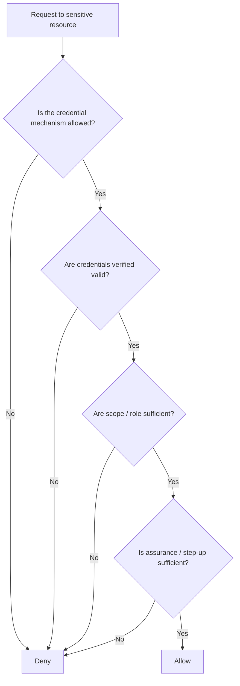

# Preventing Weaker Mechanisms from Becoming Policy-Bypass Fallbacks

**Parent topic: Multiple Authentication Mechanisms — Spring Security (Servlet).**

In an application supporting HTTP Basic, form/session, Bearer JWT, API keys, and possibly MFA, **one mechanism authenticating successfully** does not mean the request satisfies the **assurance level** required by a sensitive resource. This lesson explains how to prevent *authentication downgrade*: weaker credentials accidentally becoming a bypass to access an endpoint meant only for a stronger mechanism.

After this lesson, learners should be able to: write a per-resource policy matrix; explain `FilterChainProxy`, `SecurityFilterChain`, `AuthenticationProvider`, `ProviderManager`, and the differences between authentication, authorization, and assurance; configure isolated security zones; and write negative tests proving that Basic, cookies, or legacy API keys cannot unlock Bearer/MFA endpoints.

## 1. The Risk: Valid Login at the Wrong Authentication Level

Suppose a system has these flows:

| Resource | Allowed mechanism | Additional conditions |
| --- | --- | --- |
| `GET /legacy/status` | HTTP Basic for legacy accounts | Read-only, role `LEGACY` |
| `GET /api/strong/report` | Bearer access token from a trusted issuer | Valid token, matching audience, scope `high.read` |
| `POST /admin/transfer` | Admin session with MFA/step-up completed | Admin role, assurance and re-authentication recency meet policy |

Failure scenario: an account holding the admin role with only a password can still reach `/admin/transfer`, because the server only checks `hasRole("ADMIN")`. Another case: a new API is intended to require Bearer tokens yet still enables HTTP Basic; valid Basic becomes an alternate entry into the same endpoint.

```java
// ANTI-PATTERN: one chain accepts both Basic and JWT,
// while the endpoint requires JWT with a specific policy.
http.httpBasic(Customizer.withDefaults())
    .oauth2ResourceServer(oauth2 -> oauth2.jwt(Customizer.withDefaults()))
    .authorizeHttpRequests(auth -> auth
        .requestMatchers("/api/strong/**").authenticated());
```

The `authenticated()` condition only checks that Spring Security holds a valid `Authentication`. If the Basic filter builds an `Authentication`, the endpoint can be accepted **without Bearer**. This bypasses the mechanism-classification policy even though the user did not supply a wrong password.

We must distinguish:

- **Identity:** which principal has been verified?
- **Credential/mechanism:** was the identity verified via password, session cookie, API key, or token?
- **Authorization:** what is the principal permitted to do, on which resource?
- **Assurance:** did the authentication process meet requirements such as MFA, phishing resistance, or recency?

A properly signed JWT does not **implicitly** prove MFA was used. Conversely, a session can achieve high assurance if the server records and checks a trustworthy MFA step. The terms “strong/weak” must be defined by the application's **policy and threat model**, not merely by technology names.

## 2. Writing Policies That Cannot Be Interpreted as “Any Credential Works”

Sample policy for the report endpoint:

> `GET /api/strong/report` accepts only a Bearer access token verified by the resource server, from a trusted issuer, with valid audience and lifetime, and holding authority `SCOPE_high.read`. Basic/cookie/API keys cannot substitute. Invalid or expired Bearer tokens must be rejected without trying another weaker credential to continue.

If the API requires MFA, add issuer- or server-verified assurance conditions (such as `acr`, `amr`, `auth_time` per contract) rather than concluding “having a scope implies MFA”.

A **four-gate** policy:



If a resource only requires a verified Bearer token without MFA, the assurance gate may not apply. Even so, each endpoint's rule must be **explicitly stated**. A bare `authenticated()` cannot replace the full policy.

### Per-Resource Policy Matrix

| Request | `/legacy/status` | `/api/strong/report` | `/admin/transfer` |
| --- | --- | --- | --- |
| Anonymous | Deny | Deny | Deny |
| Valid Basic for legacy | Allow read | Deny | Deny |
| Session cookie without MFA | Does not substitute for Basic | Deny (Bearer-only) | Deny |
| Legacy API key | Deny unless permitted | Deny | Deny |
| Valid Bearer missing `high.read` | Does not substitute for Basic | Deny (`403` typical) | Depends on dedicated policy, not granted automatically |
| Valid Bearer with `high.read` | Does not substitute for Basic | Allow | Does not automatically prove MFA |
| Admin session with valid MFA | Does not automatically substitute for Basic | Does not substitute for Bearer | Allow if permissions and other constraints pass |

`401` usually indicates missing or invalid authentication; `403` usually indicates authenticated identity lacking sufficient permissions. Entry points and handlers can be customized, so verify **the policy outcome, identity, and actual mechanism used**, not just the status code.

## 3. Common Bypasses When Multiple Mechanisms Are Enabled

### 3.1. Same Chain Accepts Both Basic and Bearer

In a chain containing both `httpBasic()` and `oauth2ResourceServer().jwt()`, each filter can authenticate a different credential type. If the rule only requires `authenticated()`, a valid Basic credential can suffice even though the API design intended Bearer. **Fix:** chains for Bearer-only resources must not enable Basic, form login, or cookie mechanisms, and must enforce specific scopes.

### 3.2. Broken Bearer Automatically Falls Back to Session/API Key in Middleware

Faulty flow example:

```text
GET /api/strong/report
  Authorization: Bearer <invalid-or-expired>
  Cookie: JSESSIONID=<old-session>

  -> JWT validation fails
  -> custom code catches the error
  -> falls back to session
  -> user is treated as logged in
  -> request passes "authenticated()"
```

For a Bearer-only endpoint, this is a bypass. **Fix:** an invalid Bearer token must terminate with the appropriate failure. Never write `catch (JwtException ...)` to “rescue” the request with another credential. Rules for duplicate/mixed `Authorization` headers must also be explicit; never arbitrarily pick the most permissive credential.

### 3.3. `ProviderManager` Trying Multiple AuthenticationProviders

`ProviderManager` typically iterates through providers capable of handling the input `Authentication` type. `supports(Class<?>)` only indicates the provider **can inspect** that token class; it may still return `null` if undecided. When multiple providers support the same type, a later provider can **authenticate successfully even if an earlier provider threw `BadCredentialsException`**. A later success can override an earlier failure; certain account-status exceptions follow special short-circuit rules.

Faulty design example:

```text
Strong provider: handles UsernamePasswordAuthenticationToken,
  enforces new policy and rejects old passwords.
Legacy provider: also handles UsernamePasswordAuthenticationToken,
  accepts those same old passwords.
ProviderManager: may accept the success result from the legacy provider.
```

Putting the strong provider first **is not a fail-closed mechanism**. Separate token types or `AuthenticationManager`s per channel, wire only allowed providers into that channel, and enforce policy at the resource. If a parent manager exists, control which credential types are allowed to propagate to the parent.

### 3.4. `SecurityFilterChain` Matches Wrongly or Too Broadly

`FilterChainProxy` selects only the **first matching SecurityFilterChain**; later chains do not “add extra” protection to an already matched request. If `@Order(1)` is a Basic chain with `securityMatcher("/**")`, it can capture requests intended for Bearer. If **no chain matches**, a request can pass through unprotected by Spring Security.

Crucial distinction:

```java
http.securityMatcher("/api/strong/**"); // Selects which requests belong to the CHAIN.
http.authorizeHttpRequests(auth -> auth
    .anyRequest().hasAuthority("SCOPE_high.read")); // Rule INSIDE the chain.
```

`authorizeHttpRequests().requestMatchers(...)` does not change the scope of the chain itself. When designing multiple chains, use narrow matchers, clear ordering, and a final catch-all chain protecting every remaining route.

### 3.5. Business Roles Mistaken for MFA Proof

`ROLE_ADMIN` states the user holds an admin role; it **does not prove** the current authentication was elevated via MFA. Basic/password login can produce a principal holding the admin role. If the endpoint checks only the role, MFA is bypassed.

Solution: also verify assurance from a trusted component, such as a time-bounded session step-up state or verified `acr`/`amr` claims issued by an authoritative issuer. If recent re-authentication is required, check `auth_time` or a server-side timestamp. A client-sent `X-MFA: true` header or unverified token claim is not proof.

### 3.6. Equivalent Endpoint Aliases / Business Paths

Locking `/api/strong/report` is not enough if `/legacy/export?type=report`, a GraphQL resolver, an old API controller, or an internal endpoint still exposes the same data over Basic. Inventory **actions and data**, not just URIs. Method security at the service layer can complement HTTP rules, but if assurance is required, that layer must evaluate assurance too, not just `hasRole`.

### 3.7. Issuer Minting Strong Tokens from Weak Credentials

An API might check `acr` flawlessly while a token exchange endpoint lets an old API key be exchanged for a token with high `acr`/scopes. In that case, the flaw lies in **credential issuance**. Audit the entire token acquisition, exchange, and refresh pipeline: issuance policy must match resource requirements.

## 4. Defensive Design

1. **Define allowed mechanisms per resource** in a policy table; treat all other mechanisms as non-substitutable.
2. **Isolate filter chains by zone** when possible: Bearer-only, Basic legacy read-only, dedicated web session, and a catch-all `denyAll`.
3. **Never enable weaker mechanisms on strong chains**, even when users/passwords overlap; avoid fallback when credentials are rejected.
4. **Distinguish roles/scopes from assurance**: `SCOPE_high.read` is a permission; MFA requires separate proof if demanded.
5. **Restrict token issuance**: legacy API keys must not implicitly exchange into high-privilege tokens; verify issuer and audience.
6. **Maintain proper CSRF boundaries**: cookies/Basic can be sent automatically by browsers; disable CSRF only in zones strictly using client-attached Bearer headers, without mixing auto-sent browser credentials.
7. **Add negative tests whenever a route/provider/filter is added**, including requests with valid weak credentials and broken Bearer requests carrying old cookies.
8. **Safe auditing**: log the verified mechanism name and a generic rejection reason, never passwords or tokens.

## 5. Spring Security 6 Config: Separating Legacy Basic and JWT Bearer

Java 17, Spring Boot 3 (Servlet) example with two zones:

- `/legacy/**`: GET-only using Basic, demo user with role `LEGACY`.
- `/api/strong/**`: valid JWT Bearer only with authority `SCOPE_high.read`.
- All other paths: denied by default.

This lab demonstrates **mechanism separation**, without implementing MFA yet. If a resource requires MFA, add assurance authorization as outlined in section 7.

### 5.1. Maven and File Structure

```text
no-downgrade-demo/
├── pom.xml
└── src/
    ├── main/java/example/NoDowngradeApplication.java
    └── test/java/example/NoDowngradeApplicationTests.java
```

`pom.xml`:

```xml
<project xmlns="http://maven.apache.org/POM/4.0.0"
         xmlns:xsi="http://www.w3.org/2001/XMLSchema-instance"
         xsi:schemaLocation="http://maven.apache.org/POM/4.0.0 https://maven.apache.org/xsd/maven-4.0.0.xsd">
    <modelVersion>4.0.0</modelVersion>
    <parent>
        <groupId>org.springframework.boot</groupId>
        <artifactId>spring-boot-starter-parent</artifactId>
        <version>3.3.9</version>
        <relativePath/>
    </parent>
    <groupId>example</groupId>
    <artifactId>no-downgrade-demo</artifactId>
    <version>1.0.0</version>
    <properties><java.version>17</java.version></properties>
    <dependencies>
        <dependency>
            <groupId>org.springframework.boot</groupId>
            <artifactId>spring-boot-starter-web</artifactId>
        </dependency>
        <dependency>
            <groupId>org.springframework.boot</groupId>
            <artifactId>spring-boot-starter-security</artifactId>
        </dependency>
        <dependency>
            <groupId>org.springframework.boot</groupId>
            <artifactId>spring-boot-starter-oauth2-resource-server</artifactId>
        </dependency>
        <dependency>
            <groupId>org.springframework.boot</groupId>
            <artifactId>spring-boot-starter-test</artifactId>
            <scope>test</scope>
        </dependency>
        <dependency>
            <groupId>org.springframework.security</groupId>
            <artifactId>spring-security-test</artifactId>
            <scope>test</scope>
        </dependency>
    </dependencies>
    <build>
        <plugins>
            <plugin>
                <groupId>org.springframework.boot</groupId>
                <artifactId>spring-boot-maven-plugin</artifactId>
            </plugin>
        </plugins>
    </build>
</project>
```

Spring Boot version 3.3.9 serves as a Spring Security 6 learning baseline, not a recommendation to pin a production version. For real deployments, pick a supported release and keep security patches up to date.

### 5.2. `NoDowngradeApplication.java`

```java
package example;

import java.util.Map;

import org.springframework.boot.SpringApplication;
import org.springframework.boot.autoconfigure.SpringBootApplication;
import org.springframework.context.annotation.Bean;
import org.springframework.core.annotation.Order;
import org.springframework.http.HttpMethod;
import org.springframework.security.config.Customizer;
import org.springframework.security.config.annotation.web.builders.HttpSecurity;
import org.springframework.security.config.annotation.web.configurers.AbstractHttpConfigurer;
import org.springframework.security.config.http.SessionCreationPolicy;
import org.springframework.security.core.Authentication;
import org.springframework.security.core.userdetails.User;
import org.springframework.security.core.userdetails.UserDetailsService;
import org.springframework.security.crypto.factory.PasswordEncoderFactories;
import org.springframework.security.crypto.password.PasswordEncoder;
import org.springframework.security.provisioning.InMemoryUserDetailsManager;
import org.springframework.security.web.SecurityFilterChain;
import org.springframework.web.bind.annotation.GetMapping;
import org.springframework.web.bind.annotation.RestController;

@SpringBootApplication
public class NoDowngradeApplication {
    public static void main(String[] args) {
        SpringApplication.run(NoDowngradeApplication.class, args);
    }

    @Bean
    PasswordEncoder passwordEncoder() {
        return PasswordEncoderFactories.createDelegatingPasswordEncoder();
    }

    @Bean
    UserDetailsService users(PasswordEncoder encoder) {
        return new InMemoryUserDetailsManager(
                User.withUsername("legacy")
                        .password(encoder.encode("legacy-demo-password"))
                        .roles("LEGACY")
                        .build());
    }

    @Bean
    @Order(1)
    SecurityFilterChain strongApi(HttpSecurity http) throws Exception {
        return http
                .securityMatcher("/api/strong/**")
                .authorizeHttpRequests(auth -> auth
                        .anyRequest().hasAuthority("SCOPE_high.read"))
                .sessionManagement(sm -> sm.sessionCreationPolicy(
                        SessionCreationPolicy.STATELESS))
                .requestCache(AbstractHttpConfigurer::disable)
                .httpBasic(AbstractHttpConfigurer::disable)
                .formLogin(AbstractHttpConfigurer::disable)
                .csrf(AbstractHttpConfigurer::disable)
                .oauth2ResourceServer(oauth2 ->
                        oauth2.jwt(Customizer.withDefaults()))
                .build();
    }

    @Bean
    @Order(2)
    SecurityFilterChain legacyOnly(HttpSecurity http) throws Exception {
        return http
                .securityMatcher("/legacy/**")
                .authorizeHttpRequests(auth -> auth
                        .requestMatchers(HttpMethod.GET, "/legacy/**")
                            .hasRole("LEGACY")
                        .anyRequest().denyAll())
                .sessionManagement(sm -> sm.sessionCreationPolicy(
                        SessionCreationPolicy.STATELESS))
                .httpBasic(Customizer.withDefaults())
                .formLogin(AbstractHttpConfigurer::disable)
                .build();
    }

    @Bean
    @Order(3)
    SecurityFilterChain fallbackDeny(HttpSecurity http) throws Exception {
        return http
                .authorizeHttpRequests(auth -> auth.anyRequest().denyAll())
                .httpBasic(AbstractHttpConfigurer::disable)
                .formLogin(AbstractHttpConfigurer::disable)
                .build();
    }

    @RestController
    static class Endpoints {
        @GetMapping("/legacy/status")
        Map<String, String> legacyStatus(Authentication a) {
            return Map.of("name", a.getName(), "channel", "legacy");
        }

        @GetMapping("/api/strong/report")
        Map<String, String> strongReport(Authentication a) {
            return Map.of("name", a.getName(), "channel", "strong");
        }
    }
}
```

**Proof by reading the configuration:**

- `@Order(1)` with `securityMatcher("/api/strong/**")` captures the Bearer zone first. This chain has no Basic/form login and does not use sessions as an identity source; `authenticated()` alone is not enough because it requires `SCOPE_high.read`.
- `@Order(2)` applies solely to `/legacy/**`; HTTP Basic works only in the legacy area and only for GET. Role `LEGACY` cannot open endpoints in chain 1.
- The final chain covers all other routes and defaults to `denyAll()`. If an endpoint is added without a policy, it will not open automatically.
- `csrf.disable()` is **used only in the Bearer-only chain** under the condition that no auto-sent browser credential mechanism exists in that zone. Legacy Basic keeps default CSRF protection for unsafe methods, which are also `denyAll`.
- `SessionCreationPolicy.STATELESS` does not issue JWTs by itself and does not guarantee MFA. True separation comes from matchers, enabled filters, and authorization rules.
- In this example, there is no endpoint that mints access tokens. Bearer tokens must be issued by a trusted authorization server/issuer; the resource server only verifies them.

**Production additions needed:** a real `JwtDecoder`, typically via `spring.security.oauth2.resourceserver.jwt.issuer-uri` or JWK configuration, validating issuer, audience, expiry, and signature. The code above compiles with the dependencies, but launching a real JWT service requires configuring a valid issuer/decoder. The tests below supply a decoder **in test scope only**.

### 5.3. `NoDowngradeApplicationTests.java`: Testing Negative Paths

```java
package example;

import java.time.Instant;

import org.junit.jupiter.api.Test;
import org.springframework.beans.factory.annotation.Autowired;
import org.springframework.boot.test.autoconfigure.web.servlet.AutoConfigureMockMvc;
import org.springframework.boot.test.context.SpringBootTest;
import org.springframework.boot.test.context.TestConfiguration;
import org.springframework.context.annotation.Bean;
import org.springframework.context.annotation.Import;
import org.springframework.context.annotation.Primary;
import org.springframework.http.HttpHeaders;
import org.springframework.security.oauth2.jwt.BadJwtException;
import org.springframework.security.oauth2.jwt.Jwt;
import org.springframework.security.oauth2.jwt.JwtDecoder;
import org.springframework.test.web.servlet.MockMvc;

import static org.springframework.security.test.web.servlet.request
        .SecurityMockMvcRequestPostProcessors.httpBasic;
import static org.springframework.test.web.servlet.request
        .MockMvcRequestBuilders.get;
import static org.springframework.test.web.servlet.request
        .MockMvcRequestBuilders.post;
import static org.springframework.test.web.servlet.result
        .MockMvcResultMatchers.jsonPath;
import static org.springframework.test.web.servlet.result
        .MockMvcResultMatchers.status;

@SpringBootTest
@AutoConfigureMockMvc
@Import(NoDowngradeApplicationTests.TestTokenDecoder.class)
class NoDowngradeApplicationTests {
    @Autowired
    MockMvc mvc;

    @TestConfiguration
    static class TestTokenDecoder {
        @Bean
        @Primary
        JwtDecoder jwtDecoder() {
            // TEST-ONLY, does not verify token signature.
            return token -> {
                if (!token.equals("test-high") && !token.equals("test-low")) {
                    throw new BadJwtException("invalid demo token");
                }
                String scope = token.equals("test-high")
                        ? "high.read" : "legacy.read";
                return Jwt.withTokenValue(token)
                        .header("alg", "test-only")
                        .claim("sub", "alice")
                        .claim("scope", scope)
                        .issuedAt(Instant.now().minusSeconds(60))
                        .expiresAt(Instant.now().plusSeconds(600))
                        .build();
            };
        }
    }

    @Test
    void validBasicCannotReplaceBearer() throws Exception {
        mvc.perform(get("/legacy/status")
                        .with(httpBasic("legacy", "legacy-demo-password")))
                .andExpect(status().isOk())
                .andExpect(jsonPath("$.name").value("legacy"));

        mvc.perform(get("/api/strong/report")
                        .with(httpBasic("legacy", "legacy-demo-password")))
                .andExpect(status().isUnauthorized());
    }

    @Test
    void strongRequiresBearerAndScope() throws Exception {
        mvc.perform(get("/api/strong/report"))
                .andExpect(status().isUnauthorized());

        mvc.perform(get("/api/strong/report")
                        .header(HttpHeaders.AUTHORIZATION, "Bearer test-high"))
                .andExpect(status().isOk())
                .andExpect(jsonPath("$.channel").value("strong"))
                .andExpect(jsonPath("$.name").value("alice"));

        mvc.perform(get("/api/strong/report")
                        .header(HttpHeaders.AUTHORIZATION, "Bearer test-low"))
                .andExpect(status().isForbidden());

        mvc.perform(get("/api/strong/report")
                        .header(HttpHeaders.AUTHORIZATION, "Bearer invalid"))
                .andExpect(status().isUnauthorized());
    }

    @Test
    void tokenDoesNotAutomaticallyAuthenticateLegacy() throws Exception {
        mvc.perform(get("/legacy/status")
                        .header(HttpHeaders.AUTHORIZATION, "Bearer test-high"))
                .andExpect(status().isUnauthorized());
    }

    @Test
    void basicCannotPerformLegacyMutation() throws Exception {
        mvc.perform(post("/legacy/status")
                        .with(httpBasic("legacy", "legacy-demo-password")))
                .andExpect(status().isForbidden());
    }
}
```

Run in the directory containing `pom.xml`:

```bash
mvn test
```

Expect **4 tests PASS** and Maven to finish with `BUILD SUCCESS` given matching dependencies and environment. This is the expected outcome of the tutorial, **not a pre-executed test log**.

These tests pass through MVC and Spring Security filters, sending Basic/Bearer via `MockMvc` simulated HTTP requests and checking policy. `TestTokenDecoder` intentionally recognizes only two sample strings to separate the routing/authorization lesson from JWT cryptography. It **does not independently verify signatures, issuers, audiences, or expiry**; never copy this decoder to production. In real deployments, test the same negative-path suite against a real decoder and tokens signed by a trusted issuer.

### 5.4. Real HTTP Testing Once a Valid Issuer/JWT Exists

After configuring a production issuer/JWK/decoder and obtaining a real token, run:

```bash
mvn spring-boot:run
```

In another terminal:

```bash
# Valid Basic in the legacy zone: expected 200.
curl -i -u legacy:legacy-demo-password \
  http://localhost:8080/legacy/status

# Same Basic in the Bearer-only zone: expected 401.
curl -i -u legacy:legacy-demo-password \
  http://localhost:8080/api/strong/report

# No credentials in the strong zone: expected 401.
curl -i http://localhost:8080/api/strong/report

# REAL token with valid issuer, audience, expiry, and scope: expected 200.
curl -i -H 'Authorization: Bearer <REAL_SIGNED_ACCESS_TOKEN>' \
  http://localhost:8080/api/strong/report

# Invalid Bearer: expected 401.
curl -i -H 'Authorization: Bearer invalid' \
  http://localhost:8080/api/strong/report
```

Keep access tokens and passwords out of shared logs. The demo result does not prove MFA because `SCOPE_high.read` is an authorization check, not an assurance check. To prove MFA, separately test policies based on `acr`/`amr` or a trusted verified step-up state.

## 6. When You Must Support Multiple Mechanisms on the Same Endpoint

Some systems genuinely allow both session-based browsers and Bearer-based mobile apps to call `GET /api/me`. In that case, **allowing both must be an explicit decision** rather than a side effect of `.authenticated()`.

Example policy logic:

```text
ALLOW if:
    (verifiedBearer
       && tokenHasScope("profile.read")
       && tokenAssuranceSufficient)
    OR
    (verifiedWebSession
       && userHasPermission("profile.read")
       && sessionStepUpSufficient)
DENY in all other cases.
```

This is **policy pseudocode**, not a built-in Java API. The variables `verifiedBearer`, `verifiedWebSession`, and `tokenAssuranceSufficient` must be derived from trusted server-side authentication results, never read directly from client JSON or headers.

When implementing this in Spring Security, you can use a custom `AuthorizationManager<RequestAuthorizationContext>` or method security with verified principals/authorities/assurance. However:

1. Never allow a weak session to satisfy the Bearer branch by granting a fake `SCOPE_profile.read` authority.
2. Never merge the highest privileges from two credentials into a single “composite” principal.
3. Never treat a cookie holding a JWT as CSRF-exempt: cookies can be sent automatically by browsers.
4. If Bearer is invalid while a cookie is valid, define the multi-credential request policy **before** execution; on endpoints requiring Bearer, it must reject.
5. If MFA is required, do not inspect only `ROLE_ADMIN`: verify assurance signals and re-authentication time from a trusted source.

If two mechanisms have vastly different security boundaries, splitting endpoints by channel is usually easier to operate and test.

## 7. Anti-Authentication-Downgrade Test Matrix

Do not test only that “strong credentials work”. Prove that “valid weak credentials **cannot** substitute”.

| Case | Request to strong resource | Expected outcome |
| --- | --- | --- |
| D1 | Anonymous | Reject (`401` typical) |
| D2 | Valid Basic for legacy | Reject |
| D3 | Valid old session cookie | Reject if Bearer-only |
| D4 | Valid legacy API key | Reject |
| D5 | Bearer with bad signature/issuer/audience | Reject (`401` typical) |
| D6 | Expired Bearer | Reject |
| D7 | Valid Bearer missing scope | Reject (`403` typical) |
| D8 | Valid Bearer with required scope | Allow and return correct principal |
| D9 | Invalid Bearer paired with valid cookie/Basic | No fallback |
| D10 | Duplicate/mixed `Authorization` headers | Handle per reject policy, never auto-pick weak credential |
| D11 | User with admin role but no MFA | Reject endpoint requiring MFA |
| D12 | Issuer minting strong scopes from weak API key | Must not issue high-privilege token |
| D13 | Strong provider rejects while later provider could accept | Must guarantee no bypass via later provider |
| D14 | New routes, other HTTP methods, aliases, or GraphQL path to same business action | No alternate path |
| D15 | Concurrent requests across multiple accounts | No mixing of SecurityContext, assurance, or privileges |

`MockMvc` with `.with(user(...))`, `.with(jwt())`, or `@WithMockUser` is useful when **purely testing authorization**, because it injects a pre-built `Authentication` and bypasses credential parsing. Therefore, anti-downgrade test suites need at least one layer sending **real headers** through filters, plus testing real signatures/issuers/audiences against a real decoder.

For each case, record at least: path, method, supplied credential type, principal/authorities after verification (if any), status, expected policy, and whether another provider/chain ran. Never log raw tokens or passwords.

## 8. Diagnosing Suspected Bypasses

### Basic Reaches an Endpoint Requiring JWT

Inspect which chain actually matched the request, `@Order`, `securityMatcher` scope, whether `httpBasic()` is enabled in that chain, and whether the rule is merely `authenticated()`. Move Basic to a separate legacy chain and enforce the appropriate scope rule on the Bearer chain.

### Broken Bearer Still Returns `200`

Check code catching `JwtException`, session cookies, parent `AuthenticationManager`s, API key fallbacks, or custom filters setting `SecurityContext` after failure. Bearer validation failures must be handled per policy, never turned into a weaker success.

### Endpoint Bypasses All SecurityFilterChains

Check all matchers, servlet context path, proxy/gateway path rewrites, and the catch-all chain. If no chain matches, Spring Security has no opportunity to enforce policy on that endpoint.

### GET Returns `403` Despite Successful Login

This may be the **intended result** if scope/assurance is insufficient. Distinguish successful authentication from denied authorization. Check actual authorities and required rules—do not “fix” it by changing `hasAuthority(...)` to `authenticated()`.

### MFA Policy Bypassed via HTTP Basic

If the admin role is attached during Basic login, `hasRole("ADMIN")` can still pass. Add assurance checks and remove Basic from the admin chain. Ensure issuer/token exchange flows also cannot mint MFA claims from single-factor credentials.

### Unit Tests Pass Green, Real HTTP Behaves Differently

Check for mock users or stub decoders, gateway configs, cookies/sessions, custom filters, and multiple chains in production. Run negative tests with real HTTP requests and test credentials. A passing `mvn test` only proves the invariants simulated by those tests.

### Validly Signed Token with Wrong `iss`/`aud` Still Accepted

This is a bug in the `JwtDecoder`/validator or issuer configuration; fix it at token verification. Never let clients set `scope`/issuer in a body or header to compensate for missing validators.

## 9. Commonly Misunderstood Principles

- **“Being authenticated is enough.”** False for resources with mechanism, scope, or assurance requirements.
- **“A Basic chain after a Bearer chain will run when Bearer fails.”** False: `FilterChainProxy` selects the **first** matching chain and does not chain them together; fallback only occurs if the app builds one or matchers are wrong.
- **“BadCredentialsException definitely blocks all later providers.”** Not a universal `ProviderManager` rule. A later provider supporting the same input can still return success.
- **“JWT is always stronger than sessions.”** No such conclusion holds without defining token issuance, MFA, lifetime, issuer, client protection, and revocation policies.
- **“Admin role proves MFA.”** Roles represent business permissions; MFA is an independent assurance property.
- **“No Basic code in controllers means Basic isn't active.”** Basic lives in security filters, not controllers; inspect `SecurityFilterChain`.
- **“We only need to protect the new URI.”** Aliases, service methods, or legacy endpoints may trigger the same action; audit the business operations too.
- **“Disabling CSRF for all APIs is mandatory.”** Depends on whether browsers send cookies/Basic automatically. Decide only after clarifying credentials and client flows.
- **“If Bearer JWT fails, falling back to an existing cookie is fine.”** Only if that endpoint's own policy explicitly allows cookie auth and multi-credential handling is deliberately designed; never as an accidental fallback.

## 10. Acceptance Checklist

- [ ] Matrix exists mapping resource → allowed credential types → scope/permissions → assurance/MFA/step-up.
- [ ] Narrow `SecurityFilterChain`s come first, with a catch-all `denyAll` and no path gaps.
- [ ] Sensitive chains enable only permitted filters; no legacy HTTP Basic/form/session mixed in.
- [ ] `AuthenticationProvider`s do not accept the same token against policy or silently fall back to weak providers.
- [ ] Invalid/expired Bearer tokens are never “rescued” by cookies, Basic, or API keys.
- [ ] Scopes/roles come from trusted verification results; issuer, audience, expiry, and signature are validated.
- [ ] Policies requiring MFA verify **real MFA proof**, not confusing it with roles or `authenticated()`.
- [ ] Legacy credentials cannot be exchanged into high-privilege tokens/scopes/assurance.
- [ ] CSRF is evaluated properly for browser auto-sent credentials.
- [ ] Negative tests cover valid Basic hitting Bearer-only, tokens missing scope, old cookies, route aliases, POSTs, and provider fallbacks.
- [ ] Tests send real HTTP headers when testing authentication paths; stub test decoders never ship to production.
- [ ] Monitoring and auditing track rejection reasons without logging sensitive credentials.

**Conclusion:** Clearly define “which mechanisms are accepted” and “what assurance level is required” per resource. When multiple mechanisms coexist, protective policies must be enforced **after authentication and at the exact entry points**, so a valid yet weaker credential never becomes a substitute pass into a strong resource.

## Official Documentation

- [Spring Security — Servlet Architecture](https://docs.spring.io/spring-security/reference/servlet/architecture.html): `FilterChainProxy`, first-match chain selection.
- [Spring Security — Multiple HttpSecurity Instances](https://docs.spring.io/spring-security/reference/servlet/configuration/java.html): `@Order`, `securityMatcher`, and `authorizeHttpRequests().requestMatchers`.
- [Spring Security — Authentication Architecture](https://docs.spring.io/spring-security/reference/servlet/authentication/architecture.html): `AuthenticationManager`, `AuthenticationProvider`, `ProviderManager`.
- [Spring Security — OAuth2 Resource Server JWT](https://docs.spring.io/spring-security/reference/servlet/oauth2/resource-server/jwt.html): JWT validation, issuer, and scope authorities.
- [Spring Security — Authorize HTTP Requests](https://docs.spring.io/spring-security/reference/servlet/authorization/authorize-http-requests.html): `hasAuthority`, `denyAll`.
- [Spring Security — ProviderManager API](https://docs.spring.io/spring-security/site/docs/6.5.11/api/org/springframework/security/authentication/ProviderManager.html): later providers can succeed after an exception from an earlier provider.