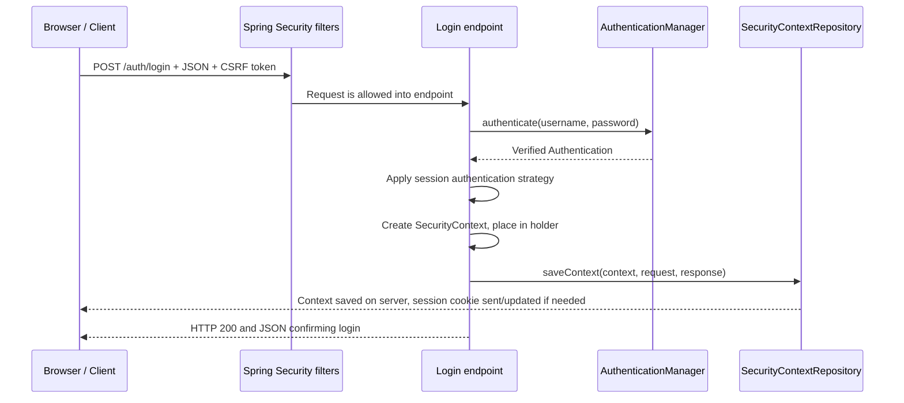
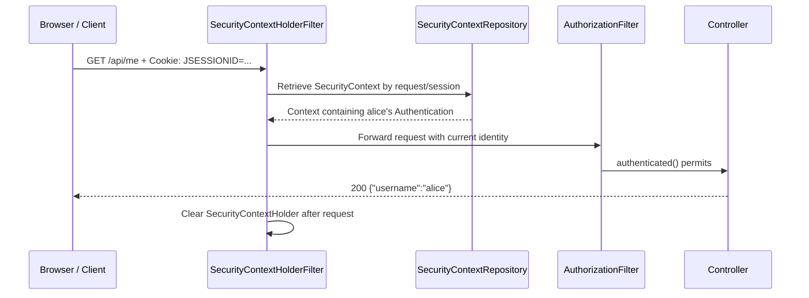

# Successful Authentication Does Not Mean Identity Is Persisted for the Next Request

## 1. The Problem: Login Returns 200, Yet the Next Request Is Still Anonymous

Imagine a client sends login credentials, the server returns HTTP `200 OK`, yet when calling `GET /api/me` immediately afterward, it receives `401 Unauthorized`. This can completely happen even though the username and password **were verified as correct**.

The reason is that Spring Security distinguishes at least **three different outcomes**:

1. **Credentials authenticated successfully:** `AuthenticationManager.authenticate(...)` returns a verified `Authentication`.
2. **Identity is active within the current request:** `SecurityContextHolder` holds a `SecurityContext` containing that `Authentication`.
3. **Identity is restored on the next request:** `SecurityContext` is written to a `SecurityContextRepository` capable of cross-request persistence, and the client sends back the information needed for the server to locate the stored state (typically a session cookie).

These three steps are related, but they **do not automatically imply one another**. This lesson explains that exact boundary, Spring Security Servlet's persistence mechanism, how to prove it using two HTTP requests, and how to diagnose issues.

**Scope:** Java 17+, Spring Boot 3.x, Spring Security 6.x, Spring MVC/Servlet. The exercise uses **session cookie login**; JWT bearer tokens, HTTP Basic, and WebFlux are compared to avoid confusing models. With WebFlux you must use `ReactiveSecurityContextHolder` and the corresponding reactive APIs, not the Servlet code directly.

### Read a Counterexample Right Away

The following snippet **illustrates incomplete logic only**, not a complete endpoint:

```java
Authentication verified = authenticationManager.authenticate(
    UsernamePasswordAuthenticationToken.unauthenticated(
        username, password
    )
);

SecurityContext context = SecurityContextHolder.createEmptyContext();
context.setAuthentication(verified);
SecurityContextHolder.setContext(context);

// The endpoint returns 200 right here, but has not saved the context for the next request.
```

After this code runs, `verified.isAuthenticated()` may be `true` and code in the same request sees the user through the holder. However, if using the default `SecurityContextHolderFilter` in Spring Security 6 and **not calling `SecurityContextRepository.saveContext(...)`**, the newly created authentication in the controller may not exist on the next request.

**The fact that must be proven is not "login returns 200" but "the second request, carrying only the session cookie, is recognized as the right principal."**

## 2. Concepts That Must Not Be Lumped Together

| Concept | What does it prove? | Does it automatically maintain login across requests? |
|---|---|---|
| `AuthenticationManager.authenticate(token)` | Credentials/token were accepted by the authentication mechanism | No |
| `Authentication` with `isAuthenticated() == true` | An authentication result trusted by a provider/manager | No |
| `SecurityContext` | The object holding the current `Authentication` | No |
| `SecurityContextHolder` | Where to obtain the active context in the current execution scope | No |
| `SecurityContextHolderFilter` | Loads context from the repository during request handling, then clears the holder | Does not auto-save modified context |
| `SecurityContextRepository` | Strategy for loading/saving context | Depends on implementation |
| `HttpSessionSecurityContextRepository` | Ties context to `HttpSession` on the server | Yes, if session and cookie remain valid |
| `RequestAttributeSecurityContextRepository` | Shares context across dispatches within the same request | Not across two independent HTTP requests |
| `NullSecurityContextRepository` | Intentionally does not persist context | No |
| Session cookie (typically `JSESSIONID`) | Helps the server locate the stored session | Does not by itself prove Authentication exists |
| `AuthorizationFilter` | Checks whether the authenticated user has permission to access a resource | Does not handle session persistence |

### AuthenticationManager Does Not Manage Sessions

An `AuthenticationProvider` such as `DaoAuthenticationProvider` checks the username/password. `ProviderManager` selects an appropriate provider. The result obtained is an `Authentication` with a principal and authorities. The manager **is not responsible** for creating cookies, setting session attributes, writing to a session database, or deciding session lifetime.

Being successfully authenticated also does not mean being allowed into every URL. After authentication comes **authorization**; a valid user lacking a role can encounter `403 Forbidden`. If the session is lost, the subsequent request carries no identity and typically receives `401` on an API.

### SecurityContextHolder Lives by the Processing Lifecycle

In a typical Servlet application, `SecurityContextHolder` uses a thread-local-based strategy for the current context. Spring Security filters are responsible for setting up and clearing the context according to the request lifecycle. Placing an `Authentication` here **does not** turn it into a global logged-in account and **does not** persist it for the next request.

Do not use static fields, singleton variables, or manually hold `Authentication` in a controller to "remember the user." Servlet servers use thread pools; storing identity in the wrong place can leak data across users or requests.

## 3. Two Separate Requests: What Must Happen?

### Request A: Successful Login



### Request B: Accessing a Protected Resource



If request A **does not save the context**, the load step of request B may only return an empty context. If request A saved it but request B **does not send the cookie**, the server does not know which session to load. If the context is intact but the session has expired or been invalidated, the user must also re-authenticate.

From a protocol perspective, a session cookie typically holds only the **session identifier**; passwords and the entire `Authentication` are not stuffed directly into the cookie. The server uses the ID to look up session data. When using Spring Session with a Redis/JDBC store, the session storage location differs from Servlet container memory, but the session identification principle remains the same.

## 4. Spring Security 6: Explicit Save vs. Earlier Auto-Saving

In many Spring Security 5 configurations, `SecurityContextPersistenceFilter` could track and automatically write the `SecurityContext` at the end of a request. In Spring Security 6, the modern default uses `SecurityContextHolderFilter`: the filter **reads** from `SecurityContextRepository` into the holder, but **does not automatically save** a new context modified by your code.

Therefore, for a controller or custom filter that **calls `AuthenticationManager` itself**, use this pattern:

```java
Authentication authentication = authenticationManager.authenticate(token);

SecurityContext context = SecurityContextHolder.createEmptyContext();
context.setAuthentication(authentication);
SecurityContextHolder.setContext(context);

securityContextRepository.saveContext(context, request, response);
```

`token` must be an **unauthenticated** `Authentication` object built from the request; `request` and `response` are the actual `HttpServletRequest` and `HttpServletResponse`. This is an illustrative snippet placed **inside** a controller/filter that has the required dependencies; it is not a standalone class.

The last two calls perform **two different jobs**:

- `setContext(context)`: the current request receives the newly authenticated identity.
- `saveContext(context, request, response)`: the context is stored in the repository so it can be loaded on subsequent requests.

**Do not infer that every login mechanism must call `saveContext` manually.** When using authentication filters provided by Spring Security, such as standard form login, the framework typically already performs the corresponding lifecycle steps. The explicit-save problem is especially common when writing a custom JSON login endpoint or custom filter.

### Why Must Saving Happen Before the Response Commits?

Saving a session may require creating or changing the session ID and sending `Set-Cookie`. If the response is already committed (e.g., `flushBuffer()` was called, a redirect was sent, or the response body finished writing), the server may not be able to add the cookie in time. Therefore, call `saveContext(...)` **before** finalizing/flushing the response, never after writing the body or after a committed response stream.

The following **incorrect** snippet is for recognizing the bug, not for production use:

```java
SecurityContextHolder.setContext(context);
response.getWriter().write("{\"ok\":true}");
response.flushBuffer(); // response may already be committed
securityContextRepository.saveContext(context, request, response);
```

Snippet with the **correct order**:

```java
SecurityContextHolder.setContext(context);
securityContextRepository.saveContext(context, request, response);
// Then the controller/handler returns ResponseEntity or writes the response.
```

## 5. Which Repository Actually Preserves the User on the Next Request?

Spring Security 6 typically uses `DelegatingSecurityContextRepository` with two repositories:

1. `RequestAttributeSecurityContextRepository`: useful when a request goes through multiple dispatches (such as FORWARD/ERROR), but does not persist across two separate HTTP requests.
2. `HttpSessionSecurityContextRepository`: stores the context in `HttpSession`, so it can be reloaded on another request with the same session.

This can be stated explicitly in configuration:

```java
SecurityContextRepository repository =
    new DelegatingSecurityContextRepository(
        new RequestAttributeSecurityContextRepository(),
        new HttpSessionSecurityContextRepository()
    );
```

The corresponding imports belong to `org.springframework.security.web.context`. When a controller uses one repository to write, the filter chain must use a **compatible repository to read**; avoid creating two instances with different storage behaviors or accidentally using `NullSecurityContextRepository` on either side.

### Common Session Policies

| `SessionCreationPolicy` | Primary effect on Spring Security | Suitable for session-based login? |
|---|---|---|
| `ALWAYS` | Spring Security proactively creates an HTTP session | Possible, though creates sessions frequently |
| `IF_REQUIRED` | Creates a session only when needed | **Natural choice** for session login |
| `NEVER` | Spring Security does not create a new session, but can use an existing one | Be cautious; can easily fail to save a new login if no session exists yet |
| `STATELESS` | Spring Security does not create a session and does not use a session to obtain `SecurityContext` | **Not suitable** for remembering login via session |

`STATELESS` does not mean the entire Java application can never create an `HttpSession`: CSRF, MVC, or other libraries can still create a session if configured to do so. The point to remember here is that Spring Security does not use the session as the place to restore authentication as in the session login model.

With `NullSecurityContextRepository`, calling `saveContext(...)` will not persist identity for the next request. With a plain `RequestAttributeSecurityContextRepository`, another dispatch within the **same request** may see the context, but a new HTTP request will not. These are two common causes of "saved it, yet still 401."

### Is Writing Directly to the Session a Solution?

Do not replace `SecurityContextRepository` with:

```java
request.getSession(true).setAttribute("loggedIn", true);
```

An application-set `loggedIn` flag does not make Spring Security treat the next request as authenticated. The framework looks up `SecurityContext` via the configured repository, rather than interpreting arbitrary session attributes.

`HttpSessionSecurityContextRepository` typically stores the context under the `SPRING_SECURITY_CONTEXT` key. You can inspect this key during local debugging, but application code should depend on the `SecurityContextRepository` interface instead of manually mutating internal session attributes.

## 6. Spring Boot Application Example: Session Login, Saving Context, and Verification

This example is intentionally small, running on Java 17+ and Spring Boot 3.x with Spring Security 6.x. The sample user is created in-memory; the password is hashed with BCrypt. The API provides:

- `GET /csrf` to obtain the CSRF token for the current session.
- `POST /auth/login` accepts JSON, authenticates, and **saves** the security context.
- `GET /api/me` requires being logged in, returns the username obtained from the context.
- `POST /auth/logout` uses the standard logout filter to invalidate the session.

We enable CSRF because the example relies on browser/session cookies. `permitAll()` on login does not mean disabling CSRF for POST.

### 6.1. Dependencies for a Boot Project with a Build

Example `build.gradle` in a project with the Spring Boot plugin:

```groovy
dependencies {
    implementation 'org.springframework.boot:spring-boot-starter-web'
    implementation 'org.springframework.boot:spring-boot-starter-security'

    testImplementation 'org.springframework.boot:spring-boot-starter-test'
    testImplementation 'org.springframework.security:spring-security-test'
}
```

The following three source files belong to the `com.example.contextpersistence` package. This is a Spring Boot program, so it requires a Gradle/Maven build and dependencies; you cannot simply invoke `javac` on a single file without Spring Security on the classpath.

### 6.2. Main Class

`src/main/java/com/example/contextpersistence/ContextPersistenceApplication.java`:

```java
package com.example.contextpersistence;

import org.springframework.boot.SpringApplication;
import org.springframework.boot.autoconfigure.SpringBootApplication;

@SpringBootApplication
public class ContextPersistenceApplication {
    public static void main(String[] args) {
        SpringApplication.run(ContextPersistenceApplication.class, args);
    }
}
```

### 6.3. Configuring Context Repository, Session, and Authentication

`src/main/java/com/example/contextpersistence/SecurityConfig.java`:

```java
package com.example.contextpersistence;

import java.util.List;
import org.springframework.context.annotation.Bean;
import org.springframework.context.annotation.Configuration;
import org.springframework.http.HttpStatus;
import org.springframework.security.authentication.AuthenticationManager;
import org.springframework.security.config.annotation.authentication.configuration.AuthenticationConfiguration;
import org.springframework.security.config.annotation.web.builders.HttpSecurity;
import org.springframework.security.config.annotation.web.configuration.EnableWebSecurity;
import org.springframework.security.config.annotation.web.configurers.AbstractHttpConfigurer;
import org.springframework.security.config.http.SessionCreationPolicy;
import org.springframework.security.core.userdetails.User;
import org.springframework.security.core.userdetails.UserDetailsService;
import org.springframework.security.crypto.bcrypt.BCryptPasswordEncoder;
import org.springframework.security.crypto.password.PasswordEncoder;
import org.springframework.security.provisioning.InMemoryUserDetailsManager;
import org.springframework.security.web.SecurityFilterChain;
import org.springframework.security.web.authentication.HttpStatusEntryPoint;
import org.springframework.security.web.authentication.session.ChangeSessionIdAuthenticationStrategy;
import org.springframework.security.web.authentication.session.CompositeSessionAuthenticationStrategy;
import org.springframework.security.web.authentication.session.SessionAuthenticationStrategy;
import org.springframework.security.web.context.DelegatingSecurityContextRepository;
import org.springframework.security.web.context.HttpSessionSecurityContextRepository;
import org.springframework.security.web.context.RequestAttributeSecurityContextRepository;
import org.springframework.security.web.context.SecurityContextRepository;
import org.springframework.security.web.csrf.CsrfAuthenticationStrategy;
import org.springframework.security.web.csrf.CsrfTokenRepository;
import org.springframework.security.web.csrf.HttpSessionCsrfTokenRepository;

@Configuration
@EnableWebSecurity
public class SecurityConfig {

    @Bean
    PasswordEncoder passwordEncoder() {
        return new BCryptPasswordEncoder();
    }

    @Bean
    UserDetailsService userDetailsService(PasswordEncoder encoder) {
        return new InMemoryUserDetailsManager(
            User.withUsername("alice")
                .password(encoder.encode("alice-secret"))
                .roles("USER")
                .build()
        );
    }

    @Bean
    AuthenticationManager authenticationManager(
            AuthenticationConfiguration configuration) throws Exception {
        return configuration.getAuthenticationManager();
    }

    @Bean
    SecurityContextRepository securityContextRepository() {
        return new DelegatingSecurityContextRepository(
            new RequestAttributeSecurityContextRepository(),
            new HttpSessionSecurityContextRepository()
        );
    }

    @Bean
    CsrfTokenRepository csrfTokenRepository() {
        return new HttpSessionCsrfTokenRepository();
    }

    @Bean
    SessionAuthenticationStrategy sessionAuthenticationStrategy(
            CsrfTokenRepository csrfRepository) {
        return new CompositeSessionAuthenticationStrategy(List.of(
            new ChangeSessionIdAuthenticationStrategy(),
            new CsrfAuthenticationStrategy(csrfRepository)
        ));
    }

    @Bean
    SecurityFilterChain securityFilterChain(
            HttpSecurity http,
            SecurityContextRepository securityContextRepository,
            CsrfTokenRepository csrfTokenRepository) throws Exception {

        http
            .authorizeHttpRequests(auth -> auth
                .requestMatchers("/csrf", "/auth/login", "/error").permitAll()
                .anyRequest().authenticated()
            )
            .securityContext(context -> context
                .securityContextRepository(securityContextRepository)
            )
            .sessionManagement(session -> session
                .sessionCreationPolicy(SessionCreationPolicy.IF_REQUIRED)
            )
            .csrf(csrf -> csrf
                .csrfTokenRepository(csrfTokenRepository)
            )
            .exceptionHandling(ex -> ex
                .authenticationEntryPoint(
                    new HttpStatusEntryPoint(HttpStatus.UNAUTHORIZED))
            )
            .httpBasic(AbstractHttpConfigurer::disable)
            .formLogin(AbstractHttpConfigurer::disable)
            .logout(logout -> logout
                .logoutUrl("/auth/logout")
                .logoutSuccessHandler((request, response, authentication) ->
                    response.setStatus(204))
            );

        return http.build();
    }
}
```

Why does this configuration fit the **cross-request persistence problem**?

- `UserDetailsService` supplies the username, password hash, and authorities to the default provider; this part only determines **whether authentication succeeds or fails**.
- `AuthenticationManager` is what the controller delegates to for verifying credentials. It does not save the context itself.
- `SecurityContextRepository` is declared as a **shared bean** and attached to `HttpSecurity.securityContext(...)`. The controller injects this exact bean to write, while the filter chain uses it to read.
- `IF_REQUIRED` allows creating a session when authentication needs to be stored. `HttpSessionSecurityContextRepository` performs persistence in the session.
- `SessionAuthenticationStrategy` demonstrates two extra steps when writing custom login: `ChangeSessionIdAuthenticationStrategy` defends against session fixation and `CsrfAuthenticationStrategy` rotates/clears the old CSRF token after successful authentication. In Spring Security 6, with custom login, do not assume `SessionManagementFilter` will run these steps for your controller.
- `HttpStatusEntryPoint` makes unauthenticated API calls receive `401` instead of redirecting to a form login page.
- `httpBasic` and `formLogin` are disabled so only the illustrative JSON login path remains. They have their own lifecycles if enabled.
- The standard logout filter handles ending authentication and the session. When CSRF is enabled, `POST /auth/logout` also requires a valid CSRF token.

### 6.4. Controller: Successful Authentication **and** Saving the Context

`src/main/java/com/example/contextpersistence/SessionLoginController.java`:

```java
package com.example.contextpersistence;

import java.util.Map;
import jakarta.servlet.http.HttpServletRequest;
import jakarta.servlet.http.HttpServletResponse;
import org.springframework.http.HttpStatus;
import org.springframework.http.MediaType;
import org.springframework.http.ResponseEntity;
import org.springframework.security.authentication.AuthenticationManager;
import org.springframework.security.authentication.UsernamePasswordAuthenticationToken;
import org.springframework.security.core.Authentication;
import org.springframework.security.core.AuthenticationException;
import org.springframework.security.core.context.SecurityContext;
import org.springframework.security.core.context.SecurityContextHolder;
import org.springframework.security.web.authentication.session.SessionAuthenticationStrategy;
import org.springframework.security.web.context.SecurityContextRepository;
import org.springframework.security.web.csrf.CsrfToken;
import org.springframework.web.bind.annotation.GetMapping;
import org.springframework.web.bind.annotation.PostMapping;
import org.springframework.web.bind.annotation.RequestBody;
import org.springframework.web.bind.annotation.RestController;

@RestController
public class SessionLoginController {

    private final AuthenticationManager authenticationManager;
    private final SecurityContextRepository securityContextRepository;
    private final SessionAuthenticationStrategy sessionStrategy;

    public SessionLoginController(
            AuthenticationManager authenticationManager,
            SecurityContextRepository securityContextRepository,
            SessionAuthenticationStrategy sessionStrategy) {
        this.authenticationManager = authenticationManager;
        this.securityContextRepository = securityContextRepository;
        this.sessionStrategy = sessionStrategy;
    }

    public record LoginRequest(String username, String password) {}

    @GetMapping("/csrf")
    public CsrfToken csrf(CsrfToken token) {
        return token;
    }

    @PostMapping(
        path = "/auth/login",
        consumes = MediaType.APPLICATION_JSON_VALUE
    )
    public ResponseEntity<Map<String, String>> login(
            @RequestBody LoginRequest body,
            HttpServletRequest request,
            HttpServletResponse response) {

        Authentication authentication;
        try {
            authentication = authenticationManager.authenticate(
                UsernamePasswordAuthenticationToken.unauthenticated(
                    body.username(), body.password()
                )
            );
        } catch (AuthenticationException ex) {
            SecurityContextHolder.clearContext();
            // If the request has an old session, avoid keeping the old context
            // after a failed login attempt.
            securityContextRepository.saveContext(
                SecurityContextHolder.createEmptyContext(),
                request,
                response
            );
            return ResponseEntity.status(HttpStatus.UNAUTHORIZED)
                .body(Map.of("error", "invalid_credentials"));
        }

        // Manual login must handle the appropriate session strategy.
        sessionStrategy.onAuthentication(authentication, request, response);

        SecurityContext context = SecurityContextHolder.createEmptyContext();
        context.setAuthentication(authentication);

        // Step 1: user is present in the currently processing request.
        SecurityContextHolder.setContext(context);

        // Step 2: user is saved so subsequent requests can load it again.
        securityContextRepository.saveContext(context, request, response);

        return ResponseEntity.ok(Map.of(
            "username", authentication.getName()
        ));
    }

    @GetMapping("/api/me")
    public Map<String, String> me(Authentication authentication) {
        return Map.of("username", authentication.getName());
    }
}
```

The focal point sits right next to each other:

```java
SecurityContextHolder.setContext(context);
securityContextRepository.saveContext(context, request, response);
```

If you **omit the second line**, the endpoint can still return JSON `{"username":"alice"}` right after authenticating. However, when the `GET /api/me` request begins, Spring Security loads the context from the session repository and will not find the newly authenticated identity. This is the "looks logged in, yet login wasn't persisted" situation.

**Do not construct a trusted `Authentication` from client-supplied data.** In the example, `UsernamePasswordAuthenticationToken.unauthenticated(...)` is passed to `AuthenticationManager`, and only the result from the manager is placed into the context. The sample username/password are for local testing only. Real applications need input validation, rate limiting, generic error responses, auditing, and secrets management.

**Why is `sessionStrategy.onAuthentication(...)` present?** Saving SecurityContext lets the next request receive the identity, but **does not automatically include** session fixation defense, concurrent session limits, CSRF-token reset, or other steps specific to interactive login. If you own the login endpoint, you must integrate the strategies appropriate for your application. The demo handles session ID and CSRF token at a basic level.

## 7. Run Two Requests Yourself and Observe Persistence

In a Spring Boot project with the Gradle wrapper and Boot plugin:

```bash
./gradlew bootRun
```

Windows PowerShell uses `.\gradlew.bat bootRun`. The examples below use Bash, `curl`, and `jq`; JSON field ordering, tokens, and session IDs vary on each run.

### Step A: Fetch the CSRF Token and Save Cookies

```bash
curl -sS -c cookies.txt -b cookies.txt \
  http://localhost:8080/csrf > csrf.json

CSRF_TOKEN=$(jq -r '.token' csrf.json)
```

GET `/csrf` is `permitAll()` and returns JSON containing the token. `HttpSessionCsrfTokenRepository` binds the token to the current session. The `cookies.txt` file stores server-issued cookies; it is for local testing only and should be protected like a credential.

### Step B: Send Login and Have the Server Save SecurityContext

```bash
curl -i -c cookies.txt -b cookies.txt \
  -H 'Content-Type: application/json' \
  -H "X-CSRF-TOKEN: $CSRF_TOKEN" \
  --data '{"username":"alice","password":"alice-secret"}' \
  http://localhost:8080/auth/login
```

**Expected:** HTTP `200` with a body containing `{"username":"alice"}`. The server may issue/update `Set-Cookie` if a session is created or the session ID is rotated. Observing the cookie header is useful, but **an issued cookie does not by itself prove the context was saved**: a session can exist solely to store the CSRF token.

### Step C: Second Request Sending Only the Cookie

```bash
curl -i -b cookies.txt http://localhost:8080/api/me
```

**Expected:** `200` and `{"username":"alice"}`. On this request there is no JSON username/password and no Authorization header; Spring Security retrieves the principal from the saved context and restores it via the session.

### Step D: Second Request **Without** Sending the Cookie

```bash
curl -i http://localhost:8080/api/me
```

**Expected:** `401 Unauthorized`. The client does not send the session ID from the login, so the server does not know which context to load. This does not mean Step B had a wrong password.

### Step E: Logout and Prove the Session Is No Longer Valid

After login, `CsrfAuthenticationStrategy` cleared the old CSRF token. Fetch a new token with the current session cookie:

```bash
NEW_CSRF=$(curl -sS -c cookies.txt -b cookies.txt \
  http://localhost:8080/csrf | jq -r '.token')

curl -i -c cookies.txt -b cookies.txt \
  -X POST -H "X-CSRF-TOKEN: $NEW_CSRF" \
  http://localhost:8080/auth/logout

curl -i -b cookies.txt http://localhost:8080/api/me
```

With the sample configuration, logout returns `204 No Content` and the protected request after logout returns `401`. Proper logout must revoke the session/server-side security context, not merely hide the username in the UI.

**Security:** the commands use localhost HTTP for learning. In real environments, login/password, session cookies, and CSRF tokens must travel over HTTPS; do not log them in logs, telemetry, or repos; cookies need appropriate `HttpOnly`, `Secure`, `SameSite`, and lifetime attributes.

## 8. Testing What Actually Needs Proof: Authentication Survives Across Separate Requests

Simply asserting `authentication.isAuthenticated()` right after authenticating **is not a persistence test**. A test that only calls the controller and checks `200` is also insufficient. At least two MockMvc requests are needed, **carrying the exact session** from login to the new request.

Create `src/test/java/com/example/contextpersistence/SessionPersistenceTest.java`:

```java
package com.example.contextpersistence;

import jakarta.servlet.http.HttpSession;
import org.junit.jupiter.api.Test;
import org.springframework.beans.factory.annotation.Autowired;
import org.springframework.boot.test.autoconfigure.web.servlet.AutoConfigureMockMvc;
import org.springframework.boot.test.context.SpringBootTest;
import org.springframework.http.MediaType;
import org.springframework.mock.web.MockHttpSession;
import org.springframework.security.web.context.HttpSessionSecurityContextRepository;
import org.springframework.test.web.servlet.MockMvc;
import org.springframework.test.web.servlet.MvcResult;

import static org.junit.jupiter.api.Assertions.assertNotNull;
import static org.springframework.security.test.web.servlet.request
    .SecurityMockMvcRequestPostProcessors.csrf;
import static org.springframework.test.web.servlet.request
    .MockMvcRequestBuilders.get;
import static org.springframework.test.web.servlet.request
    .MockMvcRequestBuilders.post;
import static org.springframework.test.web.servlet.result
    .MockMvcResultMatchers.jsonPath;
import static org.springframework.test.web.servlet.result
    .MockMvcResultMatchers.status;

@SpringBootTest
@AutoConfigureMockMvc
class SessionPersistenceTest {

    @Autowired
    MockMvc mvc;

    @Test
    void sessionSurvivesBetweenTwoSeparateRequests() throws Exception {
        MvcResult login = mvc.perform(post("/auth/login")
                .with(csrf())
                .contentType(MediaType.APPLICATION_JSON)
                .content("{\"username\":\"alice\",\"password\":\"alice-secret\"}"))
            .andExpect(status().isOk())
            .andExpect(jsonPath("$.username").value("alice"))
            .andReturn();

        MockHttpSession session = (MockHttpSession)
            login.getRequest().getSession(false);
        assertNotNull(session);

        // The repository saved the context inside the server session.
        assertNotNull(session.getAttribute(
            HttpSessionSecurityContextRepository.SPRING_SECURITY_CONTEXT_KEY
        ));

        // New request reuses the session just like when a browser sends a cookie.
        mvc.perform(get("/api/me").session(session))
            .andExpect(status().isOk())
            .andExpect(jsonPath("$.username").value("alice"));
    }

    @Test
    void withoutSessionTheNextRequestIsAnonymous() throws Exception {
        mvc.perform(post("/auth/login")
                .with(csrf())
                .contentType(MediaType.APPLICATION_JSON)
                .content("{\"username\":\"alice\",\"password\":\"alice-secret\"}"))
            .andExpect(status().isOk());

        // New request does not carry the session from the login attempt.
        mvc.perform(get("/api/me"))
            .andExpect(status().isUnauthorized());
    }

    @Test
    void invalidPasswordDoesNotCreateAuthenticatedSession()
            throws Exception {
        mvc.perform(post("/auth/login")
                .with(csrf())
                .contentType(MediaType.APPLICATION_JSON)
                .content("{\"username\":\"alice\",\"password\":\"wrong\"}"))
            .andExpect(status().isUnauthorized())
            .andExpect(jsonPath("$.error").value("invalid_credentials"));
    }

    @Test
    void loginWithoutCsrfIsRejectedBeforeController() throws Exception {
        mvc.perform(post("/auth/login")
                .contentType(MediaType.APPLICATION_JSON)
                .content("{\"username\":\"alice\",\"password\":\"alice-secret\"}"))
            .andExpect(status().isForbidden());
    }

    @Test
    void protectedEndpointRejectsAnonymousRequest() throws Exception {
        mvc.perform(get("/api/me"))
            .andExpect(status().isUnauthorized());
    }
}
```

Run:

```bash
./gradlew test
```

Windows: `.\gradlew.bat test`.

**Why is this test valuable?**

- The first test confirms that login returns `200` **and** the repository saved `SecurityContext` in the session. The second request creates a distinct Servlet request but uses that session; this is what actually proves persistence.
- The second test proves that a `200` login in request A does not make request B logged in if request B does not carry the session.
- The third test and CSRF check distinguish a `401` authentication failure from a `403` request blocked by the CSRF filter before controller code runs.
- `MockMvc` simulates sessions inside the test JVM. It proves filter/controller/repository logic, but does not replace testing `Set-Cookie`, `Secure`, `SameSite`, reverse proxies, and HTTPS in a real runtime environment.

**Do not rely solely on `@WithMockUser` to test session persistence.** That annotation typically supplies a mocked principal in the test request's security context; it does not prove that the real login endpoint called `saveContext` or that the browser retained a cookie.

## 9. Forms of Authentication That Do Not Need Session Persistence

The statement "successful authentication does not mean identity is saved" applies to session login; however, **not every API wants persistence**.

| Model | How does the next request receive the user? | Must SecurityContext be saved into HttpSession? |
|---|---|---|
| Session login / form login | Browser sends session cookie; server reloads context | Usually yes, depending on repository |
| Custom JSON login creating a session | Controller/filter saves context; browser sends cookie | Yes, if session login is desired |
| Per-request HTTP Basic | Client sends `Authorization: Basic ...` again; server re-authenticates | Not necessarily |
| Bearer JWT | Client sends `Authorization: Bearer <JWT>` again; server verifies token | No |
| Opaque access token | Client sends bearer token, server introspects/verifies per config | Not necessarily |
| Service-to-service API key | Client sends key on every request, filter/provider re-authenticates | Not necessarily |
| Remember-me | Remember-me mechanism uses token/cookie and re-authenticates per policy | Different from keeping a single request context forever |

### Example Where Stateless Is Intentional Behavior

```java
http
    .sessionManagement(session -> session
        .sessionCreationPolicy(SessionCreationPolicy.STATELESS))
    .securityContext(context -> context
        .securityContextRepository(
            new NullSecurityContextRepository()));
```

This snippet is a **fragment inside a SecurityFilterChain**, not a standalone configuration. For a JWT resource server or an API key verified **on every request**, not saving a session is appropriate. The next request must bring the token/key back per the protocol.

Do not "fix" a stateless API by calling `saveContext` into a session yourself. Conversely, do not configure `STATELESS` and expect a session cookie from JSON login to make the server remember the user.

A `/api/me` request using a bearer token that returns `200` only proves the token was valid for that request, **not that the server keeps the identity for the next request**. A subsequent request without the bearer token may return `401` — that is right for the stateless model.

## 10. States to Distinguish When Debugging

### Authenticated in One Request, Yet Insufficient Permissions

There is an authenticated `Authentication` and a context for the current request, yet the endpoint requires `ROLE_ADMIN` while the user only has `ROLE_USER`. Typical result: `403 Forbidden`. This is an **authorization failure**, not a lost-session bug.

### Authenticated and Saved, Yet the Next Request Still Has No Identity

The cause may lie in cookies, the repository, session policy, logout/invalidation events, timeout, or the session store; you must investigate the context **reload** flow of request B, not just log the authenticate step of request A.

### Server Created a Session, Yet Context Was Not Saved

An `HttpSession` can exist because of a CSRF token, request cache, or another part of the application. Seeing `JSESSIONID` in the browser, `Set-Cookie` in the HTTP response, or `request.getSession(false) != null` **is not enough to prove** the session contains `SPRING_SECURITY_CONTEXT`.

### After Login, the Second Request Reverts to the Old User

The controller may have placed the new context in the holder without overwriting the old context in the session; the next request loads the old identity. This is especially prone to happen on "switch account" screens or failed custom login attempts. You must actively manage the old session, the new authentication result, session fixation, and repository save/clear according to policy.

### Second Request Carries the Session, Yet Hits a Different Server

If the session lives only in instance A's memory, request B arriving at instance B cannot read the context. In multi-instance infrastructure, use a shared session store or an appropriate coordination strategy (such as Spring Session) and ensure consistent serializer, TTL, and domain/cookie configuration.

### Offloading Work to a New Thread

`SecurityContextHolder` is typically thread-local-based in Servlet apps. An async task or new thread does not automatically inherit the context like the request thread unless an appropriate propagation mechanism is used. This is a **context propagation within the same task** issue, distinct from saving context across two HTTP requests. Do not solve it with global static variables.

## 11. Ordered Diagnostic Guide

When encountering "login succeeds, yet the next request gets 401," check in order:

1. **Did Request A genuinely authenticate?** Verify the manager returned an `Authentication` with a trusted principal/authorities, not just a hardcoded `200` status from the controller.
2. **Was the context set for Request A?** Check `SecurityContextHolder.setContext(context)` and the use of `createEmptyContext()` before setting the user.
3. **Was `saveContext(...)` called if using custom login?** With Spring Security 6 explicit save, do not rely on automatic saving at the end of the request.
4. **Can the repository persist across requests?** Is it `HttpSessionSecurityContextRepository` or a suitable persistent repo? Was it replaced by `NullSecurityContextRepository` or request-attribute-only?
5. **Do the reading and writing repositories share the same configuration?** Do the controller and filter chain use the exact same repo, session store, and serialization?
6. **Did saving happen before the response committed?** Did a redirect, flush, streaming response, or exception cause `Set-Cookie` to be lost before saving?
7. **Does the session actually exist and contain the context?** Inspect locally via `HttpSessionSecurityContextRepository.SPRING_SECURITY_CONTEXT_KEY`; do not treat cookie presence as proof.
8. **Is the client sending the cookie back?** Inspect `Cookie` on Request B and `Set-Cookie` on Response A, along with domain/path/SameSite/Secure/CORS/client credentials settings.
9. **Is the session still valid?** Was there a logout, session fixation rotation, TTL expiration, idle timeout, or node switch?
10. **Which chain did Request B go through?** Is there a different `securityMatcher`, a stateless chain, or a `denyAll` policy producing a different result?
11. **Is it truly a 401 from missing auth?** For state-changing requests, `403` can come from CSRF; for users lacking permissions, `403` is authorization.

### Symptom Reference Table

| Symptom | Analysis hint |
|---|---|
| Login `200` yet `GET /api/me` `401` | Missing `saveContext`, missing cookie, wrong repo/session |
| User exists in login controller yet next request is anonymous | Holder only takes effect within the current request |
| `saveContext` ran, yet session has no context | Check repository, `STATELESS`, late save, or invalid authentication |
| `JSESSIONID` present yet `/api/me` still `401` | Session may only hold CSRF/request cache; inspect security context attribute |
| Works in Chrome, fails in curl | Is curl sending the cookie jar and appropriate token? |
| POST login `403`, GET public `200` | Missing/invalid CSRF token or another rule; POST may not have reached the controller |
| Still using old CSRF token after login | `CsrfAuthenticationStrategy` cleared the old token; fetch a new token |
| After logout, protected GET still returns `200` | Another mechanism is re-authenticating (Basic/Bearer), or session was not invalidated |
| Load balancer makes login intermittent | Session store is not shared or sticky routing/cookies differ per node |
| `@WithMockUser` unit test passes yet login fails in practice | Test does not prove persistence across two HTTP requests |
| Authenticated user receives `403` | Check authorities and authorization policy; do not assume lost session |

## 12. Security When Persisting Context Beyond One Request

Session login creates authentication state valid across multiple requests. Therefore, you must protect the **session identifier**, not just the password.

- **HTTPS:** prevent leaking passwords and cookies in transit. Do not write raw credentials, session IDs, CSRF tokens, or the entire `SecurityContext` into logs.
- **Cookies:** configure `HttpOnly`, `Secure` when using HTTPS, and appropriate `SameSite` and `Path`/`Domain` attributes. For cross-origin SPAs, `fetch(..., {credentials: "include"})` and CORS must be configured for specific origins, never arbitrary wildcards when credentials are included.
- **Session fixation:** after successful login, change the session ID if a session already existed that someone else might know; custom login must invoke the appropriate session strategy.
- **CSRF:** with browsers automatically sending session cookies, POST/PUT/PATCH/DELETE require CSRF protection per the threat model. `permitAll()` on the login endpoint does not disable the CSRF filter.
- **CSRF token after login/logout:** the old token may be cleared; the frontend should fetch a new token before performing state-changing operations.
- **Logout/timeout:** calling only `SecurityContextHolder.clearContext()` in one request does not fully revoke a persisted context. Use Spring Security's logout infrastructure or clear the persistent context, invalidate the session, and update cookies per policy.
- **Session store:** protect access, limit TTL, monitor invalidation; with multiple instances, synchronize sessions.
- **Do not build trusted Authentication from input:** every stored user/role must be the authenticated result from a manager/provider, not client-supplied JSON data.
- **Authorization after restore:** a reloaded context may contain previously granted authorities; have a session validity/management policy when user roles change mid-session, rather than assuming all permission changes apply instantly to old sessions.

Saving context properly is the technical prerequisite for session login to work; protecting the session, deciding timeouts, revocation, and authorization determine whether the system is secure.

## 13. Conclusion and Checklist

**Model to remember:**

```text
authenticate(credentials)
       ↓
Valid Authentication
       ↓
SecurityContextHolder.setContext(context)
       ↓
Identity exists in CURRENT REQUEST
       ↓
SecurityContextRepository.saveContext(context, request, response)
       ↓
Context saved in HttpSession / appropriate repository
       ↓
CLIENT sends session cookie back on NEW REQUEST
       ↓
SecurityContextHolderFilter loads context
       ↓
AuthorizationFilter identifies user and checks permissions
```

Check off before concluding "logged in successfully and will be remembered":

- [ ] Authentication was issued by a trusted `AuthenticationManager`/provider, not hardcoded `isAuthenticated()`.
- [ ] `SecurityContextHolder` has the right context in the current request.
- [ ] If using custom login, `SecurityContextRepository.saveContext(...)` is called before the response commits.
- [ ] The repository supports cross-request persistence; the Spring Security filter chain and login endpoint use the same repository.
- [ ] Session policy matches the goal (`IF_REQUIRED` or equivalent stateful config), not accidentally `NullSecurityContextRepository`/`STATELESS`.
- [ ] Client receives and sends back the session cookie; domain/path/SameSite/Secure/credentials have been verified.
- [ ] Session authentication strategy handles fixation/CSRF and other application requirements.
- [ ] Tests execute **two independent requests**, reusing the login session/cookie; also test requests without sending the cookie.
- [ ] Logout, timeout, revocation, session store, and post-login authorization have been reviewed.
- [ ] If intentionally stateless via JWT/Basic/API key, make clear the client must resend credentials; do not confuse that expected behavior with a lost-session bug.

**Key message:** an accepted `Authentication` proves only that **credentials were valid at the time of authentication**. Whether identity persists to the next request depends on the **persistence strategy, repository, session/token, and what the client sends back**.

### References

- [Spring Security 6.5 — Authentication Persistence and Session Management](https://docs.spring.io/spring-security/reference/6.5/servlet/authentication/session-management.html)
- [Spring Security 6.5 — Servlet Authentication Architecture](https://docs.spring.io/spring-security/reference/6.5/servlet/authentication/architecture.html)
- [Spring Security 6.5 — Session Management Migration / Explicit Save](https://docs.spring.io/spring-security/reference/6.5/migration/servlet/session-management.html)
- [Spring Security 6.5 — Form Login](https://docs.spring.io/spring-security/reference/6.5/servlet/authentication/passwords/form.html)
- [Spring Security — CSRF Protection](https://docs.spring.io/spring-security/reference/servlet/exploits/csrf.html)
- [SecurityContextRepository API](https://docs.spring.io/spring-security/reference/6.5/api/java/org/springframework/security/web/context/SecurityContextRepository.html)
