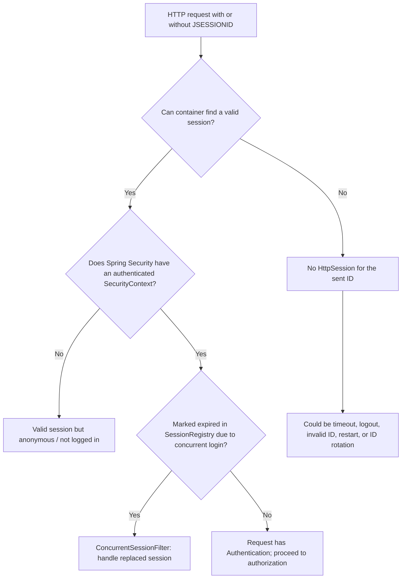
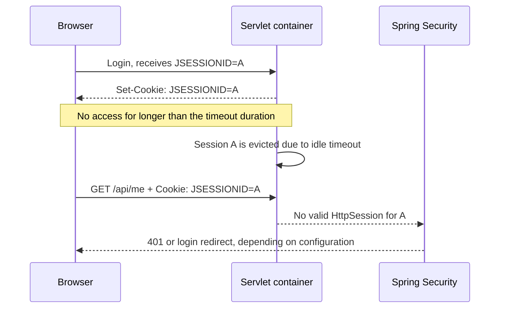
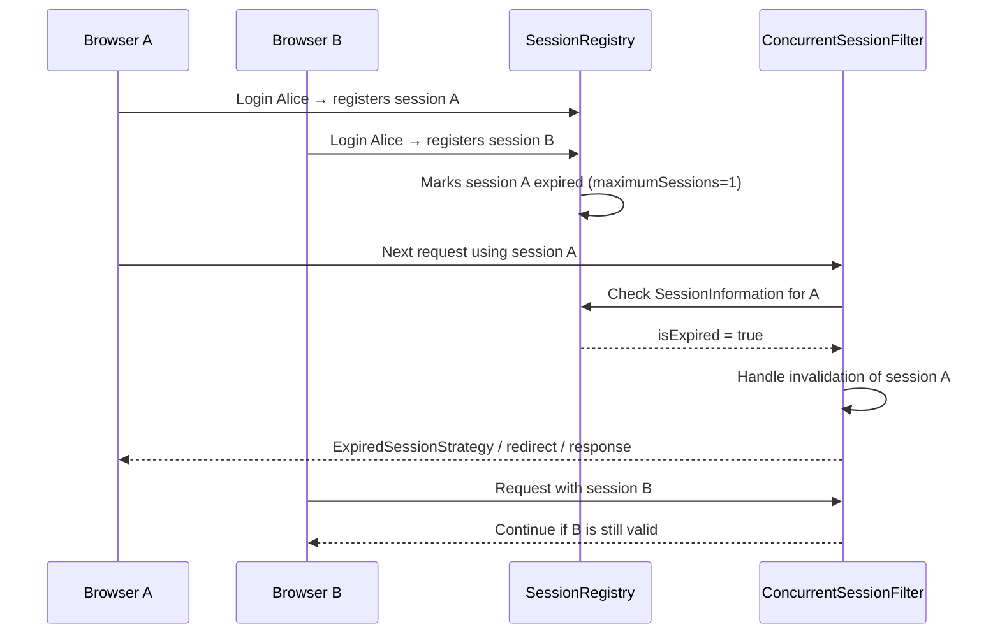

# Distinguishing Expired, Invalid, and Replaced Sessions

**Context:** Login session management in a Spring Security Servlet application using `HttpSession`/the `JSESSIONID` cookie. A user has logged in, yet a subsequent request is unexpectedly redirected to the login page, receives `401`, or gets a "session expired" message. These symptoms **do not necessarily share the same cause**.

**Learning objectives:** Distinguish sessions expired due to inactivity, invalid session IDs, and sessions marked invalid due to concurrent-session policy; recognize that changing the session ID at login is a separate mechanism; choose the right handler/API in Spring Security; design tests and non-misleading messages.

## 1. First: There Are Three Distinct Layers of State

1. **The browser** may be storing a `JSESSIONID` cookie and sending that value back on requests.
2. **The Servlet container / session store** decides whether the session ID points to a currently valid `HttpSession`. Removing a session due to timeout, `invalidate()`, a restart, or backend storage eviction can all make the old ID unresolvable.
3. **Spring Security** may load `SecurityContext` from the session, or track the session in `SessionRegistry` to enforce concurrent login limits. Having a valid session **does not mean** there is an authenticated user; a session used only for a CSRF token or shopping cart can still be anonymous.

Therefore, **cookie exists ≠ session still exists ≠ logged-in session ≠ session satisfies concurrent-session policy**.



Do not use a `401`/`302` response alone to deduce the cause: multiple branches can lead to the same "unauthenticated" state.

## 2. Case A — Session Expired Due to Inactivity (Idle Timeout)

**Concept:** `HttpSession` has an inactivity limit (`maxInactiveInterval`). If the session is not accessed within the configured duration, the container/session store may destroy it. For example, setting a 15-minute timeout:

```properties
# application.properties (Spring Boot / Servlet session)
server.servlet.session.timeout=15m
```

Or for a specific session:

```java
// Seconds: e.g., 900 seconds = 15 minutes.
HttpSession session = request.getSession(false);
if (session != null) {
    session.setMaxInactiveInterval(900);
}
```

`getSession(false)` does not auto-create a new session when the request has none. `HttpSession.getLastAccessedTime()` and `getMaxInactiveInterval()` help with inspection, but do not rely on a client clock to conclude the exact moment a session is destroyed: the container, servlet version, session store, and expiration sweep schedule can affect execution timing.

**Typical flow:**



On the request after timeout, the browser **may still send cookie A** even though session object A was deleted server-side. Cookie timeout and server session timeout are two separate mechanisms. `JSESSIONID` is not a "ticket that can resurrect a session on its own."

**Distinguish from "absolute timeout":** some systems enforce a maximum session lifetime regardless of activity. That is an additional application policy, not Servlet's `maxInactiveInterval` nature. If a user is actively using the system continuously yet still gets logged out after 8 hours, check absolute limits, upstream tokens, re-authentication policies, or intentional invalidation rather than guessing "idle timeout."

**Do not confuse "timeout" with JWT `exp`:** a stateless access token has an expiring `exp` claim that does not necessarily relate to `HttpSession` or `JSESSIONID`.

## 3. Case B — Invalid Session ID (Invalid/Stale Session)

**Concept:** A request sends a session ID that the container does not recognize as an existing session. In Java Servlet you can observe:

```java
String requestedId = request.getRequestedSessionId();
boolean isValidId = request.isRequestedSessionIdValid();
HttpSession existing = request.getSession(false);
```

- `requestedId != null` means the client sent an ID via the container's session mechanism (usually a cookie).
- `isRequestedSessionIdValid() == false` means the ID sent by the client **does not point to a valid session**, or there is no valid ID to check.
- `existing == null` means the request currently has no `HttpSession` to use; **it does not yet explain why**.
- `existing != null` also **does not guarantee the user is logged in**, because the session may hold data other than `SecurityContext`.

Sources of an invalid session ID:

1. **Idle timeout:** session A was evicted by the container/session store while cookie A remained.
2. **Logout:** the server called `HttpSession.invalidate()` or cleared SecurityContext; the client may still hold the old ID cookie.
3. **Account/session revoked:** an administrator or security policy invalidated the session.
4. **Session fixation protection:** after login, the container changed session ID A to B; a request reusing A is sending an old ID.
5. **Session store/restart:** the app restarted without persisting in-memory sessions, Redis/cache lost data, or the cluster was misconfigured.
6. **Bad cookie:** invalid domain/path, client sent a non-existent ID, cookie copied to the wrong profile, or request routed to a node lacking that session.

**Important:** "session invalid" is an **observed state** at the request/container boundary, not necessarily a distinct **business cause**. Once A is gone from the store, many systems **cannot determine with certainty** whether A timed out naturally or was logged out solely from `isRequestedSessionIdValid()`.

### Be Careful with the Invalid-Session Handler

Spring Security supports `InvalidSessionStrategy` and the shortcut `invalidSessionUrl(...)`:

```java
// Abbreviated configuration snippet, must be placed in an appropriate SecurityFilterChain:
http.sessionManagement(sm ->
        sm.invalidSessionUrl("/session-invalid"));
```

When wired with `SessionManagementFilter` in a specific configuration, the strategy can handle requests carrying an invalid session ID, usually via redirect. **Do not assume every 401 request or every session timeout automatically runs this strategy.** In Spring Security 6, `SessionManagementFilter` is not attached by default to every filter chain like in earlier Spring Security 5 patterns; authentication mechanisms must proactively invoke `SessionAuthenticationStrategy`.

On the other hand, a post-logout session ID may remain in the cookie and cause a **false positive** for a "session timeout" message. Spring Security documentation notes this; where appropriate, clear the session cookie upon logout and show a more neutral message when reliable server-side evidence is lacking.

**Do not use `request.getSession()` to check "does the old session still exist?"** because the no-arg call can create a **new session**, conflating the two situations. Use `getSession(false)` when you only want to inspect.

## 4. Case C — Session Replaced by a New Login (Concurrent-Session Expiration)

This is a **Spring Security policy** mechanism, not merely a servlet timeout. Suppose Alice's account is only allowed one active login session:

```java
http.sessionManagement(sm -> sm
        .maximumSessions(1)
        .maxSessionsPreventsLogin(false));
```

In a typical configuration, the new login B **is allowed to succeed**; the old session A is marked `expired` in `SessionRegistry`. When client A sends its next request, `ConcurrentSessionFilter` detects the session marked expired, invalidates it appropriately, and calls `SessionInformationExpiredStrategy` if configured.



**Key takeaway:** Session A may **still exist in the container** for a brief period after B logs in, yet it has been **marked unusable** in `SessionRegistry`. Thus "concurrency-expired" is not identical to "ID already invalid in servlet"; the first state can lead to the second when accessed/revoked.

In `SessionInformation`, `isExpired()` reflects that the session was marked expired by concurrency policy; `expireNow()` sets that flag. `ConcurrentSessionFilter` is responsible for handling an expired session when it continues to be used. Do not equate this `expired` flag with idle timeout handled by the servlet container.

### Two Opposing Policies When Exceeding the Limit

| Configuration | Login B Result | Session A |
| --- | --- | --- |
| `maximumSessions(1)` + `maxSessionsPreventsLogin(false)` | B succeeds | A is marked expired and cannot continue when policy is enforced |
| `maximumSessions(1)` + `maxSessionsPreventsLogin(true)` | B is rejected for exceeding the limit | A remains valid if not timed out/revoked |
| No concurrent session limit | A and B can be logged in simultaneously | A is not replaced simply because B logged in |

Do not conflate the two interpretations: with `maxSessionsPreventsLogin(true)`, **the second login is blocked**; it does not always "kick" the user in session A out. With form login, B's failure typically goes through `AuthenticationFailureHandler`/redirect per config, not necessarily HTTP 401.

### ExpiredSessionStrategy Is Only for One Specific Context

Example:

```java
http.sessionManagement(sm -> sm
        .maximumSessions(1)
        .expiredSessionStrategy(event -> {
            var response = event.getResponse();
            response.setStatus(401);
            response.setContentType("application/json;charset=UTF-8");
            response.getWriter().write(
                    "{\"error\":\"session_replaced\"}");
        }));
```

This is a handler for **sessions marked expired by concurrent-session control**, not a universal callback for all idle timeouts. A JSON/SPA endpoint can use the `session_replaced` message if the system genuinely has reliable evidence and has considered privacy; do not expose the new session's device, location, or session ID.

Accurate concurrency management usually requires `SessionRegistry` and session lifecycle events (such as `HttpSessionEventPublisher`) so the registry knows when sessions are destroyed. With multiple instances, a distributed session store does not automatically synchronize each instance's in-memory registry; choose an appropriate session registry mechanism for your deployment.

## 5. Do Not Confuse "Session ID Changed" with "Session Replaced"

When a user **logs in successfully**, Spring Security usually defends against **session fixation** by changing the session ID. On Servlet 3.1+, `HttpServletRequest.changeSessionId()` changes the ID of the existing session, rather than always creating a brand-new logical session object.

Example:

```http
# Before login
Cookie: JSESSIONID=A

# After successful login
Set-Cookie: JSESSIONID=B
```

Meaning:

- The post-login logical session may still retain necessary data; however, the ID used to access it changed from A to B.
- Subsequent requests must use **B**. Reusing A may be treated as an invalid session ID.
- Calling `changeSessionId()` **does not mean** Spring Security applied `maximumSessions(1)` to replace a session on another device.
- Conversely, when login B on a **second browser** makes session A concurrency-expired, that is a **session count policy**, not just login ID rotation.

A user can encounter **both mechanisms**: logging in on Browser B rotates the pre/post-login ID for B's session while simultaneously marking Browser A's session expired. Analyze each event separately.

You normally should not disable `sessionFixation` to "fix changing cookie IDs"; rotating the ID is a security control. If custom JSON login invokes `AuthenticationManager` in a controller/filter itself, ensure it calls `SessionAuthenticationStrategy`, explicitly saves `SecurityContext`, and delivers the new cookie to the client; do not expect `SecurityContextHolder.setContext()` alone to persist login.

## 6. Practical Comparison Table

| Case | Primary Trigger | Server State | Observable Sign | Appropriate Handler |
| --- | --- | --- | --- | --- |
| Idle timeout | No access for configured duration | Session evicted by container/store | Old cookie may remain, request cannot load session | Unauthorized/login; invalid-session strategy if wired and ID is invalid |
| Invalid ID | Bad cookie/old ID/logout/restart/lost session | No session matches ID | `isRequestedSessionIdValid() == false` if request supplies invalid ID | `InvalidSessionStrategy` when actually triggered, or default entry point |
| Concurrent session replaced | New login exceeds `maximumSessions` with replace-old policy | `SessionRegistry` marks old session expired | Next request from old session triggers `ConcurrentSessionFilter` | `SessionInformationExpiredStrategy` / `expiredUrl` |
| Session ID rotated for fixation | Successful login | ID A changes to B for the active session | New `Set-Cookie`, old A no longer usable | Client updates cookie; do not call this "logged out by another session" |
| Intentional logout | User logs out, server invalidates session | Old session destroyed, SecurityContext cleared | Subsequent request with old cookie fails | Logout success, clear cookie appropriately, re-login if needed |
| Session exists yet anonymous | HttpSession exists for CSRF/cart | Valid session, no login Authentication | `getSession(false)` is non-null yet `/api/me` is blocked | Authentication entry point |
| Stateless Bearer JWT expired | `exp` claim / invalid token | May not use `HttpSession` | Resource server rejects Bearer | Bearer auth entry point, not Servlet session timeout |

**Takeaway from the table:** Some distinct causes leave identical HTTP symptoms. If UX requires distinguishing them accurately, the application must record **reliable lifecycle events on the server side**; you cannot rely solely on whether a cookie is present.

## 7. Spring Security 6 Lab: Distinguishing Sessions "Replaced" by Concurrent Login

This lab uses **default form login** to focus on session management rather than JSON parsing. If an application uses custom JSON login, it must integrate equivalent session strategies/repositories; concurrent session settings will not work automatically just by setting `maximumSessions(1)` without invoking the required strategy components.

**Environment:** JDK 17+, Maven, Spring Boot 3.3.x / Spring Security 6.x. Example versions serve as API reference points, not recommendations to run old versions in production.

### 7.1. Create `pom.xml`

```xml
<project xmlns="http://maven.apache.org/POM/4.0.0"
         xmlns:xsi="http://www.w3.org/2001/XMLSchema-instance"
         xsi:schemaLocation="http://maven.apache.org/POM/4.0.0 https://maven.apache.org/xsd/maven-4.0.0.xsd">
    <modelVersion>4.0.0</modelVersion>
    <parent>
        <groupId>org.springframework.boot</groupId>
        <artifactId>spring-boot-starter-parent</artifactId>
        <version>3.3.9</version>
        <relativePath/>
    </parent>
    <groupId>example</groupId>
    <artifactId>session-state-lab</artifactId>
    <version>1.0.0</version>
    <properties>
        <java.version>17</java.version>
    </properties>
    <dependencies>
        <dependency>
            <groupId>org.springframework.boot</groupId>
            <artifactId>spring-boot-starter-web</artifactId>
        </dependency>
        <dependency>
            <groupId>org.springframework.boot</groupId>
            <artifactId>spring-boot-starter-security</artifactId>
        </dependency>
        <dependency>
            <groupId>org.springframework.boot</groupId>
            <artifactId>spring-boot-starter-test</artifactId>
            <scope>test</scope>
        </dependency>
        <dependency>
            <groupId>org.springframework.security</groupId>
            <artifactId>spring-security-test</artifactId>
            <scope>test</scope>
        </dependency>
    </dependencies>
    <build>
        <plugins>
            <plugin>
                <groupId>org.springframework.boot</groupId>
                <artifactId>spring-boot-maven-plugin</artifactId>
            </plugin>
        </plugins>
    </build>
</project>
```

Structure:

```text
session-state-lab/
├── pom.xml
└── src/
    ├── main/java/example/SessionStateApplication.java
    └── test/java/example/SessionStateApplicationTests.java
```

### 7.2. Application: `maximumSessions(1)` and Dedicated Handler for Concurrency-Expired

Create `src/main/java/example/SessionStateApplication.java`:

```java
package example;

import java.util.Map;

import org.springframework.boot.SpringApplication;
import org.springframework.boot.autoconfigure.SpringBootApplication;
import org.springframework.context.annotation.Bean;
import org.springframework.http.HttpStatus;
import org.springframework.security.config.Customizer;
import org.springframework.security.config.annotation.web.builders.HttpSecurity;
import org.springframework.security.config.annotation.web.configurers.AbstractHttpConfigurer;
import org.springframework.security.core.Authentication;
import org.springframework.security.core.userdetails.User;
import org.springframework.security.core.userdetails.UserDetailsService;
import org.springframework.security.crypto.factory.PasswordEncoderFactories;
import org.springframework.security.crypto.password.PasswordEncoder;
import org.springframework.security.provisioning.InMemoryUserDetailsManager;
import org.springframework.security.web.SecurityFilterChain;
import org.springframework.security.web.session.HttpSessionEventPublisher;
import org.springframework.web.bind.annotation.GetMapping;
import org.springframework.web.bind.annotation.RestController;

@SpringBootApplication
public class SessionStateApplication {
    public static void main(String[] args) {
        SpringApplication.run(SessionStateApplication.class, args);
    }

    @Bean
    PasswordEncoder passwordEncoder() {
        return PasswordEncoderFactories.createDelegatingPasswordEncoder();
    }

    @Bean
    UserDetailsService users(PasswordEncoder encoder) {
        return new InMemoryUserDetailsManager(
                User.withUsername("alice")
                        .password(encoder.encode("demo-password"))
                        .roles("USER")
                        .build());
    }

    @Bean
    HttpSessionEventPublisher httpSessionEventPublisher() {
        return new HttpSessionEventPublisher();
    }

    @Bean
    SecurityFilterChain securityFilterChain(HttpSecurity http)
            throws Exception {
        return http
                .authorizeHttpRequests(auth -> auth
                        .requestMatchers("/login").permitAll()
                        .anyRequest().authenticated())
                .formLogin(Customizer.withDefaults())
                .httpBasic(AbstractHttpConfigurer::disable)
                .sessionManagement(sm -> sm
                        .maximumSessions(1)
                        .maxSessionsPreventsLogin(false)
                        .expiredSessionStrategy(event -> {
                            var response = event.getResponse();
                            response.setStatus(HttpStatus.UNAUTHORIZED.value());
                            response.setContentType(
                                    "application/json;charset=UTF-8");
                            response.getWriter().write(
                                    "{\"error\":\"session_replaced\"}");
                        }))
                .build();
    }

    @RestController
    static class IdentityController {
        @GetMapping("/api/me")
        Map<String, String> me(Authentication current) {
            return Map.of("username", current.getName());
        }
    }
}
```

**Notable points:**

- The filter for `formLogin()` handles login, session fixation protection, and saving `SecurityContext` via standard Spring Security mechanisms.
- `maximumSessions(1)` tracks the number of authenticated sessions; B logging in later can mark A expired. `HttpSessionEventPublisher` notifies the registry of destroy/ID-change events when needed.
- `expiredSessionStrategy` returns `401` + JSON **only when `ConcurrentSessionFilter` detects a session marked concurrency-expired**. This is a demo policy message, not proof that every `401` is caused by a new login.
- `httpBasic` is disabled so new requests do not accidentally authenticate with username/password via a Basic header, skewing session test results.
- CSRF is **kept at its default**. `formLogin()` is a POST requiring a CSRF token; Spring Security's test helper supplies a valid token.
- The `/api/me` endpoint requires authentication and reads the username from the new request's `Authentication`.
- No custom logout URL or manual cookie-clearing code is added beyond defaults. In a real application, customize UX, logout, and cookie-clearing policies consistently.

**If you want to block login B instead of replacing A:** change only `maxSessionsPreventsLogin(false)` to `true`, then verify that login B fails and A continues working. You cannot use the same expected-result assertions for both policies.

### 7.3. Integration Test with `MockMvc`: Isolating Sessions A and B

Create `src/test/java/example/SessionStateApplicationTests.java`:

```java
package example;

import org.junit.jupiter.api.Test;
import org.springframework.beans.factory.annotation.Autowired;
import org.springframework.boot.test.autoconfigure.web.servlet.AutoConfigureMockMvc;
import org.springframework.boot.test.context.SpringBootTest;
import org.springframework.mock.web.MockHttpSession;
import org.springframework.test.web.servlet.MockMvc;
import org.springframework.test.web.servlet.MvcResult;

import static org.assertj.core.api.Assertions.assertThat;
import static org.springframework.security.test.web.servlet.request
        .SecurityMockMvcRequestBuilders.formLogin;
import static org.springframework.security.test.web.servlet.response
        .SecurityMockMvcResultMatchers.authenticated;
import static org.springframework.test.web.servlet.request
        .MockMvcRequestBuilders.get;
import static org.springframework.test.web.servlet.result
        .MockMvcResultMatchers.jsonPath;
import static org.springframework.test.web.servlet.result
        .MockMvcResultMatchers.status;

@SpringBootTest
@AutoConfigureMockMvc
class SessionStateApplicationTests {
    @Autowired
    MockMvc mvc;

    private MockHttpSession loginInNewClient() throws Exception {
        MvcResult result = mvc.perform(
                    formLogin().user("alice").password("demo-password"))
                .andExpect(authenticated().withUsername("alice"))
                .andReturn();
        MockHttpSession session =
                (MockHttpSession) result.getRequest().getSession(false);
        assertThat(session).isNotNull();
        return session;
    }

    @Test
    void secondLoginExpiresOldSessionButKeepsNewOne()
            throws Exception {
        // Client A completes login and has its own session.
        MockHttpSession a = loginInNewClient();
        mvc.perform(get("/api/me").session(a))
                .andExpect(status().isOk())
                .andExpect(jsonPath("$.username").value("alice"));

        // Client B DOES NOT pass session A; creates another session.
        MockHttpSession b = loginInNewClient();
        assertThat(b.getId()).isNotEqualTo(a.getId());

        // Client A sends the next request with the old session.
        mvc.perform(get("/api/me").session(a))
                .andExpect(status().isUnauthorized())
                .andExpect(jsonPath("$.error").value("session_replaced"));

        // Client B still has permission to use its new session.
        mvc.perform(get("/api/me").session(b))
                .andExpect(status().isOk())
                .andExpect(jsonPath("$.username").value("alice"));
    }
}
```

Run:

```bash
mvn test
```

**Expected result:** the `secondLoginExpiresOldSessionButKeepsNewOne` test PASSES; Maven normally finishes with `BUILD SUCCESS` if dependencies/environment match. This is **the expected outcome of the tutorial, not an actual execution log**.

This test does not verify idle timeout, because the two logins happen closely together; it specifically tests the `maximumSessions(1)` policy: A works before B logs in, A is marked expired by the policy after B, and B remains usable.

**`MockMvc` limitations:** This simulates requests/responses at the MVC/filter layer; it does not start a real container and does not reproduce the entire browser cookie/idle-expiration scheduler mechanism. Use `.session(a)` to explicitly pass the same mock session to the next request. Testing real idle timeouts requires a running container, real cookie jars, and real session store/timeout settings. Never claim `MockHttpSession.setMaxInactiveInterval(1)` plus `Thread.sleep(...)` proves the container destroyed the session: `MockHttpSession` does not simulate the full background timeout lifecycle.

## 8. Testing Real Idle Timeout and Invalid-Session IDs

### 8.1. Idle Timeout Scenario

1. Using a real browser (or HTTP client with a cookie jar), log into an app with `server.servlet.session.timeout=1m` in a **test environment**.
2. Verify `GET /api/me` after login returns the right user with a valid session cookie.
3. Ensure **no request touches the session** past the test timeout duration. Polling requests, heartbeats, calling `/csrf`, or resources that access the session can also extend session lifetime.
4. Send the old cookie back to `GET /api/me` and observe that the request is no longer authenticated; note the server event/log or confirm the session store removed the ID.
5. Compare against a session that just logged in and immediately sends another request.

Do not treat `sleep(61s)` as an absolute guarantee: different containers/stores have varying timer resolutions or cleanup schedules; confirm the session actually became invalid on the **server side**. Ultra-short timeouts are only for test environments to avoid mass logouts in production.

### 8.2. Wrong/Logged-Out ID Scenario

- Log in and save the currently valid cookie.
- Send a request with a **fake session ID**: it must be treated as unauthenticated (never auto-create an identity).
- Send `POST /logout` with a valid CSRF token; try calling `/api/me` again with the old cookie, expecting it is no longer authenticated.
- In a system with an invalid-session handler, observe **whether it is invoked**. Do not assume `InvalidSessionStrategy` always runs in every Spring Security 6 chain.
- Compare with the case of **sending no cookie**: it typically follows the anonymous/challenge flow, not necessarily a "session invalid" message.

Sample HTTP after logout (simulation only):

```http
GET /api/me HTTP/1.1
Host: app.example
Cookie: JSESSIONID=old-id-after-logout
```

A typical HTTP response can be `302 Location: /login` (web app) or `401` (API). **No single status code always distinguishes idle timeout from an invalid ID.**

### 8.3. ID Rotated on Login Scenario (Session Fixation Protection)

- Before login, there may already be a session A used for CSRF.
- Login succeeds; observe `Set-Cookie: JSESSIONID=B` and the new ID.
- Call `/api/me` with cookie B: it must work.
- Call with A: must not authenticate from the old session.
- **Do not conclude** A was a "replaced concurrent session" solely because A is no longer valid; it may simply be ID rotation.

### 8.4. Two Independent Browsers Scenario

To simulate two real sessions, you need two **independent cookie jars**: Chrome profile A vs. Chrome profile B, typically one normal window and one separate incognito window. Two tabs in the same profile usually **share cookies**, so opening a "second tab" does not necessarily create an independent session B. The server receives a session ID and does not know how many tabs the user has open.

## 9. Diagnosing the Right Layer When Issues Occur

| Symptom | Where to Check | Do Not Jump to Conclusions |
| --- | --- | --- |
| Forced to re-login after 15 minutes of silence | `maxInactiveInterval`, container/session store, polling | "Someone else logged into the account" |
| Prompted to login right after logout | Old cookie still present, invalid ID, redirect handler | "Idle timeout" |
| Browser A reports `session_replaced` after B logs in | `SessionRegistry`, `maximumSessions`, concurrent filter | "Container hit the 15-minute idle timeout" |
| Browser A is not replaced when opening tab B | Tabs share cookie jar / same session | "Concurrency control is broken" |
| Login changes `JSESSIONID` A → B | Session fixation protection | "Old session was replaced by another device" |
| `JSESSIONID` present yet API returns 401 | Valid session but anonymous, context not saved, lost ID | "Definitely session timeout" |
| `getSession(false)` is null despite cookie | Session ID failed to resolve / timeout / invalidated / storage issue | "Definitely logged out" |
| `SessionRegistry` shows no session | Not registered, missing lifecycle listener, distributed registry, expired session | "Nobody is logged in" |
| 403 on POST request after login | Wrong CSRF token, missing authorization permissions | "Definitely an invalid session" |
| Bearer JWT expired | Token verifier / `exp` claim | "HttpSession idle timeout" |

### Safe Logs and Diagnostic Data

Record events **at the moment they occur**, such as: `SESSION_CREATED`, `SESSION_ID_CHANGED`, `SESSION_DESTROYED`, `CONCURRENT_SESSION_MARKED_EXPIRED`, `LOGIN_SUCCESS`, `LOGOUT_SUCCESS`, `AUTHENTICATION_REQUIRED`. In real systems, these are illustrative custom audit event names, not a default Spring Security enum.

Avoid logging raw `JSESSIONID`, JWTs, passwords, or the entire `SecurityContext`. If correlation is needed, use a request ID and a hashed/HMAC session identifier per policy, with limited retention and unusable as a login cookie substitute. Note: `HttpSessionEventPublisher` only emits lifecycle events; on its own it cannot "know the exact business cause" for every session destroyed event.

**If you must return an exact cause message:** tie the cause to the policy event at B's login, logout, revocation, or a store-confirmed timeout. A request carrying only an old cookie without a reliable event record should usually receive a generic message like "Session is no longer valid. Please log in again", avoiding claiming "someone else logged in on another device" or leaking account activity.

## 10. Common Implementation Mistakes

### Mistake 1: Using `expiredSessionStrategy` to handle all idle timeouts

Concurrent-session control's `expiredSessionStrategy` receives sessions marked expired by the registry. Idle timeout normally leaves the servlet without a session; that flow can use an invalid-session strategy if configured, or the regular auth entry point. These are two different paths.

### Mistake 2: Using `invalidSessionStrategy` and labeling everything "timeout"

`InvalidSessionStrategy` lacks enough evidence to distinguish a logged-out session, forged cookie, server restart, fixation rotation, or timeout without additional data. The UI should show a neutral message or combine with server-side lifecycle auditing.

### Mistake 3: Forgetting `HttpSessionEventPublisher`

When using `SessionRegistryImpl` to limit concurrent sessions, missing the listener can prevent the registry from updating when sessions are destroyed, causing wrong counts or retaining dead sessions. Register the listener or an equivalent integration for real setups.

### Mistake 4: Using custom JSON login without calling the session strategy

In Spring Security 6, a custom `AuthenticationManager.authenticate(...)` does not automatically handle concurrent sessions, fixation, and session persistence if the controller skips the framework's strategies. Invoke the appropriate `SessionAuthenticationStrategy` and `SecurityContextRepository.saveContext(...)` in flow; test with two HTTP requests and two cookie jars.

### Mistake 5: Confusing "replace old" and "reject new" policies

`maxSessionsPreventsLogin(false)` lets B in and expires A; `true` blocks B and keeps A active. Choose according to UX and threat model, then test both the allowed and rejected branches.

### Mistake 6: Assuming `getSession() != null` proves authentication

An anonymous request can still have a session used for CSRF tokens. Proof of login requires loading `Authentication` from `SecurityContext`, checking `isAuthenticated()` of the right type, and verifying the authorization policy.

### Mistake 7: Treating `changeSessionId()` as a "login on another device"

That is session fixation protection for **the same login flow**; not a concurrent login record. Do not display "replaced by another device" merely because the browser's session ID changed.

### Mistake 8: Testing only two tabs in the same browser

Two tabs can share the same session ID; you cannot prove `maximumSessions(1)` works by opening a second tab. Use two independent profiles/cookie jars.

### Mistake 9: Letting handlers return overly specific details

A message like "Account Alice just logged in from IP address X" can leak login activity. APIs should return just enough error info for the client to prompt re-login; device/session details belong only in access-controlled audit areas.

## 11. Acceptance Checklist

- [ ] Distinguish **cookie sent**, **valid container session**, **authenticated SecurityContext**, **SessionRegistry expired**.
- [ ] Configure timeouts on the server/session store; do not infer from cookie lifetime.
- [ ] Use `getSession(false)` when only observing; do not trigger unintended new sessions.
- [ ] Treat `isRequestedSessionIdValid()` as an ID-validity signal, **not** a guaranteed timeout cause.
- [ ] Concurrency with `maximumSessions` has an explicitly documented `replace old` or `reject new` policy.
- [ ] `SessionInformationExpiredStrategy`/`expiredUrl` is labeled as concurrency-expired only with valid evidence.
- [ ] `InvalidSessionStrategy` is understood as conditional in Spring Security 6, not automatic for every 401.
- [ ] Registered `HttpSessionEventPublisher` or an appropriate session-registry integration, especially with multiple instances.
- [ ] Session fixation protection remains enabled unless there is a specific justification and alternative control.
- [ ] Tested timeouts against a real container/session store; tested concurrency across two distinct sessions/cookie jars.
- [ ] Tested post-logout, invalid session ID, old ID after rotation, and existing-but-anonymous sessions.
- [ ] Never log or raw-expose session IDs, credentials, or user device details.
- [ ] If exact cause differentiation is required for UX/audit, store reliable server-side lifecycle events with clear retention/permissions.

**Final principle:** "Session expired due to idle" describes a **time-based cause** in the container/store; "invalid session ID" describes a **session-not-found state** on a request; "session replaced" in concurrent-session control describes a **policy decision** where a new login marks the old session expired. And **session ID rotation for fixation protection** is a fourth mechanism that must not be lumped into the other three.

## References

- [Spring Security — Authentication Persistence and Session Management](https://docs.spring.io/spring-security/reference/servlet/authentication/session-management.html): `SessionManagementFilter`, explicit save, concurrent sessions, `HttpSessionEventPublisher`, `maximumSessions`.
- [Spring Security 6.5 — Detecting Timeouts and Invalid Session Strategy](https://docs.spring.io/spring-security/reference/6.5/servlet/authentication/session-management.html#_detecting_timeouts): handling invalid session IDs and false-positive warnings after logout.
- [Spring Security — ConcurrentSessionControlAuthenticationStrategy](https://docs.spring.io/spring-security/reference/api/java/org/springframework/security/web/authentication/session/ConcurrentSessionControlAuthenticationStrategy.html): logins exceeding limits and marking old sessions expired.
- [Spring Security — Session Fixation Protection](https://docs.spring.io/spring-security/reference/servlet/authentication/session-management.html#_understanding_session_fixation_attack_protection): changing session ID on login.
- [Spring Security — MockMvc Form Login](https://docs.spring.io/spring-security/reference/servlet/test/mockmvc/form-login.html): `formLogin()` helper including valid CSRF token.
- [Spring Framework — MockMvc](https://docs.spring.io/spring-framework/reference/testing/spring-mvc-test-framework.html): mock request/response limitations.
- [Spring Session — Spring Security Integration](https://docs.spring.io/spring-session/reference/spring-security.html): registry/sessions in distributed environments.