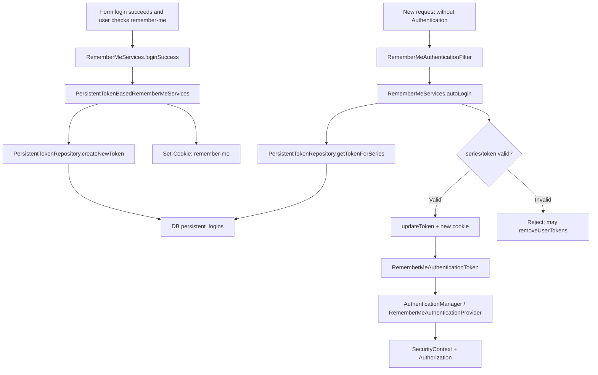
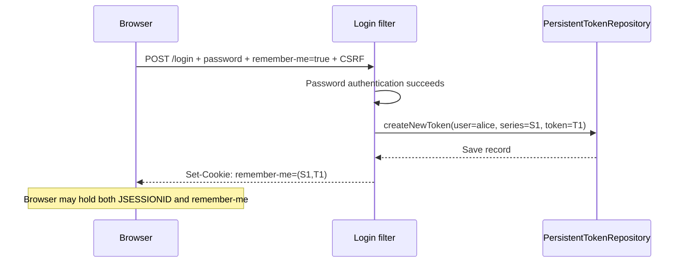

# PersistentTokenBasedRememberMeServices and PersistentTokenRepository in Spring Security

**Topic:** *Remember Me* in Spring Security Servlet. An HTTP session may expire, yet the application still recognizes the user from a previously issued remember-me cookie. When you need a token mechanism that can be stored, rotated, and revoked server-side, Spring Security provides **`PersistentTokenBasedRememberMeServices`** together with **`PersistentTokenRepository`**.

**Goal:** Properly understand the `series`/`token` mechanism, the create – verify – rotate – revoke lifecycle; choose between `JdbcTokenRepositoryImpl` or a custom repository; configure Spring Security 6; write tests that distinguish normal sessions from remember-me auto-login; and recognize risks of token replay, cookie theft, concurrent requests, expired records, and logout scenarios that do not revoke as expected.

> **Security scope:** Remember-me is a long-lived credential in the browser, **not** a `JSESSIONID` cookie, not a JWT access token, and not proof of MFA or recent login. It can automatically reconstruct `Authentication` on a new request. Therefore, restrict privileges on sensitive actions and protect the cookie like a real secret.

## 1. Why is persistent remember-me needed?

A typical web app has two levels of state:

- **Short-lived session:** `HttpSession` holds `SecurityContext` for a period of time. The browser sends `JSESSIONID` to reuse authenticated state.
- **Long-lived remember-me (optional):** the user checks “Remember me” during login. The server issues a separate cookie. Later, if `SecurityContext` lacks an `Authentication`, Spring Security can use that cookie to automatically re-identify the user without prompting for a password immediately.

Example:

```text
10:00  Alice logs in via form with "remember-me".
       Response includes session cookie + remember-me cookie.

10:30  Short-lived session is deleted or browser reopens without JSESSIONID.
       Remember-me cookie remains within its validity window.

10:31  Browser sends GET /api/me with remember-me cookie.
       Spring Security verifies persistent token against server-side store.
       If valid, request is authenticated with RememberMeAuthenticationToken.

10:31  Server rotates token, updates store, and sends new remember-me cookie.
       Subsequent requests must use that new cookie.
```

Not every application should enable remember-me: financial environments, admin panels, shared computers, MFA-gated actions, or ultra-sensitive data may need re-authentication. **Remember-me lifetime** and **session lifetime** are two separate policies.

### Two different remember-me approaches

| Aspect | `TokenBasedRememberMeServices` (hash-based) | `PersistentTokenBasedRememberMeServices` |
| --- | --- | --- |
| Proof inside cookie | Signed/hashed value depending on username, expiry, password, and key | Encoded random `series` + `token` pair placed in cookie |
| Requires token DB/store? | No separate token repository needed | **Yes**: `PersistentTokenRepository` |
| Verification method | Compute and match token from user data/key | Look up `series` in DB, compare issued token |
| Token rotation on each auto-login | No persistent rotating-token model | Yes: keep `series`, generate new token, update DB, issue new cookie |
| Active revocation | Usually requires changing password/key or extending design | `removeUserTokens(username)`, deleting records/custom strategy |
| Risks | Stolen cookie usable until expiry or signing inputs change | Stolen cookie remains a credential; replaying old token can trigger mismatch detection |
| Suitability | Simple requirements, revocation limits accepted | Better token management, rotation, and auditing required |

Persistent tokens are preferred when server-side control is desired, **but are not immune** to token theft, race conditions, or missing user-state checks. Both types require `UserDetailsService` to load the user during remember-me authentication.

## 2. Components and responsibilities



**`PersistentTokenBasedRememberMeServices`** is the `RememberMeServices` implementation responsible for creating cookies/records on successful login, reading tokens on new requests, rotating tokens, checking expiration, invoking the repository, and cancelling credentials on appropriate logout. Its primary constructor accepts `key`, `UserDetailsService`, and `PersistentTokenRepository`.

**`PersistentTokenRepository`** is the abstraction holding persistent login data. It does not authenticate passwords itself, does not issue JWTs, and does not manage `HttpSession`. Four methods:

```java
void createNewToken(PersistentRememberMeToken token);
void updateToken(String series, String tokenValue, Date lastUsed);
PersistentRememberMeToken getTokenForSeries(String seriesId);
void removeUserTokens(String username);
```

Explanation:

| Method | Who calls / when | What must be guaranteed |
| --- | --- | --- |
| `createNewToken(...)` | Login succeeds with remember-me enabled | Persist `username`, unique `series`, initial token, `lastUsed`; uniqueness constraint |
| `getTokenForSeries(seriesId)` | Auto-login from cookie | Return exact record or `null` if absent; never trust a username self-declared in the cookie |
| `updateToken(series,newValue,lastUsed)` | Token just verified successfully | Replace token for existing series, update timestamp; handle transactions/races per policy |
| `removeUserTokens(username)` | Logout/revocation/cookie theft detection depending on context | Revoke the user's series; note the scope is **all remember-me sessions** for that user |

Built-in implementations:

- **`JdbcTokenRepositoryImpl`:** stores via `DataSource` and the `persistent_logins` table; a good starting point when the app already has a SQL DB.
- **`InMemoryTokenRepositoryImpl`:** useful for tests or demos, but not durable across restarts and not shared across instances.
- **Custom `PersistentTokenRepository`:** for Redis/custom SQL or systems needing per-device management, TTL, atomic rotation, and telemetry. Must preserve contract semantics and safeguard sensitive data.

**Do not confuse:** this repository manages remember-me tokens, not `UserDetailsRepository`, `OAuth2AuthorizedClientService`, session stores, or OAuth2 refresh token tables.

## 3. Persistent cookie: `series` + `token` structure

In the persistent implementation, the remember-me cookie encodes two components:

```text
remember-me=<encoded-cookie-value>

Logical internals (not the literal wire string):
    series = stable random identifier for a login series
    token  = currently active random secret for that series
```

The username is not stored directly as either component. The server looks up `username` from the record matching `series` in `PersistentTokenRepository`.

Example **mock** data:

| username | series | token | last_used |
| --- | --- | --- | --- |
| alice | `SERIES-A` | `TOKEN-V1` | 2026-01-01 09:00:00 |
| alice | `SERIES-B` | `TOKEN-OTHER` | 2026-01-02 10:00:00 |

These two rows represent two separate remember-me series for Alice, **not necessarily** two active `HttpSession`s. In reality, series/token are random strings with sufficient entropy; `SERIES-A` and `TOKEN-V1` merely illustrate the algorithm.

### 3.1. Successful login: create new series + token



Tokens are normally created inside the `loginSuccess` hook of the standard login mechanism. The checkbox must actually be submitted with the `remember-me` parameter (or a custom name). If the user does not opt in, no persistent cookie should be issued. `alwaysRemember(true)` bypasses this choice and alters UX/security policy; use only intentionally.

### 3.2. Subsequent request: verify then rotate

When the session no longer holds an `Authentication`, `RememberMeAuthenticationFilter` calls `autoLogin`. The implementation:

1. Reads and decodes the cookie: must have exactly two parts, `series` and `token`.
2. Looks up the record via `getTokenForSeries(series)`.
3. Series not found: reject auto-login.
4. Series exists but token mismatches: handle as **suspected cookie theft/replay**; the implementation calls `removeUserTokens(username)` and throws `CookieTheftException`.
5. Token matches but is past expiration: reject.
6. Valid: generate a **new token** `T2`, call `updateToken(S1,T2,newDate)`, and return a cookie carrying `(S1,T2)`.
7. Load `UserDetails`, create `RememberMeAuthenticationToken`; Spring Security verifies via `RememberMeAuthenticationProvider`/`AuthenticationManager` and stores it in `SecurityContext`.

```text
Before auto-login:
DB:     series=S1, token=T1, last_used=t1
Cookie: series=S1, token=T1

After successful auto-login:
DB:     series=S1, token=T2, last_used=t2
Cookie: series=S1, token=T2

Old cookie T1 is no longer a valid credential.
```

**Rotation replaces the token, not the series.** `JSESSIONID` is a separate concept; requests with a valid session that already contains an `Authentication` normally do not need remember-me auto-login again.

### 3.3. Why is a mismatch treated as suspected theft?

If `S1`'s record is currently `T2`, yet a client presents `S1/T1`, someone may be holding an old cookie copy. By default this class reacts strongly: it deletes the user's persistent tokens in the repository and raises `CookieTheftException`. This is an **indicator**, not forensic certainty of an attack: two concurrent requests may have used the same old cookie, or the new response cookie may not yet have been applied by the browser.

```mermaid
sequenceDiagram
    participant A as Browser Tab A
    participant B as Browser Tab B
    participant S as Server/Repository
    Note over A,B: Both carry cookie S1,T1
    A->>S: Auto-login with S1,T1
    S->>S: Token T1 valid, rotated to T2
    S-->>A: Set-Cookie S1,T2
    B->>S: Another request still carrying S1,T1
    S->>S: Mismatch T1 vs T2
    S-->>B: Reject; may revoke user's tokens
```

This is a **race/replay** issue to test with SPAs firing parallel API calls right after session expiry, load balancers, multiple tabs, and network latency. The default implementation does not provide compare-and-swap transactions for arbitrary custom repositories; if high concurrency is needed, design the token storage/rotation layer carefully, consider safe retry policies, and avoid accidentally opening replay windows. Do not simply disable mismatch detection to “reduce errors”.

## 4. Schema and JdbcTokenRepositoryImpl

Spring Security provides the following common table schema; adapt dialect/migrations to your database:

```sql
CREATE TABLE persistent_logins (
    username VARCHAR(64) NOT NULL,
    series VARCHAR(64) PRIMARY KEY,
    token VARCHAR(64) NOT NULL,
    last_used TIMESTAMP NOT NULL
);

CREATE INDEX idx_persistent_logins_username
    ON persistent_logins(username);
```

Meaning of the four core columns:

- `username`: username used to load `UserDetails` and revoke the user's tokens.
- `series`: unique key for fast lookup and to ensure a series is never shared across two users.
- `token`: current remember-me secret value, **not** a password hash and not a JWT.
- `last_used`: timestamp when the token was saved/rotated, compared against `tokenValiditySeconds` in the implementation.

**Data protection:** by default the DB stores token values for direct matching; treat the table as sensitive data. Restrict SELECT/UPDATE/DELETE privileges to the service, enforce backup encryption, log masking, auditing, and retention. If building a custom repository to store hashed tokens, align the `getTokenForSeries()` contract and service comparison (by default, the cookie token is compared directly against the returned string); **you cannot naively replace raw DB tokens with hashes** and expect the stock code to authenticate.

### 4.1. Expiration: cookie expiry does not mean the DB cleans itself

Suppose `tokenValiditySeconds` is set to 7 days. The remember-me service checks the stored token timestamp plus the validity duration and rejects expired tokens. However, expired rows **are not automatically deleted simply because they were rejected**; a dedicated cleanup job is needed for long-running databases.

Simple cleanup example (illustrative SQL; interval syntax depends on DB):

```sql
-- PostgreSQL example: 7-day validity.
DELETE FROM persistent_logins
WHERE last_used < (CURRENT_TIMESTAMP - INTERVAL '7 days');
```

In production, cleanup thresholds must align with `tokenValiditySeconds`, timezone, clock skew, and retention policies. Because every valid auto-login updates `last_used`, expiration in this design behaves as **sliding activity-based renewal**; if you need an absolute cap from initial issuance, store an extra `created_at` column in a custom repository/logic or enforce separate re-authentication.

### 4.2. Do not use setCreateTableOnStartup in production

`JdbcTokenRepositoryImpl` has a convenience option to auto-create the schema for demos, but do not rely on it for production database migrations. Use Flyway/Liquibase or reviewed migrations; ensure schema creation runs once with proper permissions and rollback support. The demo below uses `schema.sql` with embedded H2 for hands-on ease.

### 4.3. Durability across multi-instance clusters

If the application runs multiple instances:

- All nodes must query the **same** sufficiently consistent persistent token store.
- Rotation updates the DB before sending the new cookie; if the response is lost on the network, the client may still hold the old token and trigger a mismatch next time.
- Infrastructure must monitor DB connection errors; auto-login must never “fail open” when the repository is unreachable.
- Avoid long-lived token caching without invalidation, since `updateToken` on instance A must be visible to instance B.
- Consider contention controls when multiple requests for the same series arrive concurrently; distributed testing is mandatory when high reliability is required.

## 5. Spring Boot 3 / Spring Security 6 / Java 17 lab: JDBC remember-me

The following lab provides **complete source code** for an illustrative app using embedded H2. It demonstrates:

- Form login issues remember-me only when the user selects `remember-me`.
- The remember-me cookie exists independently of `JSESSIONID`.
- A new request **with only the remember-me cookie** auto-authenticates Alice and rotates the token.
- A sensitive endpoint with `.fullyAuthenticated()` **rejects** remember-me authentication; entering full credentials is required.
- The repository holds the record and can revoke it.

### 5.1. Structure

```text
persistent-rememberme-lab/
├── pom.xml
└── src/
    ├── main/java/example/RememberMeApplication.java
    ├── main/resources/schema.sql
    ├── main/resources/application.properties
    └── test/java/example/RememberMeApplicationTests.java
```

### 5.2. Maven dependencies

`pom.xml`:

```xml
<project xmlns="http://maven.apache.org/POM/4.0.0"
         xmlns:xsi="http://www.w3.org/2001/XMLSchema-instance"
         xsi:schemaLocation="http://maven.apache.org/POM/4.0.0 https://maven.apache.org/xsd/maven-4.0.0.xsd">
    <modelVersion>4.0.0</modelVersion>
    <parent>
        <groupId>org.springframework.boot</groupId>
        <artifactId>spring-boot-starter-parent</artifactId>
        <version>3.3.9</version>
        <relativePath/>
    </parent>
    <groupId>example</groupId>
    <artifactId>persistent-rememberme-lab</artifactId>
    <version>1.0.0</version>
    <properties><java.version>17</java.version></properties>
    <dependencies>
        <dependency>
            <groupId>org.springframework.boot</groupId>
            <artifactId>spring-boot-starter-web</artifactId>
        </dependency>
        <dependency>
            <groupId>org.springframework.boot</groupId>
            <artifactId>spring-boot-starter-security</artifactId>
        </dependency>
        <dependency>
            <groupId>org.springframework.boot</groupId>
            <artifactId>spring-boot-starter-jdbc</artifactId>
        </dependency>
        <dependency>
            <groupId>com.h2database</groupId>
            <artifactId>h2</artifactId>
            <scope>runtime</scope>
        </dependency>
        <dependency>
            <groupId>org.springframework.boot</groupId>
            <artifactId>spring-boot-starter-test</artifactId>
            <scope>test</scope>
        </dependency>
        <dependency>
            <groupId>org.springframework.security</groupId>
            <artifactId>spring-security-test</artifactId>
            <scope>test</scope>
        </dependency>
    </dependencies>
    <build>
        <plugins>
            <plugin>
                <groupId>org.springframework.boot</groupId>
                <artifactId>spring-boot-maven-plugin</artifactId>
            </plugin>
        </plugins>
    </build>
</project>
```

Spring Boot 3.3.9 is a suitable learning baseline for Spring Security 6 APIs; real deployments must choose a currently supported and patched version.

### 5.3. Token storage table

`src/main/resources/schema.sql`:

```sql
CREATE TABLE persistent_logins (
    username VARCHAR(64) NOT NULL,
    series VARCHAR(64) PRIMARY KEY,
    token VARCHAR(64) NOT NULL,
    last_used TIMESTAMP NOT NULL
);

CREATE INDEX idx_persistent_logins_username
    ON persistent_logins (username);
```

`src/main/resources/application.properties`:

```properties
spring.datasource.url=jdbc:h2:mem:rememberme;DB_CLOSE_DELAY=-1
spring.datasource.username=sa
spring.datasource.password=
spring.sql.init.mode=always
```

This is an in-memory DB and is **not durable across JVM restarts**. Real products replace it with PostgreSQL/MySQL/managed DBs and migrations; never expose the H2 console to the internet.

### 5.4. Java app configuring PersistentTokenRepository

`src/main/java/example/RememberMeApplication.java`:

```java
package example;

import java.util.Map;
import javax.sql.DataSource;

import org.springframework.boot.SpringApplication;
import org.springframework.boot.autoconfigure.SpringBootApplication;
import org.springframework.context.annotation.Bean;
import org.springframework.http.HttpStatus;
import org.springframework.security.config.Customizer;
import org.springframework.security.config.annotation.web.builders.HttpSecurity;
import org.springframework.security.core.Authentication;
import org.springframework.security.core.userdetails.User;
import org.springframework.security.core.userdetails.UserDetailsService;
import org.springframework.security.crypto.factory.PasswordEncoderFactories;
import org.springframework.security.crypto.password.PasswordEncoder;
import org.springframework.security.provisioning.InMemoryUserDetailsManager;
import org.springframework.security.web.SecurityFilterChain;
import org.springframework.security.web.authentication.HttpStatusEntryPoint;
import org.springframework.security.web.authentication.rememberme.JdbcTokenRepositoryImpl;
import org.springframework.security.web.authentication.rememberme.PersistentTokenRepository;
import org.springframework.web.bind.annotation.GetMapping;
import org.springframework.web.bind.annotation.RestController;

@SpringBootApplication
public class RememberMeApplication {
    public static void main(String[] args) {
        SpringApplication.run(RememberMeApplication.class, args);
    }

    @Bean
    PasswordEncoder passwordEncoder() {
        return PasswordEncoderFactories.createDelegatingPasswordEncoder();
    }

    @Bean
    UserDetailsService users(PasswordEncoder encoder) {
        return new InMemoryUserDetailsManager(
                User.withUsername("alice")
                        .password(encoder.encode("demo-password"))
                        .roles("USER")
                        .build());
    }

    @Bean
    PersistentTokenRepository persistentTokenRepository(DataSource dataSource) {
        JdbcTokenRepositoryImpl repository = new JdbcTokenRepositoryImpl();
        repository.setDataSource(dataSource);
        // schema.sql creates the table explicitly.
        return repository;
    }

    @Bean
    SecurityFilterChain webSecurity(
            HttpSecurity http,
            UserDetailsService users,
            PersistentTokenRepository tokenRepository) throws Exception {
        return http
                .authorizeHttpRequests(auth -> auth
                        .requestMatchers("/login", "/error").permitAll()
                        .requestMatchers("/api/sensitive").fullyAuthenticated()
                        .anyRequest().authenticated())
                .formLogin(Customizer.withDefaults())
                .rememberMe(remember -> remember
                        .userDetailsService(users)
                        .tokenRepository(tokenRepository)
                        .key("lab-only-change-this-key-in-production")
                        .rememberMeParameter("remember-me")
                        .tokenValiditySeconds(7 * 24 * 60 * 60))
                .exceptionHandling(ex -> ex.authenticationEntryPoint(
                        new HttpStatusEntryPoint(HttpStatus.UNAUTHORIZED)))
                .build();
    }

    @RestController
    static class Api {
        @GetMapping("/api/me")
        Map<String, String> me(Authentication authentication) {
            return Map.of(
                    "username", authentication.getName(),
                    "authType", authentication.getClass().getSimpleName());
        }

        @GetMapping("/api/sensitive")
        Map<String, String> sensitive(Authentication authentication) {
            return Map.of(
                    "username", authentication.getName(),
                    "status", "fully-authenticated");
        }
    }
}
```

**Why does this configuration select the persistent implementation?**

- `.tokenRepository(tokenRepository)` is the key point. When configuring remember-me via the DSL and providing a repository, the framework uses the persistent token approach instead of only the default hash-based approach.
- `.userDetailsService(users)` specifies how to load `UserDetails` once the series/token is valid.
- `.rememberMeParameter("remember-me")` lets the user opt in during POST login. Do not enable `alwaysRemember(true)` in the exercise.
- `.tokenValiditySeconds(...)` defines the validity window. It is not the `HttpSession` idle timeout.
- `.key(...)` maintains consistency across remember-me authentication infrastructure; the lab uses a fixed value for reproducibility. **Production:** retrieve the secret/key from a secrets management system, rotate on schedule, and never commit real keys into source.
- `.fullyAuthenticated()` protects sensitive endpoints from treating remember-me authentication as equivalent to a full login. On access, the client must perform interactive login to obtain the proper authentication level. If the endpoint requires MFA, a dedicated MFA policy is still needed; `.fullyAuthenticated()` does not verify MFA on its own.
- Spring Security keeps CSRF enabled by default. `POST /login` and `POST /logout` forms must carry valid CSRF tokens. Because the remember-me cookie **is sent automatically by the browser**, there is no reason to disable CSRF.

**Practical flow note:** Remember-me is issued when the authentication filter calls the `loginSuccess(...)` hook; if an application builds a custom JSON login controller/endpoint that only calls `AuthenticationManager.authenticate(...)` and returns `200`, it **does not automatically invoke remember-me hooks**. Custom flows must integrate `RememberMeServices`, session strategies, and context persistence explicitly, or use an appropriate authentication filter. Never expose raw passwords or remember-me cookies in JSON responses or logs.

## 6. Integration test: proving session and remember-me differ

`MockMvc` runs through Spring Security filters without opening a real HTTP port. The tests below **intentionally omit the session** on subsequent requests to prove authentication comes from the remember-me cookie.

Create `src/test/java/example/RememberMeApplicationTests.java`:

```java
package example;

import jakarta.servlet.http.Cookie;

import org.junit.jupiter.api.BeforeEach;
import org.junit.jupiter.api.Test;
import org.springframework.beans.factory.annotation.Autowired;
import org.springframework.boot.test.autoconfigure.web.servlet.AutoConfigureMockMvc;
import org.springframework.boot.test.context.SpringBootTest;
import org.springframework.jdbc.core.JdbcTemplate;
import org.springframework.mock.web.MockHttpSession;
import org.springframework.security.web.authentication.rememberme.PersistentTokenRepository;
import org.springframework.test.web.servlet.MockMvc;
import org.springframework.test.web.servlet.MvcResult;

import static org.assertj.core.api.Assertions.assertThat;
import static org.springframework.security.test.web.servlet.request
        .SecurityMockMvcRequestBuilders.formLogin;
import static org.springframework.security.test.web.servlet.request
        .SecurityMockMvcRequestPostProcessors.csrf;
import static org.springframework.test.web.servlet.request
        .MockMvcRequestBuilders.get;
import static org.springframework.test.web.servlet.request
        .MockMvcRequestBuilders.post;
import static org.springframework.test.web.servlet.result
        .MockMvcResultMatchers.jsonPath;
import static org.springframework.test.web.servlet.result
        .MockMvcResultMatchers.status;

@SpringBootTest
@AutoConfigureMockMvc
class RememberMeApplicationTests {
    @Autowired
    MockMvc mvc;
    @Autowired
    JdbcTemplate jdbc;
    @Autowired
    PersistentTokenRepository tokens;

    @BeforeEach
    void clearRememberMeTokens() {
        tokens.removeUserTokens("alice");
    }

    private MvcResult login(boolean remember) throws Exception {
        var request = formLogin()
                .user("alice")
                .password("demo-password");
        if (remember) {
            request.param("remember-me", "true");
        }
        return mvc.perform(request)
                .andExpect(status().is3xxRedirection())
                .andReturn();
    }

    private int tokenCount() {
        Integer count = jdbc.queryForObject(
                "SELECT COUNT(*) FROM persistent_logins WHERE username = ?",
                Integer.class, "alice");
        return count == null ? 0 : count;
    }

    @Test
    void optInCreatesPersistentTokenAndAutoLoginRotatesCookie()
            throws Exception {
        MvcResult signedIn = login(true);
        Cookie original = signedIn.getResponse().getCookie("remember-me");
        assertThat(original).isNotNull();
        assertThat(tokenCount()).isEqualTo(1);

        // Do not pass MockHttpSession from login:
        // new browser has only the remember-me cookie, no JSESSIONID.
        MvcResult remembered = mvc.perform(get("/api/me").cookie(original))
                .andExpect(status().isOk())
                .andExpect(jsonPath("$.username").value("alice"))
                .andExpect(jsonPath("$.authType")
                        .value("RememberMeAuthenticationToken"))
                .andReturn();

        Cookie rotated = remembered.getResponse().getCookie("remember-me");
        assertThat(rotated).isNotNull();
        assertThat(rotated.getValue()).isNotEqualTo(original.getValue());
        assertThat(tokenCount()).isEqualTo(1); // Same series, new token.

        // Remember-me suffices for /api/me, NOT for /api/sensitive.
        mvc.perform(get("/api/sensitive").cookie(rotated))
                .andExpect(status().isUnauthorized());
    }

    @Test
    void noOptInDoesNotCreatePersistentToken() throws Exception {
        MvcResult signedIn = login(false);
        assertThat(signedIn.getResponse().getCookie("remember-me")).isNull();
        assertThat(tokenCount()).isZero();

        mvc.perform(get("/api/me"))
                .andExpect(status().isUnauthorized());
    }

    @Test
    void reusingOldCookieAfterRotationRevokesRememberMeTokens()
            throws Exception {
        Cookie original = login(true)
                .getResponse().getCookie("remember-me");
        assertThat(original).isNotNull();

        MvcResult accepted = mvc.perform(get("/api/me").cookie(original))
                .andExpect(status().isOk())
                .andReturn();
        Cookie current = accepted.getResponse().getCookie("remember-me");
        assertThat(current).isNotNull();

        // Replay old token with an existing series -> mismatch;
        // by default PersistentTokenBasedRememberMeServices deletes user tokens.
        mvc.perform(get("/api/me").cookie(original))
                .andExpect(status().isUnauthorized());
        assertThat(tokenCount()).isZero();

        mvc.perform(get("/api/me").cookie(current))
                .andExpect(status().isUnauthorized());
    }

    @Test
    void logoutWithAuthenticatedSessionRevokesUserTokens()
            throws Exception {
        MvcResult signedIn = login(true);
        MockHttpSession authenticatedSession =
                (MockHttpSession) signedIn.getRequest().getSession(false);
        assertThat(authenticatedSession).isNotNull();
        assertThat(tokenCount()).isEqualTo(1);

        // SecurityContext holds Authentication when LogoutFilter runs.
        mvc.perform(post("/logout")
                        .session(authenticatedSession)
                        .with(csrf()))
                .andExpect(status().is3xxRedirection());

        assertThat(tokenCount()).isZero();
    }
}
```

Run:

```bash
mvn test
```

**Expected:** four tests PASS and Maven finishes with `BUILD SUCCESS` when dependencies and environment are properly set up. This is the **expected outcome** of the tutorial, not an observed run log. `MockMvc` simulates HTTP requests/filters and selected cookies; it does not simulate full browser profiles, persistence across restarts, or multi-node concurrency.

### 6.1. Analyzing what each test means

**Test 1:** With opt-in, the database holds one row. Then the second request **without a session** carries only the remember-me cookie; `RememberMeAuthenticationToken` indicates it is an auto-login rather than the old session. The new cookie differs from the initial cookie while the row count stays one: the same series was rotated.

**Test 2:** Without the `remember-me` checkbox, login can still succeed with a session, yet issues no persistent cookie. A fresh request without session or remember-me must be unauthenticated.

**Test 3:** A pre-rotation cookie is not accepted again. By Spring Security defaults, a mismatch on the same series is treated as suspected token theft, and the repository deletes the user's remember-me tokens. This protects against replay **but can also be triggered by two parallel requests** using the old cookie.

**Test 4:** Logging out while holding a session `Authentication` invokes `removeUserTokens(username)`. Because the repository API only deletes by username, this logout can wipe remember-me on the user's other devices as well. Evaluate “logout this device” vs. “logout all devices” UX against your product contract.

### 6.2. Limitation of the logout test

`LogoutFilter` sits before `RememberMeAuthenticationFilter` in the usual filter chain. If a client sends **only the remember-me cookie** to `/logout` without session authentication, the logout handler may be called with `authentication == null` before remember-me auto-login happens. In that case the implementation still clears the cookie on the response, **but does not necessarily revoke rows in the repository** because it lacks a username from `Authentication`.

That is why the logout test above intentionally uses an **authenticated session**. When a design requires reliable revocation even when the session is gone, you need an appropriately authenticated “revoke remember-me credential” flow with CSRF protection, or another policy-aligned revocation mechanism. Never read raw cookie strings in a controller to delete accounts arbitrarily; it is a credential requiring proper verification and handling.

### 6.3. HTTP and browser testing beyond MockMvc

In a running environment with the H2 cookie demo:

1. Open the `/login` form, enable “Remember me”, and log in.
2. DevTools → Application/Cookies: observe `JSESSIONID` and `remember-me` are **two separate cookies**.
3. Send a `/api/me` request and verify the full-login auth type; the remember-me cookie may not rotate while the session provides Authentication.
4. In a **separate browser profile/HTTP client**, send only the `remember-me` cookie: `/api/me` will auto-login if the cookie/token is valid, returning a rotated cookie.
5. Replay the old cookie to compare; after a mismatch, the user's remember-me tokens may be revoked.
6. Visit `/api/sensitive` with remember-me only: rejected per `fullyAuthenticated()`. Perform full login and retry.
7. Verify logout, password change, and reset/revocation per policy.

**Never put raw remember-me cookies/series/tokens into screenshots, logs, tickets, or public repositories**, as they are usable login credentials.

## 7. Security, revocation, and production operations

### 7.1. Cookies are long-lived credentials

- Always use **HTTPS/TLS** and the `Secure` flag in production. Use `HttpOnly` to curb direct JavaScript access; configure `SameSite` and `Path`/`Domain` per client needs.
- Because browsers send remember-me cookies automatically, **CSRF must still be evaluated** for state-changing operations. `SameSite` only helps mitigate risk and does not replace a full CSRF policy.
- Never use remember-me as proof of MFA. For password changes, funds transfers, admin actions, or email changes, require re-authentication/step-up per policy. `.fullyAuthenticated()` separates remember-me from full login, **but does not check MFA itself**.
- Prevent XSS, session fixation, and cookie leaks via logging/proxies and caches; keep remember-me lifetimes short enough relative to application sensitivity.
- Do not broaden cookie domains across all subdomains unnecessarily. If less-trusted apps reside on other subdomains, domain-wide cookies expand the attack surface.

### 7.2. Revoking on password change, user lock, or account deletion

`PersistentTokenBasedRememberMeServices` uses the repository and loads users, yet **does not automatically infer** every password-change or user-disable event. Wire these events together:

```java
// ILLUSTRATIVE SNIPPET inside an authenticated account service
// (not a standalone controller):
userService.changePasswordForCurrentUser(newPassword);
persistentTokenRepository.removeUserTokens(currentUsername);
```

This is business pseudocode, not a full transactional flow. On password change or account lock, policy must decide how remember-me, sessions, and other tokens are revoked. If the password changes without clearing `persistent_logins`, a persistent cookie could still verify by series/token and load the updated `UserDetails`. Write tests ensuring the revocation policy works properly.

### 7.3. Single-device logout or all-device logout?

With the default `removeUserTokens(String username)` API, there is no “delete a single series” method in the standard interface. If the app needs a device list and per-device logout:

- Create a custom schema/abstraction with device identifiers and bounded metadata.
- Revoke only a series that has been verified to belong to the right account, never relying on an arbitrary user-controlled identifier.
- Protect revocation routes, require re-authentication for sensitive actions, and enforce CSRF protection.
- Do not expose raw tokens in device listings. Treat sessions and remember-me as two distinct credential stores needing coordinated management.

A user clicking “Logout” may expect only the current device to sign out; the system must clearly communicate if it revokes all remember-me tokens. Never treat clearing a browser cookie as equivalent to deleting server-side records.

### 7.4. Timeouts, cleanup, and monitoring

- Use `tokenValiditySeconds` for remember-me and `server.servlet.session.timeout` for sessions. Do not mix the two durations.
- Clean up expired records because the service may **reject tokens without deleting DB rows**.
- Monitor record counts per user and token age; cap series count per risk policy. Monitor mismatch rates, DB update errors, retry patterns, and concurrency false positives.
- `JdbcTokenRepositoryImpl` can fail when creating/updating tokens. A successful password login does not guarantee remember-me was issued if the DB errored; inspect both `Set-Cookie` and the store in tests.
- If DB connectivity is lost during auto-login, reject remember-me rather than “trusting the cookie because the DB is down”.
- In a cluster, all instances must share a consistent store and keep the remember-me key synchronized. Test multi-tab/multi-request behavior and response cookie rotation.

## 8. Troubleshooting when remember-me fails

| Symptom | Common cause | How to verify |
| --- | --- | --- |
| Login succeeds yet no remember-me cookie | Checkbox/parameter omitted, `rememberMe` unconfigured, loginSuccess hook skipped, DB create failed | Check form request, key params, filter/remember-me config, redacted server logs |
| Cookie exists yet no DB row | Persistent repository not used or DB write failed | Check `.tokenRepository(...)`, correct datasource/schema and transaction |
| DB row exists yet browser still prompted to log in | Cookie not sent due to domain/path/SameSite/Secure, other session/auth handling, expired token | DevTools Network, `getTokenForSeries`, general logs, policy |
| Cookie has right series yet token differs from DB | Token rotated, replay/race, or copied cookie | Check request sequence and mismatch alerts; do not log raw tokens |
| Token rotated yet response was lost | Client retains old token, causing mismatch next time | Monitor timeouts/retries/load balancer, concurrency design, and re-login UX |
| Restart loses remember-me | Using `InMemoryTokenRepositoryImpl` or in-memory H2 DB | Use a shared persistent DB |
| `/api/me` works, `/api/sensitive` returns 401 | Remember-me authenticated but endpoint requires `fullyAuthenticated()` | Check auth type and security rules; full login required |
| Logout clears cookie yet DB row remains | Logout handler lacked `Authentication` or custom logout did not revoke | Check filter order, `logout(Authentication)`, and policy |
| Password changed yet old cookie still logs in | Persistent tokens were not deleted on password change | Integrate account lifecycle with `removeUserTokens` |
| DB table grows continuously | Service does not auto-delete all expired tokens | Scheduled cleanup, retention, and quotas |
| Concurrent requests log the user out | Same old cookie rotated on one request while another hits mismatch | Parallel load testing, retry monitoring, atomicity/grace design |
| HTTP 403 on POST despite valid remember-me | Missing/wrong CSRF or insufficient authorization | Separate CSRF from auth; never disable CSRF just to bypass errors |

**Do not diagnose from a status code alone.** `401` can stem from missing authentication, an invalid cookie, or an endpoint demanding full login; `403` can come from missing authorities or CSRF. Inspect the security chain, server events, repository, and what the request actually carried.

## 9. Mistakes to avoid

1. **“A remember-me cookie is just JSESSIONID.”** False. Remember-me can re-authenticate **when the session is gone**, and a long-lived credential differs from a session ID.
2. **“Having `PersistentTokenRepository` definitely means JWT.”** False. The repository holds remember-me's own series/token; it is not an OAuth2 access/refresh-token store.
3. **“The cookie is base64-encoded, so nobody can read or use it.”** False. Base64 is an encoding, not cryptographic encryption; the cookie is a bearer credential that must be protected from theft.
4. **“If tokens rotate, a stolen cookie cannot be used.”** False. Anyone holding the current cookie can use it before the rightful owner; rotation limits replay and flags mismatches rather than preventing all theft.
5. **“A mismatch always proves an attacker.”** False. Concurrent requests or dropped responses can cause the same series to present an old token. Investigate before attributing root cause.
6. **“Logout always deletes all tokens in every scenario.”** False. The implementation deletes by username when `Authentication` is present; if logout lacks identity, merely expiring the cookie may not suffice.
7. **“Changing the password automatically revokes persistent tokens.”** Do not rely on that. When business policy requires it, explicitly delete tokens and test.
8. **“With a 7-day expiry, the DB cleans itself.”** False. Rejecting expired tokens in the service does not replace a cleanup job.
9. **“`authenticated()` is enough for money transfers.”** No. Remember-me counts as authenticated. Use re-authentication/step-up or `.fullyAuthenticated()` as appropriate, plus MFA if policy requires.
10. **“Use `InMemoryTokenRepositoryImpl` for a production cluster.”** False. Restarts and multiple instances make data inconsistent.
11. **“Just configuring `PersistentTokenBasedRememberMeServices` makes custom JSON login issue cookies automatically.”** False if a custom controller fails to call `RememberMeServices.loginSuccess(...)` at the right moment.
12. **“As long as the cookie exists, the session exists.”** False. Remember-me cookies can outlive `HttpSession`, and only reconstruct auth when a matching filter runs.

## 10. Implementation and testing checklist

- [ ] Genuine need for remember-me; clear opt-in UX, not enabled by default on shared devices or high-risk flows.
- [ ] `PersistentTokenBasedRememberMeServices` and `PersistentTokenRepository` configured properly without mixing with JWT or session stores.
- [ ] `persistent_logins` schema has unique `series`, least-privilege DB access, and controlled migrations.
- [ ] Opt-in login generates random series/token, saves to DB, and issues cookie; no opt-in creates neither.
- [ ] Request without session but with valid cookie produces `RememberMeAuthenticationToken`.
- [ ] Auto-login rotates token while preserving series; old cookie is no longer valid.
- [ ] Mismatched cookies, unknown series, malformed cookies, and expired tokens are rejected per policy.
- [ ] Negative tests for replay/mismatch and concurrent requests; sound UX handling without disabling security checks.
- [ ] Sensitive APIs require full login/MFA when needed; remember-me does not elevate assurance by itself.
- [ ] Cookies have appropriate Secure/HttpOnly/SameSite/Path/Domain; HTTPS mandatory in production; CSRF stays protected.
- [ ] Logout with `Authentication` revokes tokens properly; test sessionless logout flows and “one device vs. all devices” behavior.
- [ ] Password change, account disable, credential reset, and user deletion have explicit remember-me revocation policies.
- [ ] Cleanup of expired tokens, auditing of repository failures, and monitoring of token-theft signals without exposing raw tokens.
- [ ] Multi-instance shared store, retries/races, and rotation tested under realistic load.
- [ ] End-to-end tests in real browsers/HTTP clients alongside MockMvc; verify cookies and data store rather than only checking `200` responses.

**Remember:** `PersistentTokenBasedRememberMeServices` handles **remember-me logic**; `PersistentTokenRepository` handles **persistent token state**. Every valid auto-login must verify series/token, update both token and cookie, and then establish remember-me identity. Treat remember-me as a stealable credential requiring expiration, revocation, concurrency testing, and strict privilege separation.

## Official documentation

- [Spring Security 6.5 — Remember-Me Authentication](https://docs.spring.io/spring-security/reference/6.5/servlet/authentication/rememberme.html): both implementations and `RememberMeServices` hooks.
- [Spring Security 6.5 — PersistentTokenBasedRememberMeServices API](https://docs.spring.io/spring-security/reference/6.5/api/java/org/springframework/security/web/authentication/rememberme/PersistentTokenBasedRememberMeServices.html): creating, verifying, rotating tokens, and `CookieTheftException`.
- [Spring Security — PersistentTokenRepository API](https://docs.spring.io/spring-security/reference/api/java/org/springframework/security/web/authentication/rememberme/PersistentTokenRepository.html): the four repository methods.
- [Spring Security — Database Schema](https://docs.spring.io/spring-security/reference/6.5/servlet/appendix/database-schema.html): `persistent_logins` table.
- [Spring Security — Authentication Persistence](https://docs.spring.io/spring-security/reference/6.5/servlet/authentication/session-management.html): `SecurityContext` and sessions.
- [Spring Security — CSRF](https://docs.spring.io/spring-security/reference/servlet/exploits/csrf.html): automatically sent cookies and state-changing requests.