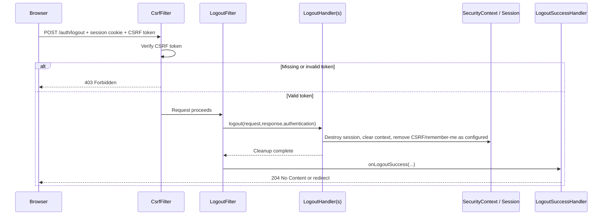

# HTTP Methods and CSRF Requirements for Logout Operations (Spring Security Servlet)

## 1. Short Answer: Logout Is a State-Changing Operation

**Logging out is not a read operation.** It invalidates the login session, clears `SecurityContext`, and may remove remember-me and CSRF tokens. Therefore, in web applications using cookies/sessions, logout should be performed via an **HTTP POST with a valid CSRF token**, not via a direct GET link.

For **Spring Security 6.x (Servlet)**:

- When CSRF is **enabled** (default), `LogoutFilter` handles logout via **`POST /logout`**. If using the default UI pages, `GET /logout` typically renders a confirmation page containing a POST form with a CSRF token; that GET **does not log out**.
- When CSRF is **disabled**, `LogoutConfigurer.logoutUrl(...)` defaults to allowing HTTP methods including GET to trigger logout. Thus disabling CSRF can inadvertently turn logout into a state change via GET.
- When changing the URL with `logout.logoutUrl("/auth/logout")`, the POST rule when CSRF is enabled still applies. However, do not assume a custom URL has an auto-generated GET confirmation page; if you need a custom confirmation UI, build the page and submit a POST form yourself.
- `permitAll()` only controls whether an endpoint requires an authenticated user at the authorization layer; **it does not make the request bypass CsrfFilter**.

**Scope:** Spring Boot 3.x, Spring Security 6.x, Java 17+, Servlet/Spring MVC, applications with HTTP session cookie login. The focus is the relationship **HTTP method ↔ CSRF ↔ `LogoutFilter`**. Differences from pure bearer-token APIs, OIDC/SSO, Spring Session, and WebFlux will be distinguished to avoid misapplication.

### Learning Objectives

You will be able to explain why GET logout is unsafe, configure POST logout without writing a manual controller, provide CSRF tokens for forms/SPAs, verify state before and after logout, diagnose `403` caused by a missing token, and properly evaluate when a stateless API application may use a different CSRF policy.

## 2. Which HTTP Method Is Appropriate for Logout?

By HTTP semantics, `GET`, `HEAD`, `OPTIONS`, and `TRACE` are treated as the group of safe methods for selecting requests that do not require CSRF verification under Spring Security's default configuration. Logout **changes security state**, so GET should not be used as the logout action.

| Method | Expectation for session-based applications | Default CSRF in Spring Security | Notes |
|---|---|---|---|
| `GET /logout` | Confirmation page in the default UI; should not directly destroy the session | No token required for GET | GET can be accessed by browsers/crawlers/prefetching |
| `POST /logout` | **Performs logout** | **Valid token required** if CSRF is enabled | Safe default flow for cookie-based apps |
| `POST /auth/logout` | Performs logout when `logoutUrl("/auth/logout")` | **Valid token required** | Configured URL, not a separate MVC controller |
| `DELETE /sessions/current` | Can be used in a custom-designed API | DELETE is unsafe so it usually requires a token with session cookies | Must explicitly configure matcher, handler, and security; not default |
| `GET /auth/logout` | Does not perform logout in this lesson's example configuration | GET is not CSRF-checked | May 404/redirect/show another page depending on the app |
| `HEAD`/`OPTIONS`/`TRACE` | Do not design them to revoke sessions | Excluded by default from CSRF-required requests | Do not open the logout matcher to all methods when CSRF is off |

**Be careful with the statement "GET /logout does nothing":** that statement holds only under the right configuration, such as the default with CSRF enabled. If CSRF is disabled or `logoutRequestMatcher` is configured to accept GET, logout **can be triggered by GET**. Always inspect the active SecurityFilterChain.

### Why Must Logout Be Protected by CSRF?

CSRF (Cross-Site Request Forgery) occurs when an attacker causes the victim's browser to send a request to an application to which the browser automatically attaches credentials, such as a session cookie.

An external website can place a link, auto-load a resource, navigate, or use a form to make the browser send a request to your site. Matching cookies may be attached automatically by the browser, even though the user did not intend to perform that action.

If `GET /logout` destroys the session, an unintended link or navigation action can **force the user to log out**. This is commonly called *logout CSRF*. The impact is not merely annoying: certain combinations of login CSRF/logout CSRF can lead to identity confusion or disrupt security flows.

Switching to POST **is not enough** if the endpoint accepts any POST without CSRF protection. An external page can also submit a POST form. A CSRF token generated/validated by the server and bound to a valid client context helps block forged requests that cannot prove the session's intent.

`SameSite` cookies, CORS, and `Origin`/`Referer` checks are supplementary layers or mitigations within a specific threat model; **do not mechanically replace CSRF tokens** for all cookie-based applications.

## 3. In What Order Does Spring Security Process POST Logout?

With Spring Security Servlet, the relevant components include:

- `CsrfFilter`: verifies the token on unsafe HTTP methods such as POST.
- `LogoutFilter`: recognizes a valid logout request and invokes the set of `LogoutHandler`s.
- `SecurityContextLogoutHandler`: by default invalidates the HTTP session, clears the current authentication/context, and handles the corresponding repository.
- `CsrfLogoutHandler`: removes the old CSRF token.
- Remember-me logout handler if remember-me is configured.
- `LogoutSuccessHandler`: after cleanup, redirects or returns an HTTP status as configured.
- `AuthorizationFilter`: enforces resource access rules; `LogoutFilter` is placed **before** it.

Overview diagram:



**A POST request rejected by CsrfFilter generally never reaches `LogoutFilter`**, so the login session should remain valid if no other condition intervenes. This is an important distinction between **"CSRF logout was blocked"** and **"logged out, but the response was unexpected"**.

### What Does It Clear by Default?

With standard logout support and normal session login, Spring Security typically:

1. Invalidates the current HTTP session.
2. Clears `SecurityContextHolder` and the context managed by the framework.
3. Cleans up remember-me if the corresponding configuration is active.
4. Deletes the current CSRF token.
5. Publishes a logout success event and runs the success handler.
6. Redirects to `/login?logout` by default, or returns a status if customized.

Do not infer that logging out one session **revokes all other sessions** on phones/laptops, JWT access tokens, refresh tokens, OIDC sessions at the Identity Provider, or open WebSocket connections. These are mechanisms with separate lifecycles.

## 4. Comparing Default Configuration and Dangerous Customizations

### 4.1. Default with CSRF Enabled

```java
@Bean
SecurityFilterChain chain(HttpSecurity http) throws Exception {
    http
        .authorizeHttpRequests(authorize ->
            authorize.anyRequest().authenticated())
        .formLogin(Customizer.withDefaults())
        .csrf(Customizer.withDefaults())
        .logout(Customizer.withDefaults());
    return http.build();
}
```

This is a **fragment inside a `@Configuration` class** with the corresponding Spring imports; the hands-on section below provides full classes. With form login support and the default pages:

- `GET /logout`: confirmation page (when the default logout page is enabled and CSRF is present).
- `POST /logout` with valid CSRF: logs out then redirects to `/login?logout`.
- `POST /logout` with missing/invalid token: typically `403 Forbidden`.
- `GET /logout` is not proof the user has left the session, because it is only a confirmation display step.

If the application builds its own UI and does not use the default pages, it should still use POST with a token; there is no need to implement a GET confirmation page if the UX already provides a logout button.

### 4.2. When CSRF Is Disabled: No Longer Guaranteed POST-Only

```java
// ANTI-PATTERN for browser applications using session cookies:
http.csrf(AbstractHttpConfigurer::disable);
```

According to the Spring Security 6.5 `LogoutConfigurer` API, when CSRF protection is disabled, the logout matcher configured by `logoutUrl` allows all HTTP methods, no longer restricting to POST by default. The result can be that **`GET /logout` directly destroys the session**.

Do not disable CSRF application-wide just to "make clicking the logout button easier", or to fix a `403` test. You are altering the protection scope of **every state-changing request**, not just logout.

If you need to change the method for a specialized API, ensure the matcher accepts only the intended method and apply appropriate verification. The simplest, safest, and most maintainable approach for a session-based website remains **POST + CSRF token**.

### 4.3. Can We "Use GET /logout and Still Have Spring Security Protect CSRF"?

No. CSRF protects unsafe HTTP methods per the default matcher; GET is a safe method so it normally does not require a token. Forcing GET logout to perform a state-changing action violates HTTP semantics and is susceptible to accidental navigation/prefetching.

If you want to use a **visible "Log out" link**, point the link to a **read-only confirmation page**, where a button inside submits a POST form. Or use JavaScript to POST directly with a valid CSRF token; clear UX status must still be shown.

## 5. Complete Example: Form Login, POST Logout, CSRF, and 204 No Content

The example uses Spring Boot 3.x + Spring Security 6.x + Java 17+, Servlet/Spring MVC. We use **default form login** for a real session and a **custom logout URL** for an API returning `204` instead of redirecting:

| Endpoint | Method | Purpose |
|---|---|---|
| `GET /login` | GET | Form login page provided by Spring Security |
| `POST /login` | POST | Form login; CSRF token required |
| `GET /api/csrf` | GET | Returns the token for the client to send unsafe requests |
| `GET /api/me` | GET | Returns the current principal; authentication required |
| `POST /auth/logout` | POST | **Actual logout**, requires CSRF token, returns `204` |
| `GET /auth/logout` | GET | Does **not** perform logout in the demo; no GET controller created |

In a project with the Spring Boot plugin and Gradle wrapper, add the dependencies:

```groovy
dependencies {
    implementation 'org.springframework.boot:spring-boot-starter-web'
    implementation 'org.springframework.boot:spring-boot-starter-security'

    testImplementation 'org.springframework.boot:spring-boot-starter-test'
    testImplementation 'org.springframework.security:spring-security-test'
}
```

No need to write a custom logout filter/controller. Spring Security's `LogoutFilter` already manages the lifecycle, session, context, and CSRF as configured.

### 5.1. Main Class

Create `src/main/java/com/example/logoutcsrf/LogoutCsrfApplication.java`:

```java
package com.example.logoutcsrf;

import org.springframework.boot.SpringApplication;
import org.springframework.boot.autoconfigure.SpringBootApplication;

@SpringBootApplication
public class LogoutCsrfApplication {
    public static void main(String[] args) {
        SpringApplication.run(LogoutCsrfApplication.class, args);
    }
}
```

### 5.2. SecurityConfig: logoutUrl and CSRF Enabled

Create `src/main/java/com/example/logoutcsrf/SecurityConfig.java`:

```java
package com.example.logoutcsrf;

import org.springframework.context.annotation.Bean;
import org.springframework.context.annotation.Configuration;
import org.springframework.http.HttpStatus;
import org.springframework.security.config.Customizer;
import org.springframework.security.config.annotation.web.builders.HttpSecurity;
import org.springframework.security.config.annotation.web.configuration.EnableWebSecurity;
import org.springframework.security.core.userdetails.User;
import org.springframework.security.core.userdetails.UserDetailsService;
import org.springframework.security.crypto.bcrypt.BCryptPasswordEncoder;
import org.springframework.security.crypto.password.PasswordEncoder;
import org.springframework.security.provisioning.InMemoryUserDetailsManager;
import org.springframework.security.web.SecurityFilterChain;
import org.springframework.security.web.authentication.HttpStatusEntryPoint;
import org.springframework.security.web.authentication.logout.HttpStatusReturningLogoutSuccessHandler;

@Configuration
@EnableWebSecurity
public class SecurityConfig {

    @Bean
    PasswordEncoder passwordEncoder() {
        return new BCryptPasswordEncoder();
    }

    @Bean
    UserDetailsService userDetailsService(PasswordEncoder encoder) {
        return new InMemoryUserDetailsManager(
            User.withUsername("alice")
                .password(encoder.encode("alice-secret"))
                .roles("USER")
                .build()
        );
    }

    @Bean
    SecurityFilterChain securityFilterChain(HttpSecurity http)
            throws Exception {

        http
            .authorizeHttpRequests(authorize -> authorize
                .requestMatchers("/login", "/api/csrf", "/error")
                    .permitAll()
                .anyRequest().authenticated()
            )
            .formLogin(Customizer.withDefaults())
            .csrf(Customizer.withDefaults())
            .logout(logout -> logout
                .logoutUrl("/auth/logout")
                .invalidateHttpSession(true)
                .clearAuthentication(true)
                .logoutSuccessHandler(
                    new HttpStatusReturningLogoutSuccessHandler(
                        HttpStatus.NO_CONTENT
                    )
                )
                .permitAll()
            )
            .exceptionHandling(exceptions -> exceptions
                .authenticationEntryPoint(
                    new HttpStatusEntryPoint(HttpStatus.UNAUTHORIZED)
                )
            );

        return http.build();
    }
}
```

**Points to observe:**

1. `.csrf(Customizer.withDefaults())` keeps CSRF protection enabled. By default, Spring Security uses `HttpSessionCsrfTokenRepository`; the token is created/exposed to the request per the deferred token mechanism and handler of the running version.
2. `.logoutUrl("/auth/logout")` routes logout to `LogoutFilter`. When CSRF is enabled, by default **only POST** performs the operation.
3. `.logoutSuccessHandler(new HttpStatusReturningLogoutSuccessHandler(HttpStatus.NO_CONTENT))` changes the post-logout response to **204**, suitable for API-calling frontends. It **does not** alter the CSRF requirement.
4. `invalidateHttpSession(true)` and `clearAuthentication(true)` are written explicitly so learners see the intended effect; they are already standard logout behavior.
5. `.permitAll()` in the logout DSL is convenient for a custom endpoint. Because `LogoutFilter` runs before `AuthorizationFilter`, it does not mean "skip CSRF" and usually eliminates needing to add the logout matcher to `authorizeHttpRequests`.
6. `formLogin(Customizer.withDefaults())` provides the session login flow; standard login handles session strategy, session fixation, and security context appropriately.
7. `HttpStatusEntryPoint(HttpStatus.UNAUTHORIZED)` makes unauthenticated requests to protected resources receive `401`. The `/login` page remains an accessible endpoint.

Note: the default logout URL is `/logout`. The example changed it to `/auth/logout`. Therefore `GET /logout` or `POST /logout` **are not** the demo requests used to log out; you must call `POST /auth/logout`.

### 5.3. Controller: Returning the CSRF Token and Current Identity

Create `src/main/java/com/example/logoutcsrf/ApiController.java`:

```java
package com.example.logoutcsrf;

import java.util.Map;
import org.springframework.security.core.Authentication;
import org.springframework.security.web.csrf.CsrfToken;
import org.springframework.web.bind.annotation.GetMapping;
import org.springframework.web.bind.annotation.RestController;

@RestController
public class ApiController {

    @GetMapping("/api/csrf")
    public CsrfToken csrf(CsrfToken token) {
        return token;
    }

    @GetMapping("/api/me")
    public Map<String, String> me(Authentication authentication) {
        return Map.of("username", authentication.getName());
    }
}
```

`GET /api/csrf` is an endpoint for same-origin clients/trusted frontends to read the token. The JSON typically contains `headerName`, `parameterName`, and `token`. By default, the common header is `X-CSRF-TOKEN` and the parameter is `_csrf`. Clients should use the header name **returned by the server**, rather than hardcoding it in case repository configuration changes.

Do not log CSRF tokens or session cookies; do not expose the token to untrusted origins via misconfigured CORS. CSRF tokens protect unsafe requests but **do not** protect against XSS capable of running JavaScript within the application's origin.

### 5.4. Running the Example

From the project root with Gradle wrapper and Spring Boot plugin:

```bash
./gradlew bootRun
```

Windows PowerShell:

```powershell
.\gradlew.bat bootRun
```

Open `http://localhost:8080/login` to see the default login page. Demo user: username `alice`, password `alice-secret`. This is a local account strictly for learning; production requires a user store, password hashing, MFA, and proper login protection.

## 6. Testing with curl: GET Does Not Log Out, POST Without CSRF Returns 403

The commands below use **Bash**, `curl`, and `jq`; if `jq` is unavailable, inspect the JSON from `/api/csrf` and send the corresponding token value with another HTTP tool. The `cookies.txt` file contains the session cookie and should only be used locally.

### Step 1: Fetch the token and cookie in the same session

```bash
curl -sS -c cookies.txt -b cookies.txt \
  http://localhost:8080/api/csrf > csrf.json

CSRF_TOKEN=$(jq -r '.token' csrf.json)
```

HTTP `200`; fetching the CSRF token usually creates/stores a session because the token is bound to the session. Having a session cookie **does not mean you are logged in**.

### Step 2: Log in via form POST with CSRF

```bash
curl -i -c cookies.txt -b cookies.txt \
  -H "X-CSRF-TOKEN: $CSRF_TOKEN" \
  --data-urlencode 'username=alice' \
  --data-urlencode 'password=alice-secret' \
  http://localhost:8080/login
```

This is **form login**, not JSON login. A successful login typically returns HTTP `302` due to the form login success handler redirecting. Do not use `-L` when you want to observe the original response of the POST login.

Check the session after login:

```bash
curl -i -b cookies.txt http://localhost:8080/api/me
```

Expect `200 OK` with JSON containing `"username":"alice"`. This is the **pre-logout** baseline for comparison.

### Step 3: GET the custom logout URL

```bash
curl -i -b cookies.txt http://localhost:8080/auth/logout
curl -i -b cookies.txt http://localhost:8080/api/me
```

Because the demo configures logout handling only for **POST** and has no MVC GET handler at this URL, GET may receive `404`/another status depending on error handling. **Do not use the GET status code itself as proof**; verify that the `/api/me` request right afterward still returns `200` with Alice. That means GET **did not revoke the session**.

If using the default `/logout` URL with the default UI and CSRF enabled, GET may return a confirmation page; that is a **different UI presentation**, without changing the principle that only POST executes logout.

### Step 4: POST logout without a token

```bash
curl -i -c cookies.txt -b cookies.txt \
  -X POST http://localhost:8080/auth/logout

curl -i -b cookies.txt http://localhost:8080/api/me
```

Expected:

- `POST /auth/logout` missing the token returns **403 Forbidden**.
- `GET /api/me` immediately afterward still returns **200**; because the logout request was blocked before cleanup, Alice's session has not been invalidated.
- If a browser/client encounters `403` during logout, do not fix it with `csrf.disable()` or by switching logout to GET; verify that the cookie and token belong to **the same session** and are still valid.

### Step 5: Fetch a new CSRF token after login, then send a valid POST logout

Spring Security may remove the pre-login CSRF token upon successful authentication via `CsrfAuthenticationStrategy`. Therefore **do not unconditionally reuse the token from Step 1**. Fetch the token again using the logged-in session's cookie:

```bash
CSRF_TOKEN=$(curl -sS -c cookies.txt -b cookies.txt \
  http://localhost:8080/api/csrf | jq -r '.token')

curl -i -c cookies.txt -b cookies.txt \
  -H "X-CSRF-TOKEN: $CSRF_TOKEN" \
  -X POST http://localhost:8080/auth/logout
```

Expect **204 No Content**. This is the HTTP status produced by the configured `HttpStatusReturningLogoutSuccessHandler`, differing from the default `302` redirect response.

Check after logout:

```bash
curl -i -b cookies.txt http://localhost:8080/api/me
```

Expect **401 Unauthorized**: the browser/jar may still hold the old cookie, but the server has invalidated the session. To make a new POST on another session, the client must create/fetch a CSRF token corresponding to that session; the old token was removed by `CsrfLogoutHandler`.

### Distinguishing the Responses

| Stage | Request | Expected Status | Alice's Session |
|---|---|---|---|
| Before login | `GET /api/me` | 401 | None yet |
| After login | `GET /api/me` | 200 | Valid |
| Attempt GET logout | `GET /auth/logout` | Route-dependent, no logout effect | Still valid |
| POST logout without token | `POST /auth/logout` | **403** | Still valid |
| POST logout with valid token | `POST /auth/logout` | **204** | Invalidated |
| After logout | `GET /api/me` | **401** | No longer valid |

The statuses in the table are expectations for the **example configuration**; other apps may use different redirects, error pages, and exception handlers. What must be tested is **the authentication state before/after the request**, not just the logout endpoint's response.

## 7. Implementing the Logout Button in the Browser

### 7.1. Browser and HTML Form

A server-rendered page using Thymeleaf can have a form:

```html
<form method="post" th:action="@{/auth/logout}">
  <button type="submit">Log out</button>
</form>
```

With proper Thymeleaf + Spring Security CSRF integration, `RequestDataValueProcessor` automatically adds the CSRF hidden input to POST forms. When rendering HTML manually or using a template engine without integration, **you must render the CSRF token as a hidden input** with the exact parameter name and value from the request's `CsrfToken`; do not expect a plain form to have the token automatically.

**Do not use**:

```html
<a href="/auth/logout">Log out</a>
```

if the intent is to destroy the session immediately. An anchor creates a GET request so it will not trigger valid POST logout in the demo; if a legacy configuration permits GET logout, that anchor creates a logout CSRF risk.

If you need to support users with JavaScript disabled, a POST form is the simple solution. No JavaScript handler is needed just to submit the form.

### 7.2. SPA Using fetch with a Header Token

If frontend and backend share the same origin, the following JavaScript fetches the CSRF token after login and invokes logout via POST:

```javascript
async function logout() {
  const csrfResponse = await fetch("/api/csrf", {
    credentials: "same-origin"
  });

  if (!csrfResponse.ok) {
    throw new Error("Cannot load CSRF token");
  }

  const csrf = await csrfResponse.json();

  const response = await fetch("/auth/logout", {
    method: "POST",
    credentials: "same-origin",
    headers: {
      [csrf.headerName]: csrf.token
    }
  });

  if (!response.ok) {
    throw new Error("Logout rejected");
  }

  // When the response is 204, do not call response.json().
  // Clear sensitive UI state and navigate to a public page.
  window.location.assign("/login");
}
```

Details to read carefully:

- `credentials: "same-origin"` allows the browser to send the session cookie for the current origin; for legitimate cross-origin setups, `credentials: "include"` and appropriate CORS/cookie settings may be required.
- The token header name comes from `csrf.headerName` provided by the server. Do not send the token in URL query strings, as URLs easily end up in logs, history, and referrers.
- A `204` logout **has no body**. Do not call `response.json()` because there is no JSON to parse.
- After a successful logout, the frontend must remove sensitive data stored in state/memory/cache and stop displaying screens that require authentication.
- If the response is `403`, do not pretend logout succeeded merely by clearing UI state. The server may still hold the session.
- An untrusted client must not be allowed to arbitrarily read the session's CSRF token via CORS. Credentialed CORS configuration must restrict to specific origins.

**SPA and BREACH note:** Spring Security 6 provides deferred/masked CSRF token mechanisms; when using `CookieCsrfTokenRepository`, configure a `CsrfTokenRequestHandler` suitable for cookie/header token reading. The example here returns the token from a same-origin endpoint and uses the default `HttpSessionCsrfTokenRepository`; do not swap the repository while ignoring the handler part.

## 8. MockMvc: Verifying HTTP Method and CSRF Before–After Logout

A test that only asserts `POST /logout` returns `204` is insufficient. You must prove:

1. Successful login produces a real session.
2. GET logout **does not** invalidate the session.
3. POST logout without a token or with an invalid token returns **403**, and the session remains usable.
4. POST logout with a valid token returns **204**, and the session is invalidated.
5. A new request not carrying a valid session returns **401**.

Create `src/test/java/com/example/logoutcsrf/LogoutCsrfTest.java`:

```java
package com.example.logoutcsrf;

import org.junit.jupiter.api.Test;
import org.springframework.beans.factory.annotation.Autowired;
import org.springframework.boot.test.autoconfigure.web.servlet.AutoConfigureMockMvc;
import org.springframework.boot.test.context.SpringBootTest;
import org.springframework.mock.web.MockHttpSession;
import org.springframework.test.web.servlet.MockMvc;
import org.springframework.test.web.servlet.MvcResult;

import static org.junit.jupiter.api.Assertions.assertFalse;
import static org.junit.jupiter.api.Assertions.assertNotNull;
import static org.junit.jupiter.api.Assertions.assertTrue;
import static org.springframework.security.test.web.servlet.request
    .SecurityMockMvcRequestPostProcessors.csrf;
import static org.springframework.test.web.servlet.request
    .MockMvcRequestBuilders.get;
import static org.springframework.test.web.servlet.request
    .MockMvcRequestBuilders.post;
import static org.springframework.test.web.servlet.result
    .MockMvcResultMatchers.jsonPath;
import static org.springframework.test.web.servlet.result
    .MockMvcResultMatchers.status;

@SpringBootTest
@AutoConfigureMockMvc
class LogoutCsrfTest {

    @Autowired
    MockMvc mvc;

    private MockHttpSession loginAlice() throws Exception {
        MvcResult result = mvc.perform(post("/login")
                .with(csrf())
                .param("username", "alice")
                .param("password", "alice-secret"))
            .andExpect(status().is3xxRedirection())
            .andReturn();

        MockHttpSession session =
            (MockHttpSession) result.getRequest().getSession(false);
        assertNotNull(session);
        return session;
    }

    @Test
    void authenticatedSessionWorksBeforeLogout() throws Exception {
        MockHttpSession session = loginAlice();

        mvc.perform(get("/api/me").session(session))
            .andExpect(status().isOk())
            .andExpect(jsonPath("$.username").value("alice"));
    }

    @Test
    void getLogoutDoesNotInvalidateSession() throws Exception {
        MockHttpSession session = loginAlice();

        // GET /auth/logout is not configured to be handled by LogoutFilter.
        // Do not assert a specific status for a GET URL that has no controller.
        mvc.perform(get("/auth/logout").session(session))
            .andReturn();

        assertFalse(session.isInvalid());

        mvc.perform(get("/api/me").session(session))
            .andExpect(status().isOk())
            .andExpect(jsonPath("$.username").value("alice"));
    }

    @Test
    void postWithoutCsrfIsRejectedWithoutLoggingOut()
            throws Exception {
        MockHttpSession session = loginAlice();

        mvc.perform(post("/auth/logout").session(session))
            .andExpect(status().isForbidden());

        assertFalse(session.isInvalid());

        mvc.perform(get("/api/me").session(session))
            .andExpect(status().isOk());
    }

    @Test
    void postWithInvalidCsrfIsAlsoRejected() throws Exception {
        MockHttpSession session = loginAlice();

        mvc.perform(post("/auth/logout")
                .session(session)
                .with(csrf().useInvalidToken()))
            .andExpect(status().isForbidden());

        assertFalse(session.isInvalid());
    }

    @Test
    void postWithCsrfInvalidatesSession() throws Exception {
        MockHttpSession session = loginAlice();

        mvc.perform(post("/auth/logout")
                .session(session)
                .with(csrf()))
            .andExpect(status().isNoContent());

        // MockHttpSession has been invalidated by the logout handler.
        assertTrue(session.isInvalid());

        // Do not try to reuse the invalidated MockHttpSession;
        // a new request without a session is recognized as anonymous.
        mvc.perform(get("/api/me"))
            .andExpect(status().isUnauthorized());
    }
}
```

Run:

```bash
./gradlew test
```

Windows PowerShell:

```powershell
.\gradlew.bat test
```

`with(csrf())` and `csrf().useInvalidToken()` are provided by `spring-security-test`. They let MockMvc construct requests with valid/invalid tokens to test CSRF; they **do not** make the controller bypass security filters.

### Why Not Reuse the Session After Invalidation?

An invalidated `MockHttpSession` can throw an exception if you try to read attributes or attach it again to a subsequent request. Therefore the test checks `session.isInvalid()` right after logout, then issues a new request without a session. With `curl` or real HTTP integration tests, you can send **the old cookie ID** and verify the server still does not restore authentication, because an HTTP client can still send a cookie even after the server-side record is deleted.

### Using Spring Security Test's logout() Helper

For default or custom logout URLs, Spring Security Test supports the `logout()` request post-processor/builder:

```java
import static org.springframework.security.test.web.servlet.request
    .SecurityMockMvcRequestBuilders.logout;

// In a @Test using the mvc field and the created session:
mvc.perform(logout("/auth/logout").session(session))
    .andExpect(status().isNoContent());
```

This is a **test fragment**, not a standalone class; the helper creates a POST with a valid CSRF token. When learning CSRF deeply, also include tests using `post(...)` **without** `with(csrf())` to observe `403` and verify the session remains intact. Using only the "happy path" helper can easily miss a configuration that accidentally disabled CSRF.

## 9. Customizing Logout While Keeping CSRF Protection

### 9.1. Only Need to Change the URL or Status

Prefer using the DSL:

```java
http.logout(logout -> logout
    .logoutUrl("/auth/logout")
    .logoutSuccessHandler(
        new HttpStatusReturningLogoutSuccessHandler(
            HttpStatus.NO_CONTENT)));
```

This leverages `LogoutFilter` and the session/context cleanup handlers, avoiding rewriting sensitive logic. While CSRF remains enabled, POST-only remains the default rule.

If you want to keep redirecting, remove the custom success handler or configure `logoutSuccessUrl(...)`. HTTP `302` after logout **does not mean an error**, but a UX choice; API clients usually find `204` easier to handle.

### 9.2. Creating a Custom @PostMapping MVC Endpoint

This example uses an **illustrative API** and should not share the same URL that `LogoutFilter` already claims:

```java
@PostMapping("/account/sign-out")
public ResponseEntity<Void> signOut(
        HttpServletRequest request,
        HttpServletResponse response,
        Authentication authentication) {

    SecurityContextLogoutHandler handler =
        new SecurityContextLogoutHandler();

    handler.logout(request, response, authentication);
    return ResponseEntity.noContent().build();
}
```

This is **only a fragment in a controller with appropriate imports and configuration**. If choosing this approach:

- The endpoint must pass through `CsrfFilter` with an unsafe matcher and valid CSRF token.
- The route must be permitted in `AuthorizationFilter` appropriately, because the MVC controller processes the request **after** the security chain.
- Full logout logic must be invoked: clearing context/repository and invalidating the session; consider remember-me, CSRF-token cleanup, logout events, and other custom handlers.
- Do not merely call `SecurityContextHolder.clearContext()` or `request.getSession().invalidate()` and assume every part of Spring Security has been handled.
- Spring Security officially recommends using the `logout` DSL whenever possible, since it is easy to miss important handlers when writing an endpoint manually.

In particular, **do not** register a `@PostMapping("/auth/logout")` alongside `logoutUrl("/auth/logout")` expecting the controller to run: `LogoutFilter` sits before MVC and will handle matching requests first.

### 9.3. What If the Product Requires HTTP DELETE?

`DELETE` is a state-changing HTTP method, so it still falls into the group Spring Security checks for CSRF by default. However, standard `LogoutConfigurer.logoutUrl` when CSRF is enabled matches POST, and does not automatically switch to DELETE just because the client sends `DELETE`.

Supporting `DELETE /sessions/current` must be explicitly designed:

- A request matcher restricted to the exact method and path, or a dedicated MVC endpoint handled safely.
- A CSRF token when the browser sends session cookies and relies on ambient credentials.
- Full logout cleanup execution, including session/context/remember-me if applicable.
- Tests verifying invalid GET/POST/DELETE requests do not unexpectedly destroy sessions.

Do not widen the matcher to **all methods** so "any client can log out". An operation that destroys sessions should have a stable, explicit, and easily testable HTTP contract.

## 10. Cases Where CSRF May Differ

### 10.1. Pure Backend-to-Backend Applications Without Browser Cookies

Suppose the API is completely stateless, clients explicitly attach `Authorization: Bearer ...` on every request, and there are no session cookies/remember-me or mechanisms where a browser automatically attaches credentials. The CSRF threat model can differ from a session-based website. An application might intentionally disable CSRF on the dedicated **SecurityFilterChain** for this API group after thorough analysis.

However, that **does not** turn `POST /logout` into JWT revocation:

- A resource server usually only verifies the access token per request.
- Stopping the client from sending the token does not make already-issued tokens expire.
- To revoke bearer/refresh tokens, you need a token revocation endpoint, denylist/introspection, short lifetimes, or another system-specific mechanism.
- If a refresh token, JWT, or API key is stored in a cookie automatically sent by the browser, CSRF risk can return.

**Do not label an app "JWT" or "stateless" and disable CSRF across the entire application by default**, especially in hybrid systems with browser session login and same-origin APIs.

### 10.2. Cross-Origin SPAs

An SPA running on a different origin from the backend may need:

- CORS strictly limited to the trusted frontend origin.
- `Access-Control-Allow-Credentials` when cross-origin cookies are genuinely required.
- Appropriate `Secure` and `SameSite` cookies, typically subject to HTTPS requirements and browser policies.
- A CSRF token obtainable via an endpoint allowed for the frontend, without exposing tokens indiscriminately to all origins.
- `fetch` with `credentials: "include"` when wanting to send cookies cross-origin.
- XSS controls, since XSS running on a trusted origin can read the CSRF token from the same application.

If the CSRF token lives in the session, login/logout may clear the old token; the SPA should fetch a new token after authentication events.

### 10.3. Logout via OIDC/SAML or with Remember-Me

An application's `POST /logout` typically clears the **local** session. It does not automatically end the session at an OIDC/SAML Identity Provider or revoke all access/refresh tokens. To coordinate single logout, a dedicated logout success handler or corresponding protocol is needed, such as OIDC RP-Initiated Logout per the IDP infrastructure.

CSRF for **local POST logout** and the **Identity Provider logout protocol** are two layers to keep distinct. Do not drop local CSRF just because the application uses SSO.

If remember-me is present, Spring Security logout handlers can delete remember-me tokens/cookies as configured; using a custom controller missing handlers can leave the browser able to re-authenticate right after the session is deleted.

## 11. Why Does POST Without CSRF Return 403 Even When Logged In?

**`permitAll` is not `csrf.ignore`.** The CSRF filter does not ask whether you have logged in before deciding if an unsafe request's token is valid. An authenticated session can still receive `403` because the logout request lacks a token.

Common causes:

| Symptom | Likely cause | How to verify |
|---|---|---|
| `POST /auth/logout` returns `403` | Missing token, wrong token, token from a different session | Fetch a fresh token from `/api/csrf` with the same cookie and send the right header |
| Logged in, yet POST still returns `403` | Old CSRF token was cleared on login | Fetch the token **after login**; do not reuse a pre-login token |
| Sending token in Postman still returns `403` | Missing cookie jar or token belongs to another session | Inspect the request `Cookie` and session ID |
| Logout returns `204` but frontend reports JSON parse error | Code tries to parse an empty body | For 204, check only `response.ok` |
| Logout POST receives `302` | Default success handler redirects | Check the Location header; do not treat redirect as failure |
| `GET /auth/logout` returns `404` | Demo does not configure an MVC GET handler for the custom URL | Do not switch to GET logout; keep using POST |
| `GET /logout` actually logs out | CSRF is disabled, or custom matcher allows GET | Inspect `SecurityFilterChain`, check `LogoutConfigurer` |
| Logout succeeds but protected GET still returns `200` | HTTP Basic/bearer token resent, remember-me, another session, another filter in the app | Check the authentication mechanism on the subsequent request |
| Token/header blocked in SPA | CORS, SameSite, `credentials`, or proxy | Inspect network requests and browser/proxy configuration |
| Logout does not hit custom controller | `LogoutFilter` intercepts before MVC at the same URL | Pick a single logout flow |
| One browser logs out, another remains logged in | Current logout is not "logout all sessions" | Use session repository/registry to revoke other sessions |
| `POST` returns `405 Method Not Allowed` | No POST matcher/controller at that URL, or mapped in another chain | Match method, path, `securityMatcher`, and controller |
| `POST` logout returns `401` | Request goes through an unsuitable chain/entry point | Check active chain, CSRF, and logout matcher |

### How to Debug Without Leaking Data

You can enable DEBUG logging for Spring Security in a test environment, but filter out secrets. Do not write raw cookies, `Authorization`, CSRF tokens, passwords, session IDs, or the full security context to centralized logs.

What to observe:

1. Whether request method/path match `POST /auth/logout`.
2. Whether `CsrfFilter` rejects the request due to an invalid token.
3. Whether `LogoutFilter` recognizes the logout matcher.
4. Whether the `LogoutHandler`s run.
5. Whether the session is invalidated and subsequent requests load a principal.
6. Whether another authentication mechanism recreates the principal automatically (Basic/Bearer/remember-me).
7. Which handler decides the `204`/`302`/`403`/`401` response.

## 12. Common Choices That Cause Security Flaws

### 12.1. Using GET for "Quick Logout"

```java
// Not recommended for browser session login:
http.logout(logout -> logout
    .logoutRequestMatcher(
        new AntPathRequestMatcher("/logout", "GET")
    )
);
```

This is an **anti-pattern**; do not use in production. GET logout can be triggered by links from external websites, browser navigation, preload/prefetch, or crawlers. If a legacy app does this, migrate to POST+CSRF and retest the UI.

### 12.2. Disabling CSRF Entirely for One Logout Button

```java
// Not recommended in websites using session cookies:
http.csrf(csrf -> csrf.disable());
```

It strips protection from other POST/PUT/PATCH/DELETE requests, not just logout, and can also change the default logout matcher to accept all HTTP methods. Instead, include a valid token and fix the frontend flow.

### 12.3. Only Clearing Cookies/Storage in JavaScript

```javascript
// Incorrect as a server-side logout guarantee:
localStorage.removeItem("currentUser");
window.location.assign("/login");
```

The snippet only alters UI/client storage. The server `HttpSession` may still be valid; the browser may still hold `HttpOnly` cookies that JavaScript cannot delete directly. You must call the logout endpoint with the proper method and token so the server invalidates the session.

### 12.4. Clearing Only SecurityContextHolder

```java
// Insufficient if the session already stored SecurityContext:
SecurityContextHolder.clearContext();
```

This method updates the current context without automatically revoking sessions/cookies/tokens in stores. Use the standard logout handlers.

### 12.5. Confusing CORS with CSRF

CORS is a browser mechanism deciding whether a page from another origin can access responses/call APIs in certain contexts. CSRF protects actions arising from **automatically sent cookies or credentials**. "CORS blocks reading the response" **does not** prove a state-changing request did not happen; cross-site HTML forms can still be submitted under certain conditions.

## 13. Order of Designing Logout for a Real Application

To pick a configuration without weakening security, walk through these questions:

1. **Who calls logout?** A browser using cookie sessions, an SPA, a desktop/mobile app, service-to-service, or an OAuth client? This determines the threat model.
2. **Are credentials automatically attached by the browser?** If yes (session cookies, remember-me, Basic in browser), CSRF must be evaluated seriously.
3. **Which HTTP contract is clearest?** With Spring Security session login, `POST /logout` or `POST /auth/logout` is usually appropriate and leverages the framework.
4. **Where does the CSRF token come from?** Server-rendered forms have a hidden input, or an SPA fetches `CsrfToken` and sends a header alongside the session cookie.
5. **What response does the frontend need?** Traditional pages typically use a `302` redirect; APIs typically use `204`. This is a UX choice and does not change the method/token requirement.
6. **What is the scope of logout?** Current session, all devices, remember-me, refresh tokens, SSO/IdP, WebSockets? Do not promise "log out everywhere" when only invoking `LogoutFilter` for the current session.
7. **What must be guaranteed after logout?** New requests with the old cookie must be anonymous/401; in-flight requests started before logout may need additional business-layer policy checks.
8. **Are there multiple SecurityFilterChains?** Verify the endpoint falls into the chain containing the right logout filter and CSRF policy; a chain dedicated to stateless APIs may differ.
9. **Is there a reverse proxy or subdomain?** Configure cookie path/domain, HTTPS, SameSite, CORS, and header forwarding accurately so tokens/cookies are not lost.
10. **Do tests cover failure scenarios?** GET does not log out, POST with missing/invalid CSRF preserves the session, valid POST revokes the session, and subsequent calls to protected APIs are rejected.

## 14. Checklist and Conclusion

- [ ] Logout uses **POST** in session-based websites; do not use GET to change state.
- [ ] Spring Security `CsrfFilter` is enabled and protects POST logout; do not disable CSRF just to fix `403`.
- [ ] If customizing the URL, invoke `POST /auth/logout` directly; do not rely on a default GET confirmation page at another URL.
- [ ] HTML forms render the CSRF hidden input or SPAs send the token in a header matching the same-session cookie.
- [ ] After login, the client fetches a new CSRF token when `CsrfAuthenticationStrategy` has cleared the previous one.
- [ ] `LogoutFilter` invokes the necessary handlers to invalidate the session, clear the context/repository, remember-me, and CSRF token.
- [ ] The logout success handler returns `204` or an intentional redirect; the frontend does not parse JSON for 204.
- [ ] Tests verify `GET` does not log out, `POST` with missing/invalid token returns 403 and **does not** lose the session, and valid `POST` logs out successfully.
- [ ] After logout, requests using the old cookie do not restore the user; check both session store and cookies in deployment.
- [ ] Do not confuse session logout with JWT/refresh token revocation, SSO logout, or logging out all devices.
- [ ] Handle `Secure`/`HttpOnly`/`SameSite` cookies, HTTPS, XSS, CORS, and secret logging according to the threat model.

**One-sentence takeaway:** In Spring Security with CSRF protection, **logout is a POST request with a valid CSRF token**; **GET should only serve navigation or a confirmation page**, never directly destroy a session. A `403` response when missing a token shows the protection is working; fix how the client sends the token, **do not weaken protection**.

### Official References

- [Spring Security 6.5 — Handling Logouts](https://docs.spring.io/spring-security/reference/6.5/servlet/authentication/logout.html)
- [Spring Security 6.5 — LogoutConfigurer API](https://docs.spring.io/spring-security/reference/6.5/api/java/org/springframework/security/config/annotation/web/configurers/LogoutConfigurer.html)
- [Spring Security — CSRF Protection](https://docs.spring.io/spring-security/reference/servlet/exploits/csrf.html)
- [Spring Security — CSRF Caveats: Logging Out](https://docs.spring.io/spring-security/reference/features/exploits/csrf.html)
- [Spring Security — MockMvc Testing Logout](https://docs.spring.io/spring-security/reference/servlet/test/mockmvc/logout.html)
- [Spring Security 6.5 — HttpStatusReturningLogoutSuccessHandler](https://docs.spring.io/spring-security/reference/6.5/api/java/org/springframework/security/web/authentication/logout/HttpStatusReturningLogoutSuccessHandler.html)
