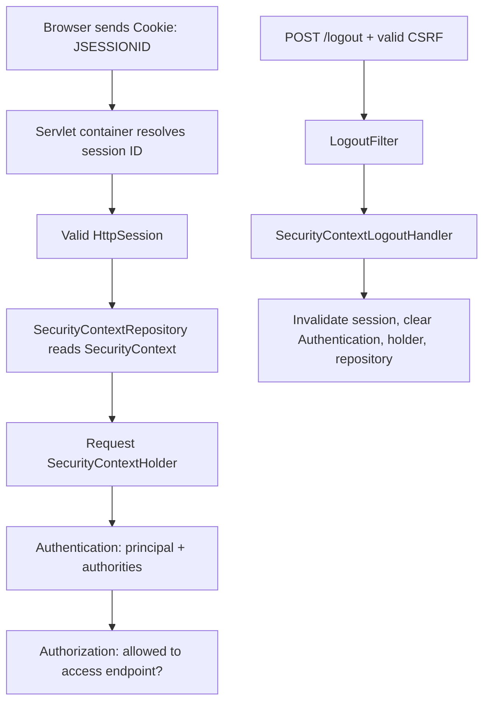
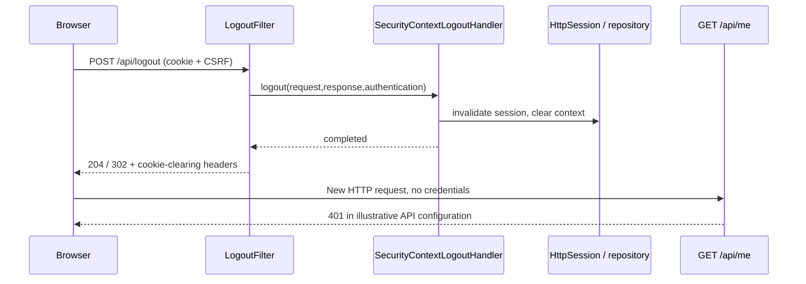

# Clearing Authentication and SecurityContext Data on Logout

**Context:** Spring Security (Servlet), parent topic **Logout**. A user may see a "Logged out" message in the UI while the server-side session still holds their identity; or the session may have been destroyed, yet the very next request immediately re-authenticates via a remember-me cookie, HTTP Basic, a Bearer token, or SSO. Therefore, you must understand precisely **what was cleared, where, and from where it can be reloaded**.

**Goal:** Distinguish the authentication state layers; understand `LogoutFilter`, `SecurityContextLogoutHandler`, `SecurityContextRepository`, and `SecurityContextHolder`; implement session logout properly in Spring Security 6; test requests before/after logout, CSRF, and session invalidation; and handle the boundaries of other credential types.

## 1. State Layers to Distinguish

When a request is authenticated via a session, the following components play distinct roles:

| Component | Meaning | Why it matters on logout |
| --- | --- | --- |
| `Authentication` | Object holding the principal, authorities, authenticated status, and possibly credentials/details | Old authentication must not be used to grant access after the user logs out |
| `SecurityContext` | Wraps the current `Authentication` | Clear authentication/context so the request no longer represents Alice |
| `SecurityContextHolder` | Access point for reading/writing the context for the current request/thread; defaults to a `ThreadLocal`-based mechanism | Clear the holder to avoid identity leakage in the active thread |
| `SecurityContextRepository` | Loads/saves `SecurityContext` across HTTP requests; may use session, request attributes, or a custom store | If persisted data remains, subsequent requests can reload the identity |
| `HttpSession` | Server-side Servlet container session state, typically holding the context and other data | `invalidate()` destroys the existing session, including security data stored in the session |
| `JSESSIONID` | Client-side cookie carrying the session identifier | Deleting the cookie stops the browser from sending the old ID, but does not replace destroying the session server-side |

Normal model:



**Three statements that must not be equated:**

- **Cookie still exists** does not mean the session still exists. The browser can send an old `JSESSIONID` after the server has destroyed the session.
- **Session still exists** does not mean the user is authenticated. The session might only hold a CSRF token or shopping cart data.
- **Current request's holder was cleared** does not mean `SecurityContext` was removed from the repository/session or that other tokens were revoked.

For example, the following code only removes the context from the current holder:

```java
SecurityContextHolder.clearContext();
```

If a custom controller returns `204` right after this call while the context is still stored in `HttpSession`, a subsequent request can still read that data via `SecurityContextRepository`. Hence **`clearContext()` alone is not a complete logout**.

## 2. Defining Success for Session-Based Logout

For user Alice who has logged in and received a `JSESSIONID` cookie, a complete flow must satisfy these invariants:

1. A valid logout request is routed through the right `SecurityFilterChain`.
2. When the app uses cookies/sessions and CSRF protection, logout must go through a **POST with a valid CSRF token**.
3. The server no longer recognizes the current session as authenticated: `HttpSession` is invalidated per policy, `Authentication` is cleared, and the repository cannot reload the old context.
4. The browser is instructed to delete/stop sending the corresponding session cookie.
5. A **new** request to `/api/me` (an actually protected endpoint) without valid credentials is rejected.
6. Previously in-flight requests and independent credentials (remember-me, Bearer, SSO, etc.) are evaluated under their own policies; do not falsely claim they have been revoked.



Do not just check "Logout API returns `200`/`204`". A response can succeed even if the app only cleared a local variable or returned a fake success status. Stronger proof is that **a subsequent request cannot restore the old Authentication**, while cookies/session store have changed properly.

## 3. Standard Mechanisms Spring Security Uses to Clear the Context

### `LogoutFilter`

`LogoutFilter` recognizes a logout request by path and HTTP method; it runs in the filter chain and invokes the necessary `LogoutHandler`s. Once the handlers finish, `LogoutSuccessHandler` decides the redirect or HTTP response.

With CSRF enabled by default, real logout requests use HTTP POST with a CSRF token. Spring Security's default configuration often includes `GET /logout` to show a confirmation page; **GET should not be treated as a logout operation that destroys the session**.

### `SecurityContextLogoutHandler`

This is the standard component for handling security state on logout. In modern Spring Security, the handler:

- Invalidates `HttpSession` when `invalidateHttpSession` is enabled (default).
- Clears `Authentication` when `clearAuthentication` is enabled (default).
- Clears `SecurityContextHolderStrategy`.
- Coordinates saving the cleared state via `SecurityContextRepository`.

The two flags:

```java
logout.invalidateHttpSession(true);
logout.clearAuthentication(true);
```

have independent security significance: invalidating the session also drops other session attributes; clearing authentication/context resolves the request thread's identity. When shopping cart data must survive logout, have a flow to migrate non-sensitive data to a new anonymous session; **do not** disable security cleanup without assessing the risk.

### `LogoutSuccessHandler`

The success handler is responsible for taking the client to a post-logout page or returning JSON/status. For example:

```java
logout.logoutSuccessHandler((request, response, authentication) -> {
    response.setStatus(204);
});
```

**The success handler does not replace cleanup.** Replacing a redirect with `204 No Content` still keeps `LogoutFilter` and `SecurityContextLogoutHandler` active. Conversely, a custom controller returning `204` without a logout handler may do nothing to the repository.

### `SecurityContextRepository` in Spring Security 6

A typical application stores the context in `HttpSessionSecurityContextRepository` or a composite repository. On a new request, `SecurityContextHolderFilter` can load the context from the repository and expose it via the holder. Spring Security 6 follows an **explicit-save** model: if writing a custom login controller/filter, for authentication to persist to the next request you must call `SecurityContextRepository.saveContext(...)` appropriately.

For manual logout, there is a symmetrical issue: if you only clear the holder without clearing the repository state, the next request reloads the context. Use `SecurityContextLogoutHandler`, wired with the right repository if your app uses custom storage, rather than guessing the order of setting `null` and saving.

## 4. Comparing Calls Often Mistaken for Logout

| Call/behavior | Actual effect | Enough for session logout? |
| --- | --- | --- |
| `SecurityContextHolder.clearContext()` | Removes context from the current holder | **No**, if the context is still saved in repository/session |
| `SecurityContextHolder.getContext().setAuthentication(null)` | Mutates a potentially shared/mutable context object | Does not guarantee durable cleanup; avoid mutating shared contexts casually |
| `SecurityContextRepository.saveContext(empty,req,resp)` | Writes an empty context to the repository | Must account for repo semantics, session invalidation, cookies, and other credentials |
| `HttpSession.invalidate()` | Destroys the current Servlet session and session attributes | Important for session; does not revoke Bearer/remember-me tokens |
| `response.addCookie(...)` with `Max-Age=0` | Tells the browser to delete the cookie | Does not destroy the session in the server store |
| `SecurityContextLogoutHandler.logout(...)` | Clears authentication, holder, repo, and usually destroys the session | Suitable foundation for manual logout |
| `LogoutFilter` + `.logout(...)` DSL | Orchestrates handlers then sends the response | **Preferred** for Spring Security Servlet |
| `LogoutSuccessHandler` | Decides redirect/status/content after handlers | Not an authentication-clearing mechanism |

An easy-to-make mistake:

```java
// ANTIPATTERN: controller returns success without invalidating session.
@PostMapping("/api/logout")
ResponseEntity<Void> logoutWrong() {
    SecurityContextHolder.clearContext();
    return ResponseEntity.noContent().build();
}
```

The API may still return `204`. But if the server still holds `HttpSession` with `SPRING_SECURITY_CONTEXT`, the next request can still see Alice. The fix is to keep the logout filter or call `SecurityContextLogoutHandler` properly.

**Be careful with mutable contexts:** Do not grab a context object that may be shared in the session and casually call `setAuthentication(null)` without considering concurrent requests. Another request may already have loaded that object; use framework-managed cleanup lifecycles while defining consistency boundaries for in-flight requests.

## 5. Complete Lab: Spring Boot 3 / Spring Security 6 / Java 17

The lab aims to verify successful login, logout cleaning session/security state, CSRF protecting POST logout, and subsequent requests no longer representing Alice. The lab uses **form login** to focus on logout, omitting remember-me/Bearer so a second credential does not re-authenticate after logout.

### 5.1. Create the Project

```text
security-logout-lab/
├── pom.xml
└── src/
    ├── main/java/example/SecurityLogoutApplication.java
    └── test/java/example/SecurityLogoutApplicationTests.java
```

`pom.xml`:

```xml
<project xmlns="http://maven.apache.org/POM/4.0.0"
         xmlns:xsi="http://www.w3.org/2001/XMLSchema-instance"
         xsi:schemaLocation="http://maven.apache.org/POM/4.0.0 https://maven.apache.org/xsd/maven-4.0.0.xsd">
    <modelVersion>4.0.0</modelVersion>
    <parent>
        <groupId>org.springframework.boot</groupId>
        <artifactId>spring-boot-starter-parent</artifactId>
        <version>3.3.9</version>
        <relativePath/>
    </parent>
    <groupId>example</groupId>
    <artifactId>security-logout-lab</artifactId>
    <version>1.0.0</version>
    <properties><java.version>17</java.version></properties>
    <dependencies>
        <dependency>
            <groupId>org.springframework.boot</groupId>
            <artifactId>spring-boot-starter-web</artifactId>
        </dependency>
        <dependency>
            <groupId>org.springframework.boot</groupId>
            <artifactId>spring-boot-starter-security</artifactId>
        </dependency>
        <dependency>
            <groupId>org.springframework.boot</groupId>
            <artifactId>spring-boot-starter-test</artifactId>
            <scope>test</scope>
        </dependency>
        <dependency>
            <groupId>org.springframework.security</groupId>
            <artifactId>spring-security-test</artifactId>
            <scope>test</scope>
        </dependency>
    </dependencies>
    <build>
        <plugins>
            <plugin>
                <groupId>org.springframework.boot</groupId>
                <artifactId>spring-boot-maven-plugin</artifactId>
            </plugin>
        </plugins>
    </build>
</project>
```

**Version note:** 3.3.9 illustrates the Spring Boot 3/Spring Security 6 API; in production choose a supported, patched release. In the lab, accounts use an in-memory encoder and demo password, not a production user-store design.

### 5.2. Application with Customized Default Logout Filter

Create `src/main/java/example/SecurityLogoutApplication.java`:

```java
package example;

import java.util.Map;

import jakarta.servlet.http.HttpServletResponse;

import org.springframework.boot.SpringApplication;
import org.springframework.boot.autoconfigure.SpringBootApplication;
import org.springframework.context.annotation.Bean;
import org.springframework.http.HttpStatus;
import org.springframework.security.config.Customizer;
import org.springframework.security.config.annotation.web.builders.HttpSecurity;
import org.springframework.security.config.annotation.web.configurers.AbstractHttpConfigurer;
import org.springframework.security.core.Authentication;
import org.springframework.security.core.userdetails.User;
import org.springframework.security.core.userdetails.UserDetailsService;
import org.springframework.security.crypto.factory.PasswordEncoderFactories;
import org.springframework.security.crypto.password.PasswordEncoder;
import org.springframework.security.provisioning.InMemoryUserDetailsManager;
import org.springframework.security.web.SecurityFilterChain;
import org.springframework.security.web.authentication.HttpStatusEntryPoint;
import org.springframework.web.bind.annotation.GetMapping;
import org.springframework.web.bind.annotation.RestController;

@SpringBootApplication
public class SecurityLogoutApplication {

    public static void main(String[] args) {
        SpringApplication.run(SecurityLogoutApplication.class, args);
    }

    @Bean
    PasswordEncoder passwordEncoder() {
        return PasswordEncoderFactories.createDelegatingPasswordEncoder();
    }

    @Bean
    UserDetailsService userDetails(PasswordEncoder encoder) {
        return new InMemoryUserDetailsManager(
                User.withUsername("alice")
                        .password(encoder.encode("demo-password"))
                        .roles("USER")
                        .build());
    }

    @Bean
    SecurityFilterChain filterChain(HttpSecurity http) throws Exception {
        return http
                .authorizeHttpRequests(auth -> auth
                        .requestMatchers("/login", "/error").permitAll()
                        .anyRequest().authenticated())
                .formLogin(Customizer.withDefaults())
                .httpBasic(AbstractHttpConfigurer::disable)
                .logout(logout -> logout
                        .logoutUrl("/api/logout")
                        .invalidateHttpSession(true)
                        .clearAuthentication(true)
                        .deleteCookies("JSESSIONID")
                        .logoutSuccessHandler((request, response, auth) -> {
                            response.setStatus(
                                    HttpServletResponse.SC_NO_CONTENT);
                        }))
                .exceptionHandling(ex -> ex.authenticationEntryPoint(
                        new HttpStatusEntryPoint(HttpStatus.UNAUTHORIZED)))
                .build();
    }

    @RestController
    static class ProfileController {
        @GetMapping("/api/me")
        Map<String, String> me(Authentication current) {
            return Map.of("username", current.getName());
        }
    }
}
```

**Explanation of decisions:**

- `formLogin()` manages session authentication via standard filters. No need to manually call `AuthenticationManager` or save the context yourself.
- `httpBasic().disable()` prevents the browser/client from resending Basic Authorization after logout and making `GET /api/me` authenticated again.
- `logoutUrl("/api/logout")` sets the URL for **`LogoutFilter`**; do not add a `@PostMapping("/api/logout")` controller colliding with that URL.
- `invalidateHttpSession(true)` forces destruction of the current session; `clearAuthentication(true)` handles the authentication part. Both are defaults in common logout flows, written explicitly for the lesson.
- `deleteCookies("JSESSIONID")` instructs the browser to delete the session cookie. If the cookie has a special Path/Domain in production, verify the response actually clears the cookie in the right scope.
- `logoutSuccessHandler` returns `204 No Content`; clearing the context is the responsibility of the `LogoutHandler`s invoked by `LogoutFilter`.
- There is no `.csrf().disable()` because cookie/session-based logout is a CSRF-sensitive POST.
- `HttpStatusEntryPoint(401)` makes `/api/me` return `401` when unauthenticated instead of redirecting to login. If the app uses web redirects, status/Location may differ.

This is a Servlet application. If the security context is stored in a custom repository or the app uses multiple chains, verify the logout handler is configured with the same repository as the authenticating chain. The lab configuration avoids those variants to verify the standard flow.

### 5.3. Integration Tests with `MockMvc`

Create `src/test/java/example/SecurityLogoutApplicationTests.java`:

```java
package example;

import org.junit.jupiter.api.Test;
import org.springframework.beans.factory.annotation.Autowired;
import org.springframework.boot.test.autoconfigure.web.servlet.AutoConfigureMockMvc;
import org.springframework.boot.test.context.SpringBootTest;
import org.springframework.mock.web.MockHttpSession;
import org.springframework.test.web.servlet.MockMvc;
import org.springframework.test.web.servlet.MvcResult;

import static org.assertj.core.api.Assertions.assertThat;
import static org.springframework.security.test.web.servlet.request
        .SecurityMockMvcRequestBuilders.formLogin;
import static org.springframework.security.test.web.servlet.request
        .SecurityMockMvcRequestPostProcessors.csrf;
import static org.springframework.test.web.servlet.request
        .MockMvcRequestBuilders.get;
import static org.springframework.test.web.servlet.request
        .MockMvcRequestBuilders.post;
import static org.springframework.test.web.servlet.result
        .MockMvcResultMatchers.jsonPath;
import static org.springframework.test.web.servlet.result
        .MockMvcResultMatchers.status;

@SpringBootTest
@AutoConfigureMockMvc
class SecurityLogoutApplicationTests {

    @Autowired
    MockMvc mvc;

    private MockHttpSession loginAlice() throws Exception {
        MvcResult login = mvc.perform(formLogin()
                        .user("alice")
                        .password("demo-password"))
                .andExpect(status().is3xxRedirection())
                .andReturn();

        MockHttpSession session =
                (MockHttpSession) login.getRequest().getSession(false);
        assertThat(session).isNotNull();
        return session;
    }

    @Test
    void logoutInvalidatesSessionAndRemovesCurrentIdentity()
            throws Exception {
        MockHttpSession session = loginAlice();

        // Request A: prove this exact session represents Alice.
        mvc.perform(get("/api/me").session(session))
                .andExpect(status().isOk())
                .andExpect(jsonPath("$.username").value("alice"));

        // Request B: log out this exact session with valid CSRF.
        mvc.perform(post("/api/logout")
                        .session(session)
                        .with(csrf()))
                .andExpect(status().isNoContent());

        // Session is invalidated by LogoutHandler.
        assertThat(session.isInvalid()).isTrue();

        // Request C: no credentials left, no Alice left.
        mvc.perform(get("/api/me"))
                .andExpect(status().isUnauthorized());
    }

    @Test
    void logoutWithoutCsrfIsRejectedAndSessionStaysAlive()
            throws Exception {
        MockHttpSession session = loginAlice();

        mvc.perform(post("/api/logout").session(session))
                .andExpect(status().isForbidden());

        assertThat(session.isInvalid()).isFalse();

        // Request blocked by CSRF did not log the user out.
        mvc.perform(get("/api/me").session(session))
                .andExpect(status().isOk())
                .andExpect(jsonPath("$.username").value("alice"));
    }

    @Test
    void sessionIsRequiredForThisProtectedEndpoint() throws Exception {
        mvc.perform(get("/api/me"))
                .andExpect(status().isUnauthorized());

        MockHttpSession loggedIn = loginAlice();

        mvc.perform(get("/api/me"))
                .andExpect(status().isUnauthorized());

        mvc.perform(get("/api/me").session(loggedIn))
                .andExpect(status().isOk())
                .andExpect(jsonPath("$.username").value("alice"));
    }
}
```

Run from the directory containing `pom.xml`:

```bash
mvn test
```

**Expected result:** 3 tests PASS and Maven `BUILD SUCCESS` if dependencies and environment are compatible. This is the documentation's expectation; **this code has not been pre-executed**.

### 5.4. Meaning and Limitations of Testing

In the test `logoutInvalidatesSessionAndRemovesCurrentIdentity`:

1. `formLogin()` performs a POST login through Spring Security filters and creates an authenticated session.
2. `GET /api/me` with the same `MockHttpSession` returns Alice, proving the endpoint is protected and the session is used.
3. `POST /api/logout` with the session and CSRF token triggers `LogoutFilter`.
4. `MockHttpSession.isInvalid()` indicates the test session has been destroyed.
5. A new GET carrying no other credentials gets `401`, showing it cannot assume Alice's identity.

In the test `logoutWithoutCsrfIsRejectedAndSessionStaysAlive`, `403` means **CSRF blocked logout**, not that the user logged out. After `403`, a request using the old session still recognizes Alice.

Do not use `@WithMockUser` or `.with(user("alice"))` in tests describing end-to-end logout, because the framework can inject a new identity into the request even when the session has been destroyed. Mock-user helpers remain suitable for standalone authorization tests, but do not prove session persistence/cleanup.

**MockMvc limitations:** MockHttpSession does not simulate a real browser cookie jar or production container. After `MockHttpSession` is invalidated, do not pass the invalidated mock object into a new GET; a mock implementation may throw an exception. To test that the server rejects an **old `JSESSIONID` cookie**, run HTTP/browser tests against a real container/session store.

## 6. Testing in a Browser or Real HTTP

In a dev environment with the Spring Boot app running:

```bash
mvn spring-boot:run
```

Test with a browser:

1. Open the app's `/login`, log in as `alice` with the demo password. Spring Security's login form contains the required CSRF token.
2. Open DevTools → Network, call `GET /api/me`. With a fresh session, the expected body is `{"username":"alice"}`.
3. Verify the session cookie belongs to the right host, Path, `Secure`, `HttpOnly`, and `SameSite` for the environment.
4. From the logged-in client, send **POST `/api/logout` with valid CSRF**. Observe `204` and `Set-Cookie` clearing `JSESSIONID` if present.
5. Send `GET /api/me` without sending other credentials: expect HTTP `401`.
6. Test with the saved old `JSESSIONID` cookie in a **controlled test environment**: the server must not recognize user Alice from the invalidated ID.
7. Log in again: the server will issue/rotate the session ID per session fixation protection policy. The new session is not a resurrection of the logged-out session.

Example HTTP structure (all using placeholders):

```http
POST /api/logout HTTP/1.1
Host: app.example
Cookie: JSESSIONID=<SESSION_COOKIE_VALUE>
X-CSRF-TOKEN: <VALID_CSRF_TOKEN>
Content-Type: application/x-www-form-urlencoded

```

Illustrative response:

```http
HTTP/1.1 204 No Content
Set-Cookie: JSESSIONID=; Max-Age=0; Path=/
Cache-Control: no-store
```

In production, the URL may sit behind a reverse proxy, so the cleared cookie's Path/Domain must match the real cookie. The same cookie name is not enough if the scope differs. Cookie clearing does not replace server-side invalidation: with a session ID copied before logout, **clearing only the browser cookie** will not stop a client holding a copy from reusing it if the server does not destroy the session.

If using PowerShell/cURL, read the CSRF token from the login page or a dedicated CSRF endpoint, keep the same cookie jar, and send the token in the logout request. A `curl -X POST` missing CSRF that receives `403` **is not a successful logout test**.

## 7. When Using a Custom Logout Controller or Custom Repository

### 7.1. Anti-pattern: Only Clearing the Holder

```java
// WRONG in an application using HttpSessionSecurityContextRepository.
@PostMapping("/custom/logout")
ResponseEntity<Void> logoutWrong() {
    SecurityContextHolder.clearContext();
    return ResponseEntity.noContent().build();
}
```

This code looks like logout, yet does not guarantee the persisted context was cleaned up. A new GET can still reload `SecurityContext` from the session. Nor is it clear whether cookies are deleted or the session is invalidated.

### 7.2. Using `SecurityContextLogoutHandler`

If the application **genuinely needs an endpoint different from `LogoutFilter`**, use the standard handler instead of re-implementing the steps yourself:

```java
// ILLUSTRATIVE SNIPPET inside a @RestController; not a standalone Java file.
private final SecurityContextLogoutHandler securityLogout =
        new SecurityContextLogoutHandler();

@PostMapping("/custom/logout")
ResponseEntity<Void> logout(
        Authentication authentication,
        HttpServletRequest request,
        HttpServletResponse response) {
    securityLogout.logout(request, response, authentication);
    return ResponseEntity.noContent().build();
}
```

The snippet requires Spring Security, Servlet API, and Spring MVC imports; the endpoint must belong to the right `SecurityFilterChain`, have proper authorization/CSRF rules defined, and **must not collide with a `logoutUrl` intercepted by `LogoutFilter` before the controller**.

If using a custom `SecurityContextRepository` (Redis, database, `DelegatingSecurityContextRepository`, etc.), wire the right repository into the handler:

```java
// Illustrates configuring the handler with the repository the app actually uses:
SecurityContextLogoutHandler handler = new SecurityContextLogoutHandler();
handler.setSecurityContextRepository(contextRepository);
handler.logout(request, response, authentication);
```

Not all custom repositories share the exact `saveContext(empty)` semantics; test data-store cleanup thoroughly. Furthermore, a manual controller must coordinate other logout handlers if using remember-me, SSO, cookies, auditing, token revocation, etc. Therefore, in Servlet web apps, **customizing the framework's `.logout(...)` is usually safer and simpler**.

### 7.3. Why Not Just Use `setAuthentication(null)`?

```java
SecurityContextHolder.getContext().setAuthentication(null);
```

This call mutates the current `SecurityContext`, which may be a mutable object loaded from a repository/session. It does not guarantee the repository receives a proper clear operation, nor does it mean the session is invalidated. Under concurrent requests, do not rely on mutating a shared object and expecting all requests to remain consistent.

A snippet explaining the explicit cleanup principle:

```java
// ILLUSTRATES THE PRINCIPLE; DO NOT replace SecurityContextLogoutHandler.
SecurityContext empty = SecurityContextHolder.createEmptyContext();
SecurityContextHolder.setContext(empty);
contextRepository.saveContext(empty, request, response);
SecurityContextHolder.clearContext();
```

You must still destroy the session/cookies per policy. Use `SecurityContextLogoutHandler` unless you have a specific reason to orchestrate it yourself.

### 7.4. Distributed Repositories and Session Stores

When running multiple nodes or a custom session store, the logout must be visible on the next node. If node A clears the holder while node B can still load `SecurityContext` from Redis/database, the user remains authenticated. Test `GET /api/me` with the old cookie through a load balancer across multiple instances; do not conclude success solely from a single-node unit test.

## 8. Do Not Confuse Session Logout with Revoking All Credentials

### Remember-me

When remember-me is enabled, the browser can retain a dedicated cookie even after `JSESSIONID` is gone. `RememberMeAuthenticationFilter` can use this cookie to create a `RememberMeAuthenticationToken` on the next request; externally this looks like "logout failed".

- When using `.rememberMe(...)` properly, Spring Security provides remember-me handling during logout.
- If using persistent remember-me, token data resides in `PersistentTokenRepository`; revocation depends on the implementation, available authentication, and policy.
- Deleting the cookie in the browser does not necessarily delete the server-side token record.
- Password changes, account disabling, and logout-all typically require revoking remember-me as a dedicated business event.

**Testing**: after logout, try calling a protected endpoint with the old remember-me cookie in a test environment; if policy requires revocation, the result must be rejected. Do not trust merely seeing the cookie vanish from DevTools.

### HTTP Basic

Basic credentials can be **re-sent on every request** by the browser/client. If Basic remains enabled, a GET after logout can re-authenticate Alice from `Authorization: Basic ...`, even when the old session was completely destroyed. This is **re-authentication**, not a retained security context. Distinguish the cause using HTTP headers and the newly created `Authentication` type.

### Bearer JWT / Opaque Tokens

Stateless APIs can verify `Authorization: Bearer ...` on every request without relying on a session. Calling `SecurityContextHolder.clearContext()` or destroying `HttpSession` does not make an already-issued JWT lose validity on its own. You must coordinate:

- The client deletes the token and stops sending the `Authorization` header.
- The resource server/authorization server enforces appropriate token expiry, revocation, or introspection policies.
- Refresh tokens must be revoked separately if the threat warrants it.
- If all devices must be logged out, inspect all credential families and active sessions, not just the current request.

### OAuth2/OIDC, SSO

Logging out of the local app does not automatically mean the Identity Provider has ended the SSO session. Depending on the architecture, OIDC RP-initiated logout, token revocation, or session coordination may be required. If the IdP still holds a session, redirecting to login can immediately re-authenticate the user. This is not necessarily a `SecurityContextLogoutHandler` bug, but a scope boundary of local logout.

### Sessions on Other Devices

Logging out browser A typically invalidates **session A**. Browser B holding its own `JSESSIONID` can remain authenticated. To achieve `logout all devices`, use a properly designed session registry/store and revocation mechanism; do not claim every session was destroyed when only one logout request succeeded.

## 9. CSRF, Cookies, Caching, and Concurrent Requests

### 9.1. Logout via POST and CSRF

With cookies/sessions, the browser sends cookies automatically on matching requests. If GET logout lacks CSRF protection, another site can trick the browser into sending a request that forces an unintended logout. Spring Security enables CSRF by default and requires POST with a CSRF token.

```text
GET /logout:
    usually a confirmation page with CSRF token (not actual logout)
POST /api/logout:
    logs out when matching LogoutFilter and valid CSRF
POST /api/logout without CSRF:
    403, logout has not been executed
```

Do not "fix" `403` by disabling `.csrf()` globally; issue and read the token properly. In an SPA, after login/logout, the previous CSRF token may have been cleared; fetch a fresh token per the active repository/CSRF workflow.

### 9.2. Cookie Flags and Browser State

Use HTTPS, `Secure`, `HttpOnly`, `SameSite`, `Domain`, and `Path` appropriately. `deleteCookies("JSESSIONID")` may fail to delete cookies with a special Path/Domain if the response does not match scope. `Clear-Site-Data: "cookies"` may affect more cookies than expected; use it only when intentionally choosing that behavior.

Beyond cookies, an SPA must clear user memory, local cache, query cache, and service worker cache per policy, and stop no-longer-needed requests/polling. Responses containing sensitive data may need `Cache-Control: no-store` to prevent the Back button from displaying stale cached data. **Do not assume server logout automatically clears all data already loaded in the browser.**

### 9.3. Requests Started Before Logout

Suppose a money-transfer request X loaded `Authentication` at 12:00:00, while logout request Y occurred at 12:00:01. Logout does not necessarily halt in-flight request X. Sensitive operations should check authorization and revocation status at the decision/commit point per the threat model, or use controlled token/session versioning.

Do not log session IDs, refresh tokens, passwords, or full `SecurityContext` objects for debugging. Log request IDs, authenticated user IDs, event types, and general outcomes with proper retention and access controls.

## 10. Diagnosing Common Symptoms

| Symptom | Possible Cause | Verification Method |
| --- | --- | --- |
| Logout returns 204, next GET still shows Alice | Only cleared holder; repository/session still has context | Check `SecurityContextLogoutHandler` and repository |
| Next GET using old cookie is still authenticated | Session ID not invalidated on server or another node | Test real HTTP, inspect session store |
| `JSESSIONID` cookie still appears | Cookie cleared with wrong Path/Domain | Inspect `Set-Cookie`, browser cookie scope |
| Next GET without session still returns 200 | `permitAll` endpoint, mock user in test, or other credential | Check authorization rules, Basic/Bearer/remember-me |
| POST logout gets 403 | Missing/wrong CSRF token | Inspect CSRF repo, request header, current session |
| Logged out, then immediately logged back in | Remember-me or IdP SSO session still active | Check remember-me cookie, OIDC logout policy |
| Stateless API still authenticated | Client keeps sending JWT/opaque token | Check Authorization header and revocation/expiry |
| Basic still returns 200 after logout | Client automatically sends username/password every request | Check Authorization header; do not confuse with session restore |
| Log out one tab, another tab stays logged in | Tabs in same browser profile share cookies or have a new session | Compare cookie jars and user session scope |
| Log out browser A, browser B stays active | Policy only logs out current session | Dedicated logout-all needed |
| Context in Redis still exists | Custom handler did not clear the right repository or storage | Check repository code, multi-node test |
| Protected GET after logout returns 401, yet UI still shows data | SPA cache not cleared | Clear state/queries and use no-store |
| Pre-logout request still succeeds | Request read auth before session was destroyed | Consider revocation check at commit |
| Cookie deletion succeeds yet session stays active | Only deleted on the client side | Invalidate server session, do not rely on cookies |

A `401` after logout is not enough to prove server data was deleted if the client simply omitted the cookie; conversely, a `200` is not enough to prove logout is broken if the endpoint is public or the client re-authenticated with another credential. **Inspect client, server, and the authentication mechanism of that specific request.**

## 11. Implementation Test Matrix

| Case | Action | Expected Result to Verify |
| --- | --- | --- |
| L1 | Log in properly via form/session | `/api/me` returns Alice and session is valid |
| L2 | POST logout with CSRF and session | Success, session invalidated, context cannot be reloaded |
| L3 | Call GET `/api/me` after logout with no credentials | Rejected (`401` in the lab) |
| L4 | Resend old session cookie over real HTTP | Server no longer authenticates Alice |
| L5 | POST logout without CSRF | `403`, session remains alive, cleanup did not run |
| L6 | GET logout when policy requires POST | Does not trigger state-changing logout |
| L7 | Session contains non-security data | Cleared on invalidation; data to keep must be migrated intentionally |
| L8 | Custom `SecurityContextRepository` | Properly cleared in repository; other nodes cannot reload |
| L9 | Browser still has remember-me cookie | Verify auto-login/revocation per policy |
| L10 | Client keeps sending Basic/Bearer | Distinguish new authentication from old session |
| L11 | Single-device vs all-device logout | Outcome matches contract |
| L12 | Logout and sensitive request running concurrently | Clear policy for handling in-flight requests |
| L13 | Reverse proxy and non-default cookie Path/Domain | Cookie clearing matches right scope |
| L14 | SPA after logout | Sensitive profile/cache not retained |
| L15 | Repeated logouts | Clear rules for CSRF token/session after first attempt; do not always promise 204 |

Unit/integration tests with `MockMvc` and real HTTP/browser tests complement each other. MockMvc cannot fully replace browser, reverse proxy, session store, and cookie expiration checks.

## 12. Self-Assessment Exercises

**Exercise 1:** In an app using `HttpSessionSecurityContextRepository`, replace standard logout with `SecurityContextHolder.clearContext()`. Predict what a subsequent GET with the same cookie will do, and explain why based on the difference between the holder and the repository. Restore the standard handler to verify.

**Exercise 2:** Use two independent browser profiles. Log in as Alice in A and B, and log out only in A. Explain why B can keep working when policy is current-session logout and what must change if policy is logout-all.

**Exercise 3:** Enable remember-me; log out the session and test `/api/me` with the old remember-me cookie. Distinguish the cases where the cookie was deleted, the repository token was revoked, and only the session was destroyed. Propose a test to detect automatic re-login.

**Exercise 4:** Read `SecurityContext` from a custom Redis repository and design a test that logs out through node A then GETs through node B. Point out why clearing the holder or a local cache key is insufficient.

**Exercise 5:** A stateless API returns `200` after logout because the client keeps sending the old access token. Prove that this is fresh token authentication, then propose an appropriate token revocation/expiry policy and refresh-token handling.

## 13. Acceptance Checklist

- [ ] Identify the app's authentication mechanisms: session, Basic, remember-me, Bearer, or SSO.
- [ ] For Servlet sessions, prefer `LogoutFilter` + `SecurityContextLogoutHandler`.
- [ ] `invalidateHttpSession(true)` and `clearAuthentication(true)` are applied per policy.
- [ ] `SecurityContextRepository` no longer allows reloading the logged-out Authentication.
- [ ] Do not rely solely on `clearContext()` or solely on deleting client cookies.
- [ ] Logout is a POST with a CSRF token in cookie/session apps.
- [ ] No controller unintentionally shares a URL with `LogoutFilter`.
- [ ] `JSESSIONID` cookie is cleared with the right scope; old session is destroyed server-side.
- [ ] Test login → GET authenticated → logout → GET unauthenticated.
- [ ] Test POST without CSRF, old session, real browser, and multiple instances.
- [ ] Test remember-me, Basic, Bearer, and SSO if the app uses those mechanisms.
- [ ] Define separate policies for current-session logout, logout-all, and token revocation.
- [ ] Do not confuse `LogoutSuccessHandler` with where `SecurityContext` is cleared.
- [ ] Do not leak cookies, credentials, or security context in responses/logs.
- [ ] Frontend clears cache/state and sensitive APIs use appropriate response cache policies.
- [ ] Assess requests running concurrently during logout.

**Conclusion:** Properly clearing `Authentication`/`SecurityContext` is not just clearing data in a current variable. With Spring Security and sessions, you must clean the **holder**, **repository**, **HttpSession**, and manage **cookies**. `SecurityContextLogoutHandler` and `LogoutFilter` handle the safe core, while other credentials such as remember-me, Bearer, or SSO must be addressed under independent policies.

## 14. Official Documentation

- [Spring Security — Handling Logouts](https://docs.spring.io/spring-security/reference/servlet/authentication/logout.html): `LogoutFilter`, `SecurityContextLogoutHandler`, logout handlers, and responses.
- [Spring Security — Authentication Persistence and Session Management](https://docs.spring.io/spring-security/reference/servlet/authentication/session-management.html): holder/repository, explicit save, manual clearing.
- [Spring Security — SecurityContextLogoutHandler API](https://docs.spring.io/spring-security/reference/api/java/org/springframework/security/web/authentication/logout/SecurityContextLogoutHandler.html): `clearAuthentication`, `invalidateHttpSession`, `setSecurityContextRepository`.
- [Spring Security — Testing Logout](https://docs.spring.io/spring-security/reference/servlet/test/mockmvc/logout.html): MockMvc and CSRF.
- [Spring Security — CSRF](https://docs.spring.io/spring-security/reference/servlet/exploits/csrf.html): protecting logout with POST/CSRF.
- [Spring Security — Remember-Me](https://docs.spring.io/spring-security/reference/servlet/authentication/rememberme.html): re-authenticating when the session is empty.
- [Spring Security — JWT Resource Server](https://docs.spring.io/spring-security/reference/servlet/oauth2/resource-server/jwt.html): token authentication independent of HttpSession.