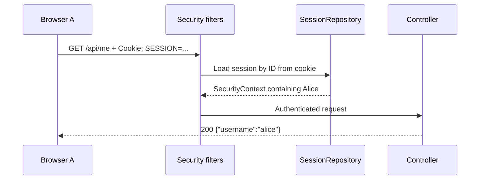
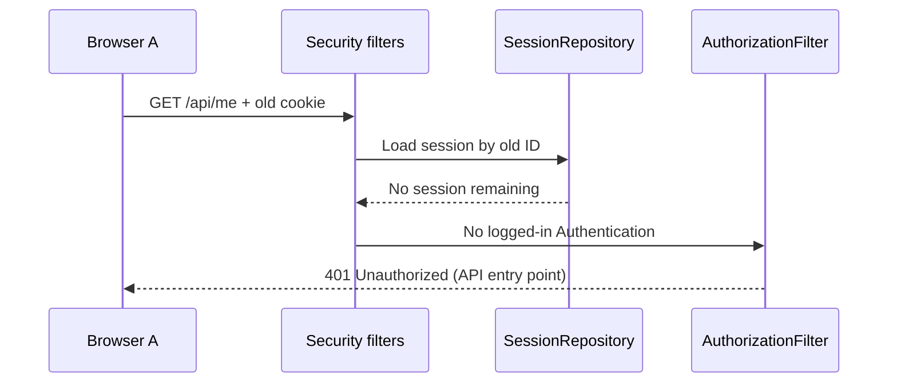
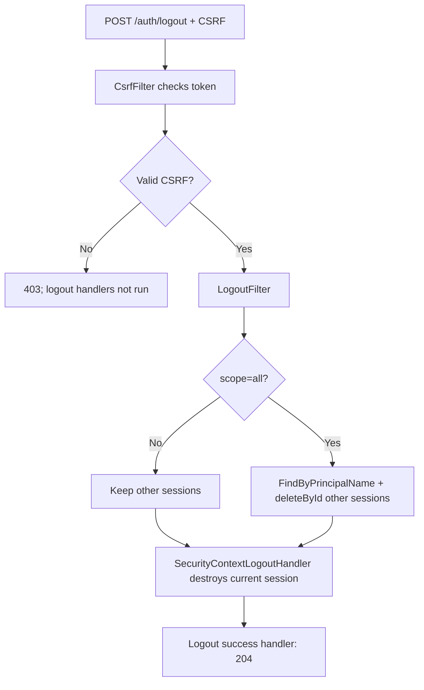

# Testing Single-Device Logout, All-Device Logout, and Post-Logout Requests

## 1. What Must Be Proved Is More Than HTTP 204 or 302

A logout endpoint returning `204 No Content` or `302 Found` is not enough to conclude the user has actually lost access. The response only shows that the handler finished along a certain path; to prove **the session was revoked**, you must test **new HTTP requests** carrying the exact same previous cookies/tokens.

This lesson builds and tests **three invariants**:

1. **Single-device logout:** only client A's session is invalidated; Alice's client B keeps using its own session, and Bob is unaffected.
2. **All-device logout:** all indexed sessions for Alice, including clients A and B, are invalidated; Bob keeps a valid session.
3. **Post-logout requests:** a client resending an old session is no longer recognized; endpoints requiring authentication must return `401` per the sample API configuration. If Alice logs back in with valid credentials, a **new session** is created; logout does not mean locking the account.

Additional critical cases: GET logout does not alter the session, POST without CSRF/with invalid CSRF returns `403` and does not log out, page refresh does not silently recreate privileges, and tests must never share a cookie jar across multiple devices.

**Scope:** Java 17+, Spring Boot 3.x, Spring Security 6.x, Spring Session 3.x, Servlet/Spring MVC. The example uses **form login + HTTP session** and Spring Session JDBC. This is not a JWT token revocation or OIDC Single Logout lesson; the final sections note what else must be tested if a system uses those mechanisms.

### Expected Results of a Good Test Suite

| Event | Alice's Laptop (A) | Alice's Phone (B) | Bob's Browser (C) |
|---|---|---|---|
| All three logged in | `200` | `200` | `200` |
| A calls current-session logout | **`401`** | **`200`** | **`200`** |
| After resetting fixture, A calls all-device logout | **`401`** | **`401`** | **`200`** |
| Alice logs back in after logout-all (account not locked) | `200` with a **new** session | Does not automatically get a new session | `200` |
| A tries POST logout without CSRF (independent test) | **Still `200`** on `GET /api/me` | **Still `200`** | Unaffected |

In the table, statuses are results **of `GET /api/me` after the event**, not the status code of the logout endpoint itself. Successful logout in the example returns `204`; missing/invalid CSRF returns `403`. Both status types must be tested separately to avoid false conclusions.

## 2. Foundation: A Session Cookie Is Not Authentication

After form login, Spring Security saves `SecurityContext` containing principal/authorities into an appropriate session store. The browser keeps a cookie identifying the session, typically named `JSESSIONID` with a Servlet container or `SESSION` when using Spring Session.

A client's `GET /api/me` is processed as follows:



When a session is invalidated:



A client can **still send the old cookie** after logout, especially if the HTTP client does not immediately purge cookies. That is not a bug if the server has invalidated the session and rejects the request. Reliable tests must measure **the authorization outcome**, not merely whether the cookie disappeared from the browser.

Conversely, a browser holding a cookie does not prove the browser is logged in: a CSRF token or request cache can create a session before login. Therefore tests must actually log in, call a protected endpoint, and verify the principal.

### Distinguishing Local Logout and Logout-All

- `LogoutFilter` and `SecurityContextLogoutHandler` by default invalidate the **current session**. They do not search for other sessions of the same user.
- Spring Security's `SessionRegistry` can track and mark sessions expired when concurrent session control is properly configured; `SessionInformation.expireNow()` does not mean every session was immediately deleted from a shared store.
- Spring Session provides `FindByIndexNameSessionRepository`, allowing lookup by principal and `deleteById(...)` to delete sessions on the backend.
- All-device logout is an **additional business requirement**, needing properly scoped lookup/isolation and usually a session store shared across instances.

**Do not write a logout-all test by merely calling `SecurityContextHolder.clearContext()`**: it clears the current request's context and does not delete sessions A/B stored on the server.

## 3. Test Matrix Before Writing Code

Split tests into three layers; never use a single "happy path logout" test to cover everything.

### 3.1. HTTP Contract Tests

| ID | Precondition | Request | Expectation |
|---|---|---|---|
| H01 | Alice logged in at A | `POST /auth/logout` + valid CSRF | 204, session A revoked |
| H02 | Alice logged in at A | `POST /auth/logout?scope=all` + valid CSRF | 204, Alice's sessions revoked |
| H03 | Alice logged in at A | `POST /auth/logout` without CSRF | **403**, session A still usable |
| H04 | Alice logged in at A | `POST /auth/logout` fake/wrong token | **403**, session A still usable |
| H05 | Alice logged in at A | `GET /auth/logout` | **Does not log out**; subsequent `GET /api/me` still 200 |
| H06 | Alice not logged in | `POST /auth/logout?scope=all` with valid CSRF | Must not delete Alice's session held by another client |
| H07 | Alice logged in at A | Two valid `POST /auth/logout` calls | No unnecessary new session; second call handled per policy |

For H05 and H07, **do not force a fixed status on the logout endpoint** if URL/matcher/entry point differs; inspect the session state afterward. This lesson's example configures `LogoutFilter` to accept POST when CSRF is enabled; GET does not log out.

### 3.2. Multi-Client Scope Tests

| ID | Setup Data | Action | Expectation |
|---|---|---|---|
| S01 | A=Alice, B=Alice, C=Bob | A performs normal logout | A 401; B 200; C 200 |
| S02 | A=Alice, B=Alice, C=Bob | A performs all-device logout | A 401; B 401; C 200 |
| S03 | A=Alice, B=Alice | B performs normal logout | A 200; B 401 |
| S04 | A=Alice, B=Alice | A does logout-all; Alice logs back in on client D | A/B 401; D 200 |
| S05 | A=Alice, B=Alice, C=Bob | C performs normal logout | Alice A/B still 200; Bob C 401 |
| S06 | Two separate Alice sessions | Read session repository before/after | Different IDs; exact right records deleted |

### 3.3. Post-Logout and Concurrency Tests

| ID | What to Check | What Must Not Be Missed |
|---|---|---|
| P01 | GET login-required resource right after logout | Must not receive revoked context |
| P02 | Resend **old cookie ID** using a separate client | Server does not restore old identity |
| P03 | POST mutation after logout, with/without CSRF token | Distinguish `401` authentication from `403` CSRF; do not look at status alone |
| P04 | Password still works after logout-all | New login receives a **different session**, unless the account is locked |
| P05 | Logout while another request is in flight | Do not promise cancelling a request that already passed authorization |
| P06 | Two nodes sharing one session store | Revocation from node 1 must affect new requests through node 2 |
| P07 | Session index covers all devices | No Alice session missed due to wrong indexing |

In every test, **A/B/C must have independent cookie stores**. Sharing a `MockHttpSession`/`CookieManager` across A and B turns an "all-device logout" test into a disguised single-device test.

## 4. Example Architecture: One LogoutFilter, Two Logout Scopes

We use a single HTTP endpoint:

- `POST /auth/logout`: logs out the current session.
- `POST /auth/logout?scope=all`: logs out the current session **and** deletes other sessions for the same principal found in Spring Session JDBC.

Why share the URL? Because both actions are logout and need the shared **`LogoutFilter` → `LogoutHandler` → `LogoutSuccessHandler`** pipeline, with CSRF and default context/session cleanup steps. We only add one `LogoutHandler` for the `scope=all` option; we do not write a custom `@PostMapping` replacing the entire logout framework.



There are three key decisions:

1. **Do not delete the current session from the repository immediately in the custom handler**: leave that to the default `SecurityContextLogoutHandler`. The handler deletes only sessions **other than the requesting ID**.
2. **Do not skip CSRF**: both single-device and all-device logout are POST requests with CSRF tokens; the `scope=all` query parameter creates no exception.
3. **Do not take a client-supplied account name to choose whose sessions to revoke**: the custom handler gets the principal from the Spring Security-authenticated `Authentication`. Only the currently logged-in user can request revoking sessions belonging to their own identity.

The example provides full code for an application running in one JVM, using in-memory H2 as the session store. Production requires a durable database/session store and appropriate authentication/auditing for logout-all operations.

## 5. Java 17 / Spring Boot 3.5 / Spring Security 6.5 / Spring Session 3.5 Example

### 5.1. Structure and Dependencies

```text
src/
  main/
    java/com/example/logoutscope/
      LogoutScopeApplication.java
      SecurityConfig.java
      SessionScopeLogoutHandler.java
      ApiController.java
    resources/
      application.properties
  test/
    java/com/example/logoutscope/
      LogoutScopeHttpTest.java
```

The project uses the Spring Boot plugin, Gradle wrapper, and Maven Central repository. In the `dependencies` block of `build.gradle`:

```groovy
dependencies {
    implementation 'org.springframework.boot:spring-boot-starter-web'
    implementation 'org.springframework.boot:spring-boot-starter-security'
    implementation 'org.springframework.boot:spring-boot-starter-jdbc'
    implementation 'org.springframework.session:spring-session-jdbc'

    runtimeOnly 'com.h2database:h2'

    testImplementation 'org.springframework.boot:spring-boot-starter-test'
    testImplementation 'org.springframework.security:spring-security-test'
    testRuntimeOnly 'org.junit.platform:junit-platform-launcher'
}

tasks.named('test') {
    useJUnitPlatform()
}
```

Spring Boot BOM manages aligned versions. The classes below are a Spring Boot application; do not compile/run with bare `javac` without Spring dependencies. The exercise targets 3.5.x/6.5.x; verify the exact BOM and APIs when using another version.

### 5.2. Configuring the JDBC Session Store

`src/main/resources/application.properties`:

```properties
spring.datasource.url=jdbc:h2:mem:logoutscopedb;DB_CLOSE_DELAY=-1
spring.datasource.driver-class-name=org.h2.Driver
spring.datasource.username=sa
spring.datasource.password=
spring.session.jdbc.initialize-schema=always
server.servlet.session.timeout=30m
server.servlet.session.cookie.http-only=true
server.servlet.session.cookie.same-site=lax
```

Spring Session JDBC uses session tables (such as `SPRING_SESSION`) and attribute tables (`SPRING_SESSION_ATTRIBUTES`). When integrated with Spring Security, sessions can be **indexed by principal name**, allowing `findByPrincipalName(...)` to locate all related sessions.

**Note:** in-memory H2 and `initialize-schema=always` are only for demos/tests. Production must use a managed database, proper migrations, consistent schema/namespace across instances, TLS/secret storage, TTL/cleanup, backups, and query/index monitoring. The session cookie with Spring Session is typically named `SESSION`; check deployment config and never hardcode the cookie name into authentication logic.

### 5.3. Main Class

`src/main/java/com/example/logoutscope/LogoutScopeApplication.java`:

```java
package com.example.logoutscope;

import org.springframework.boot.SpringApplication;
import org.springframework.boot.autoconfigure.SpringBootApplication;

@SpringBootApplication
public class LogoutScopeApplication {
    public static void main(String[] args) {
        SpringApplication.run(LogoutScopeApplication.class, args);
    }
}
```

### 5.4. Custom LogoutHandler That Revokes Only *Other* Sessions

`src/main/java/com/example/logoutscope/SessionScopeLogoutHandler.java`:

```java
package com.example.logoutscope;

import java.util.List;
import jakarta.servlet.http.HttpServletRequest;
import jakarta.servlet.http.HttpServletResponse;
import org.springframework.security.authentication.AnonymousAuthenticationToken;
import org.springframework.security.core.Authentication;
import org.springframework.security.web.authentication.logout.LogoutHandler;
import org.springframework.session.FindByIndexNameSessionRepository;
import org.springframework.session.Session;

public final class SessionScopeLogoutHandler implements LogoutHandler {

    private final FindByIndexNameSessionRepository<? extends Session> sessions;

    public SessionScopeLogoutHandler(
            FindByIndexNameSessionRepository<? extends Session> sessions) {
        this.sessions = sessions;
    }

    @Override
    public void logout(
            HttpServletRequest request,
            HttpServletResponse response,
            Authentication authentication) {

        // Normal POST: Spring Security logs out only the current session.
        if (!"all".equals(request.getParameter("scope"))) {
            return;
        }

        // Do not use a client-supplied username or session owner.
        if (authentication == null
                || authentication instanceof AnonymousAuthenticationToken
                || !authentication.isAuthenticated()) {
            return;
        }

        String principalName = authentication.getName();
        String currentId = request.getRequestedSessionId();

        // Spring Session JDBC finds sessions with the matching principal index.
        List<String> sessionIds = List.copyOf(
            sessions.findByPrincipalName(principalName).keySet()
        );

        for (String id : sessionIds) {
            if (!id.equals(currentId)) {
                // Delete only other sessions; the current session is invalidated
                // by the default SecurityContextLogoutHandler.
                sessions.deleteById(id);
            }
        }
    }
}
```

Detailed explanation:

- `LogoutHandler` receives `HttpServletRequest`, `HttpServletResponse`, and `Authentication` for the request handled by `LogoutFilter`. The custom handler's job is not to verify passwords or read an arbitrary user ID from the body.
- On a normal logout without `scope=all`, the custom handler does nothing; default handlers still clean up the current session.
- With `scope=all`, the handler reads the **authenticated** identity, finds sessions with the same principal, and deletes **other sessions**; the current request's session ID is left for the default handler to destroy.
- `List.copyOf(...)` snapshots the ID list before the deletion loop; never iterate directly over a map the repository may mutate during operations.
- `request.getRequestedSessionId()` is the session ID sent by the client in the request per Servlet wrapper; the demo uses session cookies. With custom reverse proxies/session ID resolvers, test that this value matches the IDs in the repository.
- Only sessions present in the index are deleted; sessions without the proper principal or created by another auth mechanism will not be found. Hence tests must **prove the index contains at least two distinct IDs**.

**Production design limitation:** `LogoutHandler` is meant by contract for cleanup and should not throw exceptions; database errors while revoking multiple sessions demand an explicit design for failure handling, retry/audit, and responses that never mislead users into thinking "all devices were revoked" when only partial revocation succeeded. This example assumes JDBC works so testing stays focused. For strong multi-node revocation guarantees, use a stateful workflow, security epoch/revision, transactions, and monitoring instead of relying solely on a for-loop.

### 5.5. SecurityConfig: Sharing the Standard LogoutFilter

`src/main/java/com/example/logoutscope/SecurityConfig.java`:

```java
package com.example.logoutscope;

import org.springframework.context.annotation.Bean;
import org.springframework.context.annotation.Configuration;
import org.springframework.http.HttpStatus;
import org.springframework.security.config.Customizer;
import org.springframework.security.config.annotation.web.builders.HttpSecurity;
import org.springframework.security.config.annotation.web.configuration.EnableWebSecurity;
import org.springframework.security.config.annotation.web.configurers.AbstractHttpConfigurer;
import org.springframework.security.core.userdetails.User;
import org.springframework.security.core.userdetails.UserDetailsService;
import org.springframework.security.crypto.bcrypt.BCryptPasswordEncoder;
import org.springframework.security.crypto.password.PasswordEncoder;
import org.springframework.security.provisioning.InMemoryUserDetailsManager;
import org.springframework.security.web.SecurityFilterChain;
import org.springframework.security.web.authentication.HttpStatusEntryPoint;
import org.springframework.security.web.authentication.logout.HttpStatusReturningLogoutSuccessHandler;
import org.springframework.security.web.util.matcher.AntPathRequestMatcher;
import org.springframework.session.FindByIndexNameSessionRepository;
import org.springframework.session.Session;

@Configuration
@EnableWebSecurity
public class SecurityConfig {

    @Bean
    PasswordEncoder passwordEncoder() {
        return new BCryptPasswordEncoder();
    }

    @Bean
    UserDetailsService userDetailsService(PasswordEncoder encoder) {
        return new InMemoryUserDetailsManager(
            User.withUsername("alice")
                .password(encoder.encode("alice-secret"))
                .roles("USER")
                .build(),
            User.withUsername("bob")
                .password(encoder.encode("bob-secret"))
                .roles("USER")
                .build()
        );
    }

    @Bean
    SessionScopeLogoutHandler sessionScopeLogoutHandler(
            FindByIndexNameSessionRepository<? extends Session> sessions) {
        return new SessionScopeLogoutHandler(sessions);
    }

    @Bean
    SecurityFilterChain securityFilterChain(
            HttpSecurity http,
            SessionScopeLogoutHandler scopeHandler) throws Exception {

        http
            .authorizeHttpRequests(auth -> auth
                .requestMatchers("/login", "/api/csrf", "/error")
                    .permitAll()
                .requestMatchers("/api/me").authenticated()
                .anyRequest().denyAll()
            )
            .formLogin(Customizer.withDefaults())
            .csrf(Customizer.withDefaults())
            .httpBasic(AbstractHttpConfigurer::disable)
            .logout(logout -> logout
                .logoutUrl("/auth/logout")
                .addLogoutHandler(scopeHandler)
                .invalidateHttpSession(true)
                .clearAuthentication(true)
                .logoutSuccessHandler(
                    new HttpStatusReturningLogoutSuccessHandler(
                        HttpStatus.NO_CONTENT))
                .permitAll()
            )
            .exceptionHandling(ex -> ex
                .defaultAuthenticationEntryPointFor(
                    new HttpStatusEntryPoint(HttpStatus.UNAUTHORIZED),
                    new AntPathRequestMatcher("/api/**"))
            );

        return http.build();
    }
}
```

**Points that directly affect the tests:**

1. `.logoutUrl("/auth/logout")` configures `LogoutFilter` to accept **POST** at that URL while CSRF is enabled. Query `scope=all` hits the same URL path; no need to register two controllers.
2. `.addLogoutHandler(scopeHandler)` adds cleanup alongside the default handlers; `SecurityContextLogoutHandler` is still added by Spring Security to invalidate the current session and clear context/repository.
3. `.logoutSuccessHandler(HttpStatusReturningLogoutSuccessHandler(NO_CONTENT))` makes valid logout responses return `204`, convenient for HTTP tests. `204` has no JSON body.
4. `.csrf(Customizer.withDefaults())` preserves CSRF for form login and both logout options; missing/invalid tokens get `403` **before** `LogoutFilter` destroys the session.
5. `.formLogin(...)` handles standard session login, rotating the session ID after login per the framework's strategy. Do not write a custom `@PostMapping("/login")` in the demo.
6. `.httpBasic(...disable)` avoids post-logout requests silently re-authenticating via a Basic header, which would mislead tests into thinking the session was not destroyed.
7. `HttpStatusEntryPoint` for `/api/**` returns `401` when unauthenticated. Without an API entry point, Spring Security may redirect to `/login` and tests would need to check Location instead of assuming 401.
8. `LogoutFilter` runs before `AuthorizationFilter`, so `.permitAll()` in the logout DSL is a URL configuration convenience; it **does not** bypass CSRF checks.

The `SESSION` cookie carries the identity managed by Spring Session/Spring Security; the custom handler creates no new cookies, returns no principal, and takes no username from query/body to alter the revocation target.

### 5.6. CSRF and Identity Endpoints for Verification

`src/main/java/com/example/logoutscope/ApiController.java`:

```java
package com.example.logoutscope;

import java.util.Map;
import org.springframework.security.core.Authentication;
import org.springframework.security.web.csrf.CsrfToken;
import org.springframework.web.bind.annotation.GetMapping;
import org.springframework.web.bind.annotation.RestController;

@RestController
public class ApiController {

    @GetMapping("/api/csrf")
    public CsrfToken csrf(CsrfToken token) {
        return token;
    }

    @GetMapping("/api/me")
    public Map<String, String> me(Authentication authentication) {
        return Map.of("username", authentication.getName());
    }
}
```

`GET /api/csrf` is permitted before login, returning a token for clients submitting forms/POSTs. With default config, CSRF tokens are typically stored in the session; after login or logout, Spring Security may clear the old token. **Always fetch a fresh token after login** before POSTing logout, rather than reusing an old token blindly.

`GET /api/me` has `authenticated()`, serving as a login-state probe: Alice → `200 {"username":"alice"}`, Bob → `200 {"username":"bob"}`, anonymous → `401` per the example's entry point.

## 6. Testing Over Real HTTP: One CookieManager Per Device

### Why Use Integration Tests Instead of Only @WithMockUser?

`@WithMockUser` injects a mock principal into the security context of a single test request. It is very useful for testing authorization, but does not prove:

- Whether the browser receives a real session cookie after login.
- Whether two clients have different session IDs.
- Whether Spring Session JDBC indexes both of Alice's sessions.
- Whether logging out at A invalidates B's session.
- Whether a new request with the old cookie still resolves the principal.

For full verification, use `@SpringBootTest(webEnvironment=RANDOM_PORT)` running a real web server and `java.net.http.HttpClient`, each client with its **own CookieManager**. Each request is real HTTP to the server; browser sessions are simulated via independent client cookie stores.

### 6.1. Complete Integration Test

Create `src/test/java/com/example/logoutscope/LogoutScopeHttpTest.java`:

```java
package com.example.logoutscope;

import com.fasterxml.jackson.databind.ObjectMapper;
import java.net.CookieManager;
import java.net.CookiePolicy;
import java.net.URI;
import java.net.URLEncoder;
import java.net.http.HttpClient;
import java.net.http.HttpRequest;
import java.net.http.HttpResponse;
import java.nio.charset.StandardCharsets;
import org.junit.jupiter.api.Test;
import org.springframework.beans.factory.annotation.Autowired;
import org.springframework.boot.test.context.SpringBootTest;
import org.springframework.boot.test.web.server.LocalServerPort;

import static org.junit.jupiter.api.Assertions.assertEquals;
import static org.junit.jupiter.api.Assertions.assertTrue;

@SpringBootTest(webEnvironment = SpringBootTest.WebEnvironment.RANDOM_PORT)
class LogoutScopeHttpTest {

    @LocalServerPort
    int port;

    @Autowired
    ObjectMapper mapper;

    // Each instance represents a different device/browser profile.
    static final class Browser {
        final CookieManager cookies =
            new CookieManager(null, CookiePolicy.ACCEPT_ALL);

        final HttpClient http = HttpClient.newBuilder()
            .cookieHandler(cookies)
            .followRedirects(HttpClient.Redirect.NEVER)
            .build();
    }

    URI uri(String path) {
        return URI.create("http://localhost:" + port + path);
    }

    HttpResponse<String> send(Browser browser, HttpRequest request)
            throws Exception {
        return browser.http.send(
            request, HttpResponse.BodyHandlers.ofString());
    }

    HttpResponse<String> get(Browser browser, String path)
            throws Exception {
        return send(browser,
            HttpRequest.newBuilder(uri(path)).GET().build());
    }

    String csrf(Browser browser) throws Exception {
        HttpResponse<String> response = get(browser, "/api/csrf");
        assertEquals(200, response.statusCode());

        return mapper.readTree(response.body())
            .path("token").asText();
    }

    void login(Browser browser, String username, String password)
            throws Exception {
        String form = "username=" +
            URLEncoder.encode(username, StandardCharsets.UTF_8) +
            "&password=" +
            URLEncoder.encode(password, StandardCharsets.UTF_8);

        HttpResponse<String> response = send(browser,
            HttpRequest.newBuilder(uri("/login"))
                .header("Content-Type",
                    "application/x-www-form-urlencoded")
                .header("X-CSRF-TOKEN", csrf(browser))
                .POST(HttpRequest.BodyPublishers.ofString(form))
                .build());

        // Form login redirects after successful authentication.
        assertEquals(302, response.statusCode());
        assertEquals(username, currentUser(browser));
    }

    String currentUser(Browser browser) throws Exception {
        HttpResponse<String> response = get(browser, "/api/me");
        assertEquals(200, response.statusCode());

        return mapper.readTree(response.body())
            .path("username").asText();
    }

    HttpResponse<String> logout(Browser browser, boolean allDevices)
            throws Exception {
        // Login may reset the CSRF token; fetch the current token.
        String token = csrf(browser);
        String path = allDevices
            ? "/auth/logout?scope=all" : "/auth/logout";

        return send(browser,
            HttpRequest.newBuilder(uri(path))
                .header("X-CSRF-TOKEN", token)
                .POST(HttpRequest.BodyPublishers.noBody())
                .build());
    }

    void expectAnonymous(Browser browser) throws Exception {
        assertEquals(401,
            get(browser, "/api/me").statusCode());
    }

    @Test
    void logoutOneDeviceKeepsOtherDevicesSignedIn()
            throws Exception {

        Browser aliceLaptop = new Browser();
        Browser alicePhone = new Browser();
        Browser bobLaptop = new Browser();

        login(aliceLaptop, "alice", "alice-secret");
        login(alicePhone, "alice", "alice-secret");
        login(bobLaptop, "bob", "bob-secret");

        // All three have the right principal before changing state.
        assertEquals("alice", currentUser(aliceLaptop));
        assertEquals("alice", currentUser(alicePhone));
        assertEquals("bob", currentUser(bobLaptop));

        HttpResponse<String> response = logout(aliceLaptop, false);
        assertEquals(204, response.statusCode());

        // Single-device logout destroys only Alice's laptop session.
        expectAnonymous(aliceLaptop);
        assertEquals("alice", currentUser(alicePhone));
        assertEquals("bob", currentUser(bobLaptop));
    }

    @Test
    void logoutAllRevokesBothAliceSessionsButNotBob()
            throws Exception {

        Browser aliceLaptop = new Browser();
        Browser alicePhone = new Browser();
        Browser bobLaptop = new Browser();

        login(aliceLaptop, "alice", "alice-secret");
        login(alicePhone, "alice", "alice-secret");
        login(bobLaptop, "bob", "bob-secret");

        assertEquals(204, logout(aliceLaptop, true).statusCode());

        // Both new requests with old cookies no longer have Alice.
        expectAnonymous(aliceLaptop);
        expectAnonymous(alicePhone);

        // Revocation must be scoped by principal: Bob remains logged in.
        assertEquals("bob", currentUser(bobLaptop));
    }

    @Test
    void logoutWithoutCsrfMustNotDestroyCurrentSession()
            throws Exception {

        Browser alice = new Browser();
        login(alice, "alice", "alice-secret");

        HttpResponse<String> response = send(alice,
            HttpRequest.newBuilder(uri("/auth/logout"))
                .POST(HttpRequest.BodyPublishers.noBody())
                .build());

        assertEquals(403, response.statusCode());
        assertEquals("alice", currentUser(alice));
    }

    @Test
    void logoutWithInvalidCsrfMustNotDestroyAnySession()
            throws Exception {

        Browser aliceLaptop = new Browser();
        Browser alicePhone = new Browser();
        login(aliceLaptop, "alice", "alice-secret");
        login(alicePhone, "alice", "alice-secret");

        HttpResponse<String> response = send(aliceLaptop,
            HttpRequest.newBuilder(uri("/auth/logout?scope=all"))
                .header("X-CSRF-TOKEN", "invalid-token")
                .POST(HttpRequest.BodyPublishers.noBody())
                .build());

        assertEquals(403, response.statusCode());
        assertEquals("alice", currentUser(aliceLaptop));
        assertEquals("alice", currentUser(alicePhone));
    }

    @Test
    void getLogoutDoesNotInvalidateTheSession()
            throws Exception {

        Browser alice = new Browser();
        login(alice, "alice", "alice-secret");

        // May return 403/404 depending on rules; session state is what matters.
        get(alice, "/auth/logout");

        assertEquals("alice", currentUser(alice));
    }

    @Test
    void freshLoginAfterLogoutAllCreatesNewAuthenticatedSession()
            throws Exception {

        Browser aliceLaptop = new Browser();
        Browser alicePhone = new Browser();
        login(aliceLaptop, "alice", "alice-secret");
        login(alicePhone, "alice", "alice-secret");

        assertEquals(204, logout(aliceLaptop, true).statusCode());

        expectAnonymous(aliceLaptop);
        expectAnonymous(alicePhone);

        // Logout-all does not change the password or lock the account.
        Browser aliceNewBrowser = new Browser();
        login(aliceNewBrowser, "alice", "alice-secret");
        assertEquals("alice", currentUser(aliceNewBrowser));

        // The new session does not revive the two old sessions.
        expectAnonymous(aliceLaptop);
        expectAnonymous(alicePhone);
    }

    @Test
    void anonymousAllDevicesRequestCannotRevokeAlice()
            throws Exception {

        Browser alice = new Browser();
        Browser anonymous = new Browser();

        login(alice, "alice", "alice-secret");

        // Anonymous has its own anonymous session's CSRF token.
        HttpResponse<String> response = logout(anonymous, true);
        assertEquals(204, response.statusCode());

        // No Alice principal to look up and delete Alice's sessions.
        assertEquals("alice", currentUser(alice));
    }
}
```

Run:

```bash
./gradlew test
```

Windows PowerShell:

```powershell
.\gradlew.bat test
```

**Expected result:** all tests pass if the Boot 3.x project has proper dependencies/configuration, Spring Session JDBC indexes principals, and CSRF/headers/cookies are sent properly. The example **does not claim execution results** in your environment: this is sample code to build and run with Gradle.

### 6.2. Why Do the Tests Use Separate Browser Objects?

Java's `HttpClient` is not automatically "a browser with sessions" unless you attach a `CookieHandler`. `CookieManager` stores `Set-Cookie` from responses and sends matching cookies on subsequent requests.

In the example:

- `aliceLaptop.cookies` and `alicePhone.cookies` have two separate jars, creating **two independent session IDs**.
- `bobLaptop.cookies` is a separate store and principal; tests guard against deleting the wrong user.
- `HttpClient.Redirect.NEVER` preserves the `302` login response so tests verify form login ran, rather than silently following redirects to another URL.
- The `login(...)` helper checks **both** the 302 form login status **and** `GET /api/me` afterward; if credentials are wrong yet `/login?error` still redirects 302, the `currentUser()` step catches that login did not occur.

**A common broken test:**

```java
// Incorrect as "two devices":
MockHttpSession shared = new MockHttpSession();
mvc.perform(get("/api/me").session(shared));
mvc.perform(get("/api/me").session(shared));
```

Two requests using the same `shared` session are only **one session**, not two devices. Likewise, two `HttpClient`s sharing **the same** `CookieManager` do not create two independent sessions.

### 6.3. Do Not Slap `@WithMockUser` Onto Every Integration Test

`@WithMockUser("alice")` creates a mock identity scoped to the test request without making a browser actually run `POST /login`. If a post-logout test still uses `@WithMockUser`, it can keep returning `200` because the annotation **re-injects the principal**, even though the session was destroyed. That is a dangerous false-negative.

For multi-device logout, perform real logins or explicitly create distinct authenticated sessions and use **different sessions**. In the example above, real HTTP is the clearest verification method.

## 7. Check the Spring Session Principal Index Before Trusting Logout-All

One reason logout-all returns `204` while the phone remains logged in is that the repository **failed to find the second session**. To avoid tests that only inspect the HTTP response, add a test or repository inspection:

```java
// Fragment inside a test/service with the repository bean:
Map<String, ? extends Session> aliceSessions =
    sessionRepository.findByPrincipalName("alice");

assertTrue(aliceSessions.size() >= 2);
```

`sessionRepository` must have the appropriate `FindByIndexNameSessionRepository` type; this snippet is a **fragment**, not a standalone Java class.

To make the index test reliable:

1. Create A and B with separate cookie jars.
2. Actually log A and B in via Spring Security form login.
3. Complete the login/`GET /api/me` request so sessions are persisted into Spring Session JDBC.
4. Call `findByPrincipalName("alice")` and assert there are **at least two distinct session IDs**.
5. Call logout-all from A.
6. Query the repository again and verify IDs A/B were deleted or cannot be loaded, while `GET /api/me` for both A and B is unauthenticated.

Index caveats:

- `FindByIndexNameSessionRepository` is an interface supporting lookup by indexed principal, not a static registry.
- Spring Session JDBC with Spring Security usually derives the principal name from `SPRING_SECURITY_CONTEXT`; if you write custom authentication without saving the context, the index may be empty.
- If the principal name is an email/username that can change, old sessions may retain the pre-change name. Production should use immutable account identifiers or proper mapping/tracking mechanisms.
- If the app has multiple session types or multi-tenancy, querying by Alice's name alone **does not** guarantee tenant isolation; proper namespacing/indexing and isolation policies are needed.

### Do Not Assume `SESSION=...` Always Exists or Is Unique

Cookie names and attributes can vary. A browser may already hold a session for CSRF before login; the session ID may also rotate on authentication to prevent session fixation.

Therefore never pin an ID from **before login** assuming it is the authenticated session. In integration tests, use `CookieManager` and inspect cookies after login; for auditing, log **hashed/masked identifiers**, never raw session IDs.

## 8. Manual Testing Using Three Cookie Jars with curl

If you are not writing Java tests right away, `curl` can also simulate three independent clients. Use three cookie files; never share `-b/-c` across Alice A, Alice B, and Bob C.

Start the server:

```bash
./gradlew bootRun
```

Here is an illustrative Bash script using `jq` to extract CSRF tokens:

```bash
# Helper to fetch CSRF token and update cookie jar.
csrf_token() {
  local jar="$1"
  curl -sS -b "$jar" -c "$jar" \
    http://localhost:8080/api/csrf | jq -r '.token'
}

# A: Alice's Laptop
A_TOKEN=$(csrf_token alice-a.cookies)
curl -i -b alice-a.cookies -c alice-a.cookies \
  -H "X-CSRF-TOKEN: $A_TOKEN" \
  --data-urlencode 'username=alice' \
  --data-urlencode 'password=alice-secret' \
  http://localhost:8080/login

# B: Alice's Phone (different cookie jar)
B_TOKEN=$(csrf_token alice-b.cookies)
curl -i -b alice-b.cookies -c alice-b.cookies \
  -H "X-CSRF-TOKEN: $B_TOKEN" \
  --data-urlencode 'username=alice' \
  --data-urlencode 'password=alice-secret' \
  http://localhost:8080/login

# C: Bob's Laptop
C_TOKEN=$(csrf_token bob-c.cookies)
curl -i -b bob-c.cookies -c bob-c.cookies \
  -H "X-CSRF-TOKEN: $C_TOKEN" \
  --data-urlencode 'username=bob' \
  --data-urlencode 'password=bob-secret' \
  http://localhost:8080/login

# After login all three must be able to access /api/me.
curl -i -b alice-a.cookies http://localhost:8080/api/me
curl -i -b alice-b.cookies http://localhost:8080/api/me
curl -i -b bob-c.cookies http://localhost:8080/api/me
```

Three expected results: `200` and the exact principals Alice/Alice/Bob. Login responses are typically `302`; using cookie jars and checking `/api/me` distinguishes successful logins.

### Case A: Single-Device Logout on A Only

Fetch a **post-login CSRF token** then POST:

```bash
A_TOKEN=$(csrf_token alice-a.cookies)

curl -i -b alice-a.cookies -c alice-a.cookies \
  -H "X-CSRF-TOKEN: $A_TOKEN" \
  -X POST http://localhost:8080/auth/logout

curl -i -b alice-a.cookies http://localhost:8080/api/me
curl -i -b alice-b.cookies http://localhost:8080/api/me
curl -i -b bob-c.cookies http://localhost:8080/api/me
```

Expected in order:

- Logout response: `204`.
- A: `401`.
- B: `200 {"username":"alice"}`.
- C: `200 {"username":"bob"}`.

**Do not delete cookie jar B or C** to "make the test pass": let the server prove only session A was invalidated.

### Case B: All-Device Logout

Recreate A/B (or restart the demo for clean state) then send:

```bash
A_TOKEN=$(csrf_token alice-a.cookies)

curl -i -b alice-a.cookies -c alice-a.cookies \
  -H "X-CSRF-TOKEN: $A_TOKEN" \
  -X POST 'http://localhost:8080/auth/logout?scope=all'

curl -i -b alice-a.cookies http://localhost:8080/api/me
curl -i -b alice-b.cookies http://localhost:8080/api/me
curl -i -b bob-c.cookies http://localhost:8080/api/me
```

Expected: logout `204`, A `401`, B `401`, C `200`. Note that if A already logged out in the previous case, you must log **both A and B back in before the logout-all scenario**; otherwise the test lacks multiple sessions to revoke.

### Case C: POST Without CSRF Must Not Log Out

On a still-valid session:

```bash
curl -i -b alice-b.cookies -c alice-b.cookies \
  -X POST http://localhost:8080/auth/logout

curl -i -b alice-b.cookies http://localhost:8080/api/me
```

Expected: POST logout `403`, subsequent GET `200`. Do not "fix" this by disabling `csrf` globally or switching logout to GET. CSRF must protect both single-device and all-device logout when using browser session cookies.

**Cookie jars are secrets:** cookie files can represent login authority. Never commit them to Git, paste them in chat, write raw logs, or store them longer than necessary. When finished with the exercise, delete temporary files locally per security policy.

## 9. Where Is MockMvc Useful, and What Can It Not Prove?

Spring Security Test provides the `logout()` helper, building a POST `/logout` with a valid CSRF token. For a custom URL:

```java
import static org.springframework.security.test.web.servlet.request
    .SecurityMockMvcRequestBuilders.logout;

// In a @Test, mvc is a MockMvc wired with springSecurityFilterChain:
mvc.perform(logout("/auth/logout"))
    .andExpect(status().isNoContent());
```

**The Java import line above must sit on one complete line when copied into an IDE:**

```java
import static org.springframework.security.test.web.servlet.request.SecurityMockMvcRequestBuilders.logout;
```

This is a **fragment inside a JUnit test**, not a standalone runnable program. The helper tests the default logout contract, but unless you attach a real authenticated session, it does not prove Alice's session was revoked.

With MockMvc, a local test can verify:

```java
// Fragment in a JUnit test with mvc and a real logged-in session.
mvc.perform(post("/auth/logout")
        .session(session)
        .with(csrf()))
    .andExpect(status().isNoContent());
```

Test missing CSRF:

```java
mvc.perform(post("/auth/logout").session(session))
    .andExpect(status().isForbidden());
```

**Do not reuse the same `session` as "two devices".** To test multi-device behavior, create two `MockHttpSession` instances from two independent logins or use HTTP integration tests with two cookie managers. Especially when Spring Session wraps `HttpSession` with its own wrapper, assumptions that cast directly to `MockHttpSession` can break; this lesson uses real HTTP so Spring Session's behavior is not masked.

### Status-Only Tests That Mislead

| A test checking only... | Discrepancy that can slip through | What else must be checked |
|---|---|---|
| `POST /auth/logout == 204` | Handler returned status without invalidating session | `GET /api/me` after logout |
| `GET /api/me == 401` | User never actually logged in successfully | `GET /api/me == 200` **before** logout |
| A after logout == 401 | B might also have been deleted by mistake | A/B/C use separate cookies; check B/C |
| Logout-all response 204 | Repo failed to index B | Check repository or B sending old cookie and getting 401 |
| Browser has no cookie after logout | Server still keeps record and old cookie can be replayed | Resend old session ID, check server |
| `@WithMockUser` + protected endpoint == 200 | Principal re-injected by test, does not reflect session | Real login through form/filter |
| POST without CSRF == 403 | Unknown whether session was accidentally cleared | `GET /api/me` still 200 |
| Gets 403 after logout | Could be CSRF/authorization, not missing authentication | Use protected GET to distinguish 401/403 |

## 10. Post-Logout: Testing Replay, Caching, CSRF, and Mutations

### 10.1. Testing That Old Cookies Do Not Restore Identity

An advanced test suite should save a copy of the **post-login session cookie**, call logout, and then use a separate HTTP client to resend the original cookie on `GET /api/me`. The server must reject it. Do not merely assert the browser deleted the cookie, since a client can keep the old cookie or an attacker may hold a leaked copy.

A conceptual example:

```http
GET /api/me HTTP/1.1
Cookie: SESSION=<old-session-id>
```

Expected after revocation: `401` with this lesson's API config. `<old-session-id>` is only a placeholder illustrating header structure; never write real session IDs into logs/reports. Automate the test with Java `HttpClient` or MockWebServer, **without printing secret cookies to stdout**.

Note that the status depends on session/entry point config; in traditional web apps an anonymous request may `302` to `/login`. In that case assert the redirect location instead of rigidly forcing 401.

### 10.2. An Old CSRF Token Is Not Proof of Being Logged In

CSRF tokens can be bound to a session. After logout, the old token should be removed/invalidated by `CsrfLogoutHandler` and session invalidation. Yet a `POST` with the old token may return `403` because of CSRF **before** reaching authorization—which does not prove the user is still authenticated or the session still exists.

To test loss of login, use a **protected GET** requiring no CSRF. To test the CSRF lifecycle, write a dedicated test:

1. While logged in, fetch token T1.
2. Log out with valid T1.
3. Send a POST request with T1 without a valid old session.
4. Expect `403` per CSRF configuration.
5. Fetch a new token for a new session and verify valid requests after logging back in.

Do not call `GET /api/csrf` after logout and infer the server restored authentication merely because it returns 200: that endpoint is public and may create a **new anonymous session**.

### 10.3. UI Caching After Logout

An SPA may retain user data in memory, Service Worker cache, or browser back-forward cache. Even after the server session is revoked, the Back button may still render old UI.

Testing should separate:

- **Server security:** new `/api/me` and sensitive API calls reject the old session.
- **UX/client cache:** after logout, frontend clears sensitive state, does not use stale data to show a logged-in UI, and uses `Cache-Control: no-store` on sensitive responses per policy.

**Do not conclude the server has a logout bug merely because the browser briefly shows cached HTML**, nor conclude everything is safe just because the UI hid the login button; the server must block new requests.

### 10.4. Requests Already Started Before Logout

An in-flight request may have already loaded `SecurityContext` and passed `AuthorizationFilter` before another session triggered logout-all. Deleting the session in JDBC **does not automatically abort** work already running.

For financial operations or sensitive data mutations, add tests that re-check status/security revision at the service/transaction boundary, for example:

- Thread 1 starts a high-privilege operation and pauses at a test synchronization barrier.
- Thread 2 logs out all devices or locks the account, waiting for revocation to finish.
- Thread 1 resumes and must be rejected when re-checking the revision, if policy requires immediate revocation effect.
- Do not treat `deleteById(...)` as a promise to kill in-flight requests.

This is a **separate concurrency test**, not covered automatically just because sequential HTTP integration tests pass.

## 11. Running Multiple Instances: Cross-Node Revocation Testing

The in-memory H2 demo runs in a single process. In production:

- A may log in via server 1; B via server 2.
- Logout-all may execute on server 3.
- All three must share the same Spring Session store and identical index/namespace rules.
- Once the handler returns, **new requests** carrying cookie A/B through any node must not restore authentication.

Staging test scenarios should include:

1. Log Alice in from two independent clients routed to two different instances.
2. Verify both sessions appear in the shared session store/index under the exact principal.
3. Send logout-all to a third instance.
4. Send requests A/B to each instance and verify rejection.
5. Verify Bob (another principal) still keeps his session.
6. Test retries, DB disconnects, cache/index lag, mixed session serialization versions, and cleanup jobs.
7. Measure logout-all latency when a principal has hundreds/thousands of sessions; apply bounds/governance to bulk operations.

With Redis Indexed Session or other JDBC implementations, consistency and index updates can exhibit latency/trade-offs. Do not infer that "using Spring Session" automatically yields instantaneous revocation across every in-flight request.

### Testing Partial Failures

Suppose the repository finds 4 sessions, yet deleting the third session fails. A naive logout handler may abort partway, leaving different sessions in inconsistent states. Production requires a policy:

- Audit sessions found / deleted successfully / failed.
- A retry/idempotency/outbox mechanism to complete revocation.
- A user security revision or epoch marker to reject old contexts even when session deletion fails.
- Accurate status reporting—never returning "logged out all devices" when only partially processed.
- When errors happen inside `LogoutHandler`, ensure current-session cleanup is not skipped.

The local example intentionally assumes the DB succeeds to illustrate the principle; **it is not a production implementation with full transactional guarantees**.

## 12. What About JWTs, Refresh Tokens, Remember-Me, or SSO?

"Logout all devices" is a **scoped** commitment. Deleting all HTTP sessions only completes the portion stored inside that session store.

| Mechanism | When HTTP sessions are deleted | Additional Tests Required |
|---|---|---|
| Spring Security/Spring Session cookie | New request finds no session and has no identity | Replay old cookie, re-authenticate on new login |
| HTTP Basic | Client can still resend username/password on new requests | Check whether Basic unexpectedly re-authenticates |
| Stateless JWT access token | JWT may stay valid until `exp` without revocation | Replay JWT after logout, check denylist/revision/expiry |
| Opaque access token | Depends on introspection/authorization server | Test introspection returns inactive after revocation |
| Refresh token | Usually stored in authorization server's token store | Test refresh-token family is invalidated and issues no new access tokens |
| Remember-me | Can automatically re-authenticate browser if remember-me cookie stays valid | Test remember-me token deletion/revocation |
| OIDC/SAML SSO | Local logout does not necessarily end IdP session | Test back/front-channel logout or RP-initiated logout |
| WebSocket/SSE | Existing connections may stay open | Test closing connections or re-authorizing per message per policy |

A common false "logout failed" bug is the client sending **Authorization: Bearer** or Basic on the next request; the server re-authenticates without a session. To test **session logout**, ensure the next request carries only the old session cookie and **no** other credentials capable of logging back in.

**Do not swap concepts:** `LogoutFilter` invalidates the current HTTP session; it is not a default API to revoke JWT/refresh tokens, revoke all devices, or end an IdP session.

## 13. Mistakes and Anti-Patterns in Practice

### Mistake 1: Two "Devices" Actually Sharing Cookies

```java
CookieManager shared = new CookieManager();

HttpClient a = HttpClient.newBuilder()
    .cookieHandler(shared).build();

HttpClient b = HttpClient.newBuilder()
    .cookieHandler(shared).build();
```

This is an **anti-pattern**: A and B share the same cookie jar and do not represent two separate devices. Logging out A may cause B to lose its session too, leaving you unsure whether it is a scope bug or merely shared cookies.

### Mistake 2: Checking Only the Logout HTTP Response

```java
assertEquals(204, logoutResponse.statusCode());
// Insufficient: have not checked the user on the next request.
```

You must call `GET /api/me` on clients A/B/C afterward. For logout-all, check **both of Alice's sessions and Bob's session**.

### Mistake 3: Using the Same Mock Principal for Every Test

`@WithMockUser("alice")` does not verify login/session lifecycle. If a test attaches this annotation to a post-logout request, it can restore the user's access in the test even though the session was deleted.

### Mistake 4: POST Logout Without CSRF Mistaken for Logged Out

`403` when CSRF is missing means the request was blocked. **The session may still be valid**, because `LogoutFilter` never ran. Send a protected GET to verify the user is not logged out. Never fix the test by adding `csrf.disable()` in a browser-cookie app.

### Mistake 5: Changing Logout to GET for Frontend Convenience

With CSRF enabled, `LogoutFilter` handles POST by default. GET is a safe method in HTTP and should not have session-invalidating side effects. A GET logout link easily leads to logout CSRF when navigated/prefetched from elsewhere.

### Mistake 6: Treating `SessionRegistryImpl` as a Cluster-Wide Store

Default `SessionRegistryImpl` in a single JVM has no awareness of sessions on other nodes. `SessionInformation.expireNow()` marks a flag for the corresponding filter to act upon, rather than calling `SessionRepository.deleteById(...)` directly on a shared store.

### Mistake 7: Querying the Wrong Principal Index

`findByPrincipalName(...)` can return empty if the principal was not saved/indexed, the user changed names, or sessions were created by another mechanism. Test that **at least two session IDs** are actually indexed before triggering logout-all.

### Mistake 8: Concluding All Sessions Are Invalidated Merely Because the Store Is Empty

If the server restarted and in-memory H2 lost its data, the session store may be empty even if logout logic never ran. Tests must create sessions, confirm protected GET `200` **before** logout, and then revoke and recheck — all within the same server lifecycle.

### Mistake 9: Logout Also Destroys Bob's Session

A loop deleting "every session in the repository" without filtering by principal can log out other accounts. Tests must include a **second user** who remains active after Alice's logout-all.

### Mistake 10: Tests with Automatic Redirect Following

An HTTP client that auto-follows redirects can mask a `302` login status or follow into a public page returning `200`, fooling you into thinking authentication succeeded. Set `followRedirects(NEVER)` when checking login statuses, and use `/api/me` returning the principal as separate verification.

### Mistake 11: Logout-All Followed by Re-Login Without Rotating Session ID

Form login's default session fixation protection rotates the session ID on login. Advanced test suites should verify the new ID differs from revoked session IDs, and resending old cookies cannot restore identity. Never let a "login succeeded" response reuse a previously known session ID.

### Mistake 12: Tests Running in Parallel on the Same User/Session Repository

If multiple tests all log in as Alice and one test invokes logout-all while another is inspecting Alice's session, they will interfere with each other. Solution: isolate by application context/database, use distinct test principals, or avoid running revocation-mutating tests concurrently. Do not mistake this flakiness for a product session-logic bug.

## 14. Acceptance Checklist for Single-Device / All-Device Logout

### Functional

- [ ] At least two independent cookie jars for Alice and one cookie jar for Bob.
- [ ] Before logout, all clients are genuinely logged in: `GET /api/me` returns the expected principal.
- [ ] Single-device logout of A returns success, A is rejected on new requests, and B/C keep succeeding.
- [ ] Logout-all of A returns success, A/B are rejected on new requests, and C keeps succeeding.
- [ ] Logout-all does not alter passwords or lock accounts unintentionally; Alice can log into a new session.
- [ ] Resending old session cookies does not restore the principal.
- [ ] Tests cover GET not logging out and POST with missing/invalid CSRF not logging out.
- [ ] Tests cover logout during in-flight requests if policy requires strict revocation timing.

### Security and Correctness

- [ ] `LogoutFilter` still handles the current session and clears `SecurityContext`, not just UI state.
- [ ] Logout-all uses the identity from the verified `Authentication`, never trusting a client-supplied username.
- [ ] `findByPrincipalName(...)` actually indexes all sessions to revoke; tested with multiple session IDs.
- [ ] Never deletes sessions belonging to other users/tenants.
- [ ] Shared session store exists across nodes when clustered; tested across multiple instances.
- [ ] POST logout uses a CSRF token from the same session; clients refresh the token after login if needed.
- [ ] HTTP Basic, remember-me, JWT, refresh tokens, IdP sessions, and WebSockets are evaluated separately.
- [ ] Partial revocation failures are tracked, retried, and never report false success.
- [ ] `HttpOnly`/`Secure`/`SameSite` cookies, HTTPS, CORS, and no logging of raw sessions/tokens.

### Diagnosing a Failing Scenario

When a logout-all test fails, inspect in order:

1. Did logins A/B actually succeed, yielding two cookie jars and two distinct session IDs?
2. Was the logout endpoint called via POST with a CSRF token matching A's session?
3. Did `LogoutFilter` match the request and invoke `SessionScopeLogoutHandler`?
4. Did the custom handler see `scope=all` and a valid Alice principal?
5. Which session IDs did `findByPrincipalName("alice")` return?
6. Was there a repository deletion error or did `currentId` fail to match the ID sent by the client?
7. Did request B accidentally carry Basic/Bearer/remember-me, recreating authentication?
8. Do the logout-handling node and the node serving B share the same session store namespace/DB?
9. Did request B start **after** logout completed or pass authorization beforehand?
10. Did the post-logout status come from authentication, authorization, or CSRF? Use a protected GET and secret-redacted logs to distinguish them.

## 15. Summary

This can be remembered with three short statements:

- **Single-device logout:** destroys only the current client's `HttpSession`; all other sessions must stay valid unless another policy applies.
- **All-device logout:** requires looking up sessions of the **same principal** in a shared store and revoking them alongside cleaning up the current session; cannot be achieved with `SecurityContextHolder.clearContext()` alone.
- **Proper logout testing:** after a real login, perform logout, then issue **new HTTP requests with each client's own cookies**. What must be checked is identity/authorization and scope of impact, not merely the logout endpoint's status code.

**References:**

- [Spring Security 6.5 — Handling Logouts](https://docs.spring.io/spring-security/reference/6.5/servlet/authentication/logout.html)
- [Spring Security — Testing Logout with MockMvc](https://docs.spring.io/spring-security/reference/servlet/test/mockmvc/logout.html)
- [Spring Security — CSRF Protection](https://docs.spring.io/spring-security/reference/servlet/exploits/csrf.html)
- [Spring Security — Authentication Persistence and Session Management](https://docs.spring.io/spring-security/reference/6.5/servlet/authentication/session-management.html)
- [Spring Session JDBC — Getting Started with Spring Boot](https://docs.spring.io/spring-session/reference/3.5/guides/boot-jdbc.html)
- [Spring Session — Find sessions by username](https://docs.spring.io/spring-session/reference/guides/boot-findbyusername.html)
- [Spring Session — FindByIndexNameSessionRepository API](https://docs.spring.io/spring-session/reference/3.5/api/java/org/springframework/session/FindByIndexNameSessionRepository.html)
- [Spring Session — JdbcIndexedSessionRepository API](https://docs.spring.io/spring-session/reference/3.5/api/java/org/springframework/session/jdbc/JdbcIndexedSessionRepository.html)
