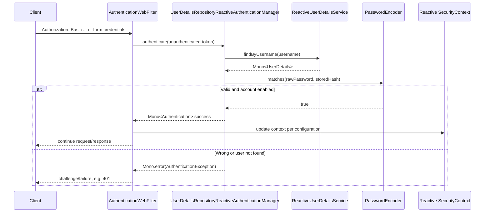

# UserDetailsRepositoryReactiveAuthenticationManager in Password Authentication

**Module:** Spring Security – authentication. **Parent topic:** Reactive Authentication. This lesson focuses on `org.springframework.security.authentication.UserDetailsRepositoryReactiveAuthenticationManager` when an application uses **Spring WebFlux**, not Servlet Spring MVC.

**Goal:** After this lesson, you will be able to explain the reactive username/password flow, wire `ReactiveUserDetailsService` with `PasswordEncoder`, distinguish the three `Mono<Authentication>` states (success/empty/error), configure a `SecurityWebFilterChain` using this manager, write integration tests with `WebTestClient`, and spot mistakes involving blocking I/O, password hashing, Reactor Context, HTTP Basic, sessions, and error codes.

## 1. Placing the Class Properly in Spring Security WebFlux

In Spring Security Servlet, a familiar example involves `DaoAuthenticationProvider`, `UserDetailsService`, `AuthenticationManager`, `HttpSecurity`, and `SecurityFilterChain`. In **WebFlux**, the corresponding abstractions operate on Reactor publishers:

| Responsibility | Servlet stack | Reactive/WebFlux stack |
| --- | --- | --- |
| Verify credentials | `AuthenticationManager` → `AuthenticationProvider` | `ReactiveAuthenticationManager` |
| Load account | `UserDetailsService#loadUserByUsername` | `ReactiveUserDetailsService#findByUsername` |
| Manager using user store + password | Typically `DaoAuthenticationProvider` | `UserDetailsRepositoryReactiveAuthenticationManager` |
| Authentication outcome | `Authentication` or exception | `Mono<Authentication>` |
| HTTP security | `HttpSecurity` / `SecurityFilterChain` | `ServerHttpSecurity` / `SecurityWebFilterChain` |
| Executing filters | Servlet `Filter`, `FilterChainProxy` | Reactive `WebFilter` / `WebFilterChainProxy` |
| Getting current user | `SecurityContextHolder` typically ThreadLocal-bound | `ReactiveSecurityContextHolder` based on Reactor Context |
| HTTP testing | `MockMvc` | `WebTestClient` |

**`UserDetailsRepositoryReactiveAuthenticationManager` is a manager dedicated to username/password**, using a `ReactiveUserDetailsService` to look up `UserDetails` and a `PasswordEncoder` to verify the password. It extends `AbstractUserDetailsReactiveAuthenticationManager` and implements `ReactiveAuthenticationManager`.

Constructor:

```java
UserDetailsRepositoryReactiveAuthenticationManager(
        ReactiveUserDetailsService userDetailsService)
```

Common configuration:

```java
UserDetailsRepositoryReactiveAuthenticationManager manager =
        new UserDetailsRepositoryReactiveAuthenticationManager(users);
manager.setPasswordEncoder(encoder);
```

The manager is **not** a user repository, database, HTTP filter, session repository, or JWT issuer. It coordinates loading `UserDetails`, verifying the password, and constructing the `Authentication` result. HTTP tasks such as parsing headers/bodies, persisting security context, issuing challenges, and authorization belong to the filter chain and other components.

### When Should You Use It?

- A WebFlux application needs **username + password** authentication from form login or HTTP Basic.
- `ReactiveUserDetailsService` retrieves user data and password hashes from a source capable of operating reactively.
- You need a custom encoder, account status policy, hash upgrades, or password verification integrated into the WebFlux flow.

**Do not use this class to “authenticate JWTs” merely because the app is reactive.** JWT access tokens are handled by a resource server/JWT decoder and its corresponding manager. Password login and Bearer tokens are two different mechanisms.

## 2. The `authenticate(...)` Method and the Meaning of `Mono`

Interface:

```java
public interface ReactiveAuthenticationManager {
    Mono<Authentication> authenticate(Authentication authentication);
}
```

When called, `authenticate` returns a **publisher**, not a blocking immediate result. When Spring Security subscribes to the publisher in the filter chain, the processing steps execute via Reactor:



**Three signals you must understand accurately:**

| Publisher result | Meaning per `ReactiveAuthenticationManager` contract | Application handling |
| --- | --- | --- |
| `Mono.just(authenticated)` | Verification succeeded; valid `Authentication` | Use identity for security context/authorization |
| `Mono.empty()` | Manager **cannot decide** for this input | Another manager may handle it depending on composition; never treat as login success |
| `Mono.error(AuthenticationException)` | Authentication failed, e.g. wrong password or disabled account | Handle error/challenge, never fabricate a fake user |

`UserDetailsRepositoryReactiveAuthenticationManager` is a password manager; for credentials within its scope that are invalid, expect failure—**never** convert it into `Mono.empty()` to fall back to a weaker mechanism.

**Note:** `ReactiveUserDetailsService#findByUsername` returning `Mono.empty()` when a user does not exist does **not** mean the manager will emit `Mono.empty()`. The manager typically converts a missing username into an appropriate authentication error, preventing accidental authentication success and avoiding leaking account existence.

### Why Not Call `.block()`?

Wrong inside a WebFlux request handler:

```java
// WRONG: blocks Reactor publisher on the Netty event loop.
Authentication a = manager.authenticate(token).block();
```

`.block()` can throw errors on non-blocking threads, degrade scalability, or introduce deadlocks/latency. In WebFlux, **return the publisher** so the framework subscribes and propagates Reactor Context. In unit tests you can use `StepVerifier`, without needing `.block()`.

Do not call `.subscribe()` manually in a controller and return a response before authentication completes; that loses error control and security context.

## 3. Each Link in Password Verification

### 3.1. Input: Unauthenticated `UsernamePasswordAuthenticationToken`

Example:

```java
Authentication request =
        UsernamePasswordAuthenticationToken.unauthenticated(
                "alice", "correct-password");

Mono<Authentication> outcome = manager.authenticate(request);
```

This is an **API illustration**; `manager` must be a configured instance. An input `UsernamePasswordAuthenticationToken` holds the username and raw password; avoid logging `credentials` or placing the request token into caches/sessions.

### 3.2. `ReactiveUserDetailsService`

Contract:

```java
public interface ReactiveUserDetailsService {
    Mono<UserDetails> findByUsername(String username);
}
```

An implementation may query reactive R2DBC/PostgreSQL, a reactive directory/client, or an in-memory map. `UserDetails` holds username, password hash, authorities, and account status flags such as enabled, non-locked, non-expired, and credentials-non-expired.

In-memory example:

```java
PasswordEncoder encoder =
        PasswordEncoderFactories.createDelegatingPasswordEncoder();

UserDetails alice = User.withUsername("alice")
        .password(encoder.encode("correct-password"))
        .roles("USER")
        .build();

ReactiveUserDetailsService users =
        new MapReactiveUserDetailsService(alice);
```

With `MapReactiveUserDetailsService`, data resides in memory; suitable for labs/tests, not a production user database.

**Do not confuse** `ReactiveUserDetailsService` with `ReactiveUserDetailsPasswordService`: the first *looks up the user*, whereas the second (if provided) can **update the password hash** when the encoder needs an upgrade upon successful authentication. Hash upgrades must be designed with an appropriate data store and transaction handling.

### 3.3. `PasswordEncoder`

`PasswordEncoder` is typically a synchronous API, though the manager can schedule encoding/matching work on an appropriate scheduler because bcrypt/Argon2 are CPU-heavy. With Spring Security, prefer `DelegatingPasswordEncoder` to support multiple hash formats.

```java
PasswordEncoder encoder =
        PasswordEncoderFactories.createDelegatingPasswordEncoder();

String storedHash = encoder.encode("correct-password");
// Example format: {bcrypt}$2a$...
// The salt/hash changes on each encode call.

boolean valid = encoder.matches("correct-password", storedHash);
```

Never compare `rawPassword.equals(storedHash)`; and do not call `encode(raw)` and compare two strings, because salted encoders produce different hashes each time. Always call `matches(raw, stored)`.

A hash like `{bcrypt}...` is sensitive data even though it is not the raw password. Never expose hashes in API responses, cookies, URLs, or logs. Never use `NoOpPasswordEncoder` or `{noop}` in production. Quick-start `User.withDefaultPasswordEncoder()` examples in documentation are for demos, not production security choices.

### 3.4. Checking Account Status and Authorities

After loading the user and verifying the password, the manager must enforce account-state policies (such as disabled, locked, expired) as supported by the implementation. If an account is locked, **never** allow login simply because the password is correct. The resulting principal/authenticated token must carry verified authorities from the user store.

| Status | Expectation |
| --- | --- |
| Username does not exist | Not authenticated |
| Wrong password | Not authenticated |
| Correct password, enabled, non-locked | Authenticated if all other conditions pass |
| Correct password but disabled/locked | Rejected per account policy |
| Password hash mismatches encoder/prefix | Handle config/data error; do not fall back to `{noop}` |
| `ROLE_USER` authority | Grants user endpoints only; never implies `ROLE_ADMIN` |
| Compromised password rejected by checker | Must not produce successful `Authentication` |

Different Spring Security versions provide `setPostAuthenticationChecks(...)`, `setCompromisedPasswordChecker(...)`, and `setUserDetailsPasswordService(...)`. When using those APIs, match what your framework version actually supports rather than copying code blindly from another release.

## 4. Reactive Does Not Mean Every Dependency Is Automatically Non-Blocking

Wrapping blocking JDBC in `Mono` does not make JDBC reactive:

```java
// ANTI-PATTERN: still runs blocking JDBC on the event loop without switching schedulers.
ReactiveUserDetailsService blocking = username -> {
    UserDetails user = legacyJdbcService.loadUserByUsername(username);
    return Mono.just(user);
};
```

`loadUserByUsername` already executed **before** the publisher was created. Under high load, the WebFlux event loop gets stalled, increasing latency for other requests.

If you **must** call a blocking system during a migration period, defer the work and isolate it onto `boundedElastic`:

```java
// MIGRATION ADAPTER ONLY; not an ideal production solution.
ReactiveUserDetailsService adapted = username ->
        Mono.fromCallable(() ->
                legacyJdbcService.loadUserByUsername(username))
            .subscribeOn(Schedulers.boundedElastic());
```

This snippet requires an existing `legacyJdbcService` and `Mono`/`Schedulers` imports. It also needs concurrency limits, timeouts, connection pooling, and proper error mapping. **Do not** offload every Mono blindly onto `boundedElastic`: only isolate genuinely blocking operations, and prefer querying databases via R2DBC/reactive drivers.

Sketch using Spring R2DBC `DatabaseClient`:

```java
// Illustrative snippet inside a class with DatabaseClient client.
@Override
public Mono<UserDetails> findByUsername(String username) {
    return client.sql("""
                SELECT username, password_hash, enabled
                FROM users WHERE username = :username
                """)
            .bind("username", username)
            .map((row, metadata) -> User.withUsername(
                        row.get("username", String.class))
                    .password(row.get("password_hash", String.class))
                    .disabled(Boolean.FALSE.equals(
                        row.get("enabled", Boolean.class)))
                    .roles("USER")
                    .build())
            .one();
}
```

In production, query trusted roles/authorities, locked/expired flags, normalized usernames, hash migration, and caching; never hardcode `roles("USER")` for every account. `DatabaseClient#one()` returns `Mono.empty()` if no user is found; the manager must treat that as an authentication failure, not an accepted anonymous user.

### Scheduler and bcrypt

`AbstractUserDetailsReactiveAuthenticationManager#setScheduler(...)` adjusts the scheduler running password work depending on the Spring Security version. By default the framework already provides scheduling for password verification; never force all authentication onto the Netty event loop just because a micro-test looked fast.

Under high load, measure: logins per second, bcrypt/Argon2 duration, backpressure, and scheduler limits. Rate limiting and brute-force protection are critical because bcrypt is CPU-intensive; login throttling must not be skipped just because reactive servers handle many concurrent connections.

## 5. Runnable Java 17 Lab: WebFlux Password Authentication via HTTP Basic

This lab creates a standalone application explicitly wiring `UserDetailsRepositoryReactiveAuthenticationManager` into `SecurityWebFilterChain` via `httpBasic().authenticationManager(...)`. This choice makes credentials observable on **every request**. It does not implement JSON login or JWTs; those require separate filters/handlers and policies.

### 5.1. Structure

```text
reactive-password-lab/
├── pom.xml
└── src/
    ├── main/java/example/ReactivePasswordApplication.java
    └── test/java/example/ReactivePasswordApplicationTests.java
```

### 5.2. `pom.xml`

```xml
<project xmlns="http://maven.apache.org/POM/4.0.0"
         xmlns:xsi="http://www.w3.org/2001/XMLSchema-instance"
         xsi:schemaLocation="http://maven.apache.org/POM/4.0.0 https://maven.apache.org/xsd/maven-4.0.0.xsd">
    <modelVersion>4.0.0</modelVersion>
    <parent>
        <groupId>org.springframework.boot</groupId>
        <artifactId>spring-boot-starter-parent</artifactId>
        <version>3.3.9</version>
        <relativePath/>
    </parent>
    <groupId>example</groupId>
    <artifactId>reactive-password-lab</artifactId>
    <version>1.0.0</version>
    <properties><java.version>17</java.version></properties>
    <dependencies>
        <dependency>
            <groupId>org.springframework.boot</groupId>
            <artifactId>spring-boot-starter-webflux</artifactId>
        </dependency>
        <dependency>
            <groupId>org.springframework.boot</groupId>
            <artifactId>spring-boot-starter-security</artifactId>
        </dependency>
        <dependency>
            <groupId>org.springframework.boot</groupId>
            <artifactId>spring-boot-starter-test</artifactId>
            <scope>test</scope>
        </dependency>
        <dependency>
            <groupId>org.springframework.security</groupId>
            <artifactId>spring-security-test</artifactId>
            <scope>test</scope>
        </dependency>
        <dependency>
            <groupId>io.projectreactor</groupId>
            <artifactId>reactor-test</artifactId>
            <scope>test</scope>
        </dependency>
    </dependencies>
    <build>
        <plugins>
            <plugin>
                <groupId>org.springframework.boot</groupId>
                <artifactId>spring-boot-maven-plugin</artifactId>
            </plugin>
        </plugins>
    </build>
</project>
```

**Important:** Do not add `spring-boot-starter-web` to this project. When both Spring MVC and WebFlux are present, Spring Boot defaults to MVC as the web application type, completely changing the chains/filters and expected tests. This lab uses WebFlux only. Boot 3.3.9 illustrates Spring Security 6; for production deployments pick a supported release with current security patches.

### 5.3. WebFlux Application

Create `src/main/java/example/ReactivePasswordApplication.java`:

```java
package example;

import java.util.Map;

import org.springframework.boot.SpringApplication;
import org.springframework.boot.autoconfigure.SpringBootApplication;
import org.springframework.context.annotation.Bean;
import org.springframework.http.HttpStatus;
import org.springframework.security.authentication.ReactiveAuthenticationManager;
import org.springframework.security.authentication.UserDetailsRepositoryReactiveAuthenticationManager;
import org.springframework.security.config.annotation.web.reactive.EnableWebFluxSecurity;
import org.springframework.security.config.web.server.ServerHttpSecurity;
import org.springframework.security.core.Authentication;
import org.springframework.security.core.userdetails.MapReactiveUserDetailsService;
import org.springframework.security.core.userdetails.ReactiveUserDetailsService;
import org.springframework.security.core.userdetails.User;
import org.springframework.security.core.userdetails.UserDetails;
import org.springframework.security.crypto.factory.PasswordEncoderFactories;
import org.springframework.security.crypto.password.PasswordEncoder;
import org.springframework.security.core.context.ReactiveSecurityContextHolder;
import org.springframework.security.web.server.SecurityWebFilterChain;
import org.springframework.web.bind.annotation.GetMapping;
import org.springframework.web.bind.annotation.RestController;

import reactor.core.publisher.Mono;

@SpringBootApplication
@EnableWebFluxSecurity
public class ReactivePasswordApplication {

    public static void main(String[] args) {
        SpringApplication.run(ReactivePasswordApplication.class, args);
    }

    @Bean
    PasswordEncoder passwordEncoder() {
        return PasswordEncoderFactories.createDelegatingPasswordEncoder();
    }

    @Bean
    ReactiveUserDetailsService users(PasswordEncoder encoder) {
        UserDetails alice = User.withUsername("alice")
                .password(encoder.encode("demo-password"))
                .roles("USER")
                .build();

        UserDetails disabledBob = User.withUsername("bob")
                .password(encoder.encode("another-password"))
                .roles("USER")
                .disabled(true)
                .build();

        return new MapReactiveUserDetailsService(alice, disabledBob);
    }

    @Bean
    ReactiveAuthenticationManager reactiveAuthenticationManager(
            ReactiveUserDetailsService users, PasswordEncoder encoder) {
        var manager =
                new UserDetailsRepositoryReactiveAuthenticationManager(users);
        manager.setPasswordEncoder(encoder);
        return manager;
    }

    @Bean
    SecurityWebFilterChain securityWebFilterChain(
            ServerHttpSecurity http,
            ReactiveAuthenticationManager manager) {
        return http
                .authorizeExchange(ex -> ex
                        .pathMatchers("/api/me").authenticated()
                        .anyExchange().denyAll())
                .httpBasic(basic -> basic.authenticationManager(manager))
                .formLogin(form -> form.disable())
                .build();
    }

    @RestController
    static class IdentityApi {
        @GetMapping("/api/me")
        Mono<Map<String, String>> me() {
            // Reactor Context: DO NOT read ThreadLocal SecurityContextHolder.
            return ReactiveSecurityContextHolder.getContext()
                    .map(ctx -> {
                        Authentication a = ctx.getAuthentication();
                        return Map.of(
                                "username", a.getName(),
                                "authenticated",
                                Boolean.toString(a.isAuthenticated()));
                    });
        }
    }
}
```

**Key points to observe:**

1. The `ReactiveUserDetailsService` bean provides `UserDetails` and encoded hashes, never returning plaintext passwords.
2. The manager bean invokes the constructor with the service and calls `setPasswordEncoder`, producing a `ReactiveAuthenticationManager` for username/password.
3. `ServerHttpSecurity` and `SecurityWebFilterChain` apply only to WebFlux. Here, the Basic filter is **explicitly pointed to the newly created manager**; declaring a bean without wiring it could leave the app picking another mechanism via auto-configuration.
4. `.authorizeExchange(...authenticated())` requires GET requests to have an authenticated principal; other URLs are denied.
5. `.formLogin(form -> form.disable())` disables form login to test HTTP Basic cleanly. This is a **lab-only decision**, not general advice.
6. CSRF remains enabled by default, which does not affect the lab's safe GET requests. If adding REST POST endpoints, determine whether browsers send credentials automatically before evaluating CSRF.
7. `ReactiveSecurityContextHolder.getContext()` reads the identity from the **request's Reactor Context**, independent of a fixed thread. When the pipeline switches schedulers, ThreadLocal is not a reliable default source.
8. `MapReactiveUserDetailsService` is a fixture, not a production repository. User Bob is disabled to test account status enforcement.
9. The endpoint returns the **verified username** rather than trusting a self-declared username from query strings or request bodies.

### 5.4. Integration Tests with WebTestClient

Create `src/test/java/example/ReactivePasswordApplicationTests.java`:

```java
package example;

import org.junit.jupiter.api.Test;
import org.springframework.beans.factory.annotation.Autowired;
import org.springframework.boot.test.autoconfigure.web.reactive.AutoConfigureWebTestClient;
import org.springframework.boot.test.context.SpringBootTest;
import org.springframework.test.web.reactive.server.WebTestClient;

@SpringBootTest(webEnvironment = SpringBootTest.WebEnvironment.RANDOM_PORT)
@AutoConfigureWebTestClient
class ReactivePasswordApplicationTests {

    @Autowired
    WebTestClient client;

    @Test
    void correctPasswordReturnsVerifiedUsername() {
        client.get()
                .uri("/api/me")
                .headers(h -> h.setBasicAuth("alice", "demo-password"))
                .exchange()
                .expectStatus().isOk()
                .expectBody()
                .jsonPath("$.username").isEqualTo("alice")
                .jsonPath("$.authenticated").isEqualTo("true");
    }

    @Test
    void wrongPasswordIsUnauthorized() {
        client.get()
                .uri("/api/me")
                .headers(h -> h.setBasicAuth("alice", "wrong-password"))
                .exchange()
                .expectStatus().isUnauthorized();
    }

    @Test
    void unknownUsernameIsUnauthorized() {
        client.get()
                .uri("/api/me")
                .headers(h -> h.setBasicAuth("unknown", "demo-password"))
                .exchange()
                .expectStatus().isUnauthorized();
    }

    @Test
    void disabledAccountCannotAuthenticate() {
        client.get()
                .uri("/api/me")
                .headers(h -> h.setBasicAuth("bob", "another-password"))
                .exchange()
                .expectStatus().isUnauthorized();
    }

    @Test
    void basicCredentialMustBeSentForEveryIndependentRequest() {
        client.get()
                .uri("/api/me")
                .headers(h -> h.setBasicAuth("alice", "demo-password"))
                .exchange()
                .expectStatus().isOk();

        // New request must not automatically inherit the Basic header.
        client.get()
                .uri("/api/me")
                .exchange()
                .expectStatus().isUnauthorized();
    }

    @Test
    void unrelatedRouteIsDenied() {
        client.get()
                .uri("/private/unknown")
                .headers(h -> h.setBasicAuth("alice", "demo-password"))
                .exchange()
                .expectStatus().isForbidden();
    }
}
```

**Expectation:** 6 HTTP tests PASS if the application and libraries work properly. Command:

```bash
mvn test
```

When successful, Maven reports `BUILD SUCCESS`. This is an **expected result**, not logs from an actual run in this article. Here Basic credentials are sent via the `Authorization` header on each request and traverse `SecurityWebFilterChain`; neither `mockUser()` nor `@WithMockUser` is used to fake passing authentication.

`RANDOM_PORT` starts a real WebFlux server on a random port, letting you verify HTTP status codes and responses, albeit without a production proxy, TLS, or DB. `WebTestClient` is the right client for reactive WebFlux; `MockMvc` belongs to Servlet and is not the default tool for this lab.

### 5.5. Direct Manager Test: Checking Mono Signals Instead of HTTP

Alongside HTTP tests, you can test the manager directly with Reactor `StepVerifier`. Add to `src/test/java/example/ReactivePasswordApplicationTests.java` or create a separate test class. Below is a **complete standalone Java test class**:

```java
package example;

import org.junit.jupiter.api.Test;
import org.springframework.beans.factory.annotation.Autowired;
import org.springframework.boot.test.context.SpringBootTest;
import org.springframework.security.authentication.ReactiveAuthenticationManager;
import org.springframework.security.authentication.UsernamePasswordAuthenticationToken;
import org.springframework.security.core.Authentication;
import reactor.test.StepVerifier;

import static org.assertj.core.api.Assertions.assertThat;

@SpringBootTest
class ReactiveAuthenticationManagerTests {

    @Autowired
    ReactiveAuthenticationManager manager;

    @Test
    void managerEmitsAuthenticatedPrincipal() {
        Authentication request =
                UsernamePasswordAuthenticationToken.unauthenticated(
                        "alice", "demo-password");

        StepVerifier.create(manager.authenticate(request))
                .assertNext(result -> {
                    assertThat(result.isAuthenticated()).isTrue();
                    assertThat(result.getName()).isEqualTo("alice");
                    assertThat(result.getAuthorities())
                            .extracting(a -> a.getAuthority())
                            .contains("ROLE_USER");
                })
                .verifyComplete();
    }

    @Test
    void managerErrorsOnWrongPassword() {
        Authentication request =
                UsernamePasswordAuthenticationToken.unauthenticated(
                        "alice", "not-the-password");

        StepVerifier.create(manager.authenticate(request))
                .expectError(org.springframework.security.core
                        .AuthenticationException.class)
                .verify();
    }
}
```

To run this test individually:

```bash
mvn -Dtest=ReactiveAuthenticationManagerTests test
```

**Meaning:** `StepVerifier.create(...)` subscribes to the `Mono` in the test context; on success, it receives an authenticated `Authentication`; on a wrong password, it verifies `Mono.error(AuthenticationException)`. No `.block()` is needed and no `@WithMockUser` is placed on the test method, because real authentication through the manager is being tested.

**Note:** `Authentication#getCredentials()` requires proper erasure/control per the manager and actual object graph; do not write a security test checking a single field and assume the password does not linger in other objects, logs, or stores. Never serialize the full `Authentication` over an API.

## 6. Testing with curl and Understanding HTTP Basic Precisely

Run the app:

```bash
mvn spring-boot:run
```

In another terminal:

```bash
# Valid password: API returns 200 and username alice.
curl -i -u alice:demo-password http://localhost:8080/api/me

# Wrong password: 401.
curl -i -u alice:wrong-password http://localhost:8080/api/me

# No Basic header: 401.
curl -i http://localhost:8080/api/me

# Disabled user: 401.
curl -i -u bob:another-password http://localhost:8080/api/me
```

Illustrative success body:

```json
{"username":"alice","authenticated":"true"}
```

Two points to remember:

1. `curl -u ...` sends credentials via HTTP Basic, typically on every request. Basic uses **base64 encoding, not encryption**; production requires HTTPS/TLS.
2. A request without a Basic header returns `401` even if an earlier request succeeded in the lab, because the example **does not create a persistent login session from Basic**. The authentication manager does not create persistent logins or issue cookies/JWTs by itself.

Never run commands containing real passwords in environments with unprotected command history or logs. In production, use interactive prompts, password managers, or secret sources instead of storing credentials in shell scripts.

## 7. `UserDetailsRepositoryReactiveAuthenticationManager` Does Not Automatically Create Sessions or JWTs

A common misconception: “once the manager authenticates successfully, the user stays logged in on the next request.” In WebFlux, those are two separate concerns:

```text
Request A:
    Credential (Basic/form/JSON)
        -> ReactiveAuthenticationManager
        -> Mono<Authentication> success
        -> Request's SecurityContext

Request B:
    Which credentials does the browser or HTTP client send?
        -> If Basic: must include valid Authorization header
        -> If session login: needs appropriate ServerSecurityContextRepository
        -> If Bearer: needs Bearer token and matching resource-server verifier
```

**HTTP Basic:** `ServerHttpSecurity.HttpBasicSpec` defaults to `NoOpServerSecurityContextRepository` so Basic results are not persisted into a session for subsequent requests. This fits Basic: clients resend credentials per request. You can swap the repository via configuration, but never assume the manager decides login persistence.

**Form login:** WebFlux provides `formLogin(...)` and SecurityContext persistence via a configured `ServerSecurityContextRepository`. With cookies/sessions, you must apply proper CSRF protection and session fixation defenses. Form login differs from Basic in credential extraction and persistence behavior.

**Custom JSON login:** If you write a custom WebFlux controller accepting JSON and calling `manager.authenticate(...)`, you still must design an `AuthenticationWebFilter`/converter, success/failure handlers, SecurityContext persistence, and cookie/token issuance for a complete flow. A controller calling `.authenticate()` and returning `{"ok":true}` does not make subsequent requests authenticated.

**JWT:** this password manager does not issue access tokens and does not verify Bearer JWTs. Token issuance is handled by an issuer/authorization server, and resource servers verify tokens per request. A JWT must not be thought of as a reactive `HttpSession`.

## 8. Answering Important Configuration Questions

### 8.1. Must You Always Declare the Manager Bean Yourself?

Not every WebFlux app has to declare it manually. Spring Security can infer a manager from `ReactiveUserDetailsService` and standard beans. However, when you need a specific encoder, multiple mechanisms, a dedicated filter manager, or to test this exact class, an explicit bean makes behavior clear. The lab **points** the HTTP Basic filter to the manager via `.httpBasic(basic -> basic.authenticationManager(manager))` to avoid relying on implicit selection.

### 8.2. Is `DaoAuthenticationProvider` Needed?

No. `DaoAuthenticationProvider` is the synchronous Servlet `AuthenticationProvider` abstraction. WebFlux uses `ReactiveAuthenticationManager`; `UserDetailsRepositoryReactiveAuthenticationManager` is the matching username/password implementation. Never wrap `DaoAuthenticationProvider` with `.block()` and call it from the event loop.

### 8.3. Why Is “Repository” in the Name When the Constructor Takes a Service?

The class name does not mean you pass a `JpaRepository`. The constructor takes a `ReactiveUserDetailsService`, an abstraction providing `Mono<UserDetails>` on username lookup. The backing store may be R2DBC, a reactive cache, or a remote identity lookup; the manager is unaware of storage details.

### 8.4. Using `ReactiveUserDetailsService` Yet Still Blocking?

You may inadvertently invoke JDBC, a JPA repository, `Thread.sleep`, a synchronous HTTP client, `.block()`, or password hashing on the event loop. Inspect thread traces, measure latency, and audit every boundary. Changing a return type to `Mono` does not make blocking operations disappear.

### 8.5. Why Does Login Return 401 Even Though the Account Exists in the DB?

Username lookup may be returning `Mono.empty()`, the password hash field may lack/mismatch its prefix (`{bcrypt}`), `PasswordEncoder` may not match, the account may be disabled/locked, or the filter's credential extractor may not be building a proper username/password token. Check each step **without logging passwords**.

### 8.6. Can You Use Argon2 or a Non-Default BCrypt?

Yes. Provide the appropriate `PasswordEncoder` and call `setPasswordEncoder(...)`. All stored hashes must be in a format the encoder can decode. With `DelegatingPasswordEncoder`, hashes usually carry an `{id}` prefix; adding a new encoder requires managing migration and avoiding automatic fallback to NoOp. Because password hashing is CPU-intensive, benchmark and apply rate limits.

### 8.7. Can MFA Be Added Inside This Manager?

This manager verifies username/password; it does not verify OTP/WebAuthn/TOTP/step-up authentication by itself. If the system requires MFA, implement a trusted multi-step/assurance flow that verifies and reflects assurance in authorization. `authenticated()` or password manager success alone does not mean MFA was satisfied.

## 9. Common Mistakes and How to Fix Them

| Mistake | Consequence | Fix |
| --- | --- | --- |
| Importing `UserDetailsService` instead of `ReactiveUserDetailsService` | Wrong contract or forced blocking adapter | Use reactive `findByUsername` interface |
| Using `HttpSecurity`/`SecurityFilterChain` in a WebFlux app | Wrong stack; filters do not behave as expected | `ServerHttpSecurity`/`SecurityWebFilterChain` |
| Calling `.block()` in a WebFlux controller | Blocks Netty event loop, hurts throughput | Compose `Mono` and return publisher |
| Calling blocking JDBC inside `Mono.just(...)` | Blocking already happened before creating Mono | R2DBC/reactive driver or `fromCallable().subscribeOn(boundedElastic())` adapter |
| Hashing passwords by string equality or `{noop}` | Broken login or insecure storage | `PasswordEncoder.matches` with BCrypt/Argon2, Delegating encoder |
| Forgetting `setPasswordEncoder` with a different hash scheme | `401` or hash format errors | Align encoder with stored hashes |
| `findByUsername` returning `null` | Violates reactive contract, NPE | Return `Mono.empty()` or `Mono.error(...)` as appropriate |
| `findByUsername` returning `Mono.just(null)` | Illegal null in Reactor | Never emit `null`; use empty |
| Mapper throwing exceptions exposing DB details in responses | Information disclosure and broken auth handling | Map generic client errors, log safely |
| Testing only HTTP 200 with `@WithMockUser` | Does not prove manager checks passwords properly | Send real Basic headers and use `StepVerifier` |
| Creating a manager bean that the HTTP filter never uses | Testing the wrong manager or hitting a different default | Wire the explicit manager to `httpBasic`/`formLogin` |
| Treating Basic login as session login | Subsequent requests without header fail with 401 | Configure `ServerSecurityContextRepository` if stateful behavior is needed |
| Calling `.subscribe()` manually in JSON login | Response sent before auth finishes; errors lost | Return `Mono` and let filters/framework subscribe |
| Using ThreadLocal `SecurityContextHolder` in a Reactor pipeline | Context lost across thread hops | `ReactiveSecurityContextHolder` |
| Treating `ROLE_USER` as proof of MFA | Password-only access may open sensitive actions | Add assurance/step-up and proper authorization |
| No limit on password attempts | CPU hashing and credential stuffing overload | Rate limiting, MFA, lockout, and monitoring |
| Logging requests/headers containing Basic credentials | Passwords leaked to tracing/APM | Mask auth headers, never log raw credentials |

### Load and Safety

Password verification with BCrypt/Argon2 is relatively CPU-heavy. Reactive programming manages I/O and concurrent connections, **it does not eliminate password-hashing cost**. If an app receives a flood of login requests, the scheduler can saturate even if the Netty event loop never blocks. You need rate limiting, proper backpressure, bounded retry policies, CPU/queue monitoring, enumeration protection, and user database protection.

**Credential erasure:** never store raw passwords in `SecurityContext`, sessions, or responses; avoid logging the input `Authentication`. Password hashes in the user repository are still needed for subsequent verifications. If a cache returns shared mutable `UserDetails`, ensure credential erasure on the authentication result does not corrupt cached objects. Test logging in twice and inspect the resulting principal/credentials if you have custom implementations.

**Security errors must not “fail open”:** when the user service hits a database error, never fabricate a dummy authenticated principal to keep the app running; fail cleanly. Never convert `Mono.error(...)` into a self-issued `Mono.just(authentication)` in the name of “preserving UX”.

## 10. Exercises and Acceptance Checklist

### Exercise A — Swap the Encoder and Observe

Create an Alice account with a valid `{bcrypt}` hash. Test valid and wrong passwords via `WebTestClient`. Then intentionally configure an incompatible encoder in a **test environment** and explain why authentication must fail rather than falling back to plaintext string comparison.

### Exercise B — Separate Manager and HTTP Filter

Call `manager.authenticate(...)` directly with `StepVerifier` to verify the contract. Then call the endpoint with a Basic header to prove `AuthenticationWebFilter` uses the same manager. Direct test success alone is **not enough** to prove the URL is properly protected.

### Exercise C — Demonstrate Blocking I/O

Create a fake `ReactiveUserDetailsService` calling `Thread.sleep` directly (for local measurement only), and compare response times under concurrent requests against a `Mono.fromCallable(...).subscribeOn(Schedulers.boundedElastic())` version. Observe threads, latency, and pool/limit effects. Return to a reactive driver for production.

### Exercise D — Distinguish Basic and Sessions

Send a valid Basic GET, followed by a GET without headers; observe `401`. Switch the flow to form login/cookie sessions with `ServerSecurityContextRepository`, then test the follow-up request with cookies. Explain why **the same password manager** can serve two flows with different identity persistence strategies.

### Exercise E — Protect an ADMIN Endpoint

Add `/api/admin` requiring `ROLE_ADMIN`, while Alice has only `ROLE_USER`. Verify that valid Basic credentials reach `/api/me` with `200` yet get `403` on `/api/admin`. Explain why successful authentication does not imply sufficient authorization.

### Checklist

- [ ] Correctly uses the WebFlux stack: `ServerHttpSecurity`, `SecurityWebFilterChain`, and `ReactiveSecurityContextHolder`.
- [ ] Implements `ReactiveUserDetailsService#findByUsername` returning `Mono<UserDetails>`, with no `null` or arbitrary blocking calls.
- [ ] `UserDetailsRepositoryReactiveAuthenticationManager` receives the right service and matching encoder.
- [ ] Raw credentials are verified against hashes with `PasswordEncoder.matches`, never stored or logged in plaintext.
- [ ] Disabled/locked/expired account statuses are honored; nonexistent usernames and wrong passwords are rejected.
- [ ] The filter (Basic/form/custom) actually uses the configured manager.
- [ ] Distinguishes `Mono.just` (success), `Mono.empty` (undecided), and `Mono.error` (failure).
- [ ] No `.block()` or manual `.subscribe()` inside request handlers.
- [ ] Distinguishes reactive user lookup from CPU-bound password hashing; evaluates scheduler and resource bounds.
- [ ] Does not assume the manager persists sessions or issues JWTs by itself.
- [ ] Separates authentication from authorization, MFA, session persistence, and token issuance.
- [ ] `WebTestClient` tests real credentials: success, wrong password, unknown user, disabled user, missing header.
- [ ] Direct manager tests use `StepVerifier` without injecting a mock principal.
- [ ] Tests endpoint authorization and account state separately; does not assert only happy-path statuses.
- [ ] Includes HTTPS, rate limiting, log masking, password policy, hash upgrades, and reactive pipeline monitoring.
- [ ] If using a blocking legacy repository, isolates it with bounds or migrates to a reactive driver.

**Remember:** `UserDetailsRepositoryReactiveAuthenticationManager` is the “bridge” between **ReactiveUserDetailsService** and **PasswordEncoder** for verifying username/password in Spring Security WebFlux. It returns `Mono<Authentication>` for filters/authorization to consume; it **does not turn Basic into sessions, issue JWTs, or verify MFA**. Keeping responsibilities distinct prevents blocking bugs and authentication policy flaws.

## 11. Official Documentation

- [Spring Security — UserDetailsRepositoryReactiveAuthenticationManager API](https://docs.spring.io/spring-security/reference/api/java/org/springframework/security/authentication/UserDetailsRepositoryReactiveAuthenticationManager.html): constructors and `retrieveUser`.
- [Spring Security — AbstractUserDetailsReactiveAuthenticationManager API](https://docs.spring.io/spring-security/reference/api/java/org/springframework/security/authentication/AbstractUserDetailsReactiveAuthenticationManager.html): `setPasswordEncoder`, scheduler, password upgrades/checks.
- [Spring Security — ReactiveAuthenticationManager API](https://docs.spring.io/spring-security/reference/api/java/org/springframework/security/authentication/ReactiveAuthenticationManager.html): `Mono<Authentication>` contract.
- [Spring Security — WebFlux Security Configuration](https://docs.spring.io/spring-security/reference/reactive/configuration/webflux.html): `SecurityWebFilterChain`, reactive HTTP Basic and form login.
- [Spring Security — Testing Web Security](https://docs.spring.io/spring-security/reference/reactive/test/web/): using `WebTestClient` to test reactive security.
- [Spring Security — Password Storage](https://docs.spring.io/spring-security/reference/features/authentication/password-storage.html): `DelegatingPasswordEncoder` and secure hashing.
- [Project Reactor — Reference Guide](https://projectreactor.io/docs/core/release/reference/): publishers, schedulers, and avoiding blocking.