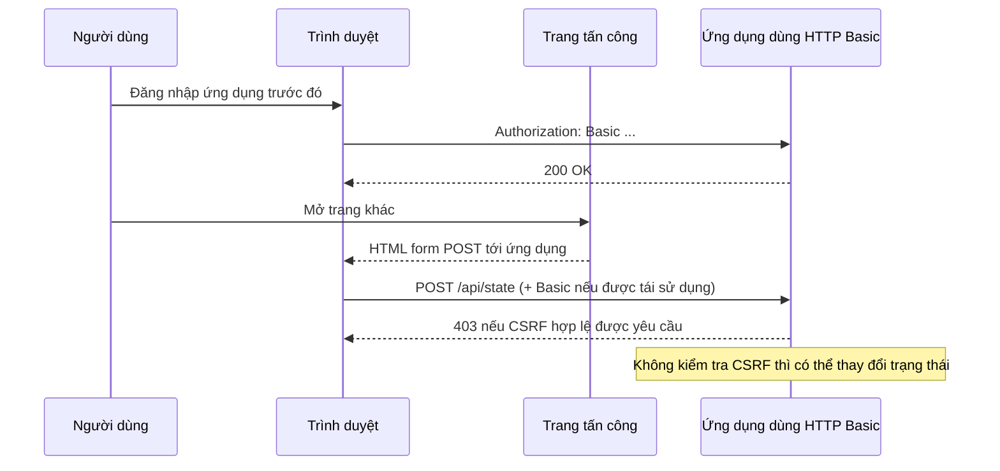

# Trình duyệt tự gửi thông tin xác thực HTTP Basic và nguy cơ CSRF

**Phạm vi:** HTTP Basic trong ứng dụng web chạy trên trình duyệt, đặc biệt với Spring Security (Servlet). Trọng tâm là sự khác biệt giữa việc người dùng **chủ động nhập** thông tin đăng nhập lần đầu và việc trình duyệt **tự gắn lại** thông tin đó vào các yêu cầu sau; từ đó đánh giá nguy cơ Cross-Site Request Forgery (CSRF).

## 1. Vì sao HTTP Basic có thể được gửi tự động?

HTTP Basic là cơ chế xác thực ở tầng HTTP, không phải một biểu mẫu đăng nhập. Khi truy cập tài nguyên được bảo vệ, luồng thường là:

1. Máy khách gọi `GET /api/state` mà chưa có thông tin xác thực.
2. Máy chủ trả `401 Unauthorized` cùng `WWW-Authenticate: Basic realm="demo"`.
3. Trình duyệt có thể mở hộp thoại đăng nhập; sau khi người dùng nhập tên và mật khẩu, trình duyệt gửi `Authorization: Basic <base64(username:password)>`.
4. Nếu hợp lệ, máy chủ cho truy cập. Trình duyệt có thể giữ thông tin xác thực trong bộ nhớ/cache của phiên duyệt để tái sử dụng cho những URL thuộc **protection space** phù hợp, kể cả khi người dùng không nhập lại mật khẩu.

Ví dụ rút gọn về giao thức:

```http
GET /api/state HTTP/1.1
Host: bank.example

HTTP/1.1 401 Unauthorized
WWW-Authenticate: Basic realm="demo"

GET /api/state HTTP/1.1
Host: bank.example
Authorization: Basic <gia-tri-base64>
```

Header `Authorization` được gửi trong **request**, còn `WWW-Authenticate` là challenge của **response**. Chuỗi Base64 chỉ mã hóa biểu diễn `username:password`, **không phải mã hóa bảo mật**; HTTP Basic phải dùng qua HTTPS để tránh lộ thông tin trên đường truyền.

Theo RFC 7617, client **có thể** tái gửi Basic credentials trước khi nhận challenge mới trong phạm vi xác thực phù hợp. Phạm vi này liên quan đến origin, `realm`, đường dẫn và cách client quản lý cache; không có quy tắc “mọi request tới mọi website đều mang mật khẩu”. Trình duyệt, phiên duyệt, chế độ riêng tư và chính sách cô lập credential có thể cho hành vi khác nhau.

## 2. Chính cơ chế tự gửi làm xuất hiện nguy cơ CSRF

**CSRF** xảy ra khi kẻ tấn công khiến **trình duyệt của người dùng đang được xác thực** gửi yêu cầu đến hệ thống tin cậy để thực hiện hành động không mong muốn. Kẻ tấn công không cần biết mật khẩu hoặc đọc được nội dung phản hồi nếu hành động đã được máy chủ thực hiện.

Một kịch bản điển hình với HTTP Basic:

1. Người dùng đăng nhập `https://bank.example` bằng HTTP Basic. Trình duyệt đã nhớ credentials cho protection space liên quan.
2. Ứng dụng có endpoint `POST /api/state` thay đổi trạng thái và kiểm tra Basic credentials, nhưng **không kiểm tra CSRF token hoặc nguồn yêu cầu**.
3. Khi người dùng truy cập trang do kẻ tấn công kiểm soát, trang đó tạo một HTML form gửi POST đến endpoint nói trên.
4. Nếu trình duyệt tự đính kèm Basic credentials đã lưu cho yêu cầu đích, máy chủ nhìn thấy một request **đã xác thực**. Nếu không có kiểm tra chống CSRF, tác vụ có thể bị thực hiện dù người dùng chưa đồng ý.



Điểm cốt lõi: **xác thực (authentication)** trả lời “request mang danh tính nào?”, còn **chống CSRF** trả lời “hành động thay đổi trạng thái có thực sự được khởi phát trong luồng tin cậy không?”. Một request mang danh tính hợp lệ vẫn có thể là request bị ép gửi.

Nguy cơ đòi hỏi đồng thời các điều kiện: trình duyệt có credential hợp lệ; credential được tự đưa vào request đích trong ngữ cảnh đó; endpoint chấp nhận request làm thay đổi trạng thái; và máy chủ thiếu biện pháp chống CSRF. Nếu trình duyệt không tái gửi Basic credentials theo chính sách của nó, kịch bản cụ thể đó không thành công. Không nên coi sự khác biệt giữa các trình duyệt là biện pháp phòng vệ.

## 3. Minh họa bằng HTML form từ một origin khác

Giả sử ứng dụng có `POST http://localhost:8080/api/state` nhận dữ liệu form `value=...`. Một trang chạy ở origin khác (ví dụ `http://localhost:8081`) có thể chứa:

```html
<!doctype html>
<html lang="vi">
<head><meta charset="utf-8"><title>Thử CSRF trong local lab</title></head>
<body>
  <form action="http://localhost:8080/api/state" method="post">
    <input type="hidden" name="value" value="999">
    <button type="submit">Gửi biểu mẫu</button>
  </form>
</body>
</html>
```

Khi nút được bấm, trình duyệt **có thể gửi** một POST form đến origin khác; nó không cần quyền đọc response để tạo ra tác dụng phụ. Nếu trình duyệt cũng tái sử dụng HTTP Basic credentials và server đã tắt CSRF, trạng thái có thể bị đổi thành `999`. Với CSRF protection hoạt động và không có token hợp lệ, thao tác phải bị từ chối.

Cần phân biệt:

| Cơ chế | Điều nó kiểm soát | Kết luận với CSRF |
| --- | --- | --- |
| Same-Origin Policy | Quyền mã JavaScript ở origin A đọc/truy cập tài nguyên của origin B | Không tự ngăn HTML form gửi request sang B |
| CORS | Quyền JavaScript đọc response cross-origin; preflight cho những request cần thiết | Không phải lớp bảo vệ CSRF tổng quát; form POST đơn giản vẫn có thể tới server |
| HTTP Basic | Danh tính xác thực qua header `Authorization` | Không chứng minh ý định thực hiện thao tác của người dùng |
| CSRF token | Bằng chứng bổ sung mà trang tấn công không thể tự biết/đặt hợp lệ | Có thể chặn POST giả mạo dù request đã xác thực |

**Không nên suy luận:** “API trả JSON”, “không bật CORS” hoặc “không dùng session cookie” đồng nghĩa với “không có CSRF”. Hãy nhìn vào **cách browser gửi credential và khả năng endpoint nhận request thay đổi trạng thái**. Với `fetch()`, chế độ `credentials` và CORS ảnh hưởng đến cross-origin JavaScript request; HTML form là một đường gửi request khác. Các khác biệt này không thay thế kiểm soát ở máy chủ.

## 4. Lab Spring Boot 3 / Spring Security 6 (Java 17+)

Ví dụ nhỏ sau chạy ở localhost, không lưu dữ liệu thật. Dùng dự án Maven Spring Boot với `spring-boot-starter-web` và `spring-boot-starter-security`. Mẫu `pom.xml` có thể dùng để chạy độc lập:

```xml
<!-- pom.xml -->
<project xmlns="http://maven.apache.org/POM/4.0.0"
         xmlns:xsi="http://www.w3.org/2001/XMLSchema-instance"
         xsi:schemaLocation="http://maven.apache.org/POM/4.0.0 https://maven.apache.org/xsd/maven-4.0.0.xsd">
    <modelVersion>4.0.0</modelVersion>
    <parent>
        <groupId>org.springframework.boot</groupId>
        <artifactId>spring-boot-starter-parent</artifactId>
        <version>3.3.9</version>
        <relativePath/>
    </parent>
    <groupId>example</groupId>
    <artifactId>basic-csrf-lab</artifactId>
    <version>1.0.0</version>
    <properties><java.version>17</java.version></properties>
    <dependencies>
        <dependency>
            <groupId>org.springframework.boot</groupId>
            <artifactId>spring-boot-starter-web</artifactId>
        </dependency>
        <dependency>
            <groupId>org.springframework.boot</groupId>
            <artifactId>spring-boot-starter-security</artifactId>
        </dependency>
    </dependencies>
    <build>
        <plugins>
            <plugin>
                <groupId>org.springframework.boot</groupId>
                <artifactId>spring-boot-maven-plugin</artifactId>
            </plugin>
        </plugins>
    </build>
</project>
```

Tạo file `src/main/java/example/BasicCsrfLabApplication.java`:

```java
package example;

import java.util.Map;
import java.util.concurrent.atomic.AtomicInteger;

import org.springframework.boot.SpringApplication;
import org.springframework.boot.autoconfigure.SpringBootApplication;
import org.springframework.context.annotation.Bean;
import org.springframework.http.MediaType;
import org.springframework.security.config.Customizer;
import org.springframework.security.config.annotation.web.builders.HttpSecurity;
import org.springframework.security.core.userdetails.User;
import org.springframework.security.core.userdetails.UserDetailsService;
import org.springframework.security.provisioning.InMemoryUserDetailsManager;
import org.springframework.security.web.SecurityFilterChain;
import org.springframework.security.web.csrf.CsrfToken;
import org.springframework.web.bind.annotation.GetMapping;
import org.springframework.web.bind.annotation.PostMapping;
import org.springframework.web.bind.annotation.RequestParam;
import org.springframework.web.bind.annotation.RestController;

@SpringBootApplication
public class BasicCsrfLabApplication {
    public static void main(String[] args) {
        SpringApplication.run(BasicCsrfLabApplication.class, args);
    }

    @Bean
    SecurityFilterChain securityFilterChain(HttpSecurity http) throws Exception {
        return http
                .authorizeHttpRequests(auth -> auth.anyRequest().authenticated())
                .httpBasic(Customizer.withDefaults())
                .csrf(Customizer.withDefaults())
                .build();
    }

    @Bean
    UserDetailsService users() {
        return new InMemoryUserDetailsManager(
                User.withUsername("alice")
                        .password("{noop}example-password")
                        .roles("USER")
                        .build()
        );
    }

    @RestController
    static class StateApi {
        private final AtomicInteger value = new AtomicInteger(0);

        @GetMapping("/api/state")
        Map<String, Integer> read() {
            return Map.of("value", value.get());
        }

        @PostMapping(value = "/api/state",
                     consumes = MediaType.APPLICATION_FORM_URLENCODED_VALUE)
        Map<String, Integer> update(@RequestParam("value") int newValue) {
            value.set(newValue);
            return Map.of("value", value.get());
        }

        @GetMapping("/csrf")
        CsrfToken csrf(CsrfToken token) {
            return token;
        }
    }
}
```

Chạy với JDK 17+ và Maven:

```bash
mvn spring-boot:run
```

Trong terminal khác:

```bash
# GET có Basic hợp lệ: dự kiến HTTP 200 và {"value":0}.
curl -i -u alice:example-password http://localhost:8080/api/state

# POST có Basic nhưng KHÔNG có CSRF token: dự kiến HTTP 403.
curl -i -u alice:example-password \
  -d 'value=99' http://localhost:8080/api/state

# Xem giá trị; vẫn là 0 sau POST bị từ chối.
curl -s -u alice:example-password http://localhost:8080/api/state
```

Để thử một POST hợp lệ, lấy token **và lưu cookie phiên CSRF** qua cùng một client:

```bash
# JSON trả về gồm headerName, parameterName, token.
curl -s -u alice:example-password -c cookies.txt \
  http://localhost:8080/csrf

# Thay <TOKEN> bằng giá trị trường token trong JSON vừa nhận.
curl -i -u alice:example-password -b cookies.txt \
  -H 'X-CSRF-TOKEN: <TOKEN>' \
  -d 'value=99' http://localhost:8080/api/state
```

Yêu cầu cuối dự kiến `HTTP 200` với `{"value":99}` khi token và cookie phiên phù hợp. Trong ví dụ này, **HTTP Basic** vẫn xác thực người dùng; cookie phiên phục vụ lưu/đối chiếu **CSRF token**, không tự thay Basic bằng cơ chế đăng nhập cookie. Spring Security 6 có cơ chế xử lý token chống BREACH; dùng nguyên giá trị `token` mà endpoint `/csrf` trả về.

Để quan sát cấu hình **không an toàn**, chỉ trong lab localhost, thử thay `.csrf(Customizer.withDefaults())` bằng `.csrf(csrf -> csrf.disable())`, chạy lại ứng dụng và gửi POST không token: request đã xác thực sẽ được chấp nhận. Sau khi kiểm chứng, bật lại CSRF. Mật khẩu `{noop}` chỉ để demo; hệ thống thật phải dùng password encoder và kho người dùng phù hợp. Phiên bản Spring Boot trong POM chỉ nhằm tái lập ví dụ; chọn nhánh còn được hỗ trợ và cập nhật bản vá khi triển khai thực tế.

## 5. Phòng vệ đúng với ứng dụng dùng HTTP Basic

1. **Giữ CSRF protection cho ứng dụng có người dùng thao tác bằng trình duyệt.** Spring Security Servlet bảo vệ các phương thức không an toàn (như POST, PUT, PATCH, DELETE) theo mặc định. Trong `SecurityFilterChain`, `.csrf(Customizer.withDefaults())` giúp thể hiện rõ ý định. Đừng tắt CSRF chỉ vì dùng Basic hoặc `SessionCreationPolicy.STATELESS`.
2. **Gửi token trong vị trí trình duyệt không tự điền từ trang lạ.** Với HTML form hợp lệ, render trường ẩn `_csrf`; với AJAX cùng origin, gửi `X-CSRF-TOKEN` (hoặc cơ chế token đã cấu hình). Máy chủ phải đối chiếu token với giá trị mong đợi; cookie chứa token mà được gửi tự động **không đủ** nếu không có cơ chế xác nhận bổ sung.
3. **Không dùng GET cho thao tác làm đổi trạng thái.** Link, ảnh và điều hướng có thể tạo GET dễ dàng. Thay đổi dữ liệu phải dùng phương thức phù hợp và có kiểm soát CSRF/ủy quyền.
4. **Kiểm tra `Origin`/`Referer` hoặc Fetch Metadata (`Sec-Fetch-Site`) như lớp bổ sung** khi kiến trúc cho phép; xử lý trường hợp header thiếu và reverse proxy một cách có chủ đích. CORS cần cấu hình chặt nhưng không được coi là thay thế CSRF token.
5. **Chỉ xem xét bỏ CSRF cho API thật sự không nhận credential tự động từ browser**, chẳng hạn máy khách ngoài trình duyệt tự gửi Bearer token trong mỗi request, sau khi đã kiểm kê mọi endpoint/luồng truy cập. Nếu cùng hệ thống vẫn có Basic auth trong trình duyệt, đừng áp dụng miễn trừ tràn lan.
6. **Bắt buộc HTTPS** để bảo vệ Basic credentials trên đường truyền. TLS ngăn nghe lén nhưng tự nó không ngăn CSRF; `SameSite` giúp giới hạn một số cookie cross-site, không phải công tắc điều khiển cache HTTP Basic.

## 6. Lỗi hiểu nhầm cần tránh

- **“Basic là stateless nên không có CSRF.”** Sai: stateless ở server không ngăn trình duyệt tự gửi lại credential; yếu tố quyết định là **ambient authority** ở client.
- **“Kẻ tấn công phải biết mật khẩu mới gửi được POST.”** Sai trong kịch bản CSRF: browser của nạn nhân có thể đưa credential đã lưu vào request tới máy chủ hợp lệ.
- **“CORS đã chặn đọc response thì thao tác không chạy.”** Sai: một simple/form request có thể đã tới server và gây side effect trước khi JavaScript bị chặn đọc response.
- **“Gắn token vào cookie là đủ.”** Sai nếu máy chủ chỉ tin cookie mà browser tự gửi; cần gửi/kiểm tra token trong header hoặc tham số riêng và gắn với ngữ cảnh tin cậy.
- **“Thấy `401` hoặc `403` là như nhau.”** `401` thường là thiếu/không hợp lệ thông tin xác thực; `403` của Spring Security trong lab cho biết request bị từ chối vì thiếu/sai CSRF token (ngay cả khi đã có Basic đúng).
- **“Mọi trình duyệt luôn gửi lại Basic trên mọi request cross-site.”** Sai: caching, protection space và chính sách credential tùy trình duyệt/ngữ cảnh. Cần kiểm tra browser thực tế nhưng phải bảo vệ server trước khả năng tự gửi.

## 7. Tự kiểm tra sau bài học

1. Mở ứng dụng bằng browser, đăng nhập Basic rồi gửi POST từ một form ở origin khác; quan sát request trong DevTools Network, nhất là `Authorization` (không chia sẻ giá trị này), `Origin`/`Sec-Fetch-Site`, mã trạng thái và dữ liệu sau request.
2. Với CSRF bật: POST chỉ có Basic phải bị từ chối; POST có token hợp lệ và cùng ngữ cảnh phiên phải thành công. Đọc lại GET để xác nhận trạng thái.
3. Với CSRF tắt **chỉ trong lab**: xác minh POST không token có thể thay đổi trạng thái khi client đã xác thực; khôi phục cấu hình an toàn.
4. Thử client như `curl`/Postman: phân biệt việc tự đặt `Authorization` với hành vi cache tự động của trình duyệt. Thử trình duyệt khác nếu luồng form cross-origin không tự kèm Basic.

**Ghi nhớ:** HTTP Basic xác thực danh tính thông qua `Authorization`; CSRF bảo vệ **ý định** của thao tác thay đổi trạng thái. Khi trình duyệt có thể tự tái sử dụng Basic credentials, request “đã đăng nhập” vẫn có thể là request giả mạo. Vì vậy ứng dụng browser-facing dùng Basic cần kiểm soát CSRF thích hợp.

### Tài liệu chuẩn để tra cứu

- [RFC 7617 — The 'Basic' HTTP Authentication Scheme](https://www.rfc-editor.org/rfc/rfc7617.html), đặc biệt §2.2 về tái sử dụng credentials.
- [Spring Security — CSRF](https://docs.spring.io/spring-security/reference/servlet/exploits/csrf.html), cách bảo vệ phương thức thay đổi trạng thái và tích hợp CSRF token.
- [Spring Security — CSRF and Stateless Browser Applications](https://docs.spring.io/spring-security/reference/features/exploits/csrf.html#csrf-considerations), vì sao HTTP Basic và ứng dụng stateless vẫn có thể bị CSRF.
- [MDN — Cross-Site Request Forgery](https://developer.mozilla.org/en-US/docs/Web/Security/Attacks/CSRF) và [MDN — CORS](https://developer.mozilla.org/en-US/docs/Web/HTTP/Guides/CORS), ranh giới giữa gửi request và đọc response.