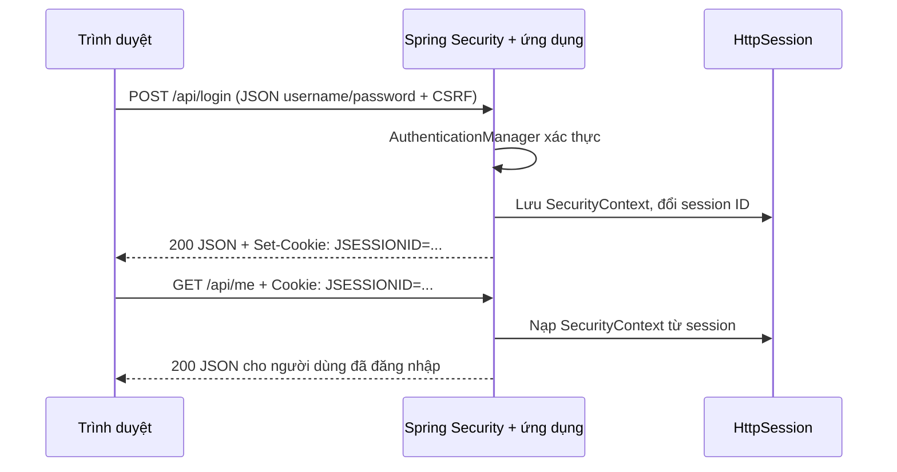

# Phân biệt định dạng yêu cầu đăng nhập JSON với mô hình phiên hoặc token

**Ngữ cảnh:** Đăng nhập JSON trong một ứng dụng web sử dụng Spring Security. Một API nhận `POST /api/login` với `Content-Type: application/json` **chưa cho biết** ứng dụng sử dụng session, JWT, opaque token hay cách nào khác để xác thực các request tiếp theo. Đây là hai quyết định thiết kế độc lập.

**Sau bài học, bạn cần:** đọc được luồng HTTP sau khi đăng nhập, phân biệt body JSON với cơ chế lưu trạng thái xác thực, thiết kế đúng cách gửi credentials cho những request kế tiếp và tránh đánh giá sai CSRF, logout, session hay token.

## 1. Hai câu hỏi khác nhau thường bị gộp làm một

### Câu hỏi A: Client gửi thông tin đăng nhập dưới dạng gì?

Đây là **định dạng yêu cầu** (request representation). Ví dụ:

```http
POST /api/login HTTP/1.1
Host: app.example
Content-Type: application/json
Accept: application/json

{"username":"alice","password":"demo-secret"}
```

`Content-Type: application/json` cho server biết cách giải mã **request body**. `Accept: application/json` thể hiện kiểu **response** client mong muốn. Tên trường `username`, `password` là hợp đồng API do hệ thống chọn; chúng chưa nói gì về session hay JWT.

Những cách đóng gói thông tin đăng nhập khác cũng có thể dẫn tới **cùng một mô hình xác thực**:

- HTML form truyền `username=alice&password=...` với `application/x-www-form-urlencoded`.
- JSON truyền `{"username":"alice","password":"..."}` với `application/json`.
- HTTP Basic truyền cặp thông tin đăng nhập qua header `Authorization`.

Cả ba cách có thể xác thực cùng một người dùng. Sự khác biệt chính nằm ở **cách tiếp nhận credentials lúc đăng nhập**, không quyết định việc sau đó ứng dụng lưu hoặc kiểm tra trạng thái ở đâu.

### Câu hỏi B: Sau khi đăng nhập, request tiếp theo chứng minh danh tính bằng gì?

Đây là **mô hình duy trì xác thực**:

1. **Session phía server:** server lưu `SecurityContext`/danh tính trong `HttpSession`; client gửi định danh session, thường qua cookie `JSESSIONID`. Server tra session khi xử lý request mới.
2. **Bearer access token:** server hoặc một authorization server cấp token; client gửi token trong `Authorization: Bearer ...` ở các request sau. Resource server kiểm tra JWT bằng chữ ký và claims hoặc xác minh opaque token qua introspection/lưu trữ.
3. **Mô hình kết hợp:** một BFF dùng cookie session với trình duyệt nhưng sử dụng access token khi gọi API phía sau; hoặc ứng dụng có cả endpoint session và endpoint Bearer với chính sách rõ ràng.

Cùng một JSON login body có thể dẫn đến lựa chọn 1, 2 hoặc 3. **JSON không đồng nghĩa stateless; JWT không đồng nghĩa JSON login; cookie không bắt buộc đồng nghĩa mọi auth được lưu phía server** (cookie cũng có thể chứa credential hay token và vẫn được browser tự gửi).

## 2. So sánh trực diện hai luồng đăng nhập JSON

| Khía cạnh | JSON login + server session | JSON login + Bearer access token |
| --- | --- | --- |
| Body của `POST /api/login` | JSON username/password | Có thể là chính JSON đó |
| Kết quả đăng nhập | Server lưu trạng thái xác thực vào `HttpSession` | Client nhận access token, nếu ứng dụng tự cấp token |
| Client gửi ở request sau | `Cookie: JSESSIONID=...` | `Authorization: Bearer ...` |
| Điều gì xác định danh tính? | Tra session và `SecurityContext` của server | Kiểm tra token, chữ ký/claims hoặc introspection |
| Trình duyệt tự đính kèm? | Cookie hợp lệ được tự gửi theo domain/path/SameSite/chế độ credentials | Bearer trong header thường do ứng dụng client chủ động thêm |
| Mức độ stateless của API | Thường stateful theo session | Có thể stateless với JWT tự xác minh; opaque token thường cần tra cứu |
| Logout/thu hồi | Hủy session phía server | Phụ thuộc thời hạn token, revocation, introspection, denylist và refresh-token lifecycle |
| Rủi ro CSRF | Cần xem xét nếu browser tự gửi cookie | Header Bearer do JavaScript tự gắn thường tránh kiểu CSRF cookie; Bearer **đặt trong cookie** vẫn có nguy cơ CSRF |
| Rủi ro XSS | XSS vẫn có thể thao tác trong phiên đang đăng nhập | XSS có thể truy cập/đánh cắp token nếu lưu ở nơi JavaScript đọc được |

Bảng mô tả các **mẫu triển khai điển hình**, không phải luật cứng cho mọi hệ thống. JWT vẫn có thể bị thu hồi bằng hạ tầng phụ trợ; session cũng có thể phân tán trên Redis và phục vụ nhiều instance. Chọn mô hình dựa vào client, yêu cầu bảo mật, khả năng thu hồi và kiến trúc, không dựa vào việc body là JSON.

## 3. Luồng A: JSON login nhưng vẫn dùng session

Một ứng dụng single-page web hoặc giao diện server-rendered có thể nhận JSON mà vẫn giữ session bình thường:



Response **có thể** trông như sau (giá trị cookie minh họa):

```http
HTTP/1.1 200 OK
Set-Cookie: JSESSIONID=demo-session-id; Path=/; HttpOnly; Secure; SameSite=Lax
Content-Type: application/json

{"username":"alice","model":"session"}
```

Cookie có thể được trình duyệt lưu theo chính sách cookie, sau đó tự gửi trên các request phù hợp:

```http
GET /api/me HTTP/1.1
Host: app.example
Cookie: JSESSIONID=demo-session-id
```

Trong trường hợp này, response JSON **không hề chứa access token**. `JSESSIONID` chỉ là định danh phiên, không phải JWT. Server lưu/ngầm tìm `SecurityContext` theo session; reload trang không nhất thiết làm mất đăng nhập. Cookie dùng `HttpOnly` vẫn được trình duyệt gửi dù JavaScript không đọc trực tiếp được.

Đăng nhập session cần xử lý **session fixation** (đổi session ID khi login), lưu SecurityContext, session timeout, logout/invalidation và CSRF cho thao tác thay đổi trạng thái. `SameSite` là lớp phụ trợ có điều kiện, không thay thế toàn bộ chính sách CSRF.

## 4. Luồng B: JSON login và trả access token

Một API có thể nhận chính body JSON rồi cấp access token. Response minh họa:

```http
HTTP/1.1 200 OK
Content-Type: application/json
Cache-Control: no-store

{"token_type":"Bearer","access_token":"demo-access-token","expires_in":900}
```

`demo-access-token` chỉ là giá trị mô phỏng, không phải token có thể xác minh. Ở request sau, **client chủ động gắn** access token:

```http
GET /api/me HTTP/1.1
Host: api.example
Authorization: Bearer demo-access-token
```

Server xác minh token và từ chối nếu hết hạn, chữ ký không hợp lệ, sai audience/issuer, token bị thu hồi theo chính sách, hoặc không đủ scope/quyền. `access_token` có thể là:

- **JWT:** thường là ba đoạn base64url có chữ ký, chứa các claims như `sub`, `iss`, `aud`, `exp`; resource server có thể xác minh cục bộ với public key và kiểm tra claims.
- **Opaque token:** chuỗi không mang cấu trúc mà client cần hiểu; resource server cần tra cứu/introspection hoặc một cơ chế xác minh được thiết kế riêng.

**JWT không phải “session” chỉ vì có JSON bên trong**, và cũng không phải bằng chứng rằng API có endpoint `POST /api/login` tự tạo token. Trong kiến trúc OAuth2/OIDC, token thường do **authorization server** phát hành theo giao thức tương ứng; ứng dụng Spring Security làm **resource server** xác minh token, không tự chọn tùy tiện một đoạn chuỗi làm JWT.

Với JWT sống 15 phút, server không thể mặc nhiên “xóa phiên” để làm token đã phát hành hết hiệu lực ngay. Cần tính trước thời hạn ngắn, refresh-token rotation nếu dùng refresh token, key rotation, thu hồi ở nơi phù hợp và xử lý logout phía client/server. `Cache-Control: no-store` giúp hạn chế cache nội dung nhạy cảm, nhưng phải bảo vệ nơi lưu token và luôn dùng HTTPS.

### Lưu token trong trình duyệt có hệ quả gì?

- **Bộ nhớ JavaScript (memory):** tránh lưu lâu dài; reload làm mất token trừ khi có cách lấy lại phiên. XSS vẫn có thể dùng token trong khi còn chạy.
- **`localStorage` hoặc `sessionStorage`:** dễ dùng nhưng bất kỳ script độc hại chạy cùng origin đều có thể đọc token; cần cân nhắc XSS và vòng đời token.
- **Cookie `HttpOnly` chứa token:** JavaScript không đọc token trực tiếp; browser lại có thể tự gửi cookie trên các request hợp lệ. Vì vậy cách này **thay đổi bài toán CSRF**, dù token bên trong là JWT.
- **BFF/session phía backend:** frontend chỉ giữ cookie phiên; backend quản lý access token phía server. Đây là cách tách nơi lưu token khỏi JavaScript của browser.

Không có cơ chế lưu token nào miễn nhiễm XSS, CSRF và rò rỉ hoàn toàn; biện pháp phải đi cùng nơi credential được lưu và cách nó được đưa vào request.

## 5. Spring Security: JSON login không tự hình thành session hay token

Spring Security có sẵn `formLogin` theo mẫu form parameters và `httpBasic` theo header challenge. **Chuyển body sang JSON không làm hai filter tự hiểu JSON.** Bạn cần một authentication endpoint/controller hoặc authentication filter thích hợp để đọc JSON, tạo `Authentication` chưa xác thực, gọi `AuthenticationManager`, rồi quyết định hậu xử lý thành công:

```text
POST JSON
  -> parse + validate input
  -> AuthenticationManager.authenticate(...)
  -> Authentication hợp lệ
       |-> Session: set SecurityContext + saveContext(HttpSession)
       `-> Token: ủy quyền/cấp token + response token theo thiết kế
```

`AuthenticationManager` chỉ kiểm tra credentials và trả một `Authentication` hợp lệ. Nó **không mặc định quyết định** liệu response của một JSON endpoint phải là cookie hay JWT. Việc gọi `SecurityContextHolder.setContext(...)` chỉ ảnh hưởng context của request hiện tại nếu không lưu vào `SecurityContextRepository` đúng cách. Trong Spring Security 6, custom controller/filter muốn **duy trì session ở các request sau** phải gọi `saveContext` một cách tường minh.

### Ví dụ có thể chạy: JSON login + HTTP session, Java 17 / Spring Boot 3

Dự án Maven có `spring-boot-starter-web` và `spring-boot-starter-security`:

```xml
<!-- pom.xml -->
<project xmlns="http://maven.apache.org/POM/4.0.0"
         xmlns:xsi="http://www.w3.org/2001/XMLSchema-instance"
         xsi:schemaLocation="http://maven.apache.org/POM/4.0.0 https://maven.apache.org/xsd/maven-4.0.0.xsd">
    <modelVersion>4.0.0</modelVersion>
    <parent>
        <groupId>org.springframework.boot</groupId>
        <artifactId>spring-boot-starter-parent</artifactId>
        <version>3.3.9</version>
        <relativePath/>
    </parent>
    <groupId>example</groupId>
    <artifactId>json-login-session</artifactId>
    <version>1.0.0</version>
    <properties><java.version>17</java.version></properties>
    <dependencies>
        <dependency>
            <groupId>org.springframework.boot</groupId>
            <artifactId>spring-boot-starter-web</artifactId>
        </dependency>
        <dependency>
            <groupId>org.springframework.boot</groupId>
            <artifactId>spring-boot-starter-security</artifactId>
        </dependency>
    </dependencies>
    <build>
        <plugins>
            <plugin>
                <groupId>org.springframework.boot</groupId>
                <artifactId>spring-boot-maven-plugin</artifactId>
            </plugin>
        </plugins>
    </build>
</project>
```

Tạo `src/main/java/example/JsonLoginApplication.java`:

```java
package example;

import java.util.List;
import java.util.Map;

import jakarta.servlet.http.HttpServletRequest;
import jakarta.servlet.http.HttpServletResponse;
import org.springframework.boot.SpringApplication;
import org.springframework.boot.autoconfigure.SpringBootApplication;
import org.springframework.context.annotation.Bean;
import org.springframework.http.HttpMethod;
import org.springframework.http.HttpStatus;
import org.springframework.http.MediaType;
import org.springframework.http.ResponseEntity;
import org.springframework.security.authentication.AuthenticationManager;
import org.springframework.security.authentication.ProviderManager;
import org.springframework.security.authentication.UsernamePasswordAuthenticationToken;
import org.springframework.security.authentication.dao.DaoAuthenticationProvider;
import org.springframework.security.config.annotation.web.builders.HttpSecurity;
import org.springframework.security.config.annotation.web.configurers.AbstractHttpConfigurer;
import org.springframework.security.core.Authentication;
import org.springframework.security.core.AuthenticationException;
import org.springframework.security.core.context.SecurityContext;
import org.springframework.security.core.context.SecurityContextHolder;
import org.springframework.security.core.userdetails.User;
import org.springframework.security.core.userdetails.UserDetailsService;
import org.springframework.security.crypto.factory.PasswordEncoderFactories;
import org.springframework.security.crypto.password.PasswordEncoder;
import org.springframework.security.provisioning.InMemoryUserDetailsManager;
import org.springframework.security.web.SecurityFilterChain;
import org.springframework.security.web.authentication.session.ChangeSessionIdAuthenticationStrategy;
import org.springframework.security.web.authentication.session.CompositeSessionAuthenticationStrategy;
import org.springframework.security.web.authentication.session.SessionAuthenticationStrategy;
import org.springframework.security.web.context.HttpSessionSecurityContextRepository;
import org.springframework.security.web.context.SecurityContextRepository;
import org.springframework.security.web.csrf.CsrfAuthenticationStrategy;
import org.springframework.security.web.csrf.CsrfToken;
import org.springframework.security.web.csrf.CsrfTokenRepository;
import org.springframework.security.web.csrf.HttpSessionCsrfTokenRepository;
import org.springframework.web.bind.annotation.ExceptionHandler;
import org.springframework.web.bind.annotation.GetMapping;
import org.springframework.web.bind.annotation.PostMapping;
import org.springframework.web.bind.annotation.RequestBody;
import org.springframework.web.bind.annotation.RestController;

@SpringBootApplication
public class JsonLoginApplication {
    public static void main(String[] args) {
        SpringApplication.run(JsonLoginApplication.class, args);
    }

    @Bean
    PasswordEncoder passwordEncoder() {
        return PasswordEncoderFactories.createDelegatingPasswordEncoder();
    }

    @Bean
    UserDetailsService users(PasswordEncoder encoder) {
        return new InMemoryUserDetailsManager(
                User.withUsername("alice")
                        .password(encoder.encode("demo-secret"))
                        .roles("USER")
                        .build());
    }

    @Bean
    AuthenticationManager authenticationManager(UserDetailsService users,
                                                PasswordEncoder encoder) {
        DaoAuthenticationProvider provider = new DaoAuthenticationProvider(encoder);
        provider.setUserDetailsService(users);
        return new ProviderManager(provider);
    }

    @Bean
    SecurityContextRepository securityContextRepository() {
        return new HttpSessionSecurityContextRepository();
    }

    @Bean
    CsrfTokenRepository csrfTokenRepository() {
        return new HttpSessionCsrfTokenRepository();
    }

    // Custom JSON login phải chủ động chạy các xử lý khi xác thực thành công.
    @Bean
    SessionAuthenticationStrategy sessionAuthenticationStrategy(
            CsrfTokenRepository csrfTokens) {
        return new CompositeSessionAuthenticationStrategy(List.of(
                new ChangeSessionIdAuthenticationStrategy(),
                new CsrfAuthenticationStrategy(csrfTokens)));
    }

    @Bean
    SecurityFilterChain filterChain(HttpSecurity http,
                                    SecurityContextRepository contexts,
                                    CsrfTokenRepository csrfTokens) throws Exception {
        return http
                .authorizeHttpRequests(auth -> auth
                        .requestMatchers(HttpMethod.GET, "/csrf").permitAll()
                        .requestMatchers(HttpMethod.POST, "/api/login").permitAll()
                        .anyRequest().authenticated())
                .httpBasic(AbstractHttpConfigurer::disable)
                .formLogin(AbstractHttpConfigurer::disable)
                .csrf(csrf -> csrf.csrfTokenRepository(csrfTokens))
                .securityContext(context -> context.securityContextRepository(contexts))
                .build();
    }

    @RestController
    static class Api {
        private final AuthenticationManager manager;
        private final SecurityContextRepository contexts;
        private final SessionAuthenticationStrategy sessionStrategy;

        Api(AuthenticationManager manager,
            SecurityContextRepository contexts,
            SessionAuthenticationStrategy sessionStrategy) {
            this.manager = manager;
            this.contexts = contexts;
            this.sessionStrategy = sessionStrategy;
        }

        record LoginRequest(String username, String password) {}

        @GetMapping("/csrf")
        CsrfToken csrf(CsrfToken token) {
            return token;
        }

        @PostMapping(value = "/api/login",
                     consumes = MediaType.APPLICATION_JSON_VALUE)
        Map<String, String> login(@RequestBody LoginRequest input,
                                  HttpServletRequest request,
                                  HttpServletResponse response) {
            Authentication auth = manager.authenticate(
                    UsernamePasswordAuthenticationToken.unauthenticated(
                            input.username(), input.password()));

            // Đổi session ID và làm mới CSRF token sau login.
            sessionStrategy.onAuthentication(auth, request, response);

            SecurityContext context = SecurityContextHolder.createEmptyContext();
            context.setAuthentication(auth);
            SecurityContextHolder.setContext(context);
            contexts.saveContext(context, request, response);

            return Map.of("username", auth.getName(), "model", "session");
        }

        @GetMapping("/api/me")
        Map<String, String> me(Authentication authentication) {
            return Map.of("username", authentication.getName());
        }

        @ExceptionHandler(AuthenticationException.class)
        ResponseEntity<Map<String, String>> badLogin(AuthenticationException error) {
            return ResponseEntity.status(HttpStatus.UNAUTHORIZED)
                    .body(Map.of("error", "invalid_credentials"));
        }
    }
}
```

**Chú ý khi đọc code:**

- `/api/login` nhận JSON, gọi `AuthenticationManager`, rồi **lưu `SecurityContext` vào session**. Không có dòng nào phát hành JWT.
- `SecurityContextRepository#saveContext` là bước cần cho persistence khi tự tạo JSON login trong Spring Security 6.
- `ChangeSessionIdAuthenticationStrategy` chống session fixation; `CsrfAuthenticationStrategy` xóa CSRF token cũ khi login để client lấy token mới.
- Request login cũng là POST và **vẫn chịu kiểm tra CSRF**, mặc dù `permitAll()` cho phép người chưa đăng nhập truy cập endpoint. `permitAll` không đồng nghĩa bỏ qua CSRF.
- Ví dụ giữ user/password trong bộ nhớ để dễ thực hành. Khi dùng thực tế cần kiểm tra dữ liệu đầu vào, rate limiting, logging phù hợp, error handling, session policy, HTTPS/cookie policy và bản vá framework. Phiên bản trong POM chỉ là mốc tái lập API Spring Security 6, không phải lời khuyên khóa phiên bản production.

### Thử bằng `curl`

Dùng Maven và JDK 17+:

```bash
mvn spring-boot:run
```

Mở một terminal khác. **Bước 1:** lấy CSRF token và lưu cookie phiên ban đầu:

```bash
curl -s -c cookies.txt http://localhost:8080/csrf
```

Ví dụ phản hồi là JSON có ba trường `headerName`, `parameterName`, `token`. Hãy sao chép **giá trị thực của trường `token`**. Lúc này server chưa đăng nhập Alice. Client lưu cookie vào `cookies.txt` để dùng cùng phiên.

**Bước 2:** thử POST JSON mà không có CSRF token, dù body chứa đúng mật khẩu:

```bash
curl -i -b cookies.txt \
  -H 'Content-Type: application/json' \
  -d '{"username":"alice","password":"demo-secret"}' \
  http://localhost:8080/api/login
```

Kỳ vọng **HTTP 403**: Spring Security chặn trước khi controller xác thực. Kết quả đó chứng minh JSON request vẫn có thể phải qua CSRF filter.

**Bước 3:** gửi login đúng, thay giá trị token đã lấy trong bước 1:

```bash
curl -i -b cookies.txt -c cookies.txt \
  -H 'Content-Type: application/json' \
  -H 'X-CSRF-TOKEN: <gia-tri-token-tu-buoc-1>' \
  -d '{"username":"alice","password":"demo-secret"}' \
  http://localhost:8080/api/login
```

Với token và mật khẩu hợp lệ, body response là:

```json
{"username":"alice","model":"session"}
```

`cookies.txt` được cập nhật theo `Set-Cookie` và session ID có thể đã đổi. **Không có Bearer token** trong body phản hồi.

**Bước 4:** gửi một request mới, chỉ sử dụng cookie phiên:

```bash
curl -s -b cookies.txt http://localhost:8080/api/me
```

Kết quả sau login thành công:

```json
{"username":"alice"}
```

Thử lại mà không gửi cookie (một client mới): endpoint không còn nhận diện Alice là người dùng đã xác thực. Đây là bằng chứng danh tính **được duy trì qua session**.

**Bước 5:** lấy lại CSRF token sau login cho các POST tiếp theo, vì token cũ đã bị xóa/đổi:

```bash
curl -s -b cookies.txt -c cookies.txt http://localhost:8080/csrf
```

Không được dùng lại CSRF token trước đăng nhập nếu chiến lược login đã thay nó. Khi học với DevTools Network, xác nhận `Content-Type`, `Cookie`, `Set-Cookie`, trạng thái 403/200 và body; không chia sẻ password, session ID hoặc CSRF token đang hoạt động.

## 6. Nếu muốn Bearer token, phần nào phải thay đổi?

Ở cùng endpoint JSON, nhánh sau xác thực **sẽ khác**:

```java
// Minh họa luồng token, KHÔNG phải ứng dụng độc lập:
Authentication auth = authenticationManager.authenticate(
        UsernamePasswordAuthenticationToken.unauthenticated(
                input.username(), input.password()));

// Token issuer được cấu hình riêng và ký/đăng ký token hợp lệ.
String accessToken = tokenIssuer.issueFor(auth);
// Response JSON: token_type=Bearer, access_token=..., expires_in=...
```

Đây là **pseudocode kiến trúc**: `tokenIssuer` không phải API tích hợp sẵn của Spring Security; ví dụ này cố tình không tự triển khai ký JWT hoặc refresh token bằng thuật toán tự chế. Trong hệ thống thực tế nên ưu tiên authorization server hoặc dịch vụ cấp token đã được thiết kế/kiểm định; resource server dùng cơ chế như `oauth2ResourceServer(...jwt(...))` hoặc opaque-token introspection.

Khác với ví dụ session ở mục 5, API nhận Bearer token phải:

1. Xác định issuer và audience được tin cậy; xác minh signature/expiration/claims hoặc introspection.
2. Kiểm soát scope/authority và xử lý `401` khi chưa xác thực, `403` khi thiếu quyền.
3. Quyết định rõ access token sống bao lâu, cách refresh/thu hồi và logout.
4. Hướng dẫn client gắn `Authorization: Bearer ...` ở request sau. Không tự gán request JSON với việc tạo token.
5. Dùng chính sách CSRF theo **cách credentials được gửi**. Nếu browser chỉ gắn Bearer header một cách chủ động và server không chấp nhận cookie/Basic tự gửi, có thể áp dụng mô hình API token phù hợp; nếu Bearer nằm trong cookie, cần đánh giá CSRF tương tự cookie session.

Để minh họa ngắn nhất bằng cấu hình Spring Security **phía resource server** (chỉ là đoạn cấu hình cần các dependencies và issuer tương ứng, không tự cấp token):

```java
// Ví dụ cấu hình độc lập với JSON-login controller ở mục 5:
http.authorizeHttpRequests(auth -> auth
        .anyRequest().authenticated())
    .oauth2ResourceServer(oauth2 -> oauth2.jwt(
            org.springframework.security.config.Customizer.withDefaults()));
```

Đoạn này **chỉ nhận và xác minh JWT Bearer được cấp nơi khác**; phải cung cấp cấu hình `JwtDecoder`/issuer hợp lệ và dependency `spring-boot-starter-oauth2-resource-server`. Không thể thêm một dòng này vào session demo rồi coi như đã có JWT login.

## 7. Kiểm tra browser, CORS, CSRF và cookie theo mô hình đã chọn

| Tình huống | Client gửi credential bằng cách nào? | Điều cần kiểm tra |
| --- | --- | --- |
| SPA cùng origin + session | Browser thường tự gửi cookie hợp lệ | CSRF token cho yêu cầu thay đổi trạng thái; HttpOnly, Secure, SameSite, session fixation và expiry |
| SPA khác origin + session | `fetch` có thể cần `credentials: "include"` cùng cấu hình cookie/CORS thích hợp | CORS cho origin đáng tin và credentials; CSRF và SameSite vẫn cần đánh giá |
| SPA + Bearer ở header | JavaScript chủ động gắn `Authorization` | XSS, rò rỉ token, preflight/CORS khi cross-origin, thời hạn và kiểm tra token |
| App mobile/non-browser + Bearer | Client chủ động gắn header | Lưu trữ bảo mật phía thiết bị, TLS, expiry/revocation; CSRF của browser thường không phải đường tấn công này |
| JWT được lưu trong cookie | Browser tự gửi cookie | CSRF vẫn cần đánh giá, JWT không tự triệt tiêu việc browser gửi credential |

**CORS không phải công tắc CSRF.** CORS chi phối việc JavaScript khác origin được gửi một số loại request và đọc response. Một form cross-site thông thường có thể gửi request mà không cần đọc response. `application/json` với `Content-Type` chuẩn thường tạo preflight khi cross-origin `fetch`, nhưng dựa riêng vào preflight hoặc từ chối CORS để bảo vệ mọi request thay đổi trạng thái là thiết kế mong manh.

Ví dụ client cùng origin dùng session:

```javascript
const response = await fetch("/api/me", {
  method: "GET",
  credentials: "same-origin"
});
const profile = await response.json();
console.log(profile.username);
```

Browser có thể tự gắn cookie hợp lệ. Với JSON login có CSRF, client cần lấy token và thêm header đúng trước POST; ngay sau login cần lấy token mới theo ví dụ mục 5.

Ví dụ client sử dụng Bearer (chỉ là minh họa cách gọi API khi đã có token):

```javascript
async function getProfile(accessToken) {
  const response = await fetch("/api/me", {
    headers: { Authorization: `Bearer ${accessToken}` }
  });
  if (!response.ok) throw new Error(`HTTP ${response.status}`);
  return response.json();
}
```

Ở đây `Authorization` được **mã JavaScript tự đặt**; chưa có quyết định nào về nơi lưu `accessToken`, cách nhận token hoặc cách refresh. Phần đó thuộc kiến trúc bảo mật của ứng dụng.

## 8. Những nhầm lẫn dễ gặp và cách tự kiểm chứng

1. **“Body là JSON thì không tạo session.”** Sai. Hãy mở DevTools kiểm tra `Set-Cookie`, các request có cookie và server có lưu SecurityContext vào `HttpSession` không.
2. **“Có cookie thì chắc chắn là đăng nhập form.”** Sai. JSON login vẫn có thể tạo session cookie; OAuth/OIDC login sau khi hoàn tất cũng thường tạo session ứng dụng.
3. **“Server trả JSON thì đó là JWT.”** Sai. Response `{"username":"alice"}` là dữ liệu ứng dụng; muốn xác định token phải xem rõ credential được phát hành và cách server xác minh ở request sau.
4. **“Đặt `SessionCreationPolicy.STATELESS` sẽ tự sinh JWT.”** Sai. Cấu hình đó không phát hành token; bạn vẫn phải có bên phát hành và cơ chế resource server xác thực token.
5. **“Chỉ cần `SecurityContextHolder.setContext` trong controller là login bền vững.”** Sai với cơ chế explicit save ở Spring Security 6. Phải lưu context vào repository/session nếu muốn request sau còn được xác thực.
6. **“Cho phép `permitAll()` trên `/api/login` thì POST không cần CSRF.”** Sai. Rule authorization và CSRF filter là hai lớp riêng; JSON login dựa trên cookie/session vẫn cần bảo vệ.
7. **“JWT là stateless nên logout luôn thu hồi token ngay.”** Sai. Token đã ký có thể còn hợp lệ tới `exp` nếu chưa có cơ chế thu hồi bổ sung.
8. **“JWT trong cookie không bị CSRF.”** Sai. Cookie được trình duyệt tự gửi; hãy xét CSRF dựa vào cách truyền credential chứ không dựa vào cấu trúc JWT.
9. **“HTTP 401 và 403 là bằng chứng trực tiếp của session/token.”** Sai. Status code phản ánh lý do từ chối theo cấu hình, không xác định phương thức lưu phiên. Chỉ nên kết luận khi đã quan sát cookie/header, server verification và persistence.
10. **“`Content-Type: application/json` đủ bảo vệ login.”** Sai. Ngoài parse đúng kiểu, vẫn cần xác thực password an toàn, rate limiting, CSRF (nếu phù hợp), HTTPS, bảo vệ session/token và phản hồi lỗi không làm lộ thông tin nhạy cảm.

### Bài tập tự kiểm tra

- Giữ nguyên `POST /api/login` JSON của lab, gọi `/api/me` bằng **cookie jar** rồi gọi lại không kèm cookie. Giải thích vì sao hai kết quả khác nhau mà body login không đổi.
- So sánh hai response đăng nhập giả định: một response có `Set-Cookie: JSESSIONID`, response kia có `access_token`. Chỉ ra credential nào client gửi ở request tiếp theo.
- Một SPA lưu JWT trong cookie `HttpOnly`. Hỏi: mô hình này có tự động miễn CSRF không? **Không** — vì cookie vẫn có thể được browser gửi tự động.
- Một mobile client nhận opaque token và gửi Bearer header. Hỏi: server tra token ở đâu, logout/token revocation làm thế nào? Câu trả lời tùy hợp đồng của issuer/introspection.
- Chỉnh ví dụ `POST /api/login` thành `Content-Type: text/plain` trong khi controller yêu cầu `application/json`. Quan sát lỗi `415 Unsupported Media Type` (với body phù hợp để test). Đây là lỗi **định dạng request**, không phải lỗi xác thực phiên/token.

**Nguyên tắc ghi nhớ:** Hãy trả lời tuần tự hai câu hỏi: **(1) Login request được mã hóa bằng gì? (2) Request tiếp theo mang bằng chứng xác thực nào và server xác minh bằng cách nào?** Không dùng câu trả lời của câu (1) để suy đoán câu (2).

## Tài liệu tham khảo

- [Spring Security — Authentication Architecture](https://docs.spring.io/spring-security/reference/servlet/authentication/architecture.html): `Authentication`, `AuthenticationManager`, `SecurityContext`.
- [Spring Security — Authentication Persistence and Session Management](https://docs.spring.io/spring-security/reference/servlet/authentication/session-management.html): explicit save, `SecurityContextRepository`, session fixation.
- [Spring Security — CSRF](https://docs.spring.io/spring-security/reference/servlet/exploits/csrf.html): token khi login/logout và endpoint `/csrf`.
- [Spring Security — OAuth2 Resource Server JWT](https://docs.spring.io/spring-security/reference/servlet/oauth2/resource-server/jwt.html): resource server xác minh JWT Bearer.
- [MDN — Cookie](https://developer.mozilla.org/en-US/docs/Web/HTTP/Guides/Cookies) và [Fetch API](https://developer.mozilla.org/en-US/docs/Web/API/Fetch_API/Using_Fetch): browser quản lý cookie, `credentials` và header.