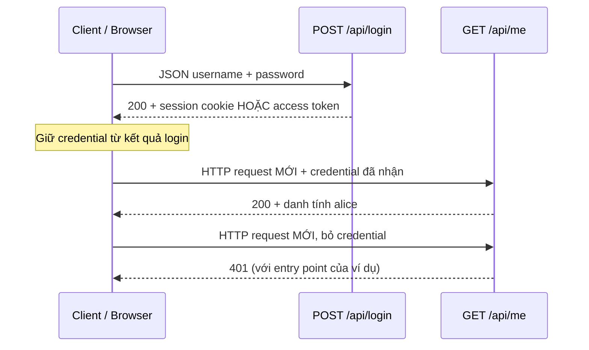
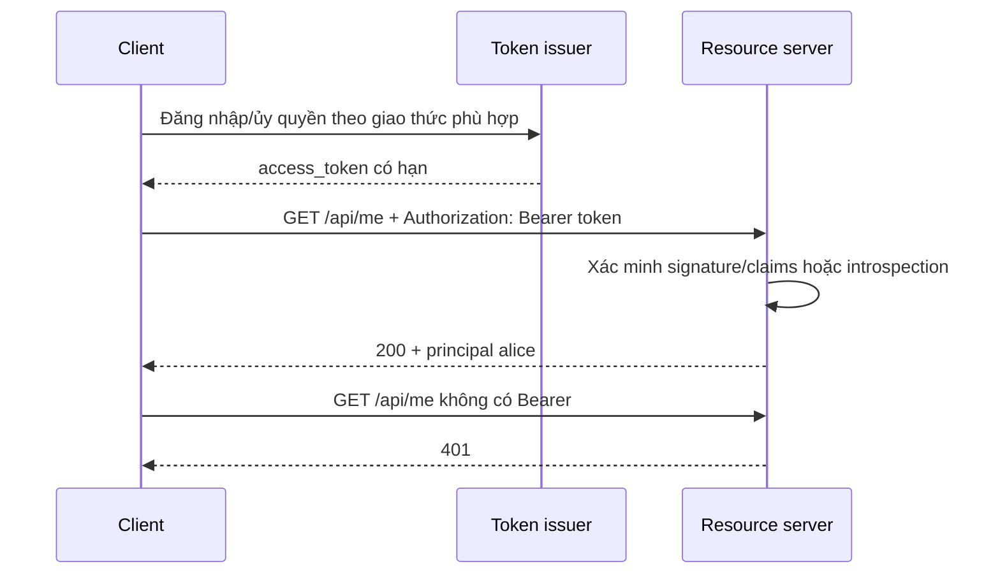

# Kiểm thử yêu cầu tiếp theo để xác nhận danh tính thực sự được duy trì

**Bối cảnh:** Đăng nhập JSON với Spring Security (Servlet). Sau khi client gửi `POST /api/login` chứa `username`/`password` và nhận `200 OK`, ta phải kiểm tra một **HTTP request mới** đến endpoint được bảo vệ. Chỉ khi request mới vẫn nhận diện đúng người dùng nhờ session hoặc credential hợp lệ thì mới có bằng chứng rằng cơ chế duy trì đăng nhập hoạt động.

**Mục tiêu của bài:**

1. Phân biệt “login vừa thành công” với “trạng thái xác thực tồn tại qua request khác”.
2. Thiết kế cặp kiểm thử **login → request kế tiếp**, có kiểm thử đối chứng khi thiếu credential.
3. Kiểm tra đúng loại bằng chứng theo mô hình **session cookie** hoặc **Bearer token**, dù body đăng nhập cùng là JSON.
4. Viết integration test có ý nghĩa với `MockMvc` và kiểm tra HTTP thực tế, biết các trường hợp kết quả dễ gây ngộ nhận.

## 1. `200 OK` ở login là tín hiệu ban đầu, chưa phải bằng chứng duy trì danh tính

Giả sử request đầu là:

```http
POST /api/login HTTP/1.1
Host: app.example
Content-Type: application/json

{"username":"alice","password":"demo-pass"}
```

Ứng dụng có thể trả:

```http
HTTP/1.1 200 OK
Content-Type: application/json

{"message":"login successful","username":"alice"}
```

Response này **chỉ chứng minh** logic xử lý yêu cầu đăng nhập đã báo thành công. Nó **không chứng minh** request thứ hai được xác thực. Có nhiều khả năng:

- Server đã xác thực mật khẩu nhưng chỉ đặt `Authentication` vào `SecurityContextHolder` của request hiện tại, **chưa lưu** `SecurityContext` vào session.
- Server định phát hành access token nhưng chưa thực sự phát hành hoặc client chưa nhận/lưu token.
- Server đã tạo session nhưng client không giữ hoặc không gửi lại cookie `JSESSIONID`.
- Cookie bị giới hạn bởi domain, path, `SameSite`, `Secure`, CORS/`credentials` hoặc đã hết hạn.
- Server có xác thực nhưng endpoint kiểm tra lại đang `permitAll()`, làm trả `200 OK` dù không có danh tính.
- Test framework tự đặt user vào mọi request (`@WithMockUser`, `.with(user(...))`) nên request sau thành công giả tạo.

**Điều phải quan sát:** một request kế tiếp **không mang lại mật khẩu** vẫn vào được tài nguyên bảo vệ, và server nhận diện đúng danh tính từ cơ chế đã thiết kế; cùng request đó **thất bại khi bỏ credential tương ứng**.

### Quy trình bằng chứng tối thiểu



Request `/api/me` phải được bảo vệ bởi Spring Security, đọc `Authentication` **tại thời điểm request thứ hai**, và trả `authentication.getName()`/quyền từ context của request thứ hai. Một test chỉ gọi hai lần vào `/api/login` không kiểm tra được sự duy trì danh tính.

## 2. Định nghĩa “request kế tiếp” cho từng mô hình

### A. Đăng nhập JSON, duy trì bằng `HttpSession`

Ví dụ response (giá trị cookie chỉ để minh họa):

```http
HTTP/1.1 200 OK
Set-Cookie: JSESSIONID=example-session; Path=/; HttpOnly; SameSite=Lax
Content-Type: application/json

{"username":"alice","model":"session"}
```

Request mới:

```http
GET /api/me HTTP/1.1
Host: app.example
Cookie: JSESSIONID=example-session
```

Spring Security tra cứu `SecurityContext` từ `HttpSession`, sau đó cung cấp `Authentication` cho phần xử lý `/api/me`. Client **không gửi lại mật khẩu**. Trong trình duyệt, cookie phù hợp thường được gửi tự động. Với `curl`, Postman hoặc integration test, phải mang session/cookie một cách rõ ràng.

Cần có đủ ba mắt xích: **(1)** login thành công; **(2)** lưu context vào repository/session phía server; **(3)** request sau gửi lại session ID hợp lệ. Thiếu bất kỳ mắt xích nào có thể khiến request thứ hai bị coi là anonymous.

### B. Đăng nhập JSON, duy trì bằng access token

Nếu server/authorization server trả:

```http
HTTP/1.1 200 OK
Content-Type: application/json
Cache-Control: no-store

{"token_type":"Bearer","access_token":"<token-do-issuer-cap>","expires_in":900}
```

Request mới phải có:

```http
GET /api/me HTTP/1.1
Host: api.example
Authorization: Bearer <token-do-issuer-cap>
```

Resource server kiểm tra token (chữ ký và claims của JWT, hoặc introspection/lookup với opaque token) **ở request mới**. Không có nghĩa server phải lưu `HttpSession`; token có thể được kiểm tra lại trên từng request. Với Bearer trong header, client thường phải chủ động gắn `Authorization`.

**Đừng nhầm:** format `application/json` chỉ quy định cách gửi body đăng nhập. Nó **không tự tạo session hay JWT**. Một API có thể dùng JSON login + session, JSON login + Bearer, hoặc kết hợp. Tiêu chí kiểm thử phụ thuộc **credential được sử dụng sau login**, không phụ thuộc cách truyền password ở request đầu.

| Điểm cần kiểm tra | JSON + session | JSON + Bearer |
| --- | --- | --- |
| Bằng chứng ở response login | Session được tạo và cookie được cấp/lưu | Access token có thật, issuer phát hành hợp lệ |
| Credential ở GET kế tiếp | `Cookie: JSESSIONID=...` | `Authorization: Bearer ...` |
| Nơi xác thực request thứ hai | `HttpSession` + `SecurityContextRepository` | Token verifier/resource server |
| Đối chứng thiếu credential | Bỏ cookie hoặc dùng session mới | Bỏ header Bearer |
| Đối chứng credential sai | Cookie giả/hết hạn/session invalid | Token giả, sai chữ ký, hết hạn/sai audience |
| Bằng chứng mạnh | GET bảo vệ trả đúng user với cùng session; không có session thì bị chặn | GET trả đúng user với token thật; token sai/thiếu thì bị chặn |
| Lưu ý riêng | Session fixation, expiry, CSRF với cookie tự gửi | Bảo vệ token, `exp`/`iss`/`aud`, refresh/revocation |

Một JWT đặt **trong cookie** vẫn có thể được trình duyệt tự gửi và phát sinh vấn đề CSRF. Cấu trúc token không tự quyết định vấn đề này.

## 3. Thiết kế bộ kiểm thử có giá trị

Dùng một endpoint như `GET /api/me` (yêu cầu đã xác thực) làm phép thử. Phản hồi nên gồm danh tính và, khi cần, roles/authorities lấy từ context thực. Đảm bảo endpoint này **không `permitAll()`**.

| Case | Request đầu | Request kế tiếp | Kỳ vọng, với cấu hình ví dụ |
| --- | --- | --- | --- |
| S1: session hợp lệ | `POST /api/login` JSON đúng + CSRF hợp lệ | `GET /api/me` dùng session sau login, không gửi password | `200`, body xác nhận `alice` |
| S2: không mang session | Đã login thành công trong S1 | `GET /api/me` không có cookie/session | `401` |
| S3: session mới | Đã login thành công trong S1 | `GET /api/me` với một session khác | `401` |
| S4: login sai mật khẩu | `POST /api/login` JSON sai | `GET /api/me` từ client đó | `401` |
| S5: POST thiếu CSRF | `POST /api/login` không có CSRF token | Không tồn tại login thành công | `403`; không chứng minh session |
| T1: Bearer hợp lệ | Lấy token hợp lệ từ issuer | `GET /api/me` kèm token đó | `200`, trả đúng identity và quyền |
| T2: Bearer trống | Đã lấy token trong T1 | `GET /api/me` bỏ `Authorization` | `401` |
| T3: Bearer không hợp lệ | Đã lấy token trong T1 | `GET /api/me` dùng token sai/expired | Thường `401` (theo cấu hình) |
| T4: Bearer thiếu quyền | Lấy token xác thực được nhưng thiếu scope/authority | Gọi endpoint đòi quyền cao hơn | `403` |

Mã `401` và `403` phụ thuộc security entry point/access-denied handling. Trong ví dụ bên dưới, ứng dụng cấu hình rõ `401` cho GET chưa xác thực; `403` dành cho POST thiếu CSRF. Khi đánh giá hệ thống khác, cần đọc cấu hình và đối chiếu dữ liệu danh tính/quyền chứ không chỉ suy đoán từ một status code.

## 4. Lab độc lập: JSON login + session, Java 17 / Spring Boot 3 / Spring Security 6

Lab dùng một ứng dụng Servlet duy nhất, username `alice`, password `demo-pass`, endpoint login JSON và endpoint kiểm tra danh tính. Đây là mô hình **session**; lab không cấp JWT. Mục tiêu là chứng minh `SecurityContext` được **lưu và nạp lại ở request khác**.

### 4.1. Tạo dự án Maven

Cấu trúc:

```text
json-next-request-lab/
├── pom.xml
└── src/
    ├── main/java/example/JsonNextRequestApplication.java
    └── test/java/example/JsonNextRequestApplicationTests.java
```

`pom.xml`:

```xml
<project xmlns="http://maven.apache.org/POM/4.0.0"
         xmlns:xsi="http://www.w3.org/2001/XMLSchema-instance"
         xsi:schemaLocation="http://maven.apache.org/POM/4.0.0 https://maven.apache.org/xsd/maven-4.0.0.xsd">
    <modelVersion>4.0.0</modelVersion>
    <parent>
        <groupId>org.springframework.boot</groupId>
        <artifactId>spring-boot-starter-parent</artifactId>
        <version>3.3.9</version>
        <relativePath/>
    </parent>
    <groupId>example</groupId>
    <artifactId>json-next-request-lab</artifactId>
    <version>1.0.0</version>
    <properties><java.version>17</java.version></properties>
    <dependencies>
        <dependency>
            <groupId>org.springframework.boot</groupId>
            <artifactId>spring-boot-starter-web</artifactId>
        </dependency>
        <dependency>
            <groupId>org.springframework.boot</groupId>
            <artifactId>spring-boot-starter-security</artifactId>
        </dependency>
        <dependency>
            <groupId>org.springframework.boot</groupId>
            <artifactId>spring-boot-starter-test</artifactId>
            <scope>test</scope>
        </dependency>
        <dependency>
            <groupId>org.springframework.security</groupId>
            <artifactId>spring-security-test</artifactId>
            <scope>test</scope>
        </dependency>
    </dependencies>
    <build>
        <plugins>
            <plugin>
                <groupId>org.springframework.boot</groupId>
                <artifactId>spring-boot-maven-plugin</artifactId>
            </plugin>
        </plugins>
    </build>
</project>
```

Mốc Spring Boot 3.3.9 chỉ dùng để minh họa API Spring Security 6. Khi triển khai thật, chọn phiên bản còn được hỗ trợ và được cập nhật bản vá bảo mật.

### 4.2. Ứng dụng: xác thực JSON và lưu `SecurityContext`

Tạo `src/main/java/example/JsonNextRequestApplication.java`:

```java
package example;

import java.util.List;
import java.util.Map;

import jakarta.servlet.http.HttpServletRequest;
import jakarta.servlet.http.HttpServletResponse;

import org.springframework.boot.SpringApplication;
import org.springframework.boot.autoconfigure.SpringBootApplication;
import org.springframework.context.annotation.Bean;
import org.springframework.http.HttpMethod;
import org.springframework.http.HttpStatus;
import org.springframework.http.MediaType;
import org.springframework.http.ResponseEntity;
import org.springframework.security.authentication.AuthenticationManager;
import org.springframework.security.authentication.ProviderManager;
import org.springframework.security.authentication.UsernamePasswordAuthenticationToken;
import org.springframework.security.authentication.dao.DaoAuthenticationProvider;
import org.springframework.security.config.annotation.web.builders.HttpSecurity;
import org.springframework.security.config.annotation.web.configurers.AbstractHttpConfigurer;
import org.springframework.security.core.Authentication;
import org.springframework.security.core.AuthenticationException;
import org.springframework.security.core.context.SecurityContext;
import org.springframework.security.core.context.SecurityContextHolder;
import org.springframework.security.core.userdetails.User;
import org.springframework.security.core.userdetails.UserDetailsService;
import org.springframework.security.crypto.factory.PasswordEncoderFactories;
import org.springframework.security.crypto.password.PasswordEncoder;
import org.springframework.security.provisioning.InMemoryUserDetailsManager;
import org.springframework.security.web.SecurityFilterChain;
import org.springframework.security.web.authentication.HttpStatusEntryPoint;
import org.springframework.security.web.authentication.session.ChangeSessionIdAuthenticationStrategy;
import org.springframework.security.web.authentication.session.CompositeSessionAuthenticationStrategy;
import org.springframework.security.web.authentication.session.SessionAuthenticationStrategy;
import org.springframework.security.web.context.HttpSessionSecurityContextRepository;
import org.springframework.security.web.context.SecurityContextRepository;
import org.springframework.security.web.csrf.CsrfAuthenticationStrategy;
import org.springframework.security.web.csrf.CsrfToken;
import org.springframework.security.web.csrf.CsrfTokenRepository;
import org.springframework.security.web.csrf.HttpSessionCsrfTokenRepository;

import org.springframework.web.bind.annotation.ExceptionHandler;
import org.springframework.web.bind.annotation.GetMapping;
import org.springframework.web.bind.annotation.PostMapping;
import org.springframework.web.bind.annotation.RequestBody;
import org.springframework.web.bind.annotation.RestController;

@SpringBootApplication
public class JsonNextRequestApplication {
    public static void main(String[] args) {
        SpringApplication.run(JsonNextRequestApplication.class, args);
    }

    @Bean
    PasswordEncoder passwordEncoder() {
        return PasswordEncoderFactories.createDelegatingPasswordEncoder();
    }

    @Bean
    UserDetailsService users(PasswordEncoder passwordEncoder) {
        return new InMemoryUserDetailsManager(
                User.withUsername("alice")
                        .password(passwordEncoder.encode("demo-pass"))
                        .roles("USER")
                        .build());
    }

    @Bean
    AuthenticationManager authenticationManager(UserDetailsService users,
                                                PasswordEncoder encoder) {
        DaoAuthenticationProvider provider = new DaoAuthenticationProvider();
        provider.setUserDetailsService(users);
        provider.setPasswordEncoder(encoder);
        return new ProviderManager(provider);
    }

    @Bean
    SecurityContextRepository securityContextRepository() {
        return new HttpSessionSecurityContextRepository();
    }

    @Bean
    CsrfTokenRepository csrfTokenRepository() {
        return new HttpSessionCsrfTokenRepository();
    }

    @Bean
    SessionAuthenticationStrategy sessionAuthenticationStrategy(
            CsrfTokenRepository csrfTokens) {
        return new CompositeSessionAuthenticationStrategy(List.of(
                new ChangeSessionIdAuthenticationStrategy(),
                new CsrfAuthenticationStrategy(csrfTokens)));
    }

    @Bean
    SecurityFilterChain securityFilterChain(
            HttpSecurity http,
            SecurityContextRepository contexts,
            CsrfTokenRepository csrfTokens) throws Exception {
        return http
                .authorizeHttpRequests(auth -> auth
                        .requestMatchers(HttpMethod.GET, "/csrf").permitAll()
                        .requestMatchers(HttpMethod.POST, "/api/login").permitAll()
                        .anyRequest().authenticated())
                .formLogin(AbstractHttpConfigurer::disable)
                .httpBasic(AbstractHttpConfigurer::disable)
                .csrf(csrf -> csrf.csrfTokenRepository(csrfTokens))
                .securityContext(sc -> sc.securityContextRepository(contexts))
                .exceptionHandling(ex -> ex.authenticationEntryPoint(
                        new HttpStatusEntryPoint(HttpStatus.UNAUTHORIZED)))
                .build();
    }

    @RestController
    static class Api {
        private final AuthenticationManager manager;
        private final SecurityContextRepository contexts;
        private final SessionAuthenticationStrategy sessionStrategy;

        Api(AuthenticationManager manager,
            SecurityContextRepository contexts,
            SessionAuthenticationStrategy sessionStrategy) {
            this.manager = manager;
            this.contexts = contexts;
            this.sessionStrategy = sessionStrategy;
        }

        record LoginRequest(String username, String password) {}

        @GetMapping("/csrf")
        CsrfToken csrf(CsrfToken token) {
            return token;
        }

        @PostMapping(value = "/api/login",
                     consumes = MediaType.APPLICATION_JSON_VALUE)
        Map<String, String> login(@RequestBody LoginRequest input,
                                  HttpServletRequest request,
                                  HttpServletResponse response) {
            Authentication authentication = manager.authenticate(
                    UsernamePasswordAuthenticationToken.unauthenticated(
                            input.username(), input.password()));

            // Custom login: chạy session strategy mà filter chuẩn thường xử lý.
            sessionStrategy.onAuthentication(authentication, request, response);

            SecurityContext securityContext = SecurityContextHolder.createEmptyContext();
            securityContext.setAuthentication(authentication);
            SecurityContextHolder.setContext(securityContext);

            // Quyết định quan trọng: lưu cho REQUEST KẾ TIẾP.
            contexts.saveContext(securityContext, request, response);

            return Map.of("username", authentication.getName(), "model", "session");
        }

        @GetMapping("/api/me")
        Map<String, String> me(Authentication currentUser) {
            return Map.of("username", currentUser.getName());
        }

        @ExceptionHandler(AuthenticationException.class)
        ResponseEntity<Map<String, String>> invalidCredentials(
                AuthenticationException ignored) {
            return ResponseEntity.status(HttpStatus.UNAUTHORIZED)
                    .body(Map.of("error", "invalid_credentials"));
        }
    }
}
```

**Phân tích các điểm quyết định:**

1. `POST /api/login` nhận JSON và dùng `AuthenticationManager` xác thực username/password. Đây chỉ là bước **chứng minh mật khẩu đúng**.
2. `sessionStrategy.onAuthentication(...)` xử lý session fixation (đổi session ID khi thích hợp) và làm mới trạng thái CSRF sau đăng nhập.
3. `SecurityContextHolder.setContext(securityContext)` đặt danh tính cho request login đang xử lý.
4. **`contexts.saveContext(securityContext, request, response)` lưu context vào `HttpSession`.** Spring Security 6 yêu cầu explicit save cho luồng đăng nhập custom nếu muốn context tồn tại ở request sau.
5. Khi `GET /api/me` đến, Spring Security nạp context từ session để đưa `Authentication` vào controller. Controller này không nhận username tự khai từ query/body nên không thể “đoán” `alice`.
6. `permitAll()` cho `POST /api/login` chỉ bỏ yêu cầu đã xác thực tại bước authorization; **CSRF vẫn áp dụng** cho POST. Endpoint `GET /csrf` cho phép lấy token trước khi gửi POST.
7. Entry point trả `401 Unauthorized` cho GET không có phiên đăng nhập, để dễ đọc kết quả test. Nếu app không cấu hình tương tự, status có thể khác.
8. Hai cơ chế đăng nhập khác (`formLogin`, `httpBasic`) được tắt trong lab để test **chỉ** đường JSON login + session; tránh login thành công qua cơ chế phụ mà ta không hề kiểm chứng.

`UserDetailsService` in-memory và mật khẩu demo chỉ phục vụ thực hành. Ứng dụng thật cần validate input, chống brute force, password policy/encoder, HTTPS, cookie `Secure`/`HttpOnly`/`SameSite` phù hợp, session timeout, logout và xử lý lỗi không lộ thông tin.

## 5. Integration test tự động: hai HTTP request độc lập với `MockMvc`

Tạo `src/test/java/example/JsonNextRequestApplicationTests.java`:

```java
package example;

import org.junit.jupiter.api.Test;
import org.springframework.beans.factory.annotation.Autowired;
import org.springframework.boot.test.autoconfigure.web.servlet.AutoConfigureMockMvc;
import org.springframework.boot.test.context.SpringBootTest;
import org.springframework.http.MediaType;
import org.springframework.mock.web.MockHttpSession;
import org.springframework.test.web.servlet.MockMvc;
import org.springframework.test.web.servlet.MvcResult;

import static org.assertj.core.api.Assertions.assertThat;
import static org.springframework.security.test.web.servlet.request.SecurityMockMvcRequestPostProcessors.csrf;
import static org.springframework.test.web.servlet.request.MockMvcRequestBuilders.get;
import static org.springframework.test.web.servlet.request.MockMvcRequestBuilders.post;
import static org.springframework.test.web.servlet.result.MockMvcResultMatchers.jsonPath;
import static org.springframework.test.web.servlet.result.MockMvcResultMatchers.status;

@SpringBootTest
@AutoConfigureMockMvc
class JsonNextRequestApplicationTests {
    @Autowired
    MockMvc mvc;

    private static final String VALID_LOGIN =
            "{\"username\":\"alice\",\"password\":\"demo-pass\"}";

    @Test
    void nextRequestRecognizesAliceFromSessionWithoutSendingPassword()
            throws Exception {
        // Request 1: gửi JSON login, có CSRF token hợp lệ.
        MvcResult login = mvc.perform(post("/api/login")
                        .with(csrf().asHeader())
                        .contentType(MediaType.APPLICATION_JSON)
                        .content(VALID_LOGIN))
                .andExpect(status().isOk())
                .andExpect(jsonPath("$.username").value("alice"))
                .andExpect(jsonPath("$.model").value("session"))
                .andReturn();

        MockHttpSession authenticatedSession =
                (MockHttpSession) login.getRequest().getSession(false);
        assertThat(authenticatedSession).isNotNull();

        // Request 2: KHÔNG có JSON login, password, Basic hoặc .with(user()).
        mvc.perform(get("/api/me").session(authenticatedSession))
                .andExpect(status().isOk())
                .andExpect(jsonPath("$.username").value("alice"));

        // Request 3: cùng endpoint, nhưng thiếu session.
        mvc.perform(get("/api/me"))
                .andExpect(status().isUnauthorized());

        // Request 4: session mới, không mang SecurityContext của Alice.
        mvc.perform(get("/api/me").session(new MockHttpSession()))
                .andExpect(status().isUnauthorized());
    }

    @Test
    void invalidCredentialsDoNotMakeTheNextRequestAuthenticated()
            throws Exception {
        MvcResult failedLogin = mvc.perform(post("/api/login")
                        .with(csrf().asHeader())
                        .contentType(MediaType.APPLICATION_JSON)
                        .content("{\"username\":\"alice\",\"password\":\"wrong\"}"))
                .andExpect(status().isUnauthorized())
                .andExpect(jsonPath("$.error").value("invalid_credentials"))
                .andReturn();

        MockHttpSession possibleSession =
                (MockHttpSession) failedLogin.getRequest().getSession(false);
        if (possibleSession != null) {
            // Có session phục vụ CSRF không đồng nghĩa đã đăng nhập.
            mvc.perform(get("/api/me").session(possibleSession))
                    .andExpect(status().isUnauthorized());
        }

        mvc.perform(get("/api/me"))
                .andExpect(status().isUnauthorized());
    }

    @Test
    void postLoginWithoutCsrfIsRejected() throws Exception {
        mvc.perform(post("/api/login")
                        .contentType(MediaType.APPLICATION_JSON)
                        .content(VALID_LOGIN))
                .andExpect(status().isForbidden());
    }
}
```

Chạy:

```bash
mvn test
```

Khi cấu hình và mã lab hoạt động đúng, **kỳ vọng ba test PASS**. Với JUnit, build thành công thường kết thúc bằng `BUILD SUCCESS`; đây là kết quả **mong đợi**, không phải log đã chạy sẵn.

### Điều test thực sự chứng minh

Trong test đầu tiên, `MvcResult` chỉ giữ session sinh ra từ **POST login thật**. Ở GET thứ hai, không có:

- username/password của JSON login;
- header `Authorization` được thêm thủ công;
- `@WithMockUser` hoặc `.with(user("alice"))`;
- giả lập một `Authentication` có sẵn chỉ để giúp GET thành công.

Do đó, GET thứ hai thành công nhờ context đã được lưu và nạp lại qua session. Hai GET đối chứng với **không session** và **session mới** giúp loại trừ khả năng `/api/me` đang mở cho mọi người.

`MockMvc` thực hiện dispatch qua MVC và Spring Security filter chain với request/response giả lập, **không mở cổng HTTP thật** và **không tự mô phỏng đầy đủ kho cookie của một trình duyệt**. Việc gọi `.session(authenticatedSession)` là thao tác có chủ ý giúp tái sử dụng phiên giữa hai request mock. Test này chứng minh logic ứng dụng, còn thuộc tính cookie, proxy, TLS, domain/path và hành vi trình duyệt cần thêm kiểm thử HTTP thực tế.

### Vì sao một số test cho kết quả xanh nhưng không đủ ý nghĩa?

```java
// KHÔNG phải bằng chứng session được duy trì:
mvc.perform(get("/api/me").with(
        org.springframework.security.test.web.servlet.request
                .SecurityMockMvcRequestPostProcessors.user("alice")));
```

`user("alice")` gắn người dùng **vào chính request đang test**, nên GET có thể thành công kể cả khi login custom chưa lưu `SecurityContext`. Tương tự, nếu dùng `@WithMockUser` cho cả test method, mọi request có thể nhận user giả lập. Những kỹ thuật này rất tốt để **test authorization**, nhưng không dùng làm bằng chứng cho luồng **login → persistence → request sau**.

Đừng chỉ assert `200 OK`. Hãy đối chiếu ít nhất **danh tính cụ thể** (`alice`), chứng cứ session/token, và các trường hợp **401 khi thiếu credential**.

## 6. Kiểm thử HTTP thực tế bằng PowerShell hoặc cURL

`MockMvc` chưa kiểm tra được browser cookie jar và reverse proxy. Vì vậy bước bổ sung là chạy app thật trên localhost:

```bash
mvn spring-boot:run
```

### 6.1. Với PowerShell (Windows)

Dùng `WebRequestSession` để giữ cookie giữa các HTTP call:

```powershell
$clientSession = New-Object Microsoft.PowerShell.Commands.WebRequestSession

# Request 0: lấy CSRF token; cookie thuộc phiên chưa đăng nhập.
$csrfInfo = Invoke-RestMethod `
    -Method Get `
    -Uri 'http://localhost:8080/csrf' `
    -WebSession $clientSession

# Request 1: đăng nhập JSON, vẫn mang cookie và token từ Request 0.
$loginResult = Invoke-RestMethod `
    -Method Post `
    -Uri 'http://localhost:8080/api/login' `
    -WebSession $clientSession `
    -ContentType 'application/json' `
    -Headers @{ 'X-CSRF-TOKEN' = $csrfInfo.token } `
    -Body '{"username":"alice","password":"demo-pass"}'

$loginResult
```

Dữ liệu phản hồi mong đợi:

```json
{"username":"alice","model":"session"}
```

Tiếp theo, **không gửi lại mật khẩu**:

```powershell
# Request 2: vẫn cùng cookie jar, không gửi username/password.
$me = Invoke-RestMethod `
    -Method Get `
    -Uri 'http://localhost:8080/api/me' `
    -WebSession $clientSession
$me
```

Phản hồi mong đợi:

```json
{"username":"alice"}
```

Bước đối chứng dùng **client mới**:

```powershell
# Request 3: không mang cookie của lần login trước.
Invoke-WebRequest `
    -Method Get `
    -Uri 'http://localhost:8080/api/me'
```

Kỳ vọng HTTP `401`. Trong Windows PowerShell 5.1, `Invoke-WebRequest` thường ném exception cho mã lỗi 4xx; cần kiểm tra HTTP status trong exception thay vì coi mọi exception là lỗi kết nối. Không lưu mật khẩu thật trong script và không xuất nội dung session cookie lên log chia sẻ.

### 6.2. Với cURL ở Bash/WSL/Git Bash

Lưu cookie vào file rồi lấy token thật từ `/csrf`:

```bash
curl -sS -c cookies.txt http://localhost:8080/csrf > csrf.json
```

Trong `csrf.json` sẽ có `token`, `headerName`, `parameterName`. Sao chép giá trị `token` từ đó, rồi thử:

```bash
# Thay <CSRF_TOKEN> bằng chuỗi token thật trong csrf.json.
curl -i -b cookies.txt -c cookies.txt \
  -H 'Content-Type: application/json' \
  -H 'X-CSRF-TOKEN: <CSRF_TOKEN>' \
  -d '{"username":"alice","password":"demo-pass"}' \
  http://localhost:8080/api/login

# Request thứ hai: chỉ cookie, không có body login.
curl -i -b cookies.txt http://localhost:8080/api/me

# Request đối chứng: không dùng cookie jar.
curl -i http://localhost:8080/api/me
```

Quan sát kỳ vọng: login `200`; GET với cookie `200` và Alice; GET không cookie `401`. Nếu chỉ dùng `curl -u alice:...` ở GET thì bạn đang kiểm tra HTTP Basic (mà lab đã tắt), **không kiểm tra session persistence**.

Với trình duyệt thực, xem DevTools → Network:

1. Ở POST login: status, response JSON, `Set-Cookie` (nếu có), các header CSRF liên quan.
2. Ở GET `/api/me` sau login: có gửi cookie session hay không, response có đúng user.
3. Thử tab mới cùng browser profile rồi gọi GET: nếu session cookie còn hợp lệ, có thể vẫn được xác thực; mở browser profile/incognito riêng sẽ không có cookie cũ.
4. Sau logout/timeout/session invalidation, GET với phiên cũ phải không còn được nhận diện. Cần thiết kế endpoint logout và CSRF hợp lệ nếu thử POST logout; lab ở trên chỉ minh họa login và `/api/me`.

**Giới hạn của test:** cùng phiên trên localhost chưa bảo đảm cookie cross-site được gửi đúng khi frontend/backend khác origin; cần test CORS, `SameSite`, `Secure`, `Domain`, `Path` và cấu hình `credentials` trong đúng môi trường triển khai.

## 7. Nếu dùng Bearer token, test request tiếp theo như thế nào?

Các bước kiểm thử tương đương nhưng **không dùng `MockHttpSession` để chứng minh Bearer**. Hãy dùng một access token **thật do issuer được tin cậy phát hành**, rồi gọi một endpoint được bảo vệ bằng resource-server authentication.



Ví dụ HTTP cho request sau (giá trị token chỉ là placeholder):

```http
GET /api/me HTTP/1.1
Host: api.example
Authorization: Bearer <ACCESS_TOKEN_THAT_VERIFIES>
```

**Tiêu chí PASS:** token phải được phát hành đúng, được kiểm tra thật bởi resource server và trả đúng principal/claim hoặc authority theo thiết kế. Các trường hợp sau phải có kỳ vọng rõ: bỏ header, token hỏng một ký tự, token hết hạn, issuer/audience sai, token bị thu hồi (nếu policy có), token hợp lệ nhưng thiếu quyền.

Spring Security Resource Server có thể kiểm tra JWT bằng `JwtDecoder` và issuer/JWK, hoặc opaque token bằng introspection. Một cấu hình minh họa:

```java
// ĐOẠN CẤU HÌNH RIÊNG CHO RESOURCE SERVER,
// không ghép vào ứng dụng session lab ở mục 4.
http.authorizeHttpRequests(auth -> auth
        .anyRequest().authenticated())
    .oauth2ResourceServer(oauth2 ->
        oauth2.jwt(org.springframework.security.config.Customizer.withDefaults()));
```

Cần dependency/config issuer hoặc `JwtDecoder` phù hợp. Đoạn này **không tự cấp JWT**, cũng không chứng minh JSON login đã xuất token. Với test Spring Security dùng `.with(jwt())`, framework gắn `JwtAuthenticationToken` giả lập vào request; đó là cách test **authorization** hữu ích, nhưng **không chứng minh token được phát hành, ký, gửi và xác minh qua HTTP thật**. Để chứng minh end-to-end, cần request đến issuer/resource server theo mô hình thực tế.

### Kết quả nào cho thấy danh tính được duy trì?

- Nếu là **session**: GET thứ hai mang đúng session ID sau login, nạp lại `SecurityContext` và nhận diện `alice`; bỏ session thì không còn danh tính.
- Nếu là **Bearer**: GET thứ hai mang token hợp lệ được cấp trước đó, được resource server xác minh và nhận diện `alice`; bỏ/đổi token thì không được xác thực.
- Nếu là **BFF/session + token backend**: browser gửi cookie cho BFF, còn BFF dùng Bearer token khi gọi resource server. Phải kiểm thử **cả hai ranh giới**, không chỉ kiểm tra một endpoint trả `200`.

## 8. Chẩn đoán khi login `200` nhưng GET kế tiếp trả `401` hoặc `403`

Đi từ bằng chứng HTTP đến từng mắt xích, tránh sửa bừa cấu hình:

| Quan sát | Nguyên nhân khả dĩ | Cách xác minh |
| --- | --- | --- |
| POST login `200`, GET không có `Cookie` | Client không giữ hoặc không gửi cookie | Kiểm tra `Set-Cookie`, cookie jar, Path/Domain/SameSite/Secure, `credentials` |
| GET có `JSESSIONID` nhưng bị `401` | Session đã hết hạn/sai ID; login chỉ set context mà chưa save; instance khác không thấy session | Kiểm tra repository, `saveContext`, session store, load balancer, session ID sau fixation protection |
| GET luôn `200` kể cả khi không cookie/token | Endpoint công khai hoặc test mock sẵn user | Kiểm tra `SecurityFilterChain` và GET đối chứng không credential |
| Test xanh khi `.with(user())`, HTTP thật lỗi | Test đã chèn danh tính giả lập vào GET | Bỏ request postprocessor, đi qua login thật và session/token thật |
| POST login bị `403` | Thiếu/sai CSRF token khi dùng cookie/session | Kiểm tra CSRF repo, session của token, request header, token mới sau login |
| GET bị `403` dù đã nhận diện user | User không đủ authority/role cho endpoint | Kiểm tra authorization rule, authorities và access denied handler |
| GET Bearer không có `Authorization` | Client chỉ nhận token nhưng chưa gắn nó ở request mới | Kiểm tra header trong Network/cURL |
| GET Bearer có token nhưng `401` | Token sai, hết hạn, issuer/audience/signature không hợp lệ; resource server cấu hình sai | Kiểm tra verifier/issuer/JWK/introspection và clock skew |
| Kết quả khác giữa localhost và production | Cookie, TLS, reverse proxy, CORS, SameSite hoặc deployment session store khác | So sánh HTTP request/response, forwarded headers, domain/path, shared session store |
| GET chỉ thành công ngay sau login nhưng thất bại khi mở client khác | Session/cookie chỉ thuộc client đầu tiên (có thể đúng thiết kế) | Phân biệt tab cùng profile, cookie jar mới và phiên đăng nhập khác |

**Spring Security 6 và explicit-save:** Khi tự cài JSON controller/filter, sau `authenticate()` phải tạo context đã xác thực và lưu qua `SecurityContextRepository` nếu chọn session. Chỉ viết vào `SecurityContextHolder` khiến request hiện tại nhìn thấy người dùng, nhưng chưa bảo đảm request kế tiếp nhận lại context. Đây là lỗi rất thường gặp và chỉ lộ ra trong **hai request thực sự tách biệt**.

**Session có thể tồn tại mà chưa authenticated.** Ví dụ khi GET `/csrf`, server tạo session để chứa CSRF token trước login. Thấy cookie `JSESSIONID` sau `/csrf` chưa có nghĩa user đã đăng nhập; phải chứng minh context của user tồn tại khi gọi endpoint được bảo vệ ở request sau.

**Refresh UI không tương đương kiểm thử login.** SPA có thể giữ tên người dùng trong state/local storage rồi hiển thị “Hello Alice”, dù API đã trả `401`. Hãy xác minh qua HTTP, server principal và endpoint bảo vệ.

## 9. Bài tập và checklist nghiệm thu

### Bài tập 1 — Tháo lưu context để thấy test phát hiện lỗi

Trong lab, tạm thời bỏ duy nhất dòng:

```java
contexts.saveContext(securityContext, request, response);
```

Dự đoán: POST login vẫn có thể trả `200` và body `{"username":"alice","model":"session"}`, nhưng GET `/api/me` bằng **session sau login** không còn đọc được xác thực đã lưu; test `nextRequestRecognizesAliceFromSessionWithoutSendingPassword` sẽ thất bại. Khôi phục dòng save sau thí nghiệm. Điều này cho thấy vì sao chỉ assert response của POST là thiếu.

### Bài tập 2 — Đổi client để phân biệt state và credential

- Gọi GET với `WebRequestSession` đã dùng để login: mong đợi Alice.
- Gọi GET từ `WebRequestSession` mới: mong đợi chưa xác thực.
- Trong `MockMvc`, thử `.session(new MockHttpSession())`: phải thất bại.
- Dùng tab mới cùng browser profile để thử tính năng chia sẻ cookie; dùng chế độ riêng tư để tạo ngữ cảnh tách biệt.

### Bài tập 3 — Nhận diện test “xanh giả”

So sánh GET sau login thực với GET sau login được gắn `.with(user("alice"))`. Giải thích vì sao cách thứ hai không chứng minh server đã nhớ người dùng, dù response có thể giống nhau.

### Bài tập 4 — Đổi từ session sang token

Giả sử login trả JWT. Viết ma trận test: token hợp lệ, không token, token hết hạn, sai issuer/audience, thiếu scope, refresh/revocation. Nêu thành phần thực sự kiểm tra token của request thứ hai và vì sao `SessionCreationPolicy.STATELESS` tự nó **không cấp JWT**.

### Checklist áp dụng cho dự án thật

- [ ] Endpoint dùng kiểm thử là endpoint **thật sự bảo vệ**, không `permitAll()`.
- [ ] Login đầu vào JSON được xác thực đúng, mật khẩu không được gửi lại ở GET tiếp theo.
- [ ] Request thứ hai là request riêng; không có helper tự chèn user ngoài cơ chế đang kiểm thử.
- [ ] Với session: client dùng session ID **sau login** và server nạp lại đúng `SecurityContext`.
- [ ] Với Bearer: client gửi token thật và server thật sự xác minh token, không chỉ mock `JwtAuthenticationToken`.
- [ ] Response kế tiếp chứng minh **đúng principal** (và quyền, nếu liên quan), không chỉ `200 OK`.
- [ ] Request không cookie/token và credential sai/hết hạn phải bị từ chối theo policy.
- [ ] POST login dùng CSRF đúng khi chọn cookie session; phân biệt `403` do CSRF với `401` do xác thực.
- [ ] Kiểm tra logout/timeout/revocation, khả năng nhiều phiên, nhiều instance, cấu hình cookie và browser thật khi cần.
- [ ] Không ghi log hoặc commit mật khẩu thật, session ID, CSRF token hoặc access token hợp lệ.

**Kết luận học tập:** Thành công của **request đăng nhập JSON** là mốc đầu; bằng chứng duy trì xác thực nằm ở **request được bảo vệ kế tiếp**. Khi request sau chỉ mang session cookie hoặc Bearer token đã cấp, trả đúng danh tính, và đối chứng không credential bị từ chối, bạn mới xác nhận được luồng duy trì danh tính tương ứng.

## Tài liệu chính thức để kiểm tra thêm

- [Spring Security — Authentication Persistence and Session Management](https://docs.spring.io/spring-security/reference/servlet/authentication/session-management.html): custom login phải lưu `SecurityContext` qua `SecurityContextRepository`.
- [Spring Security — Persisting Authentication](https://docs.spring.io/spring-security/reference/servlet/authentication/persistence.html): `HttpSessionSecurityContextRepository`, `NullSecurityContextRepository` và cách context được nạp.
- [Spring Security — MockMvc Integration](https://docs.spring.io/spring-security/reference/servlet/test/mockmvc/): kiểm thử Security filter chain cùng Spring MVC.
- [Spring Security — Testing with CSRF](https://docs.spring.io/spring-security/reference/servlet/test/mockmvc/csrf.html): `.with(csrf())`, token hợp lệ/không hợp lệ.
- [Spring Security — Resource Server JWT](https://docs.spring.io/spring-security/reference/servlet/oauth2/resource-server/jwt.html): xác minh Bearer JWT và yêu cầu claim.
- [Spring Framework — MockMvc](https://docs.spring.io/spring-framework/reference/testing/spring-mvc-test-framework.html): phạm vi của mock request/response so với HTTP server thật.