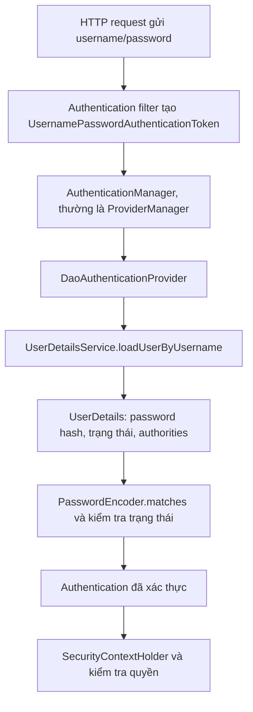
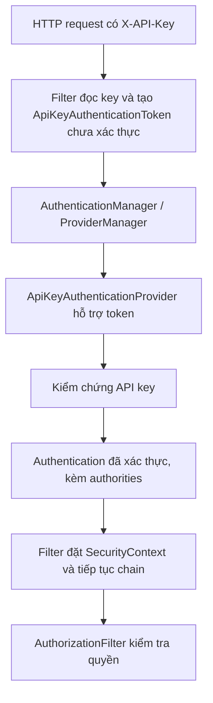

# Khi nào cần AuthenticationProvider thay vì chỉ thay UserDetailsService?

## 1. Quyết định cốt lõi

Trong Spring Security cho Servlet, **`UserDetailsService` có nhiệm vụ tải thông tin người dùng theo username**, còn **`AuthenticationProvider` có nhiệm vụ quyết định một yêu cầu xác thực có hợp lệ hay không**. Hai interface nằm ở hai tầng khác nhau:

- Nếu vẫn đăng nhập bằng **username + password** theo mô hình thông thường và chỉ thay nơi lưu người dùng (database, service nội bộ, cache, bảng có schema riêng), hãy ưu tiên **`UserDetailsService` + `PasswordEncoder` + `DaoAuthenticationProvider` có sẵn**.
- Nếu cần xử lý **loại thông tin xác thực khác** (API key, chữ ký một lần, chứng thực thiết bị, assertion đặc thù), hoặc **cách kiểm chứng credentials không thể diễn đạt bằng việc tải `UserDetails` rồi so khớp password hash**, mới cần một `AuthenticationProvider` phù hợp. Trước khi tự viết, kiểm tra Spring Security đã có provider/filter chuyên dụng cho LDAP, OAuth2, JWT, SAML, X.509… hay chưa.
- Nếu chỉ đổi giao diện đăng nhập (form thành JSON), thay endpoint hoặc thay nơi lưu session, điều đó **không tự động đòi hỏi** provider mới. Cần xem loại `Authentication` và logic kiểm chứng có thật sự thay đổi không.

Đây là bài **“khi nào cần”**, nên mục tiêu là phân biệt trách nhiệm, ra quyết định có căn cứ và triển khai đúng một ví dụ provider tùy chỉnh. Ví dụ chạy với **Java 17+, Spring Boot 3.x, Spring Security 6.x, Servlet/Spring MVC**. API tương ứng WebFlux/reactive có cách thiết kế riêng; không đưa `AuthenticationProvider` Servlet vào WebFlux như một cấu hình có thể sao chép nguyên xi.

## 2. UserDetailsService và AuthenticationProvider đứng ở đâu?

Với username/password thông thường:



Với API key tùy chỉnh:



Hai đường đi đều đi qua `AuthenticationManager` và trả về `Authentication` đã xác thực nếu hợp lệ. **Điểm khác là ai hiểu và kiểm chứng credentials.** Một `UserDetailsService` không được thiết kế để nhận raw password, HTTP header hay một custom authentication token: phương thức chủ yếu của nó là `loadUserByUsername(String username)`.

### So sánh chính xác

| Tiêu chí | `UserDetailsService` | `AuthenticationProvider` |
|---|---|---|
| Phương thức trung tâm | `loadUserByUsername(String)` | `authenticate(Authentication)` và `supports(Class<?>)` |
| Đầu vào | Username | `Authentication` chứa principal/credentials/details theo loại token |
| Công việc chính | Tải `UserDetails`: hash, trạng thái, roles/authorities | Xác minh credentials theo cơ chế mình hỗ trợ, tạo kết quả xác thực |
| Tự kiểm tra password theo mặc định? | **Không** | `DaoAuthenticationProvider` làm việc này với `PasswordEncoder` |
| Tự chọn HTTP header/đọc JSON? | Không | Cũng không nên; filter/controller chuyển request thành token trước |
| Khi thường cần viết mới | User ở DB, schema hoặc dịch vụ dữ liệu khác | Loại token mới, xác minh từ hệ thống bên ngoài, quy trình đặc thù |
| Có thay thế hoàn toàn cho nhau không? | Không | Một provider có thể **dùng** UserDetailsService ở bên trong |
| Có tự lưu `SecurityContext` không? | Không | Không; bộ phận gọi authenticate (filter/controller) quản lý context và persistence |

**`DaoAuthenticationProvider` đã là một `AuthenticationProvider`.** Khi bạn chỉ tự viết `UserDetailsService`, bạn vẫn đang dùng một provider; chỉ là không cần viết lại provider đó.

## 3. Trường hợp chỉ cần UserDetailsService

### 3.1. Đổi từ người dùng trong bộ nhớ sang database

Giả sử ứng dụng cũ có tài khoản in-memory, còn ứng dụng mới có bảng `accounts` chứa:

- `login`: tên đăng nhập.
- `password_hash`: hash đã tạo bằng BCrypt/Argon2 hoặc encoder phù hợp.
- `enabled`, `locked`: trạng thái tài khoản.
- Bảng hoặc quan hệ authorities/roles.

Quy trình vẫn là username/password. Thay đổi cần thiết là triển khai `loadUserByUsername` để chuyển record dữ liệu thành `UserDetails`. `DaoAuthenticationProvider` vẫn gọi `PasswordEncoder.matches(rawPassword, storedHash)` và thực thi các kiểm tra trạng thái phù hợp.

Ví dụ một đoạn cấu hình **độc lập ở mức bean** cho user demo; nó minh họa đúng những thông tin mà `UserDetailsService` cần cung cấp:

```java
@Configuration
class PasswordUserConfig {

    @Bean
    PasswordEncoder passwordEncoder() {
        return new BCryptPasswordEncoder();
    }

    @Bean
    UserDetailsService userDetailsService(PasswordEncoder encoder) {
        UserDetails alice = User.withUsername("alice")
            .password(encoder.encode("local-demo-password"))
            .roles("USER")
            .disabled(false)
            .accountLocked(false)
            .build();

        return new InMemoryUserDetailsManager(alice);
    }
}
```

Các import tương ứng từ `org.springframework.context.annotation.*`, `org.springframework.security.core.userdetails.*`, `org.springframework.security.crypto.password.*` và `org.springframework.security.provisioning.InMemoryUserDetailsManager`. Đoạn trên cần được đặt trong ứng dụng có các starter Spring Security; nó **không phải** một chương trình `javac` độc lập.

Nếu dữ liệu chuyển sang JPA/JDBC, chỉ việc thay thân `loadUserByUsername`, ví dụ **mã minh họa phụ thuộc entity/repository của ứng dụng**:

```java
@Override
public UserDetails loadUserByUsername(String username) {
    Account account = accountRepository.findByLogin(username)
        .orElseThrow(() ->
            new UsernameNotFoundException("Account not found"));

    return User.withUsername(account.getLogin())
        .password(account.getPasswordHash())
        .disabled(!account.isEnabled())
        .accountLocked(account.isLocked())
        .authorities(account.getAuthorities().toArray(String[]::new))
        .build();
}
```

`Account` và `accountRepository` trong đoạn thứ hai là **kiểu do ứng dụng của bạn định nghĩa**; đây là minh họa mapping, không phải một class có thể chạy riêng. Lưu ý:

1. `passwordHash` là giá trị đã hash; không dùng plaintext từ database và không tự mã hóa password mỗi lần tải user để “làm khớp”.
2. `authorities(...)` nhận các chuỗi authority thực tế, ví dụ `ROLE_USER`. `hasRole("USER")` mặc định đối chiếu `ROLE_USER`.
3. `disabled(...)`, `accountLocked(...)` là trạng thái account được provider xử lý; việc dữ liệu ở nhiều bảng **không** tạo lý do tự viết AuthenticationProvider.
4. Nếu migration algorithm password, ưu tiên cơ chế `PasswordEncoder`/`DelegatingPasswordEncoder` và password-upgrade support phù hợp thay vì dựng provider chỉ để gọi BCrypt bằng tay.

### 3.2. Những việc phức tạp nhưng vẫn có thể để DaoAuthenticationProvider xử lý

- Tìm user theo email thay username, nếu login vẫn truyền một định danh duy nhất: `loadUserByUsername` có thể tra theo email; tên method không buộc cột DB phải tên `username`.
- Load authorities từ nhiều bảng, kiểm tra trạng thái disabled/locked/expired có trong `UserDetails`.
- Đổi `PasswordEncoder` hoặc dùng delegating encoder để đọc nhiều định dạng hash.
- Kết hợp cache cho UserDetails, với chính sách invalidate/erase credentials được thiết kế rõ.
- Dùng Spring Security built-in để đăng nhập bằng password nhưng thay cách **nhận** dữ liệu (JSON POST/controller); controller có thể tạo `UsernamePasswordAuthenticationToken` và gọi manager đang sử dụng DaoAuthenticationProvider.

Điểm mấu chốt: **“Dữ liệu user phức tạp” khác với “quy tắc xác thực khác loại.”** Không nên mở rộng số lượng provider khi chỉ cần thay nguồn user.

## 4. Những tình huống thực sự cần AuthenticationProvider khác

### 4.1. Credentials không phải username/password

Ví dụ client gửi:

```http
GET /api/me HTTP/1.1
X-API-Key: <api-key>
```

Một `UserDetailsService` không nhận được raw API key, không biết giải mã/kiểm chứng/chống thu hồi key và không có ngữ nghĩa phù hợp để quyết định key đó đại diện cho service nào. Hãy để một filter tạo `ApiKeyAuthenticationToken` chưa xác thực; provider hỗ trợ token đó, kiểm tra key và trả principal với authorities hợp lệ.

Các loại credentials khác có thể là assertion nội bộ, token một lần, chữ ký request, xác thực từ thiết bị. Với OAuth2/OIDC, JWT, SAML, LDAP hoặc X.509, ưu tiên provider/framework sẵn có nếu đáp ứng giao thức; **không tự viết provider để tái triển khai một giao thức tiêu chuẩn**.

### 4.2. Mật khẩu được kiểm tra ở một hệ thống khác

Có hệ thống cũ chỉ cung cấp API `verify(username, password)`, không trả về password hash để Spring Security tự so khớp. Một `UserDetailsService` có thể tải user/profile, nhưng nó **không nhận password đầu vào** nên không tự giải quyết lời gọi verify. Provider phù hợp có thể:

1. Đọc username/password từ `UsernamePasswordAuthenticationToken`.
2. Gọi service kiểm chứng qua kênh an toàn, có timeout và chính sách lỗi.
3. Ánh xạ kết quả thành principal và authorities.
4. Trả `Authentication` đã xác thực hoặc ném `AuthenticationException` thích hợp.

Đó là một provider riêng cho **loại xác minh credentials**, dù token vẫn có thể là `UsernamePasswordAuthenticationToken`. Phải đặt provider vào đúng manager và phân định rõ khi có DaoAuthenticationProvider khác cùng `supports` để tránh fallback ngoài ý muốn.

Nếu dùng LDAP/Active Directory, Spring Security đã có phương án tích hợp phù hợp; đừng viết provider tùy chỉnh chỉ vì tài khoản nằm ở máy chủ LDAP.

### 4.3. Authentication cần thêm dữ liệu mà loadUserByUsername không nhận được

Ví dụ yêu cầu `tenantId + username + password`, mã xác nhận một lần, assertion từ phần cứng hoặc challenge chống phát lại. Với một thông tin đăng nhập có **semantics** mới, filter/controller phải đưa các giá trị cần kiểm chứng vào một `Authentication` phù hợp; provider thực hiện quyết định xác thực.

Đối với MFA, đừng trả một `Authentication` “đã xác thực hoàn toàn” ngay khi chỉ kiểm tra xong password nếu chính sách yêu cầu factor thứ hai. Có thể dùng cơ chế MFA của phiên bản framework được chọn hoặc thiết kế nhiều bước với trạng thái riêng, timeout, chống replay và chỉ cấp authorities cuối cùng sau khi hoàn tất các factor.

### 4.4. Khi cần không chỉ kiểm tra credentials, mà còn orchestration

Nếu bài toán là login success/failure response, JSON format, CSRF, session fixation, cookie, rate limit, hay lưu `SecurityContext`, **provider không phải nơi mặc định** để giải quyết tất cả. Trách nhiệm thường thuộc filter, entry point, success/failure handler, session strategy, authorization rules hoặc session repository.

Đừng đưa `HttpServletRequest` vào `UserDetailsService` qua `ThreadLocal` hoặc truy vấn `SecurityContextHolder` để lấy raw password. Những cách này lẫn tầng, khó test và có thể gây lỗi bảo mật.

## 5. ProviderManager lựa chọn provider ra sao?

`AuthenticationManager` là interface. `ProviderManager` là triển khai phổ biến, duyệt một danh sách `AuthenticationProvider`.

```java
public interface AuthenticationProvider {
    Authentication authenticate(Authentication authentication)
        throws AuthenticationException;

    boolean supports(Class<?> authentication);
}
```

Đây là **hình dạng rút gọn** của interface để đọc ý nghĩa; source thật có annotation và JavaDoc khác nhau theo phiên bản.

- `supports(MyToken.class) == true`: provider **có thể xem xét** loại token đó. Không có nghĩa mọi instance đều xác thực thành công.
- `authenticate(...)` trả `Authentication` đã xác thực: request thành công, kèm principal và authorities thích hợp.
- `authenticate(...)` trả `null`: provider không thể quyết định với instance hiện tại; manager có thể thử provider kế tiếp.
- `authenticate(...)` ném `AuthenticationException`: có lỗi xác thực. `ProviderManager` có quy tắc đặc biệt cho một số exception (ví dụ lỗi trạng thái tài khoản), và có thể tiếp tục xét provider khác trong những trường hợp khác. **Không dựa vào thứ tự provider hoặc exception tùy tiện để kiểm soát một fallback có nguy cơ bypass.**
- Không provider nào xử lý được: `ProviderNotFoundException`, thường thể hiện chưa gắn provider hỗ trợ loại token đó vào manager thực sự được sử dụng.
- `ProviderManager` thường xóa credentials khỏi authentication thành công nếu object hỗ trợ `CredentialsContainer`; không giữ password/API key trong principal hoặc authorities.

Ví dụ:

| Token được đưa vào manager | Provider hỗ trợ | Ý nghĩa |
|---|---|---|
| `UsernamePasswordAuthenticationToken` | `DaoAuthenticationProvider` | Tải UserDetails rồi kiểm tra password |
| `ApiKeyAuthenticationToken` | `ApiKeyAuthenticationProvider` | Kiểm tra API key theo chính sách riêng |
| `ApiKeyAuthenticationToken` | Chỉ có `DaoAuthenticationProvider` | Không provider hỗ trợ → lỗi `ProviderNotFoundException` |
| `UsernamePasswordAuthenticationToken` | Hai provider cùng hỗ trợ | Cần thiết kế thứ tự, điều kiện và fallback rõ ràng |

Một cấu hình có nhiều `SecurityFilterChain` có thể dùng manager khác nhau. Việc khai báo bean provider trong Spring context chưa chắc là bằng chứng rằng **filter nhận request đang dùng đúng manager đó**. Hãy nhìn đường đi thực tế: request → chain → filter → manager → provider.

## 6. Ví dụ đầy đủ: AuthenticationProvider xác thực API key

Bài thực hành này cố tình sử dụng **API key trong header tùy chỉnh** để thấy rõ lý do `UserDetailsService` không phù hợp. Đây là API cho client máy chủ gọi máy chủ, không dùng browser cookie, không cấp session. Key được xác minh **ở mỗi request**.

Các file thuộc package `com.example.authprovider`, sử dụng Spring Boot 3.x + Spring Security 6.x với Java 17+. Cần build đã cấu hình Spring Boot Gradle plugin hoặc Maven tương đương.

### 6.1. Dependencies và main class

Trong `build.gradle` của dự án Spring Boot có plugin và repositories:

```groovy
dependencies {
    implementation 'org.springframework.boot:spring-boot-starter-web'
    implementation 'org.springframework.boot:spring-boot-starter-security'

    testImplementation 'org.springframework.boot:spring-boot-starter-test'
    testImplementation 'org.springframework.security:spring-security-test'
}
```

File `src/main/java/com/example/authprovider/AuthProviderApplication.java`:

```java
package com.example.authprovider;

import org.springframework.boot.SpringApplication;
import org.springframework.boot.autoconfigure.SpringBootApplication;

@SpringBootApplication
public class AuthProviderApplication {
    public static void main(String[] args) {
        SpringApplication.run(AuthProviderApplication.class, args);
    }
}
```

### 6.2. Token riêng: trước và sau xác thực

File `src/main/java/com/example/authprovider/ApiKeyAuthenticationToken.java`:

```java
package com.example.authprovider;

import java.util.Collection;
import java.util.Collections;
import org.springframework.security.authentication.AbstractAuthenticationToken;
import org.springframework.security.core.GrantedAuthority;

public final class ApiKeyAuthenticationToken
        extends AbstractAuthenticationToken {

    private final Object principal;
    private String key;

    private ApiKeyAuthenticationToken(String rawKey) {
        super(Collections.emptyList());
        this.principal = null;
        this.key = rawKey;
        super.setAuthenticated(false);
    }

    private ApiKeyAuthenticationToken(
            String clientId,
            Collection<? extends GrantedAuthority> authorities) {
        super(authorities);
        this.principal = clientId;
        this.key = null;
        super.setAuthenticated(true);
    }

    public static ApiKeyAuthenticationToken unauthenticated(
            String rawKey) {
        return new ApiKeyAuthenticationToken(rawKey);
    }

    public static ApiKeyAuthenticationToken authenticated(
            String clientId,
            Collection<? extends GrantedAuthority> authorities) {
        return new ApiKeyAuthenticationToken(clientId, authorities);
    }

    @Override
    public Object getPrincipal() {
        return principal;
    }

    @Override
    public Object getCredentials() {
        return key;
    }

    @Override
    public void setAuthenticated(boolean trusted) {
        if (trusted) {
            throw new IllegalArgumentException(
                "Only the provider may create an authenticated token");
        }
        super.setAuthenticated(false);
    }

    @Override
    public void eraseCredentials() {
        super.eraseCredentials();
        key = null;
    }
}
```

Tại sao có hai factory method?

- `unauthenticated(rawKey)` dành cho dữ liệu client gửi, **không** có authorities và `isAuthenticated() == false`.
- `authenticated(clientId, authorities)` chỉ được gọi trong provider sau kiểm chứng thành công; credentials được đặt `null`, không chuyển API key thô sang controller.
- Override `setAuthenticated(true)` ngăn code ngoài provider biến một token chưa kiểm tra thành đáng tin bằng cách đổi cờ. Mẫu này không thay thế việc giữ factory/constructor trong phạm vi tin cậy và review toàn bộ luồng tạo token.

Token là **đầu vào/đầu ra** của authentication; nó không tự kiểm chứng API key, không đọc HTTP header và không cấp quyền truy cập một mình.

### 6.3. Provider: kiểm chứng key và tạo Authentication

File `src/main/java/com/example/authprovider/ApiKeyAuthenticationProvider.java`:

```java
package com.example.authprovider;

import java.nio.charset.StandardCharsets;
import java.security.MessageDigest;
import org.springframework.beans.factory.annotation.Value;
import org.springframework.security.authentication.AuthenticationProvider;
import org.springframework.security.authentication.BadCredentialsException;
import org.springframework.security.core.Authentication;
import org.springframework.security.core.authority.AuthorityUtils;
import org.springframework.stereotype.Component;

@Component
public final class ApiKeyAuthenticationProvider
        implements AuthenticationProvider {

    private final String expectedKey;

    public ApiKeyAuthenticationProvider(
            @Value("${demo.api.key:}") String expectedKey) {
        if (expectedKey == null || expectedKey.isBlank()) {
            throw new IllegalStateException(
                "Set demo.api.key (environment: DEMO_API_KEY)");
        }
        this.expectedKey = expectedKey;
    }

    @Override
    public Authentication authenticate(Authentication authentication) {
        if (!(authentication instanceof ApiKeyAuthenticationToken token)) {
            return null;
        }

        String candidate = (String) token.getCredentials();

        if (candidate == null || candidate.isBlank()
                || candidate.length() > 256) {
            throw new BadCredentialsException("Invalid API key");
        }

        boolean matches = MessageDigest.isEqual(
            candidate.getBytes(StandardCharsets.UTF_8),
            expectedKey.getBytes(StandardCharsets.UTF_8)
        );

        if (!matches) {
            throw new BadCredentialsException("Invalid API key");
        }

        return ApiKeyAuthenticationToken.authenticated(
            "partner-example",
            AuthorityUtils.createAuthorityList("ROLE_PARTNER")
        );
    }

    @Override
    public boolean supports(Class<?> authenticationType) {
        return ApiKeyAuthenticationToken.class
            .isAssignableFrom(authenticationType);
    }
}
```

**Điểm học tập quan trọng:**

- `supports(...)` nói với `ProviderManager` loại token mà provider hiểu. `DaoAuthenticationProvider` mặc định không thể kiểm tra `ApiKeyAuthenticationToken`.
- `authenticate(...)` kiểm tra key và trả về **principal `partner-example` có `ROLE_PARTNER`**. Chỉ provider được phép tạo kết quả “trusted”.
- Lỗi trả `BadCredentialsException` chung, tránh xác nhận key nào tồn tại/thuộc client nào.
- `@Value("`...`")` lấy cấu hình `demo.api.key`; trong Spring Boot, có thể cấu hình bằng biến môi trường `DEMO_API_KEY`. Constructor fail-fast nếu thiếu key, tránh vô tình triển khai với bí mật rỗng.
- `MessageDigest.isEqual` giúp so sánh mảng byte tránh so sánh chuỗi thông thường, nhưng ví dụ vẫn giữ **key gốc trong cấu hình** để dễ học. Production nên lưu **hash/HMAC phù hợp**, hỗ trợ key identifier, rotation, revoke, scope, expiry, rate limiting, audit và cơ chế chống lộ. Không coi đoạn demo là mô hình lưu API key production.
- `ROLE_PARTNER` là authority do provider cấp; `hasRole("PARTNER")` ở filter chain kiểm tra authority đó. Không lấy role từ client request hoặc header bên ngoài mà chưa kiểm chứng.

### 6.4. Filter: lấy header và gọi AuthenticationManager

File `src/main/java/com/example/authprovider/ApiKeyFilter.java`:

```java
package com.example.authprovider;

import java.io.IOException;
import jakarta.servlet.FilterChain;
import jakarta.servlet.ServletException;
import jakarta.servlet.http.HttpServletRequest;
import jakarta.servlet.http.HttpServletResponse;
import org.springframework.http.MediaType;
import org.springframework.security.authentication.AuthenticationManager;
import org.springframework.security.core.Authentication;
import org.springframework.security.core.AuthenticationException;
import org.springframework.security.core.context.SecurityContext;
import org.springframework.security.core.context.SecurityContextHolder;
import org.springframework.web.filter.OncePerRequestFilter;

public final class ApiKeyFilter extends OncePerRequestFilter {

    private final AuthenticationManager authenticationManager;

    public ApiKeyFilter(AuthenticationManager authenticationManager) {
        this.authenticationManager = authenticationManager;
    }

    @Override
    protected void doFilterInternal(
            HttpServletRequest request,
            HttpServletResponse response,
            FilterChain filterChain)
            throws ServletException, IOException {

        String rawKey = request.getHeader("X-API-Key");

        if (rawKey == null || rawKey.isBlank()) {
            filterChain.doFilter(request, response);
            return;
        }

        Authentication authenticated;
        try {
            authenticated = authenticationManager.authenticate(
                ApiKeyAuthenticationToken.unauthenticated(rawKey)
            );
        } catch (AuthenticationException ex) {
            SecurityContextHolder.clearContext();
            response.setStatus(HttpServletResponse.SC_UNAUTHORIZED);
            response.setContentType(MediaType.APPLICATION_JSON_VALUE);
            response.getWriter().write("{\"error\":\"unauthorized\"}");
            return;
        }

        SecurityContext context =
            SecurityContextHolder.createEmptyContext();
        context.setAuthentication(authenticated);
        SecurityContextHolder.setContext(context);

        try {
            filterChain.doFilter(request, response);
        } finally {
            SecurityContextHolder.clearContext();
        }
    }
}
```

Cách phân chia trách nhiệm rất rõ:

1. **Filter** biết HTTP, đọc `X-API-Key`.
2. Filter tạo token **chưa xác thực** và gọi `AuthenticationManager`.
3. **Provider** biết cách kiểm tra key, chọn principal và authorities.
4. Filter đặt kết quả vào `SecurityContextHolder` cho **request hiện tại**, rồi cho các filter tiếp theo xử lý.
5. Demo theo kiểu **stateless**: request kế tiếp phải gửi lại key; không gọi `SecurityContextRepository.saveContext(...)`, không cấp session. Khi muốn login session hoặc JSON login có cookie, phải thiết kế persistence riêng.

Filter tự xử lý `AuthenticationException` phát sinh **trước** `ExceptionTranslationFilter` trong chain; do đó không giả định exception tự biến thành JSON `401`. Khi thiếu key, filter tiếp tục và authorization/entry point quyết định `401` cho đường dẫn được bảo vệ.

Đoạn trên tạo filter bằng `new ApiKeyFilter(...)` trong chain, **không gắn `@Component` vào filter**. Nếu filter vừa là Servlet `Filter` bean auto-registered bởi Spring Boot vừa được `addFilter...` vào Spring Security, có thể bị gọi hai lần hoặc sai thứ tự.

### 6.5. Gắn đúng AuthenticationManager vào đúng SecurityFilterChain

File `src/main/java/com/example/authprovider/SecurityConfig.java`:

```java
package com.example.authprovider;

import org.springframework.context.annotation.Bean;
import org.springframework.context.annotation.Configuration;
import org.springframework.http.HttpStatus;
import org.springframework.security.authentication.AuthenticationManager;
import org.springframework.security.authentication.ProviderManager;
import org.springframework.security.config.annotation.web.builders.HttpSecurity;
import org.springframework.security.config.annotation.web.configuration.EnableWebSecurity;
import org.springframework.security.config.annotation.web.configurers.AbstractHttpConfigurer;
import org.springframework.security.config.http.SessionCreationPolicy;
import org.springframework.security.web.SecurityFilterChain;
import org.springframework.security.web.authentication.HttpStatusEntryPoint;
import org.springframework.security.web.authentication.logout.LogoutFilter;
import org.springframework.security.web.context.NullSecurityContextRepository;

@Configuration
@EnableWebSecurity
public class SecurityConfig {

    @Bean
    AuthenticationManager apiKeyAuthenticationManager(
            ApiKeyAuthenticationProvider provider) {
        return new ProviderManager(provider);
    }

    @Bean
    SecurityFilterChain securityFilterChain(
            HttpSecurity http,
            AuthenticationManager apiKeyAuthenticationManager)
            throws Exception {

        http
            .csrf(AbstractHttpConfigurer::disable)
            .sessionManagement(session -> session
                .sessionCreationPolicy(SessionCreationPolicy.STATELESS))
            .securityContext(context -> context
                .securityContextRepository(
                    new NullSecurityContextRepository()))
            .authorizeHttpRequests(auth -> auth
                .requestMatchers("/health").permitAll()
                .requestMatchers("/api/**").hasRole("PARTNER")
                .anyRequest().denyAll())
            .exceptionHandling(errors -> errors
                .authenticationEntryPoint(
                    new HttpStatusEntryPoint(HttpStatus.UNAUTHORIZED)))
            .httpBasic(AbstractHttpConfigurer::disable)
            .formLogin(AbstractHttpConfigurer::disable)
            .addFilterAfter(
                new ApiKeyFilter(apiKeyAuthenticationManager),
                LogoutFilter.class);

        return http.build();
    }
}
```

Giải thích cụ thể:

- `new ProviderManager(provider)` kết nối **đúng** `ApiKeyAuthenticationProvider` với `AuthenticationManager` mà filter sẽ gọi. Ví dụ chỉ có **một** loại authentication: API key. Nếu ứng dụng có username/password khác, cần tổ chức thêm manager/provider/chain đúng phạm vi, không vô tình thay thế cơ chế cũ.
- `addFilterAfter(..., LogoutFilter.class)` đưa custom authentication filter vào chain **trước giai đoạn authorization**, sau các bước xử lý cơ bản cần thiết. Với các hệ thống phức tạp, in danh sách Security Filters ở DEBUG và xác nhận thứ tự thực.
- `STATELESS` và `NullSecurityContextRepository` biểu đạt rõ rằng **không lưu đăng nhập bằng HttpSession**. Client API phải gửi key mỗi lần.
- `/api/**` yêu cầu `ROLE_PARTNER`. Không có credentials hợp lệ → `401`; đã có authentication hợp lệ nhưng thiếu role → `403`.
- `httpBasic` và `formLogin` được tắt vì demo **chỉ** nhận custom API key.
- `csrf.disable()` trong ví dụ có chủ đích vì API này dành cho client máy chủ dùng header bí mật mà browser không tự đính kèm như cookie session. **Đừng sao chép cấu hình này sang ứng dụng browser có session/cookie**; khi dùng xác thực tự gửi từ browser, cần CSRF protection phù hợp.

### 6.6. Controller để quan sát kết quả

File `src/main/java/com/example/authprovider/ExampleController.java`:

```java
package com.example.authprovider;

import java.util.Map;
import org.springframework.security.core.Authentication;
import org.springframework.web.bind.annotation.GetMapping;
import org.springframework.web.bind.annotation.RestController;

@RestController
public class ExampleController {

    @GetMapping("/health")
    public Map<String, String> health() {
        return Map.of("status", "up");
    }

    @GetMapping("/api/me")
    public Map<String, String> me(Authentication authentication) {
        return Map.of("client", authentication.getName());
    }
}
```

`authentication.getName()` dự kiến nhận `partner-example` từ token đã được provider tạo; controller không cần đọc lại key. Trên một endpoint thực tế, đừng gửi secret, access token hay nguyên `Authentication` ra JSON response.

### 6.7. Chạy demo và kiểm tra HTTP

Ứng dụng yêu cầu cấu hình `demo.api.key`. Ví dụ Bash:

```bash
export DEMO_API_KEY='local-demo-key'
./gradlew bootRun
```

Windows PowerShell:

```powershell
$env:DEMO_API_KEY = "local-demo-key"
.\gradlew.bat bootRun
```

Các lệnh chạy yêu cầu dự án Boot có build/plugin/wrapper đầy đủ; những file trên là mã ứng dụng Spring Boot, **không chạy độc lập bằng `javac` hoặc `java` mà không có dependencies**.

Ở terminal khác:

```bash
# Public, không có API key:
curl -i http://localhost:8080/health

# Protected, không có API key:
curl -i http://localhost:8080/api/me

# Sai key:
curl -i -H 'X-API-Key: wrong' http://localhost:8080/api/me

# Đúng key:
curl -i -H 'X-API-Key: local-demo-key' \
  http://localhost:8080/api/me
```

| Request | Status dự kiến | Body đáng chú ý |
|---|---|---|
| `GET /health`, không header | `200` | `{"status":"up"}` |
| `GET /api/me`, không header | `401` | Phụ thuộc entry point, demo không yêu cầu body |
| `GET /api/me`, key sai | `401` | `{"error":"unauthorized"}` |
| `GET /api/me`, key đúng | `200` | `{"client":"partner-example"}` |

Đây là kết quả dự kiến từ cấu hình ví dụ, không khẳng định thứ tự tất cả response headers hay error body do container sinh ra. API key mẫu chỉ dùng local; trong môi trường thật, command-line history, tracing, proxy logs và secret exposure phải được quản lý phù hợp.

## 7. Kiểm thử từ provider đến HTTP endpoint

Tạo `src/test/java/com/example/authprovider/ApiKeyAuthenticationTest.java`:

```java
package com.example.authprovider;

import org.junit.jupiter.api.Test;
import org.springframework.beans.factory.annotation.Autowired;
import org.springframework.boot.test.autoconfigure.web.servlet.AutoConfigureMockMvc;
import org.springframework.boot.test.context.SpringBootTest;
import org.springframework.http.HttpHeaders;
import org.springframework.test.web.servlet.MockMvc;
import org.springframework.security.authentication.UsernamePasswordAuthenticationToken;

import static org.junit.jupiter.api.Assertions.assertFalse;
import static org.junit.jupiter.api.Assertions.assertTrue;
import static org.springframework.test.web.servlet.request
    .MockMvcRequestBuilders.get;
import static org.springframework.test.web.servlet.result
    .MockMvcResultMatchers.jsonPath;
import static org.springframework.test.web.servlet.result
    .MockMvcResultMatchers.status;

@SpringBootTest(properties = "demo.api.key=local-test-key")
@AutoConfigureMockMvc
class ApiKeyAuthenticationTest {

    @Autowired
    MockMvc mvc;

    @Autowired
    ApiKeyAuthenticationProvider provider;

    @Test
    void providerSupportsOnlyItsTokenType() {
        assertTrue(provider.supports(ApiKeyAuthenticationToken.class));
        assertFalse(provider.supports(
            UsernamePasswordAuthenticationToken.class));
    }

    @Test
    void publicHealthDoesNotRequireKey() throws Exception {
        mvc.perform(get("/health"))
            .andExpect(status().isOk())
            .andExpect(jsonPath("$.status").value("up"));
    }

    @Test
    void missingKeyIsUnauthorized() throws Exception {
        mvc.perform(get("/api/me"))
            .andExpect(status().isUnauthorized());
    }

    @Test
    void incorrectKeyIsUnauthorized() throws Exception {
        mvc.perform(get("/api/me")
                .header("X-API-Key", "wrong"))
            .andExpect(status().isUnauthorized())
            .andExpect(jsonPath("$.error").value("unauthorized"));
    }

    @Test
    void validKeyProducesAuthenticatedPrincipal() throws Exception {
        mvc.perform(get("/api/me")
                .header("X-API-Key", "local-test-key"))
            .andExpect(status().isOk())
            .andExpect(jsonPath("$.client").value("partner-example"));
    }
}
```

Chạy `./gradlew test` (Windows: `.\gradlew.bat test`). `properties = "demo.api.key=local-test-key"` cho phép test chạy độc lập với biến môi trường ở máy developer. Các test xác nhận rằng một `AuthenticationProvider` hỗ trợ đúng token và filter tích hợp được với manager, context và authorization chain.

Với provider kiểm chứng từ dịch vụ bên ngoài, nên bổ sung test về timeout, service unavailable, revoked key, malformed credentials, privilege mapping, case-sensitive identity, retry policy và lỗi phân biệt `401`/`503` khi phù hợp. Không coi test MockMvc là phép kiểm chứng toàn bộ bảo mật production.

## 8. Quy tắc thiết kế và những lỗi hay gặp

### 8.1. Có provider nhưng không có filter đưa đúng token

`AuthenticationProvider` không tự “nghe” HTTP header. Nếu request chỉ qua `BasicAuthenticationFilter`, nó tạo `UsernamePasswordAuthenticationToken`, nên provider chỉ hỗ trợ `ApiKeyAuthenticationToken` sẽ **không được gọi**.

Cần cả hai: **filter/controller chuyển credentials thành token** và **provider/manager kiểm chứng token**. Lỗi điển hình:

```java
@Override
public boolean supports(Class<?> type) {
    return ApiKeyAuthenticationToken.class.isAssignableFrom(type);
}
```

Nhưng client lại dùng `Authorization: Basic ...` và không có filter tạo API key token → manager không nhận đúng token cần thiết. Hãy xác minh chính xác loại `Authentication` đi vào manager trước khi nghi ngờ logic trong provider.

### 8.2. Khai báo bean provider chưa chắc đủ

Các ứng dụng có nhiều `SecurityFilterChain`, manager local/global và bean auto-configuration. Có thể provider được Spring tạo nhưng filter đang gọi manager khác.

Trong một luồng tùy chỉnh, cách dễ hiểu là inject explicit `ProviderManager` hoặc cấu hình manager của chain rõ ràng như ví dụ. Tránh tự tạo provider/manager thứ hai trong controller không dùng chung với đường đi filter. Khi thêm provider cho username/password, kiểm tra nó có vô tình thay cơ chế password mặc định không.

### 8.3. Không lấy credential từ UserDetailsService

`loadUserByUsername(String)` có đúng **một tham số định danh**. Nếu phải kiểm tra OTP, API key, client certificate hoặc chữ ký của request, không cố lấy credentials bằng `SecurityContextHolder`, static/global variable, hoặc `HttpServletRequest` ẩn trong data-access layer. Thiết kế token và provider riêng hoặc dùng hỗ trợ chuẩn của Spring Security.

### 8.4. Không tự tin cậy dữ liệu do client tạo

Một provider thành công phải dựa trên kiểm chứng credentials thực tế, không chỉ thấy “header tồn tại”. Đặc biệt nguy hiểm:

```java
// SAI: raw data từ client không phải bằng chứng xác thực.
var trusted = UsernamePasswordAuthenticationToken.authenticated(
    incomingUsername, null, List.of(new SimpleGrantedAuthority("ROLE_ADMIN"))
);
```

Đây là mã **phản ví dụ**, không đặt vào ứng dụng. Không tạo token trusted từ client-controlled claims khi chưa xác minh chữ ký, issuer, audience, expiry, nonce/replay và chính sách yêu cầu tương ứng.

### 8.5. Trả kết quả/exception đúng contract

| Hành vi | Kết quả đúng |
|---|---|
| Token không thuộc loại provider hỗ trợ | `supports(...)` trả `false` |
| Provider hỗ trợ loại token nhưng không quyết định được instance cụ thể | `authenticate(...)` có thể trả `null` để manager thử provider khác |
| Key/password không hợp lệ | `BadCredentialsException` hoặc `AuthenticationException` cụ thể thích hợp |
| Tài khoản disabled/locked | Trả exception trạng thái phù hợp, giữ chính sách chống enumeration |
| Xác thực thành công | Trả `Authentication` đã xác thực kèm principal/authorities đáng tin |
| Không provider nào hỗ trợ token | `ProviderNotFoundException`; kiểm tra wiring và loại token |

Không trả `null` cho “password sai” một cách tùy tiện nếu manager còn provider khác có thể chấp nhận chính loại token đó: fallback có thể làm yếu chính sách bảo mật. Không nuốt exception để trả token có `isAuthenticated() == true` khi credentials chưa được kiểm chứng.

### 8.6. Đừng làm Authorization trong AuthenticationProvider

Provider có thể cấp authorities đã được nguồn danh tính chứng minh; còn rule “role nào được vào URL nào” thuộc tầng authorization như `authorizeHttpRequests`, `@PreAuthorize` hoặc `AuthorizationManager`. Tránh cứng hóa HTTP endpoint trong provider hoặc truyền request URI qua UserDetailsService để quyết định có được đăng nhập hay không.

### 8.7. SecurityContext và session không thuộc provider

Provider tạo kết quả xác thực. Filter hoặc controller đặt `Authentication` vào `SecurityContextHolder`. Khi thiết kế login session, bộ phận điều phối login phải xử lý `SessionAuthenticationStrategy` và `SecurityContextRepository.saveContext(...)` phù hợp. Khi thiết kế API key stateless, request tiếp theo cần gửi lại key; không tạo session chỉ để “lưu provider”.

**Đừng nhầm** provider trả kết quả thành công với việc “đăng nhập đã được lưu qua nhiều request”.

### 8.8. Phân biệt sự cố từ API

| Triệu chứng | Kiểm tra |
|---|---|
| `ProviderNotFoundException` | `supports(...)` có đúng loại token? Provider có trong manager đang được gọi? |
| Provider không bao giờ chạy | Filter tạo token gì? Filter đặt đúng thứ tự, có trong chain trúng URL? |
| Login password cũ ngừng hoạt động | Có thay toàn bộ manager bằng manager chỉ chứa API key provider không? |
| Key đúng nhưng `403` | Authorities trả về có `ROLE_PARTNER` và khớp rule `hasRole("PARTNER")` không? |
| Key sai nhưng request vẫn `200` | Có public matcher hoặc provider fallback vô tình cấp quyền không? |
| `401` luôn xuất hiện | Biến môi trường có được nạp? Filter gửi raw key? Provider so khớp đúng encoding? |
| Có `Authentication` trong filter nhưng controller không thấy | Context đã đặt trước `AuthorizationFilter` chưa? Có bị clear quá sớm? |
| Hai request khác nhau chia sẻ nhầm user | Không dùng biến static cho `SecurityContext`; holder phải được dọn đúng lifecycle |
| API key bị lộ trong log | Mask header, loại bỏ secret khỏi tracing, request dump và exception |
| Login JSON cần nhớ phiên nhưng mất ở request sau | Đó là bài toán saveContext/session, không phải chỉ thêm provider |

## 9. Cây quyết định áp dụng trong dự án

Hãy trả lời theo thứ tự:

1. **Credentials vẫn là username/password và server có password hash để đối chiếu?** Giữ `DaoAuthenticationProvider`; viết `UserDetailsService` để tải user và `PasswordEncoder` để kiểm tra hash.
2. **Chỉ đổi schema/DB/cache/tên cột/role?** Sửa tầng dữ liệu và mapping `UserDetails`; không viết provider mới.
3. **Cơ chế xác thực đã có triển khai chuẩn trong Spring Security?** Ưu tiên filter/provider của framework (LDAP, OAuth2 Resource Server JWT, SAML2, X.509, v.v.) thay vì tự xây giao thức.
4. **Có token hoặc quy tắc kiểm chứng credentials riêng?** Dùng hoặc viết `AuthenticationProvider` hỗ trợ token thích hợp; tạo filter/controller chuyển HTTP request thành token chưa xác thực.
5. **Có nhiều phương thức cùng hoạt động?** Thiết kế `ProviderManager`/`SecurityFilterChain` có phạm vi rõ ràng; kiểm tra `supports`, trường hợp `null`, thứ tự, fallback, entry point.
6. **Có yêu cầu nhớ đăng nhập qua request?** Chọn session/context persistence phù hợp; việc này độc lập với quyết định viết provider.

### Ghi nhớ

- **`UserDetailsService` trả lời “user này có dữ liệu gì?”; `AuthenticationProvider` trả lời “credentials này có đủ chứng minh danh tính không?”**
- `DaoAuthenticationProvider` chính là provider đã giải quyết sẵn bài toán username/password. Thay nguồn user không đồng nghĩa phải thay provider.
- Viết provider khi cần **cơ chế xác thực khác**, không phải khi chỉ cần đổi UI, JSON response, session, database hay URL.
- Provider nhận một `Authentication`; filter/controller có nhiệm vụ trích xuất HTTP credentials và tạo token chưa đáng tin.
- Test cả `supports(...)`, xác thực thành công/thất bại, authorities, manager wiring và một request qua filter chain thật.

**Tài liệu tham khảo chính thức:**

- [Spring Security — Servlet Authentication Architecture](https://docs.spring.io/spring-security/reference/6.5/servlet/authentication/architecture.html)
- [Spring Security — UserDetailsService](https://docs.spring.io/spring-security/reference/6.5/servlet/authentication/passwords/user-details-service.html)
- [Spring Security — DaoAuthenticationProvider](https://docs.spring.io/spring-security/reference/6.5/servlet/authentication/passwords/dao-authentication-provider.html)
- [Spring Security — Servlet Security Filters](https://docs.spring.io/spring-security/reference/6.5/servlet/architecture.html)
- [AuthenticationProvider API](https://docs.spring.io/spring-security/site/docs/6.5.6/api/org/springframework/security/authentication/AuthenticationProvider.html)
