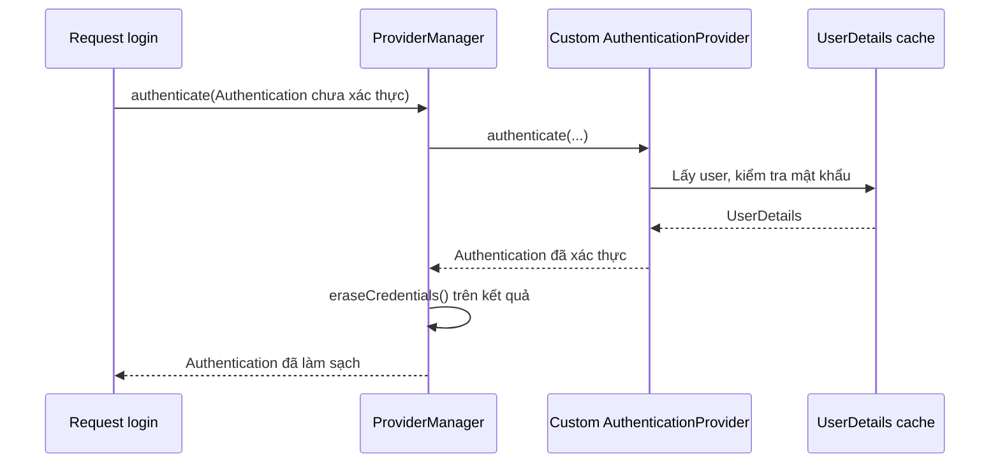
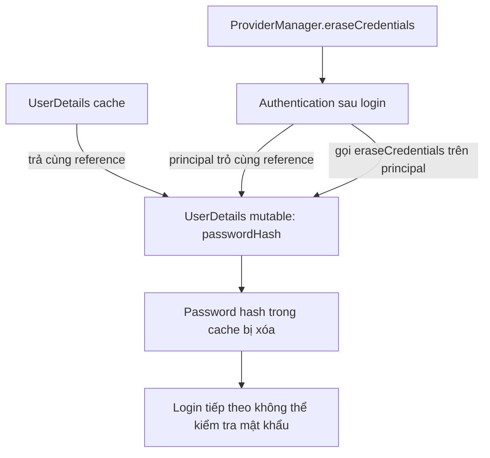

# Xóa dữ liệu bí mật và tránh lưu đối tượng có thể thay đổi dùng chung trong AuthenticationProvider

**Bối cảnh:** Spring Security, đặc biệt là `AuthenticationProvider` tùy chỉnh chạy dưới `ProviderManager`. Sau khi xác thực thành công, mật khẩu, OTP, API key hoặc bằng chứng đăng nhập khác không nên nằm lâu trong `Authentication`, `SecurityContext`, `HttpSession`, cache hoặc log. Đồng thời, `Authentication` thành công không được giữ tham chiếu đến đối tượng người dùng **có thể thay đổi dùng chung** giữa nhiều lần xác thực.

Bài học giải thích hai rủi ro thường xuất hiện cùng lúc: **giữ bí mật quá lâu** và **xóa bí mật nhầm trên một đối tượng được cache/tái sử dụng**.

## 1. Phân biệt ba loại dữ liệu trong luồng xác thực

Giả sử client đăng nhập bằng tên người dùng và mật khẩu:

```text
Request 1 (chưa xác thực)
    username = alice
    credentials = mật khẩu người dùng vừa nhập
             |
             v
AuthenticationProvider
    tải UserDetails từ UserDetailsService/cache
    so sánh mật khẩu nhập với mật khẩu đã mã hóa
             |
             v
Authentication đã xác thực
    principal = danh tính an toàn để sử dụng tiếp
    authorities = quyền đã xác minh
    credentials = null / không chứa bí mật
             |
             v
SecurityContext và có thể HttpSession
```

Cần tách bạch:

| Dữ liệu | Ý nghĩa | Có nên nằm trong `Authentication` thành công hoặc session? |
| --- | --- | --- |
| Mật khẩu vừa nhập, OTP, mã khôi phục | **Bí mật đầu vào** để chứng minh danh tính | **Không**: chỉ dùng khi xác thực, tránh giữ lại |
| Password hash trong `UserDetails` | Dữ liệu dùng để **đối chiếu** mật khẩu ở lần đăng nhập sau | Cần được bảo vệ trong kho/cache phù hợp; không trả vào principal/session |
| Username, user ID, quyền | Thông tin danh tính/ủy quyền đã được xác minh | Có thể lưu dưới dạng bản sao tối thiểu, an toàn, ổn định |
| Tham chiếu tới entity/cache object | Đối tượng có thể bị sửa bởi thao tác khác | Tránh giữ trực tiếp nếu đối tượng mutable và được dùng chung |

Password hash **không phải mật khẩu rõ**, nhưng vẫn là thông tin nhạy cảm; không nên lộ trong response/log. Việc `UserDetails.getPassword()` còn giữ **hash đã mã hóa** trong cache để các lần đăng nhập sau hoạt động là khác với việc lưu mật khẩu người dùng vừa gửi trong session.

Một `Authentication` sau login nên là “ảnh chụp” danh tính cần thiết cho request sau, không phải toàn bộ object tài khoản, entity JPA, request body hay bản ghi cache có password hash.

## 2. Cơ chế xóa credentials của Spring Security

Với `ProviderManager`, mặc định `eraseCredentialsAfterAuthentication` được bật. Khi một `AuthenticationProvider` trả về kết quả xác thực thành công, `ProviderManager` kiểm tra kết quả có triển khai `CredentialsContainer` hay không. Nếu có, nó gọi `eraseCredentials()` trước khi trả kết quả cho caller.

Các lớp phổ biến như `UsernamePasswordAuthenticationToken` và `User` của Spring Security có hỗ trợ xóa credentials. `UsernamePasswordAuthenticationToken.eraseCredentials()` xóa phần credentials của token; thông qua cơ chế của `AbstractAuthenticationToken`, nó còn gọi `eraseCredentials()` trên `principal`, `credentials` và `details` **nếu các object đó triển khai `CredentialsContainer`**.



Ví dụ tạo token thành công với principal an toàn:

```java
return UsernamePasswordAuthenticationToken.authenticated(
        safePrincipal, null, copiedAuthorities);
```

Ở đây `credentials` đã là `null` ngay khi provider trả kết quả. `ProviderManager` vẫn có thể thực hiện bước xóa mặc định mà không còn mật khẩu trong token.

**Giới hạn quan trọng:**

- Xóa credentials là **giảm thời gian giữ tham chiếu** đến dữ liệu nhạy cảm, không cam kết xóa vật lý mọi byte khỏi RAM. `String` bất biến, bản sao do thư viện tạo, log, heap dump hoặc buffer ở tầng khác có thể vẫn giữ dữ liệu.
- `ProviderManager` xử lý **kết quả trả về**. Nếu caller vẫn giữ token **đầu vào** hoặc DTO chứa mật khẩu, kết quả được xóa không tự động dọn sạch mọi bản sao đó.
- Nếu bạn gọi trực tiếp `provider.authenticate(...)` mà không qua `ProviderManager`, không được mặc nhiên cho rằng hook xóa mặc định của manager đã chạy.
- Một `Map` trong `details` chứa `"password"` không tự được quét/xóa đệ quy; việc nhét secret vào details/principal/custom fields là lỗi thiết kế.
- Không nên coi `Authentication#getCredentials() == null` là bằng chứng rằng **không có một tham chiếu bí mật khác** trong toàn bộ object graph.

Trong custom provider, phương án đáng tin cậy là **không đưa secrets vào kết quả thành công ngay từ đầu**, và dùng `CredentialsContainer` đúng cách khi tạo loại token tùy chỉnh có dữ liệu nhạy cảm cần hủy.

## 3. Lỗi nguy hiểm: principal trỏ trực tiếp vào UserDetails được cache

Giả sử `UserDetailsService` hoặc `UserCache` trả cùng một object cho nhiều lượt login. Code sau dễ viết nhưng không an toàn:

```java
// MINH HỌA CÁCH LÀM SAI: user có thể là object chung trong cache.
UserDetails cachedUser = users.loadUserByUsername(username);
if (!encoder.matches(rawPassword, cachedUser.getPassword())) {
    throw new BadCredentialsException("Invalid credentials");
}
return UsernamePasswordAuthenticationToken.authenticated(
        cachedUser, rawPassword, cachedUser.getAuthorities());
```

Những điều có thể xảy ra:

1. `Authentication` thành công chứa **rawPassword** và **tham chiếu trực tiếp** đến `cachedUser`.
2. `ProviderManager` gọi `eraseCredentials()` trên token kết quả.
3. Nếu `cachedUser` triển khai `CredentialsContainer`, bước đó cũng gọi `cachedUser.eraseCredentials()`. Với `User` của Spring Security, giá trị password trên **chính instance đó** có thể bị xóa.
4. Do token principal và cache trỏ **cùng một object**, cache vừa bị thay đổi; lần login kế tiếp lấy object đã mất hash, khiến password verification thất bại.
5. Dù không có cache, `Authentication` giữ nguyên entity hoặc `UserDetails` mutable cũng có thể làm lộ password hash hoặc chịu thay đổi roles/trạng thái ngoài dự kiến khi lưu lâu trong session.



Lỗi này thường chỉ lộ ra ở lần xác thực thứ hai, hoặc khi nhiều request đồng thời dùng chung principal. Các kiểm thử chỉ gọi login **một lần** có thể bỏ sót nó.

Không khắc phục bằng cách tắt xóa credentials một cách vội vàng. `ProviderManager#setEraseCredentialsAfterAuthentication(false)` tồn tại cho một số tình huống cần cân nhắc cache, nhưng bật lại việc giữ secrets trong kết quả xác thực là một đánh đổi bảo mật lớn. **Ưu tiên tách object trả về khỏi object được cache**.

## 4. Thiết kế đúng: xác thực bằng đối tượng nguồn, trả về bản chụp principal tối thiểu

Một custom provider nên làm bốn việc rõ ràng:

1. Nhận `Authentication` đầu vào với dữ liệu cần kiểm chứng.
2. Lấy dữ liệu xác minh từ `UserDetailsService`/kho người dùng; so khớp mật khẩu đã nhập với **encoded password** bằng `PasswordEncoder.matches(...)`, đồng thời kiểm tra trạng thái tài khoản.
3. Tạo **principal mới** chỉ chứa ID/username cần thiết; sao chép authority thành giá trị ổn định. Không đưa password, password hash, OTP, API key hay entity mutable vào principal.
4. Trả `Authentication` đã xác thực với `credentials == null`. Không lưu trạng thái của request trong field của provider.

Với Java 17, `record` là cách đơn giản tạo principal có field `final`. Nếu lưu collection, dùng `List.copyOf`, `Set.copyOf` hoặc tạo bản sao từng phần tử có thể thay đổi. Chỉ sao chép list container chưa đủ nếu bản thân từng item bên trong là mutable.

```java
import java.security.Principal;

record PrincipalSnapshot(String name) implements Principal {
    @Override
    public String getName() {
        return name;
    }
}
```

Đây là principal có một giá trị bất biến và `getName()` rõ ràng. `Authentication#getName()` sẽ trả `alice` thay vì tên class hoặc `toString()` của một DTO không triển khai `Principal`.

Sao chép authorities:

```java
List<SimpleGrantedAuthority> copiedAuthorities = user.getAuthorities()
        .stream()
        .map(a -> new SimpleGrantedAuthority(a.getAuthority()))
        .toList();
```

Mỗi `SimpleGrantedAuthority` giữ một tên quyền dạng `String`; `List#toList()` trên Java 17 tạo danh sách không sửa được. Không để một `List<GrantedAuthority>` có thể sửa từ cache được dùng chung cho nhiều token. Nếu quyền thay đổi, phải có chính sách làm mới/thu hồi `Authentication` đã tồn tại; bản chụp bất biến không có nghĩa quyền trong session tự cập nhật tức thì.

### Provider thường là singleton: không chứa state của từng lượt xác thực

Đoạn thiết kế sau **sai**, đặc biệt khi nhiều request đồng thời:

```java
// KHÔNG dùng trong ứng dụng:
final class LeakyProvider {
    private String lastPassword;
    private Authentication lastAuthentication;
    private UserDetails currentUser;
}
```

Một bean singleton có thể xử lý nhiều request trên những luồng khác nhau. Field như `currentUser` có thể bị thay bởi request B trong lúc request A đang xác thực; `lastPassword` giữ bí mật lâu và tăng nguy cơ rò rỉ; `lastAuthentication` có thể giữ principal/token của người khác. `volatile`, `synchronized` hay `ThreadLocal` không phải lời giải mặc định cho state đăng nhập; dùng biến cục bộ, object kết quả mới và dependency thread-safe.

## 5. Lab Java 17 có thể chạy: custom AuthenticationProvider không làm hỏng UserDetails cache

Lab này kiểm tra trực tiếp `ProviderManager` + custom provider, không cần khởi động web server. Nó chứng minh ba điều:

- Kết quả đã xác thực **không chứa credentials** và không trỏ vào `UserDetails` được cache.
- Cache vẫn giữ nguyên **encoded password** cần cho lần login sau.
- Login lần hai vẫn thành công; password sai bị từ chối và không tạo `Authentication` hợp lệ.

### 5.1. `pom.xml`

Dùng JDK 17+ và Maven. Mốc Spring Boot 3.3.9 quản lý phiên bản Spring Security 6 cho ví dụ này; đây là mốc tái lập API học tập, không phải khuyến nghị khóa phiên bản khi triển khai production.

```xml
<project xmlns="http://maven.apache.org/POM/4.0.0"
         xmlns:xsi="http://www.w3.org/2001/XMLSchema-instance"
         xsi:schemaLocation="http://maven.apache.org/POM/4.0.0 https://maven.apache.org/xsd/maven-4.0.0.xsd">
    <modelVersion>4.0.0</modelVersion>
    <parent>
        <groupId>org.springframework.boot</groupId>
        <artifactId>spring-boot-starter-parent</artifactId>
        <version>3.3.9</version>
        <relativePath/>
    </parent>
    <groupId>example</groupId>
    <artifactId>credential-isolation-demo</artifactId>
    <version>1.0.0</version>
    <properties>
        <java.version>17</java.version>
    </properties>
    <dependencies>
        <dependency>
            <groupId>org.springframework.security</groupId>
            <artifactId>spring-security-core</artifactId>
        </dependency>
        <dependency>
            <groupId>org.springframework.security</groupId>
            <artifactId>spring-security-crypto</artifactId>
        </dependency>
        <dependency>
            <groupId>org.springframework.boot</groupId>
            <artifactId>spring-boot-starter-test</artifactId>
            <scope>test</scope>
        </dependency>
    </dependencies>
</project>
```

Tạo file `src/test/java/example/CredentialIsolationTest.java`:

```java
package example;

import java.security.Principal;
import java.util.List;

import org.junit.jupiter.api.BeforeEach;
import org.junit.jupiter.api.Test;
import org.springframework.security.authentication.AuthenticationProvider;
import org.springframework.security.authentication.BadCredentialsException;
import org.springframework.security.authentication.ProviderManager;
import org.springframework.security.authentication.UsernamePasswordAuthenticationToken;
import org.springframework.security.core.Authentication;
import org.springframework.security.core.AuthenticationException;
import org.springframework.security.core.authority.SimpleGrantedAuthority;
import org.springframework.security.core.userdetails.User;
import org.springframework.security.core.userdetails.UserDetails;
import org.springframework.security.core.userdetails.UserDetailsService;
import org.springframework.security.core.userdetails.UsernameNotFoundException;
import org.springframework.security.crypto.factory.PasswordEncoderFactories;
import org.springframework.security.crypto.password.PasswordEncoder;

import static org.assertj.core.api.Assertions.assertThat;
import static org.assertj.core.api.Assertions.assertThatThrownBy;

class CredentialIsolationTest {
    private PasswordEncoder encoder;
    private UserDetails cachedUser;
    private ProviderManager manager;

    @BeforeEach
    void setUp() {
        encoder = PasswordEncoderFactories.createDelegatingPasswordEncoder();
        cachedUser = User.withUsername("alice")
                .password(encoder.encode("correct-password"))
                .roles("USER")
                .build();

        // Giả lập cache trả CÙNG instance UserDetails ở mọi lần truy cập.
        UserDetailsService users = username -> {
            if (!"alice".equals(username)) {
                throw new UsernameNotFoundException("Unknown username");
            }
            return cachedUser;
        };

        AuthenticationProvider provider = new SafeSnapshotProvider(users, encoder);
        manager = new ProviderManager(List.of(provider));
    }

    @Test
    void loginTwiceKeepsCacheIntactAndRemovesResultCredentials() {
        String passwordHashBefore = cachedUser.getPassword();

        UsernamePasswordAuthenticationToken requestOne =
                UsernamePasswordAuthenticationToken.unauthenticated(
                        "alice", "correct-password");

        Authentication first;
        try {
            first = manager.authenticate(requestOne);
        } finally {
            // Request input do caller tạo vẫn là object riêng cần thu dọn.
            requestOne.eraseCredentials();
        }

        assertThat(requestOne.getCredentials()).isNull();
        assertThat(first.isAuthenticated()).isTrue();
        assertThat(first.getCredentials()).isNull();
        assertThat(first.getName()).isEqualTo("alice");
        assertThat(first.getPrincipal()).isInstanceOf(PrincipalSnapshot.class);
        assertThat(first.getPrincipal()).isNotSameAs(cachedUser);
        assertThat(first.getAuthorities())
                .extracting(a -> a.getAuthority())
                .containsExactly("ROLE_USER");

        // Sau khi ProviderManager xóa result credentials,
        // UserDetails dùng chung vẫn giữ hash để login lần hai.
        assertThat(cachedUser.getPassword()).isEqualTo(passwordHashBefore);

        Authentication second = manager.authenticate(
                UsernamePasswordAuthenticationToken.unauthenticated(
                        "alice", "correct-password"));

        assertThat(second.isAuthenticated()).isTrue();
        assertThat(second.getCredentials()).isNull();
        assertThat(second.getName()).isEqualTo("alice");
        assertThat(second.getPrincipal()).isNotSameAs(first.getPrincipal());
        assertThat(cachedUser.getPassword()).isEqualTo(passwordHashBefore);
    }

    @Test
    void wrongPasswordDoesNotProduceAuthenticatedResult() {
        String passwordHashBefore = cachedUser.getPassword();

        assertThatThrownBy(() -> manager.authenticate(
                UsernamePasswordAuthenticationToken.unauthenticated(
                        "alice", "wrong-password")))
                .isInstanceOf(BadCredentialsException.class);

        assertThat(cachedUser.getPassword()).isEqualTo(passwordHashBefore);
    }

    private record PrincipalSnapshot(String name) implements Principal {
        @Override
        public String getName() {
            return name;
        }
    }

    private static final class SafeSnapshotProvider
            implements AuthenticationProvider {

        private final UserDetailsService users;
        private final PasswordEncoder encoder;

        SafeSnapshotProvider(UserDetailsService users, PasswordEncoder encoder) {
            this.users = users;
            this.encoder = encoder;
        }

        @Override
        public Authentication authenticate(Authentication request)
                throws AuthenticationException {
            if (!(request instanceof UsernamePasswordAuthenticationToken)) {
                return null;
            }

            Object raw = request.getCredentials();
            if (!(raw instanceof String password)
                    || request.getName() == null
                    || request.getName().isBlank()) {
                throw new BadCredentialsException("Invalid credentials");
            }

            UserDetails found;
            try {
                found = users.loadUserByUsername(request.getName());
            } catch (UsernameNotFoundException ex) {
                // Không tiết lộ username tồn tại hay không.
                throw new BadCredentialsException("Invalid credentials");
            }

            // Demo gom các lý do từ chối để tránh lộ trạng thái tài khoản.
            // Production vẫn cần audit phù hợp và account-state policy rõ ràng.
            if (!found.isEnabled()
                    || !found.isAccountNonLocked()
                    || !found.isAccountNonExpired()
                    || !found.isCredentialsNonExpired()) {
                throw new BadCredentialsException("Invalid credentials");
            }

            String encodedPassword = found.getPassword();
            if (encodedPassword == null
                    || !encoder.matches(password, encodedPassword)) {
                throw new BadCredentialsException("Invalid credentials");
            }

            // Không giữ tham chiếu đến found hoặc quyền mutable trong cache.
            List<SimpleGrantedAuthority> authorities = found.getAuthorities()
                    .stream()
                    .map(a -> new SimpleGrantedAuthority(a.getAuthority()))
                    .toList();

            PrincipalSnapshot principal =
                    new PrincipalSnapshot(found.getUsername());

            // Credentials được loại bỏ TRƯỚC KHI trả kết quả.
            return UsernamePasswordAuthenticationToken.authenticated(
                    principal, null, authorities);
        }

        @Override
        public boolean supports(Class<?> authenticationType) {
            return UsernamePasswordAuthenticationToken.class
                    .isAssignableFrom(authenticationType);
        }
    }
}
```

Chạy tại thư mục chứa `pom.xml`:

```bash
mvn test
```

Nếu dependencies được tải và test chạy đúng, kỳ vọng **2 test PASS** và Maven kết thúc với `BUILD SUCCESS`. Đây là **kết quả dự kiến của ví dụ**, không phải một bản ghi chạy thử trong bài học.

### 5.2. Đọc đúng ý nghĩa từng assert

- `first.getCredentials() == null`: token thành công không còn giữ mật khẩu.
- `first.getPrincipal() instanceof PrincipalSnapshot`: principal không phải object `UserDetails` chứa hash.
- `first.getPrincipal() != cachedUser`: không có **tham chiếu dùng chung** giữa token sẽ được giữ ở security context và object kho/cache.
- `cachedUser.getPassword()` giữ nguyên trước/sau cả hai lần login: bước xóa result không làm thay đổi cache.
- `second` vẫn authenticated: lần đăng nhập kế tiếp vẫn xác thực bằng hash hợp lệ.
- `second.getPrincipal() != first.getPrincipal()`: mỗi kết quả có object snapshot riêng.
- Password sai ném `BadCredentialsException`: không có đường fallback tạo token thành công.
- `requestOne.eraseCredentials()` trong `finally`: cho thấy đầu vào và đầu ra là **hai object riêng**; phần credentials đầu vào cần được xem xét vòng đời độc lập.

Bài test mô phỏng một `UserDetailsService` luôn trả **cùng một instance**, nên có chủ ý làm rõ nguy cơ shared reference. Không cần cache backend thực mới phát hiện được lỗi thiết kế này.

### 5.3. Giới hạn và mở rộng lab

`ProviderManager` trong test thực sự được gọi nên bước `eraseCredentialsAfterAuthentication` nằm trên đường chạy bình thường. Test chưa khởi tạo web `SecurityFilterChain`, `HttpSession`, Redis hoặc token issuer; vì vậy nó **chứng minh tính an toàn ở ranh giới provider/manager**, chưa chứng minh chính sách lưu session hay logout của một ứng dụng hoàn chỉnh.

Trong hệ thống thật, ngoài các test trên còn cần kiểm thử rằng `Authentication` được lưu trong `SecurityContextRepository`/session có `credentials == null`, không có trường bí mật trong principal/details và không tham chiếu tới entity/cache mutable. Dùng request tiếp theo để kiểm tra principal/authority vẫn đúng; cần chú ý chức năng cập nhật vai trò và vô hiệu hóa phiên hiện hữu.

## 6. Xóa bí mật của custom Authentication và custom principal

Nếu viết loại token riêng (ví dụ OTP hoặc mã xác nhận) và token đó thực sự giữ dữ liệu nhạy cảm, có thể triển khai `CredentialsContainer`. Một object minh họa tối giản:

```java
import java.util.Arrays;
import org.springframework.security.core.CredentialsContainer;

final class TemporaryOtp implements CredentialsContainer {
    private char[] code;

    TemporaryOtp(char[] suppliedCode) {
        this.code = suppliedCode.clone();
    }

    boolean hasCode() {
        return code != null;
    }

    @Override
    public void eraseCredentials() {
        if (code != null) {
            Arrays.fill(code, '\0');
            code = null;
        }
    }
}
```

Đây là **đoạn minh họa**, không phải một `AuthenticationProvider` hoàn chỉnh. `clone()` tránh chia sẻ cùng `char[]` với caller; `Arrays.fill(...)` dọn buffer mà class sở hữu. Caller vẫn phải xóa buffer gốc khi không dùng nữa. Lớp này có thể cần thêm cơ chế so khớp an toàn, kiểm soát số lần thử và thời hạn OTP nếu đưa vào ứng dụng thực.

`CredentialsContainer` giúp Spring Security gọi hook đúng lúc khi đối tượng nằm ở vị trí mà logic xóa credentials duyệt tới. Nó không bảo đảm mọi trường lồng sâu trong object bất kỳ sẽ tự bị quét. Nếu token đã xác thực chứa một đối tượng này trong `principal`, `details` hoặc `credentials`, `AbstractAuthenticationToken` có thể gọi hook; một custom `Authentication` tự viết phải đảm bảo hợp đồng xóa tương đương.

**Không áp dụng máy móc `char[]` cho mọi API:** `PasswordEncoder.matches` thường nhận `CharSequence`; trong nhiều ứng dụng JSON, mật khẩu đã được framework giải mã thành `String` trước khi tới provider. Xóa tham chiếu, không log, giới hạn vòng đời và tránh lưu secret vẫn là những kiểm soát cần thiết; không được hứa sẽ xóa sạch mọi byte `String` khỏi JVM heap.

## 7. Xử lý cache và đối tượng dùng chung đúng cách

### 7.1. Phân biệt “nguồn dữ liệu có thể được cache” và “principal an toàn để lưu”

Nguồn xác thực có thể chứa password hash, trạng thái khóa tài khoản, policy và quyền. `Authentication` kết quả nên chỉ giữ thông tin cần thiết sau khi đã kiểm chứng.

Các lựa chọn:

| Thiết kế | Ảnh hưởng tới xóa credentials | Đánh giá |
| --- | --- | --- |
| Trả trực tiếp `cachedUser` làm principal | Có nguy cơ `eraseCredentials()` làm thay đổi object được cache | Tránh |
| Trả copy của `UserDetails` trong result | Có thể xóa trên **bản sao** thay vì cache; vẫn có thể mang hash vào result một thời gian | Khá hơn, nhưng nên tối thiểu hóa principal |
| Trả `PrincipalSnapshot` riêng không có password/hash | Không tác động cache, không giữ secret trong principal | Phù hợp với provider có username/role |
| Trả JPA entity mutable làm principal | Có nguy cơ thay đổi ngoài ý muốn, lazy-loading và rò rỉ field | Tránh; tạo DTO/snapshot bảo mật |
| Tắt `eraseCredentialsAfterAuthentication` | Tránh xóa nhầm cache nhưng giữ secret lâu hơn trong result | Chỉ cân nhắc sau đánh giá bảo mật cụ thể |

Cần nhớ rằng một DTO `record` vẫn có thể giữ tham chiếu đến **`List`, `Map`, entity hoặc mảng mutable** nếu không sao chép đúng. `record` chỉ làm field reference thành `final`, không tự làm mọi object bên trong bất biến.

Ví dụ không đủ an toàn:

```java
record UnsafePrincipal(String name, List<String> roles) {}

// Nếu caller giữ rolesList mutable:
var view = new UnsafePrincipal("alice", rolesList);
// rolesList.add("ROLE_ADMIN") có thể thay đổi dữ liệu được view nhìn thấy.
```

Bản sửa:

```java
record SafePrincipal(String name, List<String> roles) {
    SafePrincipal {
        roles = List.copyOf(roles);
    }
}
```

Như vậy dữ liệu dạng `String` trong list được cố định theo bản chụp tại lúc tạo. Nếu list chứa class mutable, cần sao chép từng phần tử hoặc chuyển sang giá trị bất biến.

### 7.2. Cache `UserDetails` cần hash để xác minh các lần login tương lai

Đừng “làm sạch cache” bằng cách xóa hash mỗi lần user đăng nhập: như vậy những lần login sau không còn dữ liệu so sánh. Hãy làm sạch **kết quả xác thực và dữ liệu tạm**, đồng thời giữ password hash trong kho/cache được bảo vệ theo chính sách.

Nếu caching kết hợp với `DaoAuthenticationProvider`, xem tài liệu chính thức về `CachingUserDetailsService` và `UserCache` để hiểu ranh giới credential erasure. Một số cấu hình cache cần lựa chọn rõ giữa sao chép object và chính sách erasure; đừng sao chép lời khuyên “tắt erasure” sang provider custom mà không đánh giá việc secret tồn tại trong session.

### 7.3. Thread safety, invalidation và thay đổi quyền

`AuthenticationProvider` thường là dependency dùng chung. Hãy giữ các field ổn định, chẳng hạn `final UserDetailsService users` và `final PasswordEncoder encoder`. Dữ liệu riêng của lượt xác thực nên nằm trong biến cục bộ.

Khi quyền hoặc trạng thái khóa tài khoản thay đổi:

- Cache `UserDetails` phải có TTL/invalidation hoặc cơ chế kiểm tra trạng thái đủ mới.
- `Authentication` đã được tạo trước đó có thể chứa **ảnh chụp quyền cũ**; phải quyết định khi nào làm mới principal/authorities hoặc hủy session/token.
- Không nên chỉnh `GrantedAuthority` trong một list dùng chung với nhiều user/session để “đồng bộ”; nó có thể làm thay đổi quyền ngoài phạm vi.
- Nếu dùng nhiều instance ứng dụng, cần cơ chế invalidation/cache coherence thích hợp; bản chụp immutable không tự giải quyết tính nhất quán toàn hệ thống.

## 8. Kiểm thử tối thiểu cho một AuthenticationProvider tùy chỉnh

Các ca quan trọng hơn một test “mật khẩu đúng thì trả authenticated”:

| Ca kiểm thử | Điều kiện | Kỳ vọng |
| --- | --- | --- |
| Secret bị loại khỏi kết quả | Login thành công | `getCredentials() == null`; principal/details không chứa mật khẩu/OTP/token |
| Cô lập cache | Hai login đúng dùng cùng object `UserDetails` trong cache | Hai lần thành công; hash trong cache không đổi |
| Principal không chia sẻ | Hai authentication liên tiếp | Hai principal snapshot độc lập; không phải reference đến cache/entity |
| Password sai | Input không đúng | `BadCredentialsException`; không phát sinh result authenticated |
| Tài khoản khóa/tắt/hết hạn | `UserDetails` có trạng thái không hợp lệ | Từ chối theo policy; không leak bí mật qua message |
| Thứ tự provider | Nhiều `AuthenticationProvider` trong `ProviderManager` | Provider chỉ xử lý token nó hỗ trợ; không “nuốt” lỗi hoặc trả sai loại |
| Đồng thời | Nhiều luồng login các user khác nhau | Không rò user/credentials giữa requests; field provider không giữ state từng request |
| Auth sau login trong session | Lưu `SecurityContext` đã xác thực | Không có password/hash trong object graph được giữ; principal và quyền đúng |
| Session/token bị thu hồi hoặc quyền đổi | Chính sách thay đổi danh tính | Cơ chế invalidation/refresh hoạt động theo thiết kế |

Đối với test đồng thời, dùng nhiều username với password khác nhau và gọi provider/manager song song; kiểm tra mỗi response `principal.getName()` đúng user, không có secret được giữ và cache không bị thay đổi. Một `AtomicReference<Authentication>` hoặc field `currentUser` trong singleton provider không phải cách lưu “user hiện tại” đúng; user hiện tại thuộc `SecurityContext` **của request** hoặc mô hình token.

## 9. Lỗi phổ biến và phương án sửa

### Lỗi 1: Trả cả password hash qua principal

Một endpoint sau login vô tình serialize `Authentication.getPrincipal()` trực tiếp thành JSON có thể làm lộ fields. Cách an toàn: dùng một DTO response rõ ràng như `{"username":"alice"}` và principal tối thiểu; không trả toàn bộ `Authentication`, `UserDetails` hoặc JPA entity ra ngoài API.

### Lỗi 2: Cho rằng `ProviderManager` sẽ xóa mọi secret trong ứng dụng

Manager chỉ có thể làm sạch object theo những interface/hook được triển khai. Request DTO, body đã parse, bản sao `String`, details kiểu `Map`, log hoặc một token được lưu trước đó có vòng đời riêng. Hãy loại secret khỏi các lớp persistence/response/log, và không giữ tham chiếu quá thời gian cần thiết.

### Lỗi 3: Tắt erasure để xử lý cache bị xóa nhầm

Cách này có thể khiến mật khẩu rõ còn nằm trong kết quả, session hoặc heap lâu hơn. Kiểm tra object graph và dùng **bản sao principal không có secret** trước; chỉ cân nhắc tắt erasure nếu có lý do rất cụ thể, kiểm thử và kiểm soát thay thế.

### Lỗi 4: Tái sử dụng request Authentication sau khi xóa credentials

Token chưa xác thực dùng để gọi `authenticate(...)` là object cho **một lượt xác thực**. Sau khi đã xóa credentials, không nên lấy lại token đó để “thử login lần nữa”; hãy tạo request mới từ input mới, không phục hồi bí mật từ token cũ.

### Lỗi 5: Dùng collection có thể sửa bên trong `record`

`record Principal(String id, List<String> roles)` vẫn chứa `List` bên ngoài có thể sửa. Dùng defensive copy của collection và phần tử khi cần. Với quyền, tạo `SimpleGrantedAuthority` mới theo chuỗi authority đã được xác minh.

### Lỗi 6: Giữ dữ liệu từng request trong field của provider

Singleton provider có thể phục vụ đồng thời Alice và Bob. Field mutable như `password`, `currentPrincipal`, `lastToken` tạo rủi ro race condition, lẫn danh tính và leak dữ liệu. Dùng biến cục bộ, dependency thread-safe, và kết quả mới cho mỗi authentication.

### Lỗi 7: Ghi log toàn bộ Authentication hoặc exception kèm credentials

Log `request`, login DTO, full `Authentication` hay header `Authorization` có thể lộ password/OTP/token. Dùng thông điệp audit với user ID, thời điểm, kết quả và mã lỗi phù hợp; mask secrets, chú ý tracing/APM, không đưa credential vào URL/query string.

### Lỗi 8: Coi password hash và mật khẩu rõ như một

Password hash đã mã hóa cần tồn tại trong kho an toàn để kiểm chứng tương lai; mật khẩu rõ của request cần rời khỏi object result càng sớm càng tốt. Tuy nhiên password hash cũng nhạy cảm và không nên được đưa vào principal/session hoặc log.

### Lỗi 9: Tin rằng token/principal bất biến tự cập nhật quyền

Principal snapshot bất biến giúp tránh thay đổi ngoài ý muốn nhưng không tự động phản ánh lock/role mới sau khi session đã được tạo. Thêm cơ chế kiểm tra lại danh tính/phiên, invalidation hoặc thời hạn sống phù hợp với yêu cầu bảo mật.

## 10. Checklist áp dụng trong ứng dụng thật

- [ ] `AuthenticationProvider#supports` chỉ nhận đúng loại token mà provider xử lý.
- [ ] Provider kiểm chứng password bằng `PasswordEncoder`, kiểm tra trạng thái tài khoản và trả lỗi an toàn.
- [ ] Provider không lưu `rawPassword`, OTP, token hoặc user hiện tại vào field singleton.
- [ ] Kết quả authenticated có `credentials == null` và không giấu secret trong `principal`, `details` hay custom fields.
- [ ] Principal là snapshot độc lập, tối thiểu, không trỏ đến `UserDetails` cached hoặc entity mutable.
- [ ] Authorities là bản sao giá trị tin cậy, không chia sẻ list mutable.
- [ ] `ProviderManager` còn cơ chế xóa credentials mặc định, trừ khi có quyết định bảo mật khác được kiểm soát.
- [ ] Cache vẫn giữ password hash phù hợp; không bị `eraseCredentials()` thay đổi do chia sẻ reference.
- [ ] Có test **đăng nhập hai lần cùng cache**, password sai, concurrent logins và session lưu result sạch.
- [ ] Request input/DTO, log, tracing, exception và response không giữ hoặc hiển thị bí mật ngoài phạm vi cần thiết.
- [ ] Có chiến lược cache invalidation/role refresh/logout cho principal đã phát hành.
- [ ] Phân biệt “loại bỏ tham chiếu đến secret” với “bảo đảm xóa sạch vật lý mọi byte RAM”.

**Điểm cần nhớ:** Trong custom provider, **dùng** dữ liệu nhạy cảm để xác thực nhưng **không đưa** nó vào `Authentication` thành công. Đồng thời, không trả về cùng một `UserDetails` mutable mà cache đang dùng, vì chính bước xóa credentials hoặc một thay đổi concurrent có thể làm hỏng trạng thái chung. Tách rời **nguồn xác thực**, **credential tạm** và **principal snapshot** là cách thiết kế rõ ràng nhất.

## 11. Tài liệu chuẩn

- [Spring Security — Servlet Authentication Architecture](https://docs.spring.io/spring-security/reference/servlet/authentication/architecture.html): chuỗi `AuthenticationManager` → `AuthenticationProvider` → `ProviderManager` và xóa credentials.
- [Spring Security — CredentialsContainer](https://docs.spring.io/spring-security/reference/servlet/authentication/passwords/credentials-container.html): hợp đồng xóa credentials và vai trò của provider custom.
- [Spring Security — Caching UserDetails](https://docs.spring.io/spring-security/reference/servlet/authentication/passwords/caching.html): rủi ro cache khi credentials bị xóa.
- [Spring Security — UserDetails](https://docs.spring.io/spring-security/reference/servlet/authentication/passwords/user-details.html): thông tin người dùng phục vụ xác thực.
- [Spring Security — UsernamePasswordAuthenticationToken API](https://docs.spring.io/spring-security/site/docs/6.5.0/api/org/springframework/security/authentication/UsernamePasswordAuthenticationToken.html): token và `eraseCredentials()`.