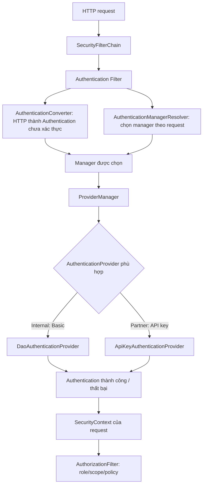

# Chọn AuthenticationManager theo từng request bằng AuthenticationManagerResolver

## 1. Vì sao ứng dụng cần chọn AuthenticationManager theo request?

Một ứng dụng Spring Security có thể nhận nhiều **cách xác thực** cùng lúc:

- `/api/internal/**`: ứng dụng nội bộ gửi `Authorization: Basic ...`, xác minh username/password bằng `DaoAuthenticationProvider`.
- `/api/partner/**`: hệ thống đối tác gửi `X-API-Key`, xác minh API key bằng provider riêng.
- Một resource server có thể nhận JWT từ nhiều issuer, hoặc JWT và opaque token từ các hệ thống cấp token khác nhau.

Điều quan trọng là **request nào phải được kiểm tra bởi cơ chế nào**. Nếu mọi provider nằm chung một manager mà không có ranh giới rõ ràng, một hình thức xác thực ngoài ý muốn có thể được thử ở khu vực chỉ định cho hình thức khác. `AuthenticationManagerResolver<C>` cho phép chọn **toàn bộ `AuthenticationManager`** dựa trên ngữ cảnh của request trước khi gọi `authenticate(...)`.

Trong Servlet stack, kiểu thường dùng là:

```java
AuthenticationManagerResolver<HttpServletRequest> resolver =
    request -> chooseManagerFor(request);
```

Đây là đoạn **minh họa**, không phải chương trình độc lập: `chooseManagerFor` là hàm bạn tự triển khai. Spring Security 6.x định nghĩa interface theo ý tưởng:

```java
@FunctionalInterface
public interface AuthenticationManagerResolver<C> {
    AuthenticationManager resolve(C context);
}
```

- `C` là loại ngữ cảnh được cung cấp lúc chọn manager. Với Servlet là `HttpServletRequest`.
- `resolve(request)` chọn một `AuthenticationManager` đã cấu hình để xử lý request.
- Manager được chọn thực hiện `authenticate(authentication)` trên token **chưa xác thực** được filter/converter tạo ra.
- Resolver **không** tự xác minh password, chữ ký hay API key; cũng **không** thay `AuthorizationManager` quyết định quyền truy cập.

Bài học dùng **Java 17+, Spring Boot 3.x với Spring Security 6.x ở Servlet/Spring MVC**. Với WebFlux/reactive, cơ chế tương ứng là `ReactiveAuthenticationManagerResolver<ServerWebExchange>` và `ReactiveAuthenticationManager`; không sao chép mã Servlet sang reactive.

### Kết quả học tập

Bạn sẽ biết cách:

1. Phân biệt resolver, manager, provider, filter/converter và authorization.
2. Chọn manager theo tuyến URL tin cậy, kiểm chứng credentials bằng đúng cơ chế.
3. Cấu hình **hai manager độc lập** và một filter gọi resolver ở mỗi request.
4. Không chấp nhận fallback âm thầm, tenant spoofing hoặc manager mặc định quá rộng.
5. Dùng `JwtIssuerAuthenticationManagerResolver` khi các bearer JWT đến từ nhiều issuer hợp lệ.
6. Kiểm thử đường đi đúng/sai của từng manager và phân biệt 401 với 403.

## 2. Vị trí của resolver trong chuỗi xác thực



Sơ đồ phân chia trách nhiệm, không khẳng định mọi app đều dùng cùng một filter. Ví dụ OAuth2 Resource Server thường dùng `BearerTokenAuthenticationFilter`, còn ví dụ hai cơ chế trong bài sẽ dùng một custom filter dành cho API.

| Thành phần | Đầu vào | Quyết định / đầu ra |
|---|---|---|
| `SecurityFilterChain` | HTTP request, `securityMatcher` | Chọn **bộ filter** áp dụng cho request |
| Authentication filter | HTTP request | Đọc credentials; tạo `Authentication` chưa xác thực |
| `AuthenticationConverter` | HTTP request | Chuyển Basic/header/bearer thành đúng loại authentication token |
| `AuthenticationManagerResolver<HttpServletRequest>` | HTTP request | Chọn **manager** cần gọi cho request |
| `AuthenticationManager` | `Authentication` chưa xác thực | Chỉ đạo kiểm tra và trả `Authentication` đã xác thực hoặc lỗi |
| `ProviderManager` | `Authentication` | Thử các `AuthenticationProvider` đã cấu hình trong manager |
| `AuthenticationProvider` | Loại token cụ thể | Kiểm tra credentials, xác lập principal/authorities |
| `SecurityContextHolder` | `Authentication` thành công | Lưu user/authorities cho xử lý request hiện tại |
| `AuthorizationManager` / `AuthorizationFilter` | User và tài nguyên yêu cầu | Cho phép hoặc từ chối truy cập |

**Một `ProviderManager` có thể chứa nhiều provider**, nhưng điều đó khác với **nhiều `ProviderManager` và resolver chọn một manager**:

- Một manager có `DaoAuthenticationProvider` và `JwtAuthenticationProvider` có thể xử lý nhiều token type, chủ yếu dựa vào `supports(...)`.
- Hai manager riêng có thể cô lập trust domain, tenant, đường kiểm chứng, nguồn khóa/issuer, cơ chế fallback và chính sách quản trị khác nhau.
- Resolver chọn manager từ **request context** trước khi manager kiểm tra token.
- Cả hai phương án có thể kết hợp: mỗi manager được chọn lại có nhiều provider của riêng mình.

### Hai bước phải nhất quán

Nếu resolver chọn manager chuyên kiểm tra API key, nhưng converter vẫn tạo `UsernamePasswordAuthenticationToken` từ Basic header, manager không hiểu token hoặc yêu cầu sẽ bị từ chối. Thiết kế đúng phải bảo đảm:

1. **Route → manager** đúng.
2. **Credential format → token type → provider** đúng với manager đã chọn.

Resolver không thể sửa sai sự không tương thích giữa token và provider.

## 3. Khi nào dùng AuthenticationManagerResolver?

### Tình huống phù hợp

1. **Multi-tenant authentication**: mỗi tenant có issuer/JWKS, nguồn user hoặc cấu hình xác thực riêng. Manager chọn theo tenant đã được kiểm chứng hoặc một phân vùng URL đáng tin cậy.
2. **Nhiều cách xác thực trong cùng ứng dụng**: khu vực A cần Basic, khu vực B cần API key; hoặc resource server chấp nhận JWT và opaque token theo điều kiện request đã xác định.
3. **Nguồn danh tính phân vùng**: request của khách hàng/đơn vị A phải đi qua manager A, của B qua manager B. Việc này tránh vô tình dò credential ở nguồn khác.
4. **Định tuyến xác thực động theo tài nguyên**: chọn chiến lược theo đường dẫn đã xác thực, mapping tenant do hệ thống quản lý hoặc issuer thuộc allowlist.

### Khi không cần

- Ứng dụng chỉ đăng nhập username/password và thay database: dùng `UserDetailsService`/`DaoAuthenticationProvider`.
- Mọi endpoint dùng một manager có vài provider hỗ trợ các token type khác nhau, không cần cách ly manager theo request: một `ProviderManager` có thể đủ.
- Chỉ cần quy định “admin được vào URL này”: đó là **authorization** (`authorizeHttpRequests`, `@PreAuthorize`), không phải việc của resolver.
- Chỉ có các vùng URL cần cấu hình filter khác nhau: cân nhắc **nhiều `SecurityFilterChain` với `securityMatcher` và `@Order`** trước. Nếu mỗi chain có đúng một cơ chế và manager cố định, tạo resolver chung có thể không cần thiết.
- Chỉ đổi JSON response, cookie, CSRF hoặc cách lưu `SecurityContext`: đó không phải lý do tạo resolver.

## 4. Chọn manager dựa vào tín hiệu nào là an toàn?

Các nguồn dữ liệu thường gặp:

| Nguồn chọn | Ví dụ | Rủi ro / điều kiện |
|---|---|---|
| URL path đã được router/Security matcher xử lý | `/api/internal/**` so với `/api/partner/**` | Đồng bộ cách so khớp URL giữa resolver, filter và authorization; tránh khác biệt do encode/normalize/rewrite |
| Tenant gắn với subdomain đã được hạ tầng xác thực | `a.api.example.org` | Không tin raw `Host` hoặc `X-Forwarded-Host` nếu proxy chưa xác minh |
| JWT issuer `iss` | Issuer A/B | Chỉ cho chọn **issuer đã tin cậy**; sau đó phải kiểm tra chữ ký, issuer, thời gian và audience |
| Header tenant do client gửi | `X-Tenant: acme` | Dữ liệu chưa đáng tin; cần xác thực hoặc ràng buộc tenant với claims/identity thực |
| Loại credential hoặc security scheme | Bearer JWT, opaque, API key | Không coi header tự khai là bằng chứng; provider được chọn phải kiểm tra cryptographically hoặc qua hệ thống có thẩm quyền |

**Nguyên tắc fail-closed:** request không khớp bất kỳ vùng hợp lệ nào **không** được chuyển sang một manager có quyền rộng, cũng không được trả authentication thành công mặc định. Nếu filter nhận request thiếu/sai credentials, quá trình xác thực hoặc authorization phải từ chối theo chính sách.

**Không dùng manager resolver như một “authorization bypass”:** sau khi manager xác thực xong, `hasRole`/`hasAuthority`/tenant scoping vẫn phải được kiểm tra. “Đăng nhập được bằng issuer A” không đồng nghĩa “được đọc dữ liệu tenant B”.

## 5. Ví dụ thực hành: một request, hai cơ chế, hai manager

Chúng ta xây một Spring Boot API có hai miền:

| URL | Credential | Manager | Provider | Authority cần |
|---|---|---|---|---|
| `GET /health` | Không cần | Không gọi | Không gọi | Public |
| `GET /api/internal/me` | `Authorization: Basic ...` | `internalManager` | `DaoAuthenticationProvider` | `ROLE_INTERNAL` |
| `GET /api/partner/me` | `X-API-Key: ...` | `partnerManager` | `ApiKeyAuthenticationProvider` | `ROLE_PARTNER` |

Bài demo thiết kế **stateless**: mỗi request API phải mang credential thích hợp, không tạo phiên đăng nhập bằng HTTP session. Các endpoint mẫu đều là GET. Ví dụ dành cho client máy chủ/công cụ CLI, không phải thiết kế đăng nhập browser tự gửi cookie/Basic credentials.

Mục tiêu của phần này là có một **ứng dụng tự chạy local** mà không cần Identity Provider bên ngoài. Hai manager có một provider riêng và **không có parent/fallback** sang manager kia. Đây là ví dụ đào tạo; quản lý API key production đòi hỏi các bước cứng hóa riêng.

### 5.1. Dependencies

Trong một dự án Spring Boot **3.5.x + Spring Security 6.5.x**, Java 17+ và Gradle plugin Spring Boot đã cấu hình, thêm:

```groovy
dependencies {
    implementation 'org.springframework.boot:spring-boot-starter-web'
    implementation 'org.springframework.boot:spring-boot-starter-security'

    testImplementation 'org.springframework.boot:spring-boot-starter-test'
    testImplementation 'org.springframework.security:spring-security-test'
}
```

Các file Java dưới đây cùng package `com.example.managerresolver`. Chúng là mã của một ứng dụng Spring Boot có build, không chạy riêng lẻ với `javac` khi chưa có Spring libraries.

### 5.2. Main class

File `src/main/java/com/example/managerresolver/ResolverDemoApplication.java`:

```java
package com.example.managerresolver;

import org.springframework.boot.SpringApplication;
import org.springframework.boot.autoconfigure.SpringBootApplication;

@SpringBootApplication
public class ResolverDemoApplication {
    public static void main(String[] args) {
        SpringApplication.run(ResolverDemoApplication.class, args);
    }
}
```

### 5.3. Tạo token dành riêng cho API key

File `src/main/java/com/example/managerresolver/ApiKeyAuthenticationToken.java`:

```java
package com.example.managerresolver;

import java.util.Collection;
import java.util.Collections;
import org.springframework.security.authentication.AbstractAuthenticationToken;
import org.springframework.security.core.GrantedAuthority;

public final class ApiKeyAuthenticationToken
        extends AbstractAuthenticationToken {

    private final Object principal;
    private String apiKey;

    private ApiKeyAuthenticationToken(String rawKey) {
        super(Collections.emptyList());
        this.principal = null;
        this.apiKey = rawKey;
        super.setAuthenticated(false);
    }

    private ApiKeyAuthenticationToken(
            String clientId,
            Collection<? extends GrantedAuthority> authorities) {
        super(authorities);
        this.principal = clientId;
        this.apiKey = null;
        super.setAuthenticated(true);
    }

    public static ApiKeyAuthenticationToken unauthenticated(
            String rawKey) {
        return new ApiKeyAuthenticationToken(rawKey);
    }

    public static ApiKeyAuthenticationToken authenticated(
            String clientId,
            Collection<? extends GrantedAuthority> authorities) {
        return new ApiKeyAuthenticationToken(clientId, authorities);
    }

    @Override
    public Object getPrincipal() {
        return principal;
    }

    @Override
    public Object getCredentials() {
        return apiKey;
    }

    @Override
    public void setAuthenticated(boolean authenticated) {
        if (authenticated) {
            throw new IllegalArgumentException(
                "Only the trusted provider creates authenticated tokens");
        }
        super.setAuthenticated(false);
    }

    @Override
    public void eraseCredentials() {
        super.eraseCredentials();
        this.apiKey = null;
    }
}
```

- `unauthenticated(rawKey)` giữ raw key mà request cung cấp, **chưa** có danh tính/authority và `isAuthenticated() == false`.
- `authenticated(clientId, authorities)` chỉ được provider gọi **sau kiểm tra thành công**; không giữ raw key.
- Chặn `setAuthenticated(true)` từ nơi khác giúp tránh biến dữ liệu tự khai từ client thành “đã xác thực”.
- Token chỉ là một **kiểu dữ liệu**. Nó chưa quyết định manager nào xử lý, chưa xác minh key và chưa ủy quyền truy cập URL.

### 5.4. Provider cho cơ chế API key

File `src/main/java/com/example/managerresolver/ApiKeyAuthenticationProvider.java`:

```java
package com.example.managerresolver;

import java.nio.charset.StandardCharsets;
import java.security.MessageDigest;
import java.security.NoSuchAlgorithmException;
import org.springframework.security.authentication.AuthenticationProvider;
import org.springframework.security.authentication.BadCredentialsException;
import org.springframework.security.core.Authentication;
import org.springframework.security.core.authority.AuthorityUtils;

public final class ApiKeyAuthenticationProvider
        implements AuthenticationProvider {

    private final byte[] expectedDigest;

    public ApiKeyAuthenticationProvider(String expectedKey) {
        if (expectedKey == null || expectedKey.isBlank()) {
            throw new IllegalStateException(
                "Set DEMO_PARTNER_KEY before starting the app");
        }
        this.expectedDigest = sha256(expectedKey);
    }

    @Override
    public Authentication authenticate(Authentication authentication) {
        if (!(authentication instanceof ApiKeyAuthenticationToken token)) {
            return null;
        }

        String candidate = (String) token.getCredentials();

        if (candidate == null || candidate.isBlank()
                || candidate.length() > 256
                || !MessageDigest.isEqual(
                    sha256(candidate), expectedDigest)) {
            throw new BadCredentialsException("Invalid API key");
        }

        return ApiKeyAuthenticationToken.authenticated(
            "partner-client",
            AuthorityUtils.createAuthorityList("ROLE_PARTNER")
        );
    }

    @Override
    public boolean supports(Class<?> tokenType) {
        return ApiKeyAuthenticationToken.class
            .isAssignableFrom(tokenType);
    }

    private static byte[] sha256(String value) {
        try {
            MessageDigest digest = MessageDigest.getInstance("SHA-256");
            return digest.digest(
                value.getBytes(StandardCharsets.UTF_8));
        } catch (NoSuchAlgorithmException ex) {
            throw new IllegalStateException("SHA-256 unavailable", ex);
        }
    }
}
```

**Vì sao có provider riêng?** Vì `DaoAuthenticationProvider` kiểm tra username/password với `UserDetailsService`; nó không biết ngữ nghĩa API key. `ApiKeyAuthenticationProvider` hỗ trợ đúng `ApiKeyAuthenticationToken`, kiểm tra key và cấp `ROLE_PARTNER` sau thành công.

`MessageDigest.isEqual` so sánh digest theo cách tránh so sánh chuỗi đơn giản, nhưng ví dụ chỉ thể hiện logic xác thực. Trong production, API key phải có entropy cao, lưu/đối chiếu bằng mô hình hash/HMAC phù hợp, phân biệt key ID, hỗ trợ revoke/rotation/expiry, rate limiting, audit và cấm ghi secret ra log. Chọn `SHA-256` trong ví dụ nhằm trình bày ý tưởng, không coi đó là quy trình lưu mọi loại secret production.

### 5.5. Filter: chuyển request thành token rồi hỏi resolver

File `src/main/java/com/example/managerresolver/ResolvedRequestAuthFilter.java`:

```java
package com.example.managerresolver;

import java.io.IOException;
import jakarta.servlet.FilterChain;
import jakarta.servlet.ServletException;
import jakarta.servlet.http.HttpServletRequest;
import jakarta.servlet.http.HttpServletResponse;
import org.springframework.http.MediaType;
import org.springframework.security.authentication.AuthenticationManager;
import org.springframework.security.authentication.AuthenticationManagerResolver;
import org.springframework.security.authentication.AuthenticationServiceException;
import org.springframework.security.core.Authentication;
import org.springframework.security.core.AuthenticationException;
import org.springframework.security.core.context.SecurityContext;
import org.springframework.security.core.context.SecurityContextHolder;
import org.springframework.security.web.authentication.www.BasicAuthenticationConverter;
import org.springframework.web.filter.OncePerRequestFilter;

public final class ResolvedRequestAuthFilter extends OncePerRequestFilter {

    private final AuthenticationManagerResolver<HttpServletRequest> resolver;
    private final BasicAuthenticationConverter basicConverter =
        new BasicAuthenticationConverter();

    public ResolvedRequestAuthFilter(
            AuthenticationManagerResolver<HttpServletRequest> resolver) {
        this.resolver = resolver;
    }

    // Chỉ dùng đường dẫn thuộc context của ứng dụng demo.
    static String applicationPath(HttpServletRequest request) {
        String uri = request.getRequestURI();
        String context = request.getContextPath();
        return uri.startsWith(context)
            ? uri.substring(context.length())
            : "";
    }

    static boolean isInternal(HttpServletRequest request) {
        return applicationPath(request).startsWith("/api/internal/");
    }

    static boolean isPartner(HttpServletRequest request) {
        return applicationPath(request).startsWith("/api/partner/");
    }

    @Override
    protected void doFilterInternal(
            HttpServletRequest request,
            HttpServletResponse response,
            FilterChain chain) throws ServletException, IOException {

        boolean internal = isInternal(request);
        boolean partner = isPartner(request);

        if (!internal && !partner) {
            chain.doFilter(request, response);
            return;
        }

        Authentication presented;
        try {
            if (internal) {
                // Có Basic header -> UsernamePasswordAuthenticationToken.
                presented = basicConverter.convert(request);
            } else {
                String key = request.getHeader("X-API-Key");
                presented = key == null || key.isBlank()
                    ? null : ApiKeyAuthenticationToken.unauthenticated(key);
            }
        } catch (AuthenticationException ex) {
            unauthorized(response);
            return;
        }

        // Không có credentials: AuthorizationFilter + entry point sẽ từ chối.
        if (presented == null) {
            chain.doFilter(request, response);
            return;
        }

        Authentication verified;
        try {
            AuthenticationManager manager = resolver.resolve(request);
            if (manager == null) {
                throw new AuthenticationServiceException(
                    "No authentication manager for request");
            }
            verified = manager.authenticate(presented);
            if (verified == null || !verified.isAuthenticated()) {
                throw new AuthenticationServiceException(
                    "Manager did not authenticate request");
            }
        } catch (AuthenticationException ex) {
            SecurityContextHolder.clearContext();
            unauthorized(response);
            return;
        }

        SecurityContext context =
            SecurityContextHolder.createEmptyContext();
        context.setAuthentication(verified);
        SecurityContextHolder.setContext(context);

        try {
            chain.doFilter(request, response);
        } finally {
            SecurityContextHolder.clearContext();
        }
    }

    private static void unauthorized(HttpServletResponse response)
            throws IOException {
        response.setStatus(HttpServletResponse.SC_UNAUTHORIZED);
        response.setContentType(MediaType.APPLICATION_JSON_VALUE);
        response.getWriter().write("{\"error\":\"unauthorized\"}");
    }
}
```

Giải thích theo đúng thứ tự thực thi:

1. Filter chỉ áp dụng cơ chế demo cho `/api/internal/**` hoặc `/api/partner/**`. Những request khác tiếp tục qua chain và vẫn chịu authorization.
2. Với nhánh internal, `BasicAuthenticationConverter` của Spring Security chuyển `Authorization: Basic ...` thành token username/password chưa xác thực. Header không đúng hoặc bị lỗi mã hóa không được coi là login thành công.
3. Với nhánh partner, filter đọc `X-API-Key` và tạo `ApiKeyAuthenticationToken` chưa xác thực.
4. **`resolver.resolve(request)` quyết định manager**, không dựa vào việc thử cả hai manager theo thứ tự.
5. Chỉ khi manager trả kết quả xác thực thành công, filter đặt `Authentication` vào một `SecurityContext` mới.
6. `AuthorizationFilter` tiếp tục xét `ROLE_INTERNAL` hoặc `ROLE_PARTNER`.
7. Bài demo không lưu context vào HTTP session; khi request kết thúc, context được dọn. Client phải gửi lại credentials cho request sau.

Đường dẫn tính từ `requestURI` đã bỏ `contextPath` phù hợp với demo chạy local dưới context root. Khi có reverse proxy, encoded path, URL rewriting hoặc context path phức tạp, hãy dùng cùng một chiến lược `RequestMatcher` đã kiểm tra/chuẩn hóa với filter chain và authorization, đồng thời test các biến thể đường dẫn. **Không** để ba lớp này hiểu URL theo ba cách khác nhau.

Filter bắt lỗi `AuthenticationException` ở khâu chuyển đổi/kiểm chứng và trả `401` chung. Thiếu credentials thì để `ExceptionTranslationFilter` và entry point xử lý. Không bắt `AuthenticationException` của toàn bộ downstream application rồi giả vờ đó luôn là credential sai.

### 5.6. Cấu hình hai AuthenticationManager và resolver

File `src/main/java/com/example/managerresolver/SecurityConfig.java`:

```java
package com.example.managerresolver;

import jakarta.servlet.http.HttpServletRequest;
import org.springframework.beans.factory.annotation.Qualifier;
import org.springframework.beans.factory.annotation.Value;
import org.springframework.context.annotation.Bean;
import org.springframework.context.annotation.Configuration;
import org.springframework.http.HttpStatus;
import org.springframework.security.authentication.AuthenticationManager;
import org.springframework.security.authentication.AuthenticationManagerResolver;
import org.springframework.security.authentication.AuthenticationServiceException;
import org.springframework.security.authentication.ProviderManager;
import org.springframework.security.authentication.dao.DaoAuthenticationProvider;
import org.springframework.security.config.annotation.web.builders.HttpSecurity;
import org.springframework.security.config.annotation.web.configuration.EnableWebSecurity;
import org.springframework.security.config.annotation.web.configurers.AbstractHttpConfigurer;
import org.springframework.security.config.http.SessionCreationPolicy;
import org.springframework.security.core.userdetails.User;
import org.springframework.security.core.userdetails.UserDetailsService;
import org.springframework.security.crypto.bcrypt.BCryptPasswordEncoder;
import org.springframework.security.crypto.password.PasswordEncoder;
import org.springframework.security.provisioning.InMemoryUserDetailsManager;
import org.springframework.security.web.SecurityFilterChain;
import org.springframework.security.web.authentication.AnonymousAuthenticationFilter;
import org.springframework.security.web.authentication.HttpStatusEntryPoint;
import org.springframework.security.web.context.NullSecurityContextRepository;

@Configuration
@EnableWebSecurity
public class SecurityConfig {

    @Bean
    PasswordEncoder passwordEncoder() {
        return new BCryptPasswordEncoder();
    }

    @Bean("internalManager")
    AuthenticationManager internalManager(PasswordEncoder encoder) {
        UserDetailsService users = new InMemoryUserDetailsManager(
            User.withUsername("alice")
                .password(encoder.encode("alice-secret"))
                .roles("INTERNAL")
                .build()
        );

        DaoAuthenticationProvider provider =
            new DaoAuthenticationProvider(users);
        provider.setPasswordEncoder(encoder);

        return new ProviderManager(provider);
    }

    @Bean("partnerManager")
    AuthenticationManager partnerManager(
            @Value("${DEMO_PARTNER_KEY:}") String key) {
        return new ProviderManager(
            new ApiKeyAuthenticationProvider(key));
    }

    @Bean
    AuthenticationManagerResolver<HttpServletRequest> requestManagerResolver(
            @Qualifier("internalManager") AuthenticationManager internal,
            @Qualifier("partnerManager") AuthenticationManager partner) {

        return request -> {
            if (ResolvedRequestAuthFilter.isInternal(request)) {
                return internal;
            }
            if (ResolvedRequestAuthFilter.isPartner(request)) {
                return partner;
            }
            throw new AuthenticationServiceException(
                "No manager for request route");
        };
    }

    @Bean
    SecurityFilterChain securityFilterChain(
            HttpSecurity http,
            AuthenticationManagerResolver<HttpServletRequest> resolver)
            throws Exception {

        http
            .authorizeHttpRequests(auth -> auth
                .requestMatchers("/health", "/error").permitAll()
                .requestMatchers("/api/internal/**").hasRole("INTERNAL")
                .requestMatchers("/api/partner/**").hasRole("PARTNER")
                .anyRequest().denyAll()
            )
            .sessionManagement(session -> session
                .sessionCreationPolicy(SessionCreationPolicy.STATELESS)
            )
            .securityContext(context -> context
                .securityContextRepository(
                    new NullSecurityContextRepository())
            )
            .exceptionHandling(errors -> errors
                .authenticationEntryPoint(
                    new HttpStatusEntryPoint(HttpStatus.UNAUTHORIZED))
            )
            .httpBasic(AbstractHttpConfigurer::disable)
            .formLogin(AbstractHttpConfigurer::disable)
            .csrf(AbstractHttpConfigurer::disable)
            .addFilterBefore(
                new ResolvedRequestAuthFilter(resolver),
                AnonymousAuthenticationFilter.class
            );

        return http.build();
    }
}
```

**Ba quyết định cấu hình tạo nên ví dụ:**

- `internalManager` là `ProviderManager` chứa **`DaoAuthenticationProvider`**. Credentials đến từ Basic và được so khớp với user local; thành công có `ROLE_INTERNAL`.
- `partnerManager` là `ProviderManager` chứa **`ApiKeyAuthenticationProvider`**. Credentials là API key, không dùng `UserDetailsService`; thành công có `ROLE_PARTNER`.
- `requestManagerResolver` chọn **một** trong hai manager theo request path. Không có manager mặc định cho route ngoài phạm vi; các route khác sẽ bị chính sách authorization tương ứng xử lý.

Các phần còn lại:

- `SecurityFilterChain` có thứ tự filter hợp lệ: custom filter chạy trước `AnonymousAuthenticationFilter` và `AuthorizationFilter`, sau cơ chế tạo/đọc security context cơ bản của Spring Security.
- `hasRole("INTERNAL")` đối chiếu `ROLE_INTERNAL`; `hasRole("PARTNER")` đối chiếu `ROLE_PARTNER`.
- `STATELESS` và `NullSecurityContextRepository` giúp ví dụ hoạt động theo request, không tạo session để giữ authentication.
- `httpBasic(...disable)` tắt **BasicAuthenticationFilter** mặc định để tránh một Basic manager toàn cục nhận request ngoài luồng resolver. Custom filter vẫn dùng **BasicAuthenticationConverter** để hiểu chuẩn header Basic.
- `formLogin(...disable)` tránh tạo login page và filter xử lý form không liên quan.
- `HttpStatusEntryPoint` trả `401` khi request chưa xác thực; cấu hình demo không tự gửi `WWW-Authenticate: Basic realm=...`. Nếu client HTTP Basic cần browser challenge, cấu hình entry point theo từng route để phát challenge đúng; đó là trách nhiệm HTTP response, không phải resolver.
- `csrf(...disable)` chỉ phù hợp ở đây vì demo dùng API headers do client máy chủ tự gửi, không dựa vào cookie/phiên trình duyệt tự đính kèm. Với web app browser sử dụng Basic hoặc cookie, phải phân tích CSRF và thường giữ bảo vệ phù hợp; `STATELESS` không tự loại bỏ CSRF.

**Hạn chế có chủ đích:** tài khoản Alice và password demo chỉ có trong memory; API key lấy từ biến môi trường; không có luồng cấp/đổi/revoke key. Những phần này không thuộc nhiệm vụ chọn manager.

### 5.7. Endpoint để quan sát principal đã xác thực

File `src/main/java/com/example/managerresolver/WhoAmIController.java`:

```java
package com.example.managerresolver;

import java.util.Map;
import org.springframework.security.core.Authentication;
import org.springframework.web.bind.annotation.GetMapping;
import org.springframework.web.bind.annotation.RestController;

@RestController
public class WhoAmIController {

    @GetMapping("/health")
    public Map<String, String> health() {
        return Map.of("status", "up");
    }

    @GetMapping("/api/internal/me")
    public Map<String, String> internal(Authentication authentication) {
        return Map.of(
            "kind", "internal",
            "subject", authentication.getName()
        );
    }

    @GetMapping("/api/partner/me")
    public Map<String, String> partner(Authentication authentication) {
        return Map.of(
            "kind", "partner",
            "subject", authentication.getName()
        );
    }
}
```

Controller chỉ nhận `Authentication` từ SecurityContext sau khi filter và manager đã xác thực; không tự nhìn vào HTTP header để tin username/partner. Điều này giúp phân biệt rõ **lựa chọn manager** với **business endpoint**.

### 5.8. Chạy thử

Trên Bash/Linux/macOS, đặt API key demo rồi chạy ứng dụng:

```bash
export DEMO_PARTNER_KEY='partner-local-key'
./gradlew bootRun
```

Trên PowerShell Windows:

```powershell
$env:DEMO_PARTNER_KEY = 'partner-local-key'
.\gradlew.bat bootRun
```

Ở terminal thứ hai, thử lần lượt:

```bash
# Public
curl -i http://localhost:8080/health

# Internal cần Basic
curl -i http://localhost:8080/api/internal/me
curl -i -u alice:alice-secret \
  http://localhost:8080/api/internal/me

# Partner cần API key
curl -i http://localhost:8080/api/partner/me
curl -i -H 'X-API-Key: partner-local-key' \
  http://localhost:8080/api/partner/me

# Gửi sai loại credential cho từng route
curl -i -H 'X-API-Key: partner-local-key' \
  http://localhost:8080/api/internal/me
curl -i -u alice:alice-secret \
  http://localhost:8080/api/partner/me

# Sai credentials
curl -i -u alice:wrong \
  http://localhost:8080/api/internal/me
curl -i -H 'X-API-Key: wrong' \
  http://localhost:8080/api/partner/me
```

| Lời gọi | HTTP status dự kiến | Bằng chứng cần quan sát |
|---|---|---|
| `GET /health` | `200` | JSON chứa `status=up` |
| Internal không có Basic | `401` | Chưa xác thực |
| Internal Basic đúng | `200` | JSON chứa `kind=internal` và `subject=alice` |
| Partner không có key | `401` | Chưa xác thực |
| Partner key đúng | `200` | JSON chứa `kind=partner` và `subject=partner-client` |
| Partner key gửi tới internal | `401` | Resolver/filter không đổi cơ chế để chấp nhận key |
| Internal Basic gửi tới partner | `401` | Basic không dùng để xác thực đối tác |
| Basic sai password hoặc API key sai | `401` | Không tạo Authentication đáng tin |

Đừng kiểm tra JSON bằng cách so khớp **thứ tự key**: `Map.of(...)` không đảm bảo thứ tự serialize. Khi viết test, kiểm tra từng trường qua JSONPath. Vì demo dùng GET và credentials gửi lại trên từng request, không có `Set-Cookie` bắt buộc cho việc đăng nhập.

**Lưu ý bảo mật:** HTTP Basic chỉ Base64-encode username/password; chạy ví dụ qua HTTP plain text chỉ chấp nhận trên máy local để học. Sản phẩm thật phải dùng HTTPS, không ghi raw `Authorization`/`X-API-Key` và cân nhắc không truyền secret thật qua command history.

## 6. Kiểm thử lựa chọn manager qua request thật

Thêm `src/test/java/com/example/managerresolver/AuthenticationManagerResolverTest.java`:

```java
package com.example.managerresolver;

import org.junit.jupiter.api.Test;
import org.springframework.beans.factory.annotation.Autowired;
import org.springframework.boot.test.autoconfigure.web.servlet.AutoConfigureMockMvc;
import org.springframework.boot.test.context.SpringBootTest;
import org.springframework.test.web.servlet.MockMvc;

import static org.springframework.security.test.web.servlet.request
    .SecurityMockMvcRequestPostProcessors.httpBasic;
import static org.springframework.test.web.servlet.request
    .MockMvcRequestBuilders.get;
import static org.springframework.test.web.servlet.result
    .MockMvcResultMatchers.jsonPath;
import static org.springframework.test.web.servlet.result
    .MockMvcResultMatchers.status;

@SpringBootTest(properties = "DEMO_PARTNER_KEY=test-partner-key")
@AutoConfigureMockMvc
class AuthenticationManagerResolverTest {

    @Autowired
    MockMvc mvc;

    @Test
    void internalRouteUsesPasswordManager() throws Exception {
        mvc.perform(get("/api/internal/me")
                .with(httpBasic("alice", "alice-secret")))
            .andExpect(status().isOk())
            .andExpect(jsonPath("$.subject").value("alice"))
            .andExpect(jsonPath("$.kind").value("internal"));
    }

    @Test
    void partnerRouteUsesApiKeyManager() throws Exception {
        mvc.perform(get("/api/partner/me")
                .header("X-API-Key", "test-partner-key"))
            .andExpect(status().isOk())
            .andExpect(jsonPath("$.subject").value("partner-client"))
            .andExpect(jsonPath("$.kind").value("partner"));
    }

    @Test
    void apiKeyCannotEnterInternalRoute() throws Exception {
        mvc.perform(get("/api/internal/me")
                .header("X-API-Key", "test-partner-key"))
            .andExpect(status().isUnauthorized());
    }

    @Test
    void basicCannotEnterPartnerRoute() throws Exception {
        mvc.perform(get("/api/partner/me")
                .with(httpBasic("alice", "alice-secret")))
            .andExpect(status().isUnauthorized());
    }

    @Test
    void invalidCredentialsAreRejected() throws Exception {
        mvc.perform(get("/api/internal/me")
                .with(httpBasic("alice", "wrong")))
            .andExpect(status().isUnauthorized());

        mvc.perform(get("/api/partner/me")
                .header("X-API-Key", "wrong"))
            .andExpect(status().isUnauthorized());
    }

    @Test
    void missingCredentialsAreRejected() throws Exception {
        mvc.perform(get("/api/internal/me"))
            .andExpect(status().isUnauthorized());

        mvc.perform(get("/api/partner/me"))
            .andExpect(status().isUnauthorized());
    }

    @Test
    void publicHealthDoesNotNeedCredentials() throws Exception {
        mvc.perform(get("/health"))
            .andExpect(status().isOk())
            .andExpect(jsonPath("$.status").value("up"));
    }
}
```

Chạy `./gradlew test` hoặc `.\gradlew.bat test` trên Windows. `spring-security-test` hỗ trợ `httpBasic(...)` để tạo header Basic trong MockMvc. Test quan trọng nhất với resolver **không chỉ** là “credential đúng trả 200”, mà là **credential đúng của cơ chế A không mở được tài nguyên dành cho cơ chế B**.

Cần bổ sung test khi đưa vào production:

- URL đặc biệt: trailing slash, encoded path, path traversal/canonicalization, nested servlet context, reverse proxy rewriting.
- Request có đồng thời hai loại credentials hoặc lặp header, header quá dài, key rỗng/malformed.
- Khi có nhiều `SecurityFilterChain`: chain nào trúng route, filter nào chạy, manager nào được chọn.
- User có nhiều authorities: `403` cho tài nguyên vượt quyền, dù xác thực thành công.
- Session/anonymous context: không rò danh tính sang request khác trong thread pool.
- Cấu hình fallback mặc định phải fail-closed; không “rơi về” một manager có trust domain rộng hơn.

## 7. Biến thể chuẩn của Spring Security: JWT từ nhiều issuer

Ví dụ vừa rồi tự tạo filter để nhìn thấy chỗ gọi `resolve(...)`. Nhưng với OAuth2 Resource Server, **Spring Security đã có `BearerTokenAuthenticationFilter` dùng `AuthenticationManagerResolver<HttpServletRequest>`**, nên thông thường không cần viết filter mới.

Một resource server có thể tin JWT từ hai hệ thống cấp token khác nhau. Mỗi issuer có khóa ký, metadata, issuer validation và có thể audience/scopes riêng. Nếu chọn theo `iss`, dùng `JwtIssuerAuthenticationManagerResolver` có sẵn.

### 7.1. Cấu hình dùng danh sách issuer tin cậy

Thêm starter (tương ứng ví dụ Spring Boot 3.x):

```groovy
dependencies {
    implementation 'org.springframework.boot:spring-boot-starter-web'
    implementation 'org.springframework.boot:spring-boot-starter-security'
    implementation 'org.springframework.boot:spring-boot-starter-oauth2-resource-server'
}
```

Ở một **ứng dụng resource server khác**, ví dụ `SecurityFilterChain` như sau (đây là **biến thể độc lập**, không thêm vào cùng SecurityConfig của API key demo):

```java
package com.example.jwtresolver;

import org.springframework.context.annotation.Bean;
import org.springframework.context.annotation.Configuration;
import org.springframework.security.config.annotation.web.builders.HttpSecurity;
import org.springframework.security.oauth2.server.resource.authentication
    .JwtIssuerAuthenticationManagerResolver;
import org.springframework.security.web.SecurityFilterChain;

@Configuration
public class JwtResourceServerConfig {

    @Bean
    SecurityFilterChain jwtApi(HttpSecurity http) throws Exception {
        var resolver = JwtIssuerAuthenticationManagerResolver
            .fromTrustedIssuers(
                "https://idp.example.org/tenant-a",
                "https://idp.example.org/tenant-b"
            );

        http
            .authorizeHttpRequests(auth -> auth
                .anyRequest().authenticated())
            .oauth2ResourceServer(oauth2 -> oauth2
                .authenticationManagerResolver(resolver));

        return http.build();
    }
}
```

Lưu ý Java: một `import` thông thường **phải nằm trên một dòng**, không tự ngắt ngay trước tên class. Hãy viết dòng import đầy đủ như sau khi dùng trong IDE:

```java
import org.springframework.security.oauth2.server.resource.authentication.JwtIssuerAuthenticationManagerResolver;
```

Các URI `https://idp.example.org/...` là **ví dụ giả lập**; muốn gọi thử thực sự phải thay bằng issuer của hệ thống danh tính đang hoạt động, có discovery/JWKS, đồng thời cung cấp JWT ký hợp lệ. Đoạn config có thể biên dịch khi dependency phù hợp nhưng không xác thực được token từ placeholder issuer.

Luồng thực tế:

1. Client gọi API với `Authorization: Bearer <jwt>`.
2. `BearerTokenAuthenticationFilter` trích xuất token và gửi `HttpServletRequest` cho resolver.
3. `JwtIssuerAuthenticationManagerResolver` đọc `iss` từ JWT để **lựa chọn** manager tương ứng **chỉ trong tập issuer được tin cậy**.
4. Manager/provider của issuer đó xác minh chữ ký với khóa thích hợp, expiry/`nbf`, issuer và các validators đã cấu hình.
5. Khi thành công, kết quả vào `SecurityContext`; authorization tiếp tục kiểm tra scopes/roles/tenant.

**Rất quan trọng:** `iss` lúc được đọc để chọn manager **chưa phải dữ liệu đã được chứng minh bằng chữ ký**. Resolver chỉ được cho phép chọn issuer từ **allowlist tin cậy**; sau đó `JwtDecoder` tương ứng phải xác minh JWT. Không làm:

```java
// NGUY HIỂM: tuyệt đối không tạo decoder cho issuer bất kỳ
// do client tự ghi mà chưa xác nhận issuer được phép.
String issuer = readUntrustedIssuer(request);
JwtDecoder decoder = JwtDecoders.fromIssuerLocation(issuer);
```

Đây là **phản ví dụ**, không phải phương án triển khai. Nó có thể khiến server truy vấn metadata/JWKS tại endpoint do attacker chỉ định và chấp nhận trust domain ngoài dự kiến. Nếu danh sách tenant thay đổi động, lấy issuer và config xác thực từ kho tenant đã được quản trị/phê duyệt, kiểm soát cache và cơ chế vô hiệu hóa, không nhận địa chỉ tùy ý từ client.

### 7.2. Kiểm chứng audience và ranh giới tenant

Chỉ chữ ký hợp lệ và `iss` đúng **chưa đủ** trong mọi hệ thống:

- `aud` phải chứa tài nguyên/API mà token được cấp cho, theo contract authorization server.
- `exp`, `nbf` và thuật toán chữ ký phải được kiểm tra.
- Scope/role được ánh xạ đúng; `SCOPE_read` khác với `ROLE_ADMIN`.
- Nếu hai tenant có route/dữ liệu riêng, token từ tenant A không được truy cập tenant B chỉ vì cả hai issuer nằm trong danh sách tin cậy. Cần đối chiếu tenant của request với issuer/claim đã được xác minh.
- Không lấy `kid`, `jku`, issuer hay host từ payload/header chưa kiểm chứng để tải arbitrary keys một cách không giới hạn.

Tùy cấu hình, `JwtIssuerAuthenticationManagerResolver` có thể cần phân tích JWT để lấy issuer trước, rồi decoder phân tích/kiểm chứng lại. Sự đánh đổi này được Spring Security ghi nhận; chỉ tối ưu ở cấp Nimbus/JWK selector khi có nhu cầu hiệu năng và hiểu đầy đủ cơ chế trust.

### 7.3. Chọn giữa JWT và opaque token theo từng request

Một ứng dụng có thể dùng `JwtAuthenticationProvider` cho một nhánh và `OpaqueTokenAuthenticationProvider` cho nhánh khác. Về nguyên tắc:

```java
AuthenticationManagerResolver<HttpServletRequest> resolver =
    request -> useJwtForTrustedRoute(request)
        ? jwtAuthenticationManager
        : opaqueTokenAuthenticationManager;
```

Đây là **đoạn minh họa**, vì `useJwtForTrustedRoute` và hai manager cần được định nghĩa thật. Sau khi xây các manager phù hợp, gắn vào DSL:

```java
http.oauth2ResourceServer(oauth2 ->
    oauth2.authenticationManagerResolver(resolver)
);
```

Điểm chính: cả JWT và opaque đều có thể dùng `Authorization: Bearer`, nên **chỉ nhìn thấy chữ “Bearer” không đủ để chọn cách kiểm tra**. Điều kiện chọn phải do kiến trúc tin cậy quyết định (ví dụ route/tenant đã xác minh), không đoán từ một token có thể bị giả mạo.

## 8. Cách phân biệt resolver, nhiều SecurityFilterChain và một ProviderManager

| Bài toán | Cơ chế thường phù hợp | Vì sao |
|---|---|---|
| Một username/password store, một login | `DaoAuthenticationProvider` + `UserDetailsService` | Chỉ một cách xác thực |
| Một API chấp nhận nhiều token type và chỉ khác `supports(...)` | Một `ProviderManager` với nhiều providers | Manager có thể phân loại token |
| Hai vùng URL cần filter/CSRF/session khác nhau | Nhiều `SecurityFilterChain` + `securityMatcher` | Cần tách **toàn bộ filter configuration** |
| Một filter cần chọn provider manager theo path/tenant | `AuthenticationManagerResolver<HttpServletRequest>` | Chọn manager trong cùng cơ chế filter |
| Resource server chấp nhận JWT nhiều issuer | `JwtIssuerAuthenticationManagerResolver` | Có sẵn logic issuer/trusted issuers |
| Một user đã xác thực cần policy truy cập khác nhau | `authorizeHttpRequests`/`AuthorizationManager` | Đây là authorization |
| Session login sau JSON POST cần nhớ user | `SecurityContextRepository.saveContext(...)` | Đây là persistence, không phải resolver |

Ví dụ ba cách thiết kế có thể đều đúng, tùy phạm vi:

- **Chain A + Chain B:** mỗi chain một manager tĩnh, matcher khác nhau, có thể khác CSRF/session/filter.
- **Một chain + resolver:** filter giống nhau nhưng manager thay đổi theo request (đặc biệt resource server).
- **Một chain + một manager nhiều provider:** provider chọn theo `supports(Authentication.class)` khi trust domain chung.

Đừng chọn công cụ chỉ vì có thể làm được. Hãy bắt đầu từ câu hỏi: *“Điều gì thay đổi theo request: bộ filter, manager, provider hay quy tắc quyền?”*

## 9. Lỗi thường gặp và cách chẩn đoán

### 9.1. Resolver chọn đúng manager nhưng token sai loại

Nếu filter tạo `UsernamePasswordAuthenticationToken`, manager chỉ có `ApiKeyAuthenticationProvider` sẽ không có provider phù hợp và có thể ném `ProviderNotFoundException`. Kiểm tra **class token lúc vào `authenticate(...)`** cùng `supports(...)` của từng provider.

### 9.2. Chỉ tạo bean resolver mà không gắn vào nơi xác thực

Bean `AuthenticationManagerResolver` **không tự thay manager của mọi filter**. Phải đưa nó vào filter hỗ trợ resolver, ví dụ:

- `BearerTokenAuthenticationFilter` qua `oauth2ResourceServer(...authenticationManagerResolver(...))`.
- `AuthenticationFilter` qua constructor nhận resolver và `AuthenticationConverter`.
- Custom filter như ví dụ, gọi `resolver.resolve(request)` rồi `authenticate(...)`.

Với `AuthenticationFilter`, lưu ý success/failure handlers và `SecurityContextRepository`: mặc định filter này **không tự lưu context qua session**. Đừng dùng nó để tạo login cookie kéo dài nếu chưa cấu hình persistence/session strategy phù hợp.

### 9.3. Header client tự khai được dùng như nguồn trust

`X-Tenant: admin` không chứng minh client thuộc tenant admin. `Host`/`X-Forwarded-Host` có thể bị làm giả nếu proxy không kiểm soát. Với JWT, claim `iss` chưa được verify khi resolver mới đọc nó. Chỉ định tuyến vào **nguồn xác thực đã allowlist**, rồi đối chiếu danh tính/tenant từ kết quả đã xác thực trước khi cấp quyền.

### 9.4. Rơi về manager “mặc định” quá mạnh

Resolver trả manager có mọi provider và mọi tenant nếu không tìm thấy match sẽ làm mất ý nghĩa phân vùng. Cần fail-closed cho route ngoài phạm vi, kiểm tra rõ default policy và giới hạn fallback của `ProviderManager` (kể cả parent manager nếu có).

### 9.5. Quên phân biệt authentication và authorization

Đăng nhập đúng bằng manager A nhưng không có quyền cần thiết → `403`. Không có credentials/sai credentials → thường `401`. Bộ kiểm tra endpoint `.hasRole(...)` không thuộc resolver, và việc chọn manager B không tự sinh `ROLE_B` trừ khi provider xác nhận và cấp authority đáng tin.

### 9.6. Lẫn thứ tự filter với thứ tự manager

Một filter đặt **sau** `AuthorizationFilter` có thể xác thực quá muộn. Một custom filter được đăng ký hai lần (vừa Servlet `Filter` bean của Spring Boot, vừa Spring Security chain) có thể gây xử lý lặp. Khi debug, xem log filter chain ở DEBUG, matcher nào trúng, token/converter nào chạy, manager nào được resolver trả về và provider nào đã xác thực.

### 9.7. Cố lưu đăng nhập bằng resolver

Resolver chọn nơi **kiểm tra credentials**, không có nhiệm vụ lưu session. API stateless gửi credential mỗi lần; session login cần `SecurityContextRepository`/`SessionAuthenticationStrategy` phù hợp. Spring Security 6 dùng explicit save đối với authentication thủ công.

### Bảng triệu chứng

| Triệu chứng | Nguyên nhân đáng kiểm tra |
|---|---|
| `ProviderNotFoundException` | Token type không được manager đã chọn hỗ trợ |
| Request A sử dụng nhầm manager B | Đường dẫn/matcher, proxy rewrite, resolver mapping |
| Token issuer lạ vẫn dẫn tới network lookup | Resolver tin issuer do client tự khai, thiếu allowlist |
| `401` dù credentials đúng | Manager sai, provider lỗi, key/issuer/audience, format header |
| `403` dù đã xác thực | Role/scope/tenant policy không đủ |
| Basic vẫn đăng nhập được vào route chỉ dành cho API key | Có filter Basic mặc định hoặc manager fallback ngoài dự kiến |
| App có nhiều chain nhưng resolver không chạy | Request khớp chain khác hoặc filter không dùng resolver |
| `SecurityContext` có user trong filter nhưng không còn ở request khác | Stateless/không lưu session; bình thường trong demo |
| Runtime lỗi khi route chưa từng gặp | Manager/JWT decoder khởi tạo lazy; cần test tất cả tenant/issuer cho phép |

## 10. Checklist triển khai an toàn

- [ ] Đã xác định rõ tín hiệu chọn manager và nguồn tin cậy của tín hiệu đó.
- [ ] Filter/converter tạo đúng token type cho từng cơ chế.
- [ ] `AuthenticationManagerResolver<HttpServletRequest>` chọn manager đã cấu hình, không tạo manager mới vô hạn từ input client.
- [ ] Mỗi manager có provider riêng với `supports(...)` phù hợp; kiểm tra chính sách parent/fallback.
- [ ] Không có đường dẫn mặc định chuyển sang cơ chế mạnh hơn hoặc một manager chấp nhận mọi tenant.
- [ ] Authorization kiểm tra role/scope và ràng buộc tenant **sau** xác thực.
- [ ] `SecurityFilterChain`, custom filter và resolver cùng hiểu request path sau proxy/normalization.
- [ ] Với JWT: allowlist issuer, verify signature/algorithm, issuer, time, audience, authorization.
- [ ] Với API key/Basic: HTTPS, masking logs, secret rotation, rate limit, chính sách CSRF đúng với loại client.
- [ ] Test các tổ hợp **đúng route + đúng credential**, **đúng credential + sai route**, thiếu/sai credential, khác role, đường dẫn đặc biệt và thiếu manager.
- [ ] Theo dõi telemetry an toàn: route category, manager identifier không nhạy cảm, kết quả và correlation ID; không ghi raw token/password/API key.

**Ghi nhớ:** `AuthenticationManagerResolver` trả lời **“Request này phải gửi tới AuthenticationManager nào?”**. `AuthenticationProvider` trả lời **“Credentials của token này có hợp lệ không?”**. `AuthorizationManager` trả lời **“Danh tính đã xác thực này có được thực hiện hành động đang yêu cầu không?”**

### Tài liệu chính thức

- [Spring Security 6.5 — Authentication Architecture](https://docs.spring.io/spring-security/reference/6.5/servlet/authentication/architecture.html)
- [Spring Security 6.5 — OAuth2 Resource Server Multi-tenancy](https://docs.spring.io/spring-security/reference/6.5/servlet/oauth2/resource-server/multitenancy.html)
- [Spring Security 6.5 — AuthenticationManagerResolver API](https://docs.spring.io/spring-security/reference/6.5/api/java/org/springframework/security/authentication/AuthenticationManagerResolver.html)
- [Spring Security 6.5 — JWT issuer AuthenticationManagerResolver API](https://docs.spring.io/spring-security/reference/6.5/api/java/org/springframework/security/oauth2/server/resource/authentication/JwtIssuerAuthenticationManagerResolver.html)
- [Spring Security 6.5 — Servlet Security Filters](https://docs.spring.io/spring-security/reference/6.5/servlet/architecture.html)
- [Spring Security 6.5 — Session & SecurityContext persistence](https://docs.spring.io/spring-security/reference/6.5/servlet/authentication/session-management.html)
