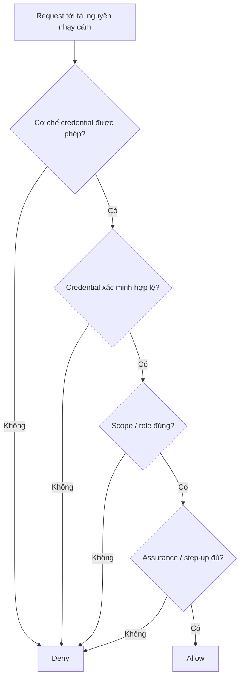

# Ngăn cơ chế yếu hơn trở thành đường thay thế bỏ qua chính sách

**Chủ đề cha: Nhiều cơ chế xác thực — Spring Security (Servlet).**

Trong một ứng dụng hỗ trợ HTTP Basic, form/session, Bearer JWT, API key và có thể cả MFA, việc **một cơ chế nào đó xác thực thành công** không có nghĩa request đã đáp ứng **mức bảo đảm** mà tài nguyên nhạy cảm yêu cầu. Bài học trình bày cách ngăn *authentication downgrade*: credential yếu hơn vô tình trở thành đường vòng để truy cập endpoint chỉ dành cho cơ chế mạnh hơn.

Sau bài học, người học cần có khả năng: viết ma trận chính sách theo tài nguyên; giải thích `FilterChainProxy`, `SecurityFilterChain`, `AuthenticationProvider`, `ProviderManager` và sự khác nhau giữa authentication/authorization/assurance; cấu hình tách vùng an toàn; viết negative tests để chứng minh Basic, cookie hoặc API key cũ không mở được endpoint Bearer/MFA.

## 1. Nguy cơ: đăng nhập đúng nhưng sai mức xác thực

Giả sử hệ thống có các luồng:

| Tài nguyên | Cơ chế được phép | Điều kiện bổ sung |
| --- | --- | --- |
| `GET /legacy/status` | HTTP Basic của tài khoản legacy | Chỉ đọc, role `LEGACY` |
| `GET /api/strong/report` | Bearer access token từ issuer tin cậy | Token hợp lệ, đúng audience, có scope `high.read` |
| `POST /admin/transfer` | Phiên quản trị đã hoàn tất MFA/step-up | Role admin, assurance và thời gian xác thực lại đáp ứng policy |

Tình huống lỗi: một tài khoản có role admin nhưng chỉ biết mật khẩu vẫn có thể vào `/admin/transfer`, vì server chỉ kiểm tra `hasRole("ADMIN")`. Một trường hợp khác: API mới dự kiến bắt buộc Bearer token nhưng vẫn bật HTTP Basic; Basic hợp lệ trở thành đường thay thế vào cùng endpoint.

```java
// PHẢN VÍ DỤ: một chain nhận cả Basic và JWT,
// trong khi endpoint cần JWT với chính sách cụ thể.
http.httpBasic(Customizer.withDefaults())
    .oauth2ResourceServer(oauth2 -> oauth2.jwt(Customizer.withDefaults()))
    .authorizeHttpRequests(auth -> auth
        .requestMatchers("/api/strong/**").authenticated());
```

Điều kiện `authenticated()` chỉ cho biết Spring Security đã có một `Authentication` hợp lệ. Nếu Basic filter tạo được `Authentication`, endpoint có thể được chấp nhận **mà không cần Bearer**. Đây là bypass của chính sách phân loại cơ chế xác thực, dù người dùng không nhập sai mật khẩu.

Cần phân biệt:

- **Danh tính (identity):** principal nào đã được xác minh?
- **Credential/cơ chế (mechanism):** danh tính được xác minh từ password, cookie session, API key hay token?
- **Quyền (authorization):** principal được phép làm gì, tại resource nào?
- **Mức bảo đảm (assurance):** quy trình xác thực có đạt yêu cầu như MFA, chống phishing, thời gian xác thực gần đây không?

Một JWT được ký đúng không **mặc nhiên** chứng minh đã dùng MFA. Ngược lại, một session có thể đạt assurance cao nếu server lưu và kiểm tra bước MFA đáng tin. Từ “mạnh/yếu” phải được định nghĩa bằng **policy và threat model** của ứng dụng, không chỉ bằng tên công nghệ.

## 2. Viết chính sách không thể bị diễn giải thành “credential nào cũng được”

Policy mẫu cho endpoint báo cáo:

> `GET /api/strong/report` chỉ chấp nhận Bearer access token được xác minh bởi resource server, đến từ issuer tin cậy, đúng audience và thời hạn, có authority `SCOPE_high.read`. Basic/cookie/API key không thay thế được. Bearer sai hoặc hết hạn phải bị từ chối, không được thử một credential yếu khác để tiếp tục.

Nếu API cần MFA, thêm điều kiện assurance do issuer hoặc server xác minh (chẳng hạn `acr`, `amr`, `auth_time` theo hợp đồng), thay vì kết luận “có scope thì đã có MFA”.

Một policy gồm **bốn cổng**:



Nếu resource chỉ đòi quyền Bearer đã xác minh mà không đòi MFA, cổng assurance có thể không áp dụng. Dù vậy vẫn phải **nêu rõ** quy định của từng endpoint. Một điều kiện `authenticated()` không thể thay cho toàn bộ policy.

### Ma trận cho các tài nguyên

| Request | `/legacy/status` | `/api/strong/report` | `/admin/transfer` |
| --- | --- | --- | --- |
| Anonymous | Deny | Deny | Deny |
| Basic hợp lệ cho legacy | Allow đọc | Deny | Deny |
| Cookie session chưa MFA | Không thay thế Basic | Deny (Bearer-only) | Deny |
| API key cũ | Deny nếu chưa được cho phép | Deny | Deny |
| Bearer hợp lệ nhưng thiếu `high.read` | Không thay thế Basic | Deny (`403` thường gặp) | Tùy policy riêng, không tự cho |
| Bearer hợp lệ, đủ `high.read` | Không thay thế Basic | Allow | Không tự chứng minh MFA |
| Session admin với MFA còn hiệu lực | Không tự thay Basic | Không thay Bearer | Allow nếu đủ quyền và các ràng buộc khác |

`401` thường chỉ thiếu hoặc sai authentication; `403` thường chỉ đã có authentication nhưng chưa đủ quyền. Entry point và handler có thể tùy biến, nên cần kiểm tra **kết quả policy, danh tính và phương thức thực sự sử dụng**, không chỉ status code.

## 3. Những đường vòng thường xuất hiện khi bật nhiều cơ chế

### 3.1. Cùng một chain chấp nhận Basic và Bearer

Với một chain chứa cả `httpBasic()` và `oauth2ResourceServer().jwt()`, mỗi filter có thể xác thực một dạng credential khác nhau. Nếu rule chỉ yêu cầu `authenticated()`, một credential Basic hợp lệ có thể đủ, dù thiết kế API muốn Bearer. **Sửa:** chain cho resource Bearer-only không bật Basic, form login hoặc cơ chế cookie khác, đồng thời kiểm tra scope cụ thể.

### 3.2. Bearer hỏng nhưng middleware tự fallback về session/API key

Ví dụ luồng sai:

```text
GET /api/strong/report
  Authorization: Bearer <invalid-or-expired>
  Cookie: JSESSIONID=<old-session>

  -> JWT validation fails
  -> custom code catches the error
  -> falls back to session
  -> user is treated as logged in
  -> request passes "authenticated()"
```

Với endpoint Bearer-only, đây là bypass. **Sửa:** Bearer không hợp lệ phải kết thúc bằng thất bại tương ứng. Không viết `catch (JwtException ...)` để “cứu” request bằng credential khác. Quy tắc cho duplicate/mixed `Authorization` headers cũng phải rõ ràng; không tùy tiện chọn credential dễ chấp nhận nhất.

### 3.3. `ProviderManager` thử nhiều AuthenticationProvider

`ProviderManager` thường lần lượt xét các provider có khả năng xử lý loại `Authentication` đầu vào. `supports(Class<?>)` chỉ báo provider **có thể xem xét** loại token đó; nó vẫn có thể trả `null` nếu không quyết định. Khi nhiều provider đều hỗ trợ cùng loại, provider sau có thể **xác thực thành công ngay cả khi provider trước ném `BadCredentialsException`**. Thành công sau cùng có thể thắng lỗi trước; một số exception về trạng thái tài khoản có quy tắc dừng đặc biệt.

Ví dụ thiết kế sai:

```text
Provider mạnh: xử lý UsernamePasswordAuthenticationToken,
  áp dụng policy mới và từ chối password cũ.
Provider legacy: cũng xử lý UsernamePasswordAuthenticationToken,
  chấp nhận chính password cũ.
ProviderManager: có thể dùng kết quả thành công từ provider legacy.
```

Đứng provider mạnh trước **chưa phải cơ chế fail closed**. Nên tách loại token hoặc `AuthenticationManager` theo kênh, chỉ kết nối provider được phép trong channel đó, và kiểm tra policy tại resource. Nếu có parent manager, phải kiểm soát loại credential nào được phép đi tiếp lên parent.

### 3.4. `SecurityFilterChain` match sai hoặc quá rộng

`FilterChainProxy` chỉ chọn **SecurityFilterChain đầu tiên khớp**; chain sau không “bổ sung” bảo vệ cho một request đã khớp. Nếu `@Order(1)` là chain Basic với `securityMatcher("/**")`, nó có thể bắt request dự kiến dành cho Bearer. Nếu **không có chain nào khớp**, request có thể đi qua mà không được Spring Security bảo vệ.

Khác biệt quan trọng:

```java
http.securityMatcher("/api/strong/**"); // Chọn những request thuộc CHAIN.
http.authorizeHttpRequests(auth -> auth
    .anyRequest().hasAuthority("SCOPE_high.read")); // Quy tắc BÊN TRONG chain.
```

`authorizeHttpRequests().requestMatchers(...)` không thay đổi phạm vi lựa chọn cả chain. Khi thiết kế nhiều chain, dùng matcher hẹp, thứ tự rõ, và một chain cuối cùng bảo vệ mọi route còn lại.

### 3.5. Role nghiệp vụ bị nhầm thành bằng chứng MFA

`ROLE_ADMIN` nói người dùng có vai trò quản trị; nó **không chứng minh** authentication hiện tại được nâng mức bằng MFA. Đăng nhập Basic/password có thể tạo principal giữ role admin. Nếu endpoint chỉ kiểm tra role, MFA bị bỏ qua.

Giải pháp: kiểm tra thêm assurance từ thành phần đáng tin, như session step-up state có thời hạn hoặc claims `acr`/`amr` do issuer xác thực phát hành. Nếu cần xác thực lại gần đây, kiểm tra `auth_time` hoặc timestamp phía server. Header `X-MFA: true` từ client hoặc claim token chưa xác minh không phải bằng chứng.

### 3.6. Endpoint alias/đường nghiệp vụ tương đương

Khóa `/api/strong/report` không đủ nếu `/legacy/export?type=report`, GraphQL resolver, API controller cũ hoặc endpoint nội bộ vẫn cho lấy cùng dữ liệu bằng Basic. Phải kiểm kê **hành động và dữ liệu**, không chỉ URI. Có thể bổ sung method security ở tầng service, nhưng nếu yêu cầu assurance thì lớp đó cũng phải đánh giá assurance phù hợp, không chỉ `hasRole`.

### 3.7. Issuer cấp token mạnh từ credential yếu

Có thể API đã kiểm tra `acr` hoàn hảo nhưng token exchange endpoint cho phép đổi API key cũ thành token có `acr`/scope mạnh. Khi đó lỗi nằm ở chỗ **phát hành credential**. Kiểm tra cả luồng lấy/đổi/refresh token: policy cấp quyền phải tương thích với yêu cầu của resource.

## 4. Thiết kế phòng vệ

1. **Xác định cơ chế được phép cho từng resource** bằng bảng policy; coi cơ chế còn lại là không được dùng thay thế.
2. **Tách filter chain theo vùng** khi có thể: Bearer-only, Basic legacy read-only, web session riêng, và một catch-all `denyAll`.
3. **Không bật cơ chế yếu trên chain mạnh**, dù có user/password giống nhau; tránh fallback khi credentials bị từ chối.
4. **Phân biệt role/scope với assurance**: `SCOPE_high.read` là quyền; MFA phải có bằng chứng riêng nếu được yêu cầu.
5. **Giới hạn cấp token**: API key cũ không mặc nhiên đổi được sang token quyền cao; issuer và audience được kiểm tra.
6. **Đảm bảo đúng CSRF boundary**: cookie/Basic có thể được browser tự gửi; chỉ tắt CSRF trong vùng thực sự dùng Bearer header do client chủ động gắn, không lẫn credential browser tự gửi.
7. **Thêm negative tests khi có route/provider/filter mới**, gồm request có credential yếu hợp lệ và request Bearer hỏng có cookie cũ.
8. **Audit an toàn**: ghi tên cơ chế được xác minh và nguyên nhân từ chối tổng quát, không ghi password/token.

## 5. Cấu hình Spring Security 6: Basic legacy và JWT Bearer không trộn

Ví dụ Java 17, Spring Boot 3 (Servlet) có hai vùng:

- `/legacy/**`: chỉ GET dùng Basic, user demo có role `LEGACY`.
- `/api/strong/**`: chỉ JWT Bearer hợp lệ với authority `SCOPE_high.read`.
- Các đường khác: từ chối mặc định.

Đây là bài lab **tách cơ chế**, chưa triển khai MFA. Nếu tài nguyên cần MFA, bổ sung authorization assurance như mục 7.

### 5.1. Maven và cấu trúc file

```text
no-downgrade-demo/
├── pom.xml
└── src/
    ├── main/java/example/NoDowngradeApplication.java
    └── test/java/example/NoDowngradeApplicationTests.java
```

`pom.xml`:

```xml
<project xmlns="http://maven.apache.org/POM/4.0.0"
         xmlns:xsi="http://www.w3.org/2001/XMLSchema-instance"
         xsi:schemaLocation="http://maven.apache.org/POM/4.0.0 https://maven.apache.org/xsd/maven-4.0.0.xsd">
    <modelVersion>4.0.0</modelVersion>
    <parent>
        <groupId>org.springframework.boot</groupId>
        <artifactId>spring-boot-starter-parent</artifactId>
        <version>3.3.9</version>
        <relativePath/>
    </parent>
    <groupId>example</groupId>
    <artifactId>no-downgrade-demo</artifactId>
    <version>1.0.0</version>
    <properties><java.version>17</java.version></properties>
    <dependencies>
        <dependency>
            <groupId>org.springframework.boot</groupId>
            <artifactId>spring-boot-starter-web</artifactId>
        </dependency>
        <dependency>
            <groupId>org.springframework.boot</groupId>
            <artifactId>spring-boot-starter-security</artifactId>
        </dependency>
        <dependency>
            <groupId>org.springframework.boot</groupId>
            <artifactId>spring-boot-starter-oauth2-resource-server</artifactId>
        </dependency>
        <dependency>
            <groupId>org.springframework.boot</groupId>
            <artifactId>spring-boot-starter-test</artifactId>
            <scope>test</scope>
        </dependency>
        <dependency>
            <groupId>org.springframework.security</groupId>
            <artifactId>spring-security-test</artifactId>
            <scope>test</scope>
        </dependency>
    </dependencies>
    <build>
        <plugins>
            <plugin>
                <groupId>org.springframework.boot</groupId>
                <artifactId>spring-boot-maven-plugin</artifactId>
            </plugin>
        </plugins>
    </build>
</project>
```

Phiên bản Spring Boot 3.3.9 là mốc học tập của Spring Security 6, không phải khuyến nghị khóa phiên bản production. Khi triển khai thật, chọn bản còn được hỗ trợ và cập nhật bản vá bảo mật.

### 5.2. `NoDowngradeApplication.java`

```java
package example;

import java.util.Map;

import org.springframework.boot.SpringApplication;
import org.springframework.boot.autoconfigure.SpringBootApplication;
import org.springframework.context.annotation.Bean;
import org.springframework.core.annotation.Order;
import org.springframework.http.HttpMethod;
import org.springframework.security.config.Customizer;
import org.springframework.security.config.annotation.web.builders.HttpSecurity;
import org.springframework.security.config.annotation.web.configurers.AbstractHttpConfigurer;
import org.springframework.security.config.http.SessionCreationPolicy;
import org.springframework.security.core.Authentication;
import org.springframework.security.core.userdetails.User;
import org.springframework.security.core.userdetails.UserDetailsService;
import org.springframework.security.crypto.factory.PasswordEncoderFactories;
import org.springframework.security.crypto.password.PasswordEncoder;
import org.springframework.security.provisioning.InMemoryUserDetailsManager;
import org.springframework.security.web.SecurityFilterChain;
import org.springframework.web.bind.annotation.GetMapping;
import org.springframework.web.bind.annotation.RestController;

@SpringBootApplication
public class NoDowngradeApplication {
    public static void main(String[] args) {
        SpringApplication.run(NoDowngradeApplication.class, args);
    }

    @Bean
    PasswordEncoder passwordEncoder() {
        return PasswordEncoderFactories.createDelegatingPasswordEncoder();
    }

    @Bean
    UserDetailsService users(PasswordEncoder encoder) {
        return new InMemoryUserDetailsManager(
                User.withUsername("legacy")
                        .password(encoder.encode("legacy-demo-password"))
                        .roles("LEGACY")
                        .build());
    }

    @Bean
    @Order(1)
    SecurityFilterChain strongApi(HttpSecurity http) throws Exception {
        return http
                .securityMatcher("/api/strong/**")
                .authorizeHttpRequests(auth -> auth
                        .anyRequest().hasAuthority("SCOPE_high.read"))
                .sessionManagement(sm -> sm.sessionCreationPolicy(
                        SessionCreationPolicy.STATELESS))
                .requestCache(AbstractHttpConfigurer::disable)
                .httpBasic(AbstractHttpConfigurer::disable)
                .formLogin(AbstractHttpConfigurer::disable)
                .csrf(AbstractHttpConfigurer::disable)
                .oauth2ResourceServer(oauth2 ->
                        oauth2.jwt(Customizer.withDefaults()))
                .build();
    }

    @Bean
    @Order(2)
    SecurityFilterChain legacyOnly(HttpSecurity http) throws Exception {
        return http
                .securityMatcher("/legacy/**")
                .authorizeHttpRequests(auth -> auth
                        .requestMatchers(HttpMethod.GET, "/legacy/**")
                            .hasRole("LEGACY")
                        .anyRequest().denyAll())
                .sessionManagement(sm -> sm.sessionCreationPolicy(
                        SessionCreationPolicy.STATELESS))
                .httpBasic(Customizer.withDefaults())
                .formLogin(AbstractHttpConfigurer::disable)
                .build();
    }

    @Bean
    @Order(3)
    SecurityFilterChain fallbackDeny(HttpSecurity http) throws Exception {
        return http
                .authorizeHttpRequests(auth -> auth.anyRequest().denyAll())
                .httpBasic(AbstractHttpConfigurer::disable)
                .formLogin(AbstractHttpConfigurer::disable)
                .build();
    }

    @RestController
    static class Endpoints {
        @GetMapping("/legacy/status")
        Map<String, String> legacyStatus(Authentication a) {
            return Map.of("name", a.getName(), "channel", "legacy");
        }

        @GetMapping("/api/strong/report")
        Map<String, String> strongReport(Authentication a) {
            return Map.of("name", a.getName(), "channel", "strong");
        }
    }
}
```

**Chứng minh bằng cách đọc cấu hình:**

- `@Order(1)` với `securityMatcher("/api/strong/**")` bắt đúng vùng Bearer trước. Chain này không có Basic/form, không lấy session làm nguồn danh tính; `authenticated()` cũng chưa đủ mà yêu cầu `SCOPE_high.read`.
- `@Order(2)` áp dụng riêng `/legacy/**`; HTTP Basic chỉ có thể dùng ở khu vực legacy và chỉ cho GET. Role `LEGACY` không mở endpoint trong chain 1.
- Chain cuối phủ mọi route khác và mặc định `denyAll()`. Nếu thêm một endpoint mà quên policy, nó không tự mở.
- `csrf.disable()` **chỉ dùng trong chain Bearer-only** với điều kiện không có cơ chế browser tự gửi credential ở vùng đó. Legacy Basic giữ CSRF protection mặc định cho các phương thức không an toàn; đồng thời chúng bị `denyAll`.
- `SessionCreationPolicy.STATELESS` không tự phát hành JWT và không bảo đảm MFA. Sự tách biệt thực sự đến từ matcher, filter được bật và authorization rule.
- Trong ví dụ, không có endpoint tạo access token. Bearer phải được phát hành bởi authorization server/issuer tin cậy; resource server chỉ xác minh.

**Cấu hình production cần thêm:** `JwtDecoder` thật, thường từ `spring.security.oauth2.resourceserver.jwt.issuer-uri` hoặc cấu hình JWK, với kiểm tra issuer, audience, expiry và chữ ký. Mã trên có thể compile cùng dependencies nhưng để khởi chạy dịch vụ JWT thực tế phải cấu hình issuer/decoder hợp lệ. Các bài test dưới cung cấp decoder **chỉ ở test scope**.

### 5.3. `NoDowngradeApplicationTests.java`: kiểm tra negative paths

```java
package example;

import java.time.Instant;

import org.junit.jupiter.api.Test;
import org.springframework.beans.factory.annotation.Autowired;
import org.springframework.boot.test.autoconfigure.web.servlet.AutoConfigureMockMvc;
import org.springframework.boot.test.context.SpringBootTest;
import org.springframework.boot.test.context.TestConfiguration;
import org.springframework.context.annotation.Bean;
import org.springframework.context.annotation.Import;
import org.springframework.context.annotation.Primary;
import org.springframework.http.HttpHeaders;
import org.springframework.security.oauth2.jwt.BadJwtException;
import org.springframework.security.oauth2.jwt.Jwt;
import org.springframework.security.oauth2.jwt.JwtDecoder;
import org.springframework.test.web.servlet.MockMvc;

import static org.springframework.security.test.web.servlet.request
        .SecurityMockMvcRequestPostProcessors.httpBasic;
import static org.springframework.test.web.servlet.request
        .MockMvcRequestBuilders.get;
import static org.springframework.test.web.servlet.request
        .MockMvcRequestBuilders.post;
import static org.springframework.test.web.servlet.result
        .MockMvcResultMatchers.jsonPath;
import static org.springframework.test.web.servlet.result
        .MockMvcResultMatchers.status;

@SpringBootTest
@AutoConfigureMockMvc
@Import(NoDowngradeApplicationTests.TestTokenDecoder.class)
class NoDowngradeApplicationTests {
    @Autowired
    MockMvc mvc;

    @TestConfiguration
    static class TestTokenDecoder {
        @Bean
        @Primary
        JwtDecoder jwtDecoder() {
            // CHỈ DÙNG CHO TEST, không xác minh chữ ký token.
            return token -> {
                if (!token.equals("test-high") && !token.equals("test-low")) {
                    throw new BadJwtException("invalid demo token");
                }
                String scope = token.equals("test-high")
                        ? "high.read" : "legacy.read";
                return Jwt.withTokenValue(token)
                        .header("alg", "test-only")
                        .claim("sub", "alice")
                        .claim("scope", scope)
                        .issuedAt(Instant.now().minusSeconds(60))
                        .expiresAt(Instant.now().plusSeconds(600))
                        .build();
            };
        }
    }

    @Test
    void validBasicCannotReplaceBearer() throws Exception {
        mvc.perform(get("/legacy/status")
                        .with(httpBasic("legacy", "legacy-demo-password")))
                .andExpect(status().isOk())
                .andExpect(jsonPath("$.name").value("legacy"));

        mvc.perform(get("/api/strong/report")
                        .with(httpBasic("legacy", "legacy-demo-password")))
                .andExpect(status().isUnauthorized());
    }

    @Test
    void strongRequiresBearerAndScope() throws Exception {
        mvc.perform(get("/api/strong/report"))
                .andExpect(status().isUnauthorized());

        mvc.perform(get("/api/strong/report")
                        .header(HttpHeaders.AUTHORIZATION, "Bearer test-high"))
                .andExpect(status().isOk())
                .andExpect(jsonPath("$.channel").value("strong"))
                .andExpect(jsonPath("$.name").value("alice"));

        mvc.perform(get("/api/strong/report")
                        .header(HttpHeaders.AUTHORIZATION, "Bearer test-low"))
                .andExpect(status().isForbidden());

        mvc.perform(get("/api/strong/report")
                        .header(HttpHeaders.AUTHORIZATION, "Bearer invalid"))
                .andExpect(status().isUnauthorized());
    }

    @Test
    void tokenDoesNotAutomaticallyAuthenticateLegacy() throws Exception {
        mvc.perform(get("/legacy/status")
                        .header(HttpHeaders.AUTHORIZATION, "Bearer test-high"))
                .andExpect(status().isUnauthorized());
    }

    @Test
    void basicCannotPerformLegacyMutation() throws Exception {
        mvc.perform(post("/legacy/status")
                        .with(httpBasic("legacy", "legacy-demo-password")))
                .andExpect(status().isForbidden());
    }
}
```

Chạy tại thư mục chứa `pom.xml`:

```bash
mvn test
```

Kỳ vọng **4 test PASS**, Maven kết thúc bằng `BUILD SUCCESS` nếu dependencies và môi trường phù hợp. Đây là kết quả dự kiến của bài hướng dẫn, **không phải kết quả đã chạy sẵn**.

Các test này đi qua MVC và Spring Security filters, gửi Basic/Bearer qua HTTP request giả lập của `MockMvc` và kiểm tra policy. `TestTokenDecoder` cố ý chỉ nhận hai chuỗi mẫu để tách bài học về routing/authorization khỏi bài học mật mã JWT. Nó **không xác minh chữ ký, issuer, audience hoặc expiry một cách độc lập**; tuyệt đối không copy decoder này sang production. Khi triển khai thật, cần test cùng một chuỗi negative paths với decoder thật và token được issuer tin cậy ký.

### 5.4. HTTP thực tế khi đã có issuer/JWT hợp lệ

Sau khi cấu hình issuer/JWK/decoder production và có token thật, chạy:

```bash
mvn spring-boot:run
```

Dùng terminal khác:

```bash
# Basic hợp lệ ở vùng cũ: dự kiến 200.
curl -i -u legacy:legacy-demo-password \
  http://localhost:8080/legacy/status

# Chính Basic đó ở vùng Bearer-only: dự kiến 401.
curl -i -u legacy:legacy-demo-password \
  http://localhost:8080/api/strong/report

# Không credential tại vùng mạnh: dự kiến 401.
curl -i http://localhost:8080/api/strong/report

# Token THẬT đúng issuer, audience, expiry và scope: dự kiến 200.
curl -i -H 'Authorization: Bearer <REAL_SIGNED_ACCESS_TOKEN>' \
  http://localhost:8080/api/strong/report

# Bearer sai: dự kiến 401.
curl -i -H 'Authorization: Bearer invalid' \
  http://localhost:8080/api/strong/report
```

Giữ access token và password ra khỏi logs được chia sẻ. Kết quả demo không chứng minh MFA vì `SCOPE_high.read` là một kiểm tra quyền, chưa phải kiểm tra assurance. Muốn chứng minh MFA, kiểm thử riêng policy dựa trên `acr`/`amr` hoặc step-up state được tin cậy xác minh.

## 6. Khi bắt buộc hỗ trợ nhiều cơ chế trên cùng một endpoint

Có hệ thống thật sự cho cả trình duyệt dùng session và ứng dụng mobile dùng Bearer gọi `GET /api/me`. Trong trường hợp đó, **cho phép song song phải là quyết định rõ ràng** chứ không phải kết quả phụ của `.authenticated()`.

Ví dụ logic chính sách:

```text
ALLOW nếu:
    (verifiedBearer
       && tokenHasScope("profile.read")
       && tokenAssuranceSufficient)
    OR
    (verifiedWebSession
       && userHasPermission("profile.read")
       && sessionStepUpSufficient)
DENY trong mọi trường hợp khác.
```

Đây là **pseudocode policy**, không phải API Java sẵn có. Các biến `verifiedBearer`, `verifiedWebSession`, `tokenAssuranceSufficient` phải được xác định từ kết quả xác thực đáng tin của server, không lấy nguyên xi từ JSON hoặc header client gửi.

Khi thực hiện với Spring Security, có thể dùng custom `AuthorizationManager<RequestAuthorizationContext>` hoặc method security với principal/authority/assurance đã được chứng thực. Tuy nhiên:

1. Không cho phép một session yếu đáp ứng nhánh Bearer bằng cách cấp authority giả `SCOPE_profile.read`.
2. Không ghép vai trò cao nhất từ hai credentials vào một principal “tổng hợp”.
3. Không coi cookie chứa JWT là được miễn CSRF: cookie có thể được trình duyệt tự gửi.
4. Nếu Bearer sai nhưng cookie hợp lệ, xác định chính sách xử lý request nhiều credential **trước** khi chạy; với endpoint yêu cầu Bearer phải từ chối.
5. Nếu có MFA, đừng chỉ nhìn `ROLE_ADMIN`: cần tín hiệu assurance và thời điểm xác thực lại từ thành phần tin cậy.

Nếu hai cơ chế có ranh giới bảo mật khác nhau lớn, tách endpoint theo kênh thường dễ vận hành và kiểm thử hơn.

## 7. Test ma trận chống authentication downgrade

Không chỉ test “credential mạnh dùng được”. Phải chứng minh “credential yếu hợp lệ **không** được dùng thay”.

| Case | Request đến tài nguyên mạnh | Kết quả kỳ vọng |
| --- | --- | --- |
| D1 | Anonymous | Từ chối (`401` thường gặp) |
| D2 | Basic hợp lệ cho legacy | Từ chối |
| D3 | Session cookie cũ hợp lệ | Từ chối nếu Bearer-only |
| D4 | API key legacy hợp lệ | Từ chối |
| D5 | Bearer sai chữ ký/issuer/audience | Từ chối (`401` thường gặp) |
| D6 | Bearer hết hạn | Từ chối |
| D7 | Bearer hợp lệ thiếu scope | Từ chối (`403` thường gặp) |
| D8 | Bearer hợp lệ đủ scope | Cho phép và trả đúng principal |
| D9 | Bearer sai kèm cookie/Basic hợp lệ | Không fallback |
| D10 | Header `Authorization` trùng/lẫn | Xử lý theo reject policy, không tự chọn credential yếu |
| D11 | User có role admin nhưng chưa MFA | Từ chối endpoint yêu cầu MFA |
| D12 | Issuer cấp scope mạnh từ API key yếu | Không được phát hành token đủ quyền |
| D13 | Provider mạnh từ chối nhưng provider sau có thể chấp nhận | Phải bảo đảm không bypass bằng provider sau |
| D14 | Route mới, HTTP method khác, alias hoặc GraphQL path tới cùng nghiệp vụ | Không có đường vòng |
| D15 | Nhiều request đồng thời, nhiều tài khoản | Không trộn SecurityContext, assurance, quyền |

`MockMvc` với `.with(user(...))`, `.with(jwt())` hoặc `@WithMockUser` có ích khi **đơn thuần test authorization**, nhưng chúng có thể tiêm sẵn `Authentication`, bỏ qua phần đọc credential từ request. Vì vậy bài test chống downgrade cần ít nhất một lớp test gửi **header thật** qua filter, và test chữ ký/issuer/audience thực ở môi trường có decoder thật.

Đối với mỗi case, ghi lại ít nhất: path, method, loại credential đã cung cấp, principal/authorities sau khi xác minh (nếu có), status, policy expected và liệu một provider/chain khác đã chạy không. Không ghi giá trị token hoặc password thật.

## 8. Cách chẩn đoán khi nghi có bypass

### Basic vào được endpoint đòi JWT

Kiểm tra chain thực sự khớp request, `@Order`, phạm vi `securityMatcher`, có `httpBasic()` trong chain đó không, và rule có chỉ là `authenticated()` không. Chuyển Basic sang chain legacy riêng; đặt rule scope phù hợp trong chain Bearer.

### Bearer hỏng nhưng request vẫn `200`

Kiểm tra code bắt `JwtException`, cookie session, parent `AuthenticationManager`, API key fallback hoặc custom filter đặt `SecurityContext` sau thất bại. Lỗi xác thực Bearer phải được xử lý theo policy, không được đổi thành một thành công yếu hơn.

### Endpoint không chịu SecurityFilterChain

Kiểm tra mọi matcher, servlet context path, path rewrite của proxy/gateway và chain catch-all. Nếu không chain nào khớp, Spring Security không có cơ hội thực thi policy cho endpoint đó.

### GET trả `403` dù login thành công

Đây có thể là **kết quả mong muốn** nếu scope/assurance chưa đạt. Phân biệt authentication thành công với authorization từ chối. Xem authority thực và rule yêu cầu, không “sửa” bằng cách đổi `hasAuthority(...)` thành `authenticated()`.

### Policy MFA bị bypass qua HTTP Basic

Nếu role admin được gắn khi Basic login, `hasRole("ADMIN")` có thể vẫn đúng. Bổ sung assurance check và loại Basic khỏi admin chain. Bảo đảm cả issuer/token exchange không thể cấp claims MFA từ credential một yếu tố.

### Unit test xanh nhưng HTTP thực tế khác

Kiểm tra có mock user hoặc stub decoder, cấu hình gateway, cookie/session, custom filters và nhiều chain trong production. Chạy negative tests trên HTTP request thật với credential thử nghiệm. `mvn test` thành công chỉ chứng minh những invariant mà test đã mô phỏng.

### Token hợp lệ nhưng `iss`/`aud` sai vẫn được chấp nhận

Đây là lỗi của `JwtDecoder`/validator hoặc cấu hình issuer; sửa ở bước xác minh token. Đừng cho phép client tự đặt `scope`/issuer bằng body hoặc header để bù cho thiếu validator.

## 9. Những nguyên tắc hay bị hiểu nhầm

- **“Đã authenticated là đủ.”** Không đúng với resource có điều kiện về cơ chế, scope hoặc mức bảo đảm.
- **“Chain Basic đứng sau chain Bearer sẽ chạy khi Bearer lỗi.”** Không đúng: `FilterChainProxy` chọn chain khớp **đầu tiên**, không nối tất cả chain; fallback chỉ xuất hiện nếu ứng dụng tự tạo hoặc matcher sai.
- **“BadCredentialsException chắc chắn chặn mọi provider sau.”** Không phải quy tắc chung của `ProviderManager`. Provider sau hỗ trợ cùng input có thể trả thành công.
- **“JWT chắc chắn mạnh hơn session.”** Không có kết luận như vậy nếu chưa định nghĩa cách cấp token, MFA, thời hạn, issuer, bảo vệ client và chính sách thu hồi.
- **“Role admin chứng minh MFA.”** Role là quyền nghiệp vụ; MFA là assurance độc lập.
- **“Không có Basic trong controller nên Basic không hoạt động.”** Basic nằm ở security filter, không phải controller; xem `SecurityFilterChain`.
- **“Chỉ cần protect URI mới.”** Có thể có alias/service method/endpoint cũ dẫn đến cùng hành động; phải audit cả nghiệp vụ.
- **“Tắt CSRF cho mọi API là bắt buộc.”** Phụ thuộc cách browser tự gửi cookie/Basic. Chỉ quyết định sau khi rõ credential và luồng client.
- **“Bearer JWT sai thì dùng cookie còn lại cũng được.”** Chỉ khi policy của chính endpoint cho phép cơ chế cookie và xử lý đa credential được thiết kế tường minh; không được thành fallback ngoài ý muốn.

## 10. Checklist nghiệm thu

- [ ] Có ma trận resource → loại credential cho phép → scope/quyền → assurance/MFA/step-up.
- [ ] `SecurityFilterChain` hẹp được đặt trước, có catch-all `denyAll`, không có khoảng trống path.
- [ ] Chain nhạy cảm chỉ bật các filter được cho phép; không lẫn HTTP Basic/form/session cũ.
- [ ] `AuthenticationProvider` không nhận cùng token trái chính sách hoặc fallback ngầm sang provider yếu.
- [ ] Bearer sai/expired không được “cứu” bằng cookie, Basic, API key.
- [ ] Scope/role được lấy từ kết quả xác minh của bên tin cậy; issuer, audience, expiry, chữ ký được kiểm tra.
- [ ] Policy cần MFA có **bằng chứng MFA thực**, không nhầm với role hoặc `authenticated()`.
- [ ] Credential cũ không tự đổi được thành token/scope/assurance cao.
- [ ] CSRF được đánh giá đúng cho browser auto-sent credentials.
- [ ] Negative tests bao phủ Basic hợp lệ vào Bearer-only, token thiếu scope, cookie cũ, route alias, POST và provider fallback.
- [ ] Tests dùng HTTP headers thật khi kiểm tra đường xác thực; test decoder stub không lên production.
- [ ] Có giám sát và audit lý do từ chối, không log credential nhạy cảm.

**Kết luận:** Định nghĩa rõ “cơ chế nào được chấp nhận” và “mức bảo đảm nào được yêu cầu” cho từng tài nguyên. Khi nhiều cơ chế tồn tại, chính sách bảo vệ phải được thực thi **sau xác thực và tại đúng đường vào**, để một credential hợp lệ nhưng yếu hơn không bao giờ trở thành vé thay thế vào tài nguyên mạnh.

## Tài liệu chính thức

- [Spring Security — Servlet Architecture](https://docs.spring.io/spring-security/reference/servlet/architecture.html): `FilterChainProxy`, cơ chế chọn chain đầu tiên.
- [Spring Security — Multiple HttpSecurity Instances](https://docs.spring.io/spring-security/reference/servlet/configuration/java.html): `@Order`, `securityMatcher` và `authorizeHttpRequests().requestMatchers`.
- [Spring Security — Authentication Architecture](https://docs.spring.io/spring-security/reference/servlet/authentication/architecture.html): `AuthenticationManager`, `AuthenticationProvider`, `ProviderManager`.
- [Spring Security — OAuth2 Resource Server JWT](https://docs.spring.io/spring-security/reference/servlet/oauth2/resource-server/jwt.html): xác minh JWT, issuer và scope authorities.
- [Spring Security — Authorize HTTP Requests](https://docs.spring.io/spring-security/reference/servlet/authorization/authorize-http-requests.html): `hasAuthority`, `denyAll`.
- [Spring Security — ProviderManager API](https://docs.spring.io/spring-security/site/docs/6.5.11/api/org/springframework/security/authentication/ProviderManager.html): provider sau có thể thành công sau exception ở provider trước.