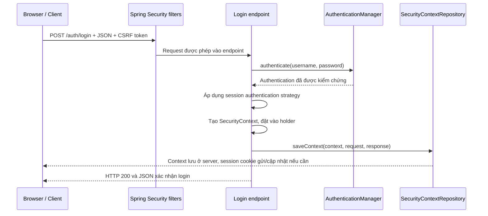
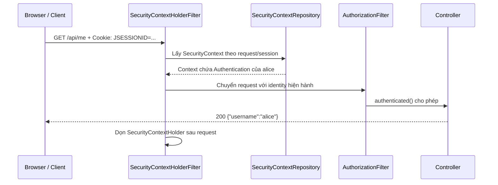

# Xác thực thành công không đồng nghĩa với danh tính được lưu cho yêu cầu sau

## 1. Vấn đề: login trả 200 nhưng request tiếp theo vẫn là anonymous

Hãy tưởng tượng client gửi thông tin đăng nhập, server trả HTTP `200 OK`, nhưng khi gọi `GET /api/me` ngay sau đó thì nhận `401 Unauthorized`. Chuyện này hoàn toàn có thể xảy ra dù username và password **đã được kiểm tra đúng**.

Lý do là Spring Security phân biệt ít nhất **ba kết quả khác nhau**:

1. **Xác thực credentials thành công:** `AuthenticationManager.authenticate(...)` trả `Authentication` đã được kiểm chứng.
2. **Danh tính có hiệu lực trong request đang chạy:** `SecurityContextHolder` chứa `SecurityContext` có `Authentication` đó.
3. **Danh tính được khôi phục ở request tiếp theo:** `SecurityContext` được ghi vào một `SecurityContextRepository` có khả năng lưu liên request, đồng thời client gửi lại thông tin để server tìm đúng trạng thái đã lưu (thường là session cookie).

Ba bước có liên quan, nhưng **không tự động đồng nghĩa với nhau**. Bài này giải thích chính xác ranh giới ấy, cơ chế persistence của Spring Security Servlet, cách chứng minh bằng hai HTTP request và cách chẩn đoán lỗi.

**Phạm vi:** Java 17+, Spring Boot 3.x, Spring Security 6.x, Spring MVC/Servlet. Bài tập dùng **đăng nhập bằng session cookie**; JWT bearer token, HTTP Basic và WebFlux được so sánh để tránh nhầm mô hình. Với WebFlux phải dùng `ReactiveSecurityContextHolder` và các API reactive tương ứng, không dùng nguyên mã Servlet.

### Đọc ngay một phản ví dụ

Đoạn sau **chỉ minh họa logic chưa đủ**, không phải một endpoint hoàn chỉnh:

```java
Authentication verified = authenticationManager.authenticate(
    UsernamePasswordAuthenticationToken.unauthenticated(
        username, password
    )
);

SecurityContext context = SecurityContextHolder.createEmptyContext();
context.setAuthentication(verified);
SecurityContextHolder.setContext(context);

// Endpoint trả 200 ngay ở đây, nhưng chưa lưu context cho request sau.
```

Sau khi đoạn mã chạy, `verified.isAuthenticated()` có thể là `true` và code trong cùng request nhìn thấy user qua holder. Nhưng nếu dùng `SecurityContextHolderFilter` mặc định ở Spring Security 6 và **chưa gọi `SecurityContextRepository.saveContext(...)`**, authentication mới tạo trong controller có thể không tồn tại ở request tiếp theo.

**Sự kiện cần chứng minh không phải “login trả 200” mà là “request thứ hai, chỉ mang session cookie, được nhận diện đúng principal”.**

## 2. Những khái niệm không nên gộp làm một

| Khái niệm | Chứng minh điều gì? | Có tự duy trì đăng nhập qua request? |
|---|---|---|
| `AuthenticationManager.authenticate(token)` | Credentials/token được cơ chế xác thực chấp nhận | Không |
| `Authentication` có `isAuthenticated() == true` | Một kết quả xác thực được provider/manager tin cậy | Không |
| `SecurityContext` | Đối tượng chứa `Authentication` hiện hành | Không |
| `SecurityContextHolder` | Nơi lấy context đang áp dụng trong phạm vi thực thi hiện tại | Không |
| `SecurityContextHolderFilter` | Tải context từ repository khi xử lý request rồi dọn holder | Không tự ghi context đã sửa |
| `SecurityContextRepository` | Chiến lược tải/lưu context | Tùy implementation |
| `HttpSessionSecurityContextRepository` | Gắn context với `HttpSession` ở server | Có, nếu session và cookie còn hợp lệ |
| `RequestAttributeSecurityContextRepository` | Chia sẻ context giữa các dispatch trong cùng request | Không qua hai HTTP request độc lập |
| `NullSecurityContextRepository` | Chủ động không lưu context | Không |
| Session cookie (thường `JSESSIONID`) | Giúp server tìm lại phiên đã lưu | Không tự chứng minh có Authentication |
| `AuthorizationFilter` | Kiểm tra user đã xác thực có quyền truy cập tài nguyên không | Không xử lý lưu phiên |

### AuthenticationManager không quản lý session

Một `AuthenticationProvider` như `DaoAuthenticationProvider` kiểm tra username/password. `ProviderManager` chọn provider phù hợp. Kết quả nhận được là một `Authentication` có principal và authorities. Manager **không có trách nhiệm** tạo cookie, đặt session attribute, ghi database phiên hay quyết định thời gian sống của session.

Việc được xác thực thành công cũng chưa đồng nghĩa được phép vào mọi URL. Sau xác thực còn **authorization**; user hợp lệ nhưng thiếu role có thể gặp `403 Forbidden`. Nếu session bị mất, request sau không mang danh tính và thường gặp `401` trên API.

### SecurityContextHolder sống theo vòng đời xử lý

Ở ứng dụng Servlet thông thường, `SecurityContextHolder` sử dụng chiến lược dựa vào thread-local cho ngữ cảnh hiện tại. Spring Security filter chịu trách nhiệm thiết lập và dọn context đúng vòng đời request. Việc đặt một `Authentication` ở đây **không** biến nó thành tài khoản đăng nhập toàn cục và **không** lưu nó cho request sau.

Không dùng static field, biến singleton hay tự giữ `Authentication` trong controller để “nhớ người dùng”. Server Servlet dùng thread pool; giữ identity sai chỗ có thể rò dữ liệu giữa người dùng hoặc request.

## 3. Hai request khác nhau: điều gì phải xảy ra?

### Request A: đăng nhập thành công



### Request B: truy cập tài nguyên được bảo vệ



Nếu request A **không lưu context**, bước tải của request B có thể chỉ trả context rỗng. Nếu request A đã lưu nhưng request B **không gửi cookie**, server không biết phải tải session nào. Nếu context có đủ nhưng session hết hạn hoặc bị vô hiệu hóa, user cũng phải xác thực lại.

Từ góc nhìn giao thức, session cookie thường chỉ giữ **mã định danh phiên**; password và toàn bộ `Authentication` không được nhét thẳng vào cookie. Server dùng ID để tìm dữ liệu phiên. Khi dùng Spring Session với kho Redis/JDBC, nơi lưu session có thể khác bộ nhớ Servlet container nhưng nguyên tắc nhận diện phiên không đổi.

## 4. Spring Security 6: explicit save khác cơ chế lưu tự động trước đây

Trong nhiều cấu hình của Spring Security 5, `SecurityContextPersistenceFilter` có thể theo dõi và tự ghi `SecurityContext` cuối request. Ở Spring Security 6, mặc định hiện đại sử dụng `SecurityContextHolderFilter`: filter **đọc** từ `SecurityContextRepository` vào holder, nhưng **không tự save** một context mới do code của bạn thay đổi.

Vì vậy, với một controller hoặc custom filter **tự gọi `AuthenticationManager`**, hãy dùng công thức:

```java
Authentication authentication = authenticationManager.authenticate(token);

SecurityContext context = SecurityContextHolder.createEmptyContext();
context.setAuthentication(authentication);
SecurityContextHolder.setContext(context);

securityContextRepository.saveContext(context, request, response);
```

`token` phải là đối tượng `Authentication` **chưa xác thực** được tạo từ request; `request` và `response` là `HttpServletRequest` và `HttpServletResponse` thực tế. Đây là đoạn minh họa đặt **bên trong** controller/filter có các dependency cần thiết; không phải class chạy độc lập.

Hai lời gọi cuối thực hiện **hai công việc khác nhau**:

- `setContext(context)`: request hiện tại nhận danh tính vừa xác thực.
- `saveContext(context, request, response)`: context được lưu tại repository để có thể tải ở những request kế tiếp.

**Không suy luận rằng mọi cơ chế đăng nhập phải tự gọi `saveContext`.** Khi dùng các authentication filter được Spring Security cung cấp, chẳng hạn form login chuẩn, framework thường đã thực hiện những bước lifecycle tương ứng. Bài toán explicit-save đặc biệt dễ gặp khi bạn tự viết endpoint login JSON hoặc filter tùy chỉnh.

### Tại sao việc save phải diễn ra trước khi response commit?

Một lần lưu session có thể cần tạo hoặc đổi session ID và gửi `Set-Cookie`. Nếu response đã commit (ví dụ đã `flushBuffer()`, gửi redirect hoặc ghi body xong), server có thể không thêm cookie đúng thời điểm. Do đó, cần `saveContext(...)` **trước khi** finalize/flush response, không đặt save sau khi ghi body hoặc sau một response stream đã commit.

Đoạn **sai** sau dùng để nhận diện lỗi, không dùng trong production:

```java
SecurityContextHolder.setContext(context);
response.getWriter().write("{\"ok\":true}");
response.flushBuffer(); // response có thể đã commit
securityContextRepository.saveContext(context, request, response);
```

Đoạn **đúng về thứ tự**:

```java
SecurityContextHolder.setContext(context);
securityContextRepository.saveContext(context, request, response);
// Sau đó controller/handler mới trả ResponseEntity hoặc ghi response.
```

## 5. Repository nào thực sự giữ được user ở request sau?

Spring Security 6 thường dùng `DelegatingSecurityContextRepository` với hai repository:

1. `RequestAttributeSecurityContextRepository`: có ích khi request trải qua nhiều dispatch (ví dụ FORWARD/ERROR), nhưng không lưu qua hai request HTTP riêng biệt.
2. `HttpSessionSecurityContextRepository`: lưu context trong `HttpSession`, nên có thể tải lại ở một request khác với cùng session.

Có thể mô tả rõ trong cấu hình:

```java
SecurityContextRepository repository =
    new DelegatingSecurityContextRepository(
        new RequestAttributeSecurityContextRepository(),
        new HttpSessionSecurityContextRepository()
    );
```

Các import tương ứng thuộc `org.springframework.security.web.context`. Khi controller dùng một repository để ghi, filter chain phải dùng **repository tương thích để đọc**; tránh tạo hai instance có cách lưu khác nhau hoặc vô tình dùng `NullSecurityContextRepository` cho một trong hai phía.

### Các chính sách session thường gặp

| `SessionCreationPolicy` | Tác động chính với Spring Security | Có hợp với đăng nhập qua session? |
|---|---|---|
| `ALWAYS` | Spring Security chủ động tạo HTTP session | Có thể, nhưng tạo session thường xuyên |
| `IF_REQUIRED` | Chỉ tạo session khi cần | **Lựa chọn tự nhiên** cho session login |
| `NEVER` | Spring Security không tạo session mới, nhưng có thể dùng session tồn tại | Thận trọng; dễ không lưu được login mới nếu chưa có session |
| `STATELESS` | Spring Security không tạo session và không dùng session để lấy `SecurityContext` | **Không phù hợp** với mục tiêu nhớ login qua session |

`STATELESS` không có nghĩa cả ứng dụng Java hoàn toàn không bao giờ tạo `HttpSession`: CSRF, MVC hoặc thư viện khác vẫn có thể tạo session nếu được cấu hình. Ý nghĩa cần nhớ ở đây là Spring Security không sử dụng session làm nơi phục hồi authentication như mô hình session login.

Với `NullSecurityContextRepository`, gọi `saveContext(...)` sẽ không giúp lưu danh tính cho request sau. Với `RequestAttributeSecurityContextRepository` thuần túy, một lần dispatch khác trong **cùng request** có thể thấy context nhưng request HTTP mới vẫn không. Đây là hai nguyên nhân phổ biến của “save rồi vẫn 401”.

### Ghi trực tiếp vào session có phải giải pháp?

Đừng thay `SecurityContextRepository` bằng:

```java
request.getSession(true).setAttribute("loggedIn", true);
```

Cờ `loggedIn` do ứng dụng tự đặt không làm Spring Security coi request tiếp theo là authenticated. Framework tìm `SecurityContext` theo repository đã cấu hình, chứ không tự hiểu mọi session attribute.

`HttpSessionSecurityContextRepository` thường lưu context dưới key `SPRING_SECURITY_CONTEXT`. Có thể quan sát key này khi debug local, nhưng code ứng dụng nên phụ thuộc interface `SecurityContextRepository` thay vì tự sửa session attribute nội bộ.

## 6. Ví dụ ứng dụng Spring Boot: đăng nhập session, save context và kiểm chứng

Ví dụ này chủ ý nhỏ, chạy trên Java 17+ và Spring Boot 3.x với Spring Security 6.x. Người dùng mẫu được tạo in-memory; password đã hash bằng BCrypt. API cung cấp:

- `GET /csrf` để lấy CSRF token của phiên hiện tại.
- `POST /auth/login` nhận JSON, xác thực và **lưu** security context.
- `GET /api/me` yêu cầu đã đăng nhập, trả tên user lấy từ context.
- `POST /auth/logout` sử dụng logout filter chuẩn để hủy phiên.

Chúng ta bật CSRF vì ví dụ dựa vào browser/session cookie. `permitAll()` cho login không đồng nghĩa bỏ CSRF cho POST.

### 6.1. Dependency cho dự án Boot đã có build

Ví dụ `build.gradle` trong dự án có Spring Boot plugin:

```groovy
dependencies {
    implementation 'org.springframework.boot:spring-boot-starter-web'
    implementation 'org.springframework.boot:spring-boot-starter-security'

    testImplementation 'org.springframework.boot:spring-boot-starter-test'
    testImplementation 'org.springframework.security:spring-security-test'
}
```

Ba file source sau thuộc package `com.example.contextpersistence`. Đây là chương trình Spring Boot, nên yêu cầu build Gradle/Maven và dependencies; không thể chỉ gọi `javac` một file mà thiếu Spring Security trên classpath.

### 6.2. Main class

`src/main/java/com/example/contextpersistence/ContextPersistenceApplication.java`:

```java
package com.example.contextpersistence;

import org.springframework.boot.SpringApplication;
import org.springframework.boot.autoconfigure.SpringBootApplication;

@SpringBootApplication
public class ContextPersistenceApplication {
    public static void main(String[] args) {
        SpringApplication.run(ContextPersistenceApplication.class, args);
    }
}
```

### 6.3. Cấu hình context repository, session và xác thực

`src/main/java/com/example/contextpersistence/SecurityConfig.java`:

```java
package com.example.contextpersistence;

import java.util.List;
import org.springframework.context.annotation.Bean;
import org.springframework.context.annotation.Configuration;
import org.springframework.http.HttpStatus;
import org.springframework.security.authentication.AuthenticationManager;
import org.springframework.security.config.annotation.authentication.configuration.AuthenticationConfiguration;
import org.springframework.security.config.annotation.web.builders.HttpSecurity;
import org.springframework.security.config.annotation.web.configuration.EnableWebSecurity;
import org.springframework.security.config.annotation.web.configurers.AbstractHttpConfigurer;
import org.springframework.security.config.http.SessionCreationPolicy;
import org.springframework.security.core.userdetails.User;
import org.springframework.security.core.userdetails.UserDetailsService;
import org.springframework.security.crypto.bcrypt.BCryptPasswordEncoder;
import org.springframework.security.crypto.password.PasswordEncoder;
import org.springframework.security.provisioning.InMemoryUserDetailsManager;
import org.springframework.security.web.SecurityFilterChain;
import org.springframework.security.web.authentication.HttpStatusEntryPoint;
import org.springframework.security.web.authentication.session.ChangeSessionIdAuthenticationStrategy;
import org.springframework.security.web.authentication.session.CompositeSessionAuthenticationStrategy;
import org.springframework.security.web.authentication.session.SessionAuthenticationStrategy;
import org.springframework.security.web.context.DelegatingSecurityContextRepository;
import org.springframework.security.web.context.HttpSessionSecurityContextRepository;
import org.springframework.security.web.context.RequestAttributeSecurityContextRepository;
import org.springframework.security.web.context.SecurityContextRepository;
import org.springframework.security.web.csrf.CsrfAuthenticationStrategy;
import org.springframework.security.web.csrf.CsrfTokenRepository;
import org.springframework.security.web.csrf.HttpSessionCsrfTokenRepository;

@Configuration
@EnableWebSecurity
public class SecurityConfig {

    @Bean
    PasswordEncoder passwordEncoder() {
        return new BCryptPasswordEncoder();
    }

    @Bean
    UserDetailsService userDetailsService(PasswordEncoder encoder) {
        return new InMemoryUserDetailsManager(
            User.withUsername("alice")
                .password(encoder.encode("alice-secret"))
                .roles("USER")
                .build()
        );
    }

    @Bean
    AuthenticationManager authenticationManager(
            AuthenticationConfiguration configuration) throws Exception {
        return configuration.getAuthenticationManager();
    }

    @Bean
    SecurityContextRepository securityContextRepository() {
        return new DelegatingSecurityContextRepository(
            new RequestAttributeSecurityContextRepository(),
            new HttpSessionSecurityContextRepository()
        );
    }

    @Bean
    CsrfTokenRepository csrfTokenRepository() {
        return new HttpSessionCsrfTokenRepository();
    }

    @Bean
    SessionAuthenticationStrategy sessionAuthenticationStrategy(
            CsrfTokenRepository csrfRepository) {
        return new CompositeSessionAuthenticationStrategy(List.of(
            new ChangeSessionIdAuthenticationStrategy(),
            new CsrfAuthenticationStrategy(csrfRepository)
        ));
    }

    @Bean
    SecurityFilterChain securityFilterChain(
            HttpSecurity http,
            SecurityContextRepository securityContextRepository,
            CsrfTokenRepository csrfTokenRepository) throws Exception {

        http
            .authorizeHttpRequests(auth -> auth
                .requestMatchers("/csrf", "/auth/login", "/error").permitAll()
                .anyRequest().authenticated()
            )
            .securityContext(context -> context
                .securityContextRepository(securityContextRepository)
            )
            .sessionManagement(session -> session
                .sessionCreationPolicy(SessionCreationPolicy.IF_REQUIRED)
            )
            .csrf(csrf -> csrf
                .csrfTokenRepository(csrfTokenRepository)
            )
            .exceptionHandling(ex -> ex
                .authenticationEntryPoint(
                    new HttpStatusEntryPoint(HttpStatus.UNAUTHORIZED))
            )
            .httpBasic(AbstractHttpConfigurer::disable)
            .formLogin(AbstractHttpConfigurer::disable)
            .logout(logout -> logout
                .logoutUrl("/auth/logout")
                .logoutSuccessHandler((request, response, authentication) ->
                    response.setStatus(204))
            );

        return http.build();
    }
}
```

Vì sao cấu hình này phù hợp với **bài toán tồn tại qua request**?

- `UserDetailsService` cung cấp username, password hash, authorities cho provider mặc định; phần này chỉ quyết định **xác thực thành công hay thất bại**.
- `AuthenticationManager` là nơi controller nhờ kiểm tra credentials. Nó không tự lưu context.
- `SecurityContextRepository` được khai báo thành **bean dùng chung** và gắn vào `HttpSecurity.securityContext(...)`. Controller sẽ inject chính bean này để ghi, còn filter chain dùng nó để đọc.
- `IF_REQUIRED` cho phép tạo session khi authentication cần được lưu. `HttpSessionSecurityContextRepository` thực hiện persistence trong session.
- `SessionAuthenticationStrategy` minh họa hai bước bổ sung khi tự viết login: `ChangeSessionIdAuthenticationStrategy` chống session fixation và `CsrfAuthenticationStrategy` xóa CSRF token cũ sau khi authentication thành công. Trong Spring Security 6, với login tự viết, không nên mặc định tin rằng `SessionManagementFilter` sẽ thực hiện các bước này thay controller.
- `HttpStatusEntryPoint` giúp API chưa xác thực nhận `401` thay vì redirect tới form login.
- `httpBasic` và `formLogin` tắt để chỉ còn đường login JSON minh họa. Chúng có lifecycle riêng nếu bật.
- Logout filter chuẩn xử lý việc kết thúc authentication và phiên. Khi CSRF bật, `POST /auth/logout` cũng cần CSRF token hợp lệ.

### 6.4. Controller: authentication thành công **và** lưu context

`src/main/java/com/example/contextpersistence/SessionLoginController.java`:

```java
package com.example.contextpersistence;

import java.util.Map;
import jakarta.servlet.http.HttpServletRequest;
import jakarta.servlet.http.HttpServletResponse;
import org.springframework.http.HttpStatus;
import org.springframework.http.MediaType;
import org.springframework.http.ResponseEntity;
import org.springframework.security.authentication.AuthenticationManager;
import org.springframework.security.authentication.UsernamePasswordAuthenticationToken;
import org.springframework.security.core.Authentication;
import org.springframework.security.core.AuthenticationException;
import org.springframework.security.core.context.SecurityContext;
import org.springframework.security.core.context.SecurityContextHolder;
import org.springframework.security.web.authentication.session.SessionAuthenticationStrategy;
import org.springframework.security.web.context.SecurityContextRepository;
import org.springframework.security.web.csrf.CsrfToken;
import org.springframework.web.bind.annotation.GetMapping;
import org.springframework.web.bind.annotation.PostMapping;
import org.springframework.web.bind.annotation.RequestBody;
import org.springframework.web.bind.annotation.RestController;

@RestController
public class SessionLoginController {

    private final AuthenticationManager authenticationManager;
    private final SecurityContextRepository securityContextRepository;
    private final SessionAuthenticationStrategy sessionStrategy;

    public SessionLoginController(
            AuthenticationManager authenticationManager,
            SecurityContextRepository securityContextRepository,
            SessionAuthenticationStrategy sessionStrategy) {
        this.authenticationManager = authenticationManager;
        this.securityContextRepository = securityContextRepository;
        this.sessionStrategy = sessionStrategy;
    }

    public record LoginRequest(String username, String password) {}

    @GetMapping("/csrf")
    public CsrfToken csrf(CsrfToken token) {
        return token;
    }

    @PostMapping(
        path = "/auth/login",
        consumes = MediaType.APPLICATION_JSON_VALUE
    )
    public ResponseEntity<Map<String, String>> login(
            @RequestBody LoginRequest body,
            HttpServletRequest request,
            HttpServletResponse response) {

        Authentication authentication;
        try {
            authentication = authenticationManager.authenticate(
                UsernamePasswordAuthenticationToken.unauthenticated(
                    body.username(), body.password()
                )
            );
        } catch (AuthenticationException ex) {
            SecurityContextHolder.clearContext();
            // Nếu request có phiên cũ, tránh giữ lại context cũ
            // sau một lần cố đăng nhập thất bại.
            securityContextRepository.saveContext(
                SecurityContextHolder.createEmptyContext(),
                request,
                response
            );
            return ResponseEntity.status(HttpStatus.UNAUTHORIZED)
                .body(Map.of("error", "invalid_credentials"));
        }

        // Login thủ công phải xử lý chiến lược session phù hợp.
        sessionStrategy.onAuthentication(authentication, request, response);

        SecurityContext context = SecurityContextHolder.createEmptyContext();
        context.setAuthentication(authentication);

        // Bước 1: user hiện diện trong request đang xử lý.
        SecurityContextHolder.setContext(context);

        // Bước 2: user được lưu để request sau có thể tải lại.
        securityContextRepository.saveContext(context, request, response);

        return ResponseEntity.ok(Map.of(
            "username", authentication.getName()
        ));
    }

    @GetMapping("/api/me")
    public Map<String, String> me(Authentication authentication) {
        return Map.of("username", authentication.getName());
    }
}
```

Điểm trọng tâm nằm ngay cạnh nhau:

```java
SecurityContextHolder.setContext(context);
securityContextRepository.saveContext(context, request, response);
```

Nếu **bỏ dòng thứ hai**, endpoint vẫn có thể trả JSON `{"username":"alice"}` ngay sau authenticate. Song khi request `GET /api/me` bắt đầu, Spring Security tải context từ session repository và có thể không tìm thấy danh tính vừa xác thực. Đây là tình huống “trông như đã login nhưng chưa duy trì login”.

**Không tạo `Authentication` đáng tin bằng dữ liệu do client tự khai.** Trong ví dụ, `UsernamePasswordAuthenticationToken.unauthenticated(...)` được đưa cho `AuthenticationManager`, và chỉ kết quả từ manager mới đặt vào context. Username/password mẫu chỉ để thử local. Ứng dụng thật cần input validation, rate limit, generic error response, audit và quản lý secrets.

**Vì sao có `sessionStrategy.onAuthentication(...)`?** Lưu SecurityContext giúp request sau nhận identity, nhưng **không tự bao gồm** session fixation defense, giới hạn phiên đồng thời, CSRF-token reset hoặc các bước riêng của đăng nhập tương tác. Nếu bạn sở hữu endpoint login, phải tích hợp những strategy phù hợp với ứng dụng. Bài demo xử lý session ID và CSRF token ở mức cơ bản.

## 7. Tự chạy hai request và quan sát persistence

Trong dự án Spring Boot có Gradle wrapper và Boot plugin:

```bash
./gradlew bootRun
```

Windows PowerShell dùng `.\gradlew.bat bootRun`. Ví dụ dưới đây dùng Bash, `curl` và `jq`; các ký tự kết quả JSON có thể thay đổi thứ tự, token và session ID thay đổi mỗi lần chạy.

### Bước A: lấy CSRF token và lưu cookie

```bash
curl -sS -c cookies.txt -b cookies.txt \
  http://localhost:8080/csrf > csrf.json

CSRF_TOKEN=$(jq -r '.token' csrf.json)
```

GET `/csrf` được `permitAll()` và trả JSON chứa token. `HttpSessionCsrfTokenRepository` gắn token với session hiện tại. File `cookies.txt` ghi cookie server cấp; nó chỉ dành cho kiểm thử local và phải được bảo vệ như một credential.

### Bước B: gửi login và yêu cầu server lưu SecurityContext

```bash
curl -i -c cookies.txt -b cookies.txt \
  -H 'Content-Type: application/json' \
  -H "X-CSRF-TOKEN: $CSRF_TOKEN" \
  --data '{"username":"alice","password":"alice-secret"}' \
  http://localhost:8080/auth/login
```

**Kỳ vọng:** HTTP `200` với body có `{"username":"alice"}`. Server có thể phát/cập nhật `Set-Cookie` nếu phiên được tạo hay session ID được đổi. Quan sát header cookie là hữu ích, nhưng **một cookie được phát không tự chứng minh context đã được lưu**: session có thể tồn tại chỉ để lưu CSRF token.

### Bước C: request thứ hai chỉ gửi cookie

```bash
curl -i -b cookies.txt http://localhost:8080/api/me
```

**Kỳ vọng:** `200` và `{"username":"alice"}`. Ở request này không còn JSON username/password, không có Authorization header; Spring Security lấy principal từ context đã lưu và phục hồi qua session.

### Bước D: request thứ hai **không** gửi cookie

```bash
curl -i http://localhost:8080/api/me
```

**Kỳ vọng:** `401 Unauthorized`. Client không mang session ID của lần đăng nhập, nên server không biết phải tải context nào. Điều này không có nghĩa bước B sai password.

### Bước E: logout và chứng minh phiên không còn hợp lệ

Sau khi login, `CsrfAuthenticationStrategy` đã xóa token CSRF cũ. Lấy token mới với cookie của phiên hiện hành:

```bash
NEW_CSRF=$(curl -sS -c cookies.txt -b cookies.txt \
  http://localhost:8080/csrf | jq -r '.token')

curl -i -c cookies.txt -b cookies.txt \
  -X POST -H "X-CSRF-TOKEN: $NEW_CSRF" \
  http://localhost:8080/auth/logout

curl -i -b cookies.txt http://localhost:8080/api/me
```

Với cấu hình mẫu, logout trả `204 No Content` và request được bảo vệ sau logout trả `401`. Logout đúng phải thu hồi phiên/server-side security context, không chỉ ẩn tên user trên giao diện.

**Bảo mật:** các lệnh dùng HTTP localhost để học. Trong môi trường thật, login/password, cookie session và CSRF token phải đi qua HTTPS; không lưu chúng trong log, telemetry hoặc repo; cookie cần thuộc tính `HttpOnly`, `Secure`, `SameSite` và thời hạn phù hợp.

## 8. Test đúng điều cần chứng minh: authentication còn sau request riêng biệt

Đơn giản kiểm tra `authentication.isAuthenticated()` ngay sau authenticate **chưa phải test persistence**. Một test chỉ gọi controller rồi kiểm tra `200` cũng chưa đủ. Cần ít nhất hai MockMvc request và **mang đúng session** từ login sang request mới.

Tạo `src/test/java/com/example/contextpersistence/SessionPersistenceTest.java`:

```java
package com.example.contextpersistence;

import jakarta.servlet.http.HttpSession;
import org.junit.jupiter.api.Test;
import org.springframework.beans.factory.annotation.Autowired;
import org.springframework.boot.test.autoconfigure.web.servlet.AutoConfigureMockMvc;
import org.springframework.boot.test.context.SpringBootTest;
import org.springframework.http.MediaType;
import org.springframework.mock.web.MockHttpSession;
import org.springframework.security.web.context.HttpSessionSecurityContextRepository;
import org.springframework.test.web.servlet.MockMvc;
import org.springframework.test.web.servlet.MvcResult;

import static org.junit.jupiter.api.Assertions.assertNotNull;
import static org.springframework.security.test.web.servlet.request
    .SecurityMockMvcRequestPostProcessors.csrf;
import static org.springframework.test.web.servlet.request
    .MockMvcRequestBuilders.get;
import static org.springframework.test.web.servlet.request
    .MockMvcRequestBuilders.post;
import static org.springframework.test.web.servlet.result
    .MockMvcResultMatchers.jsonPath;
import static org.springframework.test.web.servlet.result
    .MockMvcResultMatchers.status;

@SpringBootTest
@AutoConfigureMockMvc
class SessionPersistenceTest {

    @Autowired
    MockMvc mvc;

    @Test
    void sessionSurvivesBetweenTwoSeparateRequests() throws Exception {
        MvcResult login = mvc.perform(post("/auth/login")
                .with(csrf())
                .contentType(MediaType.APPLICATION_JSON)
                .content("{\"username\":\"alice\",\"password\":\"alice-secret\"}"))
            .andExpect(status().isOk())
            .andExpect(jsonPath("$.username").value("alice"))
            .andReturn();

        MockHttpSession session = (MockHttpSession)
            login.getRequest().getSession(false);
        assertNotNull(session);

        // Repository đã lưu context bên trong phiên server.
        assertNotNull(session.getAttribute(
            HttpSessionSecurityContextRepository.SPRING_SECURITY_CONTEXT_KEY
        ));

        // Yêu cầu mới dùng lại session như khi browser gửi cookie.
        mvc.perform(get("/api/me").session(session))
            .andExpect(status().isOk())
            .andExpect(jsonPath("$.username").value("alice"));
    }

    @Test
    void withoutSessionTheNextRequestIsAnonymous() throws Exception {
        mvc.perform(post("/auth/login")
                .with(csrf())
                .contentType(MediaType.APPLICATION_JSON)
                .content("{\"username\":\"alice\",\"password\":\"alice-secret\"}"))
            .andExpect(status().isOk());

        // Request mới không mang session từ lần login.
        mvc.perform(get("/api/me"))
            .andExpect(status().isUnauthorized());
    }

    @Test
    void invalidPasswordDoesNotCreateAuthenticatedSession()
            throws Exception {
        mvc.perform(post("/auth/login")
                .with(csrf())
                .contentType(MediaType.APPLICATION_JSON)
                .content("{\"username\":\"alice\",\"password\":\"wrong\"}"))
            .andExpect(status().isUnauthorized())
            .andExpect(jsonPath("$.error").value("invalid_credentials"));
    }

    @Test
    void loginWithoutCsrfIsRejectedBeforeController() throws Exception {
        mvc.perform(post("/auth/login")
                .contentType(MediaType.APPLICATION_JSON)
                .content("{\"username\":\"alice\",\"password\":\"alice-secret\"}"))
            .andExpect(status().isForbidden());
    }

    @Test
    void protectedEndpointRejectsAnonymousRequest() throws Exception {
        mvc.perform(get("/api/me"))
            .andExpect(status().isUnauthorized());
    }
}
```

Chạy:

```bash
./gradlew test
```

Windows: `.\gradlew.bat test`.

**Vì sao test này có giá trị?**

- Test đầu tiên khẳng định login trả `200` **và** repository đã lưu `SecurityContext` trong session. Request thứ hai tạo một Servlet request khác nhưng dùng session đó; đây mới là bằng chứng về persistence.
- Test thứ hai chứng minh một login `200` của request A không làm request B trở thành đã đăng nhập nếu request B không mang session.
- Test thứ ba/quy tắc CSRF giúp phân biệt authentication failure `401` với request bị CSRF filter chặn `403` trước khi code controller chạy.
- `MockMvc` mô phỏng session trong test JVM. Nó chứng minh logic filter/controller/repository, nhưng chưa thay thế kiểm thử cookie `Set-Cookie`, `Secure`, `SameSite`, reverse proxy và HTTPS ở môi trường chạy thật.

**Không nên chỉ dùng `@WithMockUser` để kiểm tra việc lưu phiên.** Annotation đó thường cung cấp một principal giả lập trong security context của test request; nó không chứng minh endpoint login thật đã gọi `saveContext` hay browser đã giữ cookie.

## 9. Các hình thức authentication không cần session persistence

Mệnh đề “xác thực thành công không có nghĩa đã lưu danh tính” đúng với session login; nhưng **không phải mọi API đều muốn lưu**.

| Mô hình | Làm thế nào request tiếp theo nhận user? | Có bắt buộc lưu SecurityContext vào HttpSession? |
|---|---|---|
| Session login / form login | Browser gửi session cookie; server tải lại context | Thường có, tùy repository |
| Custom JSON login tạo session | Controller/filter save context; browser gửi cookie | Có nếu muốn session login |
| HTTP Basic theo request | Client gửi `Authorization: Basic ...` lần nữa; server xác thực lần nữa | Không nhất thiết |
| Bearer JWT | Client gửi `Authorization: Bearer <JWT>` lần nữa; server kiểm tra token | Không |
| Opaque access token | Client gửi bearer token, server introspect/kiểm tra theo cấu hình | Không nhất thiết |
| Service-to-service API key | Client gửi key cho mỗi request, filter/provider xác thực lại | Không nhất thiết |
| Remember-me | Cơ chế remember-me có token/cookie và xác thực lại theo chính sách | Khác với việc giữ mãi một context request |

### Ví dụ stateless là hành vi có chủ ý

```java
http
    .sessionManagement(session -> session
        .sessionCreationPolicy(SessionCreationPolicy.STATELESS))
    .securityContext(context -> context
        .securityContextRepository(
            new NullSecurityContextRepository()));
```

Đoạn này là **fragment trong SecurityFilterChain**, không phải cấu hình độc lập. Với resource server JWT hoặc API key được kiểm chứng **mỗi request**, không lưu session là hợp lý. Request sau phải mang lại token/key theo protocol.

Đừng “sửa” một API stateless bằng cách tự `saveContext` vào session. Ngược lại, đừng cấu hình `STATELESS` rồi kỳ vọng cookie session từ JSON login làm server nhớ người dùng.

Một request `/api/me` dùng bearer token trả `200` chỉ chứng minh token có hiệu lực cho request đó, **không chứng minh server giữ identity ở request sau**. Request sau không mang bearer token có thể trả `401` — đó là đúng theo mô hình stateless.

## 10. Các trạng thái cần phân biệt khi debug

### Đã có Authentication trong một request nhưng chưa đủ quyền

Có `Authentication` đã xác thực và có context cho request hiện tại nhưng endpoint đòi `ROLE_ADMIN` trong khi user chỉ có `ROLE_USER`. Kết quả thông thường: `403 Forbidden`. Đây là **authorization failure**, không phải lỗi mất session.

### Đã xác thực và đã save nhưng request sau vẫn chưa có danh tính

Khả năng có thể nằm ở cookie, repository, session policy, sự kiện logout/invalidation, timeout hoặc session store; cần điều tra luồng **đọc lại** context của request B, không chỉ log bước authenticate của request A.

### Server đã tạo session nhưng context chưa lưu

Một `HttpSession` có thể tồn tại do CSRF token, request cache hoặc phần khác của ứng dụng. Thấy `JSESSIONID` trong browser, `Set-Cookie` trong HTTP response hoặc `request.getSession(false) != null` **không đủ chứng minh** session chứa `SPRING_SECURITY_CONTEXT`.

### Login xong request thứ hai về lại user cũ

Có thể controller đặt context mới vào holder nhưng không ghi đè context cũ trong session; request tiếp theo tải identity cũ. Điều này đặc biệt dễ xảy ra ở màn hình “đổi tài khoản” hoặc tự viết login thất bại. Cần chủ động quản lý phiên cũ, kết quả authentication mới, session fixation và việc lưu/clear repository theo policy.

### Request thứ hai giữ session nhưng đang chạy server khác

Nếu session chỉ nằm trong memory của instance A, request B đến instance B không đọc được context. Trong hạ tầng nhiều instance, dùng session store chia sẻ hoặc chiến lược điều phối phù hợp (ví dụ Spring Session) và bảo đảm cấu hình serializer, TTL, domain/cookie nhất quán.

### Chuyển tác vụ sang thread mới

`SecurityContextHolder` thường dựa trên thread-local trong Servlet. Một async task/new thread không tự thừa hưởng context như request thread nếu không dùng cơ chế propagation phù hợp. Đây là vấn đề **truyền ngữ cảnh trong cùng tác vụ**, khác với lưu context giữa hai HTTP request. Đừng xử lý bằng static biến toàn cục.

## 11. Hướng dẫn chẩn đoán có thứ tự

Khi gặp “login thành công nhưng request sau 401”, kiểm tra lần lượt:

1. **Request A thật sự xác thực thành công?** Kiểm tra manager trả `Authentication` có principal/authorities đáng tin, không chỉ status `200` do controller hardcode.
2. **Context đã được đặt cho request A?** Kiểm tra `SecurityContextHolder.setContext(context)` và việc dùng `createEmptyContext()` trước khi set user.
3. **Có gọi `saveContext(...)` nếu đang tự viết login?** Với Spring Security 6 explicit save, không dựa vào sự tự lưu cuối request.
4. **Repository có thể lưu liên request?** `HttpSessionSecurityContextRepository` hay repo persistent thích hợp? Có bị thay bằng `NullSecurityContextRepository` hoặc request attribute only không?
5. **Repository đọc và ghi có cùng cấu hình?** Controller và filter chain dùng đúng repo, cùng session store/serialization hay không?
6. **Save xảy ra trước response commit?** Có redirect, flush, streaming response hoặc exception dẫn tới mất `Set-Cookie` trước khi save không?
7. **Session thực sự tồn tại và chứa context?** Kiểm tra local qua `HttpSessionSecurityContextRepository.SPRING_SECURITY_CONTEXT_KEY`; không coi việc có cookie là bằng chứng.
8. **Client gửi lại cookie?** Quan sát `Cookie` trên request B và `Set-Cookie` trên response A, domain/path/SameSite/Secure/CORS/credentials của client.
9. **Phiên còn hiệu lực?** Có logout, session fixation rotation, TTL, idle timeout hoặc node switching không?
10. **Request B đi qua chain nào?** Có `securityMatcher` khác, chain stateless hoặc policy `denyAll` làm kết quả khác không?
11. **Đó thật sự là 401 do thiếu auth?** Với request thay đổi trạng thái, `403` có thể do CSRF; với user thiếu quyền, `403` là authorization.

### Bảng đối chiếu triệu chứng

| Triệu chứng | Gợi ý phân tích |
|---|---|
| Login `200` nhưng `GET /api/me` `401` | Thiếu `saveContext`, không có cookie, repo/session sai |
| Có user trong controller login nhưng request sau anonymous | Holder chỉ có tác dụng trong request hiện tại |
| `saveContext` đã chạy mà session không có context | Kiểm tra repository, `STATELESS`, save muộn hoặc xác thực chưa hợp lệ |
| Có `JSESSIONID` nhưng `/api/me` vẫn `401` | Session có thể chỉ lưu CSRF/request cache; xem security context attribute |
| Chrome dùng được, curl không | curl có gửi cookie jar và token phù hợp không? |
| POST login `403`, GET public `200` | CSRF token thiếu/sai hoặc rule khác; POST có thể chưa vào controller |
| Sau login vẫn dùng CSRF token cũ | `CsrfAuthenticationStrategy` xóa token cũ; lấy token mới |
| Sau logout GET protected vẫn `200` | Có cơ chế khác tự xác thực lại (Basic/Bearer), hoặc session chưa bị vô hiệu hóa |
| Load balancer làm đăng nhập lúc được lúc không | Session store không chia sẻ hoặc routing cookie/node khác |
| Unit test `@WithMockUser` pass nhưng thực tế mất login | Test chưa chứng minh persistence qua hai HTTP request |
| User đã xác thực nhưng bị `403` | Kiểm tra authorities và authorization policy; không mặc định là mất session |

## 12. Bảo mật khi lưu context dài hơn một request

Đăng nhập session tạo ra trạng thái xác thực có giá trị nhiều request. Vì vậy cần bảo vệ **session identifier**, không chỉ password.

- **HTTPS:** ngăn lộ password và cookie trong quá trình truyền. Không ghi raw credentials, session ID, CSRF token hoặc nguyên `SecurityContext` vào log.
- **Cookie:** cấu hình `HttpOnly`, `Secure` khi dùng HTTPS, `SameSite` và `Path`/`Domain` thích hợp. Với cross-origin SPA, `fetch(..., {credentials: "include"})` và CORS cần được cấu hình cho origin cụ thể, không dùng wildcard tùy tiện khi có credentials.
- **Session fixation:** sau login thành công nên đổi session ID nếu đã tồn tại session do người khác có thể biết; custom login phải gọi session strategy phù hợp.
- **CSRF:** với browser tự gửi session cookie, POST/PUT/PATCH/DELETE cần CSRF protection theo threat model. `permitAll()` của endpoint login không vô hiệu hóa CSRF filter.
- **CSRF token sau login/logout:** token cũ có thể bị xóa; frontend lấy token mới trước khi làm thao tác thay đổi trạng thái.
- **Logout/timeout:** chỉ gọi `SecurityContextHolder.clearContext()` trong một request không thu hồi đầy đủ context đã lưu. Dùng hạ tầng logout của Spring Security hoặc xóa persistent context, vô hiệu session và cập nhật cookie theo chính sách.
- **Session store:** bảo vệ quyền truy cập, giới hạn TTL, giám sát invalidation; với nhiều instance phải đồng bộ session.
- **Không tạo trusted Authentication từ input:** mọi user/role được lưu phải là kết quả đã xác thực bởi manager/provider, không phải dữ liệu do client tự gửi trong JSON.
- **Phân quyền sau khi restore:** context được đọc lại có thể chứa authorities từng được cấp; cần chính sách hiệu lực/quản trị phiên khi vai trò user đổi giữa chừng, không mặc định mọi thay đổi quyền áp dụng tức thời lên session cũ.

Lưu context đúng là điều kiện kỹ thuật để session login hoạt động; bảo vệ session, quyết định timeout, revoke và authorization mới quyết định hệ thống có an toàn hay không.

## 13. Kết luận và checklist

**Mô hình cần nhớ:**

```text
authenticate(credentials)
       ↓
Authentication hợp lệ
       ↓
SecurityContextHolder.setContext(context)
       ↓
Danh tính có trong REQUEST HIỆN TẠI
       ↓
SecurityContextRepository.saveContext(context, request, response)
       ↓
Context lưu trong HttpSession / repository phù hợp
       ↓
CLIENT gửi lại cookie session ở REQUEST MỚI
       ↓
SecurityContextHolderFilter tải context
       ↓
AuthorizationFilter nhận diện user và kiểm tra quyền
```

Đánh dấu trước khi kết luận “đã đăng nhập thành công và sẽ được nhớ”:

- [ ] Authentication được cấp bởi `AuthenticationManager`/provider đáng tin, không hardcode `isAuthenticated()`.
- [ ] `SecurityContextHolder` đã có context đúng trong request hiện tại.
- [ ] Nếu dùng custom login, đã gọi `SecurityContextRepository.saveContext(...)` trước khi response commit.
- [ ] Repository hỗ trợ lưu liên request; Spring Security filter chain và login endpoint dùng cùng repository.
- [ ] Chính sách session phù hợp mục tiêu (`IF_REQUIRED` hoặc cấu hình stateful tương đương), không vô tình dùng `NullSecurityContextRepository`/`STATELESS`.
- [ ] Client nhận và gửi lại session cookie; đã kiểm tra domain/path/SameSite/Secure/credentials.
- [ ] Session authentication strategy xử lý fixation/CSRF và yêu cầu khác của ứng dụng.
- [ ] Test thực hiện **hai request độc lập**, dùng lại session/cookie của login; test thêm request không gửi cookie.
- [ ] Logout, timeout, revoke, session store và authorization sau login đã được xem xét.
- [ ] Nếu cố ý stateless bằng JWT/Basic/API key, xác định rõ client phải gửi lại credentials; không nhầm hành vi đúng đó với lỗi mất phiên.

**Thông điệp chính:** một `Authentication` được chấp nhận chỉ chứng minh **credentials hợp lệ ở thời điểm xác thực**. Việc danh tính còn tồn tại ở request sau phụ thuộc vào **persistence strategy, repository, session/token và dữ liệu mà client mang trở lại**.

### Tài liệu tham khảo

- [Spring Security 6.5 — Authentication Persistence and Session Management](https://docs.spring.io/spring-security/reference/6.5/servlet/authentication/session-management.html)
- [Spring Security 6.5 — Servlet Authentication Architecture](https://docs.spring.io/spring-security/reference/6.5/servlet/authentication/architecture.html)
- [Spring Security 6.5 — Session Management Migration / Explicit Save](https://docs.spring.io/spring-security/reference/6.5/migration/servlet/session-management.html)
- [Spring Security 6.5 — Form Login](https://docs.spring.io/spring-security/reference/6.5/servlet/authentication/passwords/form.html)
- [Spring Security — CSRF Protection](https://docs.spring.io/spring-security/reference/servlet/exploits/csrf.html)
- [SecurityContextRepository API](https://docs.spring.io/spring-security/reference/6.5/api/java/org/springframework/security/web/context/SecurityContextRepository.html)
