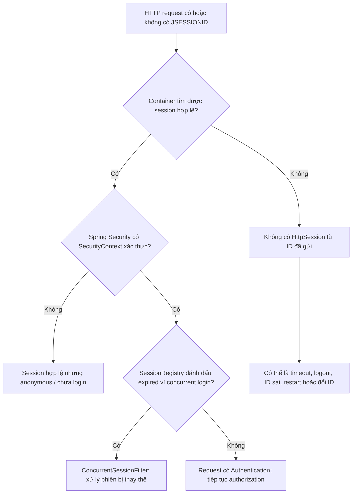
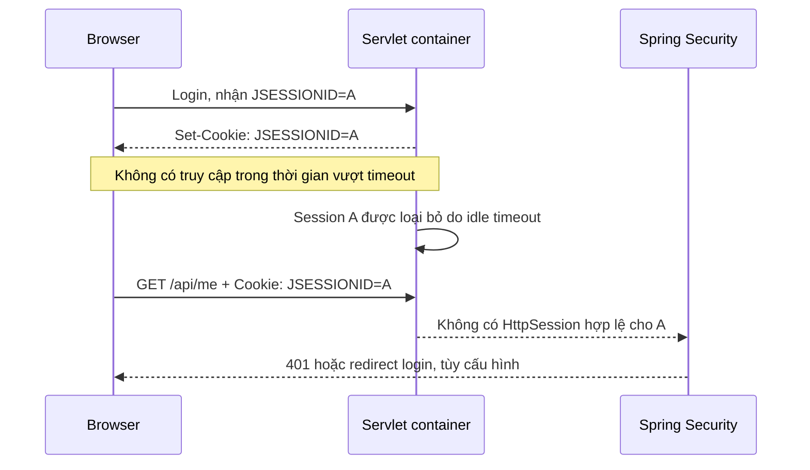
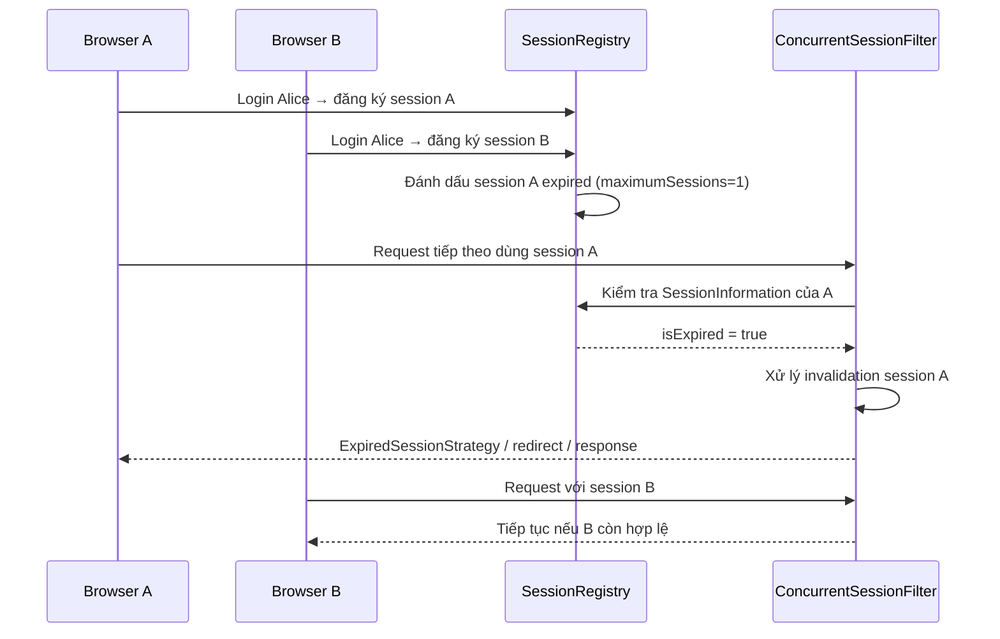

# Phân biệt phiên hết hạn, phiên không hợp lệ và phiên bị thay thế

**Ngữ cảnh:** Quản lý phiên đăng nhập (*session management*) trong ứng dụng Spring Security Servlet dùng `HttpSession`/cookie `JSESSIONID`. Người dùng đã đăng nhập, nhưng một request sau bất ngờ bị chuyển về trang login, nhận `401`, hoặc nhận thông báo “session expired”. Các hiện tượng này **không nhất thiết cùng nguyên nhân**.

**Mục tiêu học tập:** Phân biệt phiên hết hạn do thời gian không hoạt động, session ID không hợp lệ và phiên bị đánh dấu hết hiệu lực do chính sách đồng thời; nhận ra việc thay đổi session ID khi login là một cơ chế khác; chọn đúng handler/API trong Spring Security; thiết kế kiểm thử và thông báo không gây hiểu nhầm.

## 1. Trước hết: có ba lớp trạng thái khác nhau

1. **Trình duyệt** có thể đang lưu cookie `JSESSIONID` và gửi lại giá trị ấy trên request.
2. **Servlet container / session store** quyết định session ID có trỏ tới một `HttpSession` đang hợp lệ không. Việc xóa session do timeout, `invalidate()`, restart hoặc backend storage đều có thể khiến ID cũ không còn tra cứu được.
3. **Spring Security** có thể nạp `SecurityContext` từ session, hoặc theo dõi session trong `SessionRegistry` để áp dụng giới hạn đăng nhập đồng thời. Có session hợp lệ **không đồng nghĩa** có người dùng đã xác thực; một session chỉ dùng cho CSRF token hoặc giỏ hàng vẫn có thể là anonymous.

Do đó, **cookie tồn tại ≠ session còn tồn tại ≠ phiên đã đăng nhập ≠ phiên đáp ứng chính sách concurrent-session**.



Đừng dùng mỗi response `401`/`302` để suy ra nguyên nhân: nhiều nhánh có thể dẫn tới cùng trạng thái “chưa xác thực”.

## 2. Trường hợp A — Phiên hết hạn do thời gian không hoạt động (idle timeout)

**Khái niệm:** `HttpSession` có giới hạn không hoạt động (`maxInactiveInterval`). Nếu session không được truy cập trong khoảng thời gian quy định, container/session store có thể hủy nó. Ví dụ, đặt timeout 15 phút:

```properties
# application.properties (Spring Boot / Servlet session)
server.servlet.session.timeout=15m
```

Hoặc với một session cụ thể:

```java
// Giây: ví dụ 900 giây = 15 phút.
HttpSession session = request.getSession(false);
if (session != null) {
    session.setMaxInactiveInterval(900);
}
```

`getSession(false)` không tự tạo phiên mới khi request chưa có. `HttpSession.getLastAccessedTime()` và `getMaxInactiveInterval()` hỗ trợ quan sát, nhưng đừng dựa vào một đồng hồ client để kết luận chắc chắn thời điểm session bị hủy: container, phiên bản servlet, session store và lịch kiểm tra hết hạn có thể ảnh hưởng thời điểm thực thi.

**Luồng điển hình:**



Ở request sau timeout, trình duyệt **vẫn có thể gửi cookie A** dù đối tượng session A đã bị xóa phía server. Cookie timeout và server session timeout là hai cơ chế khác nhau. `JSESSIONID` không phải “vé có thể tự làm sống lại session”.

**Phân biệt với “absolute timeout”:** một số hệ thống tự đặt giới hạn phiên tối đa, bất kể có hoạt động hay không. Đây là chính sách ứng dụng bổ sung, không phải bản chất `maxInactiveInterval` của Servlet. Nếu một user liên tục sử dụng hệ thống nhưng vẫn bị đăng xuất sau 8 giờ, hãy kiểm tra giới hạn tuyệt đối, token upstream, chính sách reauthentication hoặc invalidation có chủ đích thay vì đoán “idle timeout”.

**Không nhầm “timeout” với JWT `exp`:** access token stateless có `exp` hết hạn nhưng không nhất thiết liên quan `HttpSession` hoặc `JSESSIONID`.

## 3. Trường hợp B — Session ID không hợp lệ (invalid/stale session)

**Khái niệm:** Request gửi một session ID mà container không công nhận là session hiện hữu. Trong Java Servlet có thể quan sát:

```java
String requestedId = request.getRequestedSessionId();
boolean isValidId = request.isRequestedSessionIdValid();
HttpSession existing = request.getSession(false);
```

- `requestedId != null` nghĩa là client có gửi một ID theo cơ chế session của container (thường cookie).
- `isRequestedSessionIdValid() == false` nghĩa là ID client gửi **không trỏ tới session còn hợp lệ**, hoặc không có ID hợp lệ để kiểm tra.
- `existing == null` nghĩa là request hiện không có `HttpSession` để dùng; **chưa nói rõ nguyên nhân**.
- `existing != null` cũng **chưa bảo đảm đã đăng nhập**, vì session có thể chứa dữ liệu khác ngoài `SecurityContext`.

Những nguồn gây ra session ID không hợp lệ:

1. **Idle timeout:** session A bị container/session store loại bỏ, cookie A vẫn còn.
2. **Logout:** server gọi `HttpSession.invalidate()` hoặc xóa SecurityContext; client có thể còn cookie ID cũ.
3. **Tài khoản/session bị thu hồi:** quản trị viên hoặc chính sách bảo mật vô hiệu hóa session.
4. **Session fixation protection:** sau đăng nhập, container đổi session ID A thành B; một request dùng lại A là dùng ID cũ.
5. **Session store/restart:** ứng dụng khởi động lại và không giữ session trong bộ nhớ, Redis/cache mất dữ liệu hoặc cluster sai cấu hình.
6. **Cookie lỗi:** domain/path không hợp lệ, client gửi ID không tồn tại, copy cookie nhầm profile, hoặc request đi sang node không có session tương ứng.

**Quan trọng:** “session invalid” là một **trạng thái quan sát** ở ranh giới request/container, không nhất thiết là một **nguyên nhân nghiệp vụ** riêng biệt. Sau khi A không còn trong store, nhiều hệ thống **không thể suy ra chắc chắn** A hết hạn tự nhiên hay bị logout chỉ bằng `isRequestedSessionIdValid()`.

### Cẩn trọng với invalid-session handler

Spring Security hỗ trợ `InvalidSessionStrategy` và shortcut `invalidSessionUrl(...)`:

```java
// Đoạn cấu hình rút gọn, phải đặt trong SecurityFilterChain phù hợp:
http.sessionManagement(sm ->
        sm.invalidSessionUrl("/session-invalid"));
```

Khi được wiring với `SessionManagementFilter` trong cấu hình cụ thể, strategy có thể xử lý request mang session ID không hợp lệ, thường bằng redirect. **Không được cho rằng mọi request 401 hoặc mọi session timeout đều tự chạy strategy này.** Trong Spring Security 6, `SessionManagementFilter` không được gắn mặc định vào mọi chuỗi filter như các mẫu Spring Security 5 trước đây; các authentication mechanism cần chủ động gọi `SessionAuthenticationStrategy`.

Mặt khác, session ID sau logout có thể vẫn còn ở cookie và gây **false positive** cho thông báo “session timeout”. Tài liệu Spring Security lưu ý điều này; nếu phù hợp, dọn session cookie lúc logout và hiển thị thông báo trung tính hơn khi không có bằng chứng server-side đáng tin.

**Không dùng `request.getSession()` để kiểm tra “phiên cũ còn không”** vì lời gọi không tham số có thể tạo **session mới**, làm lẫn hai tình huống. Hãy dùng `getSession(false)` khi chỉ muốn quan sát.

## 4. Trường hợp C — Phiên bị thay thế bởi lần đăng nhập mới (concurrent-session expiration)

Đây là một cơ chế **chính sách của Spring Security**, không chỉ là timeout servlet. Giả sử tài khoản Alice chỉ được có một phiên đăng nhập hoạt động:

```java
http.sessionManagement(sm -> sm
        .maximumSessions(1)
        .maxSessionsPreventsLogin(false));
```

Với cấu hình điển hình, lần đăng nhập B mới **được phép thành công**; phiên A cũ bị đánh dấu `expired` theo `SessionRegistry`. Khi client A gửi request tiếp theo, `ConcurrentSessionFilter` phát hiện session được đánh dấu expired, vô hiệu hóa phiên phù hợp và gọi `SessionInformationExpiredStrategy` nếu đã cấu hình.



**Điểm then chốt:** Session A có thể **vẫn tồn tại trong container** ở một thời điểm ngắn sau khi B login, nhưng đã bị **đánh dấu không được sử dụng** trong `SessionRegistry`. Vì vậy “concurrency-expired” không đồng nhất với “ID đã invalid trong servlet”; trạng thái thứ nhất có thể dẫn đến trạng thái thứ hai khi được truy cập/thu hồi.

Trong `SessionInformation`, phương thức `isExpired()` thể hiện việc session bị đánh dấu expired bởi concurrency policy; `expireNow()` đặt cờ đó. `ConcurrentSessionFilter` chịu trách nhiệm xử lý khi một session expired tiếp tục được dùng. Không nên đồng nhất cờ `expired` này với idle timeout do servlet container xử lý.

### Hai chính sách đối lập khi vượt giới hạn

| Cấu hình | Kết quả login B | Phiên A |
| --- | --- | --- |
| `maximumSessions(1)` + `maxSessionsPreventsLogin(false)` | B thành công | A bị đánh dấu expired, không được tiếp tục dùng khi policy được thực thi |
| `maximumSessions(1)` + `maxSessionsPreventsLogin(true)` | B bị từ chối do vượt giới hạn | A vẫn hợp lệ nếu chưa hết hạn/thu hồi |
| Không giới hạn concurrent sessions | A và B có thể đồng thời đăng nhập | Không có việc thay A chỉ vì B đăng nhập |

Không dùng hai cách diễn giải lẫn nhau: khi `maxSessionsPreventsLogin(true)`, **lần login thứ hai bị chặn**; không phải luôn “đẩy” người dùng ở phiên A ra ngoài. Với form login, lỗi ở B thường đi qua `AuthenticationFailureHandler`/redirect tùy cấu hình, không nhất thiết là HTTP 401.

### ExpiredSessionStrategy chỉ dành cho một ngữ cảnh cụ thể

Ví dụ:

```java
http.sessionManagement(sm -> sm
        .maximumSessions(1)
        .expiredSessionStrategy(event -> {
            var response = event.getResponse();
            response.setStatus(401);
            response.setContentType("application/json;charset=UTF-8");
            response.getWriter().write(
                    "{\"error\":\"session_replaced\"}");
        }));
```

Đây là handler cho **session bị đánh dấu expired theo concurrent-session control**, không phải callback phổ quát cho mọi idle timeout. Endpoint JSON/SPA có thể dùng thông điệp `session_replaced` nếu hệ thống thực sự có bằng chứng đáng tin và đã cân nhắc quyền riêng tư; không công khai thiết bị, vị trí hoặc session ID của phiên mới.

Để quản lý concurrency chính xác thường cần `SessionRegistry` và sự kiện vòng đời session (ví dụ `HttpSessionEventPublisher`) để registry biết khi nào session bị hủy. Nếu dùng nhiều instance, session store phân tán không tự bảo đảm registry ở mỗi instance đều đồng bộ; hãy chọn cơ chế session registry phù hợp cho deployment.

## 5. Đừng nhầm “session ID bị đổi” với “session bị thay thế”

Khi người dùng **đăng nhập thành công**, Spring Security thường bảo vệ chống **session fixation** bằng cách đổi session ID. Trên Servlet 3.1+, `HttpServletRequest.changeSessionId()` đổi ID của session hiện tại, không phải lúc nào cũng tạo mới một object session logic.

Ví dụ:

```http
# Trước đăng nhập
Cookie: JSESSIONID=A

# Sau đăng nhập thành công
Set-Cookie: JSESSIONID=B
```

Ý nghĩa:

- Session logic sau login có thể vẫn giữ một số dữ liệu cần thiết; nhưng ID dùng để truy cập nó đã chuyển từ A sang B.
- Request tiếp theo phải dùng **B**. Dùng lại A có thể bị coi là session ID không hợp lệ.
- Việc `changeSessionId()` **không có nghĩa** Spring Security đã áp dụng `maximumSessions(1)` để thay phiên ở thiết bị khác.
- Ngược lại, khi login B ở **trình duyệt thứ hai** làm session A bị concurrency-expired, đó là một **chính sách số lượng phiên**, không chỉ là ID rotation khi login.

Một người dùng có thể gặp **cả hai cơ chế**: lần đăng nhập trên Browser B làm đổi ID trước/sau login cho session của B, đồng thời đánh dấu session trên Browser A expired. Cần phân tích riêng từng sự kiện.

Thường không cần tắt `sessionFixation` để “giải quyết cookie đổi ID”; việc đổi ID là kiểm soát an toàn. Nếu custom JSON-login tự gọi `AuthenticationManager` trong controller/filter, phải bảo đảm gọi đúng `SessionAuthenticationStrategy`, lưu `SecurityContext` tường minh và truyền cookie mới cho client; không thể kỳ vọng `SecurityContextHolder.setContext()` đơn lẻ sẽ duy trì login.

## 6. Bảng đối chiếu thực chiến

| Trường hợp | Trigger chính | Tình trạng server | Dấu hiệu quan sát | Handler phù hợp |
| --- | --- | --- | --- | --- |
| Idle timeout | Không truy cập trong thời gian quy định | Session bị container/store loại bỏ | Cookie cũ có thể còn, request không nạp được session | Unauthorized/login; invalid-session strategy nếu được wiring và có invalid ID |
| ID không hợp lệ | Cookie sai/ID cũ/logout/restart/mất session | Không có session khớp ID | `isRequestedSessionIdValid() == false` nếu request đưa ID không hợp lệ | `InvalidSessionStrategy` khi thực sự được kích hoạt, hoặc entry point mặc định |
| Concurrent session bị thay | Login mới vượt `maximumSessions` với replace-old policy | `SessionRegistry` đánh dấu session cũ expired | Request sau từ phiên cũ kích hoạt `ConcurrentSessionFilter` | `SessionInformationExpiredStrategy` / `expiredUrl` |
| Session ID đổi chống fixation | Login thành công | ID A đổi sang B cho session đang dùng | `Set-Cookie` mới, A cũ không còn dùng được | Cập nhật cookie client, không gọi đây là “đăng xuất do phiên khác” |
| Logout có chủ đích | User logout, server invalidates session | Session cũ bị hủy, SecurityContext xóa | Request sau dùng cookie cũ thất bại | Logout success, xóa cookie phù hợp, login lại nếu cần |
| Session còn nhưng anonymous | Có HttpSession phục vụ CSRF/cart | Session hợp lệ, không có Authentication login | `getSession(false)` khác null nhưng `/api/me` bị chặn | Authentication entry point |
| Stateless Bearer JWT hết hạn | Claim `exp`/token invalid | Có thể không dùng `HttpSession` | Resource server từ chối Bearer | Bearer auth entry point, không phải Servlet session timeout |

**Kết luận từ bảng:** Có trường hợp nhiều nguyên nhân để lại dấu hiệu HTTP giống nhau. Nếu yêu cầu UX phân biệt chính xác, ứng dụng phải ghi nhận **sự kiện vòng đời đáng tin cậy ở phía server**; không thể chỉ nhìn vào việc cookie còn hay không.

## 7. Lab Spring Security 6: phân biệt session bị “thay” do concurrent login

Lab này dùng **form login mặc định** để tập trung vào session-management, không phải parsing JSON. Nếu ứng dụng dùng JSON login custom, cần tích hợp session strategy/repository tương đương; cấu hình concurrent session sẽ không tự hoạt động đúng chỉ vì bạn đặt `maximumSessions(1)` mà không gọi thành phần chiến lược cần thiết.

**Môi trường:** JDK 17+, Maven, Spring Boot 3.3.x / Spring Security 6.x. Phiên bản ví dụ là mốc minh họa API, không phải khuyến nghị dùng bản cũ ở production.

### 7.1. Tạo `pom.xml`

```xml
<project xmlns="http://maven.apache.org/POM/4.0.0"
         xmlns:xsi="http://www.w3.org/2001/XMLSchema-instance"
         xsi:schemaLocation="http://maven.apache.org/POM/4.0.0 https://maven.apache.org/xsd/maven-4.0.0.xsd">
    <modelVersion>4.0.0</modelVersion>
    <parent>
        <groupId>org.springframework.boot</groupId>
        <artifactId>spring-boot-starter-parent</artifactId>
        <version>3.3.9</version>
        <relativePath/>
    </parent>
    <groupId>example</groupId>
    <artifactId>session-state-lab</artifactId>
    <version>1.0.0</version>
    <properties>
        <java.version>17</java.version>
    </properties>
    <dependencies>
        <dependency>
            <groupId>org.springframework.boot</groupId>
            <artifactId>spring-boot-starter-web</artifactId>
        </dependency>
        <dependency>
            <groupId>org.springframework.boot</groupId>
            <artifactId>spring-boot-starter-security</artifactId>
        </dependency>
        <dependency>
            <groupId>org.springframework.boot</groupId>
            <artifactId>spring-boot-starter-test</artifactId>
            <scope>test</scope>
        </dependency>
        <dependency>
            <groupId>org.springframework.security</groupId>
            <artifactId>spring-security-test</artifactId>
            <scope>test</scope>
        </dependency>
    </dependencies>
    <build>
        <plugins>
            <plugin>
                <groupId>org.springframework.boot</groupId>
                <artifactId>spring-boot-maven-plugin</artifactId>
            </plugin>
        </plugins>
    </build>
</project>
```

Cấu trúc:

```text
session-state-lab/
├── pom.xml
└── src/
    ├── main/java/example/SessionStateApplication.java
    └── test/java/example/SessionStateApplicationTests.java
```

### 7.2. Ứng dụng: `maximumSessions(1)` và handler riêng cho concurrency-expired

Tạo `src/main/java/example/SessionStateApplication.java`:

```java
package example;

import java.util.Map;

import org.springframework.boot.SpringApplication;
import org.springframework.boot.autoconfigure.SpringBootApplication;
import org.springframework.context.annotation.Bean;
import org.springframework.http.HttpStatus;
import org.springframework.security.config.Customizer;
import org.springframework.security.config.annotation.web.builders.HttpSecurity;
import org.springframework.security.config.annotation.web.configurers.AbstractHttpConfigurer;
import org.springframework.security.core.Authentication;
import org.springframework.security.core.userdetails.User;
import org.springframework.security.core.userdetails.UserDetailsService;
import org.springframework.security.crypto.factory.PasswordEncoderFactories;
import org.springframework.security.crypto.password.PasswordEncoder;
import org.springframework.security.provisioning.InMemoryUserDetailsManager;
import org.springframework.security.web.SecurityFilterChain;
import org.springframework.security.web.session.HttpSessionEventPublisher;
import org.springframework.web.bind.annotation.GetMapping;
import org.springframework.web.bind.annotation.RestController;

@SpringBootApplication
public class SessionStateApplication {
    public static void main(String[] args) {
        SpringApplication.run(SessionStateApplication.class, args);
    }

    @Bean
    PasswordEncoder passwordEncoder() {
        return PasswordEncoderFactories.createDelegatingPasswordEncoder();
    }

    @Bean
    UserDetailsService users(PasswordEncoder encoder) {
        return new InMemoryUserDetailsManager(
                User.withUsername("alice")
                        .password(encoder.encode("demo-password"))
                        .roles("USER")
                        .build());
    }

    @Bean
    HttpSessionEventPublisher httpSessionEventPublisher() {
        return new HttpSessionEventPublisher();
    }

    @Bean
    SecurityFilterChain securityFilterChain(HttpSecurity http)
            throws Exception {
        return http
                .authorizeHttpRequests(auth -> auth
                        .requestMatchers("/login").permitAll()
                        .anyRequest().authenticated())
                .formLogin(Customizer.withDefaults())
                .httpBasic(AbstractHttpConfigurer::disable)
                .sessionManagement(sm -> sm
                        .maximumSessions(1)
                        .maxSessionsPreventsLogin(false)
                        .expiredSessionStrategy(event -> {
                            var response = event.getResponse();
                            response.setStatus(HttpStatus.UNAUTHORIZED.value());
                            response.setContentType(
                                    "application/json;charset=UTF-8");
                            response.getWriter().write(
                                    "{\"error\":\"session_replaced\"}");
                        }))
                .build();
    }

    @RestController
    static class IdentityController {
        @GetMapping("/api/me")
        Map<String, String> me(Authentication current) {
            return Map.of("username", current.getName());
        }
    }
}
```

**Điểm đáng chú ý:**

- Filter cho `formLogin()` xử lý đăng nhập, session fixation protection và lưu `SecurityContext` theo cơ chế Spring Security chuẩn.
- `maximumSessions(1)` theo dõi số phiên đã xác thực; B login sau có thể đánh dấu A expired. `HttpSessionEventPublisher` thông báo sự kiện destroy/ID change cho registry khi cần.
- `expiredSessionStrategy` trả `401` + JSON **chỉ khi `ConcurrentSessionFilter` phát hiện phiên bị đánh dấu concurrency-expired**. Đây là thông báo theo policy demo, không phải chứng cứ mọi `401` đều do có login mới.
- `httpBasic` bị tắt để request mới không vô tình xác thực bằng username/password qua header Basic, làm sai kết quả kiểm thử session.
- CSRF được **giữ mặc định**. `formLogin()` là một POST cần CSRF token; test helper của Spring Security sẽ cung cấp token hợp lệ.
- Endpoint `/api/me` yêu cầu đã xác thực, lấy username từ `Authentication` của request mới.
- Không có code cố ý tạo URL logout hoặc tự xóa cookie ngoài cơ chế mặc định. Trong ứng dụng thật cần tùy chỉnh UX, logout và chính sách xóa cookie một cách nhất quán.

**Nếu muốn chặn login B thay vì thay A:** đổi duy nhất `maxSessionsPreventsLogin(false)` thành `true`, rồi kiểm tra login B thất bại và A vẫn hoạt động. Không thể dùng cùng một bộ expected-result cho cả hai chính sách.

### 7.3. Integration test với `MockMvc`: xác định riêng session A/B

Tạo `src/test/java/example/SessionStateApplicationTests.java`:

```java
package example;

import org.junit.jupiter.api.Test;
import org.springframework.beans.factory.annotation.Autowired;
import org.springframework.boot.test.autoconfigure.web.servlet.AutoConfigureMockMvc;
import org.springframework.boot.test.context.SpringBootTest;
import org.springframework.mock.web.MockHttpSession;
import org.springframework.test.web.servlet.MockMvc;
import org.springframework.test.web.servlet.MvcResult;

import static org.assertj.core.api.Assertions.assertThat;
import static org.springframework.security.test.web.servlet.request
        .SecurityMockMvcRequestBuilders.formLogin;
import static org.springframework.security.test.web.servlet.response
        .SecurityMockMvcResultMatchers.authenticated;
import static org.springframework.test.web.servlet.request
        .MockMvcRequestBuilders.get;
import static org.springframework.test.web.servlet.result
        .MockMvcResultMatchers.jsonPath;
import static org.springframework.test.web.servlet.result
        .MockMvcResultMatchers.status;

@SpringBootTest
@AutoConfigureMockMvc
class SessionStateApplicationTests {
    @Autowired
    MockMvc mvc;

    private MockHttpSession loginInNewClient() throws Exception {
        MvcResult result = mvc.perform(
                    formLogin().user("alice").password("demo-password"))
                .andExpect(authenticated().withUsername("alice"))
                .andReturn();
        MockHttpSession session =
                (MockHttpSession) result.getRequest().getSession(false);
        assertThat(session).isNotNull();
        return session;
    }

    @Test
    void secondLoginExpiresOldSessionButKeepsNewOne()
            throws Exception {
        // Client A hoàn thành login và có session riêng.
        MockHttpSession a = loginInNewClient();
        mvc.perform(get("/api/me").session(a))
                .andExpect(status().isOk())
                .andExpect(jsonPath("$.username").value("alice"));

        // Client B KHÔNG truyền session A; tạo một session khác.
        MockHttpSession b = loginInNewClient();
        assertThat(b.getId()).isNotEqualTo(a.getId());

        // Client A gửi request kế tiếp với session cũ.
        mvc.perform(get("/api/me").session(a))
                .andExpect(status().isUnauthorized())
                .andExpect(jsonPath("$.error").value("session_replaced"));

        // Client B vẫn có quyền dùng session mới của mình.
        mvc.perform(get("/api/me").session(b))
                .andExpect(status().isOk())
                .andExpect(jsonPath("$.username").value("alice"));
    }
}
```

Chạy:

```bash
mvn test
```

**Kết quả mong đợi:** test `secondLoginExpiresOldSessionButKeepsNewOne` PASS; Maven thường kết thúc bằng `BUILD SUCCESS` nếu dependencies/môi trường phù hợp. Đây là **kết quả kỳ vọng của bài hướng dẫn, chưa phải log đã chạy thực tế**.

Test này không kiểm tra idle timeout, bởi hai lần login diễn ra gần nhau; nó đặc biệt kiểm tra chính sách `maximumSessions(1)`: A hoạt động trước khi B login, A bị policy đánh dấu expired sau B, còn B vẫn được sử dụng.

**Giới hạn `MockMvc`:** Đây là request/response mô phỏng ở tầng MVC/filter; không khởi động container thật và không tự tái tạo toàn bộ cơ chế browser cookie/idle-expiration scheduler. Dùng `.session(a)` để chủ động truyền cùng session mock sang request sau. Để kiểm thử idle timeout thật cần container đang chạy, cookie jar thực và cấu hình session store/thời gian chờ thực. Đừng khẳng định `MockHttpSession.setMaxInactiveInterval(1)` cộng `Thread.sleep(...)` tự động chứng minh container đã hủy session: `MockHttpSession` không mô phỏng toàn bộ lifecycle timeout nền.

## 8. Kiểm thử idle timeout và invalid-session ID thực tế

### 8.1. Kịch bản idle timeout

1. Dùng trình duyệt thật (hoặc HTTP client có cookie jar) đăng nhập ứng dụng có `server.servlet.session.timeout=1m` trong **môi trường test**.
2. Xác minh `GET /api/me` sau login trả user đúng, với cookie session hợp lệ.
3. Để **không có request nào chạm session** vượt thời hạn thử nghiệm. Các request polling, heartbeat, gọi `/csrf` hoặc tài nguyên có truy cập session cũng có thể kéo dài tuổi phiên.
4. Gửi lại cookie cũ tới `GET /api/me` và quan sát request không còn được xác thực; ghi nhận server event/log hoặc session store đã remove ID.
5. So sánh với trường hợp session vừa login rồi request lại ngay.

Đừng dùng `sleep(61s)` như kết luận tuyệt đối: nhiều container/store có độ phân giải hoặc lịch cleanup khác nhau; hãy xác nhận session thực sự mất hiệu lực ở **phía server**. Cấu hình timeout cực ngắn chỉ dùng cho môi trường thử nghiệm, tránh gây logout hàng loạt ở production.

### 8.2. Kịch bản ID sai/đã logout

- Đăng nhập, lưu cookie đang hợp lệ.
- Gửi request với một **session ID giả**: phải bị xem là không xác thực (không bao giờ được tự sinh danh tính).
- Gửi `POST /logout` có CSRF token hợp lệ; dùng cookie cũ thử gọi `/api/me` lại, kỳ vọng không còn được xác thực.
- Trong hệ thống có invalid-session handler, ghi nhận nó **có được gọi hay không**. Không mặc định `InvalidSessionStrategy` luôn thực thi trong mọi chain Spring Security 6.
- So sánh với case **không gửi cookie**: thường đi theo luồng anonymous/challenge, không phải nhất thiết thông báo “session invalid”.

Mẫu HTTP sau logout (chỉ là mô phỏng):

```http
GET /api/me HTTP/1.1
Host: app.example
Cookie: JSESSIONID=old-id-after-logout
```

Một HTTP response điển hình có thể là `302 Location: /login` (web app) hoặc `401` (API). **Không có một status code duy nhất luôn phân biệt idle timeout với ID sai**.

### 8.3. Kịch bản ID bị đổi khi login (session fixation protection)

- Trước login, có thể đã có một session A phục vụ CSRF.
- Login thành công; quan sát `Set-Cookie: JSESSIONID=B` và ID mới.
- Gọi `/api/me` với cookie B: phải hoạt động.
- Gọi với A: không được xác thực từ session cũ.
- **Không kết luận** A là “concurrent session bị thay” chỉ dựa vào việc A không còn hợp lệ; nó có thể đơn giản là ID rotation.

### 8.4. Kịch bản hai browser độc lập

Muốn mô phỏng hai phiên thật, cần hai **cookie jars độc lập**: Chrome profile A với Chrome profile B, thường một cửa sổ thường và một cửa sổ incognito riêng. Hai tab trong cùng profile thường **chia sẻ cookie**, vì vậy mở “tab thứ hai” không nhất thiết tạo session B độc lập. Server nhận session ID, không biết người dùng đã mở bao nhiêu tab.

## 9. Chẩn đoán đúng lớp khi có sự cố

| Triệu chứng | Nơi cần kiểm tra | Không nên kết luận vội |
| --- | --- | --- |
| Sau 15 phút im lặng bị login lại | `maxInactiveInterval`, container/session store, polling | “Có người khác đăng nhập vào tài khoản” |
| Bị login lại ngay sau logout | Cookie cũ còn, ID invalid, redirect handler | “Idle timeout” |
| Browser A báo `session_replaced` sau khi B login | `SessionRegistry`, `maximumSessions`, concurrent filter | “Container hết 15 phút idle” |
| Browser A không bị thay khi mở tab B | Tab cùng cookie jar / cùng session | “Concurrency control bị hỏng” |
| Login làm `JSESSIONID` đổi A → B | Session fixation protection | “Phiên cũ bị thay bởi một thiết bị khác” |
| Có `JSESSIONID` nhưng API trả 401 | Session hợp lệ nhưng anonymous, context chưa save, ID đã mất | “Chắc chắn session timeout” |
| `getSession(false)` null dù có cookie | Session ID không resolve/timeout/invalidate/storage issue | “Chắc chắn bị logout” |
| `SessionRegistry` không thấy session | Không đăng ký, lifecycle listener thiếu, registry phân tán, session hết | “Không ai đăng nhập” |
| Bị 403 trên request POST sau login | CSRF token sai, authorization thiếu quyền | “Chắc chắn phiên không hợp lệ” |
| Bearer JWT hết hạn | Token verifier/claim `exp` | “HttpSession idle timeout” |

### Log và dữ liệu chẩn đoán an toàn

Nên ghi nhận những sự kiện **ở thời điểm chúng xảy ra**, chẳng hạn: `SESSION_CREATED`, `SESSION_ID_CHANGED`, `SESSION_DESTROYED`, `CONCURRENT_SESSION_MARKED_EXPIRED`, `LOGIN_SUCCESS`, `LOGOUT_SUCCESS`, `AUTHENTICATION_REQUIRED`. Với hệ thống thực tế, đây là tên sự kiện minh họa cho audit tự xây, không phải enum mặc định của Spring Security.

Tránh log raw `JSESSIONID`, JWT, password hoặc toàn bộ `SecurityContext`. Nếu cần correlation, dùng request ID và session identifier đã băm/HMAC theo chính sách, có retention hạn chế và không thể dùng thay cookie để đăng nhập. Lưu ý: `HttpSessionEventPublisher` chỉ phát sự kiện lifecycle; bản thân nó không thể “biết chắc nguyên nhân nghiệp vụ” cho mọi session destroyed event.

**Nếu cần trả thông báo nguyên nhân chính xác:** hãy gắn nguyên nhân vào sự kiện policy lúc đăng nhập B, logout, thu hồi, hoặc timeout được xác nhận từ session store. Một request chỉ có cookie cũ mà không có bản ghi sự kiện đáng tin thường nên nhận thông báo chung kiểu “Phiên không còn hiệu lực. Vui lòng đăng nhập lại”, tránh khẳng định “đã có người đăng nhập ở thiết bị khác” hoặc làm lộ hoạt động tài khoản.

## 10. Các lỗi triển khai phổ biến

### Lỗi 1: Dùng `expiredSessionStrategy` để xử lý mọi idle timeout

`expiredSessionStrategy` của concurrent-session control nhận phiên đã được registry đánh dấu expired. Idle timeout thường khiến servlet không còn session; luồng đó có thể dùng invalid-session strategy nếu được cấu hình, hoặc auth entry point thông thường. Đây là hai đường khác nhau.

### Lỗi 2: Dùng `invalidSessionStrategy` rồi gắn nhãn “timeout”

`InvalidSessionStrategy` không có đủ bằng chứng để phân biệt session bị logout, cookie giả, restart, fixation rotation hay timeout nếu không có dữ liệu bổ sung. UI nên có thông báo trung tính hoặc kết hợp server-side lifecycle audit.

### Lỗi 3: Quên `HttpSessionEventPublisher`

Khi dùng `SessionRegistryImpl` để giới hạn phiên concurrent, thiếu listener có thể khiến registry không được cập nhật khi session bị destroy, gây đếm sai hoặc giữ session đã chết. Đăng ký listener hoặc cơ chế tích hợp tương đương cho cấu hình thực tế.

### Lỗi 4: Dùng JSON login custom mà không gọi session strategy

Trong Spring Security 6, custom `AuthenticationManager.authenticate(...)` không tự xử lý toàn bộ concurrent sessions, fixation và session persistence nếu controller bỏ qua các chiến lược của framework. Cần gọi `SessionAuthenticationStrategy` thích hợp và `SecurityContextRepository.saveContext(...)` theo flow; kiểm thử bằng hai HTTP request và hai cookie jars.

### Lỗi 5: Không phân biệt chính sách “replace old” và “reject new”

`maxSessionsPreventsLogin(false)` cho B vào và expire A; `true` chặn B và A tiếp tục. Chọn theo UX và threat model, rồi kiểm thử cả nhánh được phép và bị từ chối.

### Lỗi 6: Cho rằng `getSession() != null` chứng minh authentication

Một request anonymous có thể vẫn có session dùng cho CSRF token. Bằng chứng login cần nạp `Authentication` từ `SecurityContext`, kiểm tra `isAuthenticated()` đúng loại, và authorization policy.

### Lỗi 7: Coi `changeSessionId()` là một lần “đăng nhập trên thiết bị khác”

Đó là bảo vệ session fixation của **cùng luồng đăng nhập**; không phải bản ghi concurrent login. Đừng hiển thị “đã bị thay bởi thiết bị khác” chỉ vì session ID của browser thay đổi.

### Lỗi 8: Chỉ kiểm tra hai tab cùng browser

Hai tab có thể chia sẻ session ID; không thể chứng minh `maximumSessions(1)` hoạt động bằng cách mở tab thứ hai. Dùng hai profile/cookie jars độc lập.

### Lỗi 9: Để handler trả thông tin quá cụ thể

Thông báo “Tài khoản Alice vừa đăng nhập tại địa chỉ IP X” có thể làm lộ hoạt động đăng nhập. API nên trả lỗi đủ để client quyết định yêu cầu đăng nhập lại; chi tiết thiết bị/session chỉ nên xuất hiện trong khu vực audit đã kiểm soát quyền.

## 11. Checklist nghiệm thu

- [ ] Phân biệt **cookie được gửi**, **session container hợp lệ**, **SecurityContext đã xác thực**, **SessionRegistry expired**.
- [ ] Cấu hình timeout ở server/session store; không suy đoán từ thời gian sống cookie.
- [ ] Dùng `getSession(false)` khi chỉ quan sát; không làm phát sinh session mới ngoài ý muốn.
- [ ] Dùng `isRequestedSessionIdValid()` như tín hiệu ID hợp lệ, **không** như nguyên nhân timeout chắc chắn.
- [ ] Concurrency với `maximumSessions` có policy `replace old` hoặc `reject new` được ghi rõ.
- [ ] `SessionInformationExpiredStrategy`/`expiredUrl` chỉ được gắn nhãn concurrency-expired khi có bằng chứng đúng.
- [ ] `InvalidSessionStrategy` được hiểu là cơ chế có điều kiện trong Spring Security 6, không mặc định cho mọi 401.
- [ ] Đăng ký `HttpSessionEventPublisher` hoặc session-registry integration phù hợp, nhất là khi có nhiều instance.
- [ ] Session fixation protection giữ nguyên trừ khi có lý do đặc biệt và biện pháp thay thế.
- [ ] Test timeout qua container/session store thật; test concurrency qua hai phiên/cookie jars khác nhau.
- [ ] Test sau logout, session ID sai, session ID cũ sau rotation, session còn nhưng anonymous.
- [ ] Không log/raw-expose session IDs, credentials hoặc thông tin thiết bị của người dùng.
- [ ] Nếu cần phân biệt chính xác nguyên nhân cho UX/audit, lưu sự kiện vòng đời đáng tin phía server với retention/permissions rõ ràng.

**Nguyên tắc cuối:** “Phiên hết hạn do idle” mô tả **nguyên nhân thời gian** ở container/store; “session ID không hợp lệ” mô tả **trạng thái không tìm thấy phiên** tại request; “phiên bị thay thế” trong concurrent-session control mô tả **quyết định chính sách** do một login mới khiến session cũ bị đánh dấu expired. Và **session ID bị đổi chống fixation** là một cơ chế thứ tư, không nên gộp vào cả ba.

## Tài liệu tham khảo

- [Spring Security — Authentication Persistence and Session Management](https://docs.spring.io/spring-security/reference/servlet/authentication/session-management.html): `SessionManagementFilter`, explicit save, concurrent sessions, `HttpSessionEventPublisher`, `maximumSessions`.
- [Spring Security 6.5 — Detecting Timeouts and Invalid Session Strategy](https://docs.spring.io/spring-security/reference/6.5/servlet/authentication/session-management.html#_detecting_timeouts): cách xử lý session ID không hợp lệ và cảnh báo false positive sau logout.
- [Spring Security — ConcurrentSessionControlAuthenticationStrategy](https://docs.spring.io/spring-security/reference/api/java/org/springframework/security/web/authentication/session/ConcurrentSessionControlAuthenticationStrategy.html): đăng nhập vượt giới hạn và đánh dấu phiên cũ expired.
- [Spring Security — Session Fixation Protection](https://docs.spring.io/spring-security/reference/servlet/authentication/session-management.html#_understanding_session_fixation_attack_protection): đổi session ID khi login.
- [Spring Security — MockMvc Form Login](https://docs.spring.io/spring-security/reference/servlet/test/mockmvc/form-login.html): helper `formLogin()` đã kèm CSRF token hợp lệ.
- [Spring Framework — MockMvc](https://docs.spring.io/spring-framework/reference/testing/spring-mvc-test-framework.html): giới hạn mock request/response.
- [Spring Session — Spring Security Integration](https://docs.spring.io/spring-session/reference/spring-security.html): registry/session trong môi trường phân tán.