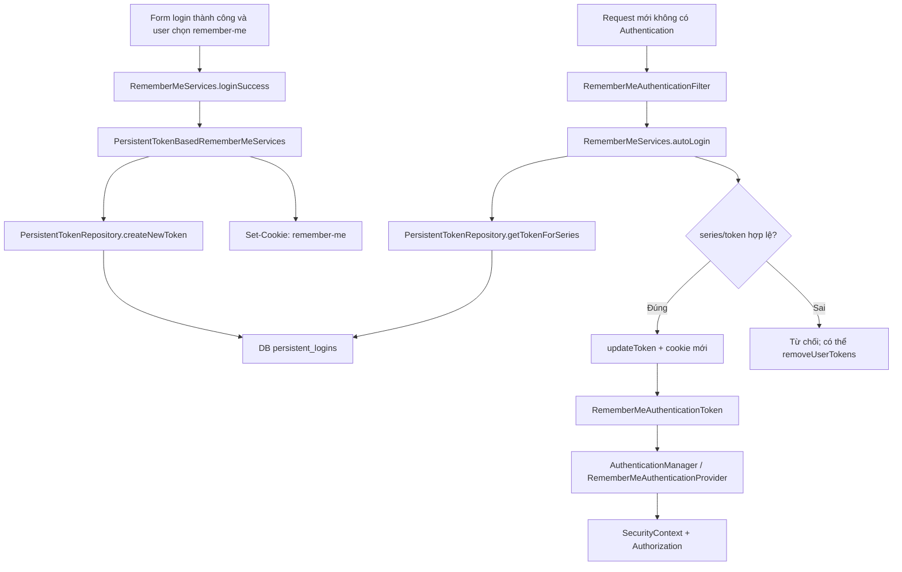
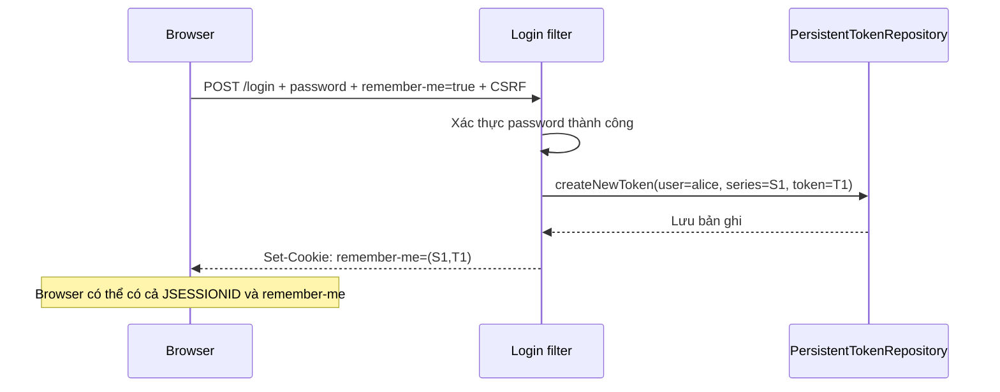

# PersistentTokenBasedRememberMeServices và PersistentTokenRepository trong Spring Security

**Chủ đề:** Ghi nhớ đăng nhập (*Remember Me*) trong Spring Security Servlet. Một phiên đăng nhập HTTP session có thể hết hạn, nhưng ứng dụng vẫn nhận diện lại người dùng từ cookie remember-me được cấp trước đó. Khi cần cơ chế token có thể được lưu trữ, xoay vòng và thu hồi phía server, Spring Security cung cấp **`PersistentTokenBasedRememberMeServices`** cùng **`PersistentTokenRepository`**.

**Mục tiêu:** Hiểu đúng cơ chế `series`/`token`, vòng đời tạo – xác minh – rotate – thu hồi; chọn `JdbcTokenRepositoryImpl` hay tự viết repository; cấu hình Spring Security 6; viết test có thể phân biệt session thông thường với đăng nhập tự động bằng remember-me; nhận ra các rủi ro token replay, cookie theft, song song nhiều request, dữ liệu quá hạn và các tình huống logout không thu hồi như kỳ vọng.

> **Phạm vi bảo mật:** Remember-me là một credential dài hạn trong trình duyệt, **không phải** cookie `JSESSIONID`, không phải JWT access token và không chứng minh MFA/đăng nhập gần đây. Nó có thể tự tái tạo `Authentication` trên request mới. Vì thế hãy giới hạn quyền ở các thao tác nhạy cảm và bảo vệ cookie như một bí mật thực sự.

## 1. Vì sao cần persistent remember-me?

Một web app thông thường có hai cấp trạng thái:

- **Session ngắn hạn:** `HttpSession` giữ `SecurityContext` trong một khoảng thời gian. Trình duyệt gửi `JSESSIONID` để dùng lại trạng thái đã xác thực.
- **Remember-me dài hạn (tùy chọn):** người dùng đánh dấu “Ghi nhớ đăng nhập” khi login. Server cấp cookie riêng. Sau này, nếu `SecurityContext` không có `Authentication`, Spring Security có thể dùng cookie ấy để tự nhận diện lại user mà không yêu cầu nhập mật khẩu ngay.

Ví dụ:

```text
10:00  Alice đăng nhập bằng form với "remember-me".
       Response có cookie session + cookie remember-me.

10:30  Session ngắn hạn bị xóa hoặc browser mở lại không còn JSESSIONID.
       Remember-me cookie vẫn còn trong phạm vi thời hạn.

10:31  Browser GET /api/me với cookie remember-me.
       Spring Security xác minh persistent token qua server-side store.
       Nếu hợp lệ, request được xác thực bằng RememberMeAuthenticationToken.

10:31  Server rotate token, cập nhật store và gửi remember-me cookie mới.
       Request sau phải sử dụng cookie mới đó.
```

Không phải ứng dụng nào cũng nên bật remember-me: môi trường tài chính, admin, máy dùng chung, các thao tác đòi MFA hay thông tin cực nhạy có thể cần yêu cầu đăng nhập lại. **Thời hạn remember-me** và **thời hạn session** là hai chính sách riêng.

### Hai cách remember-me khác nhau

| Khía cạnh | `TokenBasedRememberMeServices` (hash-based) | `PersistentTokenBasedRememberMeServices` |
| --- | --- | --- |
| Bằng chứng trong cookie | Giá trị có chữ ký/hash phụ thuộc username, thời hạn, password và key | Cặp `series` + `token` ngẫu nhiên được mã hóa để đưa vào cookie |
| Cần DB/store token? | Không cần token repository riêng | **Có**: `PersistentTokenRepository` |
| Cách kiểm tra | Tính và so khớp token từ dữ liệu user/key | Tìm `series` trong DB, so token đã cấp |
| Token rotation mỗi lần auto-login | Không theo mô hình persistent rotating token | Có: giữ `series`, tạo token mới, cập nhật DB, phát cookie mới |
| Thu hồi chủ động | Thường phải thay password/key hoặc mở rộng thiết kế | `removeUserTokens(username)`, xóa bản ghi/chiến lược riêng |
| Rủi ro | Cookie bị đánh cắp có thể bị dùng đến khi hết hạn hoặc dữ liệu ký thay đổi | Cookie bị đánh cắp vẫn là credential; replay token cũ có thể kích hoạt phát hiện mismatch |
| Mức độ phù hợp | Yêu cầu đơn giản, chấp nhận giới hạn thu hồi | Cần quản lý, xoay vòng và audit credential tốt hơn |

Persistent token được ưu tiên khi muốn kiểm soát ở phía server, **nhưng không miễn nhiễm** token theft, race condition hoặc thiếu kiểm tra user-state. Cả hai loại đều yêu cầu `UserDetailsService` để nạp người dùng khi xác thực remember-me.

## 2. Các thành phần và trách nhiệm



**`PersistentTokenBasedRememberMeServices`** là implementation của `RememberMeServices`, có nhiệm vụ tạo cookie/bản ghi khi login thành công, đọc token trên request mới, xoay vòng token, kiểm tra thời hạn, gọi repository và hủy credential khi logout phù hợp. Constructor chính của nó nhận `key`, `UserDetailsService`, `PersistentTokenRepository`.

**`PersistentTokenRepository`** là abstraction chứa dữ liệu persistent login. Nó không tự xác thực password, không cấp JWT và không quản lý `HttpSession`. Bốn phương thức:

```java
void createNewToken(PersistentRememberMeToken token);
void updateToken(String series, String tokenValue, Date lastUsed);
PersistentRememberMeToken getTokenForSeries(String seriesId);
void removeUserTokens(String username);
```

Giải thích:

| Phương thức | Ai gọi / khi nào | Điều phải bảo đảm |
| --- | --- | --- |
| `createNewToken(...)` | Login thành công có bật remember-me | Lưu `username`, `series` duy nhất, token ban đầu, `lastUsed`; ràng buộc uniqueness |
| `getTokenForSeries(seriesId)` | Auto-login từ cookie | Trả đúng bản ghi hoặc `null` nếu không tồn tại; tuyệt đối không tin username tự khai trong cookie |
| `updateToken(series,newValue,lastUsed)` | Token vừa được xác minh thành công | Thay token của series hiện hữu, cập nhật thời điểm; xử lý transaction/race theo chính sách |
| `removeUserTokens(username)` | Logout/thu hồi/cookie theft detection tùy ngữ cảnh | Thu hồi các series của người dùng; chú ý phạm vi **tất cả phiên remember-me** của user |

Các implementation sẵn có:

- **`JdbcTokenRepositoryImpl`:** lưu qua `DataSource` và bảng `persistent_logins`; thích hợp làm điểm bắt đầu khi app đã có SQL DB.
- **`InMemoryTokenRepositoryImpl`:** hữu ích cho test hoặc demo nhưng không bền vững qua restart và không chia sẻ giữa nhiều instance.
- **Custom `PersistentTokenRepository`:** dành cho Redis/SQL tùy chỉnh hoặc hệ thống cần per-device management, TTL, atomic rotation, telemetry. Phải giữ đúng ý nghĩa contract và kiểm soát dữ liệu nhạy cảm.

**Không nhầm:** repository này quản lý token remember-me, không phải `UserDetailsRepository`, `OAuth2AuthorizedClientService`, session store hay bảng refresh token của OAuth2.

## 3. Cookie persistent: cấu trúc `series` + `token`

Trong implementation persistent, remember-me cookie mã hóa hai thành phần:

```text
remember-me=<giá-trị-cookie-đã-mã-hóa>

Bên trong logic (không phải chuỗi gửi trực tiếp):
    series = định danh ngẫu nhiên ổn định của một chuỗi đăng nhập
    token  = bí mật ngẫu nhiên đang có hiệu lực của chuỗi đó
```

Không lưu username trực tiếp làm một trong hai thành phần. Server tra `username` từ bản ghi có `series` trùng trong `PersistentTokenRepository`.

Ví dụ dữ liệu **giả lập**:

| username | series | token | last_used |
| --- | --- | --- | --- |
| alice | `SERIES-A` | `TOKEN-V1` | 2026-01-01 09:00:00 |
| alice | `SERIES-B` | `TOKEN-OTHER` | 2026-01-02 10:00:00 |

Hai record này đại diện hai chuỗi remember-me riêng của Alice, **không nhất thiết** là hai `HttpSession` đang hoạt động. Trong thực tế series/token là chuỗi ngẫu nhiên đủ entropy; các chữ `SERIES-A`, `TOKEN-V1` chỉ để minh họa thuật toán.

### 3.1. Login thành công: tạo series + token mới



Token thường được tạo trong hook `loginSuccess` của cơ chế login chuẩn. Checkbox cần thực sự được gửi với tham số `remember-me` (hoặc tên custom). Nếu user không chọn, không nên cấp cookie persistent. `alwaysRemember(true)` bỏ qua sự lựa chọn này và thay đổi chính sách UX/bảo mật, chỉ dùng khi có chủ đích.

### 3.2. Request kế tiếp: verify rồi rotate

Khi session không còn `Authentication`, `RememberMeAuthenticationFilter` gọi `autoLogin`. Implementation:

1. Đọc và giải mã cookie: phải có đúng hai phần `series`, `token`.
2. Tìm bản ghi bằng `getTokenForSeries(series)`.
3. Không thấy series: từ chối auto-login.
4. Có series nhưng token không khớp: xử lý như **nghi ngờ cookie theft/replay**; implementation gọi `removeUserTokens(username)` rồi ném `CookieTheftException`.
5. Token khớp nhưng đã quá thời hạn: từ chối.
6. Hợp lệ: tạo **token mới** `T2`, gọi `updateToken(S1,T2,newDate)`, trả cookie chứa `(S1,T2)`.
7. Nạp `UserDetails`, tạo `RememberMeAuthenticationToken`; Spring Security kiểm tra bằng `RememberMeAuthenticationProvider`/`AuthenticationManager` rồi đưa vào `SecurityContext`.

```text
Trước auto-login:
DB:     series=S1, token=T1, last_used=t1
Cookie: series=S1, token=T1

Sau auto-login thành công:
DB:     series=S1, token=T2, last_used=t2
Cookie: series=S1, token=T2

Cookie T1 cũ không còn là credential hợp lệ.
```

**Rotation thay token, không tạo series mới**. `JSESSIONID` là một khái niệm khác; request có session hợp lệ và đã có `Authentication` thường không cần auto-login lại bằng remember-me.

### 3.3. Vì sao mismatch được coi là dấu hiệu nghi ngờ đánh cắp?

Nếu bản ghi của `S1` đang là `T2`, nhưng client trình `S1/T1`, thì có thể ai đó giữ bản cookie cũ. Mặc định class này xử lý mạnh: xóa các persistent token của user theo repository rồi báo `CookieTheftException`. Trường hợp này là **chỉ báo**, không phải bằng chứng pháp lý chắc chắn đã bị tấn công: có thể hai request đồng thời dùng cùng cookie cũ hoặc response cookie mới chưa được browser cập nhật.

```mermaid
sequenceDiagram
    participant A as Browser Tab A
    participant B as Browser Tab B
    participant S as Server/Repository
    Note over A,B: Cả hai mang cookie S1,T1
    A->>S: Auto-login với S1,T1
    S->>S: Token T1 hợp lệ, rotate thành T2
    S-->>A: Set-Cookie S1,T2
    B->>S: Request khác vẫn mang S1,T1
    S->>S: Mismatch T1 với T2
    S-->>B: Từ chối; có thể thu hồi token của user
```

Đây là vấn đề **race/replay** cần test với SPA gửi song song nhiều API call khi session vừa hết hạn, load balancer, multi-tab và độ trễ mạng. Implementation mặc định không có transaction compare-and-swap cho mọi repository tùy biến; nếu cần concurrency mạnh, hãy thiết kế lớp token storage/rotation cẩn thận, cân nhắc retry policy có bảo đảm và không vô tình mở đường replay. Không đơn giản tắt phát hiện mismatch để “giảm lỗi”.

## 4. Schema và JdbcTokenRepositoryImpl

Spring Security cung cấp schema bảng phổ biến sau; chỉnh dialect/migration theo database:

```sql
CREATE TABLE persistent_logins (
    username VARCHAR(64) NOT NULL,
    series VARCHAR(64) PRIMARY KEY,
    token VARCHAR(64) NOT NULL,
    last_used TIMESTAMP NOT NULL
);

CREATE INDEX idx_persistent_logins_username
    ON persistent_logins(username);
```

Bốn cột cốt lõi có ý nghĩa:

- `username`: tên user để nạp `UserDetails` và thu hồi token của user.
- `series`: khóa duy nhất để tra nhanh và đảm bảo series không bị cấp cho hai user.
- `token`: giá trị bí mật remember-me hiện tại, **không phải** password hash và không phải JWT.
- `last_used`: thời điểm của token được lưu/rotate, phục vụ so với `tokenValiditySeconds` trong implementation.

**An toàn dữ liệu:** DB mặc định lưu giá trị token phục vụ so khớp; hãy coi bảng là dữ liệu nhạy cảm. Giới hạn quyền SELECT/UPDATE/DELETE theo service, backup encryption, log masking, audit và retention. Nếu xây repository riêng để lưu token dưới dạng hash, cần làm rõ contract `getTokenForSeries()` và việc so sánh của service (mặc định so sánh token cookie với chuỗi trả ra); **không thể thay raw token trong DB bằng hash một cách ngây thơ** rồi mong code có sẵn xác thực được.

### 4.1. Thời hạn: cookie expiry không đồng nghĩa DB tự dọn

Đặt `tokenValiditySeconds` chẳng hạn 7 ngày. Remember-me service kiểm tra thời điểm của token trong store cộng thời hạn, và từ chối token quá hạn. Nhưng bản ghi quá hạn **không tự bị xóa chỉ vì đã bị từ chối**; cần job riêng để dọn DB khi dùng lâu dài.

Ví dụ cleanup đơn giản (minh họa SQL, cách viết interval tùy DB):

```sql
-- Ví dụ PostgreSQL: thời hạn 7 ngày.
DELETE FROM persistent_logins
WHERE last_used < (CURRENT_TIMESTAMP - INTERVAL '7 days');
```

Trong production, thời hạn cleanup phải nhất quán với `tokenValiditySeconds`, timezone, clock skew và chính sách retention. Vì mỗi auto-login hợp lệ cập nhật `last_used`, expiration trong thiết kế này có thể mang tính **gia hạn theo hoạt động**; nếu cần giới hạn tuyệt đối từ lần đầu cấp, lưu thêm `created_at` ở custom repository/logic hoặc yêu cầu reauthentication riêng.

### 4.2. Không dùng setCreateTableOnStartup ở production

`JdbcTokenRepositoryImpl` có cách hỗ trợ tự tạo schema để demo, nhưng không nên dựa vào nó để migrate database production. Dùng Flyway/Liquibase hoặc migration đã được review; bảo đảm chạy schema đúng một lần, có kiểm soát quyền và rollback. Trong demo bên dưới dùng `schema.sql` với H2 nhúng để dễ thực hành.

### 4.3. Bền vững trong cụm nhiều instance

Nếu ứng dụng chạy nhiều instance:

- Tất cả phải tra **cùng** persistent token store đủ nhất quán.
- Rotation cập nhật DB trước khi phát cookie mới; nếu response mất trên mạng, client vẫn có thể giữ token cũ gây mismatch lần sau.
- Hạ tầng cần giám sát lỗi kết nối DB; auto-login không nên “cho qua” khi repository unreachable.
- Tránh lưu token cache lâu mà không invalidation, vì `updateToken` ở instance A phải được instance B nhìn thấy.
- Cân nhắc kiểm soát cạnh tranh khi nhiều request cùng một series đến đồng thời; test phân tán là bắt buộc nếu hệ thống có yêu cầu ổn định cao.

## 5. Lab Spring Boot 3 / Spring Security 6 / Java 17: remember-me JDBC

Lab sau có **source hoàn chỉnh** cho một ứng dụng minh họa, dùng H2 embedded. Nó chứng minh:

- Đăng nhập form chỉ cấp remember-me khi người dùng chọn `remember-me`.
- Cookie remember-me tồn tại độc lập với `JSESSIONID`.
- Request mới **chỉ với remember-me cookie** tự xác thực Alice và rotate token.
- Endpoint nhạy cảm có `.fullyAuthenticated()` sẽ **không chấp nhận** authentication dạng remember-me; muốn vào phải nhập credential đầy đủ.
- Repository có bản ghi và có thể bị thu hồi.

### 5.1. Cấu trúc

```text
persistent-rememberme-lab/
├── pom.xml
└── src/
    ├── main/java/example/RememberMeApplication.java
    ├── main/resources/schema.sql
    ├── main/resources/application.properties
    └── test/java/example/RememberMeApplicationTests.java
```

### 5.2. Maven dependencies

`pom.xml`:

```xml
<project xmlns="http://maven.apache.org/POM/4.0.0"
         xmlns:xsi="http://www.w3.org/2001/XMLSchema-instance"
         xsi:schemaLocation="http://maven.apache.org/POM/4.0.0 https://maven.apache.org/xsd/maven-4.0.0.xsd">
    <modelVersion>4.0.0</modelVersion>
    <parent>
        <groupId>org.springframework.boot</groupId>
        <artifactId>spring-boot-starter-parent</artifactId>
        <version>3.3.9</version>
        <relativePath/>
    </parent>
    <groupId>example</groupId>
    <artifactId>persistent-rememberme-lab</artifactId>
    <version>1.0.0</version>
    <properties><java.version>17</java.version></properties>
    <dependencies>
        <dependency>
            <groupId>org.springframework.boot</groupId>
            <artifactId>spring-boot-starter-web</artifactId>
        </dependency>
        <dependency>
            <groupId>org.springframework.boot</groupId>
            <artifactId>spring-boot-starter-security</artifactId>
        </dependency>
        <dependency>
            <groupId>org.springframework.boot</groupId>
            <artifactId>spring-boot-starter-jdbc</artifactId>
        </dependency>
        <dependency>
            <groupId>com.h2database</groupId>
            <artifactId>h2</artifactId>
            <scope>runtime</scope>
        </dependency>
        <dependency>
            <groupId>org.springframework.boot</groupId>
            <artifactId>spring-boot-starter-test</artifactId>
            <scope>test</scope>
        </dependency>
        <dependency>
            <groupId>org.springframework.security</groupId>
            <artifactId>spring-security-test</artifactId>
            <scope>test</scope>
        </dependency>
    </dependencies>
    <build>
        <plugins>
            <plugin>
                <groupId>org.springframework.boot</groupId>
                <artifactId>spring-boot-maven-plugin</artifactId>
            </plugin>
        </plugins>
    </build>
</project>
```

Spring Boot 3.3.9 là mốc học tập phù hợp API Spring Security 6; triển khai thật cần chọn phiên bản còn được hỗ trợ và đã được vá.

### 5.3. Bảng lưu token

`src/main/resources/schema.sql`:

```sql
CREATE TABLE persistent_logins (
    username VARCHAR(64) NOT NULL,
    series VARCHAR(64) PRIMARY KEY,
    token VARCHAR(64) NOT NULL,
    last_used TIMESTAMP NOT NULL
);

CREATE INDEX idx_persistent_logins_username
    ON persistent_logins (username);
```

`src/main/resources/application.properties`:

```properties
spring.datasource.url=jdbc:h2:mem:rememberme;DB_CLOSE_DELAY=-1
spring.datasource.username=sa
spring.datasource.password=
spring.sql.init.mode=always
```

Đây là DB in-memory nên **không bền qua khởi động lại JVM**. Sản phẩm thật sẽ thay bằng PostgreSQL/MySQL/DB managed và migration; không bật H2 console ra internet.

### 5.4. Java app cấu hình PersistentTokenRepository

`src/main/java/example/RememberMeApplication.java`:

```java
package example;

import java.util.Map;
import javax.sql.DataSource;

import org.springframework.boot.SpringApplication;
import org.springframework.boot.autoconfigure.SpringBootApplication;
import org.springframework.context.annotation.Bean;
import org.springframework.http.HttpStatus;
import org.springframework.security.config.Customizer;
import org.springframework.security.config.annotation.web.builders.HttpSecurity;
import org.springframework.security.core.Authentication;
import org.springframework.security.core.userdetails.User;
import org.springframework.security.core.userdetails.UserDetailsService;
import org.springframework.security.crypto.factory.PasswordEncoderFactories;
import org.springframework.security.crypto.password.PasswordEncoder;
import org.springframework.security.provisioning.InMemoryUserDetailsManager;
import org.springframework.security.web.SecurityFilterChain;
import org.springframework.security.web.authentication.HttpStatusEntryPoint;
import org.springframework.security.web.authentication.rememberme.JdbcTokenRepositoryImpl;
import org.springframework.security.web.authentication.rememberme.PersistentTokenRepository;
import org.springframework.web.bind.annotation.GetMapping;
import org.springframework.web.bind.annotation.RestController;

@SpringBootApplication
public class RememberMeApplication {
    public static void main(String[] args) {
        SpringApplication.run(RememberMeApplication.class, args);
    }

    @Bean
    PasswordEncoder passwordEncoder() {
        return PasswordEncoderFactories.createDelegatingPasswordEncoder();
    }

    @Bean
    UserDetailsService users(PasswordEncoder encoder) {
        return new InMemoryUserDetailsManager(
                User.withUsername("alice")
                        .password(encoder.encode("demo-password"))
                        .roles("USER")
                        .build());
    }

    @Bean
    PersistentTokenRepository persistentTokenRepository(DataSource dataSource) {
        JdbcTokenRepositoryImpl repository = new JdbcTokenRepositoryImpl();
        repository.setDataSource(dataSource);
        // schema.sql tạo bảng một cách tường minh.
        return repository;
    }

    @Bean
    SecurityFilterChain webSecurity(
            HttpSecurity http,
            UserDetailsService users,
            PersistentTokenRepository tokenRepository) throws Exception {
        return http
                .authorizeHttpRequests(auth -> auth
                        .requestMatchers("/login", "/error").permitAll()
                        .requestMatchers("/api/sensitive").fullyAuthenticated()
                        .anyRequest().authenticated())
                .formLogin(Customizer.withDefaults())
                .rememberMe(remember -> remember
                        .userDetailsService(users)
                        .tokenRepository(tokenRepository)
                        .key("lab-only-change-this-key-in-production")
                        .rememberMeParameter("remember-me")
                        .tokenValiditySeconds(7 * 24 * 60 * 60))
                .exceptionHandling(ex -> ex.authenticationEntryPoint(
                        new HttpStatusEntryPoint(HttpStatus.UNAUTHORIZED)))
                .build();
    }

    @RestController
    static class Api {
        @GetMapping("/api/me")
        Map<String, String> me(Authentication authentication) {
            return Map.of(
                    "username", authentication.getName(),
                    "authType", authentication.getClass().getSimpleName());
        }

        @GetMapping("/api/sensitive")
        Map<String, String> sensitive(Authentication authentication) {
            return Map.of(
                    "username", authentication.getName(),
                    "status", "fully-authenticated");
        }
    }
}
```

**Tại sao config này chọn implementation persistent?**

- `.tokenRepository(tokenRepository)` là điểm quan trọng. Khi cấu hình remember-me bằng DSL và cung cấp repository, framework dùng persistent token approach thay vì chỉ dùng hash-based approach mặc định.
- `.userDetailsService(users)` chỉ rõ cách nạp `UserDetails` sau khi series/token hợp lệ.
- `.rememberMeParameter("remember-me")` cho phép người dùng chọn khi POST login. Không bật `alwaysRemember(true)` trong bài tập.
- `.tokenValiditySeconds(...)` quy định khoảng thời hạn. Nó không phải idle timeout của `HttpSession`.
- `.key(...)` giữ tính nhất quán của remember-me authentication infrastructure; lab dùng giá trị cố định để tái lập. **Production:** lấy secret/key từ hệ thống quản lý bí mật, xoay vòng theo kế hoạch và không commit key thật vào source.
- `.fullyAuthenticated()` bảo vệ endpoint nhạy cảm khỏi việc coi remember-me authentication tương đương đăng nhập đầy đủ. Khi truy cập, client phải thực hiện đăng nhập tương tác để lấy cấp xác thực phù hợp. Nếu endpoint đòi MFA, vẫn cần policy MFA riêng; `.fullyAuthenticated()` không tự xác minh MFA.
- Spring Security vẫn bật CSRF mặc định. Form `POST /login` và `POST /logout` phải mang CSRF token hợp lệ. Cookie remember-me **được browser tự gửi** nên không phải lý do để tắt CSRF.

**Cần lưu ý về flow thực tế:** Remember-me được cấp khi authentication filter gọi hook `loginSuccess(...)`; nếu ứng dụng tự tạo endpoint JSON login/controller, chỉ gọi `AuthenticationManager.authenticate(...)` rồi trả `200` **không tự động gọi remember-me hooks**. Custom flow phải tích hợp `RememberMeServices`, session strategies và context persistence một cách tường minh, hoặc dùng authentication filter thích hợp. Không đưa raw password/remember-me cookie vào JSON response hay log.

## 6. Integration test: chứng minh session và remember-me khác nhau

`MockMvc` giúp chạy qua Spring Security filters mà không cần mở port HTTP thật. Test bên dưới **chủ động không truyền session** ở request sau để chứng minh nó được xác thực từ remember-me cookie.

Tạo `src/test/java/example/RememberMeApplicationTests.java`:

```java
package example;

import jakarta.servlet.http.Cookie;

import org.junit.jupiter.api.BeforeEach;
import org.junit.jupiter.api.Test;
import org.springframework.beans.factory.annotation.Autowired;
import org.springframework.boot.test.autoconfigure.web.servlet.AutoConfigureMockMvc;
import org.springframework.boot.test.context.SpringBootTest;
import org.springframework.jdbc.core.JdbcTemplate;
import org.springframework.mock.web.MockHttpSession;
import org.springframework.security.web.authentication.rememberme.PersistentTokenRepository;
import org.springframework.test.web.servlet.MockMvc;
import org.springframework.test.web.servlet.MvcResult;

import static org.assertj.core.api.Assertions.assertThat;
import static org.springframework.security.test.web.servlet.request
        .SecurityMockMvcRequestBuilders.formLogin;
import static org.springframework.security.test.web.servlet.request
        .SecurityMockMvcRequestPostProcessors.csrf;
import static org.springframework.test.web.servlet.request
        .MockMvcRequestBuilders.get;
import static org.springframework.test.web.servlet.request
        .MockMvcRequestBuilders.post;
import static org.springframework.test.web.servlet.result
        .MockMvcResultMatchers.jsonPath;
import static org.springframework.test.web.servlet.result
        .MockMvcResultMatchers.status;

@SpringBootTest
@AutoConfigureMockMvc
class RememberMeApplicationTests {
    @Autowired
    MockMvc mvc;
    @Autowired
    JdbcTemplate jdbc;
    @Autowired
    PersistentTokenRepository tokens;

    @BeforeEach
    void clearRememberMeTokens() {
        tokens.removeUserTokens("alice");
    }

    private MvcResult login(boolean remember) throws Exception {
        var request = formLogin()
                .user("alice")
                .password("demo-password");
        if (remember) {
            request.param("remember-me", "true");
        }
        return mvc.perform(request)
                .andExpect(status().is3xxRedirection())
                .andReturn();
    }

    private int tokenCount() {
        Integer count = jdbc.queryForObject(
                "SELECT COUNT(*) FROM persistent_logins WHERE username = ?",
                Integer.class, "alice");
        return count == null ? 0 : count;
    }

    @Test
    void optInCreatesPersistentTokenAndAutoLoginRotatesCookie()
            throws Exception {
        MvcResult signedIn = login(true);
        Cookie original = signedIn.getResponse().getCookie("remember-me");
        assertThat(original).isNotNull();
        assertThat(tokenCount()).isEqualTo(1);

        // Không truyền MockHttpSession từ login:
        // browser mới chỉ có remember-me cookie, không có JSESSIONID.
        MvcResult remembered = mvc.perform(get("/api/me").cookie(original))
                .andExpect(status().isOk())
                .andExpect(jsonPath("$.username").value("alice"))
                .andExpect(jsonPath("$.authType")
                        .value("RememberMeAuthenticationToken"))
                .andReturn();

        Cookie rotated = remembered.getResponse().getCookie("remember-me");
        assertThat(rotated).isNotNull();
        assertThat(rotated.getValue()).isNotEqualTo(original.getValue());
        assertThat(tokenCount()).isEqualTo(1); // Cùng series, token mới.

        // Remember-me đủ cho /api/me nhưng KHÔNG đủ cho /api/sensitive.
        mvc.perform(get("/api/sensitive").cookie(rotated))
                .andExpect(status().isUnauthorized());
    }

    @Test
    void noOptInDoesNotCreatePersistentToken() throws Exception {
        MvcResult signedIn = login(false);
        assertThat(signedIn.getResponse().getCookie("remember-me")).isNull();
        assertThat(tokenCount()).isZero();

        mvc.perform(get("/api/me"))
                .andExpect(status().isUnauthorized());
    }

    @Test
    void reusingOldCookieAfterRotationRevokesRememberMeTokens()
            throws Exception {
        Cookie original = login(true)
                .getResponse().getCookie("remember-me");
        assertThat(original).isNotNull();

        MvcResult accepted = mvc.perform(get("/api/me").cookie(original))
                .andExpect(status().isOk())
                .andReturn();
        Cookie current = accepted.getResponse().getCookie("remember-me");
        assertThat(current).isNotNull();

        // Replay old token với series còn tồn tại -> mismatch;
        // mặc định PersistentTokenBasedRememberMeServices xóa token user.
        mvc.perform(get("/api/me").cookie(original))
                .andExpect(status().isUnauthorized());
        assertThat(tokenCount()).isZero();

        mvc.perform(get("/api/me").cookie(current))
                .andExpect(status().isUnauthorized());
    }

    @Test
    void logoutWithAuthenticatedSessionRevokesUserTokens()
            throws Exception {
        MvcResult signedIn = login(true);
        MockHttpSession authenticatedSession =
                (MockHttpSession) signedIn.getRequest().getSession(false);
        assertThat(authenticatedSession).isNotNull();
        assertThat(tokenCount()).isEqualTo(1);

        // SecurityContext có Authentication tại thời điểm LogoutFilter chạy.
        mvc.perform(post("/logout")
                        .session(authenticatedSession)
                        .with(csrf()))
                .andExpect(status().is3xxRedirection());

        assertThat(tokenCount()).isZero();
    }
}
```

Chạy:

```bash
mvn test
```

**Kỳ vọng:** bốn test PASS và Maven kết thúc bằng `BUILD SUCCESS` khi dependencies và môi trường được thiết lập chính xác. Đây là **kết quả dự kiến** của bài hướng dẫn, không phải log đã chạy. `MockMvc` giả lập HTTP request/filter và cookie đã chọn; nó không tự mô phỏng đầy đủ browser profile, persistence sau restart hay concurrency của nhiều node.

### 6.1. Phân tích ý nghĩa từng test

**Test 1:** Có opt-in, database có một bản ghi. Sau đó request thứ hai **không có session** mà chỉ mang cookie remember-me; kết quả `RememberMeAuthenticationToken` cho biết đó là auto-login chứ không phải session cũ. Cookie mới khác cookie ban đầu và số dòng vẫn là một: cùng series đã được rotate.

**Test 2:** Không có checkbox `remember-me`, login vẫn có thể thành công bằng session, nhưng không cấp persistent cookie. Request mới không có session/remember-me phải không được xác thực.

**Test 3:** Cookie trước rotation không được chấp nhận lại. Với mặc định Spring Security, mismatch cùng series được coi là nghi ngờ token theft, và repository xóa các remember-me token của user. Đây là hành vi bảo vệ chống replay **nhưng cũng có thể bị kích hoạt bởi hai request song song** dùng cookie cũ.

**Test 4:** Logout trong lúc có một `Authentication` từ session có thể gọi `removeUserTokens(username)`. Vì API repository chỉ có xóa theo username, logout này có thể làm mất remember-me ở các thiết bị khác của cùng user. Cần đánh giá UX “logout thiết bị này” và “logout tất cả thiết bị” theo hợp đồng sản phẩm.

### 6.2. Giới hạn của test logout

`LogoutFilter` nằm trước `RememberMeAuthenticationFilter` trong chuỗi filter thông thường. Nếu client gửi **chỉ cookie remember-me** đến `/logout` và không có session authentication, handler logout có thể được gọi với `authentication == null` trước khi remember-me auto-login diễn ra. Khi đó implementation vẫn hủy cookie trên response nhưng **không nhất thiết thu hồi hàng trong repository** vì không biết username từ `Authentication`.

Vì vậy test logout ở trên chủ động dùng **session đã xác thực**. Khi thiết kế yêu cầu thu hồi chắc chắn cả lúc session mất, cần một luồng “revoke remember-me credential” được xác thực phù hợp và kiểm soát CSRF, hoặc cơ chế thu hồi khác theo chính sách. Không tự đọc chuỗi cookie trong controller rồi xóa tài khoản tùy ý; đó là credential cần kiểm chứng và xử lý an toàn.

### 6.3. Test HTTP và trình duyệt ngoài MockMvc

Trên môi trường đã chạy với cookie H2 demo:

1. Mở form `/login`, bật “Remember me” và đăng nhập.
2. DevTools → Application/Cookies: quan sát `JSESSIONID` và `remember-me` là **hai cookie khác nhau**.
3. Gửi request `/api/me`, xác nhận auth type của lần đăng nhập đầy đủ; cookie remember-me có thể chưa rotate nếu session đang cung cấp Authentication.
4. Trong một **profile/HTTP client tách biệt**, gửi chỉ `remember-me` cookie: `/api/me` sẽ tự login nếu cookie/token còn hợp lệ, nhận cookie đã rotate.
5. Dùng cookie cũ so sánh; sau mismatch, những remember-me token của user có thể bị thu hồi.
6. Vào `/api/sensitive` chỉ bằng remember-me: bị từ chối theo `fullyAuthenticated()`. Đăng nhập đầy đủ rồi thử lại.
7. Xác minh logout, password change và reset/revocation theo policy.

**Không đưa raw remember-me cookie/series/token vào ảnh chụp, log, ticket hoặc public source**, vì đó là credential có thể dùng để đăng nhập.

## 7. Bảo mật, thu hồi và vận hành production

### 7.1. Cookie là credential dài hạn

- Luôn dùng **HTTPS/TLS** và cờ `Secure` trên production. `HttpOnly` để giảm truy cập trực tiếp của JavaScript; `SameSite` và `Path`/`Domain` theo nhu cầu client.
- Vì browser tự gửi cookie remember-me, **CSRF vẫn phải được đánh giá** cho các thao tác thay đổi trạng thái. `SameSite` chỉ hỗ trợ giảm rủi ro, không thay thế hoàn toàn chính sách CSRF.
- Không dùng remember-me như bằng chứng MFA. Với thao tác đổi mật khẩu, chuyển tiền, quản trị hoặc thay đổi email, yêu cầu reauthentication/step-up theo policy. `.fullyAuthenticated()` giúp phân biệt remember-me từ full login nhưng **không tự kiểm tra MFA**.
- Ngăn XSS, session fixation, rò cookie qua logging/proxy và cache; giới hạn thời hạn remember-me đủ ngắn so với mức nhạy cảm của ứng dụng.
- Không mở rộng cookie domain sang toàn bộ subdomain nếu không cần thiết. Nếu có app ít tin cậy ở subdomain khác, domain-wide cookies có thể tăng bề mặt tấn công.

### 7.2. Thu hồi khi đổi password, khóa user hoặc xóa tài khoản

`PersistentTokenBasedRememberMeServices` dùng repository và nạp user, nhưng **không tự suy ra** mọi nghiệp vụ password change hay user disable. Hãy kết hợp các sự kiện:

```java
// ĐOẠN MINH HỌA trong account service đã xác thực user
// (không phải một controller độc lập):
userService.changePasswordForCurrentUser(newPassword);
persistentTokenRepository.removeUserTokens(currentUsername);
```

Đây là pseudocode nghiệp vụ, không phải toàn bộ flow transaction. Khi đổi password/khóa tài khoản, chính sách phải quyết định thu hồi remember-me, session và các token khác. Nếu thay đổi password nhưng không xóa `persistent_logins`, một cookie persistent vẫn có thể được xác minh bằng series/token và nạp `UserDetails` mới. Phải viết test bảo đảm policy thu hồi đúng.

### 7.3. Logout một thiết bị hay logout tất cả?

Với API mặc định `removeUserTokens(String username)`, không có phương thức “xóa một series” trong interface tiêu chuẩn. Nếu app muốn danh sách thiết bị và logout từng thiết bị:

- Tạo schema/abstraction riêng có định danh thiết bị và metadata giới hạn.
- Chỉ thu hồi series đã được xác minh và thuộc đúng tài khoản, không dựa vào user-controlled identifier.
- Phân quyền route thu hồi, yêu cầu xác thực lại cho thao tác nhạy cảm và chống CSRF.
- Không lộ raw token trong danh sách thiết bị. Cân nhắc session/remember-me là hai kho credential khác nhau cần quản lý đồng bộ.

Một người dùng nhấn “Logout” có thể chỉ mong thoát thiết bị hiện tại; hệ thống cần mô tả rõ nếu nó thu hồi tất cả remember-me tokens. Không coi xóa cookie ở browser là tương đương xóa bản ghi phía server.

### 7.4. Timeouts, cleanup và giám sát

- Dùng `tokenValiditySeconds` cho remember-me, `server.servlet.session.timeout` cho session. Không trộn hai khoảng thời gian.
- Dọn bản ghi quá hạn vì service có thể **từ chối token mà chưa xóa hàng DB**.
- Theo dõi số bản ghi theo user và tuổi của token; giới hạn số series theo chính sách rủi ro. Giám sát số lần mismatch, lỗi update DB, pattern retry và false positive do concurrency.
- `JdbcTokenRepositoryImpl` có thể thất bại khi tạo/update token. Login thành công bằng password không bảo đảm remember-me đã được cấp nếu DB lỗi; kiểm tra `Set-Cookie` và store khi test.
- Nếu mất kết nối DB trong auto-login, phải từ chối remember-me, không “tin cookie vì DB đang lỗi”.
- Trong cluster, tất cả instance phải dùng store nhất quán và giữ remember-me key đồng bộ. Test multi-tab/multi-request và response cookie rotation.

## 8. Chẩn đoán khi remember-me không hoạt động

| Triệu chứng | Nguyên nhân thường gặp | Cách kiểm chứng |
| --- | --- | --- |
| Login thành công nhưng không có cookie remember-me | Checkbox/parameter không gửi, `rememberMe` chưa cấu hình, hook loginSuccess không chạy, DB create lỗi | Kiểm tra request form, key param, filter/remember-me config, server log không lộ token |
| Có cookie nhưng không có dòng DB | Chưa dùng persistent repository hoặc ghi DB thất bại | Kiểm tra `.tokenRepository(...)`, đúng datasource/schema và transaction |
| Có dòng DB nhưng browser vẫn bị yêu cầu login | Cookie không gửi do domain/path/SameSite/Secure, session/auth xử lý khác, token hết hạn | DevTools Network, `getTokenForSeries`, logs tổng quát, policy |
| Cookie đúng series nhưng token khác DB | Token đã rotate, replay/race hoặc cookie bị sao chép | Kiểm tra trình tự request và báo động mismatch; không log token thô |
| Cookie rotate nhưng response bị mất | Client giữ token cũ, lần sau mismatch | Theo dõi timeout/retry/load balancer, thiết kế concurrency và UX đăng nhập lại |
| Restart làm mất remember-me | Dùng `InMemoryTokenRepositoryImpl` hoặc DB H2 in-memory | Dùng persistent DB dùng chung |
| `/api/me` hoạt động, `/api/sensitive` trả 401 | Remember-me authenticated nhưng endpoint đòi `fullyAuthenticated()` | Kiểm tra auth type và security rule, yêu cầu full login |
| Logout chỉ xóa cookie nhưng DB còn | Logout handler không có `Authentication` hoặc custom logout chưa thu hồi | Kiểm tra thứ tự filter, `logout(Authentication)` và policy |
| Đổi password nhưng cookie cũ vẫn vào được | Chưa xóa persistent tokens khi đổi password | Tích hợp account lifecycle với `removeUserTokens` |
| Bảng DB tăng liên tục | Service không tự xóa mọi token quá hạn | Scheduled cleanup, retention và quota |
| Nhiều request đồng thời làm user bị đăng xuất | Cùng cookie cũ bị rotate ở một request, request khác nhận mismatch | Load test song song, giám sát retry, thiết kế atomicity/grace phù hợp |
| HTTP 403 trên POST dù remember-me hợp lệ | CSRF thiếu/sai hoặc authorization không đủ | Phân biệt CSRF và auth, không tắt CSRF chỉ để vượt lỗi |

**Không kết luận bằng status code đơn lẻ.** `401` có thể do không có authentication, cookie không hợp lệ hoặc endpoint đòi full login; `403` có thể do thiếu quyền hoặc CSRF. Xem security chain, server event, repository và request mới thực sự mang gì.

## 9. Những sai lầm cần tránh

1. **“Remember-me cookie chính là JSESSIONID.”** Sai. Remember-me có thể tự xác thực lại **khi session không còn** và credential dài hạn khác với session ID.
2. **“Có `PersistentTokenRepository` thì chắc chắn JWT.”** Sai. Repository giữ series/token riêng của remember-me; không phải OAuth2 access/refresh-token store.
3. **“Cookie đã được mã hóa base64 nên không ai đọc hoặc dùng được.”** Sai. Base64 là biểu diễn, không phải mã hóa bảo mật; cookie là bearer credential. Phải bảo vệ chống bị đánh cắp.
4. **“Token xoay vòng thì cookie bị đánh cắp không thể dùng.”** Sai. Kẻ cầm cookie hiện tại có thể dùng trước chủ sở hữu; rotation giúp giảm replay và phát hiện mismatch, không ngăn mọi dạng theft.
5. **“Mismatch luôn chứng minh có attacker.”** Sai. Hai request song song hoặc mất response có thể khiến cùng series xuất hiện token cũ. Phải điều tra trước khi gán nguyên nhân.
6. **“Logout tự xóa mọi token ở mọi trường hợp.”** Sai. Implementation xóa theo username khi có `Authentication`; nếu logout không có danh tính, chỉ hủy cookie có thể không đủ.
7. **“Đổi password tự thu hồi persistent token.”** Không nên dựa vào điều đó. Khi business policy yêu cầu, phải chủ động xóa token và test.
8. **“Hết hạn 7 ngày thì DB tự dọn.”** Sai. Việc service từ chối quá hạn không thay thế cleanup job.
9. **“`authenticated()` là đủ cho chuyển tiền.”** Không. Remember-me cũng được xem là authenticated. Dùng reauthentication/step-up hoặc `.fullyAuthenticated()` khi phù hợp, cộng MFA nếu policy yêu cầu.
10. **“Dùng `InMemoryTokenRepositoryImpl` cho cluster production.”** Sai. Restart và nhiều instance sẽ làm dữ liệu không nhất quán.
11. **“Chỉ cần cài `PersistentTokenBasedRememberMeServices` là JSON login custom tự cấp cookie.”** Sai nếu custom controller không gọi `RememberMeServices.loginSuccess(...)` đúng lúc.
12. **“Cookie còn thì session còn.”** Sai. Cookie remember-me có thể vẫn còn khi `HttpSession` đã hết, và chỉ tạo auth mới khi có filter hợp lệ.

## 10. Checklist triển khai và kiểm thử

- [ ] Có nhu cầu remember-me thực sự; UX opt-in rõ, không dùng mặc định cho thiết bị chia sẻ hoặc hành động rủi ro cao.
- [ ] Chọn `PersistentTokenBasedRememberMeServices` và `PersistentTokenRepository` đúng cách, không trộn với JWT hay session store.
- [ ] Schema `persistent_logins` có `series` duy nhất, quyền DB tối thiểu và migration kiểm soát.
- [ ] Login opt-in tạo một series/token ngẫu nhiên, lưu DB rồi cấp cookie; không opt-in thì không tạo.
- [ ] Request không có session nhưng có cookie hợp lệ tạo `RememberMeAuthenticationToken`.
- [ ] Auto-login rotate token, giữ series; cookie cũ không còn hợp lệ.
- [ ] Cookie mismatch, series không tồn tại, cookie sai cấu trúc và token quá hạn đều bị từ chối theo policy.
- [ ] Negative test cho replay/mismatch và song song nhiều request; có xử lý UX phù hợp nhưng không vô hiệu hóa kiểm soát bảo mật.
- [ ] API nhạy cảm đòi full login/MFA khi cần; remember-me không tự nâng assurance.
- [ ] Cookie có Secure/HttpOnly/SameSite/Path/Domain phù hợp; HTTPS bắt buộc ở production; CSRF vẫn được bảo vệ.
- [ ] Logout có `Authentication` phải thu hồi đúng token; kiểm tra luồng logout không có session và khác biệt “một thiết bị/tất cả”.
- [ ] Password change, disable account, reset credentials và user deletion có chính sách thu hồi remember-me rõ ràng.
- [ ] Cleanup token quá hạn, audit lỗi repository và giám sát token-theft signals không tiết lộ raw token.
- [ ] Multi-instance cùng store, retry/race và rotation được kiểm thử dưới tải thực tế.
- [ ] Test end-to-end trên trình duyệt/HTTP client thật bên cạnh MockMvc; xác minh thông qua cookie và data store thay vì chỉ nhìn response `200`.

**Ghi nhớ:** `PersistentTokenBasedRememberMeServices` xử lý **logic remember-me**; `PersistentTokenRepository` xử lý **trạng thái token bền vững**. Mỗi auto-login hợp lệ cần xác minh series/token, cập nhật token và cookie, rồi mới tạo danh tính remember-me. Hãy coi remember-me là một credential có thể bị mất cắp và cần thời hạn, thu hồi, kiểm thử concurrency và phân cấp quyền rõ ràng.

## Tài liệu chính thức

- [Spring Security 6.5 — Remember-Me Authentication](https://docs.spring.io/spring-security/reference/6.5/servlet/authentication/rememberme.html): hai implementation và các hook `RememberMeServices`.
- [Spring Security 6.5 — PersistentTokenBasedRememberMeServices API](https://docs.spring.io/spring-security/reference/6.5/api/java/org/springframework/security/web/authentication/rememberme/PersistentTokenBasedRememberMeServices.html): tạo, xác minh, rotate token và `CookieTheftException`.
- [Spring Security — PersistentTokenRepository API](https://docs.spring.io/spring-security/reference/api/java/org/springframework/security/web/authentication/rememberme/PersistentTokenRepository.html): bốn phương thức repository.
- [Spring Security — Database Schema](https://docs.spring.io/spring-security/reference/6.5/servlet/appendix/database-schema.html): bảng `persistent_logins`.
- [Spring Security — Authentication Persistence](https://docs.spring.io/spring-security/reference/6.5/servlet/authentication/session-management.html): `SecurityContext` và session.
- [Spring Security — CSRF](https://docs.spring.io/spring-security/reference/servlet/exploits/csrf.html): cookie tự gửi và các request thay đổi trạng thái.