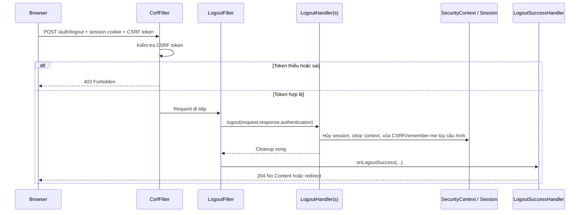

# HTTP method và yêu cầu CSRF đối với thao tác đăng xuất (Spring Security Servlet)

## 1. Câu trả lời ngắn: logout là thao tác thay đổi trạng thái

**Đăng xuất không phải một thao tác đọc dữ liệu.** Nó làm mất hiệu lực phiên đăng nhập, dọn `SecurityContext`, có thể xóa remember-me và CSRF token. Vì thế, trong ứng dụng web sử dụng cookie/session, nên thực hiện logout bằng **HTTP POST có CSRF token hợp lệ**, không phải bằng liên kết GET trực tiếp.

Đối với **Spring Security 6.x (Servlet)**:

- Khi CSRF được **bật** (mặc định), `LogoutFilter` xử lý logout bằng **`POST /logout`**. Nếu dùng trang giao diện mặc định, `GET /logout` thường hiển thị trang xác nhận có biểu mẫu POST chứa CSRF token; GET đó **chưa đăng xuất**.
- Khi CSRF bị **tắt**, `LogoutConfigurer.logoutUrl(...)` mặc định cho phép các HTTP method, bao gồm GET, kích hoạt logout. Vì vậy việc vô hiệu hóa CSRF có thể vô tình biến logout thành một thay đổi trạng thái qua GET.
- Khi đổi URL với `logout.logoutUrl("/auth/logout")`, quy tắc POST khi CSRF bật vẫn áp dụng. Tuy nhiên đừng mặc định rằng URL tùy chỉnh có một trang GET xác nhận được tạo sẵn; nếu cần UI xác nhận riêng, hãy tự xây trang hiển thị và gửi form POST.
- `permitAll()` chỉ quyết định endpoint có cần user đã xác thực ở tầng authorization hay không; **nó không làm request vượt qua CsrfFilter**.

**Phạm vi:** Spring Boot 3.x, Spring Security 6.x, Java 17+, Servlet/Spring MVC, ứng dụng có login bằng HTTP session cookie. Trọng tâm là quan hệ **HTTP method ↔ CSRF ↔ `LogoutFilter`**. Những khác biệt với API thuần bearer token, OIDC/SSO, Spring Session và WebFlux sẽ được phân biệt để tránh áp dụng sai.

### Mục tiêu sau bài học

Bạn có thể giải thích được vì sao GET logout không an toàn, cấu hình POST logout mà không phải viết controller thủ công, cung cấp CSRF token cho form/SPA, kiểm tra trạng thái trước và sau logout, chẩn đoán `403` do thiếu token, và đánh giá đúng trường hợp ứng dụng API stateless có thể dùng chính sách CSRF khác.

## 2. HTTP method nào phù hợp với logout?

Theo ngữ nghĩa HTTP, `GET`, `HEAD`, `OPTIONS` và `TRACE` được xem là nhóm phương thức an toàn (safe) cho mục đích chọn các request không cần kiểm tra CSRF theo cấu hình mặc định của Spring Security. Logout **thay đổi trạng thái bảo mật**, vì vậy không nên dùng GET làm hành động logout.

| Method | Kỳ vọng đối với ứng dụng session-based | CSRF mặc định trong Spring Security | Ghi chú |
|---|---|---|---|
| `GET /logout` | Trang xác nhận trong UI mặc định; không nên trực tiếp hủy phiên | Không cần token cho GET | GET có thể được trình duyệt/crawler/prefetch truy cập |
| `POST /logout` | **Thực hiện logout** | **Bắt buộc token hợp lệ** nếu CSRF bật | Luồng mặc định an toàn cho ứng dụng dùng cookie |
| `POST /auth/logout` | Thực hiện logout khi `logoutUrl("/auth/logout")` | **Bắt buộc token hợp lệ** | URL được cấu hình, không phải MVC controller riêng |
| `DELETE /sessions/current` | Có thể dùng trong API tự thiết kế | DELETE là unsafe nên thường cần token với session cookie | Phải cấu hình matcher, handler và bảo mật rõ; không phải mặc định |
| `GET /auth/logout` | Không thực hiện logout trong cấu hình ví dụ của bài | GET không kiểm CSRF | Có thể 404/redirect/hiển thị trang khác tùy app |
| `HEAD`/`OPTIONS`/`TRACE` | Không thiết kế chúng để thu hồi session | Mặc định ngoài tập request cần CSRF | Đừng mở matcher logout cho mọi method khi CSRF tắt |

**Cẩn thận với câu “GET /logout không làm gì”:** phát biểu đó chỉ chắc chắn với cấu hình phù hợp, ví dụ mặc định có CSRF bật. Nếu CSRF bị tắt hoặc đã cấu hình `logoutRequestMatcher` chấp nhận GET, logout **có thể được kích hoạt bằng GET**. Luôn kiểm tra SecurityFilterChain đang áp dụng.

### Vì sao phải bảo vệ logout bằng CSRF?

CSRF (Cross-Site Request Forgery) xảy ra khi kẻ tấn công khiến browser của nạn nhân gửi request đến ứng dụng mà browser đã có credentials tự động đính kèm, ví dụ session cookie.

Một website bên ngoài có thể đặt link, tự tải tài nguyên, điều hướng, hoặc dùng một form để khiến browser gửi request về site của bạn. Cookie phù hợp có thể được browser gắn tự động, dù người dùng không định thực hiện hành động đó.

Nếu `GET /logout` làm mất phiên, một liên kết hay hành động điều hướng ngoài ý muốn có thể **cưỡng ép người dùng đăng xuất**. Đây thường được gọi là *logout CSRF*. Mức độ ảnh hưởng không chỉ là gây phiền: một số tình huống login CSRF/logout CSRF kết hợp có thể dẫn đến nhầm lẫn danh tính hoặc làm gián đoạn luồng bảo mật.

Đổi sang POST **chưa đủ** nếu endpoint chấp nhận mọi POST không có CSRF protection. Một trang bên ngoài cũng có thể gửi form POST. CSRF token được sinh/kiểm tra bởi server và liên kết với ngữ cảnh client hợp lệ giúp chặn request mạo danh không chứng minh được chủ ý của phiên.

`SameSite` cookie, CORS, `Origin`/`Referer` check là các lớp bổ sung hoặc biện pháp trong threat model cụ thể; **không thay thế một cách máy móc CSRF token** cho mọi ứng dụng dựa vào cookie.

## 3. Spring Security xử lý POST logout theo thứ tự nào?

Với Spring Security Servlet, các thành phần liên quan gồm:

- `CsrfFilter`: kiểm tra token trên các HTTP method không an toàn như POST.
- `LogoutFilter`: nhận diện request logout hợp lệ rồi gọi tập `LogoutHandler`.
- `SecurityContextLogoutHandler`: mặc định vô hiệu HTTP session, xóa authentication/context hiện hành và xử lý repository tương ứng.
- `CsrfLogoutHandler`: xóa CSRF token cũ.
- Remember-me logout handler nếu remember-me được cấu hình.
- `LogoutSuccessHandler`: sau cleanup, chuyển hướng hoặc trả một HTTP status theo cấu hình.
- `AuthorizationFilter`: xử lý rule truy cập tài nguyên; `LogoutFilter` được đặt **trước** nó.

Sơ đồ khái quát:



**Một request POST bị CsrfFilter từ chối thường chưa tới `LogoutFilter`**, nên session đăng nhập phải còn hiệu lực nếu không có điều kiện khác tác động. Đây là khác biệt quan trọng giữa **“CSRF logout bị chặn”** và **“đã logout nhưng response không như mong muốn”**.

### Mặc định sẽ xóa những gì?

Với hỗ trợ logout tiêu chuẩn và session login thông thường, Spring Security thường:

1. Vô hiệu hóa HTTP session hiện tại.
2. Dọn `SecurityContextHolder` và nội dung context mà framework quản lý.
3. Dọn remember-me nếu cấu hình tương ứng có hiệu lực.
4. Xóa CSRF token hiện hành.
5. Phát sự kiện logout thành công và chạy success handler.
6. Chuyển hướng về `/login?logout` theo mặc định, hoặc trả status nếu bạn tùy biến.

Không suy luận rằng logout một session **thu hồi mọi phiên khác** trên điện thoại/laptop, JWT access token, refresh token, OIDC session tại Identity Provider hay kết nối WebSocket đã mở. Đây là các cơ chế với vòng đời riêng.

## 4. So sánh cấu hình mặc định và những tùy biến nguy hiểm

### 4.1. Mặc định khi có CSRF

```java
@Bean
SecurityFilterChain chain(HttpSecurity http) throws Exception {
    http
        .authorizeHttpRequests(authorize ->
            authorize.anyRequest().authenticated())
        .formLogin(Customizer.withDefaults())
        .csrf(Customizer.withDefaults())
        .logout(Customizer.withDefaults());
    return http.build();
}
```

Đây là **fragment trong một class `@Configuration`** với các import Spring tương ứng; phần thực hành bên dưới sẽ cung cấp class đầy đủ. Với hỗ trợ form login và trang mặc định:

- `GET /logout`: trang xác nhận (khi trang logout mặc định được bật và có CSRF).
- `POST /logout` kèm CSRF hợp lệ: logout rồi redirect về `/login?logout`.
- `POST /logout` thiếu/sai token: thường `403 Forbidden`.
- `GET /logout` không phải bằng chứng người dùng đã rời phiên, vì nó chỉ là bước hiển thị xác nhận.

Nếu ứng dụng tự viết giao diện và không dùng trang mặc định, vẫn nên dùng POST có token; không cần triển khai GET confirmation nếu UX đã có nút logout.

### 4.2. Khi CSRF bị tắt: không còn bảo đảm POST-only

```java
// PHẢN VÍ DỤ cho ứng dụng browser sử dụng session cookie:
http.csrf(AbstractHttpConfigurer::disable);
```

Theo API `LogoutConfigurer` của Spring Security 6.5, khi CSRF protection bị vô hiệu, matcher logout cấu hình bởi `logoutUrl` cho phép các HTTP method, không còn giới hạn POST mặc định. Kết quả có thể là **`GET /logout` trực tiếp hủy phiên**.

Đừng tắt CSRF toàn ứng dụng chỉ để “bấm nút logout cho tiện”, hoặc để sửa một test `403`. Bạn đang làm thay đổi phạm vi bảo vệ **mọi request thay đổi trạng thái**, không chỉ logout.

Nếu cần thay đổi method cho một API chuyên biệt, phải bảo đảm matcher chỉ nhận method định trước và áp dụng kiểm chứng phù hợp. Cách đơn giản, an toàn và dễ bảo trì nhất cho session-based website vẫn là **POST + CSRF token**.

### 4.3. “Để GET /logout rồi Spring Security vẫn bảo vệ CSRF” có được không?

Không nên. CSRF bảo vệ các HTTP method unsafe theo matcher mặc định; GET là phương thức safe nên thông thường không cần token. Buộc GET logout làm thao tác thay đổi trạng thái gây lệch với ngữ nghĩa HTTP và dễ bị điều hướng/prefetch tự động.

Nếu muốn dùng **liên kết hiển thị “Đăng xuất”**, cho liên kết trỏ tới **trang xác nhận chỉ đọc**, rồi nút bên trong trang gửi form POST. Hoặc dùng JavaScript để POST trực tiếp với CSRF token hợp lệ; vẫn phải hiển thị trạng thái UX rõ ràng.

## 5. Ví dụ hoàn chỉnh: form login, POST logout, CSRF và 204 No Content

Ví dụ dùng Spring Boot 3.x + Spring Security 6.x + Java 17+, Servlet/Spring MVC. Chúng ta sử dụng **form login mặc định** để có session thật và một **logout URL tùy chỉnh** cho API trả `204` thay vì redirect:

| Endpoint | Method | Ý nghĩa |
|---|---|---|
| `GET /login` | GET | Trang form login do Spring Security cung cấp |
| `POST /login` | POST | Form login; CSRF token được yêu cầu |
| `GET /api/csrf` | GET | Trả token cho client để gửi request unsafe |
| `GET /api/me` | GET | Cho biết principal hiện tại; cần xác thực |
| `POST /auth/logout` | POST | **Logout thật**, cần CSRF token, trả `204` |
| `GET /auth/logout` | GET | **Không** thực hiện logout trong demo; không tạo controller GET |

Với một dự án có Spring Boot plugin và Gradle wrapper, thêm các dependency:

```groovy
dependencies {
    implementation 'org.springframework.boot:spring-boot-starter-web'
    implementation 'org.springframework.boot:spring-boot-starter-security'

    testImplementation 'org.springframework.boot:spring-boot-starter-test'
    testImplementation 'org.springframework.security:spring-security-test'
}
```

Không cần tự viết filter/controller logout. `LogoutFilter` của Spring Security đã quản lý lifecycle, session, context và CSRF như cấu hình.

### 5.1. Main class

Tạo `src/main/java/com/example/logoutcsrf/LogoutCsrfApplication.java`:

```java
package com.example.logoutcsrf;

import org.springframework.boot.SpringApplication;
import org.springframework.boot.autoconfigure.SpringBootApplication;

@SpringBootApplication
public class LogoutCsrfApplication {
    public static void main(String[] args) {
        SpringApplication.run(LogoutCsrfApplication.class, args);
    }
}
```

### 5.2. SecurityConfig: logoutUrl và CSRF bật

Tạo `src/main/java/com/example/logoutcsrf/SecurityConfig.java`:

```java
package com.example.logoutcsrf;

import org.springframework.context.annotation.Bean;
import org.springframework.context.annotation.Configuration;
import org.springframework.http.HttpStatus;
import org.springframework.security.config.Customizer;
import org.springframework.security.config.annotation.web.builders.HttpSecurity;
import org.springframework.security.config.annotation.web.configuration.EnableWebSecurity;
import org.springframework.security.core.userdetails.User;
import org.springframework.security.core.userdetails.UserDetailsService;
import org.springframework.security.crypto.bcrypt.BCryptPasswordEncoder;
import org.springframework.security.crypto.password.PasswordEncoder;
import org.springframework.security.provisioning.InMemoryUserDetailsManager;
import org.springframework.security.web.SecurityFilterChain;
import org.springframework.security.web.authentication.HttpStatusEntryPoint;
import org.springframework.security.web.authentication.logout.HttpStatusReturningLogoutSuccessHandler;

@Configuration
@EnableWebSecurity
public class SecurityConfig {

    @Bean
    PasswordEncoder passwordEncoder() {
        return new BCryptPasswordEncoder();
    }

    @Bean
    UserDetailsService userDetailsService(PasswordEncoder encoder) {
        return new InMemoryUserDetailsManager(
            User.withUsername("alice")
                .password(encoder.encode("alice-secret"))
                .roles("USER")
                .build()
        );
    }

    @Bean
    SecurityFilterChain securityFilterChain(HttpSecurity http)
            throws Exception {

        http
            .authorizeHttpRequests(authorize -> authorize
                .requestMatchers("/login", "/api/csrf", "/error")
                    .permitAll()
                .anyRequest().authenticated()
            )
            .formLogin(Customizer.withDefaults())
            .csrf(Customizer.withDefaults())
            .logout(logout -> logout
                .logoutUrl("/auth/logout")
                .invalidateHttpSession(true)
                .clearAuthentication(true)
                .logoutSuccessHandler(
                    new HttpStatusReturningLogoutSuccessHandler(
                        HttpStatus.NO_CONTENT
                    )
                )
                .permitAll()
            )
            .exceptionHandling(exceptions -> exceptions
                .authenticationEntryPoint(
                    new HttpStatusEntryPoint(HttpStatus.UNAUTHORIZED)
                )
            );

        return http.build();
    }
}
```

**Điểm cần quan sát:**

1. `.csrf(Customizer.withDefaults())` giữ bảo vệ CSRF. Với cấu hình mặc định, Spring Security sử dụng `HttpSessionCsrfTokenRepository`; token được tạo/đưa vào request theo cơ chế deferred token và handler của phiên bản đang chạy.
2. `.logoutUrl("/auth/logout")` định tuyến logout cho `LogoutFilter`. Khi CSRF bật, mặc định **chỉ POST** mới thực hiện thao tác.
3. `.logoutSuccessHandler(new HttpStatusReturningLogoutSuccessHandler(HttpStatus.NO_CONTENT))` đổi response sau logout thành **204**, phù hợp frontend gọi API. Nó **không** thay đổi yêu cầu CSRF.
4. `invalidateHttpSession(true)` và `clearAuthentication(true)` được ghi tường minh để người học thấy tác dụng mong muốn; chúng đã là hành vi thông thường của logout.
5. `.permitAll()` trong logout DSL thuận tiện cho endpoint tùy chỉnh. Vì `LogoutFilter` chạy trước `AuthorizationFilter`, nó không đồng nghĩa “bỏ CSRF” và thường không cần thêm matcher logout vào `authorizeHttpRequests`.
6. `formLogin(Customizer.withDefaults())` cung cấp quy trình đăng nhập session; login chuẩn xử lý session strategy, session fixation và security context phù hợp.
7. `HttpStatusEntryPoint(HttpStatus.UNAUTHORIZED)` giúp request vào tài nguyên cần xác thực nhưng chưa có session nhận `401`. Trang login `/login` vẫn là endpoint được phép truy cập.

Lưu ý: logout URL mặc định là `/logout`. Ví dụ đã đổi nó thành `/auth/logout`. Vì vậy `GET /logout` hoặc `POST /logout` **không phải** các request demo dùng để logout; cần gọi đúng `POST /auth/logout`.

### 5.3. Controller: trả CSRF token và danh tính hiện tại

Tạo `src/main/java/com/example/logoutcsrf/ApiController.java`:

```java
package com.example.logoutcsrf;

import java.util.Map;
import org.springframework.security.core.Authentication;
import org.springframework.security.web.csrf.CsrfToken;
import org.springframework.web.bind.annotation.GetMapping;
import org.springframework.web.bind.annotation.RestController;

@RestController
public class ApiController {

    @GetMapping("/api/csrf")
    public CsrfToken csrf(CsrfToken token) {
        return token;
    }

    @GetMapping("/api/me")
    public Map<String, String> me(Authentication authentication) {
        return Map.of("username", authentication.getName());
    }
}
```

`GET /api/csrf` là endpoint cho client cùng origin/trusted frontend đọc token. JSON thường chứa `headerName`, `parameterName` và `token`. Với mặc định, header phổ biến là `X-CSRF-TOKEN` và parameter là `_csrf`. Client nên dùng tên header **được server trả về**, không hardcode nếu cấu hình repository thay đổi.

Không ghi CSRF token hoặc session cookie vào log; không trả token cho origin không đáng tin thông qua CORS sai cấu hình. CSRF token bảo vệ request unsafe nhưng **không** bảo vệ trước XSS đã chạy được JavaScript trong origin của ứng dụng.

### 5.4. Chạy thử

Từ root dự án có Gradle wrapper và Spring Boot plugin:

```bash
./gradlew bootRun
```

Windows PowerShell:

```powershell
.\gradlew.bat bootRun
```

Mở `http://localhost:8080/login` để thấy trang login mặc định. Người dùng demo: username `alice`, password `alice-secret`. Đây là tài khoản local chỉ để học; production cần nguồn người dùng, password hashing, MFA và bảo vệ login phù hợp.

## 6. Thử bằng curl: GET không logout, POST thiếu CSRF bị 403

Các lệnh dưới đây dùng **Bash**, `curl` và `jq`; nếu không có `jq`, có thể xem JSON từ `/api/csrf` rồi gửi giá trị token tương ứng bằng công cụ HTTP khác. File `cookies.txt` chứa session cookie nên chỉ dùng trong môi trường local.

### Bước 1: lấy token và cookie cùng một phiên

```bash
curl -sS -c cookies.txt -b cookies.txt \
  http://localhost:8080/api/csrf > csrf.json

CSRF_TOKEN=$(jq -r '.token' csrf.json)
```

HTTP `200`; việc lấy CSRF token thường dẫn đến lưu một session vì token được gắn với session. Có session cookie **chưa có nghĩa đã đăng nhập**.

### Bước 2: đăng nhập bằng POST form với CSRF

```bash
curl -i -c cookies.txt -b cookies.txt \
  -H "X-CSRF-TOKEN: $CSRF_TOKEN" \
  --data-urlencode 'username=alice' \
  --data-urlencode 'password=alice-secret' \
  http://localhost:8080/login
```

Đây là **form login**, không phải login JSON. Kết quả login thành công thường là HTTP `302` do success handler của form login chuyển hướng. Đừng dùng `-L` khi muốn quan sát response gốc của POST login.

Kiểm tra session sau login:

```bash
curl -i -b cookies.txt http://localhost:8080/api/me
```

Kỳ vọng `200 OK` với JSON chứa `"username":"alice"`. Đây là mốc **trước logout** dùng để đối chiếu.

### Bước 3: GET URL logout tùy chỉnh

```bash
curl -i -b cookies.txt http://localhost:8080/auth/logout
curl -i -b cookies.txt http://localhost:8080/api/me
```

Vì demo chỉ cấu hình xử lý logout với **POST** và không có MVC handler GET tại URL này, GET có thể nhận `404`/trạng thái khác tùy error handling. **Không dùng chính mã trạng thái GET làm bằng chứng**; hãy kiểm tra request `/api/me` ngay sau đó vẫn trả `200` với Alice. Nghĩa là GET **không thu hồi phiên**.

Nếu dùng URL mặc định `/logout` với giao diện mặc định và CSRF bật, GET có thể trả trang xác nhận; đó là **cách trình bày UI khác**, không làm thay đổi nguyên tắc POST mới thực thi logout.

### Bước 4: POST logout nhưng không có token

```bash
curl -i -c cookies.txt -b cookies.txt \
  -X POST http://localhost:8080/auth/logout

curl -i -b cookies.txt http://localhost:8080/api/me
```

Kỳ vọng:

- `POST /auth/logout` thiếu token trả **403 Forbidden**.
- `GET /api/me` ngay sau vẫn trả **200**; vì request logout bị chặn trước khi cleanup, session của Alice chưa bị vô hiệu hóa.
- Nếu trình duyệt/client gặp `403` ở bước logout, không sửa bằng `csrf.disable()` hoặc đổi logout sang GET; hãy kiểm tra cookie và token có thuộc **cùng session**, còn hiệu lực hay không.

### Bước 5: lấy CSRF token mới sau login rồi POST logout hợp lệ

Spring Security có thể xóa token CSRF trước login khi xác thực thành công thông qua `CsrfAuthenticationStrategy`. Vì vậy **không dùng lại token ở Bước 1 một cách vô điều kiện**. Lấy lại token bằng cookie của phiên đã đăng nhập:

```bash
CSRF_TOKEN=$(curl -sS -c cookies.txt -b cookies.txt \
  http://localhost:8080/api/csrf | jq -r '.token')

curl -i -c cookies.txt -b cookies.txt \
  -H "X-CSRF-TOKEN: $CSRF_TOKEN" \
  -X POST http://localhost:8080/auth/logout
```

Kỳ vọng **204 No Content**. Đây là HTTP status do `HttpStatusReturningLogoutSuccessHandler` được cấu hình, khác response redirect `302` của logout mặc định.

Kiểm tra sau logout:

```bash
curl -i -b cookies.txt http://localhost:8080/api/me
```

Kỳ vọng **401 Unauthorized**: browser vẫn có thể còn cookie cũ trong jar, nhưng server đã vô hiệu session. Nếu muốn gọi một POST mới trên một phiên khác, client phải tạo/lấy token CSRF tương ứng với phiên đó; token cũ đã bị `CsrfLogoutHandler` xóa.

### Phân biệt các phản hồi

| Giai đoạn | Request | Status kỳ vọng | Phiên Alice |
|---|---|---|---|
| Trước login | `GET /api/me` | 401 | Chưa có |
| Sau login | `GET /api/me` | 200 | Hợp lệ |
| Thử GET logout | `GET /auth/logout` | Tùy route, không có ý nghĩa logout | Vẫn hợp lệ |
| Logout POST không token | `POST /auth/logout` | **403** | Vẫn hợp lệ |
| Logout POST token đúng | `POST /auth/logout` | **204** | Bị vô hiệu |
| Sau logout | `GET /api/me` | **401** | Không còn hợp lệ |

Các status trong bảng là kỳ vọng của **cấu hình ví dụ**; app khác có thể dùng redirect, error page và exception handlers khác. Yếu tố phải test là **trạng thái authentication trước/sau request**, không chỉ response của endpoint logout.

## 7. Thực hiện nút Logout trong trình duyệt

### 7.1. Trình duyệt và HTML form

Một trang server-rendered dùng Thymeleaf có thể có form:

```html
<form method="post" th:action="@{/auth/logout}">
  <button type="submit">Đăng xuất</button>
</form>
```

Trong tích hợp Thymeleaf + Spring Security CSRF đúng cách, `RequestDataValueProcessor` hỗ trợ thêm CSRF hidden input cho form POST. Khi tự render HTML hoặc dùng template engine không tích hợp, **phải render CSRF token thành hidden input** với tên parameter và giá trị đúng theo `CsrfToken` của request; không trông chờ form thuần tự có token.

**Không dùng**:

```html
<a href="/auth/logout">Đăng xuất</a>
```

nếu ý định là hủy session ngay. Anchor tạo GET nên không kích hoạt POST logout hợp lệ trong demo; nếu một cấu hình cũ cho phép GET logout, anchor đó lại tạo rủi ro logout CSRF.

Nếu cần hỗ trợ người dùng tắt JavaScript, form POST là giải pháp đơn giản. Không cần một JavaScript handler chỉ để gửi form.

### 7.2. SPA dùng fetch với header token

Nếu frontend và backend cùng origin, mã JavaScript sau lấy CSRF token sau login và gọi logout bằng POST:

```javascript
async function logout() {
  const csrfResponse = await fetch("/api/csrf", {
    credentials: "same-origin"
  });

  if (!csrfResponse.ok) {
    throw new Error("Cannot load CSRF token");
  }

  const csrf = await csrfResponse.json();

  const response = await fetch("/auth/logout", {
    method: "POST",
    credentials: "same-origin",
    headers: {
      [csrf.headerName]: csrf.token
    }
  });

  if (!response.ok) {
    throw new Error("Logout rejected");
  }

  // Khi response là 204, không gọi response.json().
  // Xóa UI state nhạy cảm, chuyển đến trang public.
  window.location.assign("/login");
}
```

Nội dung cần đọc kỹ:

- `credentials: "same-origin"` cho phép browser gửi cookie session của origin hiện tại; với cross-origin hợp lệ có thể cần `credentials: "include"` và CORS/cookie phù hợp.
- Header token lấy từ `csrf.headerName` do server cung cấp. Không gửi token trong query string URL, vì URL dễ đi vào log, history và referrer.
- Logout `204` **không có body**. Đừng gọi `response.json()` vì không có JSON để parse.
- Sau logout thành công, frontend cần loại bỏ dữ liệu nhạy cảm đang lưu trong state/bộ nhớ/cache, không tiếp tục hiển thị màn hình yêu cầu xác thực.
- Nếu response là `403`, đừng giả vờ logout thành công chỉ bằng cách xóa UI state. Server có thể vẫn giữ session.
- Một client không đáng tin không được quyền tùy ý lấy CSRF token của session qua CORS. Cấu hình credentialed CORS phải giới hạn origin cụ thể.

**Lưu ý SPA và BREACH:** Spring Security 6 có các cơ chế deferred/masked CSRF token; khi dùng `CookieCsrfTokenRepository`, cần cấu hình `CsrfTokenRequestHandler` phù hợp với kiểu token đọc từ cookie/header. Ví dụ ở đây trả token từ endpoint cùng origin và dùng mặc định `HttpSessionCsrfTokenRepository`; không tự thay repository mà bỏ qua phần handler.

## 8. MockMvc: kiểm chứng HTTP method và CSRF trước–sau logout

Test chỉ khẳng định `POST /logout` trả `204` là chưa đủ. Cần chứng minh:

1. Đăng nhập thành công có session thực sự.
2. GET logout **không** vô hiệu session.
3. POST logout không token hoặc sai token bị **403**, session còn dùng được.
4. POST logout có token hợp lệ trả **204**, session bị vô hiệu.
5. Request mới không mang một session hợp lệ trả **401**.

Tạo `src/test/java/com/example/logoutcsrf/LogoutCsrfTest.java`:

```java
package com.example.logoutcsrf;

import org.junit.jupiter.api.Test;
import org.springframework.beans.factory.annotation.Autowired;
import org.springframework.boot.test.autoconfigure.web.servlet.AutoConfigureMockMvc;
import org.springframework.boot.test.context.SpringBootTest;
import org.springframework.mock.web.MockHttpSession;
import org.springframework.test.web.servlet.MockMvc;
import org.springframework.test.web.servlet.MvcResult;

import static org.junit.jupiter.api.Assertions.assertFalse;
import static org.junit.jupiter.api.Assertions.assertNotNull;
import static org.junit.jupiter.api.Assertions.assertTrue;
import static org.springframework.security.test.web.servlet.request
    .SecurityMockMvcRequestPostProcessors.csrf;
import static org.springframework.test.web.servlet.request
    .MockMvcRequestBuilders.get;
import static org.springframework.test.web.servlet.request
    .MockMvcRequestBuilders.post;
import static org.springframework.test.web.servlet.result
    .MockMvcResultMatchers.jsonPath;
import static org.springframework.test.web.servlet.result
    .MockMvcResultMatchers.status;

@SpringBootTest
@AutoConfigureMockMvc
class LogoutCsrfTest {

    @Autowired
    MockMvc mvc;

    private MockHttpSession loginAlice() throws Exception {
        MvcResult result = mvc.perform(post("/login")
                .with(csrf())
                .param("username", "alice")
                .param("password", "alice-secret"))
            .andExpect(status().is3xxRedirection())
            .andReturn();

        MockHttpSession session =
            (MockHttpSession) result.getRequest().getSession(false);
        assertNotNull(session);
        return session;
    }

    @Test
    void authenticatedSessionWorksBeforeLogout() throws Exception {
        MockHttpSession session = loginAlice();

        mvc.perform(get("/api/me").session(session))
            .andExpect(status().isOk())
            .andExpect(jsonPath("$.username").value("alice"));
    }

    @Test
    void getLogoutDoesNotInvalidateSession() throws Exception {
        MockHttpSession session = loginAlice();

        // GET /auth/logout không được LogoutFilter cấu hình xử lý.
        // Không ràng buộc status của một URL GET không có controller.
        mvc.perform(get("/auth/logout").session(session))
            .andReturn();

        assertFalse(session.isInvalid());

        mvc.perform(get("/api/me").session(session))
            .andExpect(status().isOk())
            .andExpect(jsonPath("$.username").value("alice"));
    }

    @Test
    void postWithoutCsrfIsRejectedWithoutLoggingOut()
            throws Exception {
        MockHttpSession session = loginAlice();

        mvc.perform(post("/auth/logout").session(session))
            .andExpect(status().isForbidden());

        assertFalse(session.isInvalid());

        mvc.perform(get("/api/me").session(session))
            .andExpect(status().isOk());
    }

    @Test
    void postWithInvalidCsrfIsAlsoRejected() throws Exception {
        MockHttpSession session = loginAlice();

        mvc.perform(post("/auth/logout")
                .session(session)
                .with(csrf().useInvalidToken()))
            .andExpect(status().isForbidden());

        assertFalse(session.isInvalid());
    }

    @Test
    void postWithCsrfInvalidatesSession() throws Exception {
        MockHttpSession session = loginAlice();

        mvc.perform(post("/auth/logout")
                .session(session)
                .with(csrf()))
            .andExpect(status().isNoContent());

        // MockHttpSession đã bị invalidate bởi logout handler.
        assertTrue(session.isInvalid());

        // Không cố tái sử dụng MockHttpSession đã invalidate;
        // request mới không có session được nhận diện là anonymous.
        mvc.perform(get("/api/me"))
            .andExpect(status().isUnauthorized());
    }
}
```

Chạy:

```bash
./gradlew test
```

Windows PowerShell:

```powershell
.\gradlew.bat test
```

`with(csrf())` và `csrf().useInvalidToken()` do `spring-security-test` cung cấp. Chúng giúp MockMvc tạo request có token hợp lệ/sai để kiểm thử CSRF; **không** làm controller bỏ qua filter bảo mật.

### Tại sao không tái sử dụng session sau khi invalidate?

`MockHttpSession` đã invalidated có thể ném exception nếu bạn cố đọc thuộc tính hoặc gắn lại nó vào request sau. Vì thế test kiểm tra `session.isInvalid()` ngay sau logout, rồi tạo request mới không mang session. Với `curl` hoặc integration test HTTP thật, ta có thể gửi **cookie ID cũ** và xác nhận server vẫn không phục hồi authentication, vì HTTP client vẫn có thể gửi cookie ngay cả khi bản ghi server-side bị xóa.

### Có thể dùng helper logout() của Spring Security Test

Với cấu hình mặc định hoặc custom logout URL, Spring Security Test hỗ trợ `logout()` request post-processor/builder:

```java
import static org.springframework.security.test.web.servlet.request
    .SecurityMockMvcRequestBuilders.logout;

// Trong một @Test dùng biến mvc và session đã tạo:
mvc.perform(logout("/auth/logout").session(session))
    .andExpect(status().isNoContent());
```

Đây là **fragment kiểm thử**, không phải class độc lập; helper sẽ tạo POST với CSRF token hợp lệ. Khi học sâu về CSRF, nên có thêm test dùng `post(...)` **không** gọi `with(csrf())` để thấy `403` và khẳng định session còn nguyên. Chỉ dùng helper “happy path” dễ bỏ sót một cấu hình vô tình tắt CSRF.

## 9. Tùy biến logout mà vẫn giữ bảo vệ CSRF

### 9.1. Chỉ cần đổi URL hoặc status

Ưu tiên dùng DSL:

```java
http.logout(logout -> logout
    .logoutUrl("/auth/logout")
    .logoutSuccessHandler(
        new HttpStatusReturningLogoutSuccessHandler(
            HttpStatus.NO_CONTENT)));
```

Nó tận dụng `LogoutFilter` và các handlers dọn session/context, tránh phải viết lại logic nhạy cảm. Khi CSRF còn bật, POST-only vẫn là nguyên tắc mặc định.

Nếu muốn giữ redirect, bỏ custom success handler hoặc cấu hình `logoutSuccessUrl(...)`. HTTP `302` sau logout **không đồng nghĩa lỗi**, mà là một lựa chọn UX; client API dùng `204` thường dễ xử lý hơn.

### 9.2. Tạo endpoint MVC @PostMapping riêng

Ví dụ này dùng **API minh họa**, không nên đặt trùng URL mà `LogoutFilter` đang chiếm quyền xử lý:

```java
@PostMapping("/account/sign-out")
public ResponseEntity<Void> signOut(
        HttpServletRequest request,
        HttpServletResponse response,
        Authentication authentication) {

    SecurityContextLogoutHandler handler =
        new SecurityContextLogoutHandler();

    handler.logout(request, response, authentication);
    return ResponseEntity.noContent().build();
}
```

Đây **chỉ là fragment trong controller có import và cấu hình phù hợp**. Nếu chọn cách này:

- Endpoint phải qua `CsrfFilter` với matcher unsafe và CSRF token đúng.
- Phải cho phép route tại `AuthorizationFilter` phù hợp, vì MVC controller xử lý request **sau** security chain.
- Phải gọi logic logout hoàn chỉnh: xóa context/repository, invalidating session; cân nhắc remember-me, CSRF-token cleanup, logout events và các handler riêng khác.
- Đừng chỉ gọi `SecurityContextHolder.clearContext()` hoặc `request.getSession().invalidate()` rồi cho rằng mọi phần của Spring Security đã được xử lý.
- Spring Security chính thức khuyến nghị dùng `logout` DSL hơn khi có thể, vì dễ bỏ sót handlers quan trọng khi tự viết endpoint.

Đặc biệt, **không** đăng ký một `@PostMapping("/auth/logout")` song song với `logoutUrl("/auth/logout")` rồi kỳ vọng controller được chạy: `LogoutFilter` đứng trước MVC và sẽ xử lý request khớp URL trước.

### 9.3. Nếu product yêu cầu HTTP DELETE?

`DELETE` là một HTTP method thay đổi trạng thái, nên vẫn thuộc nhóm Spring Security CSRF kiểm tra theo mặc định. Tuy nhiên `LogoutConfigurer.logoutUrl` tiêu chuẩn khi CSRF bật khớp POST, không tự động chuyển sang DELETE chỉ vì client gọi `DELETE`.

Muốn hỗ trợ `DELETE /sessions/current` phải thiết kế rõ:

- Request matcher giới hạn đúng method và path, hoặc endpoint MVC riêng xử lý an toàn.
- CSRF token khi browser gửi session cookie và dựa vào ambient credentials.
- Thực thi logout cleanup đầy đủ, bao gồm session/context/remember-me nếu có.
- Test GET/POST/DELETE bất hợp lệ không làm mất session ngoài mong đợi.

Đừng nới matcher thành **tất cả method** để “client nào cũng logout được”. Một hành vi phá vỡ session nên có contract HTTP ổn định, tường minh và dễ kiểm thử.

## 10. Những trường hợp CSRF có thể khác

### 10.1. Ứng dụng thuần backend gọi backend, không dùng browser cookie

Giả sử API hoàn toàn stateless, client tự thêm `Authorization: Bearer ...` vào mỗi request, không có session cookie/remember-me hoặc một cơ chế browser tự động đính kèm credentials. Threat model CSRF có thể khác so với session-based website. Một ứng dụng có thể chủ đích tắt CSRF ở **SecurityFilterChain** dành riêng cho nhóm API này sau khi phân tích đầy đủ.

Nhưng điều đó **không** biến `POST /logout` thành phép thu hồi JWT:

- Resource server thường chỉ xác minh access token cho từng request.
- Dừng gửi token từ client chưa chắc làm token đã phát hết hiệu lực.
- Muốn thu hồi bearer/refresh token, cần token revocation endpoint, denylist/introspection, hạn dùng ngắn hoặc cơ chế khác tùy hệ thống.
- Nếu refresh token, JWT hoặc API key được lưu trong cookie browser tự gửi, rủi ro CSRF có thể quay lại.

**Không gán nhãn “JWT” hay “stateless” rồi mặc định vô hiệu CSRF cho toàn ứng dụng**, nhất là hệ thống hybrid có browser session login và API cùng origin.

### 10.2. SPA cross-origin

Một SPA chạy ở origin khác backend có thể cần:

- CORS giới hạn chính xác frontend origin được tin cậy.
- `Access-Control-Allow-Credentials` khi thực sự cần cookie xuyên origin.
- Cookie `Secure` và `SameSite` phù hợp, thường có yêu cầu HTTPS và chính sách trình duyệt.
- CSRF token có thể lấy qua endpoint được cấp phép cho frontend, không cấp token bừa bãi cho tất cả origin.
- `fetch` với `credentials: "include"` khi muốn gửi cookie cross-origin.
- Kiểm soát XSS, vì XSS chạy trên trusted origin có thể lấy token CSRF từ cùng ứng dụng.

Nếu CSRF token nằm trong session, login/logout có thể xóa token cũ; SPA nên lấy token mới sau các sự kiện xác thực.

### 10.3. Logout qua OIDC/SAML hoặc có remember-me

`POST /logout` của ứng dụng thường xóa session **cục bộ**. Nó không tự kết thúc phiên tại Identity Provider của OIDC/SAML hay thu hồi mọi access/refresh token. Để phối hợp single logout, cần logout success handler hoặc giao thức tương ứng, chẳng hạn OIDC RP-Initiated Logout theo hạ tầng IDP.

CSRF cho **POST logout cục bộ** và giao thức **logout tại Identity Provider** là hai lớp cần phân biệt. Không bỏ CSRF local chỉ vì ứng dụng có SSO.

Nếu có remember-me, Spring Security logout handlers có thể xóa remember-me token/cookie theo cấu hình; dùng custom controller thiếu handlers có thể để browser được xác thực lại sau khi session bị xóa.

## 11. Tại sao POST không có CSRF bị 403 ngay cả khi đã đăng nhập?

**`permitAll` không phải `csrf.ignore`.** CSRF filter không hỏi bạn đã login hay chưa trước khi quyết định token của một unsafe request có hợp lệ không. Một session authenticated vẫn có thể bị `403` vì request logout thiếu token.

Những nguyên nhân thường gặp:

| Triệu chứng | Khả năng xảy ra | Cách xác minh |
|---|---|---|
| `POST /auth/logout` trả `403` | Không có token, sai token, token của session khác | Lấy token mới từ `/api/csrf` cùng cookie, gửi đúng header |
| Đã login nhưng POST vẫn `403` | CSRF token cũ bị xóa khi login | Lấy token **sau login**, không dùng lại token từ trước login |
| Dùng Postman gửi token mà vẫn `403` | Thiếu cookie jar hoặc token thuộc phiên khác | Quan sát `Cookie` request và session ID |
| Logout `204` nhưng frontend báo lỗi JSON parse | Code cố parse body rỗng | Với 204, chỉ kiểm tra `response.ok` |
| Logout POST được `302` | Success handler mặc định chuyển hướng | Test Location header, không coi redirect là thất bại |
| `GET /auth/logout` trả `404` | Demo không cấu hình MVC handler GET cho custom URL | Không chuyển sang GET logout; vẫn dùng POST |
| `GET /logout` thực sự đăng xuất | CSRF bị tắt, hoặc custom matcher cho GET | Đọc `SecurityFilterChain`, kiểm tra `LogoutConfigurer` |
| Logout thành công nhưng GET protected vẫn `200` | HTTP Basic/bearer token được gửi lại, remember-me, session khác, app có filter khác | Xem authentication mechanism ở request sau |
| Token/header bị chặn khi dùng SPA | CORS, SameSite, `credentials` hoặc proxy | Kiểm tra network request và cấu hình browser/proxy |
| Logout không vào controller tùy chỉnh | `LogoutFilter` chặn trước MVC ở cùng URL | Chọn một luồng logout duy nhất |
| Một browser logout, browser khác vẫn đăng nhập | Logout hiện tại không phải “logout all sessions” | Dùng session repository/registry để revoke các session khác |
| `POST` bị `405 Method Not Allowed` | Không có matcher/controller POST đúng URL, hoặc mapping ở chain khác | So khớp method, path, `securityMatcher` và controller |
| `POST` logout bị `401` | Request đang đi qua chain/entry point không phù hợp | Kiểm tra chain áp dụng, CSRF và logout matcher |

### Cách debug không làm lộ dữ liệu

Có thể bật log DEBUG cho Spring Security trên môi trường thử nghiệm, nhưng cần lọc secrets. Không ghi raw cookie, `Authorization`, CSRF token, password, session ID hay toàn bộ security context vào log tập trung.

Nên quan sát:

1. Request method/path đúng `POST /auth/logout` hay không.
2. `CsrfFilter` có bác request vì token không hợp lệ không.
3. `LogoutFilter` có nhận diện logout matcher không.
4. Các `LogoutHandler` có chạy không.
5. Session đã invalidated chưa và request sau có tải được principal không.
6. Có cơ chế authentication khác tự tạo lại principal không (Basic/Bearer/remember-me).
7. Response là `204`/`302`/`403`/`401` do handler nào quyết định.

## 12. Các lựa chọn gây lỗi bảo mật phổ biến

### 12.1. Dùng GET để “logout nhanh”

```java
// Không nên cho browser session login:
http.logout(logout -> logout
    .logoutRequestMatcher(
        new AntPathRequestMatcher("/logout", "GET")
    )
);
```

Đây là **phản ví dụ**, không dùng trong production. GET logout có thể bị kích hoạt bởi link từ website ngoài, browser navigation, preload/prefetch hoặc crawler. Nếu một ứng dụng legacy đã làm vậy, nên chuyển sang POST+CSRF và test lại giao diện.

### 12.2. Tắt CSRF toàn bộ cho riêng một nút logout

```java
// Không nên trong website dùng session cookie:
http.csrf(csrf -> csrf.disable());
```

Nó làm mất bảo vệ của các request POST/PUT/PATCH/DELETE khác, không chỉ logout, đồng thời có thể thay đổi matcher logout thành chấp nhận mọi HTTP method mặc định. Thay vào đó, thêm token hợp lệ và sửa luồng frontend.

### 12.3. Chỉ xóa cookie ở JavaScript

```javascript
// Sai về mặt bảo đảm server-side logout:
localStorage.removeItem("currentUser");
window.location.assign("/login");
```

Đoạn trên chỉ thay giao diện/client storage. `HttpSession` server vẫn có thể hợp lệ; browser có thể còn cookie `HttpOnly` mà JavaScript không xóa trực tiếp được. Phải gọi logout endpoint đúng method và token để server vô hiệu hóa phiên.

### 12.4. Xóa chỉ SecurityContextHolder

```java
// Không đủ nếu session đã lưu SecurityContext:
SecurityContextHolder.clearContext();
```

Method này thay context hiện tại, không tự thu hồi mọi session/cookie/token ở store. Dùng logout handlers chuẩn.

### 12.5. Nhầm CORS với CSRF

CORS là cơ chế trình duyệt quyết định trang origin khác có được truy cập response/call API trong một số ngữ cảnh hay không. CSRF bảo vệ hành động phát sinh từ **cookie hoặc credentials tự động gửi**. “CORS không cho đọc response” **không** chứng minh request thay đổi trạng thái không xảy ra; form HTML cross-site vẫn có thể được gửi trong một số điều kiện.

## 13. Trình tự thiết kế logout cho ứng dụng thật

Để chọn cấu hình mà không làm yếu bảo mật, nên đi qua các câu hỏi:

1. **Ai gọi logout?** Browser dùng cookie session, SPA, desktop/mobile app, service-to-service hay OAuth client? Đây là yếu tố quyết định threat model.
2. **Credentials có được browser tự đính kèm không?** Nếu có (session cookie, remember-me, Basic trong browser), CSRF phải được đánh giá nghiêm túc.
3. **HTTP contract nào rõ nhất?** Với Spring Security session login, `POST /logout` hoặc `POST /auth/logout` thường phù hợp và tận dụng framework.
4. **Token CSRF đến từ đâu?** Form server-rendered có hidden input, hoặc SPA lấy `CsrfToken` rồi gửi header cùng session cookie.
5. **Frontend cần response gì?** Trang truyền thống thường dùng redirect `302`; API thường dùng `204`. Đây là lựa chọn UX, không làm đổi yêu cầu method/token.
6. **Logout phạm vi nào?** Session hiện tại, tất cả thiết bị, remember-me, refresh token, SSO/IdP, WebSocket? Đừng hứa “đăng xuất ở mọi nơi” khi chỉ gọi `LogoutFilter` cho session hiện tại.
7. **Cần bảo đảm gì sau logout?** Request mới với cookie cũ phải là anonymous/401; request đang chạy trước logout có thể cần kiểm tra chính sách bổ sung ở tầng business.
8. **Có nhiều SecurityFilterChain?** Xác minh endpoint rơi vào chain chứa logout filter và CSRF policy đúng; chain dành riêng stateless API có thể khác.
9. **Có reverse proxy hoặc domain phụ?** Cấu hình cookie path/domain, HTTPS, SameSite, CORS và header forwarding chính xác để token/cookie không bị thất lạc.
10. **Bài test có tình huống lỗi?** GET không logout, POST thiếu/sai CSRF vẫn giữ phiên, POST hợp lệ thu hồi session, gọi lại API được bảo vệ bị từ chối.

## 14. Checklist và kết luận

- [ ] Logout dùng **POST** trong website session-based, không dùng GET để thay đổi trạng thái.
- [ ] Spring Security `CsrfFilter` đang bật và bảo vệ logout POST; không vô hiệu CSRF chỉ để sửa `403`.
- [ ] Nếu tùy biến URL, gọi đúng `POST /auth/logout`; không dựa vào GET confirmation mặc định ở URL khác.
- [ ] Form HTML render CSRF hidden input hoặc SPA gửi token bằng header phù hợp với cookie cùng session.
- [ ] Sau login, client lấy CSRF token mới khi `CsrfAuthenticationStrategy` đã xóa token trước đó.
- [ ] `LogoutFilter` gọi handlers cần thiết để invalid session, clear context/repository, remember-me và CSRF token.
- [ ] Logout success handler trả `204` hoặc redirect có chủ đích; frontend không parse JSON cho 204.
- [ ] Test `GET` không logout, `POST` không/sai token trả 403 và **không** mất session, `POST` hợp lệ logout thành công.
- [ ] Sau logout, request dùng cookie cũ không khôi phục user; kiểm tra cả session store/cookie khi triển khai.
- [ ] Không nhầm logout session với revocation JWT/refresh token, logout SSO hoặc logout toàn bộ thiết bị.
- [ ] Xử lý cookie `Secure`/`HttpOnly`/`SameSite`, HTTPS, XSS, CORS và log secrets theo threat model.

**Ghi nhớ một câu:** Trong Spring Security có CSRF protection, **logout là một yêu cầu POST có CSRF token hợp lệ**; **GET chỉ nên phục vụ điều hướng hoặc trang xác nhận**, không trực tiếp hủy phiên. Một response `403` khi thiếu token cho thấy cơ chế bảo vệ đang hoạt động; hãy sửa cách client gửi token, **đừng giảm bảo vệ**.

### Tài liệu tham khảo chính thức

- [Spring Security 6.5 — Handling Logouts](https://docs.spring.io/spring-security/reference/6.5/servlet/authentication/logout.html)
- [Spring Security 6.5 — LogoutConfigurer API](https://docs.spring.io/spring-security/reference/6.5/api/java/org/springframework/security/config/annotation/web/configurers/LogoutConfigurer.html)
- [Spring Security — CSRF Protection](https://docs.spring.io/spring-security/reference/servlet/exploits/csrf.html)
- [Spring Security — CSRF Caveats: Logging Out](https://docs.spring.io/spring-security/reference/features/exploits/csrf.html)
- [Spring Security — MockMvc Testing Logout](https://docs.spring.io/spring-security/reference/servlet/test/mockmvc/logout.html)
- [Spring Security 6.5 — HttpStatusReturningLogoutSuccessHandler](https://docs.spring.io/spring-security/reference/6.5/api/java/org/springframework/security/web/authentication/logout/HttpStatusReturningLogoutSuccessHandler.html)
