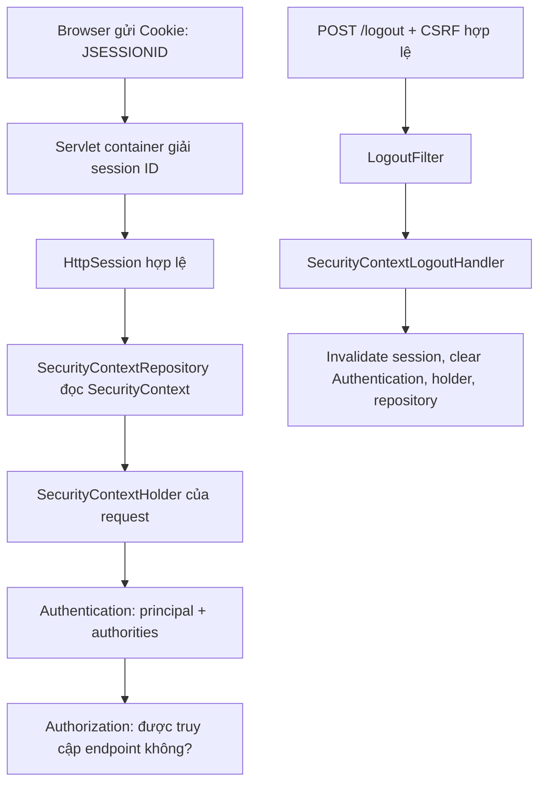
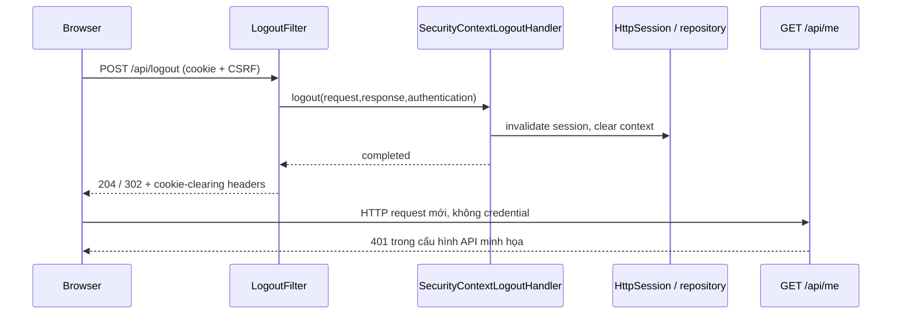

# Xóa Authentication và dữ liệu của SecurityContext khi đăng xuất

**Ngữ cảnh:** Spring Security (Servlet), chủ đề cha **Đăng xuất**. Một người dùng có thể nhìn thấy thông báo “Đã đăng xuất” trên giao diện nhưng session phía server vẫn giữ danh tính; cũng có thể session đã được hủy nhưng request kế tiếp lập tức được xác thực lại bằng remember-me cookie, HTTP Basic, Bearer token hoặc SSO. Vì vậy cần hiểu chính xác **đã xóa gì, ở đâu và có thể nạp lại từ đâu**.

**Mục tiêu:** Phân biệt các lớp trạng thái xác thực; nắm `LogoutFilter`, `SecurityContextLogoutHandler`, `SecurityContextRepository`, `SecurityContextHolder`; thực hiện logout session đúng Spring Security 6; kiểm thử request trước/sau logout, CSRF và session invalidation; xử lý ranh giới của các loại credential khác.

## 1. Các lớp trạng thái cần phân biệt

Khi một request được xác thực bằng session, bốn nơi sau có vai trò khác nhau:

| Thành phần | Ý nghĩa | Vì sao cần quan tâm lúc logout |
| --- | --- | --- |
| `Authentication` | Đối tượng chứa principal, authorities, trạng thái authenticated và có thể credentials/details | Không được để authentication cũ được dùng để cấp quyền sau khi user logout |
| `SecurityContext` | Bao chứa `Authentication` hiện tại | Xóa authentication/context để request không tiếp tục đại diện Alice |
| `SecurityContextHolder` | Cổng đọc/ghi context ở request/luồng hiện tại; mặc định có cơ chế dựa trên `ThreadLocal` | Xóa holder để tránh lẫn danh tính trong luồng đang xử lý |
| `SecurityContextRepository` | Nạp/lưu `SecurityContext` giữa các HTTP requests; có thể dùng session, request attribute hoặc custom store | Nếu dữ liệu bền vững vẫn còn, request sau có thể nạp lại danh tính |
| `HttpSession` | Trạng thái phiên phía Servlet container, thường chứa context và các dữ liệu khác | `invalidate()` loại bỏ phiên hiện hữu, bao gồm dữ liệu security được lưu trong session |
| `JSESSIONID` | Cookie phía client mang định danh session | Xóa cookie giúp browser ngừng gửi ID cũ, nhưng không thay việc hủy session phía server |

Mô hình bình thường:



**Ba mệnh đề không được đồng nhất:**

- **Cookie còn** không có nghĩa session còn. Browser có thể gửi `JSESSIONID` cũ sau khi server đã hủy session.
- **Session còn** không có nghĩa user đã authenticated. Session có thể chỉ giữ CSRF token hoặc dữ liệu giỏ hàng.
- **Holder của request vừa được xóa** không có nghĩa `SecurityContext` đã bị xóa ở repository/session hoặc các token khác đã bị thu hồi.

Ví dụ, code sau chỉ loại context khỏi holder hiện tại:

```java
SecurityContextHolder.clearContext();
```

Nếu custom controller trả `204` ngay sau lệnh này nhưng context đã được lưu trong `HttpSession`, một request sau vẫn có thể đọc dữ liệu ấy qua `SecurityContextRepository`. Bởi vậy **`clearContext()` một mình không phải logout hoàn chỉnh**.

## 2. Định nghĩa thành công của logout theo session

Với user Alice đã login và nhận cookie `JSESSIONID`, quy trình hoàn chỉnh phải đáp ứng các bất biến sau:

1. Một request logout hợp lệ được route qua đúng `SecurityFilterChain`.
2. Khi ứng dụng dùng cookie/session và CSRF protection, logout phải đi qua **POST có CSRF token hợp lệ**.
3. Server không còn nhận phiên hiện tại như một phiên đã xác thực: `HttpSession` bị invalidates theo policy, `Authentication` bị xóa và repository không thể nạp lại context cũ.
4. Browser được yêu cầu xóa/không gửi lại cookie session tương ứng.
5. Request **mới** đến `/api/me` (endpoint thực sự bảo vệ), không có credential còn hiệu lực, bị từ chối.
6. Các request đang thực thi từ trước và các credential độc lập (remember-me, Bearer, SSO…) được đánh giá theo chính sách riêng; không tự tuyên bố chúng đã bị thu hồi.



Không chỉ kiểm tra “Logout API trả `200`/`204`”. Response có thể thành công dù ứng dụng chỉ xóa một biến hoặc trả trạng thái thành công giả. Bằng chứng mạnh hơn là **request sau không thể khôi phục Authentication cũ**, đồng thời cookie/session store đã thay đổi đúng.

## 3. Spring Security xóa context bằng cơ chế chuẩn nào?

### `LogoutFilter`

`LogoutFilter` nhận biết request logout theo đường dẫn và HTTP method; nó chạy trong filter chain và gọi các `LogoutHandler` cần thiết. Khi các handler hoàn thành, `LogoutSuccessHandler` quyết định redirect hoặc HTTP response.

Với CSRF đang bật mặc định, request logout thật dùng HTTP POST kèm CSRF token. Cấu hình mặc định của Spring Security thường có GET `/logout` để hiện trang xác nhận, **không nên coi GET là thao tác logout có tác dụng hủy session**.

### `SecurityContextLogoutHandler`

Đây là thành phần chuẩn để xử lý trạng thái security khi logout. Trong Spring Security hiện đại, handler:

- Vô hiệu hóa `HttpSession` khi `invalidateHttpSession` bật (mặc định).
- Xóa `Authentication` khi `clearAuthentication` bật (mặc định).
- Làm sạch `SecurityContextHolderStrategy`.
- Phối hợp lưu trạng thái đã bị xóa qua `SecurityContextRepository`.

Hai cờ:

```java
logout.invalidateHttpSession(true);
logout.clearAuthentication(true);
```

có ý nghĩa bảo mật độc lập: hủy session còn loại các session attributes khác; dọn authentication/context giải quyết danh tính của luồng request. Khi cần giữ dữ liệu giỏ hàng sau logout, nên có quy trình di chuyển dữ liệu không nhạy cảm sang phiên anonymous mới, **không** tắt phần cleanup của security mà không đánh giá rủi ro.

### `LogoutSuccessHandler`

Success handler chịu trách nhiệm đưa client tới trang sau logout, hoặc trả JSON/status. Ví dụ:

```java
logout.logoutSuccessHandler((request, response, authentication) -> {
    response.setStatus(204);
});
```

**Success handler không thay thế cleanup.** Chỉ thay redirect bằng `204 No Content` vẫn giữ `LogoutFilter` và `SecurityContextLogoutHandler` hoạt động. Ngược lại, controller custom tự trả `204` không có logout handler chưa chắc làm gì cho repository.

### `SecurityContextRepository` trong Spring Security 6

Một ứng dụng thông thường lưu context trong `HttpSessionSecurityContextRepository` hoặc một repository kết hợp. Tại thời điểm request mới, `SecurityContextHolderFilter` có thể nạp context từ repository rồi dùng qua holder. Spring Security 6 theo cơ chế **explicit-save**: nếu viết custom login controller/filter, muốn authentication tồn tại ở request sau thì phải gọi `SecurityContextRepository.saveContext(...)` phù hợp.

Đối với logout thủ công, có vấn đề đối xứng: nếu chỉ xóa holder mà không xóa trạng thái repository, request sau lại nạp được context. Hãy dùng `SecurityContextLogoutHandler`, gắn đúng repository nếu ứng dụng tùy chỉnh storage, thay vì tự đoán thứ tự đặt `null` và save.

## 4. So sánh các lệnh hay bị nhầm là logout

| Lệnh/hành vi | Tác dụng thật | Đủ cho session logout? |
| --- | --- | --- |
| `SecurityContextHolder.clearContext()` | Gỡ context ở holder hiện tại | **Không**, nếu context vẫn được lưu ở repository/session |
| `SecurityContextHolder.getContext().setAuthentication(null)` | Thay đổi một context object có thể mutable | Không bảo đảm cleanup bền vững; tránh chỉnh shared context một cách tùy tiện |
| `SecurityContextRepository.saveContext(empty,req,resp)` | Ghi context rỗng theo repository | Phải xem semantics repo, session invalidation, cookies và các credential khác |
| `HttpSession.invalidate()` | Hủy phiên Servlet hiện hữu và session attributes | Quan trọng cho session; chưa thu hồi Bearer/remember-me token |
| `response.addCookie(...)` với `Max-Age=0` | Yêu cầu browser xóa cookie | Không tự hủy session trong server store |
| `SecurityContextLogoutHandler.logout(...)` | Dọn authentication, holder, repo và thường hủy session | Nền tảng phù hợp cho logout manual |
| `LogoutFilter` + `.logout(...)` DSL | Điều phối các handlers rồi phản hồi kết quả | **Ưu tiên** với Spring Security Servlet |
| `LogoutSuccessHandler` | Quyết định redirect/status/content sau handlers | Không phải cơ chế xóa authentication |

Ví dụ dễ sai:

```java
// ANTIPATTERN: controller trả thành công mà không invalidate session.
@PostMapping("/api/logout")
ResponseEntity<Void> logoutWrong() {
    SecurityContextHolder.clearContext();
    return ResponseEntity.noContent().build();
}
```

Kết quả API có thể vẫn là `204`. Nhưng nếu server còn `HttpSession` với `SPRING_SECURITY_CONTEXT`, request tiếp theo có thể nhìn thấy Alice. Cách sửa là giữ logout filter hoặc gọi `SecurityContextLogoutHandler` đúng.

**Cẩn thận với context mutable:** Không lấy object context có thể chia sẻ trong session rồi tùy tiện `setAuthentication(null)` mà không suy nghĩ đến các request đồng thời. Một request khác có thể đã nạp object ấy; cần dùng lifecycle cleanup được framework quản lý, đồng thời xác định giới hạn consistency của các request đang chạy.

## 5. Bài lab hoàn chỉnh: Spring Boot 3 / Spring Security 6 / Java 17

Mục tiêu lab là kiểm chứng login thành công, logout làm sạch session/security state, CSRF bảo vệ POST logout, và request sau không còn tự đại diện Alice. Lab dùng **form login** để tập trung vào logout, không triển khai remember-me/Bearer để tránh một credential thứ hai xác thực lại sau logout.

### 5.1. Tạo dự án

```text
security-logout-lab/
├── pom.xml
└── src/
    ├── main/java/example/SecurityLogoutApplication.java
    └── test/java/example/SecurityLogoutApplicationTests.java
```

`pom.xml`:

```xml
<project xmlns="http://maven.apache.org/POM/4.0.0"
         xmlns:xsi="http://www.w3.org/2001/XMLSchema-instance"
         xsi:schemaLocation="http://maven.apache.org/POM/4.0.0 https://maven.apache.org/xsd/maven-4.0.0.xsd">
    <modelVersion>4.0.0</modelVersion>
    <parent>
        <groupId>org.springframework.boot</groupId>
        <artifactId>spring-boot-starter-parent</artifactId>
        <version>3.3.9</version>
        <relativePath/>
    </parent>
    <groupId>example</groupId>
    <artifactId>security-logout-lab</artifactId>
    <version>1.0.0</version>
    <properties><java.version>17</java.version></properties>
    <dependencies>
        <dependency>
            <groupId>org.springframework.boot</groupId>
            <artifactId>spring-boot-starter-web</artifactId>
        </dependency>
        <dependency>
            <groupId>org.springframework.boot</groupId>
            <artifactId>spring-boot-starter-security</artifactId>
        </dependency>
        <dependency>
            <groupId>org.springframework.boot</groupId>
            <artifactId>spring-boot-starter-test</artifactId>
            <scope>test</scope>
        </dependency>
        <dependency>
            <groupId>org.springframework.security</groupId>
            <artifactId>spring-security-test</artifactId>
            <scope>test</scope>
        </dependency>
    </dependencies>
    <build>
        <plugins>
            <plugin>
                <groupId>org.springframework.boot</groupId>
                <artifactId>spring-boot-maven-plugin</artifactId>
            </plugin>
        </plugins>
    </build>
</project>
```

**Phiên bản lưu ý:** 3.3.9 là ví dụ API Spring Boot 3/Spring Security 6; khi triển khai sản phẩm hãy chọn release còn được hỗ trợ và vá lỗ hổng. Trong lab, tài khoản dùng in-memory encoder và mật khẩu demo, không phải thiết kế user-store production.

### 5.2. Ứng dụng với logout filter mặc định được tùy chỉnh

Tạo `src/main/java/example/SecurityLogoutApplication.java`:

```java
package example;

import java.util.Map;

import jakarta.servlet.http.HttpServletResponse;

import org.springframework.boot.SpringApplication;
import org.springframework.boot.autoconfigure.SpringBootApplication;
import org.springframework.context.annotation.Bean;
import org.springframework.http.HttpStatus;
import org.springframework.security.config.Customizer;
import org.springframework.security.config.annotation.web.builders.HttpSecurity;
import org.springframework.security.config.annotation.web.configurers.AbstractHttpConfigurer;
import org.springframework.security.core.Authentication;
import org.springframework.security.core.userdetails.User;
import org.springframework.security.core.userdetails.UserDetailsService;
import org.springframework.security.crypto.factory.PasswordEncoderFactories;
import org.springframework.security.crypto.password.PasswordEncoder;
import org.springframework.security.provisioning.InMemoryUserDetailsManager;
import org.springframework.security.web.SecurityFilterChain;
import org.springframework.security.web.authentication.HttpStatusEntryPoint;
import org.springframework.web.bind.annotation.GetMapping;
import org.springframework.web.bind.annotation.RestController;

@SpringBootApplication
public class SecurityLogoutApplication {

    public static void main(String[] args) {
        SpringApplication.run(SecurityLogoutApplication.class, args);
    }

    @Bean
    PasswordEncoder passwordEncoder() {
        return PasswordEncoderFactories.createDelegatingPasswordEncoder();
    }

    @Bean
    UserDetailsService userDetails(PasswordEncoder encoder) {
        return new InMemoryUserDetailsManager(
                User.withUsername("alice")
                        .password(encoder.encode("demo-password"))
                        .roles("USER")
                        .build());
    }

    @Bean
    SecurityFilterChain filterChain(HttpSecurity http) throws Exception {
        return http
                .authorizeHttpRequests(auth -> auth
                        .requestMatchers("/login", "/error").permitAll()
                        .anyRequest().authenticated())
                .formLogin(Customizer.withDefaults())
                .httpBasic(AbstractHttpConfigurer::disable)
                .logout(logout -> logout
                        .logoutUrl("/api/logout")
                        .invalidateHttpSession(true)
                        .clearAuthentication(true)
                        .deleteCookies("JSESSIONID")
                        .logoutSuccessHandler((request, response, auth) -> {
                            response.setStatus(
                                    HttpServletResponse.SC_NO_CONTENT);
                        }))
                .exceptionHandling(ex -> ex.authenticationEntryPoint(
                        new HttpStatusEntryPoint(HttpStatus.UNAUTHORIZED)))
                .build();
    }

    @RestController
    static class ProfileController {
        @GetMapping("/api/me")
        Map<String, String> me(Authentication current) {
            return Map.of("username", current.getName());
        }
    }
}
```

**Giải thích các quyết định:**

- `formLogin()` quản lý xác thực session theo filter chuẩn. Không cần tự gọi `AuthenticationManager` hoặc tự save context.
- `httpBasic().disable()` tránh việc browser/client gửi lại Basic Authorization sau logout và khiến GET `/api/me` authenticated một lần nữa.
- `logoutUrl("/api/logout")` đặt URL cho **`LogoutFilter`**; không viết thêm controller `@PostMapping("/api/logout")` trùng với URL ấy.
- `invalidateHttpSession(true)` buộc hủy phiên hiện tại; `clearAuthentication(true)` xử lý phần authentication. Cả hai là mặc định trong luồng logout thường gặp, được ghi rõ để phục vụ bài học.
- `deleteCookies("JSESSIONID")` yêu cầu browser xóa session cookie. Nếu cookie có Path/Domain đặc biệt ở production, cần kiểm chứng response có thực sự dọn cookie đúng scope.
- `logoutSuccessHandler` trả `204 No Content`; việc xóa context là trách nhiệm của các `LogoutHandler` được `LogoutFilter` gọi.
- Không có `.csrf().disable()` vì logout theo cookie/session là POST nhạy cảm với CSRF.
- `HttpStatusEntryPoint(401)` giúp `/api/me` trả `401` khi chưa xác thực, thay vì redirect login. Nếu app dùng web redirect, mã/Location có thể khác.

Đây là ứng dụng Servlet. Nếu security context được lưu trong custom repository hoặc app dùng nhiều chain, phải kiểm tra logout handler được cấu hình cùng repository đúng với chain đã xác thực. Cấu hình lab tránh những biến thể đó để kiểm chứng luồng chuẩn.

### 5.3. Integration tests với `MockMvc`

Tạo `src/test/java/example/SecurityLogoutApplicationTests.java`:

```java
package example;

import org.junit.jupiter.api.Test;
import org.springframework.beans.factory.annotation.Autowired;
import org.springframework.boot.test.autoconfigure.web.servlet.AutoConfigureMockMvc;
import org.springframework.boot.test.context.SpringBootTest;
import org.springframework.mock.web.MockHttpSession;
import org.springframework.test.web.servlet.MockMvc;
import org.springframework.test.web.servlet.MvcResult;

import static org.assertj.core.api.Assertions.assertThat;
import static org.springframework.security.test.web.servlet.request
        .SecurityMockMvcRequestBuilders.formLogin;
import static org.springframework.security.test.web.servlet.request
        .SecurityMockMvcRequestPostProcessors.csrf;
import static org.springframework.test.web.servlet.request
        .MockMvcRequestBuilders.get;
import static org.springframework.test.web.servlet.request
        .MockMvcRequestBuilders.post;
import static org.springframework.test.web.servlet.result
        .MockMvcResultMatchers.jsonPath;
import static org.springframework.test.web.servlet.result
        .MockMvcResultMatchers.status;

@SpringBootTest
@AutoConfigureMockMvc
class SecurityLogoutApplicationTests {

    @Autowired
    MockMvc mvc;

    private MockHttpSession loginAlice() throws Exception {
        MvcResult login = mvc.perform(formLogin()
                        .user("alice")
                        .password("demo-password"))
                .andExpect(status().is3xxRedirection())
                .andReturn();

        MockHttpSession session =
                (MockHttpSession) login.getRequest().getSession(false);
        assertThat(session).isNotNull();
        return session;
    }

    @Test
    void logoutInvalidatesSessionAndRemovesCurrentIdentity()
            throws Exception {
        MockHttpSession session = loginAlice();

        // Request A: chứng minh chính session này đang đại diện Alice.
        mvc.perform(get("/api/me").session(session))
                .andExpect(status().isOk())
                .andExpect(jsonPath("$.username").value("alice"));

        // Request B: logout đúng session với CSRF hợp lệ.
        mvc.perform(post("/api/logout")
                        .session(session)
                        .with(csrf()))
                .andExpect(status().isNoContent());

        // Session được LogoutHandler vô hiệu hóa.
        assertThat(session.isInvalid()).isTrue();

        // Request C: không còn credential, không còn Alice.
        mvc.perform(get("/api/me"))
                .andExpect(status().isUnauthorized());
    }

    @Test
    void logoutWithoutCsrfIsRejectedAndSessionStaysAlive()
            throws Exception {
        MockHttpSession session = loginAlice();

        mvc.perform(post("/api/logout").session(session))
                .andExpect(status().isForbidden());

        assertThat(session.isInvalid()).isFalse();

        // Request bị chặn bởi CSRF chưa logout user.
        mvc.perform(get("/api/me").session(session))
                .andExpect(status().isOk())
                .andExpect(jsonPath("$.username").value("alice"));
    }

    @Test
    void sessionIsRequiredForThisProtectedEndpoint() throws Exception {
        mvc.perform(get("/api/me"))
                .andExpect(status().isUnauthorized());

        MockHttpSession loggedIn = loginAlice();

        mvc.perform(get("/api/me"))
                .andExpect(status().isUnauthorized());

        mvc.perform(get("/api/me").session(loggedIn))
                .andExpect(status().isOk())
                .andExpect(jsonPath("$.username").value("alice"));
    }
}
```

Chạy từ thư mục chứa `pom.xml`:

```bash
mvn test
```

**Kết quả mong đợi:** 3 test PASS và Maven `BUILD SUCCESS` nếu dependencies và môi trường tương thích. Đây là dự kiến của tài liệu; **bài code này không được chạy sẵn**.

### 5.4. Ý nghĩa và giới hạn của kiểm thử

Trong test `logoutInvalidatesSessionAndRemovesCurrentIdentity`:

1. `formLogin()` thực hiện POST login qua Spring Security filters và tạo session đã xác thực.
2. `GET /api/me` với cùng `MockHttpSession` trả Alice, chứng minh endpoint là protected và session được sử dụng.
3. `POST /api/logout` với session và token CSRF kích hoạt `LogoutFilter`.
4. `MockHttpSession.isInvalid()` cho biết session test đã bị hủy.
5. GET mới không mang credential khác bị `401`, cho thấy nó không thể tự nhận Alice.

Trong test `logoutWithoutCsrfIsRejectedAndSessionStaysAlive`, `403` có nghĩa **CSRF chặn logout** chứ không phải user đã logout. Sau `403`, request dùng session cũ vẫn nhận Alice.

Không dùng `@WithMockUser` hoặc `.with(user("alice"))` trong test mô tả logout end-to-end, vì như vậy framework có thể tiêm danh tính mới vào request ngay cả khi session đã bị hủy. Các mock-user helper vẫn phù hợp cho test authorization độc lập, nhưng không chứng minh session persistence/cleanup.

**Giới hạn MockMvc:** MockHttpSession không tự mô phỏng browser cookie jar hay container production. Sau khi `MockHttpSession` đã invalidate, không cần truyền chính object mock bị invalid vào GET mới; một mock implementation có thể ném exception. Muốn kiểm tra server từ chối một **cookie `JSESSIONID` cũ** cần HTTP/browser test với container/session store thật.

## 6. Kiểm thử trên trình duyệt hoặc HTTP thật

Trong môi trường dev có Spring Boot app chạy:

```bash
mvn spring-boot:run
```

Thử bằng browser:

1. Mở `/login` của app, đăng nhập `alice` bằng password demo. Form login của Spring Security chứa CSRF token cần thiết.
2. Mở DevTools → Network, gọi `GET /api/me`. Với session mới, body mong đợi là `{"username":"alice"}`.
3. Xác minh cookie session thuộc đúng host, Path, `Secure`, `HttpOnly`, `SameSite` theo môi trường.
4. Từ client đang login, gửi **POST `/api/logout` có CSRF hợp lệ**. Quan sát `204` và `Set-Cookie` dùng để dọn `JSESSIONID` nếu có.
5. Gửi GET `/api/me` mà không gửi credential khác: kỳ vọng HTTP `401`.
6. Thử bằng cookie `JSESSIONID` cũ đã được lưu trong **môi trường test được kiểm soát**: server không được nhận user Alice dựa trên ID đã invalidates.
7. Đăng nhập lại: server sẽ cấp/đổi session ID theo chính sách chống session fixation. Session mới không phải là sự hồi sinh session đã logout.

Ví dụ cấu trúc HTTP (đều dùng placeholder):

```http
POST /api/logout HTTP/1.1
Host: app.example
Cookie: JSESSIONID=<SESSION_COOKIE_VALUE>
X-CSRF-TOKEN: <VALID_CSRF_TOKEN>
Content-Type: application/x-www-form-urlencoded

```

Response minh họa:

```http
HTTP/1.1 204 No Content
Set-Cookie: JSESSIONID=; Max-Age=0; Path=/
Cache-Control: no-store
```

Trong production, URL có thể nằm sau reverse proxy, nên Path/Domain cookie xóa phải khớp với cookie thật. Cùng một tên cookie không đủ nếu scope khác. Cookie clearing không thay thế server-side invalidation: với một session ID bị copy trước logout, **chỉ xóa cookie ở browser** sẽ không ngăn client giữ bản sao tiếp tục dùng nếu server không hủy session.

Nếu dùng PowerShell/cURL, cần đọc token CSRF từ trang login hoặc endpoint được thiết kế để cấp CSRF, duy trì cùng cookie jar rồi gửi token trong request logout. Một `curl -X POST` thiếu CSRF và nhận `403` **không phải kiểm thử logout thành công**.

## 7. Khi có custom logout controller hoặc custom repository

### 7.1. Anti-pattern: chỉ xóa holder

```java
// SAI trong ứng dụng đang dùng HttpSessionSecurityContextRepository.
@PostMapping("/custom/logout")
ResponseEntity<Void> logoutWrong() {
    SecurityContextHolder.clearContext();
    return ResponseEntity.noContent().build();
}
```

Code này nhìn như logout nhưng không chắc đã dọn context đã persist. Một GET mới vẫn có thể nạp lại `SecurityContext` từ session. Cũng không rõ cookie có được xóa hoặc session có bị invalidates không.

### 7.2. Dùng `SecurityContextLogoutHandler`

Nếu ứng dụng **thực sự cần endpoint khác với `LogoutFilter`**, dùng handler chuẩn thay vì tự tái hiện các bước:

```java
// ĐOẠN MINH HỌA bên trong một @RestController; không phải file Java độc lập.
private final SecurityContextLogoutHandler securityLogout =
        new SecurityContextLogoutHandler();

@PostMapping("/custom/logout")
ResponseEntity<Void> logout(
        Authentication authentication,
        HttpServletRequest request,
        HttpServletResponse response) {
    securityLogout.logout(request, response, authentication);
    return ResponseEntity.noContent().build();
}
```

Đoạn trên cần imports Spring Security, Servlet API và Spring MVC; endpoint phải thuộc đúng `SecurityFilterChain`, được định nghĩa authorization/CSRF phù hợp, và **không trùng với `logoutUrl` đang được `LogoutFilter` chặn trước controller**.

Nếu custom `SecurityContextRepository` (Redis, database, `DelegatingSecurityContextRepository`, v.v.), cần gắn đúng repository cho handler:

```java
// Minh họa cấu hình handler với repository app thật sự dùng:
SecurityContextLogoutHandler handler = new SecurityContextLogoutHandler();
handler.setSecurityContextRepository(contextRepository);
handler.logout(request, response, authentication);
```

Không phải mọi custom repository có cùng semantics `saveContext(empty)`; cần kiểm thử chính xác data-store cleanup. Đồng thời controller thủ công phải tự phối hợp các logout handlers khác nếu có remember-me, SSO, cookie, audit, token revocation, v.v. Vì vậy với Servlet web app, **tùy chỉnh `.logout(...)` của framework thường an toàn và đơn giản hơn**.

### 7.3. Tại sao không chỉ dùng `setAuthentication(null)`?

```java
SecurityContextHolder.getContext().setAuthentication(null);
```

Lệnh này thay đổi `SecurityContext` hiện tại, vốn có thể là đối tượng mutable được nạp từ một repository/session. Nó không đảm bảo repository nhận được thao tác clear đúng, và không có nghĩa session bị invalidates. Trong môi trường request đồng thời, không nên dựa vào việc sửa chung object rồi mong tất cả request đồng nhất.

Một đoạn giải thích nguyên tắc explicit cleanup:

```java
// MINH HỌA NGUYÊN LÝ; KHÔNG thay cho SecurityContextLogoutHandler.
SecurityContext empty = SecurityContextHolder.createEmptyContext();
SecurityContextHolder.setContext(empty);
contextRepository.saveContext(empty, request, response);
SecurityContextHolder.clearContext();
```

Còn phải hủy session/cookie theo policy. Dùng `SecurityContextLogoutHandler` nếu không có lý do cụ thể để tự điều phối.

### 7.4. Repository và session store phân tán

Khi có nhiều node hoặc custom session store, quy trình logout phải được nhìn thấy trên node kế tiếp. Nếu node A xóa holder nhưng node B vẫn nạp được `SecurityContext` từ Redis/database, user tiếp tục authenticated. Kiểm thử `GET /api/me` bằng cookie cũ qua load balancer và nhiều instances; không kết luận thành công chỉ từ unit test ở một node.

## 8. Không nhầm logout session với thu hồi mọi credential

### Remember-me

Khi bật remember-me, browser có thể giữ cookie riêng dù `JSESSIONID` đã mất. `RememberMeAuthenticationFilter` có thể dùng cookie này để tạo `RememberMeAuthenticationToken` trên request kế tiếp; nhìn bên ngoài giống “logout không thành công”.

- Khi sử dụng `.rememberMe(...)` đúng cách, Spring Security có handling dành cho remember-me trong logout.
- Nếu dùng persistent remember-me, dữ liệu token nằm trong `PersistentTokenRepository`; việc thu hồi phụ thuộc implementation, authentication có sẵn và chính sách.
- Xóa cookie ở browser không nhất thiết xóa bản ghi token ở server.
- Password change, disable account, logout-all thường cần thu hồi nhớ đăng nhập như một sự kiện nghiệp vụ riêng.

**Kiểm thử**: sau logout, cố gọi endpoint protected bằng remember-me cookie cũ trong môi trường test; nếu chính sách đòi revoke, kết quả phải bị từ chối. Không tin riêng việc cookie biến mất khỏi DevTools.

### HTTP Basic

Basic credential có thể được browser/client gửi **lại trên mỗi request**. Nếu Basic vẫn bật, một GET sau logout có thể xác thực lại Alice từ `Authorization: Basic ...`, dù session cũ đã được hủy hoàn toàn. Đây là **xác thực lại** chứ không phải security context bị giữ lại. Phân biệt nguyên nhân bằng HTTP headers và loại `Authentication` mới được tạo.

### Bearer JWT / opaque token

API stateless có thể xác minh `Authorization: Bearer ...` trên mọi request, không dựa vào session. Gọi `SecurityContextHolder.clearContext()` hay hủy `HttpSession` không làm JWT đã cấp tự mất hiệu lực. Cần phối hợp:

- Client xóa token và ngừng gửi header `Authorization`.
- Resource server/authorization server có chính sách token expiry, revocation hoặc introspection phù hợp.
- Refresh token cần thu hồi riêng nếu nguy cơ yêu cầu.
- Nếu cần logout mọi thiết bị, cần xem toàn bộ credential families và các session còn hiệu lực, không chỉ request hiện tại.

### OAuth2/OIDC, SSO

Đăng xuất local app không tự đồng nghĩa Identity Provider đã hủy phiên SSO. Tùy hệ thống có thể cần OIDC RP-initiated logout, token revocation hoặc session coordination. Nếu IdP vẫn giữ session, một redirect sang login có thể lập tức xác thực lại user. Đây không nhất thiết là bug của `SecurityContextLogoutHandler`, mà là giới hạn phạm vi local logout.

### Session ở thiết bị khác

Logout browser A thường vô hiệu hóa **session A**. Browser B giữ `JSESSIONID` riêng vẫn có thể authenticated. Nếu muốn `logout all devices`, dùng session registry/store và revocation được thiết kế, không tuyên bố mọi phiên đã hủy khi chỉ một request logout thành công.

## 9. CSRF, cookies, cache và các request chạy song song

### 9.1. Logout bằng POST và CSRF

Với cookie/session, browser tự gửi cookie khi request phù hợp. Nếu logout bằng GET không bảo vệ CSRF, trang khác có thể ép browser gửi request và buộc user logout không chủ đích. Spring Security bật CSRF mặc định và yêu cầu POST có CSRF token.

```text
GET /logout:
    thường là trang xác nhận với CSRF token (không phải logout thật)
POST /api/logout:
    logout khi khớp LogoutFilter và CSRF hợp lệ
POST /api/logout thiếu CSRF:
    403, logout chưa được thực thi
```

Đừng “sửa” `403` bằng cách tắt `.csrf()` toàn ứng dụng; hãy cấp/đọc token đúng. Trong SPA, sau login/logout, CSRF token trước đó có thể đã bị xóa; cần lấy token mới theo repository/CSRF workflow đang dùng.

### 9.2. Cookie flags và browser state

Dùng HTTPS, `Secure`, `HttpOnly`, `SameSite`, `Domain`, `Path` phù hợp. `deleteCookies("JSESSIONID")` có thể không xóa cookie có Path/Domain đặc biệt khi response không khớp scope. `Clear-Site-Data: "cookies"` có thể ảnh hưởng nhiều cookies hơn dự tính; chỉ dùng khi chủ động chọn hành vi đó.

Ngoài cookies, SPA phải xóa bộ nhớ người dùng, local cache, query cache, service worker cache theo policy, và dừng requests/polling không còn cần thiết. Response chứa thông tin nhạy cảm có thể cần `Cache-Control: no-store` để tránh nút Back hiển thị dữ liệu cũ từ cache. **Không cho rằng server logout sẽ tự xóa mọi dữ liệu đã tải ở browser.**

### 9.3. Request đã bắt đầu trước logout

Giả sử request chuyển tiền X đã nạp `Authentication` lúc 12:00:00, trong khi request logout Y xảy ra lúc 12:00:01. Logout không nhất thiết dừng request X đang chạy. Các thao tác nhạy cảm nên kiểm tra quyền và trạng thái thu hồi tại điểm quyết định/commit theo threat model, hoặc dùng token/session versioning có kiểm soát.

Không đưa session ID, refresh token, password hoặc nguyên object `SecurityContext` vào log để debug. Ghi request ID, user ID đã xác thực, event type và kết quả chung, có retention và quyền truy cập phù hợp.

## 10. Chẩn đoán các triệu chứng thường gặp

| Dấu hiệu | Nguyên nhân khả dĩ | Phương pháp kiểm chứng |
| --- | --- | --- |
| Logout trả 204, GET sau vẫn Alice | Chỉ xóa holder; repository/session còn context | Kiểm tra `SecurityContextLogoutHandler` và repository |
| GET sau dùng cookie cũ vẫn authenticated | Session ID chưa được invalidate ở server hoặc node khác | Thử HTTP thật, kiểm tra session store |
| Cookie `JSESSIONID` vẫn xuất hiện | Xóa cookie sai Path/Domain | Xem `Set-Cookie`, browser cookie scope |
| GET sau không session vẫn 200 | Endpoint `permitAll`, test mock user, hoặc credential khác | Xem authorization rules, Basic/Bearer/remember-me |
| POST logout nhận 403 | Thiếu/sai CSRF token | Kiểm tra CSRF repo, request header, session hiện tại |
| Logout xong login tự bật trở lại | Remember-me hoặc IdP SSO session vẫn còn | Kiểm tra cookie remember-me, OIDC logout policy |
| API stateless vẫn authenticated | Client tiếp tục gửi JWT/opaque token | Kiểm tra Authorization và revocation/expiry |
| Basic vẫn 200 sau logout | Client tự gửi username/password mỗi request | Xem Authorization, không nhầm với session restore |
| Logout một tab, tab khác vẫn user | Tab cùng browser profile chia sẻ cookie hoặc session mới | So sánh cookie jars và scope user session |
| Logout browser A, browser B còn hoạt động | Policy chỉ logout current session | Cần logout-all riêng |
| Context ở Redis vẫn tồn tại | Custom handler không xóa đúng repository hoặc storage | Kiểm tra repository code, multi-node test |
| GET protected sau logout trả 401 nhưng dữ liệu UI vẫn hiện | SPA cache chưa xóa | Clear state/queries và no-store |
| Request trước logout vẫn thành công | Request đã đọc auth trước khi session bị hủy | Cân nhắc revoke check khi commit |
| Cơ chế xóa cookie thành công nhưng session vẫn active | Chỉ xóa phía client | Invalidate server session, không dựa vào cookie |

Một `401` sau logout chưa đủ để chứng minh dữ liệu server đã được xóa nếu client đơn giản không gửi cookie; ngược lại, một `200` chưa đủ chứng minh logout lỗi nếu endpoint công khai hoặc client được xác thực lại bằng credential khác. **Hãy kiểm tra cả phía client, server và cơ chế xác thực của chính request đó.**

## 11. Ma trận kiểm thử triển khai

| Case | Hành động | Kết quả cần kiểm tra |
| --- | --- | --- |
| L1 | Đăng nhập đúng bằng form/session | `/api/me` có Alice và session hợp lệ |
| L2 | POST logout có CSRF và session | Success, session invalidated, context không được nạp lại |
| L3 | Gọi GET `/api/me` sau logout không có credential | Bị từ chối (`401` với lab) |
| L4 | Gửi lại cookie session cũ ở HTTP thật | Server không còn xác thực Alice |
| L5 | POST logout không có CSRF | `403`, session vẫn còn, cleanup không chạy |
| L6 | GET logout khi policy yêu cầu POST | Không gây logout thay đổi trạng thái |
| L7 | Session vẫn có các dữ liệu không-security | Được xóa khi invalidate; dữ liệu cần giữ phải di chuyển có chủ ý |
| L8 | Custom `SecurityContextRepository` | Đã xóa đúng repository; node khác không nạp lại |
| L9 | Browser vẫn có remember-me cookie | Kiểm tra auto-login/revocation theo policy |
| L10 | Client tiếp tục gửi Basic/Bearer | Phân biệt authentication mới với session cũ |
| L11 | Logout một thiết bị vs mọi thiết bị | Kết quả đúng contract |
| L12 | Logout và request nhạy cảm chạy đồng thời | Chính sách xử lý in-flight requests rõ ràng |
| L13 | Reverse proxy và cookie Path/Domain không mặc định | Cookie clearing đúng scope |
| L14 | SPA sau logout | Không giữ profile/cache nhạy cảm |
| L15 | Logout nhiều lần | Quy định rõ với CSRF token/session sau lần đầu, không hứa luôn 204 |

Test unit/integration với `MockMvc` và test HTTP/browser thật bổ sung cho nhau. MockMvc không thể thay thế hoàn toàn kiểm tra trình duyệt, reverse proxy, session store và cookie expiration.

## 12. Bài tập tự đánh giá

**Bài tập 1:** Trong một ứng dụng dùng `HttpSessionSecurityContextRepository`, thay logout chuẩn bằng `SecurityContextHolder.clearContext()`. Dự đoán GET sau với cùng cookie sẽ ra sao, và giải thích nguyên nhân theo sự khác nhau giữa holder và repository. Khôi phục handler chuẩn để kiểm chứng.

**Bài tập 2:** Dùng hai browser profiles độc lập. Đăng nhập Alice ở A và B, chỉ logout A. Giải thích vì sao B có thể tiếp tục sử dụng khi policy là logout current session và phải thay đổi gì nếu policy là logout-all.

**Bài tập 3:** Bật remember-me; logout session rồi kiểm tra `/api/me` với remember-me cookie cũ. Phân biệt tình huống cookie đã bị xóa, repository token đã revoke và chỉ session bị hủy. Đề xuất test để phát hiện tự động login lại.

**Bài tập 4:** Đọc `SecurityContext` từ custom Redis repository và thiết kế test logout qua node A rồi GET qua node B. Chỉ ra vì sao xóa holder hoặc xóa cache key cục bộ là không đủ.

**Bài tập 5:** Một API stateless trả `200` sau logout do client tiếp tục gửi access token cũ. Chứng minh đó là token authentication mới, rồi đề xuất chính sách token revocation/expiry và refresh-token handling phù hợp.

## 13. Checklist nghiệm thu

- [ ] Xác định cơ chế authentication của ứng dụng: session, Basic, remember-me, Bearer hay SSO.
- [ ] Với Servlet session, ưu tiên `LogoutFilter` + `SecurityContextLogoutHandler`.
- [ ] `invalidateHttpSession(true)` và `clearAuthentication(true)` được áp dụng theo policy.
- [ ] `SecurityContextRepository` không còn cho phép nạp lại Authentication đã logout.
- [ ] Không dựa vào chỉ `clearContext()` hoặc chỉ xóa cookie client.
- [ ] Logout là POST có CSRF token trong ứng dụng dùng cookie/session.
- [ ] Không có controller trùng URL với `LogoutFilter` ngoài ý muốn.
- [ ] Cookie `JSESSIONID` được dọn đúng scope; session cũ bị hủy ở server.
- [ ] Test login → GET authenticated → logout → GET unauthenticated.
- [ ] Test POST thiếu CSRF, session cũ, browser thật và nhiều instance.
- [ ] Test remember-me, Basic, Bearer và SSO nếu ứng dụng có những cơ chế ấy.
- [ ] Có policy riêng cho logout current session, logout-all, token revocation.
- [ ] Không nhầm `LogoutSuccessHandler` với nơi dọn SecurityContext.
- [ ] Không tiết lộ cookie, credentials hoặc security context trong response/log.
- [ ] Frontend clear cache/state và API nhạy cảm dùng response cache policy phù hợp.
- [ ] Có đánh giá các request đang xử lý song song khi logout.

**Kết luận:** Xóa `Authentication`/`SecurityContext` đúng nghĩa không chỉ là xóa dữ liệu trong biến hiện tại. Với Spring Security và session, cần dọn **holder**, **repository**, **HttpSession** và quản lý **cookie**. `SecurityContextLogoutHandler` và `LogoutFilter` thực hiện phần cốt lõi an toàn, trong khi các credential khác như remember-me, Bearer hoặc SSO phải được xử lý theo chính sách độc lập.

## 14. Tài liệu chính thức

- [Spring Security — Handling Logouts](https://docs.spring.io/spring-security/reference/servlet/authentication/logout.html): `LogoutFilter`, `SecurityContextLogoutHandler`, logout handlers và response.
- [Spring Security — Authentication Persistence and Session Management](https://docs.spring.io/spring-security/reference/servlet/authentication/session-management.html): holder/repository, explicit save, manual clearing.
- [Spring Security — SecurityContextLogoutHandler API](https://docs.spring.io/spring-security/reference/api/java/org/springframework/security/web/authentication/logout/SecurityContextLogoutHandler.html): `clearAuthentication`, `invalidateHttpSession`, `setSecurityContextRepository`.
- [Spring Security — Testing Logout](https://docs.spring.io/spring-security/reference/servlet/test/mockmvc/logout.html): MockMvc và CSRF.
- [Spring Security — CSRF](https://docs.spring.io/spring-security/reference/servlet/exploits/csrf.html): bảo vệ logout bằng POST/CSRF.
- [Spring Security — Remember-Me](https://docs.spring.io/spring-security/reference/servlet/authentication/rememberme.html): tự xác thực lại khi session trống.
- [Spring Security — JWT Resource Server](https://docs.spring.io/spring-security/reference/servlet/oauth2/resource-server/jwt.html): token authentication độc lập HttpSession.