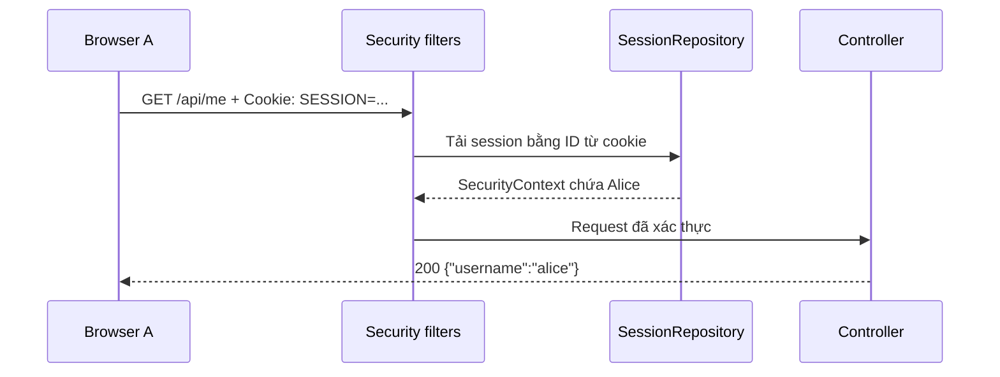
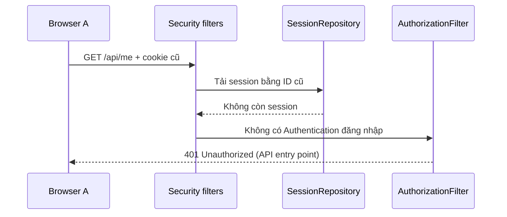
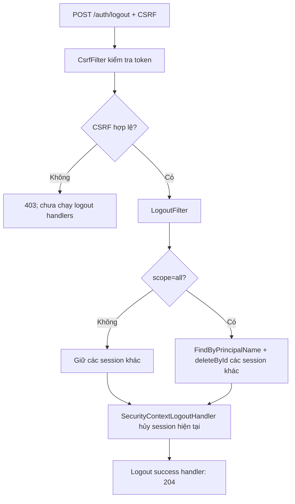

# Kiểm thử đăng xuất một thiết bị, mọi thiết bị và yêu cầu sau đăng xuất

## 1. Điều cần chứng minh không chỉ là HTTP 204 hay 302

Một endpoint đăng xuất trả về `204 No Content` hoặc `302 Found` chưa đủ để kết luận người dùng đã thực sự mất quyền truy cập. Phản hồi chỉ cho biết handler đã kết thúc theo một luồng nhất định; muốn biết **phiên đã bị thu hồi**, cần kiểm tra những **HTTP request mới** với đúng cookie/token trước đó.

Bài học này xây dựng và kiểm thử **ba bất biến (invariants)**:

1. **Đăng xuất một thiết bị:** chỉ session của client A bị vô hiệu; client B của cùng Alice vẫn dùng được phiên riêng của nó, và Bob không bị ảnh hưởng.
2. **Đăng xuất mọi thiết bị:** tất cả session được lập chỉ mục của Alice, gồm client A và B, đều bị vô hiệu; Bob vẫn giữ phiên hợp lệ.
3. **Yêu cầu sau đăng xuất:** client gửi lại session cũ không còn được nhận diện; endpoint cần xác thực phải trả `401` theo cấu hình API mẫu. Nếu Alice đăng nhập lại bằng credentials hợp lệ, một **session mới** được tạo; logout không đồng nghĩa khóa tài khoản.

Các trường hợp bổ sung rất quan trọng: logout bằng GET không làm thay đổi session, POST không có CSRF/sai CSRF trả `403` và không logout, refresh trang không âm thầm tạo lại quyền, và không dùng chung cookie jar trong bài test nhiều thiết bị.

**Phạm vi:** Java 17+, Spring Boot 3.x, Spring Security 6.x, Spring Session 3.x, Servlet/Spring MVC. Ví dụ dùng **form login + HTTP session** và Spring Session JDBC. Đây không phải bài JWT token revocation hay OIDC Single Logout; phần cuối sẽ chỉ ra phải kiểm thử thêm gì nếu hệ thống có những cơ chế đó.

### Kết quả mong đợi của một bộ test tốt

| Sự kiện | Laptop Alice (A) | Điện thoại Alice (B) | Browser Bob (C) |
|---|---|---|---|
| Cả ba đã login | `200` | `200` | `200` |
| A gọi logout phiên hiện tại | **`401`** | **`200`** | **`200`** |
| Sau khi reset fixture, A gọi logout mọi thiết bị | **`401`** | **`401`** | **`200`** |
| Alice đăng nhập lại sau logout-all (không khóa account) | `200` với session **mới** | Không tự có phiên mới | `200` |
| A thử POST logout thiếu CSRF (test độc lập) | **Vẫn `200`** khi GET /api/me | **Vẫn `200`** | Không ảnh hưởng |

Trong bảng, status là kết quả **của `GET /api/me` sau sự kiện**, không phải mã phản hồi của chính endpoint logout. Logout thành công trong ví dụ trả `204`; thiếu/sai CSRF trả `403`. Hai loại status phải được test riêng để không kết luận nhầm.

## 2. Nền tảng: session cookie không phải Authentication

Sau form login, Spring Security lưu `SecurityContext` chứa principal/authorities vào một kho phiên phù hợp. Browser giữ cookie định danh session, thông thường tên `JSESSIONID` với Servlet container hoặc `SESSION` khi dùng Spring Session.

`GET /api/me` của một client được xử lý như sau:



Khi một phiên bị vô hiệu:



Một client có thể **vẫn gửi cookie cũ** sau logout, đặc biệt nếu HTTP client không xóa cookie ngay. Đó không phải lỗi nếu server đã vô hiệu session và từ chối request. Test đáng tin phải đo **kết quả authorization**, không chỉ nhìn vào việc cookie có được xóa khỏi browser hay không.

Ngược lại, một browser có cookie không chứng minh browser đã đăng nhập: CSRF token hoặc request cache có thể tạo session trước khi login. Vì vậy test phải đăng nhập thật, gọi endpoint bảo vệ và đối chiếu principal.

### Phân biệt logout local và logout-all

- `LogoutFilter` và `SecurityContextLogoutHandler` mặc định vô hiệu hóa **session hiện tại**. Chúng không tự tìm các session khác của cùng user.
- `SessionRegistry` của Spring Security có thể theo dõi và đánh dấu session hết hạn khi cấu hình concurrent session control đúng; `SessionInformation.expireNow()` không có nghĩa mọi session đã bị xóa ngay từ một kho chia sẻ.
- Spring Session có `FindByIndexNameSessionRepository`, cho phép tìm session theo principal và `deleteById(...)` để xóa session ở backend.
- Đăng xuất mọi thiết bị là một yêu cầu **nghiệp vụ bổ sung**, cần cơ chế tra cứu/cô lập đúng phạm vi, thường cần kho phiên dùng chung giữa các instance.

**Không viết test logout-all bằng cách chỉ gọi `SecurityContextHolder.clearContext()`**: nó dọn context của request hiện tại, không xóa các session A/B đã lưu trên server.

## 3. Ma trận test trước khi viết mã

Chia test thành ba lớp; không dùng một test “logout happy path” để thay tất cả.

### 3.1. Test HTTP contract

| ID | Tiền điều kiện | Request | Kỳ vọng |
|---|---|---|---|
| H01 | Alice login tại A | `POST /auth/logout` + CSRF hợp lệ | 204, session A bị thu hồi |
| H02 | Alice login tại A | `POST /auth/logout?scope=all` + CSRF hợp lệ | 204, các phiên của Alice bị thu hồi |
| H03 | Alice login tại A | `POST /auth/logout` không CSRF | **403**, session A vẫn dùng được |
| H04 | Alice login tại A | `POST /auth/logout` token giả/sai | **403**, session A vẫn dùng được |
| H05 | Alice login tại A | `GET /auth/logout` | **Không logout**; GET /api/me sau đó vẫn 200 |
| H06 | Alice chưa login | `POST /auth/logout?scope=all` với CSRF hợp lệ | Không được xóa session của Alice do client khác |
| H07 | Alice login tại A | `POST /auth/logout` hợp lệ hai lần | Không có phiên mới vô cớ; xử lý lần hai theo policy |

Với H05 và H07, **đừng ép một status cố định của endpoint logout** nếu URL/matcher/entry point khác nhau; hãy kiểm tra trạng thái phiên sau đó. Ví dụ của bài cấu hình `LogoutFilter` nhận POST khi CSRF bật; GET không làm logout.

### 3.2. Test phạm vi nhiều client

| ID | Dữ liệu chuẩn bị | Hành động | Kỳ vọng |
|---|---|---|---|
| S01 | A=Alice, B=Alice, C=Bob | A logout thường | A 401; B 200; C 200 |
| S02 | A=Alice, B=Alice, C=Bob | A logout mọi thiết bị | A 401; B 401; C 200 |
| S03 | A=Alice, B=Alice | B logout thường | A 200; B 401 |
| S04 | A=Alice, B=Alice | A logout-all; Alice login lại ở client D | A/B 401; D 200 |
| S05 | A=Alice, B=Alice, C=Bob | C logout thường | Alice A/B vẫn 200; Bob C 401 |
| S06 | Hai session Alice khác nhau | Đọc session repository trước/sau | ID khác nhau; đúng các record bị xóa |

### 3.3. Test hậu đăng xuất và tình huống cạnh tranh

| ID | Nội dung kiểm tra | Điều không được bỏ sót |
|---|---|---|
| P01 | GET tài nguyên cần login ngay sau logout | Không được nhận context đã bị thu hồi |
| P02 | Gửi lại **cookie ID cũ** bằng client tách biệt | Server không phục hồi identity cũ |
| P03 | POST mutation sau logout, có/không CSRF token | Phân biệt `401` authentication và `403` CSRF; không chỉ nhìn status |
| P04 | Password vẫn đúng sau logout-all | Login mới được tạo **session khác**, trừ khi account bị khóa |
| P05 | Logout trong lúc request khác đang chạy | Không hứa hủy request đã qua authorization |
| P06 | Hai node dùng session store chung | Revocation từ node 1 phải ảnh hưởng request mới qua node 2 |
| P07 | Session index có đủ các thiết bị | Không có phiên Alice bị bỏ sót do index sai |

Ở mọi test, **A/B/C phải có cookie store độc lập**. Dùng chung `MockHttpSession`/`CookieManager` cho A và B sẽ khiến test “đăng xuất mọi thiết bị” trở thành test một thiết bị trá hình.

## 4. Kiến trúc ví dụ: cùng một LogoutFilter, hai phạm vi logout

Chúng ta dùng một HTTP endpoint:

- `POST /auth/logout`: logout session hiện tại.
- `POST /auth/logout?scope=all`: logout session hiện tại **và** xóa các session khác cùng principal được tìm thấy ở Spring Session JDBC.

Tại sao dùng chung URL? Bởi vì cả hai hành động đều là logout, cần chung chuỗi xử lý **`LogoutFilter` → `LogoutHandler` → `LogoutSuccessHandler`**, với CSRF và các bước dọn context/session mặc định. Chúng ta chỉ thêm một `LogoutHandler` cho lựa chọn `scope=all`; không tự viết `@PostMapping` thay thế toàn bộ logout framework.



Có ba quyết định quan trọng:

1. **Không xóa session hiện tại khỏi repository ngay trong custom handler**: dành việc đó cho `SecurityContextLogoutHandler` mặc định. Handler chỉ xóa những session **khác ID đang request**.
2. **Không bỏ CSRF**: cả logout một thiết bị và mọi thiết bị đều là POST có CSRF token; query parameter `scope=all` không tạo ngoại lệ.
3. **Không dùng account name do client tự nhập để chọn user cần thu hồi**: custom handler lấy principal từ `Authentication` do Spring Security đã xác thực. Chỉ user đang đăng nhập mới có thể yêu cầu thu hồi các session thuộc danh tính mình.

Ví dụ cung cấp toàn bộ code cho một ứng dụng chạy trong một JVM, dùng H2 in-memory làm session store. Production cần database/kho phiên bền vững và authentication/audit thích hợp cho thao tác logout-all.

## 5. Ví dụ Java 17 / Spring Boot 3.5 / Spring Security 6.5 / Spring Session 3.5

### 5.1. Cấu trúc và dependencies

```text
src/
  main/
    java/com/example/logoutscope/
      LogoutScopeApplication.java
      SecurityConfig.java
      SessionScopeLogoutHandler.java
      ApiController.java
    resources/
      application.properties
  test/
    java/com/example/logoutscope/
      LogoutScopeHttpTest.java
```

Dự án có Spring Boot plugin, Gradle wrapper và repository Maven Central. Trong phần `dependencies` của `build.gradle`:

```groovy
dependencies {
    implementation 'org.springframework.boot:spring-boot-starter-web'
    implementation 'org.springframework.boot:spring-boot-starter-security'
    implementation 'org.springframework.boot:spring-boot-starter-jdbc'
    implementation 'org.springframework.session:spring-session-jdbc'

    runtimeOnly 'com.h2database:h2'

    testImplementation 'org.springframework.boot:spring-boot-starter-test'
    testImplementation 'org.springframework.security:spring-security-test'
    testRuntimeOnly 'org.junit.platform:junit-platform-launcher'
}

tasks.named('test') {
    useJUnitPlatform()
}
```

Spring Boot BOM quản lý version đồng bộ. Các class dưới đây là Spring Boot application; không chạy bằng `javac` trần khi chưa có Spring dependencies. Bài tập hướng tới phiên bản 3.5.x/6.5.x; nên đối chiếu chính xác BOM và API khi dùng dự án khác version.

### 5.2. Cấu hình JDBC session store

`src/main/resources/application.properties`:

```properties
spring.datasource.url=jdbc:h2:mem:logoutscopedb;DB_CLOSE_DELAY=-1
spring.datasource.driver-class-name=org.h2.Driver
spring.datasource.username=sa
spring.datasource.password=
spring.session.jdbc.initialize-schema=always
server.servlet.session.timeout=30m
server.servlet.session.cookie.http-only=true
server.servlet.session.cookie.same-site=lax
```

Spring Session JDBC dùng bảng phiên (ví dụ `SPRING_SESSION`) và attribute (`SPRING_SESSION_ATTRIBUTES`). Khi tích hợp với Spring Security, session có thể được **index theo principal name**, cho phép `findByPrincipalName(...)` tìm mọi session liên quan.

**Lưu ý:** H2 in-memory và `initialize-schema=always` chỉ dùng demo/test. Production phải dùng database được quản lý, migrations đúng, cùng schema/namespace giữa các instance, TLS/secret storage, TTL/cleanup, backup và giám sát query/index. Session cookie với Spring Session thường có tên `SESSION`; kiểm tra cấu hình triển khai, không hardcode tên cookie vào logic xác thực.

### 5.3. Main class

`src/main/java/com/example/logoutscope/LogoutScopeApplication.java`:

```java
package com.example.logoutscope;

import org.springframework.boot.SpringApplication;
import org.springframework.boot.autoconfigure.SpringBootApplication;

@SpringBootApplication
public class LogoutScopeApplication {
    public static void main(String[] args) {
        SpringApplication.run(LogoutScopeApplication.class, args);
    }
}
```

### 5.4. Custom LogoutHandler chỉ thu hồi những session *khác*

`src/main/java/com/example/logoutscope/SessionScopeLogoutHandler.java`:

```java
package com.example.logoutscope;

import java.util.List;
import jakarta.servlet.http.HttpServletRequest;
import jakarta.servlet.http.HttpServletResponse;
import org.springframework.security.authentication.AnonymousAuthenticationToken;
import org.springframework.security.core.Authentication;
import org.springframework.security.web.authentication.logout.LogoutHandler;
import org.springframework.session.FindByIndexNameSessionRepository;
import org.springframework.session.Session;

public final class SessionScopeLogoutHandler implements LogoutHandler {

    private final FindByIndexNameSessionRepository<? extends Session> sessions;

    public SessionScopeLogoutHandler(
            FindByIndexNameSessionRepository<? extends Session> sessions) {
        this.sessions = sessions;
    }

    @Override
    public void logout(
            HttpServletRequest request,
            HttpServletResponse response,
            Authentication authentication) {

        // POST thường: Spring Security chỉ logout session hiện tại.
        if (!"all".equals(request.getParameter("scope"))) {
            return;
        }

        // Không dùng username hoặc session owner do client tự khai.
        if (authentication == null
                || authentication instanceof AnonymousAuthenticationToken
                || !authentication.isAuthenticated()) {
            return;
        }

        String principalName = authentication.getName();
        String currentId = request.getRequestedSessionId();

        // Spring Session JDBC tìm các session có principal index tương ứng.
        List<String> sessionIds = List.copyOf(
            sessions.findByPrincipalName(principalName).keySet()
        );

        for (String id : sessionIds) {
            if (!id.equals(currentId)) {
                // Chỉ xóa phiên khác; phiên hiện tại do
                // SecurityContextLogoutHandler mặc định invalidate.
                sessions.deleteById(id);
            }
        }
    }
}
```

Giải thích chi tiết:

- `LogoutHandler` nhận `HttpServletRequest`, `HttpServletResponse` và `Authentication` của request được `LogoutFilter` xử lý. Custom handler không có nhiệm vụ tự xác minh password hay đọc user ID tùy ý từ body.
- Với logout thường không có `scope=all`, custom handler không làm gì; các handler mặc định vẫn dọn session hiện tại.
- Với `scope=all`, handler lấy danh tính **đã xác thực**, tìm các session cùng principal và xóa **các session khác**; session ID của request hiện tại được để cho handler mặc định hủy.
- `List.copyOf(...)` đóng băng danh sách ID trước vòng lặp xóa; không duyệt một map mà repository có thể thay đổi trong lúc thao tác.
- `request.getRequestedSessionId()` là session ID mà client gửi trong request theo wrapper Servlet; demo dùng session cookie. Với custom reverse proxy/session ID resolver, cần kiểm thử giá trị này tương ứng với IDs trong repository.
- Chỉ số lượng session trong index mới bị xóa; các session không được gắn đúng principal hoặc dùng cơ chế xác thực khác sẽ không bị tìm thấy. Vì vậy test phải **chứng minh index có ít nhất hai ID khác nhau**.

**Giới hạn thiết kế production:** `LogoutHandler` theo contract được dùng để cleanup và không nên ném exception; lỗi database khi thu hồi nhiều session đòi hỏi một thiết kế rõ ràng về xử lý thất bại, retry/audit và phản hồi không gây ngộ nhận “đã thu hồi mọi thiết bị” khi mới thu hồi một phần. Ví dụ này giả định JDBC hoạt động để tập trung vào kiểm thử. Với yêu cầu bảo đảm thu hồi mạnh/đa node, dùng một workflow có trạng thái, epoch/revision bảo mật, giao dịch và cơ chế giám sát thay vì chỉ tin một vòng for.

### 5.5. SecurityConfig: dùng chung LogoutFilter chuẩn

`src/main/java/com/example/logoutscope/SecurityConfig.java`:

```java
package com.example.logoutscope;

import org.springframework.context.annotation.Bean;
import org.springframework.context.annotation.Configuration;
import org.springframework.http.HttpStatus;
import org.springframework.security.config.Customizer;
import org.springframework.security.config.annotation.web.builders.HttpSecurity;
import org.springframework.security.config.annotation.web.configuration.EnableWebSecurity;
import org.springframework.security.config.annotation.web.configurers.AbstractHttpConfigurer;
import org.springframework.security.core.userdetails.User;
import org.springframework.security.core.userdetails.UserDetailsService;
import org.springframework.security.crypto.bcrypt.BCryptPasswordEncoder;
import org.springframework.security.crypto.password.PasswordEncoder;
import org.springframework.security.provisioning.InMemoryUserDetailsManager;
import org.springframework.security.web.SecurityFilterChain;
import org.springframework.security.web.authentication.HttpStatusEntryPoint;
import org.springframework.security.web.authentication.logout.HttpStatusReturningLogoutSuccessHandler;
import org.springframework.security.web.util.matcher.AntPathRequestMatcher;
import org.springframework.session.FindByIndexNameSessionRepository;
import org.springframework.session.Session;

@Configuration
@EnableWebSecurity
public class SecurityConfig {

    @Bean
    PasswordEncoder passwordEncoder() {
        return new BCryptPasswordEncoder();
    }

    @Bean
    UserDetailsService userDetailsService(PasswordEncoder encoder) {
        return new InMemoryUserDetailsManager(
            User.withUsername("alice")
                .password(encoder.encode("alice-secret"))
                .roles("USER")
                .build(),
            User.withUsername("bob")
                .password(encoder.encode("bob-secret"))
                .roles("USER")
                .build()
        );
    }

    @Bean
    SessionScopeLogoutHandler sessionScopeLogoutHandler(
            FindByIndexNameSessionRepository<? extends Session> sessions) {
        return new SessionScopeLogoutHandler(sessions);
    }

    @Bean
    SecurityFilterChain securityFilterChain(
            HttpSecurity http,
            SessionScopeLogoutHandler scopeHandler) throws Exception {

        http
            .authorizeHttpRequests(auth -> auth
                .requestMatchers("/login", "/api/csrf", "/error")
                    .permitAll()
                .requestMatchers("/api/me").authenticated()
                .anyRequest().denyAll()
            )
            .formLogin(Customizer.withDefaults())
            .csrf(Customizer.withDefaults())
            .httpBasic(AbstractHttpConfigurer::disable)
            .logout(logout -> logout
                .logoutUrl("/auth/logout")
                .addLogoutHandler(scopeHandler)
                .invalidateHttpSession(true)
                .clearAuthentication(true)
                .logoutSuccessHandler(
                    new HttpStatusReturningLogoutSuccessHandler(
                        HttpStatus.NO_CONTENT))
                .permitAll()
            )
            .exceptionHandling(ex -> ex
                .defaultAuthenticationEntryPointFor(
                    new HttpStatusEntryPoint(HttpStatus.UNAUTHORIZED),
                    new AntPathRequestMatcher("/api/**"))
            );

        return http.build();
    }
}
```

**Các điểm thực sự ảnh hưởng bài test:**

1. `.logoutUrl("/auth/logout")` làm `LogoutFilter` nhận **POST** URL đó khi CSRF bật. Query `scope=all` vẫn là cùng URL path; không cần đăng ký hai controller.
2. `.addLogoutHandler(scopeHandler)` bổ sung cleanup trước các handler mặc định; `SecurityContextLogoutHandler` vẫn được Spring Security thêm để vô hiệu session hiện tại, dọn context/repository.
3. `.logoutSuccessHandler(HttpStatusReturningLogoutSuccessHandler(NO_CONTENT))` làm response logout hợp lệ là `204`, phù hợp test HTTP. `204` không có JSON body.
4. `.csrf(Customizer.withDefaults())` giữ CSRF cho form login và cả hai lựa chọn logout; thiếu/sai token bị `403` **trước khi** `LogoutFilter` xóa session.
5. `.formLogin(...)` xử lý login session chuẩn; đổi session ID sau đăng nhập theo strategy của framework. Không tự viết `@PostMapping("/login")` trong demo.
6. `.httpBasic(...disable)` tránh tình huống request sau logout vẫn tự được xác thực bằng Basic header, làm test nhầm tưởng session chưa bị hủy.
7. `HttpStatusEntryPoint` cho `/api/**` trả `401` nếu chưa xác thực. Nếu không cấu hình API entry point, Spring Security có thể redirect sang `/login` và test nên xét Location, không mặc định 401.
8. `LogoutFilter` chạy trước `AuthorizationFilter`, vì vậy `.permitAll()` ở logout DSL là tiện ích cấu hình URL; nó **không** bỏ kiểm tra CSRF.

`SESSION` cookie đã chứa identity do Spring Session/Spring Security quản lý; custom handler không tạo cookie mới, không trả principal ra ngoài, và không nhận username từ query/body để thay mục tiêu thu hồi.

### 5.6. Endpoint CSRF và identity để kiểm chứng

`src/main/java/com/example/logoutscope/ApiController.java`:

```java
package com.example.logoutscope;

import java.util.Map;
import org.springframework.security.core.Authentication;
import org.springframework.security.web.csrf.CsrfToken;
import org.springframework.web.bind.annotation.GetMapping;
import org.springframework.web.bind.annotation.RestController;

@RestController
public class ApiController {

    @GetMapping("/api/csrf")
    public CsrfToken csrf(CsrfToken token) {
        return token;
    }

    @GetMapping("/api/me")
    public Map<String, String> me(Authentication authentication) {
        return Map.of("username", authentication.getName());
    }
}
```

`GET /api/csrf` được cho phép trước login, trả token để client gửi form/POST. Với cấu hình mặc định, CSRF token thường được giữ trong session; sau login hoặc logout, Spring Security có thể xóa token cũ. **Luôn lấy token mới sau login** trước thao tác POST logout, thay vì dùng token cũ một cách mù quáng.

`GET /api/me` có rule `authenticated()`, là “đầu dò” trạng thái đăng nhập: Alice → `200 {"username":"alice"}`, Bob → `200 {"username":"bob"}`, anonymous → `401` theo entry point của ví dụ.

## 6. Test theo HTTP thật: mỗi thiết bị một CookieManager

### Tại sao cần integration test thay vì chỉ @WithMockUser?

`@WithMockUser` đưa principal giả vào security context của một request test. Nó rất hữu ích khi kiểm thử authorization, nhưng không chứng minh:

- Browser có nhận/session cookie thật sau login không.
- Hai client có session ID khác nhau không.
- Spring Session JDBC có index cả hai session của Alice không.
- Logout ở A có làm vô hiệu session ở B không.
- Request mới với cookie cũ có còn nhận được principal không.

Để kiểm chứng đầy đủ, dùng `@SpringBootTest(webEnvironment=RANDOM_PORT)` chạy web server và `java.net.http.HttpClient`, mỗi client có **CookieManager riêng**. Mỗi request là HTTP thật đến server; browser session được mô phỏng bằng cookie store của client độc lập.

### 6.1. Toàn bộ integration test

Tạo `src/test/java/com/example/logoutscope/LogoutScopeHttpTest.java`:

```java
package com.example.logoutscope;

import com.fasterxml.jackson.databind.ObjectMapper;
import java.net.CookieManager;
import java.net.CookiePolicy;
import java.net.URI;
import java.net.URLEncoder;
import java.net.http.HttpClient;
import java.net.http.HttpRequest;
import java.net.http.HttpResponse;
import java.nio.charset.StandardCharsets;
import org.junit.jupiter.api.Test;
import org.springframework.beans.factory.annotation.Autowired;
import org.springframework.boot.test.context.SpringBootTest;
import org.springframework.boot.test.web.server.LocalServerPort;

import static org.junit.jupiter.api.Assertions.assertEquals;
import static org.junit.jupiter.api.Assertions.assertTrue;

@SpringBootTest(webEnvironment = SpringBootTest.WebEnvironment.RANDOM_PORT)
class LogoutScopeHttpTest {

    @LocalServerPort
    int port;

    @Autowired
    ObjectMapper mapper;

    // Mỗi instance đại diện một thiết bị/browser profile khác nhau.
    static final class Browser {
        final CookieManager cookies =
            new CookieManager(null, CookiePolicy.ACCEPT_ALL);

        final HttpClient http = HttpClient.newBuilder()
            .cookieHandler(cookies)
            .followRedirects(HttpClient.Redirect.NEVER)
            .build();
    }

    URI uri(String path) {
        return URI.create("http://localhost:" + port + path);
    }

    HttpResponse<String> send(Browser browser, HttpRequest request)
            throws Exception {
        return browser.http.send(
            request, HttpResponse.BodyHandlers.ofString());
    }

    HttpResponse<String> get(Browser browser, String path)
            throws Exception {
        return send(browser,
            HttpRequest.newBuilder(uri(path)).GET().build());
    }

    String csrf(Browser browser) throws Exception {
        HttpResponse<String> response = get(browser, "/api/csrf");
        assertEquals(200, response.statusCode());

        return mapper.readTree(response.body())
            .path("token").asText();
    }

    void login(Browser browser, String username, String password)
            throws Exception {
        String form = "username=" +
            URLEncoder.encode(username, StandardCharsets.UTF_8) +
            "&password=" +
            URLEncoder.encode(password, StandardCharsets.UTF_8);

        HttpResponse<String> response = send(browser,
            HttpRequest.newBuilder(uri("/login"))
                .header("Content-Type",
                    "application/x-www-form-urlencoded")
                .header("X-CSRF-TOKEN", csrf(browser))
                .POST(HttpRequest.BodyPublishers.ofString(form))
                .build());

        // Form login dùng redirect sau xác thực thành công.
        assertEquals(302, response.statusCode());
        assertEquals(username, currentUser(browser));
    }

    String currentUser(Browser browser) throws Exception {
        HttpResponse<String> response = get(browser, "/api/me");
        assertEquals(200, response.statusCode());

        return mapper.readTree(response.body())
            .path("username").asText();
    }

    HttpResponse<String> logout(Browser browser, boolean allDevices)
            throws Exception {
        // Login có thể reset CSRF token; lấy token hiện hành.
        String token = csrf(browser);
        String path = allDevices
            ? "/auth/logout?scope=all" : "/auth/logout";

        return send(browser,
            HttpRequest.newBuilder(uri(path))
                .header("X-CSRF-TOKEN", token)
                .POST(HttpRequest.BodyPublishers.noBody())
                .build());
    }

    void expectAnonymous(Browser browser) throws Exception {
        assertEquals(401,
            get(browser, "/api/me").statusCode());
    }

    @Test
    void logoutOneDeviceKeepsOtherDevicesSignedIn()
            throws Exception {

        Browser aliceLaptop = new Browser();
        Browser alicePhone = new Browser();
        Browser bobLaptop = new Browser();

        login(aliceLaptop, "alice", "alice-secret");
        login(alicePhone, "alice", "alice-secret");
        login(bobLaptop, "bob", "bob-secret");

        // Cả ba có principal đúng trước khi thay đổi trạng thái.
        assertEquals("alice", currentUser(aliceLaptop));
        assertEquals("alice", currentUser(alicePhone));
        assertEquals("bob", currentUser(bobLaptop));

        HttpResponse<String> response = logout(aliceLaptop, false);
        assertEquals(204, response.statusCode());

        // Lệnh logout một thiết bị chỉ hủy session laptop Alice.
        expectAnonymous(aliceLaptop);
        assertEquals("alice", currentUser(alicePhone));
        assertEquals("bob", currentUser(bobLaptop));
    }

    @Test
    void logoutAllRevokesBothAliceSessionsButNotBob()
            throws Exception {

        Browser aliceLaptop = new Browser();
        Browser alicePhone = new Browser();
        Browser bobLaptop = new Browser();

        login(aliceLaptop, "alice", "alice-secret");
        login(alicePhone, "alice", "alice-secret");
        login(bobLaptop, "bob", "bob-secret");

        assertEquals(204, logout(aliceLaptop, true).statusCode());

        // Hai request mới với cookie cũ đều không có Alice.
        expectAnonymous(aliceLaptop);
        expectAnonymous(alicePhone);

        // Thu hồi phải giới hạn theo principal: Bob vẫn đăng nhập.
        assertEquals("bob", currentUser(bobLaptop));
    }

    @Test
    void logoutWithoutCsrfMustNotDestroyCurrentSession()
            throws Exception {

        Browser alice = new Browser();
        login(alice, "alice", "alice-secret");

        HttpResponse<String> response = send(alice,
            HttpRequest.newBuilder(uri("/auth/logout"))
                .POST(HttpRequest.BodyPublishers.noBody())
                .build());

        assertEquals(403, response.statusCode());
        assertEquals("alice", currentUser(alice));
    }

    @Test
    void logoutWithInvalidCsrfMustNotDestroyAnySession()
            throws Exception {

        Browser aliceLaptop = new Browser();
        Browser alicePhone = new Browser();
        login(aliceLaptop, "alice", "alice-secret");
        login(alicePhone, "alice", "alice-secret");

        HttpResponse<String> response = send(aliceLaptop,
            HttpRequest.newBuilder(uri("/auth/logout?scope=all"))
                .header("X-CSRF-TOKEN", "invalid-token")
                .POST(HttpRequest.BodyPublishers.noBody())
                .build());

        assertEquals(403, response.statusCode());
        assertEquals("alice", currentUser(aliceLaptop));
        assertEquals("alice", currentUser(alicePhone));
    }

    @Test
    void getLogoutDoesNotInvalidateTheSession()
            throws Exception {

        Browser alice = new Browser();
        login(alice, "alice", "alice-secret");

        // Có thể nhận 403/404 tùy rule; trạng thái session mới quan trọng.
        get(alice, "/auth/logout");

        assertEquals("alice", currentUser(alice));
    }

    @Test
    void freshLoginAfterLogoutAllCreatesNewAuthenticatedSession()
            throws Exception {

        Browser aliceLaptop = new Browser();
        Browser alicePhone = new Browser();
        login(aliceLaptop, "alice", "alice-secret");
        login(alicePhone, "alice", "alice-secret");

        assertEquals(204, logout(aliceLaptop, true).statusCode());

        expectAnonymous(aliceLaptop);
        expectAnonymous(alicePhone);

        // Logout-all không đổi password và không khóa account.
        Browser aliceNewBrowser = new Browser();
        login(aliceNewBrowser, "alice", "alice-secret");
        assertEquals("alice", currentUser(aliceNewBrowser));

        // Session mới không làm sống lại hai phiên cũ.
        expectAnonymous(aliceLaptop);
        expectAnonymous(alicePhone);
    }

    @Test
    void anonymousAllDevicesRequestCannotRevokeAlice()
            throws Exception {

        Browser alice = new Browser();
        Browser anonymous = new Browser();

        login(alice, "alice", "alice-secret");

        // Anonymous có CSRF token của chính session anonymous.
        HttpResponse<String> response = logout(anonymous, true);
        assertEquals(204, response.statusCode());

        // Không có principal của Alice để dò và xóa session Alice.
        assertEquals("alice", currentUser(alice));
    }
}
```

Chạy:

```bash
./gradlew test
```

Windows PowerShell:

```powershell
.\gradlew.bat test
```

**Kết quả dự kiến:** các test đều pass nếu project Boot 3.x có dependency/configuration đúng, Spring Session JDBC index được principal và CSRF/header/cookie được gửi chính xác. Ví dụ **không khẳng định kết quả đã được thực thi** trên môi trường của bạn: đây là mã mẫu để xây và chạy bằng Gradle.

### 6.2. Tại sao các test sử dụng Browser object riêng?

Java `HttpClient` không tự là “một browser có session” nếu bạn không gắn `CookieHandler`. `CookieManager` lưu `Set-Cookie` từ response và gửi cookie tương ứng cho request sau.

Trong ví dụ:

- `aliceLaptop.cookies` và `alicePhone.cookies` có hai jar riêng nên tạo **hai session ID độc lập**.
- `bobLaptop.cookies` là kho khác và principal khác; test chống xóa nhầm user.
- `HttpClient.Redirect.NEVER` giữ nguyên response login `302` để test biết form login đã chạy; không âm thầm gọi redirect đến URL khác.
- Hàm `login(...)` kiểm tra **cả** status 302 của form login **và** `GET /api/me` sau đó; nếu credentials sai nhưng redirect `/login?error` vẫn là 302, bước `currentUser()` sẽ phát hiện chưa đăng nhập.

**Một test sai thường gặp:**

```java
// Sai về ý nghĩa "hai thiết bị":
MockHttpSession shared = new MockHttpSession();
mvc.perform(get("/api/me").session(shared));
mvc.perform(get("/api/me").session(shared));
```

Hai request dùng cùng `shared` chỉ là **một session**, không phải hai thiết bị. Tương tự, hai `HttpClient` dùng **cùng** `CookieManager` cũng không tạo hai session độc lập.

### 6.3. Đừng gán `@WithMockUser` cho toàn bộ integration test

`@WithMockUser("alice")` tạo identity giả ở phạm vi request test, không bắt browser chạy `POST /login` thực sự. Nếu test sau logout vẫn sử dụng `@WithMockUser`, nó có thể tiếp tục trả `200` do annotation **tạo lại principal**, dù session đã bị hủy. Đây là false-negative rất nguy hiểm.

Với logout multi-device, hãy thực hiện login thật hoặc tạo session đã xác thực một cách tường minh rồi dùng **các session khác nhau**. Trong ví dụ trên, HTTP thực là cách kiểm chứng dễ giải thích nhất.

## 7. Kiểm tra Spring Session principal index trước khi tin logout-all

Một nguyên nhân khiến logout-all trả `204` nhưng điện thoại còn đăng nhập là repository **không tìm được session thứ hai**. Để tránh test chỉ nhìn response, cần thêm test hoặc quan sát repository:

```java
// Fragment trong một test/service có bean repository:
Map<String, ? extends Session> aliceSessions =
    sessionRepository.findByPrincipalName("alice");

assertTrue(aliceSessions.size() >= 2);
```

`sessionRepository` phải có kiểu `FindByIndexNameSessionRepository` phù hợp; đoạn này là **fragment**, không phải Java class độc lập.

Để test index đủ ổn định:

1. Tạo A và B với cookie jar khác nhau.
2. Login A và B thật sự bằng Spring Security form login.
3. Hoàn thành request login/GET `/api/me` để session được lưu vào Spring Session JDBC.
4. Gọi `findByPrincipalName("alice")` và kiểm tra có **ít nhất hai session ID khác nhau**.
5. Logout-all tại A.
6. Gọi lại repository và kiểm tra các ID A/B đã bị xóa hoặc không còn load được, đồng thời GET `/api/me` của A và B đều không được xác thực.

Lưu ý index:

- `FindByIndexNameSessionRepository` là interface hỗ trợ tìm theo indexed principal, không phải một registry tĩnh.
- Spring Session JDBC với Spring Security thường suy ra principal name từ `SPRING_SECURITY_CONTEXT`; nếu bạn tự viết authentication và không lưu context, index có thể rỗng.
- Nếu principal name là email/username có thể đổi, phiên cũ có thể lưu tên trước khi đổi. Production nên thiết kế định danh account bất biến hoặc cơ chế mapping/tracking đúng.
- Nếu ứng dụng có nhiều loại session hoặc tenancy, truy vấn theo tên Alice đơn thuần **không** tự bảo đảm đúng tenant; cần namespace/index và policy cô lập phù hợp.

### Đừng giả định `SESSION=...` luôn tồn tại hoặc duy nhất

Tên cookie và các thuộc tính có thể thay đổi. Một browser có thể có session phục vụ CSRF trước login; session ID còn có thể được đổi khi xác thực nhằm chống session fixation.

Vì vậy không cố định ID từ **trước login** rồi cho rằng đó là session đã đăng nhập. Trong integration test, dùng CookieManager và lấy ID từ cookie sau login; khi muốn audit, ghi **định danh đã hash/masked**, không in raw session ID.

## 8. Kiểm thử thủ công bằng ba cookie jar với curl

Nếu không viết test Java ngay, `curl` cũng mô phỏng được ba client độc lập. Dùng ba file cookie, không dùng cùng `-b/-c` cho Alice A, Alice B và Bob C.

Chạy server:

```bash
./gradlew bootRun
```

Đây là Bash script minh họa dùng `jq` để đọc token CSRF:

```bash
# Helper lấy token CSRF và cập nhật cookie jar.
csrf_token() {
  local jar="$1"
  curl -sS -b "$jar" -c "$jar" \
    http://localhost:8080/api/csrf | jq -r '.token'
}

# A: Laptop Alice
A_TOKEN=$(csrf_token alice-a.cookies)
curl -i -b alice-a.cookies -c alice-a.cookies \
  -H "X-CSRF-TOKEN: $A_TOKEN" \
  --data-urlencode 'username=alice' \
  --data-urlencode 'password=alice-secret' \
  http://localhost:8080/login

# B: Điện thoại Alice (cookie jar khác)
B_TOKEN=$(csrf_token alice-b.cookies)
curl -i -b alice-b.cookies -c alice-b.cookies \
  -H "X-CSRF-TOKEN: $B_TOKEN" \
  --data-urlencode 'username=alice' \
  --data-urlencode 'password=alice-secret' \
  http://localhost:8080/login

# C: Laptop Bob
C_TOKEN=$(csrf_token bob-c.cookies)
curl -i -b bob-c.cookies -c bob-c.cookies \
  -H "X-CSRF-TOKEN: $C_TOKEN" \
  --data-urlencode 'username=bob' \
  --data-urlencode 'password=bob-secret' \
  http://localhost:8080/login

# Sau login cả ba phải vào được /api/me.
curl -i -b alice-a.cookies http://localhost:8080/api/me
curl -i -b alice-b.cookies http://localhost:8080/api/me
curl -i -b bob-c.cookies http://localhost:8080/api/me
```

Ba kết quả dự kiến: `200` và principal đúng Alice/Alice/Bob. Các response login thường là `302`; dùng cookie jar và kiểm tra `/api/me` mới phân biệt login thành công.

### Trường hợp A: chỉ logout thiết bị A

Lấy **token CSRF sau login** rồi POST:

```bash
A_TOKEN=$(csrf_token alice-a.cookies)

curl -i -b alice-a.cookies -c alice-a.cookies \
  -H "X-CSRF-TOKEN: $A_TOKEN" \
  -X POST http://localhost:8080/auth/logout

curl -i -b alice-a.cookies http://localhost:8080/api/me
curl -i -b alice-b.cookies http://localhost:8080/api/me
curl -i -b bob-c.cookies http://localhost:8080/api/me
```

Kỳ vọng lần lượt:

- Logout response: `204`.
- A: `401`.
- B: `200 {"username":"alice"}`.
- C: `200 {"username":"bob"}`.

**Không xóa cookie jar B hoặc C** để “làm test pass”: phải để server chứng minh chỉ session A bị vô hiệu.

### Trường hợp B: logout mọi thiết bị

Tạo lại A/B (hoặc restart demo để có state sạch) rồi gửi:

```bash
A_TOKEN=$(csrf_token alice-a.cookies)

curl -i -b alice-a.cookies -c alice-a.cookies \
  -H "X-CSRF-TOKEN: $A_TOKEN" \
  -X POST 'http://localhost:8080/auth/logout?scope=all'

curl -i -b alice-a.cookies http://localhost:8080/api/me
curl -i -b alice-b.cookies http://localhost:8080/api/me
curl -i -b bob-c.cookies http://localhost:8080/api/me
```

Kỳ vọng: logout `204`, A `401`, B `401`, C `200`. Chú ý nếu đã logout A từ trường hợp trước, bạn cần đăng nhập lại **A và B trước kịch bản logout-all**; nếu không, test không có đủ phiên cần thu hồi.

### Trường hợp C: POST không có CSRF không được logout

Trên phiên còn hợp lệ:

```bash
curl -i -b alice-b.cookies -c alice-b.cookies \
  -X POST http://localhost:8080/auth/logout

curl -i -b alice-b.cookies http://localhost:8080/api/me
```

Kỳ vọng: POST logout `403`, request GET tiếp theo `200`. Không nên “sửa” bằng cách tắt `csrf` toàn ứng dụng hoặc đổi logout sang GET. CSRF phải bảo vệ cả logout một thiết bị lẫn mọi thiết bị khi dùng browser session cookie.

**Cookie jar là bí mật:** file cookie có thể đại diện quyền đăng nhập. Không commit vào Git, gửi qua chat, ghi log raw hay lưu lâu không cần thiết. Khi xong bài tập, xóa những file tạm trên môi trường local theo chính sách bảo mật.

## 9. MockMvc có ích ở đâu, và không chứng minh được điều gì?

Spring Security Test cung cấp helper `logout()`, tạo POST `/logout` với CSRF token đúng. Với URL tùy chỉnh:

```java
import static org.springframework.security.test.web.servlet.request
    .SecurityMockMvcRequestBuilders.logout;

// Trong một @Test, mvc là MockMvc đã gắn springSecurityFilterChain:
mvc.perform(logout("/auth/logout"))
    .andExpect(status().isNoContent());
```

**Dòng import Java trên cần nằm trên một dòng hoàn chỉnh khi copy vào IDE:**

```java
import static org.springframework.security.test.web.servlet.request.SecurityMockMvcRequestBuilders.logout;
```

Đây là **fragment trong JUnit test**, không phải chương trình chạy độc lập. Helper giúp test default logout contract, nhưng nếu bạn không gắn một session authenticated thực, nó chưa khẳng định đã thu hồi session của Alice.

Với MockMvc, một test local có thể xác minh:

```java
// Fragment trong JUnit test có mvc và session đã đăng nhập thực.
mvc.perform(post("/auth/logout")
        .session(session)
        .with(csrf()))
    .andExpect(status().isNoContent());
```

Test thiếu CSRF:

```java
mvc.perform(post("/auth/logout").session(session))
    .andExpect(status().isForbidden());
```

**Đừng dùng cùng `session` làm “hai thiết bị”.** Để test multi-device, phải tạo hai `MockHttpSession` từ hai lần login độc lập hoặc dùng HTTP integration test có hai cookie managers. Đặc biệt khi Spring Session thay `HttpSession` bằng wrapper riêng, một số giả định cast trực tiếp về `MockHttpSession` có thể sai; bài này dùng HTTP thật để tránh che mất hành vi của Spring Session.

### Test status có thể gây ngộ nhận

| Test chỉ kiểm tra... | Sai lệch có thể lọt qua | Cần kiểm tra bổ sung |
|---|---|---|
| `POST /auth/logout == 204` | Handler trả status nhưng chưa invalid session | GET `/api/me` sau logout |
| `GET /api/me == 401` | User chưa từng login thành công | GET `/api/me == 200` **trước** logout |
| A sau logout == 401 | B có thể cũng bị xóa nhầm | A/B/C dùng cookie riêng, kiểm tra B/C |
| Logout-all response 204 | Repo không index được B | Kiểm tra repository hoặc B gửi cookie cũ và bị 401 |
| Sau logout browser không có cookie | Server còn bản ghi và cookie cũ bị replay được | Gửi lại session ID cũ, kiểm tra server |
| `@WithMockUser` + endpoint protected == 200 | Principal được test gắn lại thủ công, không phản ánh session | Login thật qua form/filter |
| POST không CSRF == 403 | Không biết session có bị xóa ngoài ý muốn không | GET `/api/me` vẫn 200 |
| Bị 403 sau logout | Có thể là CSRF/authorization, không phải thiếu authentication | Dùng GET protected để phân biệt 401/403 |

## 10. Hậu đăng xuất: kiểm thử replay, cache, CSRF và request mutation

### 10.1. Kiểm tra cookie cũ không phục hồi danh tính

Một bộ test nâng cao cần lưu bản sao **session cookie sau login**, gọi logout, rồi dùng HTTP client tách biệt gửi lại cookie gốc trên `GET /api/me`. Server phải từ chối. Không chỉ kiểm tra browser đã xóa cookie, vì client có thể giữ cookie cũ hoặc kẻ tấn công có bản sao cookie bị lộ.

Một ví dụ ý tưởng:

```http
GET /api/me HTTP/1.1
Cookie: SESSION=<old-session-id>
```

Kỳ vọng sau revocation: `401` với cấu hình API của bài. Dữ liệu `<old-session-id>` chỉ là placeholder mô tả cấu trúc header; không dùng session ID thật trong log/báo cáo. Thực hiện test tự động bằng Java `HttpClient` hoặc MockWebServer, nhưng **không ghi cookie bí mật vào stdout**.

Cần lưu ý status do session/entry point quyết định; ở app web truyền thống request anonymous có thể `302` đến `/login`. Khi đó assert redirect location thay vì máy móc ép 401.

### 10.2. CSRF token cũ không phải bằng chứng đã đăng nhập

CSRF token có thể gắn với session. Sau logout, token cũ phải bị xóa/vô hiệu theo `CsrfLogoutHandler` và việc invalid session. Nhưng `POST` bằng token cũ có thể trả `403` vì CSRF **trước khi** tới authorization, chứ không chứng minh user vẫn authenticated hay session còn tồn tại.

Để kiểm thử mất đăng nhập, dùng **GET protected** không đòi CSRF. Để kiểm thử CSRF lifecycle, tạo test riêng:

1. Khi còn login, lấy token T1.
2. Logout với T1 hợp lệ.
3. Gửi POST request với T1 nhưng không có session cũ hợp lệ.
4. Kỳ vọng `403` theo cấu hình CSRF.
5. Lấy token mới cho session mới và kiểm tra request hợp lệ sau khi login lại.

Không gọi GET `/api/csrf` sau logout rồi suy luận server đã phục hồi authentication chỉ vì trả 200: endpoint đó public và có thể tạo **session anonymous mới**.

### 10.3. Cache giao diện sau logout

Một SPA có thể giữ dữ liệu user trong memory, Service Worker cache hoặc browser back-forward cache. Dù session phía server đã bị thu hồi, nút Back vẫn có thể hiển thị giao diện cũ.

Kiểm thử cần tách:

- **Bảo mật server:** API mới `/api/me` và API chứa dữ liệu nhạy cảm từ chối session cũ.
- **UX/client cache:** sau logout, frontend xóa state nhạy cảm, không dùng dữ liệu cũ để biểu diễn trạng thái đã đăng nhập, dùng `Cache-Control: no-store` ở response nhạy cảm theo chính sách.

**Không kết luận server bị lỗi logout chỉ vì trình duyệt tạm hiển thị HTML cũ từ cache**, và cũng không kết luận an toàn chỉ vì UI đã ẩn nút đăng nhập; server phải chặn request mới.

### 10.4. Request đã bắt đầu trước logout

Một request đang xử lý có thể đã tải `SecurityContext` và qua `AuthorizationFilter` trước khi một session khác thực hiện logout-all. Xóa session trong JDBC **không tự hủy** tác vụ đang chạy.

Với nghiệp vụ tài chính hoặc thay đổi dữ liệu nhạy cảm, bổ sung test kiểm tra lại trạng thái/security revision tại service/transaction boundary, ví dụ:

- Thread 1 bắt đầu thao tác cần quyền cao và chờ ở điểm đồng bộ test.
- Thread 2 đăng xuất mọi thiết bị hoặc khóa account, đợi revocation hoàn tất.
- Thread 1 tiếp tục và phải bị từ chối khi kiểm tra lại revision, nếu policy yêu cầu thu hồi hiệu lực ngay.
- Không coi `deleteById(...)` là lời hứa chấm dứt request đã chạy.

Đây là **test cạnh tranh riêng**, không tự có chỉ vì integration test HTTP tuần tự đã pass.

## 11. Khi chạy nhiều instance: cần test revocation xuyên node

H2 in-memory demo chỉ có một process. Trong production:

- A có thể đăng nhập qua server 1; B qua server 2.
- Logout-all có thể chạy ở server 3.
- Cả ba phải dùng cùng Spring Session store và cùng rules về index/namespace.
- Sau khi handler trả kết quả, **request mới** mang cookie A/B qua bất kỳ node nào đều không được phục hồi authentication.

Kịch bản test staging nên gồm:

1. Login Alice từ hai client độc lập, route đến hai instance khác nhau.
2. Xác nhận cả hai session xuất hiện trong shared session store/index đúng principal.
3. Gửi logout-all trên instance thứ ba.
4. Gửi request A/B vào từng instance, xác nhận bị từ chối.
5. Xác nhận Bob (principal khác) vẫn còn session.
6. Kiểm tra retry, mất kết nối DB, lag của cache/index, session serialization khác version và cleanup job.
7. Đánh giá latency của logout-all khi principal có hàng trăm/hàng nghìn session; cần giới hạn/quản trị thao tác hàng loạt.

Với Redis Indexed Session hoặc JDBC implementation khác, cơ chế nhất quán và cập nhật index có thể có độ trễ/trade-off. Không suy luận “sử dụng Spring Session” tự động làm thu hồi ngay lập tức trên mọi request đang chạy.

### Kiểm thử lỗi một phần

Giả sử repository tìm 4 session nhưng xóa session thứ ba thất bại. Một logout handler đơn giản có thể không hoàn thành, còn các session khác có trạng thái khác nhau. Production cần chính sách:

- Audit số session tìm thấy/số xóa thành công/số lỗi.
- Một cơ chế retry/idempotency/outbox để hoàn thành thu hồi.
- Cơ chế đánh dấu security revision hay epoch cho user để từ chối context cũ ngay cả khi xóa session bị lỗi.
- Thông báo trạng thái thật, không trả “đã đăng xuất mọi thiết bị” khi mới xử lý một phần.
- Khi lỗi xảy ra trong `LogoutHandler`, phải bảo đảm cleanup session hiện tại không bị bỏ qua.

Ví dụ local cố ý giả định DB hoạt động để minh họa nguyên lý; **đó không phải một implementation production có đầy đủ bảo đảm giao dịch**.

## 12. Nếu có JWT, refresh token, remember-me hoặc SSO thì sao?

“Logout all devices” là một cam kết **phạm vi**. Xóa mọi session HTTP chỉ hoàn thành phần nằm trong session store đó.

| Cơ chế | Khi HTTP session bị xóa | Bài test bổ sung cần thiết |
|---|---|---|
| Session cookie của Spring Security/Spring Session | Request mới không tìm session và không có identity | Replay cookie cũ, xác thực lại khi login mới |
| HTTP Basic | Client vẫn có thể gửi username/password ở request mới | Kiểm tra Basic có tái xác thực ngoài ý muốn không |
| JWT access token stateless | JWT có thể vẫn hợp lệ tới `exp` nếu không có revocation | Replay JWT sau logout, kiểm tra denylist/revision/expiry |
| Opaque access token | Phụ thuộc introspection/authorization server | Test introspection trả inactive sau revocation |
| Refresh token | Thường nằm ở token store của authorization server | Test refresh-token family bị vô hiệu, không phát access token mới |
| Remember-me | Có thể tự xác thực lại browser nếu remember-me cookie còn hợp lệ | Test remember-me token bị xóa/thu hồi |
| OIDC/SAML SSO | Logout local chưa chắc kết thúc IdP session | Test back/front channel logout hoặc RP-initiated logout |
| WebSocket/SSE | Kết nối cũ có thể vẫn tồn tại | Test đóng kết nối hoặc kiểm tra lại quyền từng message theo policy |

Một bug giả “logout vẫn có tác dụng” thường là client gửi **Authorization: Bearer** hoặc Basic ở request sau; server xác thực lại mà không cần session. Để kiểm thử **session logout**, hãy chắc chắn request sau chỉ mang session cookie cũ, **không** gửi thêm credentials có thể đăng nhập lại.

**Không đánh tráo khái niệm:** `LogoutFilter` vô hiệu hóa HTTP session hiện tại, không phải một API mặc định để thu hồi token JWT/refresh token, thu hồi mọi thiết bị hoặc kết thúc IdP session.

## 13. Lỗi và phản ví dụ trong thực hành

### Lỗi 1: Hai “thiết bị” thực chất dùng chung cookie

```java
CookieManager shared = new CookieManager();

HttpClient a = HttpClient.newBuilder()
    .cookieHandler(shared).build();

HttpClient b = HttpClient.newBuilder()
    .cookieHandler(shared).build();
```

Đây là **phản ví dụ**: A và B sẽ chia sẻ cookie jar, không đại diện hai thiết bị riêng biệt. Test logout A có thể khiến B cùng mất session nhưng bạn không biết đó là lỗi scope hay chỉ do cookie chung.

### Lỗi 2: Chỉ kiểm tra HTTP response của logout

```java
assertEquals(204, logoutResponse.statusCode());
// Chưa đủ: chưa kiểm tra user ở request tiếp theo.
```

Phải gọi `GET /api/me` ở client A/B/C sau đó. Với logout-all, kiểm tra **cả hai session của Alice và session của Bob**.

### Lỗi 3: Dùng cùng principal giả cho mọi test

`@WithMockUser("alice")` không chứng minh login/session lifecycle. Nếu test gắn annotation này vào request sau logout, nó có thể làm người dùng có quyền trở lại trong test mặc dù session đã bị xóa.

### Lỗi 4: POST logout thiếu CSRF và tưởng đã logout

`403` khi thiếu CSRF là dấu hiệu request bị chặn. **Session có thể vẫn hợp lệ**, do `LogoutFilter` chưa chạy. Gửi GET protected để chứng minh chưa logout. Không sửa bài test bằng `csrf.disable()` trong ứng dụng dùng browser cookie.

### Lỗi 5: Đổi GET thành logout để dễ gọi từ frontend

Với CSRF bật, `LogoutFilter` mặc định xử lý POST. GET là safe method theo HTTP, không nên có side effect vô hiệu session. Một link GET logout dễ dẫn đến logout CSRF khi bị điều hướng/prefetch từ nơi khác.

### Lỗi 6: Dùng `SessionRegistryImpl` như kho toàn cluster

`SessionRegistryImpl` mặc định trong một JVM không tự biết session của node khác. `SessionInformation.expireNow()` là đánh dấu expired để filter phù hợp xử lý, không phải `SessionRepository.deleteById(...)` xóa bản ghi trực tiếp khỏi shared store.

### Lỗi 7: Truy vấn sai principal index

`findByPrincipalName(...)` có thể trả rỗng khi principal chưa được lưu/index, user đổi tên hoặc phiên do cơ chế khác tạo. Nên test **ít nhất hai session ID** thực sự được index trước thao tác logout-all.

### Lỗi 8: Kết luận mọi phiên đã bị vô hiệu chỉ vì session store rỗng

Nếu server restart và H2 in-memory mất dữ liệu, session store có thể rỗng dù logout logic chưa chạy. Test nên tạo session, xác nhận GET protected `200` **trước** logout, sau đó mới thu hồi và kiểm tra lại — cùng một server lifecycle.

### Lỗi 9: Logout làm mất cả session của Bob

Vòng lặp xóa “mọi session trong repository” không có điều kiện principal có thể khiến các account khác bị đăng xuất. Test phải có **user thứ hai** vẫn hoạt động sau logout-all của Alice.

### Lỗi 10: Test có redirection tự động

Một HTTP client tự follow redirect có thể che status login `302` hoặc follow sang trang public trả `200` khiến bạn tưởng authenticated. Đặt `followRedirects(NEVER)` khi kiểm tra status login, và dùng endpoint `/api/me` trả principal làm kiểm chứng riêng.

### Lỗi 11: Logout-all rồi đăng nhập lại mà không đổi session ID

Session fixation protection mặc định của form login giúp đổi session ID khi login. Bộ test nâng cao nên xác minh ID mới khác ID phiên đã bị revoke, và gửi lại cookie cũ không được khôi phục identity. Đừng để response “login thành công” mà tái sử dụng một session ID bị biết trước.

### Lỗi 12: Test chạy song song trên cùng user/session repository

Nếu các test đều đăng nhập Alice và một test gọi logout-all trong khi test khác đang kiểm tra session Alice, chúng có thể tác động lẫn nhau. Giải pháp: isolation theo application context/database, principal test riêng, hoặc kiểm soát không chạy song song test có tác động revocation. Không coi sự ngẫu nhiên này là bug logic session trong sản phẩm.

## 14. Checklist nghiệm thu cho logout một thiết bị/mọi thiết bị

### Chức năng

- [ ] Có ít nhất hai cookie jar độc lập cho Alice và một cookie jar Bob.
- [ ] Trước logout, mọi client thực sự đã login: `GET /api/me` trả đúng principal.
- [ ] Logout thường của A trả success, A bị từ chối ở request mới, B/C vẫn thành công.
- [ ] Logout-all của A trả success, A/B bị từ chối ở request mới, C vẫn thành công.
- [ ] Logout-all không sửa password hoặc khóa account ngoài yêu cầu; Alice có thể login phiên mới.
- [ ] Gửi lại session cookie cũ không phục hồi principal.
- [ ] Có test cho GET không logout, POST thiếu/sai CSRF không logout.
- [ ] Có test logout khi request đang chạy nếu policy yêu cầu hiệu lực thu hồi nghiêm ngặt.

### Security và tính đúng đắn

- [ ] `LogoutFilter` vẫn xử lý session hiện tại và dọn `SecurityContext`, không chỉ xóa UI state.
- [ ] Logout-all dùng danh tính từ `Authentication` đã xác thực, không tin username từ client.
- [ ] `findByPrincipalName(...)` thật sự index tất cả session cần thu hồi; đã test bằng nhiều session IDs.
- [ ] Không xóa session của user/tenant khác.
- [ ] Có session store chung giữa các node khi chạy cluster; test qua nhiều instance.
- [ ] POST logout dùng CSRF token cùng session; client làm mới token sau login nếu cần.
- [ ] HTTP Basic, remember-me, JWT, refresh token, IdP session, WebSocket được đánh giá riêng.
- [ ] Kết quả lỗi partial revoke được theo dõi, xử lý lại và không báo thành công giả.
- [ ] Cookie `HttpOnly`/`Secure`/`SameSite`, HTTPS, CORS và không log raw session/token.

### Chẩn đoán một kịch bản thất bại

Khi một test logout-all thất bại, kiểm tra theo thứ tự:

1. Login A/B thật sự thành công, có hai cookie jar và hai session ID khác nhau không?
2. Endpoint logout được gọi bằng POST, có CSRF token đúng với session của A không?
3. `LogoutFilter` có nhận matcher và gọi `SessionScopeLogoutHandler` không?
4. Custom handler có thấy `scope=all` và principal Alice hợp lệ không?
5. `findByPrincipalName("alice")` trả những session ID nào?
6. Có lỗi khi xóa trong repository hoặc currentId không khớp ID client đang mang không?
7. Request B có tình cờ mang Basic/Bearer/remember-me, tạo lại authentication không?
8. Session store có dùng chung namespace/DB giữa node xử lý logout và node phục vụ B không?
9. Request B bắt đầu **sau** khi logout hoàn tất hay đã qua authorization trước đó?
10. Status sau logout đến từ authentication, authorization hay CSRF? Dùng GET protected và log đã loại bỏ secrets để phân biệt.

## 15. Tổng kết

Có thể ghi nhớ bằng ba phát biểu ngắn:

- **Logout một thiết bị:** chỉ hủy `HttpSession` của client hiện tại; mọi session khác phải còn hợp lệ nếu không có chính sách khác.
- **Logout mọi thiết bị:** cần tra đúng các session của **cùng principal** trong kho được chia sẻ rồi thu hồi chúng, đồng thời thực hiện cleanup session hiện tại; không thể đạt bằng `SecurityContextHolder.clearContext()` đơn lẻ.
- **Kiểm thử logout đúng:** sau khi login thật, thực hiện logout, rồi gọi **request HTTP mới với cookie riêng của từng client**. Kết quả cần kiểm tra là identity/authorization và phạm vi ảnh hưởng, không chỉ mã status của endpoint logout.

**Tài liệu tham khảo:**

- [Spring Security 6.5 — Handling Logouts](https://docs.spring.io/spring-security/reference/6.5/servlet/authentication/logout.html)
- [Spring Security — Testing Logout with MockMvc](https://docs.spring.io/spring-security/reference/servlet/test/mockmvc/logout.html)
- [Spring Security — CSRF Protection](https://docs.spring.io/spring-security/reference/servlet/exploits/csrf.html)
- [Spring Security — Authentication Persistence and Session Management](https://docs.spring.io/spring-security/reference/6.5/servlet/authentication/session-management.html)
- [Spring Session JDBC — Getting Started with Spring Boot](https://docs.spring.io/spring-session/reference/3.5/guides/boot-jdbc.html)
- [Spring Session — Find sessions by username](https://docs.spring.io/spring-session/reference/guides/boot-findbyusername.html)
- [Spring Session — FindByIndexNameSessionRepository API](https://docs.spring.io/spring-session/reference/3.5/api/java/org/springframework/session/FindByIndexNameSessionRepository.html)
- [Spring Session — JdbcIndexedSessionRepository API](https://docs.spring.io/spring-session/reference/3.5/api/java/org/springframework/session/jdbc/JdbcIndexedSessionRepository.html)
