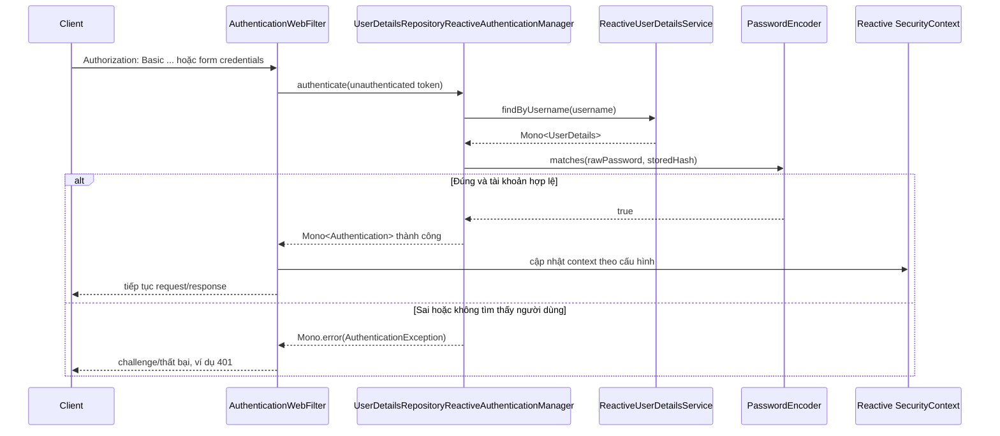

# UserDetailsRepositoryReactiveAuthenticationManager trong xác thực mật khẩu

**Module:** Spring Security – authentication. **Chủ đề cha:** Xác thực reactive (*Reactive Authentication*). Bài học tập trung vào class `org.springframework.security.authentication.UserDetailsRepositoryReactiveAuthenticationManager` khi ứng dụng dùng **Spring WebFlux**, không phải Servlet Spring MVC.

**Mục tiêu:** Sau bài này, bạn có thể giải thích luồng username/password reactive, kết nối `ReactiveUserDetailsService` với `PasswordEncoder`, phân biệt ba trạng thái thành công/rỗng/lỗi của `Mono<Authentication>`, cấu hình `SecurityWebFilterChain` dùng manager này, tự viết integration tests qua `WebTestClient`, và phát hiện các sai lầm về blocking I/O, password hashing, Reactor Context, HTTP Basic, session và mã lỗi.

## 1. Đặt đúng vị trí class trong Spring Security WebFlux

Ở Spring Security Servlet, một ví dụ quen thuộc là `DaoAuthenticationProvider`, `UserDetailsService`, `AuthenticationManager`, `HttpSecurity` và `SecurityFilterChain`. Với **WebFlux**, các abstraction tương ứng hoạt động trên publisher Reactor:

| Nhiệm vụ | Servlet stack | Reactive/WebFlux stack |
| --- | --- | --- |
| Xác minh credential | `AuthenticationManager` → `AuthenticationProvider` | `ReactiveAuthenticationManager` |
| Nạp tài khoản | `UserDetailsService#loadUserByUsername` | `ReactiveUserDetailsService#findByUsername` |
| Manager dùng user store + password | Thường `DaoAuthenticationProvider` | `UserDetailsRepositoryReactiveAuthenticationManager` |
| Kết quả xác thực | `Authentication` hoặc exception | `Mono<Authentication>` |
| HTTP security | `HttpSecurity` / `SecurityFilterChain` | `ServerHttpSecurity` / `SecurityWebFilterChain` |
| Filter thực thi | Servlet `Filter`, `FilterChainProxy` | Reactive `WebFilter` / `WebFilterChainProxy` |
| Lấy user hiện tại | `SecurityContextHolder` thường gắn ThreadLocal | `ReactiveSecurityContextHolder` dựa trên Reactor Context |
| HTTP test | `MockMvc` | `WebTestClient` |

**`UserDetailsRepositoryReactiveAuthenticationManager` là manager chuyên cho username/password**, sử dụng một `ReactiveUserDetailsService` để tìm `UserDetails` và `PasswordEncoder` để kiểm tra mật khẩu. Nó kế thừa `AbstractUserDetailsReactiveAuthenticationManager` và triển khai `ReactiveAuthenticationManager`.

Constructor:

```java
UserDetailsRepositoryReactiveAuthenticationManager(
        ReactiveUserDetailsService userDetailsService)
```

Cấu hình thường dùng:

```java
UserDetailsRepositoryReactiveAuthenticationManager manager =
        new UserDetailsRepositoryReactiveAuthenticationManager(users);
manager.setPasswordEncoder(encoder);
```

Manager **không phải** một repository lưu user, database, HTTP filter, session repository hay JWT issuer. Nó điều phối việc lấy `UserDetails`, xác thực password và tạo kết quả `Authentication`. Các công việc HTTP như parse header/body, lưu security context, challenge và phân quyền thuộc filter chain và các service khác.

### Khi nào nên dùng?

- Ứng dụng WebFlux cần xác thực **username + password** từ form login hoặc HTTP Basic.
- `ReactiveUserDetailsService` có dữ liệu user và password hash từ nguồn có thể hoạt động reactive.
- Cần cấu hình encoder riêng, chính sách tài khoản, nâng cấp hash hoặc xác thực mật khẩu gắn với luồng WebFlux.

**Không dùng class này để “xác thực JWT” chỉ vì ứng dụng reactive.** JWT access token được xử lý bằng resource server/JWT decoder và manager tương ứng. Password login và Bearer token là hai cơ chế khác nhau.

## 2. Phương thức `authenticate(...)` và ý nghĩa của `Mono`

Interface:

```java
public interface ReactiveAuthenticationManager {
    Mono<Authentication> authenticate(Authentication authentication);
}
```

Ở thời điểm được gọi, `authenticate` trả về một **publisher**, không phải trả kết quả blocking ngay lập tức. Khi Spring Security subscribe publisher trong filter chain, các bước xử lý được thực thi theo Reactor:



**Ba tín hiệu phải hiểu đúng:**

| Kết quả publisher | Ý nghĩa theo contract của `ReactiveAuthenticationManager` | Ứng dụng xử lý |
| --- | --- | --- |
| `Mono.just(authenticated)` | Xác minh thành công; có `Authentication` hợp lệ | Dùng danh tính cho security context/authorization |
| `Mono.empty()` | Manager **không quyết định** được với input này | Có thể manager khác xử lý, tùy composition; không coi là login thành công |
| `Mono.error(AuthenticationException)` | Thất bại xác thực, ví dụ password sai hoặc account disabled | Xử lý lỗi/challenge, không tạo user giả |

`UserDetailsRepositoryReactiveAuthenticationManager` là manager password; với credential thuộc phạm vi của nó nhưng sai, bạn phải kỳ vọng thất bại, **không** tự chuyển thành `Mono.empty()` để thử cơ chế yếu khác.

**Lưu ý:** Việc `ReactiveUserDetailsService#findByUsername` trả `Mono.empty()` khi user không tồn tại **không đồng nghĩa** manager sẽ báo `Mono.empty()`. Manager thường chuyển tình huống username không tồn tại thành một lỗi xác thực thích hợp, tránh xác thực vô tình thành công và tránh tiết lộ account existence.

### Vì sao không gọi `.block()`?

Sai trong WebFlux request handler:

```java
// SAI: block Reactor publisher trên Netty event loop.
Authentication a = manager.authenticate(token).block();
```

`.block()` có thể gây lỗi trên thread non-blocking, làm giảm khả năng mở rộng hoặc tạo deadlock/độ trễ. Trong WebFlux, **trả publisher** để framework subscribe và propagate Reactor Context. Trong unit test có thể dùng `StepVerifier`, không cần `.block()`.

Đừng gọi `.subscribe()` thủ công trong controller để rồi trả response trước khi kết quả xác thực đến; điều đó làm mất kiểm soát lỗi và security context.

## 3. Từng mắt xích trong kiểm tra password

### 3.1. Input: `UsernamePasswordAuthenticationToken` chưa xác thực

Ví dụ:

```java
Authentication request =
        UsernamePasswordAuthenticationToken.unauthenticated(
                "alice", "correct-password");

Mono<Authentication> outcome = manager.authenticate(request);
```

Đây là đoạn **minh họa API**; `manager` phải là instance được cấu hình. Một `UsernamePasswordAuthenticationToken` đầu vào chứa username và raw password; tránh log `credentials` hoặc đưa request token vào cache/session.

### 3.2. `ReactiveUserDetailsService`

Contract:

```java
public interface ReactiveUserDetailsService {
    Mono<UserDetails> findByUsername(String username);
}
```

Một implementation có thể truy cập R2DBC/PostgreSQL reactive, một reactive directory/client hoặc map in-memory. `UserDetails` chứa username, password hash, authorities và trạng thái tài khoản như enabled, non-locked, non-expired, credentials-non-expired.

Ví dụ in-memory:

```java
PasswordEncoder encoder =
        PasswordEncoderFactories.createDelegatingPasswordEncoder();

UserDetails alice = User.withUsername("alice")
        .password(encoder.encode("correct-password"))
        .roles("USER")
        .build();

ReactiveUserDetailsService users =
        new MapReactiveUserDetailsService(alice);
```

Với `MapReactiveUserDetailsService`, dữ liệu nằm trong bộ nhớ; thích hợp lab/test, không phải user database production.

**Không nhầm** `ReactiveUserDetailsService` với `ReactiveUserDetailsPasswordService`: service đầu *tìm user*, service sau (nếu cung cấp) có thể dùng để **cập nhật password hash** khi encoder cần upgrade trên lần xác thực thành công. Việc nâng cấp hash phải được thiết kế với kho dữ liệu và transaction phù hợp.

### 3.3. `PasswordEncoder`

`PasswordEncoder` thường là API đồng bộ, nhưng manager có thể lên lịch tác vụ mã hóa/so khớp ở scheduler phù hợp vì bcrypt/Argon2 là công việc nặng CPU. Với Spring Security, nên dùng `DelegatingPasswordEncoder` để hỗ trợ nhiều phiên bản hash.

```java
PasswordEncoder encoder =
        PasswordEncoderFactories.createDelegatingPasswordEncoder();

String storedHash = encoder.encode("correct-password");
// Ví dụ định dạng: {bcrypt}$2a$...
// Phần salt/hash thay đổi theo mỗi lần encode.

boolean valid = encoder.matches("correct-password", storedHash);
```

Đừng so sánh `rawPassword.equals(storedHash)`; cũng không `encode(raw)` rồi so hai chuỗi, vì encoder có salt tạo hash khác nhau. Cần gọi `matches(raw, stored)`.

Một hash dạng `{bcrypt}...` là dữ liệu nhạy cảm nhưng không phải raw password. Không đưa hash vào API response, cookie, URL hoặc logs. Không dùng `NoOpPasswordEncoder` hay `{noop}` trong production. Các ví dụ `User.withDefaultPasswordEncoder()` trong tài liệu nhanh dành cho demo, không phải chọn lựa bảo mật production.

### 3.4. Kiểm tra account status và authority

Sau khi lấy user và kiểm tra mật khẩu, manager phải áp dụng policy account-state (ví dụ disabled, locked, expired) theo cách implementation hỗ trợ. Nếu tài khoản đã khóa, **không** cho phép login chỉ vì password đúng. Principal/authenticated token kết quả cần có authorities đã được xác minh từ user store.

| Trạng thái | Mong đợi |
| --- | --- |
| Username không tồn tại | Không xác thực |
| Password sai | Không xác thực |
| Password đúng, enabled, non-locked | Xác thực nếu các điều kiện khác đạt |
| Password đúng nhưng disabled/locked | Bị từ chối theo account policy |
| Password hash không khớp encoder/prefix | Xử lý lỗi cấu hình/dữ liệu; không fallback `{noop}` |
| Quyền `ROLE_USER` | Chỉ mở endpoint cho user; không tự có `ROLE_ADMIN` |
| Password bị lộ/compromised checker từ chối | Không nên tạo `Authentication` thành công |

Các bản Spring Security khác nhau có cấu hình `setPostAuthenticationChecks(...)`, `setCompromisedPasswordChecker(...)` và `setUserDetailsPasswordService(...)`. Khi dùng API đó, phải chọn phiên bản framework thực tế hỗ trợ, không copy code từ release khác mà không kiểm tra.

## 4. Reactive không đồng nghĩa mọi phụ thuộc đều tự non-blocking

Đặt `Mono` quanh JDBC blocking không biến JDBC thành reactive:

```java
// PHẢN VÍ DỤ: vẫn chạy blocking JDBC trên event loop nếu không chuyển scheduler.
ReactiveUserDetailsService blocking = username -> {
    UserDetails user = legacyJdbcService.loadUserByUsername(username);
    return Mono.just(user);
};
```

`loadUserByUsername` đã chạy **trước khi** publisher được tạo. Dưới tải cao, event loop WebFlux bị giữ, làm request khác tăng độ trễ.

Nếu **bắt buộc** gọi hệ thống blocking trong giai đoạn chuyển đổi, cần trì hoãn tác vụ và cách ly lên `boundedElastic`:

```java
// CHỈ LÀ ADAPTER CHUYỂN TIẾP; không phải giải pháp production lý tưởng.
ReactiveUserDetailsService adapted = username ->
        Mono.fromCallable(() ->
                legacyJdbcService.loadUserByUsername(username))
            .subscribeOn(Schedulers.boundedElastic());
```

Đoạn này cần `legacyJdbcService` sẵn có, imports `Mono`, `Schedulers`. Nó còn cần giới hạn concurrency, timeout, connection pool và error mapping thích hợp. **Không** chuyển bừa mọi Mono sang `boundedElastic`: lời khuyên là chỉ cô lập các blocking operations thực sự, ưu tiên truy cập database qua R2DBC/reactive drivers.

Ví dụ phác thảo với Spring R2DBC `DatabaseClient`:

```java
// Đoạn minh họa nằm trong class có DatabaseClient client.
@Override
public Mono<UserDetails> findByUsername(String username) {
    return client.sql("""
                SELECT username, password_hash, enabled
                FROM users WHERE username = :username
                """)
            .bind("username", username)
            .map((row, metadata) -> User.withUsername(
                        row.get("username", String.class))
                    .password(row.get("password_hash", String.class))
                    .disabled(Boolean.FALSE.equals(
                        row.get("enabled", Boolean.class)))
                    .roles("USER")
                    .build())
            .one();
}
```

Với thực tế phải truy vấn roles/authorities đáng tin, account locked/expired, tên user chuẩn hóa, phần hash migration và cache; đừng dùng `roles("USER")` cố định cho mọi tài khoản. `DatabaseClient#one()` trả `Mono.empty()` nếu không tìm thấy user; manager phải coi đây là thất bại xác thực, không phải anonymous được chấp nhận.

### Scheduler và bcrypt

`AbstractUserDetailsReactiveAuthenticationManager#setScheduler(...)` điều chỉnh scheduler thực thi phần mật khẩu theo phiên bản Spring Security. Mặc định framework đã có cơ chế scheduling cho password work; đừng đặt toàn bộ authentication trên Netty event loop chỉ vì thử thấy nhanh.

Nếu tải cao, đo lường: số lần login/giây, thời gian bcrypt/Argon2, backpressure và giới hạn scheduler. Rate limiting và brute-force protection rất quan trọng, vì bcrypt tốn CPU; giới hạn request đăng nhập không nên bỏ qua chỉ vì reactive có thể phục vụ nhiều connections.

## 5. Lab Java 17 chạy được: WebFlux password authentication qua HTTP Basic

Bài lab tạo một ứng dụng độc lập, thực sự nối `UserDetailsRepositoryReactiveAuthenticationManager` vào `SecurityWebFilterChain` thông qua `httpBasic().authenticationManager(...)`. Đây là lựa chọn để quan sát credential trên **mỗi request**. Không triển khai JSON login hoặc JWT; hai loại đó cần filter/handler và policy riêng.

### 5.1. Cấu trúc

```text
reactive-password-lab/
├── pom.xml
└── src/
    ├── main/java/example/ReactivePasswordApplication.java
    └── test/java/example/ReactivePasswordApplicationTests.java
```

### 5.2. `pom.xml`

```xml
<project xmlns="http://maven.apache.org/POM/4.0.0"
         xmlns:xsi="http://www.w3.org/2001/XMLSchema-instance"
         xsi:schemaLocation="http://maven.apache.org/POM/4.0.0 https://maven.apache.org/xsd/maven-4.0.0.xsd">
    <modelVersion>4.0.0</modelVersion>
    <parent>
        <groupId>org.springframework.boot</groupId>
        <artifactId>spring-boot-starter-parent</artifactId>
        <version>3.3.9</version>
        <relativePath/>
    </parent>
    <groupId>example</groupId>
    <artifactId>reactive-password-lab</artifactId>
    <version>1.0.0</version>
    <properties><java.version>17</java.version></properties>
    <dependencies>
        <dependency>
            <groupId>org.springframework.boot</groupId>
            <artifactId>spring-boot-starter-webflux</artifactId>
        </dependency>
        <dependency>
            <groupId>org.springframework.boot</groupId>
            <artifactId>spring-boot-starter-security</artifactId>
        </dependency>
        <dependency>
            <groupId>org.springframework.boot</groupId>
            <artifactId>spring-boot-starter-test</artifactId>
            <scope>test</scope>
        </dependency>
        <dependency>
            <groupId>org.springframework.security</groupId>
            <artifactId>spring-security-test</artifactId>
            <scope>test</scope>
        </dependency>
        <dependency>
            <groupId>io.projectreactor</groupId>
            <artifactId>reactor-test</artifactId>
            <scope>test</scope>
        </dependency>
    </dependencies>
    <build>
        <plugins>
            <plugin>
                <groupId>org.springframework.boot</groupId>
                <artifactId>spring-boot-maven-plugin</artifactId>
            </plugin>
        </plugins>
    </build>
</project>
```

**Quan trọng:** Không thêm `spring-boot-starter-web` vào project này. Khi có cả Spring MVC và WebFlux, Spring Boot thường chọn MVC làm web application type theo mặc định, dẫn đến khác hoàn toàn chain/filter và test mong muốn. Lab chỉ dùng WebFlux. Mốc Boot 3.3.9 minh họa Spring Security 6; khi triển khai production chọn release còn hỗ trợ và cập nhật bản vá bảo mật.

### 5.3. Ứng dụng WebFlux

Tạo `src/main/java/example/ReactivePasswordApplication.java`:

```java
package example;

import java.util.Map;

import org.springframework.boot.SpringApplication;
import org.springframework.boot.autoconfigure.SpringBootApplication;
import org.springframework.context.annotation.Bean;
import org.springframework.http.HttpStatus;
import org.springframework.security.authentication.ReactiveAuthenticationManager;
import org.springframework.security.authentication.UserDetailsRepositoryReactiveAuthenticationManager;
import org.springframework.security.config.annotation.web.reactive.EnableWebFluxSecurity;
import org.springframework.security.config.web.server.ServerHttpSecurity;
import org.springframework.security.core.Authentication;
import org.springframework.security.core.userdetails.MapReactiveUserDetailsService;
import org.springframework.security.core.userdetails.ReactiveUserDetailsService;
import org.springframework.security.core.userdetails.User;
import org.springframework.security.core.userdetails.UserDetails;
import org.springframework.security.crypto.factory.PasswordEncoderFactories;
import org.springframework.security.crypto.password.PasswordEncoder;
import org.springframework.security.core.context.ReactiveSecurityContextHolder;
import org.springframework.security.web.server.SecurityWebFilterChain;
import org.springframework.web.bind.annotation.GetMapping;
import org.springframework.web.bind.annotation.RestController;

import reactor.core.publisher.Mono;

@SpringBootApplication
@EnableWebFluxSecurity
public class ReactivePasswordApplication {

    public static void main(String[] args) {
        SpringApplication.run(ReactivePasswordApplication.class, args);
    }

    @Bean
    PasswordEncoder passwordEncoder() {
        return PasswordEncoderFactories.createDelegatingPasswordEncoder();
    }

    @Bean
    ReactiveUserDetailsService users(PasswordEncoder encoder) {
        UserDetails alice = User.withUsername("alice")
                .password(encoder.encode("demo-password"))
                .roles("USER")
                .build();

        UserDetails disabledBob = User.withUsername("bob")
                .password(encoder.encode("another-password"))
                .roles("USER")
                .disabled(true)
                .build();

        return new MapReactiveUserDetailsService(alice, disabledBob);
    }

    @Bean
    ReactiveAuthenticationManager reactiveAuthenticationManager(
            ReactiveUserDetailsService users, PasswordEncoder encoder) {
        var manager =
                new UserDetailsRepositoryReactiveAuthenticationManager(users);
        manager.setPasswordEncoder(encoder);
        return manager;
    }

    @Bean
    SecurityWebFilterChain securityWebFilterChain(
            ServerHttpSecurity http,
            ReactiveAuthenticationManager manager) {
        return http
                .authorizeExchange(ex -> ex
                        .pathMatchers("/api/me").authenticated()
                        .anyExchange().denyAll())
                .httpBasic(basic -> basic.authenticationManager(manager))
                .formLogin(form -> form.disable())
                .build();
    }

    @RestController
    static class IdentityApi {
        @GetMapping("/api/me")
        Mono<Map<String, String>> me() {
            // Reactor Context: KHÔNG đọc SecurityContextHolder ThreadLocal.
            return ReactiveSecurityContextHolder.getContext()
                    .map(ctx -> {
                        Authentication a = ctx.getAuthentication();
                        return Map.of(
                                "username", a.getName(),
                                "authenticated",
                                Boolean.toString(a.isAuthenticated()));
                    });
        }
    }
}
```

**Các điểm đáng quan sát:**

1. Bean `ReactiveUserDetailsService` cung cấp `UserDetails` và hash đã mã hóa, chứ không trả password rõ.
2. Bean manager gọi constructor với service và `setPasswordEncoder`. Kết quả là một `ReactiveAuthenticationManager` dành cho username/password.
3. `ServerHttpSecurity` và `SecurityWebFilterChain` chỉ dùng ở WebFlux. Trong cấu hình này, Basic filter **thực sự được trỏ đến manager vừa tạo**; việc chỉ khai báo bean rồi không dùng có thể khiến app chọn cơ chế khác theo auto-configuration.
4. `.authorizeExchange(...authenticated())` đòi request GET có principal xác thực; các URL khác bị từ chối.
5. `.formLogin(form -> form.disable())` loại đăng nhập form để test HTTP Basic rõ ràng. Đây là quyết định **chỉ cho lab**, không phải khuyến nghị chung.
6. CSRF vẫn được bật mặc định, không ảnh hưởng request GET an toàn của lab. Nếu thêm REST POST, phải xác định credential có tự được browser gửi hay không trước khi đánh giá CSRF.
7. `ReactiveSecurityContextHolder.getContext()` đọc danh tính trong **Reactor Context của request**, không dựa vào thread cố định. Khi pipeline chuyển scheduler, ThreadLocal không được xem là nguồn tin cậy mặc định.
8. `MapReactiveUserDetailsService` là fixture, không phải repository production. User Bob bị disabled để test account status.
9. Endpoint trả **username đã được xác minh** chứ không chấp nhận username từ query string/body tự khai.

### 5.4. Integration tests bằng WebTestClient

Tạo `src/test/java/example/ReactivePasswordApplicationTests.java`:

```java
package example;

import org.junit.jupiter.api.Test;
import org.springframework.beans.factory.annotation.Autowired;
import org.springframework.boot.test.autoconfigure.web.reactive.AutoConfigureWebTestClient;
import org.springframework.boot.test.context.SpringBootTest;
import org.springframework.test.web.reactive.server.WebTestClient;

@SpringBootTest(webEnvironment = SpringBootTest.WebEnvironment.RANDOM_PORT)
@AutoConfigureWebTestClient
class ReactivePasswordApplicationTests {

    @Autowired
    WebTestClient client;

    @Test
    void correctPasswordReturnsVerifiedUsername() {
        client.get()
                .uri("/api/me")
                .headers(h -> h.setBasicAuth("alice", "demo-password"))
                .exchange()
                .expectStatus().isOk()
                .expectBody()
                .jsonPath("$.username").isEqualTo("alice")
                .jsonPath("$.authenticated").isEqualTo("true");
    }

    @Test
    void wrongPasswordIsUnauthorized() {
        client.get()
                .uri("/api/me")
                .headers(h -> h.setBasicAuth("alice", "wrong-password"))
                .exchange()
                .expectStatus().isUnauthorized();
    }

    @Test
    void unknownUsernameIsUnauthorized() {
        client.get()
                .uri("/api/me")
                .headers(h -> h.setBasicAuth("unknown", "demo-password"))
                .exchange()
                .expectStatus().isUnauthorized();
    }

    @Test
    void disabledAccountCannotAuthenticate() {
        client.get()
                .uri("/api/me")
                .headers(h -> h.setBasicAuth("bob", "another-password"))
                .exchange()
                .expectStatus().isUnauthorized();
    }

    @Test
    void basicCredentialMustBeSentForEveryIndependentRequest() {
        client.get()
                .uri("/api/me")
                .headers(h -> h.setBasicAuth("alice", "demo-password"))
                .exchange()
                .expectStatus().isOk();

        // Request mới không được tự kế thừa Basic header.
        client.get()
                .uri("/api/me")
                .exchange()
                .expectStatus().isUnauthorized();
    }

    @Test
    void unrelatedRouteIsDenied() {
        client.get()
                .uri("/private/unknown")
                .headers(h -> h.setBasicAuth("alice", "demo-password"))
                .exchange()
                .expectStatus().isForbidden();
    }
}
```

**Kỳ vọng:** 6 test HTTP PASS nếu ứng dụng và thư viện hoạt động đúng. Lệnh:

```bash
mvn test
```

Nếu chạy thành công, Maven báo `BUILD SUCCESS`. Đây là **kết quả dự kiến**, không phải log đã được chạy trong bài. Trong test này, Basic được gửi bằng `Authorization` header trên mỗi request và đi qua `SecurityWebFilterChain`; không dùng `mockUser()` hay `@WithMockUser` để làm kết quả authentication “xanh giả”.

`RANDOM_PORT` dùng server WebFlux thật ở cổng ngẫu nhiên; vì vậy có thể kiểm tra HTTP status và response, dù chưa có proxy/TLS/DB production. `WebTestClient` là client phù hợp cho reactive WebFlux; `MockMvc` thuộc Servlet và không phải công cụ mặc định cho lab này.

### 5.5. Direct manager test: kiểm tra tín hiệu Mono thay vì HTTP

Ngoài test HTTP, có thể test trực tiếp manager bằng Reactor `StepVerifier`. Thêm vào `src/test/java/example/ReactivePasswordApplicationTests.java` hoặc tạo một class test riêng. Dưới đây là **class test Java riêng hoàn chỉnh**:

```java
package example;

import org.junit.jupiter.api.Test;
import org.springframework.beans.factory.annotation.Autowired;
import org.springframework.boot.test.context.SpringBootTest;
import org.springframework.security.authentication.ReactiveAuthenticationManager;
import org.springframework.security.authentication.UsernamePasswordAuthenticationToken;
import org.springframework.security.core.Authentication;
import reactor.test.StepVerifier;

import static org.assertj.core.api.Assertions.assertThat;

@SpringBootTest
class ReactiveAuthenticationManagerTests {

    @Autowired
    ReactiveAuthenticationManager manager;

    @Test
    void managerEmitsAuthenticatedPrincipal() {
        Authentication request =
                UsernamePasswordAuthenticationToken.unauthenticated(
                        "alice", "demo-password");

        StepVerifier.create(manager.authenticate(request))
                .assertNext(result -> {
                    assertThat(result.isAuthenticated()).isTrue();
                    assertThat(result.getName()).isEqualTo("alice");
                    assertThat(result.getAuthorities())
                            .extracting(a -> a.getAuthority())
                            .contains("ROLE_USER");
                })
                .verifyComplete();
    }

    @Test
    void managerErrorsOnWrongPassword() {
        Authentication request =
                UsernamePasswordAuthenticationToken.unauthenticated(
                        "alice", "not-the-password");

        StepVerifier.create(manager.authenticate(request))
                .expectError(org.springframework.security.core
                        .AuthenticationException.class)
                .verify();
    }
}
```

Nếu muốn chạy test riêng, dùng:

```bash
mvn -Dtest=ReactiveAuthenticationManagerTests test
```

**Ý nghĩa:** `StepVerifier.create(...)` subscribe `Mono` trong ngữ cảnh test; khi đúng, nhận một `Authentication` đã xác thực; khi password sai, kiểm chứng `Mono.error(AuthenticationException)`. Không cần `.block()` và không đặt `@WithMockUser` lên method, vì cần xác thực thật qua manager.

**Lưu ý:** `Authentication#getCredentials()` là chi tiết cần kiểm soát/erasure theo manager và object graph thực tế; đừng viết test bảo mật chỉ xác nhận một field rồi suy ra password không nằm ở các object khác, log hoặc store. Không serialize toàn bộ `Authentication` ra API.

## 6. Thử bằng curl và hiểu chính xác ý nghĩa HTTP Basic

Chạy app:

```bash
mvn spring-boot:run
```

Trong một terminal khác:

```bash
# Password đúng: API trả 200 và username alice.
curl -i -u alice:demo-password http://localhost:8080/api/me

# Password sai: 401.
curl -i -u alice:wrong-password http://localhost:8080/api/me

# Không header Basic: 401.
curl -i http://localhost:8080/api/me

# User disabled: 401.
curl -i -u bob:another-password http://localhost:8080/api/me
```

Kết quả body minh họa khi thành công:

```json
{"username":"alice","authenticated":"true"}
```

Hai điểm cần nhớ:

1. `curl -u ...` gửi credential qua HTTP Basic, thường ở mỗi request. Basic dùng **base64 encoding, không phải encryption**; production cần HTTPS/TLS.
2. Request không Basic header bị `401` dù trước đó request khác đã thành công trong lab, vì ví dụ **không tạo login session bền vững từ Basic**. Authentication manager không tự làm persistent login hoặc cấp cookie/JWT.

Không chạy các lệnh có mật khẩu thật ở môi trường ghi history/log không được bảo vệ. Trong production nên chọn interactive/password manager/secret source phù hợp thay vì lưu credentials vào shell scripts.

## 7. `UserDetailsRepositoryReactiveAuthenticationManager` không tự tạo session hoặc JWT

Một hiểu nhầm phổ biến: “manager đã xác thực thành công thì người dùng vẫn đăng nhập ở request tiếp theo”. Trên WebFlux, đó là hai giai đoạn khác nhau:

```text
Request A:
    Credential (Basic/form/JSON)
        -> ReactiveAuthenticationManager
        -> Mono<Authentication> thành công
        -> SecurityContext của request

Request B:
    Browser hoặc HTTP client đưa credential nào?
        -> Nếu Basic: phải có Authorization header phù hợp
        -> Nếu session login: cần ServerSecurityContextRepository phù hợp
        -> Nếu Bearer: cần Bearer token và resource-server verifier phù hợp
```

**HTTP Basic:** `ServerHttpSecurity.HttpBasicSpec` mặc định dùng `NoOpServerSecurityContextRepository` để không lưu kết quả Basic vào session cho request sau. Điều này thích hợp với Basic: client gửi credential lại mỗi request. Tùy cấu hình có thể thay repository, nhưng đừng tự suy luận manager quyết định lưu login.

**Form login:** trong WebFlux có `formLogin(...)` và cơ chế lưu SecurityContext bằng `ServerSecurityContextRepository` theo cấu hình. Với cookie/session, phải bảo vệ CSRF và chống session fixation phù hợp. Form login khác với Basic ở lúc nhận credential và khả năng persistence.

**Custom JSON login:** Nếu tự viết WebFlux controller nhận JSON và gọi `manager.authenticate(...)`, bạn vẫn phải thiết kế `AuthenticationWebFilter`/converter, success/failure handlers, SecurityContext persistence và cookie/token issuance nếu muốn một flow đúng. Một controller gọi `.authenticate()` rồi trả `{"ok":true}` không tự đảm bảo request kế tiếp authenticated.

**JWT:** manager password này không cấp access token và không xác minh Bearer JWT. Phát hành token do issuer/authorization server thực hiện, resource server xác minh token mỗi request. JWT không được hiểu là một `HttpSession` reactive.

## 8. Trả lời những câu hỏi cấu hình quan trọng

### 8.1. Có nhất thiết khai báo bean manager hay không?

Không phải mọi WebFlux app đều cần tự khai báo. Spring Security có thể suy ra manager từ `ReactiveUserDetailsService` và các bean chuẩn. Nhưng khi bạn cần chọn encoder, nhiều cơ chế, manager riêng cho filter hoặc test đúng class này, khai báo explicit giúp rõ ràng hơn. Bài lab **chỉ định** manager cho HTTP Basic filter qua `.httpBasic(basic -> basic.authenticationManager(manager))` để tránh phụ thuộc vào lựa chọn ngầm.

### 8.2. Có cần `DaoAuthenticationProvider` không?

Không. `DaoAuthenticationProvider` là abstraction cho Servlet `AuthenticationProvider` kiểu đồng bộ. WebFlux dùng `ReactiveAuthenticationManager`; `UserDetailsRepositoryReactiveAuthenticationManager` là implementation username/password phù hợp. Đừng bọc `DaoAuthenticationProvider` bằng `.block()` rồi gọi từ event loop.

### 8.3. Vì sao tên “Repository” nhưng constructor nhận service?

Tên class không có nghĩa bạn phải truyền `JpaRepository`. Constructor nhận `ReactiveUserDetailsService`, một abstraction cung cấp `Mono<UserDetails>` khi lookup username. Nguồn thật có thể là R2DBC, cache reactive hoặc remote identity lookup; manager không biết chi tiết lưu trữ.

### 8.4. Dùng `ReactiveUserDetailsService` nhưng vẫn bị block?

Bạn có thể vô tình gọi JDBC, JPA repository, `Thread.sleep`, HTTP client synchronous, `.block()` hoặc password hash trên event loop. Đọc thread traces, đo latency và kiểm tra từng boundary. Đổi return type thành `Mono` không làm thao tác blocking tự biến mất.

### 8.5. Tại sao có tài khoản trong DB nhưng login vẫn 401?

Có thể username lookup trả `Mono.empty()`, field password hash lưu sai prefix (`{bcrypt}`), `PasswordEncoder` không tương ứng, tài khoản bị disabled/locked, hoặc credential extractor của filter không tạo đúng username/password token. Kiểm tra từng bước mà **không log mật khẩu**.

### 8.6. Có thể dùng Argon2/BCrypt khác mặc định không?

Có. Cung cấp `PasswordEncoder` phù hợp và dùng `setPasswordEncoder(...)`. Mọi stored hash phải có định dạng mà encoder giải mã được. Với `DelegatingPasswordEncoder`, hash thường có `{id}`; thêm encoder mới cần quản lý migration và tránh cấu hình tự động fallback sang NoOp. Vì password hashing tốn CPU, cần benchmark và rate limits.

### 8.7. Có thể thêm MFA vào manager này không?

Manager này xác minh username/password, không tự chứng minh OTP/WebAuthn/TOTP/step-up. Nếu hệ thống yêu cầu MFA, cần một quy trình xác thực đa bước/assurance được tin cậy kiểm tra và phản ánh trong authorization. `authenticated()` hoặc thành công password manager chưa có nghĩa đạt MFA.

## 9. Lỗi phổ biến và cách khắc phục

| Sai lầm | Hậu quả | Cách xử lý |
| --- | --- | --- |
| Import `UserDetailsService` thay vì `ReactiveUserDetailsService` | Dùng sai contract hoặc buộc blocking adapter | Dùng interface reactive `findByUsername` |
| Dùng `HttpSecurity`/`SecurityFilterChain` trong WebFlux app | Sai stack, filter không hoạt động như mong đợi | `ServerHttpSecurity`/`SecurityWebFilterChain` |
| Dùng `.block()` trong WebFlux controller | Block Netty event loop, giảm thông lượng | Compose `Mono` và return publisher |
| Gọi blocking JDBC bên trong `Mono.just(...)` | Blocking đã xảy ra trước khi tạo Mono | R2DBC/reactive driver hoặc adapter `fromCallable().subscribeOn(boundedElastic())` |
| Hash mật khẩu bằng cách so chuỗi hoặc `{noop}` | Login sai hoặc storage không an toàn | `PasswordEncoder.matches` với BCrypt/Argon2, Delegating encoder |
| Quên `setPasswordEncoder` khi dùng hash scheme khác | `401` hoặc lỗi hash format | Đồng bộ encoder với stored hashes |
| `findByUsername` trả `null` | Vi phạm reactive contract, NPE | Trả `Mono.empty()` hoặc `Mono.error(...)` tùy trường hợp |
| `findByUsername` trả `Mono.just(null)` | Illegal null in Reactor | Không emit `null`; dùng empty |
| Mapper ném exception lộ dữ liệu DB vào response | Lộ thông tin nội bộ và lỗi authentication | Map lỗi chung phía client, log an toàn |
| Chỉ test HTTP 200 với `@WithMockUser` | Không chứng minh manager dùng password đúng | Dùng Basic header thật và `StepVerifier` |
| Tạo bean manager nhưng HTTP filter không dùng nó | Test nhầm manager hoặc dùng default khác | Wiring explicit manager cho `httpBasic`/`formLogin` |
| Coi Basic login là session login | Request sau không header bị 401 | Thiết kế `ServerSecurityContextRepository` nếu cần stateful |
| Gọi `.subscribe()` thủ công khi đăng nhập JSON | Kết quả trả trước khi xác thực xong, mất lỗi | Trả `Mono`, để filter/framework subscribe |
| Dùng `SecurityContextHolder` ThreadLocal trong Reactor pipeline | Mất context khi chuyển thread | `ReactiveSecurityContextHolder` |
| Xem `ROLE_USER` là bằng chứng MFA | Password-only có thể mở thao tác nhạy cảm | Thêm assurance/step-up và authorization đúng |
| Không giới hạn số lần thử password | CPU hashing và credential stuffing gây tải lớn | Rate limit, MFA, lockout và giám sát |
| Ghi log request/headers chứa Basic credential | Mật khẩu bị lộ qua tracing/APM | Mask auth header, không log raw credentials |

### Tải và an toàn

Password verification bằng BCrypt/Argon2 tương đối tốn CPU. Reactive giúp quản lý I/O và số lượng kết nối, **không làm chi phí password hash biến mất**. Nếu app nhận quá nhiều login requests, scheduler có thể nghẽn dù Netty event loop không block. Cần rate limiting, backpressure phù hợp, retry policy hạn chế, giám sát CPU/queue, chống enumeration và bảo vệ user database.

**Credential erasure:** không lưu raw password vào `SecurityContext`, session hoặc response; tránh log `Authentication` đầu vào. Password hash trong user repository vẫn cần để xác minh lần sau. Nếu cache trả `UserDetails` mutable được dùng chung, không để công đoạn xóa credential của authentication kết quả làm hỏng object cache. Test login hai lần và kiểm tra result principal/credentials nếu app có custom implementation.

**Lỗi bảo mật không nên “fail open”:** khi user service bị lỗi database, không tạo authenticated principal giả để ứng dụng vẫn chạy; hãy thất bại có kiểm soát. Không chuyển `Mono.error(...)` thành `Mono.just(authentication)` tự nhận với lý do “giữ UX”.

## 10. Bài tập và checklist nghiệm thu

### Bài tập A — Thay encoder rồi quan sát

Tạo một tài khoản Alice với hash hợp lệ `{bcrypt}`. Thử password đúng/sai qua `WebTestClient`. Sau đó cố ý cấu hình encoder không tương thích ở **môi trường test** và giải thích vì sao kết quả xác thực phải thất bại, không được fallback xác thực bằng chuỗi rõ.

### Bài tập B — Tách manager và HTTP filter

Gọi trực tiếp `manager.authenticate(...)` bằng `StepVerifier` để xác minh contract. Sau đó gọi endpoint bằng Basic header để chứng minh `AuthenticationWebFilter` dùng cùng manager. Chỉ direct test thành công **không đủ** để khẳng định URL được bảo vệ đúng.

### Bài tập C — Minh họa blocking I/O

Tạo một `ReactiveUserDetailsService` fake gọi `Thread.sleep` trực tiếp (chỉ trong bài đo local), so sánh thời gian phản hồi khi gửi đồng thời nhiều requests với phiên bản `Mono.fromCallable(...).subscribeOn(Schedulers.boundedElastic())`. Quan sát thread, latency và tác dụng của pool/limit. Trở lại reactive driver khi sản xuất.

### Bài tập D — Phân biệt Basic và session

Gửi GET Basic hợp lệ, tiếp đến GET không header; ghi nhận `401`. Đổi flow sang form login/cookie session với `ServerSecurityContextRepository`, rồi test request sau với cookie. Giải thích vì sao **cùng một password manager** có thể được dùng ở hai luồng có cách duy trì danh tính khác nhau.

### Bài tập E — Bảo vệ endpoint ADMIN

Thêm `/api/admin` đòi `ROLE_ADMIN`, nhưng Alice chỉ có `ROLE_USER`. Kiểm tra Basic đúng password đến `/api/me` được `200` nhưng `/api/admin` bị `403`. Giải thích authentication thành công không đồng nghĩa authorization đủ quyền.

### Checklist

- [ ] Dùng đúng stack WebFlux, `ServerHttpSecurity`, `SecurityWebFilterChain` và `ReactiveSecurityContextHolder`.
- [ ] Tạo `ReactiveUserDetailsService#findByUsername` trả `Mono<UserDetails>`, không `null`/blocking call tùy tiện.
- [ ] `UserDetailsRepositoryReactiveAuthenticationManager` nhận đúng service và encoder phù hợp.
- [ ] Credential raw so khớp với hash bằng `PasswordEncoder.matches`, không lưu/ghi log password rõ.
- [ ] Account status disabled/locked/expired được tôn trọng; username không tồn tại và password sai bị từ chối.
- [ ] Filter (Basic/form/custom) thực sự dùng manager đã cấu hình.
- [ ] Phân biệt `Mono.just` (thành công), `Mono.empty` (không quyết định), `Mono.error` (thất bại).
- [ ] Không `.block()` hoặc `.subscribe()` tùy tiện trong request handler.
- [ ] Phân biệt user lookup reactive với password hash CPU work; đánh giá scheduler và giới hạn tài nguyên.
- [ ] Không coi manager tự lưu session hoặc tự cấp JWT.
- [ ] Tách authentication với authorization, MFA, session persistence và token issuance.
- [ ] Test `WebTestClient` với credential thật: success, wrong password, unknown user, disabled user, missing header.
- [ ] Test trực tiếp manager bằng `StepVerifier` mà không chèn mock principal.
- [ ] Test phân quyền endpoint riêng và account state; không chỉ assert status thành công.
- [ ] Có HTTPS, rate limiting, log masking, password policy, upgrade hashes và giám sát reactive pipeline.
- [ ] Nếu dùng blocking legacy repository, cách ly có giới hạn hoặc thay bằng reactive driver.

**Ghi nhớ:** `UserDetailsRepositoryReactiveAuthenticationManager` là “cầu nối” giữa **ReactiveUserDetailsService** và **PasswordEncoder** để xác minh username/password trong Spring Security WebFlux. Nó trả `Mono<Authentication>` cho phần filter/authorization dùng; nó **không tự biến Basic thành session, không phát hành JWT và không kiểm chứng MFA**. Tách rõ trách nhiệm giúp tránh lỗi blocking và lỗi chính sách xác thực.

## 11. Tài liệu chính thức

- [Spring Security — UserDetailsRepositoryReactiveAuthenticationManager API](https://docs.spring.io/spring-security/reference/api/java/org/springframework/security/authentication/UserDetailsRepositoryReactiveAuthenticationManager.html): constructor và `retrieveUser`.
- [Spring Security — AbstractUserDetailsReactiveAuthenticationManager API](https://docs.spring.io/spring-security/reference/api/java/org/springframework/security/authentication/AbstractUserDetailsReactiveAuthenticationManager.html): `setPasswordEncoder`, scheduler, password upgrade/checks.
- [Spring Security — ReactiveAuthenticationManager API](https://docs.spring.io/spring-security/reference/api/java/org/springframework/security/authentication/ReactiveAuthenticationManager.html): contract `Mono<Authentication>`.
- [Spring Security — WebFlux Security Configuration](https://docs.spring.io/spring-security/reference/reactive/configuration/webflux.html): `SecurityWebFilterChain`, HTTP Basic và form login reactive.
- [Spring Security — Testing Web Security](https://docs.spring.io/spring-security/reference/reactive/test/web/): dùng `WebTestClient` để test reactive security.
- [Spring Security — Password Storage](https://docs.spring.io/spring-security/reference/features/authentication/password-storage.html): `DelegatingPasswordEncoder` và hash bảo mật.
- [Project Reactor — Reference Guide](https://projectreactor.io/docs/core/release/reference/): publisher, scheduler và tránh blocking.