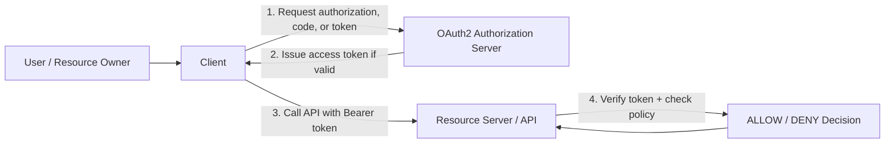

# Distinguishing the Authorization Function from the OAuth2 Authorization Server Role

In the **Spring Security – authorization** topic, the word "authorization" appears in two contexts that are easy to confuse:

- **Authorization (access control)** is the act of deciding whether an authenticated subject is allowed to perform a specific operation on a specific resource. For example: Is Alice allowed to view order 42?
- **OAuth2 Authorization Server** is **a role in the OAuth 2.0 protocol**, responsible for receiving authorization/login requests under supported flows, verifying the client and grant conditions, and **issuing tokens** to the client. It does not by default decide every per-order access rule in an API.

The two concepts are related, yet **having the same word in their names does not mean they have the same job**. An API that only checks permissions still performs authorization, even when it does not implement an OAuth2 Authorization Server.

## 1. Definitions and the Question Each Answers

### 1.1. Authorization as an access decision

Typical question:

> Is subject S, given its current permissions and context, allowed to perform action A on resource R?

Commonly evaluated components:

| Component | Example |
| --- | --- |
| Subject | User `alice`; service `billing-job` |
| Action | `read`, `create`, `update`, `approve` |
| Resource | Order `order-42`, API `GET /api/orders/42` |
| Context | Tenant, owner, order status, timestamp |
| Policy | Requires `orders.read` **and** right owner; administrators have explicitly defined exceptions |
| Outcome | Allow or deny; record for audit if needed |

This is the **access control problem**. Decisions may be based on roles (RBAC), permissions/scopes, attributes (ABAC), ownership relationships (ReBAC), or business rules. **Authentication** answers "who are you?"; **authorization** answers "what are you allowed to do?". Being logged in does not automatically grant permission to view all data.

In Spring Security Servlet, HTTP-layer rules typically pass through `authorizeHttpRequests`, `AuthorizationFilter`, and `AuthorizationManager`. At the method/service layer, you can use `@EnableMethodSecurity` and `@PreAuthorize`, or a dedicated `AuthorizationManager`/policy service.

### 1.2. OAuth2 Authorization Server as a protocol role

Typical question:

> Which token type, for which subject and which scopes, should this client be issued under the configured grant/flow according to the Authorization Server's policy?

An Authorization Server (AS) typically handles these groups of responsibilities:

1. Identify and verify the registered **client**, grant type, redirect URI, and PKCE/client authentication when applicable.
2. Coordinate user authentication and/or obtain consent for user-interactive flows; with `client_credentials`, the subject is typically the client itself, requiring no user login.
3. Apply **token-issuance** policy: whether requested scopes are valid/approved, token lifetime, audience, and issuance conditions.
4. Issue **access tokens**; optionally issue refresh tokens and support endpoints such as `/oauth2/authorize`, `/oauth2/token`, metadata, JWKS, introspection, and revocation depending on configuration/token type and product.
5. When OpenID Connect (OIDC) is enabled, also act as an OpenID Provider, issuing **ID tokens** and providing the corresponding OIDC endpoints.

Key point: the AS **does perform authorization regarding granting permissions to a client**, yet the AS issuing a token containing the `orders.read` scope **does not by itself prove** that Alice owns `order-42`.

## 2. The Four OAuth2 Roles and Where Decisions Happen

| OAuth2 Role | Responsibility in the "View Order" Example |
| --- | --- |
| Resource Owner | Subject entitled to authorize access to protected resources; typically the user in interactive flows |
| Client | Web/mobile app or service requesting a token to call the API |
| Authorization Server | Authenticates/validates requests per grant and token-issuance policy; issues tokens |
| Resource Server | API holding order data; validates tokens and **enforces resource access policies** |

**A Resource Server can be a Spring Boot application protected by Spring Security**. An Authorization Server can be a separate service, an IdP product, or a self-built service using Authorization Server capabilities in the Spring ecosystem. A single application can still hold multiple roles, yet each responsibility must be kept distinct.

Logical model:



Arrow (4) is **API authorization**, not the token-issuance operation in (2). If needed, the API can call the AS to **introspect** an opaque token; even then, checking business policy remains the enforcement responsibility of the API or a policy system trusted by the API.

## 3. Direct Comparison: Do Not Conflate the Two Uses of "Authorization"

| Criterion | Authorization in Spring Security | OAuth2 Authorization Server |
| --- | --- | --- |
| Nature | Mechanism/policy making access decisions | Role/service in the OAuth2/OIDC protocol |
| Question | "May this request enter the endpoint or read this record?" | "May this client be issued a token with the requested scopes?" |
| Typical inputs | `Authentication`, authorities, HTTP method/path, resource and business attributes | Client registration, grant, authorization code, PKCE, user session, consent, scope |
| Output | Allow/deny action; typically leads to HTTP 2xx/401/403 depending on context | Authorization code, access token, refresh token, ID token if OIDC; or OAuth error |
| Where applied | Gateway/API/Resource Server/service, or the AS itself to protect AS endpoints | Protocol endpoints of the token-issuing service |
| Typical Spring components | `AuthorizationManager`, `authorizeHttpRequests`, `@PreAuthorize` | OAuth2 Authorization Server configuration, token endpoint, `RegisteredClient`, token services |
| Does it issue tokens? | **No**, not just because `authorizeHttpRequests` rules are configured | **Yes**, this is its central responsibility |
| Does it inherently know who owns an order? | Can check when given policies and relevant data | **Not by default**; scopes/claims do not replace per-record permissions |

**Be careful with the word "scope":** Scope typically describes the level of delegation granted to a client for a group of APIs/operations (e.g., `orders.read`). Scope does not necessarily correspond to an internal role, and even less serves as proof of ownership of individual resources. Scope names and semantics are part of the contract between the AS, client, and Resource Server.

## 4. Walking Through a Concrete OAuth2 Flow

Example: Alice uses an order management app with **Authorization Code + PKCE**.

1. The client redirects the browser to the AS authorization endpoint with `client_id`, `redirect_uri`, `scope=orders.read`, `state`, and appropriate PKCE parameters.
2. The AS authenticates the user if needed, checks the client and authorization request, and handles consent per policy. When allowed, the AS returns an **authorization code** to the redirect URI.
3. The client sends the authorization code along with the PKCE verifier and required client credentials to the token endpoint. The AS verifies them and may issue an access token carrying `orders.read`.
4. The client calls `GET /api/orders/42` with `Authorization: Bearer <access-token>`.
5. The API acting as Resource Server **verifies the token** (signature and claims for JWT, or introspection for an opaque token); Spring Security then checks permission to invoke the endpoint.
6. The business service checks further: does order 42 belong to Alice / the current tenant? If not, **deny** even though the token is valid and carries `orders.read`.

There are **two gates** to pass:

- **AS grant gate:** did the client receive an access token and the requested scopes?
- **API access gate:** is that token/identity allowed to perform this operation on this specific resource?

When the token is a JWT, the API can usually verify the signature using public keys from JWKS without asking the AS on every request. With an opaque token, the API typically calls introspection as configured. Regardless of token type, **business rules at the API do not disappear**.

## 5. Spring Security Example: An API That Checks Permissions Without Issuing Tokens

Assume a **Spring Boot 3.x / Spring Security 6.x, Java 17+** project with Spring Web, Spring Security, and Spring OAuth2 Resource Server (including JOSE/JWT support) dependencies, and an external AS issuing JWTs.

`application.yml` configuration for the **API/Resource Server**:

```yaml
spring:
  security:
    oauth2:
      resourceserver:
        jwt:
          issuer-uri: https://auth.example.test
```

`https://auth.example.test` is an **illustrative issuer** and must be replaced with the AS's real issuer along with appropriate metadata/JWKS configuration. The Resource Server uses the issuer to configure JWT verification; `aud` (audience) must also be verified when the system requires tokens intended specifically for this API.

Example `ApiSecurityConfig.java`: this is a **complete configuration class in a Spring Boot application** with the dependencies above, not a standalone plain Java program run directly with `javac`.

```java
import org.springframework.context.annotation.Bean;
import org.springframework.context.annotation.Configuration;
import org.springframework.http.HttpMethod;
import org.springframework.security.config.Customizer;
import org.springframework.security.config.annotation.method.configuration.EnableMethodSecurity;
import org.springframework.security.config.annotation.web.builders.HttpSecurity;
import org.springframework.security.web.SecurityFilterChain;

@Configuration
@EnableMethodSecurity
public class ApiSecurityConfig {

    @Bean
    SecurityFilterChain apiSecurityFilterChain(HttpSecurity http) throws Exception {
        http
            .authorizeHttpRequests(authorize -> authorize
                .requestMatchers(HttpMethod.GET, "/api/orders/**")
                    .hasAuthority("SCOPE_orders.read")
                .requestMatchers(HttpMethod.POST, "/api/orders/**")
                    .hasAuthority("SCOPE_orders.write")
                .anyRequest().denyAll()
            )
            .oauth2ResourceServer(oauth2 -> oauth2
                .jwt(Customizer.withDefaults())
            );

        return http.build();
    }
}
```

**What happens here?**

- `oauth2ResourceServer(...jwt(...))` configures a **Resource Server that accepts/verifies Bearer JWTs**. It **does not provide** `/oauth2/token` and does not issue tokens.
- `authorizeHttpRequests` defines **API access decisions**. With the default mapping configuration, Spring Security converts the `orders.read` scope in the JWT into the `SCOPE_orders.read` authority; `hasAuthority` matches that exact string.
- `anyRequest().denyAll()` prevents accidentally exposing undeclared endpoints; in real applications, clearly separate health checks, public endpoints, and corresponding security chains.
- `@EnableMethodSecurity` enables `@PreAuthorize` on Spring bean methods; for instance, you can combine a policy like `@PreAuthorize("@orderPolicy.canRead(authentication, #id)")` with an **application-implemented** `orderPolicy` bean to verify owner/tenant from trusted data. That SpEL line is an **integration illustration** and cannot run without the corresponding bean and method.
- The example focuses on authorization. For state-changing requests such as POST, CSRF/session configuration must fit the application type; do not blindly disable CSRF for cookie/session apps.

**Intentional limitation of the example:** The configuration above has no controller, database, real JWT, or ownership check yet. It simply demonstrates that **a Resource Server can perform authorization with Spring Security without acting as an Authorization Server**.

## 6. Small Java 17 Simulation to Understand Both Check Layers

After the token has been verified, the application receives a trusted identity and decides permissions on the order. The program below **simulates only the decision step inside the API**; it does not generate tokens and does not verify JWTs itself.

Save as `AuthorizationDecisionDemo.java`:

```java
import java.util.Set;

public class AuthorizationDecisionDemo {

    record VerifiedIdentity(String subject, Set<String> scopes) {}

    static boolean mayReadOrder(VerifiedIdentity identity, String orderOwner) {
        return identity != null
                && identity.scopes().contains("orders.read")
                && identity.subject().equals(orderOwner);
    }

    public static void main(String[] args) {
        var aliceRead = new VerifiedIdentity("alice", Set.of("orders.read"));
        var aliceProfile = new VerifiedIdentity("alice", Set.of("profile"));

        System.out.println("Alice owns order: " + mayReadOrder(aliceRead, "alice"));
        System.out.println("Bob owns order: " + mayReadOrder(aliceRead, "bob"));
        System.out.println("Missing scope: " + mayReadOrder(aliceProfile, "alice"));
    }
}
```

Compile and run with JDK 17 or later:

```bash
javac AuthorizationDecisionDemo.java
java AuthorizationDecisionDemo
```

```text
Alice owns order: true
Bob owns order: false
Missing scope: false
```

Result: **having the right scope is not enough** if the data belongs to someone else. `VerifiedIdentity` represents identity only **after** the security layer has verified the token; a real application must never trust a subject/scope string self-declared by the client.

## 7. What If the Application Itself Is the OAuth2 Authorization Server?

A Spring application can use OAuth2 Authorization Server capabilities to expose protocol endpoints such as:

- `/oauth2/authorize`: handles authorization requests in authorization-code flows.
- `/oauth2/token`: handles exchanging valid grants to issue tokens.
- `/oauth2/jwks`: serves public keys when an appropriate JWK source is configured.
- `/oauth2/introspect` and `/oauth2/revoke`: support token validity lookup/revocation per specification and configuration.
- Metadata and, when enabled, OIDC endpoints such as UserInfo/ID Token.

These are **AS endpoints**, not endpoints created by an ordinary API's `authorizeHttpRequests`. Building an AS requires not only a `SecurityFilterChain`, but also client configuration, token/authorization persistence, issuer, signing keys, grant support, key and endpoint protection, and more. Never assume adding `.hasRole("ADMIN")` turns an API into an AS.

**Note on naming in the Spring ecosystem:** "Spring Authorization Server" is the framework/project name providing an AS implementation built on Spring Security; current Spring Security documentation also presents Authorization Server features under OAuth2. "Authorization" in `AuthorizationManager` and "Authorization Server" in OAuth2 remain **two concepts at two different layers**, even though both build on Spring's security components.

Even inside an AS, authorization policies can restrict who may access administrative UIs or AS endpoints. A service acting as an AS **does not eliminate** the need for internal access control.

## 8. Commonly Confused Operational Scenarios

| Situation | Accurate Assessment |
| --- | --- |
| Using only `http.authorizeHttpRequests(...)` | Has application access control rules; has **not** become an OAuth2 Authorization Server |
| Enabling only `oauth2ResourceServer(...jwt(...))` | API can accept/verify JWTs; does **not** issue JWTs |
| AS issues a JWT with `scope=orders.read` | Client was granted that scope; API still must decide path/method, owner/tenant, and business conditions |
| Valid JWT but missing scope | Resource Server can deny with **403 Forbidden** after successful authentication |
| Missing/invalid Bearer token for a protected resource | Typically triggers an authentication challenge, responding **401 Unauthorized**; details depend on config |
| Valid JWT with scope, but order belongs to someone else | Ownership policy must return **deny**; usually 403, or 404 if policy hides resource existence |
| Receiving an ID token from OIDC | ID token carries login info for the client; **not by default** an access token for calling APIs |
| AS issues a token for `client_credentials` | May carry only a client/service identity; never assume an end user is acting |
| JWT already issued but needs immediate revocation | Must design TTL, rotation, deny-list/introspection, or an appropriate revocation strategy; never assume an issued JWT is immediately rejected |
| API checks signature but omits required `issuer` or `audience` | Risks accepting tokens from the wrong source or intended for another API; validate all claims per trust boundary |

A sound design typically has **two control layers**: the protocol layer decides **who gets which token/scopes**, and the Resource Server layer decides **what that token may do with real resources**. A shared policy engine may serve multiple services, yet **the enforcement point for access decisions** must remain explicit.

## 9. Which Spring Component Fits Which Requirement?

- **"My API needs to protect endpoints using JWTs issued by an IdP."** Use Spring Security OAuth2 **Resource Server**, configure the issuer/JWT decoder, and add the corresponding `AuthorizationManager`/method policies.
- **"The app needs to log in via an IdP or call APIs on behalf of a user."** Look at Spring Security **OAuth2 Client / OAuth2 Login**; that is the client role, not an AS.
- **"The organization needs to issue access tokens itself, manage OAuth clients, consent, and grant flows."** You need an **OAuth2 Authorization Server** (built with an appropriate stack or a managed IdP product). Protecting APIs still requires separate Resource Server and policy configuration.
- **"Users are allowed to view a list, yet should only see their own orders."** Add **resource ownership/tenant** checks in the API/service/database. Configuring only an AS or checking only `hasAuthority("SCOPE_orders.read")` is insufficient.
- **"The application only uses session login and internal roles, without OAuth2."** You can still use Spring Security's full **authorization** mechanisms without an AS.

## 10. Self-Check Questions

1. Alice has a valid access token and scope `orders.read` yet calls `GET /api/orders/42` belonging to Bob: **who must deny it?** → The API/Resource Server or the policy engine the API uses, based on ownership/tenant.
2. Does adding `@PreAuthorize("hasRole('ADMIN')")` make the application issue access tokens? → **No**. That is a method access constraint.
3. Can authorization exist without OAuth2? → **Yes**: session login + internal roles/permissions still require authorization.
4. Can an AS exist without the API application using Spring Authorization Server? → **Yes**: the AS is an external service; the API receives tokens in the Resource Server role.
5. Does an AS perform no authorization at all? → **False**: the AS makes decisions about **issuing tokens/scopes**; the distinction is that those decisions do not replace **resource access decisions** at the API.

**Takeaway:** **Authorization** is *deciding whether to allow an action on a resource*. **OAuth2 Authorization Server** is *the protocol role that issues tokens and grants authorization*. In Spring Security, `authorizeHttpRequests`, `AuthorizationManager`, and `@PreAuthorize` solve the first problem; Authorization Server features solve token issuance; Resource Server connects verified tokens to resource access policies.

## Further Reading

- [Spring Security — Authorize HttpServletRequests](https://docs.spring.io/spring-security/reference/servlet/authorization/authorize-http-requests.html)
- [Spring Security — Method Security](https://docs.spring.io/spring-security/reference/servlet/authorization/method-security.html)
- [Spring Security — OAuth2](https://docs.spring.io/spring-security/reference/servlet/oauth2/)
- [Spring Security — OAuth2 Resource Server JWT](https://docs.spring.io/spring-security/reference/servlet/oauth2/resource-server/jwt.html)
- [Spring Security — OAuth2 Authorization Server](https://docs.spring.io/spring-security/reference/servlet/oauth2/authorization-server/)
- [RFC 6749 — OAuth 2.0 Authorization Framework](https://www.rfc-editor.org/rfc/rfc6749)
