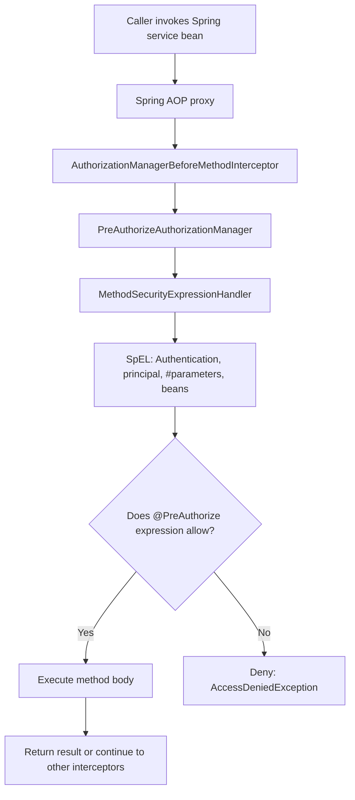

# @PreAuthorize and Decisions Before Business Logic Executes

**`@PreAuthorize`** is a Spring Security annotation used to **decide whether to allow invoking a Java method before the method body executes**. It belongs to **method security** – the authorization control layer at the service/business logic boundary, independent of whether the controller was already permitted to receive the HTTP request.

Short example:

```java
@PreAuthorize("hasAuthority('documents.read')")
public Document readDocument(String documentId) {
    // The method body only runs after the authorization check permits it.
    return repository.getDocument(documentId);
}
```

A user with the `documents.read` authority can pass this check; a user without that authority is denied **before the body runs** under the default method security mechanism. However, the general `documents.read` authority **does not mean** the user can read every document, especially when there are owners, tenants, sharing, statuses, or security labels.

To also check the resource:

```java
@PreAuthorize(
    "hasAuthority('documents.read') and " +
    "@documentPolicy.canRead(authentication, #documentId)"
)
public Document readDocument(@P("documentId") String documentId) {
    return repository.getDocument(documentId);
}
```

Here Spring Security requires both the authority **and** the specific document check policy to permit access before executing the body. `@documentPolicy` is a bean implemented by the application, not a built-in Spring Security class; `@P` helps the expression recognize the parameter name when needed.

This lesson focuses on **decisions before business logic executes**, including the Spring AOP/`PreAuthorizeAuthorizationManager` mechanism, how to enable method security, SpEL, parameter/resource-based authorization, a runnable Spring Boot example with Java 17, denial handling, proxy pitfalls, and testing scenarios. API context: **Spring Security 6.5.x / Spring Boot 3.x (Servlet or imperative application) / Java 17+**.

## 1. Why is authorization needed before calling a method?

An HTTP endpoint can be protected with:

```java
http.authorizeHttpRequests(auth -> auth
    .requestMatchers("/api/documents/**").authenticated()
    .anyRequest().denyAll()
);
```

This requires an authenticated user to enter the URL group. However, a service can be invoked through **multiple paths**:

- REST controller `GET /api/documents/{id}`.
- GraphQL or RPC controller.
- Jobs, message listeners, or batch operations in the application.
- Another Spring-injected service.
- A new endpoint that a developer adds later.

If the document-reading policy only lives at the URL layer, another entry point might accidentally call the service without going through the right rule. Placing `@PreAuthorize` at **a security-meaningful service layer** keeps the policy closer to the data operation.

Example:

```java
@Service
public class BillingService {

    @PreAuthorize("hasAuthority('invoices.approve')")
    public Receipt approveInvoice(String invoiceId) {
        // Do not perform the approval operation if the authority check denies it.
        return billingWorkflow.approve(invoiceId);
    }
}
```

`@PreAuthorize` has clear value here: **the approval command is not started if the condition is not met**. Even so, if separation between creator and approver, tenant checks, or transaction limits are needed, the corresponding policies must be added before committing.

### Does not replace authentication or HTTP authorization

`@PreAuthorize` does not verify passwords, does not parse JWT claims from HTTP headers on its own, and does not create an `Authentication`. It uses the identity already established by **Spring Security authentication** and retrievable via `SecurityContextHolder` in the call's context.

It also does not replace URL authorization, CSRF, CORS, or security headers by default. Good design usually combines:

```text
HTTP authentication / security filters
          |
          v
Controller / API adapter
          |
          v
Spring-managed service bean via proxy
          |
          v
@PreAuthorize: pre-method decision
          |
          v
Business operation and data/resource policy
```

If the service is called without going through a Spring-managed proxy, the annotation may not be enforced even though the source code looks as if the method has been “locked”.

## 2. Enabling @PreAuthorize with @EnableMethodSecurity

In Spring Boot 3.x, simply adding `spring-boot-starter-security` **does not automatically activate method security**. It must be enabled explicitly:

```java
package com.example.security;

import org.springframework.context.annotation.Configuration;
import org.springframework.security.config.annotation.method.configuration.EnableMethodSecurity;

@Configuration
@EnableMethodSecurity
public class MethodSecurityConfig {
}
```

`@EnableMethodSecurity` (`prePostEnabled = true` by default) registers the infrastructure protecting these annotations:

- `@PreAuthorize`: **checks before the body**.
- `@PostAuthorize`: **checks after the body returns**.
- `@PreFilter`: filters supported inputs, usually before the invocation.
- `@PostFilter`: filters supported results after the invocation.

Conversely, `@Secured` is only enabled when `securedEnabled = true`; `@RolesAllowed` belongs to the JSR-250 group and requires `jsr250Enabled = true`. These are separate mechanisms, not just renames of `@PreAuthorize`.

**Do not leave the following configuration in an application that uses @PreAuthorize:**

```java
@EnableMethodSecurity(prePostEnabled = false)
```

If you intentionally disable pre/post to register another authorization manager yourself, you must configure a replacement interceptor and test it. Otherwise, the `@PreAuthorize` annotation may no longer be the protection layer you expect.

### Why shouldn't you only check that the annotation exists?

The Java compiler allows placing annotations even when no Spring Security runtime processes them. A test that simply calls `new DocumentService()` and observes the method working **does not prove the annotation is enforced**. You must test through the **Spring ApplicationContext** and include at least one case where an insufficiently privileged principal is blocked.

## 3. Under the hood: how does authorization happen before the body?

In Spring Security 6.5, the modern method security mechanism uses **`AuthorizationManager`**, replacing the legacy `AccessDecisionManager`/voters path from older configurations.

Typical flow:



Step-by-step details:

1. The caller obtains the **Spring-managed service bean** and invokes the method through the proxy.
2. The advisor/interceptor looks up the `@PreAuthorize` annotation on the method, class, or supported metadata.
3. `AuthorizationManagerBeforeMethodInterceptor` invokes `PreAuthorizeAuthorizationManager`.
4. The manager uses `MethodSecurityExpressionHandler` to create the **SpEL** evaluation context from the `MethodInvocation` and `Supplier<Authentication>`.
5. The expression reads `Authentication`, authorities, method arguments, and any needed policy beans.
6. If the result permits access, the interceptor proceeds to call the **method body**.
7. If denied, the interceptor throws a security exception (or uses a configured custom denial mechanism); the body normally **is not executed**.

Specific version Javadocs may show different `authorize(...)`/`check(...)` methods along `AuthorizationManager`'s deprecation path. When writing applications, use the supported DSL/annotations instead of relying on an unverified internal signature.

### Decision at method invocation time

Example:

```text
Alice has documents.read:
  calls documentService.read("D-42")
  -> expression evaluates to true
  -> body executes

Bob does not have documents.read:
  calls documentService.read("D-42")
  -> expression evaluates to false
  -> denied
  -> body does not execute
```

The key benefit is **keeping sensitive business logic behind a gate**. This differs from `@PostAuthorize`: checking after the body runs may be too late to prevent a database write, payment, email dispatch, or data export.

### Does not mean “no code before the method has run”

The `@PreAuthorize` expression is checked before **the body of the advised method**. However, the caller may already have done other work beforehand; request filters, controllers, argument evaluation, or other AOP advisors (such as tracing/transactions depending on order) may already have executed. You must not promise that when a request is denied, “no side effect whatsoever has occurred anywhere in the application”.

**Place sensitive side effects behind the authorization boundary**, not merely after the route is invoked.

## 4. SpEL in @PreAuthorize: what can be written?

`@PreAuthorize` accepts **a string SpEL expression**, for example:

```java
@PreAuthorize("isAuthenticated()")
@PreAuthorize("hasRole('ADMIN')")
@PreAuthorize("hasAuthority('documents.read')")
@PreAuthorize("hasAnyAuthority('documents.read', 'documents.audit')")
```

These four lines are **independent examples**, not four `@PreAuthorize` annotations stacked repeatedly on a single method.

Table of commonly used expressions:

| Expression | Meaning | Notes |
| --- | --- | --- |
| `permitAll` | Always true in the security expression | Less useful when method security is placed |
| `denyAll` | Always false | Can completely close off a method |
| `isAuthenticated()` | Principal is authenticated | Does not express a specific permission |
| `isAnonymous()` | Anonymous principal | Different from role/authority checks |
| `hasRole('ADMIN')` | Looks up authority `ROLE_ADMIN` by default | Prefix can be configured |
| `hasAuthority('documents.read')` | Checks the exact authority string | Does not prepend `ROLE_` automatically |
| `hasAnyRole('ADMIN','MANAGER')` | Has **at least one** role | OR relation |
| `hasAnyAuthority('x','y')` | Has **at least one** authority | OR relation |
| `hasAuthority('read') and hasAuthority('write')` | Must have both | AND relation |
| `authentication.name == 'alice'` | Checks principal information | Insufficient for multi-tenant policies |
| `#documentId` | Named method parameter | Depends on parameter name discovery or `@P` |
| `@documentPolicy.canRead(authentication, #documentId)` | Calls a Spring policy bean | Bean must be implemented and check trusted data |
| `hasPermission(#documentId, 'Document', 'read')` | Calls `PermissionEvaluator` when configured | Does not know owner/tenant automatically |

In Spring Security, a role is fundamentally still an authority string following the `ROLE_` convention. `hasRole('ADMIN')` looks for `ROLE_ADMIN` by default; `hasAuthority('ROLE_ADMIN')` checks the full string. If a JWT converter only produces `SCOPE_documents.read`, then `hasAuthority('documents.read')` **will not match automatically**, even if the JWT is valid.

### AND, OR, and parentheses

Example requiring the manager role **and** approval authority:

```java
@PreAuthorize(
    "hasRole('MANAGER') and hasAuthority('invoices.approve')"
)
```

If the intent is manager **or** auditor:

```java
@PreAuthorize(
    "hasAnyRole('MANAGER', 'AUDITOR')"
)
```

If you want one branch to have an additional condition:

```java
@PreAuthorize(
    "(hasRole('MANAGER') and hasAuthority('invoices.approve')) " +
    "or hasRole('FINANCE_ADMIN')"
)
```

**Always use parentheses when a policy has multiple AND/OR operators** to make auditing easy. Do not let an increasingly complex expression turn into a string nobody can review anymore; move it into a tested policy bean.

## 5. Parameter-based authorization: #documentId before querying data

An advantage of `@PreAuthorize` over a URL-only rule is that it can **inspect method parameters** before calling the body.

Example in a service:

```java
@PreAuthorize(
    "hasAuthority('documents.read') and " +
    "@documentPolicy.canRead(authentication, #documentId)"
)
public DocumentDto load(
        @P("documentId") String documentId) {
    return repository.load(documentId);
}
```

Key points:

- `#documentId` reads the argument value of the current invocation.
- `@P("documentId")` from `org.springframework.security.access.method.P` explicitly names the argument for SpEL, even when Java bytecode does not retain parameter names the way the framework expects.
- `@documentPolicy` is a **Spring bean** with the corresponding name; for instance, the `canRead(Authentication, String)` method written by the application.
- `authentication` comes from the trusted SecurityContext established by the authentication provider.
- Both the `documents.read` authority **and** the resource policy must be true.
- If not satisfied, the `repository.load(...)` method body is not invoked under the normal flow.

### What should a resource policy check?

For `documentId=D-42`, the policy may need:

```text
authenticated(user)
AND authority(user, "documents.read")
AND document.exists(D-42)
AND user.tenantId == document.tenantId
AND (user.id == document.ownerId OR sharedWith(user, D-42))
AND document.status != "RESTRICTED"
```

Do not take `X-Tenant-Id`, `X-Owner`, or a self-declared role in the body/request and trust it immediately. IDs coming from URLs/method arguments are **client-controlled data**: they must be tied to the authenticated principal and document metadata read by the server from a trusted source.

### Do not confuse a method argument with a route variable

A controller might map:

```java
@GetMapping("/documents/{id}")
public DocumentDto read(@PathVariable String id) {
    return documentService.load(id);
}
```

Upon entering the service `load(id)`, the service's annotation uses the **argument value** `#documentId` according to the Java name/`@P` declared on the service, not by automatically pulling the `{id}` variable from the HTTP matcher. Therefore, method security can apply both when the service is called from HTTP and from a job, provided the caller has an appropriate Authentication.

### When you need to avoid leaking the existence of a resource

A policy may return false for a document that does not exist or does not belong to the tenant, yet the default HTTP response from a method denial typically becomes **403** for a logged-in user. If the product requires 404 to curb resource enumeration, design consistent error handling that does not disclose data, while not equating 404 with the method never having been authorized.

## 6. Policy beans: separate complex logic from annotations

When a decision depends on multiple conditions, use a Spring bean:

```java
@Component("documentPolicy")
public class DocumentPolicy {

    private final DocumentRepository repository;

    public DocumentPolicy(DocumentRepository repository) {
        this.repository = repository;
    }

    public boolean canRead(Authentication user, String documentId) {
        if (user == null || !user.isAuthenticated()) {
            return false;
        }

        Document doc = repository.findById(documentId).orElse(null);
        if (doc == null) {
            return false;
        }

        return doc.tenantId().equals(currentTrustedTenant(user))
            && (doc.ownerId().equals(user.getName())
                || isSharedWith(user, doc));
    }
}
```

This is a **Spring architecture snippet**: `DocumentRepository`, `Document`, `currentTrustedTenant`, and `isSharedWith` are application-defined components; the snippet **is not standalone runnable**. For anonymous Authentication, some implementations are marked authenticated at the object level, so in production you must explicitly check anonymous status and the required security policy.

To use it:

```java
@PreAuthorize("@documentPolicy.canRead(authentication, #documentId)")
public DocumentDto read(@P("documentId") String documentId) {
    return repository.readDto(documentId);
}
```

Or, if there is a general authority to check first:

```java
@PreAuthorize(
    "hasAuthority('documents.read') and " +
    "@documentPolicy.canRead(authentication, #documentId)"
)
```

Value of separating the policy:

1. **Easy to test** at the Java unit-test level with owner, share, tenant, and locked-document cases.
2. **Easy to audit** because the logic is clearly named instead of a very long SpEL string.
3. **Easy to cache in a controlled way**, though permission/data freshness must be accounted for.
4. **Reusable** across HTTP, other services, or other permission checks under a designed contract.
5. **Evaluable in the right order**: static permissions first, then querying the document only when needed.

### Optimization must not trade away safety

The policy is called **before the body**, but that does not eliminate race conditions: permissions could change or the record could be moved to another tenant between the policy read and the data-updating transaction. For sensitive operations, verify conditions at the write point (transaction/locking/versioning/conditional update) rather than trusting only a snapshot from the start of the request.

## 7. Comparing @PreAuthorize with @PostAuthorize and @Secured

| Criterion | `@PreAuthorize` | `@PostAuthorize` | `@Secured` |
| --- | --- | --- | --- |
| Decision timing | **Before the body** | **After the body returns** | Before the body |
| Condition | SpEL | SpEL with `returnObject` | List of literal authorities |
| Reads method parameters | Yes, via `#param` | Yes | Not via SpEL |
| Checks returnObject | No method result exists before running | Yes | No |
| Checks owner/tenant via bean | Yes | Yes, but after the body | Not directly |
| AND/OR operators | Yes | Yes | OR list |
| Enabled by default via @EnableMethodSecurity | Yes | Yes | No, requires `securedEnabled=true` |
| Standard manager | `PreAuthorizeAuthorizationManager` | `PostAuthorizeAuthorizationManager` | `SecuredAuthorizationManager` |
| Suitable for preventing side effects | **More suitable** | Do not use as the sole check for writes | Possible, if only static authorities are needed |

Example:

```java
@PreAuthorize("hasAuthority('payments.execute')")
public Receipt executePayment(String paymentId) {
    // Check before executing the payment.
    return paymentGateway.execute(paymentId);
}
```

If replaced with `@PostAuthorize` to decide after returning, the transaction may already have been executed before denial. That is why this lesson emphasizes **“decisions before business logic executes”**.

### What do multiple annotations on the same method mean?

Spring Security allows annotations of **different types** on one method; each interceptor is evaluated in order and **all conditions must pass** for the call to succeed. Example:

```java
@PreAuthorize("hasAuthority('documents.read')")
@PostAuthorize("returnObject.ownerId == authentication.name")
public DocumentDto readWithPostCheck(String documentId) {
    return repository.getDocument(documentId);
}
```

For the method to return successfully: the pre-check permits, the body runs, and the post-check also permits. If the post-check denies, the body has already run. The example above is only an integration snippet; it needs a real repository/DTO along with proper handling of nulls, trusted owners, and errors.

**Do not place two repeated `@PreAuthorize` annotations on the same method** to express AND: repeating the annotation is not supported. Use a single expression:

```java
@PreAuthorize(
    "hasAuthority('documents.read') and @policy.canRead(authentication, #id)"
)
```

For annotations inherited on classes and methods, method-level annotations can override class-level ones for the same annotation type. Do not rely on class-level and method-level automatically combining with AND: verify the exact semantics through tests.

## 8. Runnable Spring Boot Java 17 example – proving the body does not run on deny

This example creates a **Spring Boot CLI application** (without running a web server) yet executes **real method security** on a Spring-managed bean. It does not assume a controller or HTTP filter to reject calls; therefore it is very easy to observe that **the body only executes in ALLOW cases**.

**Environment:** Java 17+, compatible Maven, Spring Boot **3.5.16**, dependencies managed by the parent BOM (Spring Security 6.5.x). Spring Boot 3.5.16 has been released, though it is the final 3.5 OSS-supported release; when starting a new product, choose a currently supported branch. The version is pinned here so the demonstration is reproducible.

File layout:

```text
preauthorize-demo/
├── pom.xml
└── src/
    └── main/
        ├── java/demo/
        │   ├── PreAuthorizeDemoApplication.java
        │   ├── DocumentService.java
        │   └── DocumentPolicy.java
        └── resources/
            └── application.properties
```

### 8.1. pom.xml

```xml
<project xmlns="http://maven.apache.org/POM/4.0.0"
         xmlns:xsi="http://www.w3.org/2001/XMLSchema-instance"
         xsi:schemaLocation="http://maven.apache.org/POM/4.0.0
             https://maven.apache.org/xsd/maven-4.0.0.xsd">

    <modelVersion>4.0.0</modelVersion>

    <parent>
        <groupId>org.springframework.boot</groupId>
        <artifactId>spring-boot-starter-parent</artifactId>
        <version>3.5.16</version>
        <relativePath/>
    </parent>

    <groupId>demo</groupId>
    <artifactId>preauthorize-demo</artifactId>
    <version>1.0.0</version>

    <properties>
        <java.version>17</java.version>
    </properties>

    <dependencies>
        <dependency>
            <groupId>org.springframework.boot</groupId>
            <artifactId>spring-boot-starter</artifactId>
        </dependency>
        <dependency>
            <groupId>org.springframework.boot</groupId>
            <artifactId>spring-boot-starter-security</artifactId>
        </dependency>
    </dependencies>

    <build>
        <plugins>
            <plugin>
                <groupId>org.springframework.boot</groupId>
                <artifactId>spring-boot-maven-plugin</artifactId>
            </plugin>
        </plugins>
    </build>
</project>
```

`spring-boot-starter-web` is not needed because the example only runs a `CommandLineRunner` and a service. For a real REST application, you can add the Web starter and configure authentication, HTTP authorization, and CSRF appropriately.

### 8.2. PreAuthorizeDemoApplication.java

Place at `src/main/java/demo/PreAuthorizeDemoApplication.java`:

```java
package demo;

import java.util.List;
import java.util.function.Supplier;

import org.springframework.boot.CommandLineRunner;
import org.springframework.boot.SpringApplication;
import org.springframework.boot.autoconfigure.SpringBootApplication;
import org.springframework.context.annotation.Bean;
import org.springframework.security.access.AccessDeniedException;
import org.springframework.security.authentication.UsernamePasswordAuthenticationToken;
import org.springframework.security.config.annotation.method.configuration.EnableMethodSecurity;
import org.springframework.security.core.authority.SimpleGrantedAuthority;
import org.springframework.security.core.context.SecurityContext;
import org.springframework.security.core.context.SecurityContextHolder;

@SpringBootApplication
@EnableMethodSecurity
public class PreAuthorizeDemoApplication {

    public static void main(String[] args) {
        SpringApplication.run(PreAuthorizeDemoApplication.class, args);
    }

    @Bean
    CommandLineRunner demonstrate(DocumentService documents) {
        return args -> {
            invoke("alice", "docs.read", "alice read DOC-1",
                    () -> documents.read("DOC-1"));

            invoke("alice", "docs.read", "alice read DOC-2",
                    () -> documents.read("DOC-2"));

            invoke("bob", "docs.read", "bob read DOC-1",
                    () -> documents.read("DOC-1"));

            invoke("alice", "docs.read", "alice publish",
                    documents::publish);

            invoke("writer", "docs.write", "writer publish",
                    documents::publish);

            invoke("admin", "ROLE_ADMIN", "admin audit",
                    documents::audit);

            invoke("writer", "docs.write", "writer audit",
                    documents::audit);

            invoke("admin", "ROLE_ADMIN", "admin read DOC-1",
                    () -> documents.read("DOC-1"));

            System.out.println("bodyCalls: " + documents.bodyCalls());
        };
    }

    private static void invoke(
            String name,
            String authority,
            String label,
            Supplier<String> action) {

        SecurityContext context =
                SecurityContextHolder.createEmptyContext();

        context.setAuthentication(
                new UsernamePasswordAuthenticationToken(
                    name,
                    "demo-only",
                    List.of(new SimpleGrantedAuthority(authority))
                )
        );

        SecurityContextHolder.setContext(context);

        try {
            System.out.println(label + " -> " + action.get());
        } catch (AccessDeniedException denied) {
            System.out.println(label + " -> DENY");
        } finally {
            SecurityContextHolder.clearContext();
        }
    }
}
```

**Intentional design points:**

- `@EnableMethodSecurity` enables pre/post annotation interception.
- `CommandLineRunner` is injected with **`DocumentService` from the Spring context**; the method references/lambdas call through the proxied bean.
- The three-argument `UsernamePasswordAuthenticationToken` constructor creates an **authenticated Authentication** with a single authority; this is a **simulation harness**, not how role information from production users should be handled.
- `SecurityContextHolder.clearContext()` clears the identity after each case, preventing `ThreadLocal` leaks.
- The "admin read DOC-1" case uses `ROLE_ADMIN` but **lacks `docs.read`**; the name admin does not imply the permission when no role hierarchy is declared.
- `documents.bodyCalls()` is the key observation: it tells us exactly how many times **the body ran**.

### 8.3. DocumentService.java

Place at `src/main/java/demo/DocumentService.java`:

```java
package demo;

import org.springframework.security.access.method.P;
import org.springframework.security.access.prepost.PreAuthorize;
import org.springframework.stereotype.Service;

@Service
public class DocumentService {

    private int reads;
    private int publishes;
    private int audits;

    @PreAuthorize(
        "hasAuthority('docs.read') and " +
        "@documentPolicy.canRead(authentication, #documentId)"
    )
    public String read(@P("documentId") String documentId) {
        reads++;
        return "READ:" + documentId;
    }

    @PreAuthorize("hasAuthority('docs.write')")
    public String publish() {
        publishes++;
        return "PUBLISHED";
    }

    @PreAuthorize("hasRole('ADMIN')")
    public String audit() {
        audits++;
        return "AUDITED";
    }

    public String bodyCalls() {
        return "read=" + reads
                + ",publish=" + publishes
                + ",audit=" + audits;
    }
}
```

In this example, the counters are only incremented in **the body**. A method denied by `@PreAuthorize` never reaches the `reads++`, `publishes++`, or `audits++` statements.

The `int` counters serve a sequential CLI demo and are **not meant as thread-safe production metrics**. In a multi-threaded application, use appropriate metrics/atomic counters or test side effects via a repository/fake gateway.

### 8.4. DocumentPolicy.java

Place at `src/main/java/demo/DocumentPolicy.java`:

```java
package demo;

import org.springframework.security.core.Authentication;
import org.springframework.stereotype.Component;

@Component("documentPolicy")
public class DocumentPolicy {

    public boolean canRead(
            Authentication user,
            String documentId) {

        return user != null
                && user.isAuthenticated()
                && "alice".equals(user.getName())
                && "DOC-1".equals(documentId);
    }
}
```

This is a **fixed policy so the exercise runs without a database**: only Alice can read DOC-1, **provided she also holds the docs.read authority** per the `@PreAuthorize` expression. In a real system, replace the hard-coded conditions with trusted tenant/owner/share/status queries and handle anonymous authentication per policy.

### 8.5. application.properties

Place at `src/main/resources/application.properties`:

```properties
spring.main.web-application-type=none
spring.main.banner-mode=off
logging.level.root=OFF
```

This configuration is only for the CLI exercise, keeping log output minimal. Production needs proper logging/auditing; never turn off security logging.

### 8.6. Run command and expected stdout

Inside the `preauthorize-demo` directory, run with JDK 17+ and Maven:

```bash
mvn -q spring-boot:run
```

Lines **printed by the program**, excluding external Maven/JVM messages:

```text
alice read DOC-1 -> READ:DOC-1
alice read DOC-2 -> DENY
bob read DOC-1 -> DENY
alice publish -> DENY
writer publish -> PUBLISHED
admin audit -> AUDITED
writer audit -> DENY
admin read DOC-1 -> DENY
bodyCalls: read=1,publish=1,audit=1
```

### Output analysis

1. **alice read DOC-1:** Alice has `docs.read` and `documentPolicy` allows DOC-1; the body runs and increments `reads`.
2. **alice read DOC-2:** The authority still matches, but the policy returns false; the body **does not run**.
3. **bob read DOC-1:** Bob has the authority, but he is not Alice; the body does not run.
4. **alice publish:** Missing `docs.write`, denied before calling `publishes++`.
5. **writer publish:** Has `docs.write`, the body runs once.
6. **admin audit:** Has `ROLE_ADMIN`, `hasRole('ADMIN')` passes; the body runs.
7. **writer audit:** Only has `docs.write`, lacks `ROLE_ADMIN`, denied.
8. **admin read DOC-1:** Even though the name is admin, lacks `docs.read`; without a hierarchy, denied before full policy evaluation.
9. **Final bodyCalls:** `read=1,publish=1,audit=1` proves **only the three ALLOW calls** actually executed the body.

**Limitations:** The example has no HTTP requests, database, transactions, tokens, or concurrency, and sets up an intentionally simulated SecurityContext. It demonstrates **pre-body method authorization**. In production, Authentication must be verified by a trusted mechanism and permissions must follow least-privilege policy.

## 9. Role-based, authority-based policies, and RoleHierarchy

Suppose the app has the hierarchy:

```text
ROLE_ADMIN > ROLE_MANAGER
ROLE_MANAGER > ROLE_USER
ROLE_USER > docs.read
ROLE_MANAGER > docs.write
```

When **`RoleHierarchy`** is integrated into `MethodSecurityExpressionHandler`, a user with `ROLE_ADMIN` can be treated as having `docs.read` and `docs.write` in `hasAuthority` checks.

Sample Spring Security 6.5 configuration:

```java
@Bean
static RoleHierarchy roleHierarchy() {
    return RoleHierarchyImpl.fromHierarchy("""
        ROLE_ADMIN > ROLE_MANAGER
        ROLE_MANAGER > ROLE_USER
        ROLE_USER > docs.read
        ROLE_MANAGER > docs.write
    """);
}

@Bean
static MethodSecurityExpressionHandler methodSecurityExpressionHandler(
        RoleHierarchy hierarchy) {

    DefaultMethodSecurityExpressionHandler handler =
            new DefaultMethodSecurityExpressionHandler();

    handler.setRoleHierarchy(hierarchy);
    return handler;
}
```

These are **bean configuration snippets**, requiring imports:

```java
import org.springframework.context.annotation.Bean;
import org.springframework.security.access.hierarchicalroles.RoleHierarchy;
import org.springframework.security.access.hierarchicalroles.RoleHierarchyImpl;
import org.springframework.security.access.expression.method.MethodSecurityExpressionHandler;
import org.springframework.security.access.expression.method.DefaultMethodSecurityExpressionHandler;
```

`static` bean methods ensure the infrastructure configuration is published in time; especially for `MethodSecurityExpressionHandler`, Spring Security documentation recommends `static` to avoid late initialization.

**Two limitations to understand:**

- Hierarchy only expands **authority reachability**. It does not make ADMIN the owner of an arbitrary document or bypass `@documentPolicy.canRead(...)`.
- Hierarchy does not automatically mutate `Authentication#getAuthorities()` or token claims. Custom code iterating raw authorities may see something different from hierarchy-aware checks.

If you modify the CLI example in section 8 by adding these beans, the result may change for admin, so **the stdout in section 8 only applies to the exact configuration without a hierarchy**. Do not treat the old stdout as a contract for an application that has added other policies.

## 10. AOP proxy: the essential condition for “before method” to mean something

An annotation placed on source code does not execute by itself when the JVM calls a method. Spring Security method interception relies on **Spring AOP proxies** in default mode.

### 10.1. Calling through a Spring bean

```java
@Service
public class OrderControllerAdapter {

    private final OrderService orders;

    public OrderControllerAdapter(OrderService orders) {
        this.orders = orders;
    }

    public void process(String id) {
        orders.submit(id); // Spring-managed proxy if configured properly.
    }
}
```

If `OrderService#submit` is annotated with `@PreAuthorize` and the bean is Spring-injected, the call can be intercepted.

### 10.2. Self-invocation: a trap that easily bypasses authorization

```java
@Service
public class DangerousOrderService {

    public void processBatch() {
        deleteInvoice("42"); // equivalent to this.deleteInvoice: bypasses proxy
    }

    @PreAuthorize("hasRole('ADMIN')")
    public void deleteInvoice(String id) {
        // Dangerous operation.
    }
}
```

In common Spring AOP proxy mode, `processBatch` calls another method on **the same instance**, not going through the outer proxy. Therefore `@PreAuthorize` on `deleteInvoice` **may not run**.

**Recommended fix:** extract the protected method into a separate bean and call it via an injected bean, or design a public entrypoint protected at the right boundary. If using AspectJ weaving, the mechanism differs; it must be explicitly configured and tested.

### 10.3. Cases where annotations are not intercepted

- Creating the service with `new` instead of obtaining it from the Spring context.
- Self-invocation calls `this.method()`.
- `private`/`final` methods or `final` classes under an unsupported proxy strategy.
- Annotation placed on a type/method not matched by Spring AOP per configuration.
- Multiple ApplicationContexts where the advisor is not in the same context holding the service.
- Tests mocking the entire service with Mockito, leaving no real proxy.
- Invoking from another thread without properly propagating the SecurityContext.
- Annotation on a method that is never called in the actual flow.

**Negative cases must be tested through a real Spring bean**, not just by confirming the annotation exists.

## 11. Exceptions and HTTP responses when @PreAuthorize denies

In a standard configuration, when a pre-check denies, the method-security interceptor throws **`AccessDeniedException`** or an appropriate denial exception type. In a servlet application, if the error propagates back through `ExceptionTranslationFilter` and the corresponding exception handling setup:

- For an authenticated user lacking permissions: typically responds with **403 Forbidden**.
- For an unauthenticated user: may trigger `AuthenticationEntryPoint` and return **401**, or redirect to login under form-login.
- When called from a CLI, scheduled job, or message consumer: there is no automatic HTTP response; the caller must handle the exception/appropriate retry, DLQ, or fail-safe mechanism.

**Do not claim every `@PreAuthorize` denial yields HTTP 403.** It depends on the call site, authentication state, exception handling, and whether a controller/filter wraps it.

### Testing at the service layer can be more accurate than HTTP tests

An HTTP request can be blocked by `CsrfFilter`, URL authorization, or authentication **before the controller calls the service**. In that case, a 403 status does not prove `@PreAuthorize` is working. To properly test method security, inject the service from the context and invoke it with `@WithMockUser` or an appropriate SecurityContext.

### Denial before body still means the policy has a cost

A `@PreAuthorize` expression can call the DB/services before the body executes. If the policy bean hits a timeout or exception, the invocation can fail before the body. Do not let a policy bean produce side effects such as sending emails, approving, or transferring money; the decision should be short, deterministic, and fail-safe.

## 12. @PreAuthorize with transactions, concurrent updates, and TOCTOU

A business example:

```java
@PreAuthorize("@invoicePolicy.canApprove(authentication, #invoiceId)")
@Transactional
public void approve(String invoiceId) {
    invoiceRepository.changeStatusToApproved(invoiceId);
}
```

The condition in `invoicePolicy` is evaluated **before the method body**, but the relationship between the method-security advisor and the transaction advisor **still depends on AOP configuration order**. You must not assume authorization is guaranteed to run before a transaction opens, or that the policy and the write share the same isolation snapshot.

**TOCTOU (time-of-check / time-of-use):** a resource can change owner, become locked, or change status right after the policy returns true. If the business requires strong consistency:

- Read and write within a properly designed transaction.
- Use optimistic version checks, row locks, or a conditional UPDATE by owner/tenant/status.
- Enforce constraints at the repository/database layer when needed.
- Re-check sensitive conditions at the commit/write point.
- Design idempotency and rollback for operations with external side effects outside the DB.

Meaningful conditional update example (illustrative SQL):

```sql
UPDATE invoices
SET status = 'APPROVED'
WHERE id = :invoiceId
  AND tenant_id = :trustedTenantId
  AND approver_id = :authenticatedUserId
  AND status = 'PENDING';
```

If `0 rows` are updated, the policy state may have changed or no longer hold. This SQL is only illustrative and needs full business conditions added. `@PreAuthorize` is **a pre-invocation guard**, not an automatic locking mechanism.

## 13. Testing: verifying the body does not run when lacking permission

Three types of tests should be distinguished:

1. **Policy bean unit tests**: verify owner/tenant/permission logic accurately.
2. **Method-security proxy integration tests**: confirm `@PreAuthorize` is applied and the body does not run for an unauthorized user.
3. **HTTP integration tests**: confirm authentication, URL policy, controller/service wiring, CSRF, and exception translation.

### 13.1. Positive + negative matrix

For the CLI example in section 8, without role hierarchy:

| Principal + authority | Method | Result | Does body run? |
| --- | --- | --- | --- |
| alice + `docs.read` | `read("DOC-1")` | ALLOW | Yes |
| alice + `docs.read` | `read("DOC-2")` | DENY (policy) | No |
| bob + `docs.read` | `read("DOC-1")` | DENY (policy) | No |
| alice + `docs.read` | `publish()` | DENY (missing write) | No |
| writer + `docs.write` | `publish()` | ALLOW | Yes |
| admin + `ROLE_ADMIN` | `audit()` | ALLOW | Yes |
| writer + `docs.write` | `audit()` | DENY | No |
| admin + `ROLE_ADMIN` | `read("DOC-1")` | DENY (missing docs.read) | No |

Tests should measure **counters/repository calls** to prove denial genuinely prevents the body from running, rather than merely returning some response status.

### 13.2. Testing with Spring Security Test

Example placed in a `@SpringBootTest` context containing `DocumentService` from section 8, along with `spring-boot-starter-test` and `spring-security-test` (test scope) dependencies:

```java
@SpringBootTest
class DocumentMethodSecurityTests {

    @Autowired
    DocumentService documents;

    @Test
    @WithMockUser(username = "alice", authorities = "docs.read")
    void aliceCanReadHerDocument() {
        assertEquals("READ:DOC-1", documents.read("DOC-1"));
    }

    @Test
    @WithMockUser(username = "bob", authorities = "docs.read")
    void bobCannotReadAliceDocument() {
        assertThrows(AccessDeniedException.class,
                () -> documents.read("DOC-1"));
    }

    @Test
    @WithMockUser(username = "alice", authorities = "docs.read")
    void readAuthorityDoesNotAllowPublishing() {
        assertThrows(AccessDeniedException.class,
                () -> documents.publish());
    }
}
```

This is a **JUnit 5 class snippet**, not part of the minimal CLI setup without adding test dependencies/imports. Because `@SpringBootTest` may execute the demo's `CommandLineRunner`, in a real project separate the demo runner from the test profile or disable the runner in the test context so side-effect measurements remain independent. When testing with `@WithMockUser`, Spring Security Test populates the SecurityContext for the call and **does not query the database** to assign roles.

Additional assertions to include:

- An annotated method on a Spring-managed bean is denied; the same method called on an instance created with `new` loses interception (to demonstrate the difference in this lesson, **never use `new` in production**).
- Without `@EnableMethodSecurity`: negative tests fail, showing the annotation is not enforced.
- Missing Authentication, anonymous user, wrong role prefix cases.
- `#documentId` extracted correctly via `@P` or parameter name discovery.
- Wrong owner/tenant, nonexistent document, locked record.
- Authenticated user with the right authority, but the policy bean returns false.
- When combined with `@PostAuthorize`, the pre-check runs before the body and the post-check runs after.
- With a custom hierarchy, confirm implied authorities work and reverse implication does not.

## 14. Annotations on class, interface, and method: precedence

`@PreAuthorize` can be placed on a class/interface or a method. Under modern method security:

```java
@Service
@PreAuthorize("hasAuthority('documents.read')")
public class SearchService {

    public String list() {
        return "list";
    }

    @PreAuthorize("hasAuthority('documents.admin')")
    public void rebuildIndex() {
        // Uses the specific method-level rule.
    }
}
```

In the example above, `rebuildIndex` has its own `@PreAuthorize`; method-level metadata can **override** class-level annotations of the same kind, **not automatically AND the two expressions**. If both read and admin permissions are required, write a combined expression or a policy service.

Spring Security also checks annotations on interfaces and concrete classes. If a class inherits annotations of the same type from multiple interfaces with conflicting policies, the framework may report an ambiguous configuration at startup. Place policies on concrete methods and avoid ambiguous semantics.

**Do not place two `@PreAuthorize` annotations on the same method**; the annotation is not designed as a repeatable list to express multiple conditions. A single AND expression is the clear approach:

```java
@PreAuthorize(
    "hasAuthority('documents.read') and " +
    "hasAuthority('documents.export')"
)
```

## 15. Async, event listeners, and scheduled jobs: where does Authentication come from?

`@PreAuthorize` can only evaluate properly if the call has an appropriate **SecurityContext**. In a synchronous HTTP call, Spring Security filters usually establish the context. However, scheduled jobs, Kafka listeners, thread pools, and custom `CompletableFuture`s do not automatically carry user identity.

Questions that must be answered before protecting a service:

- **With which service identity** and permissions does the job run?
- Does the asynchronous call need to **act on behalf of a user**?
- By what mechanism is the SecurityContext propagated to the worker thread?
- Is re-authorization needed before publishing results after a delay?
- If the user was revoked while the job was running, should the job be canceled or the export blocked?

Spring Security provides wrappers such as `DelegatingSecurityContextRunnable`, `DelegatingSecurityContextCallable`, and corresponding executors. Do not create an artificial `ROLE_ADMIN` for every job just to pass `@PreAuthorize`.

A safer approach is a **least-privilege service identity**, paired with policies that verify the right tenant and resource at the business boundary.

## 16. Common misconceptions and security pitfalls

| Misconception or pitfall | What actually happens | How to address |
| --- | --- | --- |
| Having `@PreAuthorize` automatically protects all calls | Interception only happens when method security and proxies are enabled | Enable `@EnableMethodSecurity`, test real beans |
| `@PreAuthorize` checks after the body has run | It is **before-method authorization** | Place policies here to block side effects |
| `@PreAuthorize("hasRole('ADMIN')")` equals `@Secured("ADMIN")` | Different mechanisms and prefix/string semantics | Use the proper role/authority syntax |
| `@PreAuthorize` creates Authentication itself | It only reads the existing context | Configure trusted authentication |
| Having `docs.read` lets you read other tenants' docs | An authority is only a general permission | Add a document-level policy |
| `@PreAuthorize("hasAuthority('read')")` checks JWT scope `read` by default | Resource server may produce `SCOPE_read` | Align converter and rules |
| Calling `this.protectedMethod()` is guaranteed to be blocked | Self-invocation can bypass the proxy | Call through another Spring bean |
| Private methods are protected like public service methods | Proxy mode has limitations | Place security boundaries on interceptable methods |
| Using `@PostAuthorize` to block money transfers | Side effects can happen before denial | Use pre-checks and DB transaction policies |
| `hasAnyAuthority('a','b')` requires both a and b | It means OR | Use `and` when both permissions are needed |
| Two `@PreAuthorize` on the same method mean AND | Repeating the annotation is not supported | Combine into one expression |
| Method-level and class-level are always ANDed | Same-type rules can override by precedence | Test annotation inheritance/override |
| Seeing HTTP 403 alone proves method security works | HTTP filters/CSRF can reject earlier | Test the service proxy directly |
| `@PreAuthorize` prevents races between check and write | Checking and using the resource can be separated in time | Conditional update/lock/versioning |
| Having an authority in session means new DB roles took effect | Sessions/tokens can hold stale snapshots | Design refresh/revocation/live checks |
| Testing a Mockito-mocked service proves authorization | A mock is not a proxied service with an advisor | Use `@SpringBootTest` or an appropriate method-security slice |
| Expression beans can modify data before returning false | The policy can cause side effects even when the body is blocked | Keep policies read-only and fail-safe |
| Changing role hierarchy auto-syncs all API nodes | RoleHierarchy may be built at startup | Manage lifecycle and consistency |

## 17. Implementation checklist for project teams

- [ ] `@EnableMethodSecurity` is in the ApplicationContext containing the services to protect.
- [ ] Protected methods are on Spring-managed beans and calls go through proxies/advisors.
- [ ] Each `@PreAuthorize` rule describes **least privilege**, avoiding a single ADMIN role for every operation.
- [ ] `ROLE_`, `SCOPE_`, and permission name strings match the Authentication converter accurately.
- [ ] If `RoleHierarchy` is used, direction, handler wiring, reachability, and negative tests are verified.
- [ ] Policy beans verify owner/tenant/status on the server from a trusted data source.
- [ ] `#parameter` is stable via `@P` or compiler parameter metadata.
- [ ] No unverified roles/permissions are taken from user input.
- [ ] Deny cases prove the body **does not** run and side effects do not occur.
- [ ] Tests exist for self-invocation or call paths bypassing Spring proxies.
- [ ] Distinct exception handling exists for HTTP, CLI, jobs, and message listeners as appropriate.
- [ ] Check/use races are handled in transactions/repositories when strong consistency is needed.
- [ ] SecurityContext propagation is designed for async/background workflows.
- [ ] Permission changes/revocations have SLAs and session/token freshness mechanisms.
- [ ] When upgrading major Spring Security versions, review expression handler/interceptor APIs and behavior.
- [ ] Policies for destructive actions are reviewed for least privilege, separation of duties, and auditing.

## 18. Self-check questions

**1. Does `@PreAuthorize` decide before or after the body?**  
Before the body of the intercepted method. If denied, the method body normally does not run.

**2. Why is `@EnableMethodSecurity` important?**  
It registers the method-security advisor infrastructure; Spring Boot starter security does not enable method-level authorization on its own.

**3. Does `hasAuthority('docs.read')` guarantee reading DOC-42?**  
No. An authority is a general permission; resource owner, tenant, sharing, and status may need additional checks.

**4. What string does `@PreAuthorize("hasRole('ADMIN')")` require by default?**  
`ROLE_ADMIN` in the effective authorities set.

**5. Is `hasAnyAuthority('read','write')` AND or OR?**  
OR; having either one is sufficient. To require both, use `and`.

**6. Why might `#documentId` need `@P("documentId")`?**  
To provide an explicit method argument name to SpEL when parameter name discovery is unavailable or unsuitable.

**7. Is placing `@PreAuthorize` on a private method and calling it from the same class safe?**  
Do not assume so. Proxy mode usually does not intercept private/self-invocation calls; design a protected public boundary through a Spring bean.

**8. Why is a test that only receives HTTP 403 not enough?**  
A 403 can come from CSRF or HTTP authorization, which does not prove `@PreAuthorize` on the service executed.

**9. Can `@PreAuthorize` be used instead of `@PostAuthorize` for money transfers?**  
Yes, checks should happen before side effects; also verify business conditions at the transaction/write point to avoid TOCTOU.

**10. If both `@PreAuthorize` and `@PostAuthorize` are on a method, are they merged into one expression?**  
No. Each annotation has its own interceptor evaluated at its own point; both must permit for the call to succeed.

**11. Does someone with ROLE_ADMIN automatically have docs.read?**  
Not by default. They need the direct authority or a properly configured RoleHierarchy/mapping.

**12. Why might a method with `@PreAuthorize` still be called when a user lacks permission?**  
Method security might not be enabled, the service might not go through a proxy, self-invocation, test mocks, overridden annotations, or unexpected authentication/context state.

## Conclusion

**`@PreAuthorize` is an authorization gate placed before the execution of a business method body.** In Spring Security 6.5, Spring AOP intercepts a call to a managed bean, `PreAuthorizeAuthorizationManager` evaluates the SpEL expression against Authentication, method arguments, and bean policies, and **only allows the body to run when the decision permits it**.

To use it properly:

1. Enable `@EnableMethodSecurity`.
2. Place `@PreAuthorize` at a **service boundary** that can be intercepted through a proxy.
3. Write clear expressions: authority/role **and** resource-level policy when needed.
4. Test denied scenarios to prove **the body and side effects do not execute**.
5. Structure transactions, async contexts, caching, and permission updates so security boundaries after the pre-check cannot be bypassed.

**Remember:** *Deciding before the body* is the core advantage of `@PreAuthorize`, but it **does not replace authentication, per-resource authorization, or guarantee non-proxied calls are safe**.

## References

- [Spring Security 6.5 – Method Security and @PreAuthorize](https://docs.spring.io/spring-security/reference/6.5/servlet/authorization/method-security.html)
- [Spring Security 6.5 – Authorization Architecture](https://docs.spring.io/spring-security/reference/6.5/servlet/authorization/architecture.html)
- [Spring Security 6.5 – PreAuthorizeAuthorizationManager Javadoc](https://docs.spring.io/spring-security/reference/6.5/api/java/org/springframework/security/authorization/method/PreAuthorizeAuthorizationManager.html)
- [Spring Security 6.5 – EnableMethodSecurity Javadoc](https://docs.spring.io/spring-security/reference/6.5/api/java/org/springframework/security/config/annotation/method/configuration/EnableMethodSecurity.html)
- [Spring Security 6.5 – PreAuthorize Javadoc](https://docs.spring.io/spring-security/reference/6.5/api/java/org/springframework/security/access/prepost/PreAuthorize.html)
- [Spring Security 6.5 – DefaultMethodSecurityExpressionHandler Javadoc](https://docs.spring.io/spring-security/reference/6.5/api/java/org/springframework/security/access/expression/method/DefaultMethodSecurityExpressionHandler.html)
- [Spring Boot 3.5.16 release announcement (June 25, 2026)](https://spring.io/blog/2026/06/25/spring-boot-3-5-16-available-now/)
