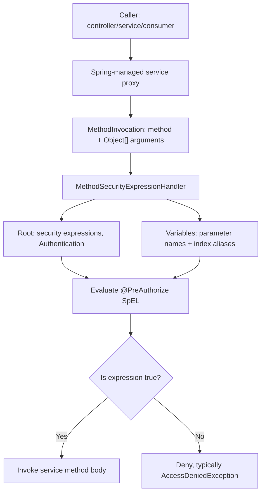

# Referencing Parameters by Name, #p0, #a0, or #root.args in Spring Security

## Learning Objectives

When using `@PreAuthorize`, you often need to check **permission for a specific action** based on the service method's parameters: document ID, owner name, tenant, operation type, or request status. Spring Security lets you pass **method arguments** into Spring Expression Language (SpEL), yet each syntax has its own requirements and limitations.

This lesson focuses on four expressions that are easily confused:

- **`#documentId`, `#owner`**: parameter variables by **name**, discovered by Spring Security via annotations or compiled class metadata.
- **`#p0`, `#p1`, ...**: **positional** aliases for method arguments, zero-indexed.
- **`#a0`, `#a1`, ...**: positional aliases equivalent to `#p0`, `#p1` in a method-based evaluation context.
- **`#root.args`**: syntax available in **some Spring Framework SpEL contexts** such as caching or event listeners, but **not a guaranteed way to access method arguments on the root of `@PreAuthorize`**. Do not treat the four forms as mechanically interchangeable.

After completing this lesson, you will be able to write `@PreAuthorize` policies with proper names/positions, understand why checks break when refactoring method signatures, use `@P` or `-parameters` to stabilize names, understand the difference between **SpEL root and SpEL variables**, verify the limitation of `#root.args`, and test with Spring Test using principals with sufficient and insufficient permissions.

**Scope:** Spring Security 6.x/7.x, method-security on Spring-managed Java services using `@EnableMethodSecurity` and `@PreAuthorize`. Spring snippets require framework dependencies. The standalone Java 17 program in section 12 illustrates name/index binding, not Spring's SpEL evaluator.

## 1. Context: parameters provide context for the authorization decision

Suppose an API supports:

```text
GET /api/documents/42
  → DocumentService.read(documentId = 42, owner = "alice")

POST /api/documents/42/share
  → DocumentService.share(documentId = 42, targetUser = "bob")
```

You cannot merely ask whether the user has `document:read`; sometimes you also need to know **which document**, **who owns it**, and **which tenant is selected**. One way to express this is:

```java
@PreAuthorize(
    "hasAuthority('document:read') and " +
    "@documentPolicy.canRead(authentication, #documentId)"
)
public Document read(long documentId) {
    return repository.findById(documentId).orElseThrow();
}
```

Here:

1. `hasAuthority('document:read')` checks the functional permission granted in `Authentication.getAuthorities()`.
2. `#documentId` references the **method argument** by name.
3. `@documentPolicy` references a **Spring bean** (the `@` symbol in SpEL), not a Java annotation on the method.
4. `authentication` is the authentication object supplied by Spring Security into the method-security expression context.
5. `documentPolicy.canRead(...)` must verify owner/tenant/ACL using trusted server-side data.

This is an **integration snippet**: `Document`, `repository`, and `documentPolicy` must be implemented in the project. If parameter names are not discovered, `#documentId` may fail to retrieve the intended value; an expression that looks completely valid in source can fail at runtime.

## 2. @EnableMethodSecurity and the evaluation context

Enable Method Security in modern Spring Security:

```java
import org.springframework.context.annotation.Configuration;
import org.springframework.security.config.annotation.method.configuration.EnableMethodSecurity;

@Configuration
@EnableMethodSecurity
public class MethodSecurityConfiguration {
}
```

On a Spring bean with `@PreAuthorize`, the Spring AOP proxy intercepts the call, and `PreAuthorizeAuthorizationManager` uses `MethodSecurityExpressionHandler` to build the evaluation context and evaluate the expression **before running the method body**.



Key distinction:

- **Root object** is the object SpEL uses by default for property/method expressions (such as `hasAuthority(...)`, `authentication`).
- **Variables** are accessed with `#` (such as `#documentId`, `#p0`, `#a0`).
- **`#root`** is a special variable pointing to the current root object; `#root.args` means “read the `args` property of **root**”, not “access all parameter variables” in general.

Spring Security creates a `MethodSecurityEvaluationContext` capable of binding parameter names and positional aliases. This is not the same root object or variable set as every other SpEL feature in Spring Framework.

### When does the annotation actually work?

`@PreAuthorize` is enforced only when the interceptor exists in the right Spring context and the call goes through the Spring-managed proxy. Scenarios such as `new DocumentService()`, tests using only a Mockito mock, or internal `this.someProtectedMethod()` calls can bypass the Spring AOP proxy.

**Tests must invoke the bean retrieved from ApplicationContext.** Reading an annotation in source code does not prove security executed.

## 3. Four ways to write it — comparison table to avoid confusion

Suppose a method is declared as:

```java
public String transfer(String owner, long documentId) {
    return "sent";
}
```

With a proper method-security evaluation context:

| Expression | Intended meaning | Requires parameter name metadata? | Notes |
| --- | --- | --- | --- |
| `#owner` | Argument `owner`, position 0 | **Yes**, or explicit alias `@P`/`@Param` | Readable, but requires stable names |
| `#documentId` | Argument `documentId`, position 1 | **Yes**, or explicit alias | Suitable for calling policy beans |
| `#p0` | First argument | **No** source name needed | Tied to **position**, fragile on signature changes |
| `#p1` | Second argument | **No** | Zero-based indexing, not 1-based |
| `#a0` | First argument | **No** source name needed | Positional alias identical to `#p0` |
| `#a1` | Second argument | **No** | Positional alias identical to `#p1` |
| `#root` | Current SpEL root object | No | Not an `Object[]` of arguments |
| `#root.args[0]` | Read `args` property on root then take first element | Depends on root implementation | **Do not use by default in `@PreAuthorize`** |

**Reading rule:** for a method with `N` parameters, valid argument indices run from `0` to `N - 1`. `#p0` and `#a0` refer to **the argument at the first position**, which does not guarantee it is always `owner`: if the signature changes, its meaning changes immediately.

### Three common safe approaches

```java
// By name: requires name discovery or an alias annotation.
@PreAuthorize("#owner == authentication.name")
public String view(String owner) { return "ok"; }

// By position: in a typical method-security evaluation context.
@PreAuthorize("#p0 == authentication.name")
public String viewWithP0(String owner) { return "ok"; }

// Another positional alias with the same value.
@PreAuthorize("#a0 == authentication.name")
public String viewWithA0(String owner) { return "ok"; }
```

The three methods above are snippets placed inside **a Spring-managed class**; imports for `@PreAuthorize` and `@EnableMethodSecurity` configuration are covered in the relevant sections. With the two index-based forms, naming intent exists only in **the reader's mind**, not enforced against parameter names.

## 4. Referencing by name: #owner, #documentId, #tenantId

In an expression:

```java
@PreAuthorize(
    "hasAuthority('document:read') and " +
    "#owner == authentication.name"
)
public Document readDocument(String owner, long documentId) {
    // ...
}
```

Spring needs to know that the first parameter is named `owner`. `DefaultSecurityParameterNameDiscoverer` (or the version-appropriate parameter-name discovery API) uses several sources:

1. Aliases marked with Spring Security's `@P("alias")`.
2. Spring Data's `@Param("alias")` if that dependency and annotation are present.
3. Method parameter names from Java reflection **when the class is compiled with `-parameters`**.
4. Older versions or legacy documentation mention debug/local-variable metadata; **do not rely on debug symbols instead of `-parameters`** in modern Spring Framework versions, as this capability has changed across releases.

**Recommendation:** if you want to write `#owner`, configure your build tool to emit runtime parameter metadata with `-parameters` or use `@P` explicitly. Never assume names written in source always exist at runtime.

### Example Maven compiler configuration for Java 17

```xml
<plugin>
  <groupId>org.apache.maven.plugins</groupId>
  <artifactId>maven-compiler-plugin</artifactId>
  <configuration>
    <release>17</release>
    <parameters>true</parameters>
  </configuration>
</plugin>
```

This is **a plugin configuration snippet** that belongs in the project's `pom.xml`. With Maven/Spring Boot managed plugin versions, follow the BOM/plugin management rather than assigning arbitrary versions.

### Example Gradle configuration

```groovy
tasks.withType(JavaCompile).configureEach {
    options.compilerArgs += ['-parameters']
}
```

Gradle Groovy DSL snippet; Kotlin DSL syntax differs. After changing build flags, **clean/recompile all relevant classes**; previously compiled classes may lack the metadata.

### Situations where names disappear

- Compiling without `-parameters`, then changing build packaging.
- Annotations placed on an interface where the interface class does not retain parameter metadata like the implementation.
- Generated code, Kotlin/Java interop, or AOT proxies with differing name/method signature characteristics.
- Refactoring parameter `owner` to `requester` while the expression still keeps `#owner`.
- Enabling minification/obfuscation that strips required metadata.
- A method overridden by an implementation with different parameter names than the interface, where the matcher/discoverer inspects metadata differently than the author expected.

**Never let broken variable names lead to silently opening access.** An expression that fails to resolve as intended may throw a SpEL evaluation exception or evaluate to DENY depending on context; never add `permitAll` or remove the check to “fix” this error.

## 5. @P specifies names explicitly, independent of Java parameter names

If you want a consistent alias for SpEL, place `@P`:

```java
import org.springframework.security.access.method.P;
import org.springframework.security.access.prepost.PreAuthorize;

public class DocumentService {

    @PreAuthorize(
        "hasAuthority('document:read') and " +
        "@documentPolicy.canRead(authentication, #docId)"
    )
    public Document read(@P("docId") long documentId) {
        // ...
    }
}
```

`#docId` uses the name declared by `@P("docId")`; the Java parameter can remain named `documentId`. Importantly, **SpEL looks for the `docId` alias**, rather than inferring both aliases exist and picking freely. If you change the annotation from `docId` to `id`, you must also update the expression.

This is an integration Spring snippet requiring the `documentPolicy` bean, `Document` class, and dependencies. A real application normally places `@Service` on the class and constructor-injects repositories; shortened here to highlight the annotation.

### Interface compilation case

An interface can declare a parameter alias while the implementation uses a different parameter name:

```java
import org.springframework.security.access.method.P;
import org.springframework.security.access.prepost.PreAuthorize;

public interface DocumentOperations {

    @PreAuthorize(
        "hasAuthority('document:read') and " +
        "@documentPolicy.canRead(authentication, #docId)"
    )
    String summary(@P("docId") long id);
}
```

In default proxy configurations supporting annotations inherited from interfaces, `@P` reduces reliance on Java parameter names in the implementation method. However, test the real Spring-managed bean: AOP proxy strategy, compile flags, signatures, and annotation inheritance can all affect a given project.

### Spring Data @Param

If the project already uses Spring Data, Spring Security documentation also supports aliases via `org.springframework.data.repository.query.Param`:

```java
import org.springframework.data.repository.query.Param;

@PreAuthorize("#requestedOwner == authentication.name")
public String view(@Param("requestedOwner") String owner) {
    return "ok";
}
```

Do not pull in **Spring Data** solely to name security arguments if the project does not use it: `@P` is Spring Security's dedicated option.

## 6. #p0, #p1: positional argument aliases

In `MethodBasedEvaluationContext` (Spring Framework), method arguments are exposed using `pX` and `aX` aliases. Spring Security's method-security evaluation context builds on a corresponding mechanism to bind method arguments. These variables **do not depend on parameter names written in source**.

Example:

```java
@PreAuthorize(
    "hasAuthority('document:read') and " +
    "@documentPolicy.canRead(authentication, #p0)"
)
public Document read(long documentId) {
    // ...
}
```

`#p0` is the **first** argument — here `documentId`. If the method becomes:

```java
public Document read(String tenantId, long documentId) {
    // ...
}
```

then `#p0` **shifts to `tenantId`**; the document ID is now `#p1`. If the expression still calls `canRead(authentication, #p0)`, the policy receives the wrong data type/meaning; it may throw an exception or make a wrong decision if both types are compatible Strings/longs.

**Dangerous trap:** two parameters of the same `String` type mean an indexing error can **go undetected by the compiler**.

```java
// Initially:
@PreAuthorize("#p0 == authentication.name")
public String view(String owner, String key) {
    return "ok";
}

// After signature refactoring:
@PreAuthorize("#p0 == authentication.name")
public String view(String key, String owner) {
    return "ok";
}
```

If it still relies on `#p0`, the policy has changed from comparing `owner` to comparing `key`. To avoid this risk, use a **named alias** `@P("owner")` or keep a meaningful request object/policy method.

### Positional alias mapping in a 3-parameter method

Given:

```java
public void grant(
    long documentId,
    String targetUser,
    boolean notify
) {
    // ...
}
```

the mapping is:

| Parameter | Index | `p` alias | `a` alias |
| --- | ---: | --- | --- |
| `documentId` | 0 | `#p0` | `#a0` |
| `targetUser` | 1 | `#p1` | `#a1` |
| `notify` | 2 | `#p2` | `#a2` |

There is no `#p3` for a three-parameter method. If the method uses varargs or Kotlin suspend arguments, binding/metadata behavior must be tested specifically for the actual version and signature.

### When are positional aliases reasonable?

- Very short test examples with stable, unambiguous method signatures.
- Generated code that does not preserve parameter names (though the runtime expression context must still be tested).
- Single-parameter methods where `#p0` is easy to inspect visually.

For business services with multiple parameters or critical policies, **prefer meaningful names** and regression tests on refactoring.

## 7. #a0, #a1: same as #p0, not an “authentication” variable

`#a0` and `#p0` normally point to **the argument at index 0**, and `#a1`/`#p1` point to index 1. The letter `a` stands for **argument index alias**, not `Authentication`.

Example:

```java
@PreAuthorize(
    "hasAuthority('invoice:approve') and " +
    "#a1 == authentication.name"
)
public void approve(long invoiceId, String approver) {
    // ...
}
```

Meaning: the caller must have the approve authority and the **second argument** must equal the logged-in user's name. It does not mean `#a1` is an `Authentication` object; the authentication source remains the `authentication` variable/root property.

For clarity, write:

```java
import org.springframework.security.access.method.P;

@PreAuthorize(
    "hasAuthority('invoice:approve') and " +
    "#approver == authentication.name"
)
public void approve(
    @P("invoiceId") long invoiceId,
    @P("approver") String suppliedApprover
) {
    // ...
}
```

Both examples use caller-supplied data as an **additional condition**, yet **must not assume the caller can specify an arbitrary identity**. Who is logged in must come from the server-verified `Authentication`; `suppliedApprover` is merely input compared against the trusted identity.

### Should you mix #p0 and #a1?

It works technically:

```java
@PreAuthorize(
    "#p0 > 0 and #a1 == authentication.name"
)
public void approve(long id, String owner) {
    // ...
}
```

However, this expression is harder to read than `#id > 0 and #owner == authentication.name`, and very error-prone when adding or reordering parameters. A codebase should adopt a uniform convention: **names/`@P` for business policies**, reserving index aliases only where specifically justified.

## 8. #root.args: why it cannot be assumed to work in @PreAuthorize?

This is one of the most misunderstood areas in tutorials/blogs. **SpEL** is a shared language, yet **each framework feature constructs its own evaluation context/root**.

Examples:

- In Spring Cache `@Cacheable(key = "...")`, the caching expression root **has `args` metadata**, so `#root.args[0]` appears in Spring Cache documentation.
- In `@EventListener(condition = "...")`, the Spring event expression context provides `#root.args` or `args` to access listener arguments.
- In **Spring Security method security**, the root object is `MethodSecurityExpressionRoot` or the corresponding `MethodSecurityExpressionOperations`. It provides security operations/authentication, not an `args` property by default like the caching root.

Thus, the example:

```java
// DO NOT use as a guaranteed equivalent in @PreAuthorize.
@PreAuthorize("#root.args[0] == authentication.name")
public String getForOwner(String owner) {
    return "ok";
}
```

can fail at runtime with a SpEL exception such as:

```text
EL1008E: Property or field 'args' cannot be found
on object of type '...MethodSecurityExpressionRoot'
```

This is an **illustrative error form**; exact exception text may vary by version. Do not put such code into production just because a `@Cacheable` or `@EventListener` guide states `#root.args` is valid.

### What is #root?

`#root` is the SpEL variable pointing to the **root object** of the expression context. In Method Security, an official example of passing root to a custom authorizer is:

```java
@PreAuthorize("@authz.decide(#root)")
public String securedOperation() {
    return "ok";
}
```

The `authz` bean can accept `MethodSecurityExpressionOperations` and use the security operations the root actually provides. Yet `#root` **does not turn into a `MethodInvocation`**, and does not automatically expose `args`. To access args, use `#owner`/`#p0`/`#a0` or move the policy to an `AuthorizationManager<MethodInvocation>` to access `MethodInvocation.getArguments()` through that API.

### What if you truly need Object[] args?

There are two proper approaches:

**Approach 1 — pass specific parameters to a policy bean:**

```java
@PreAuthorize(
    "@documentPolicy.canShare(authentication, #p0, #a1)"
)
public void share(long documentId, String targetUser) {
    // ...
}
```

The policy receives strongly typed data and checks tenant/ACL on the server. With many parameters, place `@P` and pass `#documentId`/`#targetUser` for easier review.

**Approach 2 — create a custom authorization manager for MethodInvocation:**

```java
// ARCHITECTURAL PSEUDOCODE, not a standalone Spring file.
AuthorizationManager<MethodInvocation> manager = (auth, invocation) -> {
    Object[] arguments = invocation.getArguments();
    // Inspect count, types, and semantics of arguments.
    // Evaluate principal / owner / tenant.
    return new AuthorizationDecision(customDecision(auth.get(), arguments));
};
```

This is a sketch showing how to use `MethodInvocation.getArguments()`; you must provide the `customDecision` implementation, manager/interceptor wiring, and null/abstain handling appropriate for your Spring Security version. Prefer this for large codebases with special policies; do not build custom AOP just to read a `documentId`.

**Key conclusion:** do not copy SpEL syntax from **Spring Cache or Spring Events** and apply it verbatim to **Spring Security method security**. Variable names, root properties, and evaluation timing must be verified in the actual context.

## 9. Parameter expressions and object-level permissions

A sound policy must express the exact **data object** permitted, not merely compare an ID string against a username.

Multi-tenant system example:

```java
@PreAuthorize(
    "hasAuthority('document:read') and " +
    "@documentPolicy.canRead(authentication, #documentId)"
)
public Document read(@P("documentId") long documentId) {
    return repository.findById(documentId).orElseThrow();
}
```

Inside `documentPolicy.canRead`, check:

1. Are the user/tenant from `Authentication` trusted and authenticated?
2. Does `documentId` exist and which tenant does it belong to?
3. Is the user the owner or granted an ACL on the document?
4. Does the document status permit the current operation?
5. Could there be time-of-check/time-of-use (TOCTOU) between the check and the data query/write?

Do not write `#tenantId == principal.tenantId` and assume it is sufficient when `tenantId` from an HTTP request can be forged. Tenant membership/ACL must come from a server-side source.

### #principal and authentication.name

Typically:

```java
@PreAuthorize("#owner == authentication.name")
public String read(String owner) {
    return "ok";
}
```

compares the `owner` input with the currently authenticated identity. However, a user can **supply an owner matching their own username**, which does not ensure the document ID actually belongs to them. Server data must be read to confirm permissions for the resource ID.

### Null-safety and complex expressions

Example:

```java
@PreAuthorize(
    "#request != null and #request.documentId() > 0 and " +
    "@documentPolicy.canRead(authentication, #request.documentId())"
)
public Document read(@P("request") ReadDocumentRequest request) {
    // ...
}
```

This snippet requires `ReadDocumentRequest` (e.g., a Java record) to be defined. SpEL's `and` short-circuits in standard boolean expressions, preventing dereference when `request` is null in the example. For nullable nested data, safe navigation may be used where appropriate for the SpEL parser/version; do not skip service-level input validation.

If the policy grows too long, move the logic into a policy bean or Java `AuthorizationManager` so it can be unit-tested independently and stay easy to review.

## 10. Changing method signatures: silent bugs and regression prevention

Suppose version 1 is:

```java
@PreAuthorize(
    "@documentPolicy.canEdit(authentication, #p0)"
)
public void edit(long documentId, String content) {
    // ...
}
```

Version 2 prepends `tenantId`:

```java
@PreAuthorize(
    "@documentPolicy.canEdit(authentication, #p0)"
)
public void edit(String tenantId, long documentId, String content) {
    // ...
}
```

Now `#p0` is `tenantId`, no longer `documentId`. If the policy accepts `Object` or parameters share the same `String` type, the bug may **escape compile-time detection** and lead to incorrect security decisions.

### An example with two Strings: clearer risk

```java
// V1
@PreAuthorize("#a0 == authentication.name")
void download(String owner, String documentKey);

// V2: argument order swapped
@PreAuthorize("#a0 == authentication.name")
void download(String documentKey, String owner);
```

In V2, a user can pass a `documentKey` equal to their own username to satisfy `#a0`, even when `owner` differs. This is a **policy logic bug**, not a parser bug.

**Reducing risk:**

- Use `@P("owner")` and `#owner` for business-meaningful arguments.
- When changing a signature, review **every SpEL expression** referencing indices.
- Add unit/integration tests calling the service directly with the same ID but a different owner/tenant.
- Do not test only authorized cases; require **DENY** tests for policy-violating inputs.
- For ID/tenant/owner, verify original data in the policy bean/repository.
- Use cleanly validated DTO/record inputs when there are many parameters, without dumping everything into an untyped `Map<String,Object>`.

### Interfaces and reflection metadata

If `@PreAuthorize` is declared on an interface while the implementation renames parameters, parameter name discovery may depend on the specific method/annotation and proxy strategy. When compiling interfaces, debug local-variable metadata cannot supply parameter names like concrete methods with bodies; `-parameters` or `@P` is much more reliable.

Tests should exercise both interface-based and class-based proxies according to the project configuration, especially when upgrading Spring Boot/Spring Framework versions.

## 11. Distinguishing Method Security SpEL from other contexts

| Technology/mechanism | Example SpEL | Characteristics |
| --- | --- | --- |
| Spring Security `@PreAuthorize` | `#owner`, `#p0`, `#a0`, `authentication`, `hasAuthority(...)` | Root is security expression root; arguments bound as variables |
| Spring Security `@PostAuthorize` | `returnObject`, `#owner` | Evaluated after method; also has result |
| Spring Security `@PreFilter`/`@PostFilter` | `filterObject` | Each element being filtered has its own context |
| Spring Cache `@Cacheable(key=...)` | `#root.args[0]`, `#root.methodName` | Root metadata specific to caching |
| Spring Events `@EventListener(condition=...)` | `#root.args[0]`, `#a0` | Dedicated event listener expression context |
| Spring Data repository queries | `?#{ principal?.id }` or matching syntax | Security extension for query context, not `@PreAuthorize` |
| Custom SpEL evaluation context | Depends on custom root/variables | Must inspect the context implementation |

**There is no single SpEL variable table that applies across every annotation in Spring.** Even with the same name `#root`, the actual object has a different type in each place.

### @PostAuthorize is not pre-method

```java
@PreAuthorize("hasAuthority('document:read')")
@PostAuthorize("returnObject.owner() == authentication.name")
public DocumentView load(long id) {
    // ...
}
```

Here `returnObject` exists only once the method returns a result for post-checking. Do not use `returnObject` inside `@PreAuthorize` because no return value exists yet. For methods transferring money or deleting data, never rely on post-checks as the sole barrier: the method body has already run before the post-check.

### @PreFilter does not necessarily reject the whole batch

```java
@PreFilter("filterObject.owner() == authentication.name")
@PreAuthorize("hasAuthority('task:process')")
public void process(List<Task> tasks) {
    // ...
}
```

`filterObject` is the current element of the collection; it is **not** synonymous with `#p0`. `#p0` can point to **the entire List<Task>**, whereas `filterObject` points to each item. For batches that must be all-or-nothing, silently filtering out unauthorized items can be a business bug; write validation/policy to reject the entire batch before creating side effects.

## 12. Standalone Java 17: mapping names and positions of method arguments

The Java 17 program below **does not use Spring**, yet demonstrates via Java reflection and alias maps that:

- `-parameters` retains **Java parameter names** for runtime inspection.
- Aliases `p0`/`a0` point to the same position; `p1`/`a1` point to the second position.
- The root variable depends on **the root object type**; a root without an `args` property cannot read `root.args`.
- Changing parameter order shifts the meaning of `p0`/`a0` accordingly.

Save the file with the exact name **`ParameterReferenceDemo.java`**:

```java
import java.lang.reflect.Method;
import java.util.LinkedHashMap;
import java.util.Map;

public class ParameterReferenceDemo {

    record Context(Map<String, Object> variables) {
        Object get(String key) {
            return variables.get(key);
        }
    }

    static void example(String owner, long documentId) {
        // Signature solely for Java reflection to inspect metadata.
    }

    static Context bind(String owner, long documentId) {
        Map<String, Object> values = new LinkedHashMap<>();
        values.put("owner", owner);
        values.put("documentId", documentId);
        values.put("p0", owner);
        values.put("a0", owner);
        values.put("p1", documentId);
        values.put("a1", documentId);
        return new Context(values);
    }

    public static void main(String[] args) throws Exception {
        Method method = ParameterReferenceDemo.class
            .getDeclaredMethod("example", String.class, long.class);

        System.out.println(
            "parameter[0] name = "
                + method.getParameters()[0].getName()
        );
        System.out.println(
            "parameter[1] name = "
                + method.getParameters()[1].getName()
        );

        Context context = bind("alice", 42L);

        System.out.println(
            "#owner = " + context.get("owner")
        );
        System.out.println(
            "#p0 = " + context.get("p0")
        );
        System.out.println(
            "#a0 = " + context.get("a0")
        );
        System.out.println(
            "#p1 = " + context.get("p1")
        );
        System.out.println(
            "#a1 = " + context.get("a1")
        );

        Object[] reordered = {42L, "alice"};
        System.out.println(
            "after reorder p0 = " + reordered[0]
        );

        // Assume root only has security methods and no args property.
        boolean rootHasArgs = false;
        System.out.println(
            "root has args property = " + rootHasArgs
        );
    }
}
```

Compile **with `-parameters` required** so the parameter names match the output in this lesson:

```bash
javac -parameters ParameterReferenceDemo.java
java ParameterReferenceDemo
```

**Exact stdout when using the command above (JDK 17+):**

```text
parameter[0] name = owner
parameter[1] name = documentId
#owner = alice
#p0 = alice
#a0 = alice
#p1 = 42
#a1 = 42
after reorder p0 = 42
root has args property = false
```

**Program limitations:** `bind` manually puts variables into a map and `rootHasArgs` is an illustrative assumption to contrast contexts. It **does not** actually test `MethodSecurityEvaluationContext`, `MethodSecurityExpressionRoot`, or Spring Security AOP. To verify `#p0`/`#a0` and root evaluation in an application, use the tests in section 13.

### What if -parameters is forgotten?

Java reflection may report generic names like `arg0` and `arg1` when name metadata is absent. Do not treat `arg0` output as an invariant contract across all toolchains; real project tests should prove `-parameters` was applied to **the module containing the service method**. `#p0`/`#a0` do not require source variable names, yet remain tied to index position.

## 13. Spring JUnit tests: verifying #owner, #p0, and #a0

To verify real Spring Security, tests must:

1. Enable `@EnableMethodSecurity`.
2. Obtain the **real** service from ApplicationContext, not `new` or a Mockito mock.
3. Use `@WithMockUser`/properly constructed authentication.
4. Test matching and mismatching principals for **each syntax**.
5. Test two arguments to confirm index `1` refers to the second parameter.
6. Use `@P` for named aliases so tests do not depend on build flags.

The following JUnit 5 example requires Spring Context, Spring Security Config/Test, and Spring Test dependencies, and cannot run with plain JDK alone:

```java
import org.junit.jupiter.api.Test;
import org.springframework.beans.factory.annotation.Autowired;
import org.springframework.context.annotation.Bean;
import org.springframework.context.annotation.Configuration;
import org.springframework.security.access.AccessDeniedException;
import org.springframework.security.access.method.P;
import org.springframework.security.access.prepost.PreAuthorize;
import org.springframework.security.config.annotation.method.configuration.EnableMethodSecurity;
import org.springframework.security.test.context.support.WithMockUser;
import org.springframework.test.context.junit.jupiter.SpringJUnitConfig;

import static org.junit.jupiter.api.Assertions.assertEquals;
import static org.junit.jupiter.api.Assertions.assertThrows;

@SpringJUnitConfig(ParameterReferenceTest.Config.class)
class ParameterReferenceTest {

    @Autowired
    GuardedService service;

    @Test
    @WithMockUser(username = "alice")
    void namedAliasMatchesAuthenticatedUser() {
        assertEquals("alice",
            service.byName("alice"));
        assertThrows(AccessDeniedException.class,
            () -> service.byName("bob"));
    }

    @Test
    @WithMockUser(username = "alice")
    void p0MatchesFirstArgument() {
        assertEquals("alice",
            service.byP0("alice"));
        assertThrows(AccessDeniedException.class,
            () -> service.byP0("bob"));
    }

    @Test
    @WithMockUser(username = "alice")
    void a0MatchesFirstArgument() {
        assertEquals("alice",
            service.byA0("alice"));
        assertThrows(AccessDeniedException.class,
            () -> service.byA0("bob"));
    }

    @Test
    @WithMockUser(username = "alice")
    void secondArgumentIsP1AndA1() {
        assertEquals("accepted",
            service.bySecondArgument(42L, "alice"));
        assertThrows(AccessDeniedException.class,
            () -> service.bySecondArgument(42L, "bob"));
    }

    @Configuration
    @EnableMethodSecurity
    static class Config {
        @Bean
        GuardedService guardedService() {
            return new GuardedService();
        }
    }

    public static class GuardedService {

        @PreAuthorize("#owner == authentication.name")
        public String byName(@P("owner") String suppliedOwner) {
            return suppliedOwner;
        }

        @PreAuthorize("#p0 == authentication.name")
        public String byP0(String suppliedOwner) {
            return suppliedOwner;
        }

        @PreAuthorize("#a0 == authentication.name")
        public String byA0(String suppliedOwner) {
            return suppliedOwner;
        }

        @PreAuthorize(
            "#p1 == authentication.name and " +
            "#a1 == authentication.name"
        )
        public String bySecondArgument(
                long documentId, String suppliedOwner) {
            return "accepted";
        }
    }
}
```

This is a **Spring test fixture**; it does not verify real object ownership, only parameter binding. The `byName` test uses `@P("owner")` so it does not depend on the actual parameter being named `suppliedOwner`. Tests `byP0` and `byA0` prove index-based access in a real context. When upgrading Spring Security/Framework, keep these tests as a regression suite.

### Testing #root.args properly

Do not write a “happy path” test assuming `#root.args[0]` exists. If a project ever used this expression, add a **dedicated test** confirming the actual root object of the running framework version and document the finding in technical notes. Under default configurations where root has no `args`, the expression can throw `SpelEvaluationException` or be wrapped in a Spring Security evaluation error.

**Fix:** replace `#root.args[0]` with `#p0`/`#a0` or `#owner`/`@P("owner")`. For policies requiring `MethodInvocation.getArguments()`, use a custom authorization manager at the method invocation layer rather than assuming `#root` is `MethodInvocation`.

## 14. Testing signature changes and verifying security with negative cases

A reliable test suite should cover:

| Case | Input | Expected |
| --- | --- | --- |
| Valid named param | `#owner`, user alice, owner alice | ALLOW |
| Wrong named param | user alice, owner bob | DENY |
| Correct positional `p0` | `#p0` = alice | ALLOW |
| Wrong positional `p0` | `#p0` = bob | DENY |
| Correct positional `a0` | `#a0` = alice | ALLOW |
| Second index | `#p1` / `#a1` is owner | ALLOW right owner |
| Wrong second index | owner is bob | DENY |
| Prepended first parameter | `#p0` is no longer owner | Test must fail or policy updated |
| Missing Java name metadata | `#owner` without `@P`/`-parameters` | Test detects broken mapping |
| Annotated interface service | Different proxy types | Rule still evaluates properly |
| User lacks authority | `hasAuthority(...)` missing permission | DENY |
| Owner in another tenant | Has read authority but wrong tenant | DENY via object policy |
| Self-invocation | `this.protectedMethod()` | Does not silently bypass guard |
| Method called from scheduler | No HTTP context | Explicit system principal/authorization |
| Expression contains `#root.args` | Root lacks `args` | Do not rely on cross-context syntax |
| Null request | Named value is `null` | Fail closed per policy; avoid dereference exception |

**Do not assert only HTTP 403 status**. HTTP filters or CSRF can return 403 before the service is invoked. Direct service tests with `@WithMockUser` verify method-security policies, and repository/service interaction tests ensure no side effects happen on DENY.

## 15. Common mistakes and fixes

1. **Forgetting `@EnableMethodSecurity`:** annotations are not intercepted; enable it in the right Spring context.
2. **Using `#documentId` when build lacks parameter metadata:** add `-parameters` or `@P("documentId")`.
3. **Thinking indexing is 1-based:** `#p0`/`#a0` is the first argument.
4. **Thinking `#a0` is Authentication:** it is the argument index 0 alias; authentication has its own variable/root property.
5. **Swapping two `String` arguments:** `#p0` may still evaluate cleanly while comparing the wrong data.
6. **Copying `#root.args` from Spring Cache/EventListener:** root objects differ; syntax can fail in Method Security.
7. **Treating `#root` as an `Object[]`:** root provides security operations and does not expose an argument array by default.
8. **Calling `@documentPolicy` forgetting it is a Spring bean:** must have the exact bean name/types and a tested policy.
9. **Using request-supplied tenant ID as authority:** must check membership/ACL on the server.
10. **Using parameter names from an interface without metadata:** add `@P` or compile the interface with `-parameters`.
11. **Stale variable names after refactoring:** SpEL literals in annotations are not checked by the compiler like Java references.
12. **Writing long index-only expressions:** hard to review; use named aliases or policy beans with typed methods.
13. **Putting checks in `@PostAuthorize` for writes:** too late, side effects already happened.
14. **Skipping null checks:** accessing properties on a null object can throw a SpEL exception; validate/fail closed.
15. **Instantiating services with `new` in tests:** bypasses Spring AOP proxy; test the real bean from context.
16. **Self-invocation via `this`:** can bypass the interceptor; protect entrypoints or split beans.
17. **Testing only authorized users:** missing negative cases can hide bypasses after signature changes.
18. **Fixing SpEL errors with `permitAll`:** defeats security; fix the root/variable/policy instead.
19. **Assuming HTTP and service expressions share the same args:** HTTP `RequestMatcher` sees the request, method security sees `MethodInvocation`; each context differs.
20. **Assuming syntax from old version examples is immutable:** Spring Framework/Security change parameter name discovery and root implementations; run regression tests against your actual version.

## 16. Code review checklist

- [ ] `@EnableMethodSecurity` is enabled, and the real service goes through a Spring-managed proxy.
- [ ] In `@PreAuthorize`, every `#name` has a clear binding source: `@P`, `@Param`, or Java `-parameters`.
- [ ] `#p0`/`#a0` aliases are used only when indices are certain and signatures will not silently shift.
- [ ] When there are multiple arguments, clear names and typed service/policy APIs are preferred.
- [ ] `#root.args` from caching/event listeners is not assumed in method security.
- [ ] Distinguished `authentication`, `principal`, `#root`, `#p0`, and `@beanName`.
- [ ] Roles/authorities along with owner/tenant/ACL are verified from trusted sources.
- [ ] Raw client `ownerId`/`tenantId` is never treated as proof of identity or permission.
- [ ] Tests cover both ALLOW and DENY, null, signature refactors, interfaces, and wrong tenants.
- [ ] Tested with the real service bean, not only MockMvc or Mockito mocks.
- [ ] Missing metadata or properties are fixed at the binding, never by loosening permissions.
- [ ] If Spring Security/Framework versions change, the full Method Security regression suite is re-run.

### Self-check questions

**1.** Given `void transfer(String owner, long id)`, what are `#p0` and `#a1` respectively?

**Answer:** `#p0` is `owner` (String at index 0), `#a1` is `id` (long at index 1).

**2.** Why might `#owner` fail to resolve even though the source code has a parameter named `owner`?

**Answer:** Runtime method parameter metadata was not emitted or discovered. Use `@P("owner")` or compile with `-parameters` and test.

**3.** Is `#root.args[0]` a guaranteed syntax in `@PreAuthorize`?

**Answer:** **No.** Method Security's `#root` does not have `args` by default like Spring Cache/EventListener. Use `#p0`/`#a0`, a named parameter, or a custom manager handling `MethodInvocation`.

**4.** Given `void share(String targetUser, String owner)`, what is the risk of swapping the parameter order while keeping `#a0 == authentication.name`?

**Answer:** The policy silently switches from `targetUser` to `owner` (or vice versa) by position; the compiler does not know the SpEL literal now violates intent. Use named aliases and tests.

**5.** Can `#documentId` prove a document belongs to the current tenant by its ID alone?

**Answer:** No. Owner/tenant/ACL and state must be fetched from a server-side source in the policy/repository.

## Official References

- Spring Security 6.5 — *Method Security / Using Method Parameters*: https://docs.spring.io/spring-security/reference/6.5/servlet/authorization/method-security.html
- Spring Security 7.0 — *Method Security / Expression Root and Method Parameters*: https://docs.spring.io/spring-security/reference/7.0/servlet/authorization/method-security.html
- Spring Framework — *MethodBasedEvaluationContext API*: https://docs.spring.io/spring-framework/docs/6.2.18/javadoc-api/org/springframework/context/expression/MethodBasedEvaluationContext.html
- Spring Framework — *SpEL Language Reference*: https://docs.spring.io/spring-framework/reference/core/expressions/language-ref.html
- Spring Framework — *Cache SpEL Context*: https://docs.spring.io/spring-framework/reference/integration/cache/annotations.html
- Spring Framework — *EventListener SpEL Context*: https://docs.spring.io/spring-framework/reference/core/beans/context-introduction.html
- Spring Security — *Testing Method Security*: https://docs.spring.io/spring-security/reference/servlet/test/method.html
- Spring Framework — *Proxying and Self Invocation*: https://docs.spring.io/spring-framework/reference/core/aop/proxying.html
