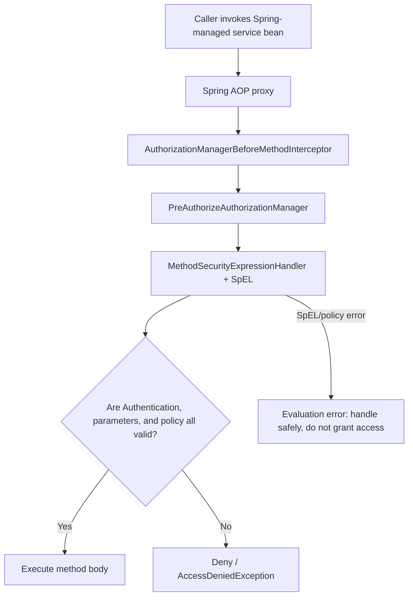

# Handling Null Parameters and Explicit Denial Policies

In **Spring Security method security**, a `@PreAuthorize` expression often uses method parameters to decide whether the caller is allowed to execute business logic. Examples: `#documentId`, `#command`, `#tenantId`, or a DTO containing multiple fields. Yet these values can be **`null`, empty, whitespace-only, malformed, nonexistent in the database, or outside the user's permission scope**.

Without careful handling, a seemingly valid expression can throw an error when accessing properties on `null`, grant access wrongly due to overly broad defaults, or blur the boundary between **invalid data** and **access denial**.

Unsafe example:

```java
@PreAuthorize("#documentId.startsWith('DOC-') and hasAuthority('documents.read')")
public Document read(String documentId) {
    return repository.read(documentId);
}
```

When `documentId == null`, calling `startsWith(...)` can trigger a SpEL/runtime error. Even with `DOC-123`, checking a prefix **does not prove** the document belongs to the tenant or that the user may view it.

Example with explicit denial intent:

```java
@PreAuthorize(
    "hasAuthority('documents.read') " +
    "and #documentId != null " +
    "and !#documentId.isBlank() " +
    "and @documentPolicy.canRead(authentication, #documentId)"
)
public Document read(@P("documentId") String documentId) {
    return repository.read(documentId);
}
```

Here **every condition must be true**. If lacking authority, the ID is `null`, the ID is empty/blank, or `documentPolicy` returns `false`, the method body **is not called** along the normal interception path. `@documentPolicy` is an application-implemented bean and must validate its own inputs safely; it is not a built-in Spring Security API.

**Overarching principle: _fail closed_** — when required evidence to confirm authorization is missing, **never default to allow**, never turn `null` into public access, never pick another resource arbitrarily as a default, and never treat expression evaluation errors as a standard security control.

This lesson targets **Java 17+, Spring Boot 3.x, and Spring Security 6.5.x**. Its main scope is **pre-method checks** using `@PreAuthorize`, with discussion of `AuthorizationManager` and related APIs to distinguish denial, abstain, errors, and validation.

## 1. Four questions to answer before granting access

For the call:

```java
documentService.readDocument(documentId);
```

evaluate **four distinct conditions**:

1. **Is there a trusted identity?** `Authentication` created by a trusted authentication provider or token validator, not a self-declared role string from an HTTP body.
2. **Is the input valid?** Does `documentId` exist, match the expected type, remain non-`null` and non-blank, follow the right format, and belong to the expected namespace?
3. **Does the user hold the required authority?** For example `documents.read`, or effective permissions computed via `RoleHierarchy` if configured.
4. **Does the user have permission on the specific resource?** Does the document exist? Same tenant? Owner? Shared? Locked or revoked?

A broad check like `hasAuthority('documents.read')` only answers question 3. It **does not automatically answer questions 2 and 4**.

### Input state matrix

| Scenario | Recommended design | What to avoid |
| --- | --- | --- |
| `documentId == null` | Do not call sensitive repositories; return deny or validation error per API contract | Falling back to an admin/another tenant's default ID |
| `documentId == ""` | Treat as missing ID if the API requires an ID | Treating empty string as “all documents” |
| `documentId == "   "` | Check `isBlank()` or an equivalent validator | Checking only `!= null` and permitting |
| `documentId` malformed | Reject in validation/policy; do not query with arbitrary strings | Checking only a forgeable prefix |
| `documentId` well-formed yet nonexistent | Return no data; decide per API policy | Treating “not found” as permission granted |
| `documentId` belongs to another tenant | Deny and avoid leaking data | Trusting a caller-supplied tenant ID |
| User lacks authority | Deny before calling business code | Skipping permissions because request “is logged in” |
| Missing/anonymous Authentication | Never auto-elevate to a system account | Using a default principal with `ROLE_ADMIN` |
| Authorization service hits dependency error | Fail safely, log minimally, never auto-allow | `catch (Exception) { return true; }` |
| Permission unknown due to missing data | Deny per explicit policy, or use a safe policy-error path | Treating `null`/abstain as “permitted” |

**Null is not a normal business option when an ID is mandatory.** However, if an API genuinely has an *optional* parameter with clear semantics, the application must define behavior for the missing case and protect it with a dedicated policy. Not every `null` in every system is an error; what must be avoided is **defaulting to allow when authorization conditions remain unproven**.

## 2. @PreAuthorize is evaluated before the method body

In Spring Security 6.5, modern method security infrastructure consists of:



Minimal configuration:

```java
import org.springframework.context.annotation.Configuration;
import org.springframework.security.config.annotation.method.configuration.EnableMethodSecurity;

@Configuration
@EnableMethodSecurity
public class MethodSecurityConfig {
}
```

`@EnableMethodSecurity` enables pre/post annotations by default; Spring Boot starter security **does not enable method security automatically**. `@PreAuthorize` takes effect only when the method call is intercepted by Spring: the bean must live in the ApplicationContext and calls must pass through the corresponding proxy/advisor.

**Distinction between two failure modes:**

- **Expression returns `false`:** negative authorization decision with an explicit denial mechanism.
- **Expression errors out** (e.g., invoking a method on `null`): can throw an exception during evaluation; never assume it always becomes 403 or a specific `AccessDeniedException`.

The goal of a safe policy is not just “avoiding exceptions”: it needs a **testable, explainable boolean denial**.

## 3. Difference between null, empty, blank, and invalid

Java has multiple states that need distinct checks:

```java
String a = null;       // No String object exists.
String b = "";         // String exists but has 0 characters.
String c = "   ";      // Has characters, but only whitespace.
String d = "DOC-7";    // Valid example format.
String e = "DOC-XYZ";  // Has data, yet may violate ID rules.
```

- `id != null` only proves the reference is non-null.
- `!id.isEmpty()` rejects empty strings, yet whitespace-only strings still pass.
- `!id.isBlank()` rejects empty or whitespace-only strings per Java 11+ semantics.
- `id.matches("DOC-[0-9]+")` checks part of the syntax; it does not check record existence or permissions on the record.
- `id.equals("DOC-7")` requires `id` to be non-null; `"DOC-7".equals(id)` is a null-safe comparison.
- `id.strip()`/`trim()` can help normalize at the validation layer, yet **never arbitrarily normalize IDs before authorization** if the system uses character-, case-, or whitespace-sensitive IDs.

In `@PreAuthorize`, check ordering can prevent null dereferences:

```java
@PreAuthorize(
    "#id != null and !#id.isBlank() and hasAuthority('documents.read')"
)
```

Because `and` is a short-circuit logical operator in SpEL, when `#id != null` is false, the expression skips calling `#id.isBlank()`. Better still, check authority first to avoid expensive operations/data reads when the caller lacks permission.

### Do not use numeric comparisons with null to infer validity

In SpEL, ordering comparisons with `null` are not equivalent to ordinary arithmetic; `null` is not zero. Never write a comparison expression like:

```java
@PreAuthorize("#amount > null")
```

thinking it acts as validation. Check null, data type, and bounds:

```java
@PreAuthorize(
    "#amount != null and #amount.signum() > 0 " +
    "and hasAuthority('payments.create')"
)
```

Here `#amount` assumes a `BigDecimal`; if data comes from a request and the operation is sensitive, you also need validation for upper limits, currency, fraud checks, and transaction-level service policies.

## 4. Writing fail-closed expressions with AND and short-circuiting

A reliable pattern is typically:

```text
authenticated
AND hasRequiredAuthority
AND input != null
AND input is valid
AND resource policy returns true
```

Spring example:

```java
@PreAuthorize(
    "isAuthenticated() " +
    "and hasAuthority('documents.read') " +
    "and #id != null " +
    "and !#id.isBlank() " +
    "and @documentPolicy.canRead(authentication, #id)"
)
```

**All conditions must be true.** This pattern prevents several bugs:

- No valid authentication → fails authentication check.
- Lacks `documents.read` → never enters the document-reading policy bean.
- Null or blank ID → never invokes the policy bean with that input.
- Syntactically valid ID yet document does not belong to user → bean returns `false`.
- Only when every condition is true → body is allowed to execute.

**Do not write an unparenthesized `OR`** like:

```java
@PreAuthorize(
    "hasRole('ADMIN') or #id != null and @policy.canRead(authentication, #id)"
)
```

If system intent is that **admins must also stay within resource scope**, the expression above opens the `hasRole('ADMIN')` branch too wide. Write the actual policy:

```java
@PreAuthorize(
    "(hasRole('ADMIN') or hasAuthority('documents.read')) " +
    "and #id != null " +
    "and @policy.canRead(authentication, #id)"
)
```

This is a **configuration fragment**: the `policy` bean must have a null-safe method; the expression illustrates grouping conditions. If admins are genuinely permitted to bypass resource scope, evaluate and document the exception explicitly rather than creating an accidental shortcut.

### Short-circuit ordering when calling helpers

Avoid:

```java
@PreAuthorize(
    "@policy.canRead(authentication, #id) and #id != null"
)
```

The policy runs **before** the guard. If the policy does not handle null, it can cause unwanted errors. Prefer:

```java
@PreAuthorize(
    "#id != null and @policy.canRead(authentication, #id)"
)
```

Still, **the policy bean itself must check for null** because it may be reused by Java code, batch jobs, or other annotations.

## 5. SpEL safe navigation: ?. prevents NPEs, does not deny by itself

Spring Expression Language supports the **safe navigation operator `?.`**, for example:

```java
@PreAuthorize(
    "#command?.getDocumentId() != null"
)
```

If `#command` is `null`, `#command?.getDocumentId()` evaluates to `null` instead of attempting to invoke the method and throwing an error. Comparing `!= null` then returns boolean `false`, expressing a clear denial condition.

If `command` contains nested DTOs:

```java
@PreAuthorize(
    "#command?.getDocument()?.getId() != null " +
    "and @documentPolicy.canRead(authentication, #command.getDocument().getId())"
)
```

Both `?.` operators guard **both traversal levels**. When the first branch is false, `and` skips evaluating the right-hand side. Never put `?.` only on the first level and then dereference the next level as if guaranteed non-null.

**Wrong:**

```java
@PreAuthorize("#command?.getDocument().getId() != null")
```

If `command` is null, the null produced by one safe-navigation step can still be dereferenced at the unsafe `.getId()` step.

**Correct:**

```java
@PreAuthorize("#command?.getDocument()?.getId() != null")
```

Never use a nullable value directly as the **entire decision**:

```java
@PreAuthorize("#command?.getDocumentId()")
```

This expression returns a String or null rather than **being designed as a boolean authorization decision**. Write an explicit predicate:

```java
@PreAuthorize(
    "#command?.getDocumentId() != null and " +
    "@documentPolicy.canRead(authentication, #command.getDocumentId())"
)
```

### Safe navigation in chained expressions

Per Spring Framework documentation, the `?.` operator applies only to **the marked access step**, and does not make the rest of a property/method chain automatically null-safe. For example, `#person?.address.city` can still fail if the next step accesses `.city` on null; use `#person?.address?.city`.

**With lists/collections:** a `null` `List` and an empty `List` are also two distinct cases. If a policy requires at least one item and all items belonging to the tenant, compute an explicit predicate in Java rather than hoping `?.size()` behaves as desired on null.

## 6. Elvis (?:), default values, and the risk of wrongly granting access

SpEL provides the **Elvis operator `?:`** to supply a fallback when the left-hand side is null (with version-specific rules for empty strings as well). Example expressing a display value idea:

```java
String displayName = "Guest";
```

Yet in **authorization**, fallbacks are not always safe. An illustrative expression to avoid:

```java
@PreAuthorize(
    "@policy.canRead(authentication, #documentId ?: 'PUBLIC')"
)
```

If the ID is null, the policy is queried about the `PUBLIC` resource instead of the original request. That can grant unintended access or check a different resource than the one the body actually operates on.

Principles:

- **Never substitute another fallback ID** for null if the body still uses the original input.
- **Never default identity/tenant** when the input lacks a value.
- If a policy bean returns a nullable `Boolean`, convert null to **false** right in Java with `Boolean.TRUE.equals(result)`, or return primitive `boolean` and ensure every branch returns a boolean.
- If there genuinely is a *business-defined default resource*, normalize and resolve it **once at the business layer**, and ensure authorization checks **the exact resource used**, not a divergent copy of the logic.

Null-safe Java example:

```java
Boolean decision = externalPolicy.check(user, documentId);
boolean allowed = Boolean.TRUE.equals(decision);
```

If `decision == null`, `allowed == false`. This is clearly **fail-closed** compared to `decision == null ? true : decision`.

### The right default value in authorization is deny

Simple policy fallbacks:

```java
boolean canRead(Authentication user, String id) {
    if (user == null || id == null || id.isBlank()) {
        return false;
    }
    return checkFromTrustedData(user, id);
}
```

`checkFromTrustedData(...)` is application-written code, not a default Spring API. For failures like lost database connectivity, handle a separate **policy failure** and ensure it never produces authorization success; not every operational outage has to be turned into HTTP 403.

## 7. Distinguishing “false”, “null”, “abstain”, exceptions, and missing rules

In multi-layered authorization systems, terminology is easily confused:

| Scenario | Meaning | Safe handling |
| --- | --- | --- |
| Predicate/bean returns `false` | Rule actively forbids access | Deny |
| Predicate/bean returns `true` | Rule confirmed permission | Allow only within policy scope |
| Bean returns `Boolean null` | No boolean decision | Never coerce to true; normalize to false or handle as error |
| Custom `AuthorizationManager` returns `null` | May represent **abstain/no decision** per manager contract | Do not equate with deny; return an explicit deny decision |
| SpEL null access causes exception | Error during policy evaluation | Return no data / execute no side effects; fix expression |
| No Authentication | Lacks trusted identity | Never default to a system user |
| Anonymous Authentication present | An anonymous token can have special state | Never rely solely on object's `isAuthenticated()` |
| No annotation/advisor on method | May have **no method check at all** | Ensure interception; do not assume automatic deny |
| HTTP rule present, no method rule | Requests may be checked at HTTP, yet calls elsewhere are unprotected | Protect critical service boundaries |

**Crucial point:** In Spring Security, the `AuthorizationManager` contract can use `null` to represent **abstain**, especially when customizing managers. `null` **does not mean the same thing as `new AuthorizationDecision(false)`**. Depending on how managers/interceptors are composed, an abstain may not produce the expected denial. When evidence to permit is insufficient, sensitive policies should return **`AuthorizationDecision(false)` / non-granted `AuthorizationResult`** instead of `null`.

Illustrative pattern for a custom manager (subject to 6.5 version imports and types):

```java
AuthorizationManager<MethodInvocation> manager =
    (authentication, invocation) -> {
        Authentication current = authentication.get();
        boolean allowed = current != null
                && current.isAuthenticated()
                && !current.getAuthorities().isEmpty();
        return new AuthorizationDecision(allowed);
    };
```

This is an **API fragment**, not a standalone runnable app. It is simpler than a real policy and must not be used to guard production resources; in particular, `isAuthenticated()` alone is insufficient to distinguish anonymous callers. The key point is **always producing a boolean decision**, never returning `null` due to missing input.

### Deny-by-default at protected boundaries

An explicit rule:

```java
@PreAuthorize("denyAll")
public void neverInvokeFromApplication() {
    // Body should run only if policy is intentionally changed.
}
```

Similarly in the HTTP DSL:

```java
http.authorizeHttpRequests(auth -> auth
    .requestMatchers("/public/**").permitAll()
    .anyRequest().denyAll()
);
```

**Difference:** `anyRequest().denyAll()` protects URLs *in the selected filter chain*. `@PreAuthorize("denyAll")` protects one method *when method-security interception is active*. They **do not turn every unannotated method into deny-by-default**.

## 8. Standalone Java 17: fail-closed simulation runnable with javac

Before integrating SpEL, model the policy as a testable Java predicate. The example below uses **completely standalone Java SE 17**; no Spring, Maven, or network required.

Create **`NullPolicyDemo.java`**:

```java
import java.util.Set;

public class NullPolicyDemo {

    record User(String name, Set<String> authorities) {
        boolean has(String authority) {
            return authorities != null && authorities.contains(authority);
        }
    }

    static boolean canRead(User user, String id) {
        if (user == null || user.name() == null
                || user.authorities() == null) {
            return false;
        }

        if (!user.has("documents.read")) {
            return false;
        }

        if (id == null || id.isBlank()) {
            return false;
        }

        if (!id.matches("DOC-[0-9]+")) {
            return false;
        }

        return "alice".equals(user.name()) && "DOC-7".equals(id);
    }

    static void check(String label, User user, String id) {
        System.out.println(label + ": "
                + (canRead(user, id) ? "ALLOW" : "DENY"));
    }

    public static void main(String[] args) {
        User alice = new User(
                "alice", Set.of("documents.read"));
        User bob = new User(
                "bob", Set.of("documents.read"));
        User writer = new User(
                "alice", Set.of("documents.write"));

        check("null user", null, "DOC-7");
        check("null authorities", new User("alice", null), "DOC-7");
        check("null id", alice, null);
        check("empty id", alice, "");
        check("blank id", alice, "   ");
        check("bad format", alice, "DOC-ABC");
        check("different resource", alice, "DOC-8");
        check("different owner", bob, "DOC-7");
        check("missing read", writer, "DOC-7");
        check("valid", alice, "DOC-7");
    }
}
```

Compile/run with JDK 17+:

```bash
javac NullPolicyDemo.java
java NullPolicyDemo
```

**Exact expected stdout:**

```text
null user: DENY
null authorities: DENY
null id: DENY
empty id: DENY
blank id: DENY
bad format: DENY
different resource: DENY
different owner: DENY
missing read: DENY
valid: ALLOW
```

The program intentionally denies all missing/invalid data. This is a **plain Java** logic model without Spring AOP, `Authentication`, JWTs, controllers, or a database; it **does not automatically protect real HTTP endpoints**.

### Why keep a Java predicate?

When a policy has multiple branches, Java lets you:

- Express and clearly name every precondition.
- Test `null`/blank/format/owner/tenant case by case.
- Return a primitive `boolean`, avoiding nullable results.
- Decouple policy from SpEL syntax and prevent null-dereference exceptions.
- Collect audit reasons **server-side** without exposing internal rules to clients.
- Verify data contracts across components rather than relying solely on an annotation string.

When moving into Spring, pass a **verified Authentication** and read resource metadata from real server sources, not hard-coded strings as in the exercise.

## 9. Spring Boot 3.5.16 example: pre-check denies null before body executes

The complete example below uses **real Spring Security method security**, without requiring a web server. Main goal: observe that `@PreAuthorize` denies `null`/blank/missing-authority calls before the Java method body runs and **before the policy bean is called** when an earlier condition is already false.

**Environment:** Java 17+, Maven 3.6.3+ or compatible Maven. Spring Boot **3.5.16** was released in June 2026 and pairs with compatible Spring Security 6.5.x. The Spring Boot 3.5 line has reached end of OSS support per its release announcement; use this version here to match 6.5 accurately, while new products should choose a supported branch and read the migration guide.

Layout:

```text
null-method-security/
├── pom.xml
└── src/
    └── main/
        ├── java/
        │   └── demo/
        │       ├── NullMethodSecurityApp.java
        │       ├── DocumentService.java
        │       └── DocumentPolicy.java
        └── resources/
            └── application.properties
```

### 9.1. pom.xml

```xml
<project xmlns="http://maven.apache.org/POM/4.0.0"
         xmlns:xsi="http://www.w3.org/2001/XMLSchema-instance"
         xsi:schemaLocation="http://maven.apache.org/POM/4.0.0
             https://maven.apache.org/xsd/maven-4.0.0.xsd">

    <modelVersion>4.0.0</modelVersion>

    <parent>
        <groupId>org.springframework.boot</groupId>
        <artifactId>spring-boot-starter-parent</artifactId>
        <version>3.5.16</version>
        <relativePath/>
    </parent>

    <groupId>demo</groupId>
    <artifactId>null-method-security</artifactId>
    <version>1.0.0</version>

    <properties>
        <java.version>17</java.version>
    </properties>

    <dependencies>
        <dependency>
            <groupId>org.springframework.boot</groupId>
            <artifactId>spring-boot-starter</artifactId>
        </dependency>
        <dependency>
            <groupId>org.springframework.boot</groupId>
            <artifactId>spring-boot-starter-security</artifactId>
        </dependency>
    </dependencies>

    <build>
        <plugins>
            <plugin>
                <groupId>org.springframework.boot</groupId>
                <artifactId>spring-boot-maven-plugin</artifactId>
            </plugin>
        </plugins>
    </build>
</project>
```

`spring-boot-starter-web` is unnecessary because the exercise runs inside `CommandLineRunner`. If adding web, configure HTTP authentication, request authorization, and controllers per business requirements; never use the demo's mock users as production authentication.

### 9.2. NullMethodSecurityApp.java

Place at `src/main/java/demo/NullMethodSecurityApp.java`:

```java
package demo;

import java.util.List;
import java.util.function.Supplier;

import org.springframework.boot.CommandLineRunner;
import org.springframework.boot.SpringApplication;
import org.springframework.boot.autoconfigure.SpringBootApplication;
import org.springframework.context.annotation.Bean;
import org.springframework.security.access.AccessDeniedException;
import org.springframework.security.authentication.UsernamePasswordAuthenticationToken;
import org.springframework.security.config.annotation.method.configuration.EnableMethodSecurity;
import org.springframework.security.core.authority.SimpleGrantedAuthority;
import org.springframework.security.core.context.SecurityContext;
import org.springframework.security.core.context.SecurityContextHolder;

@SpringBootApplication
@EnableMethodSecurity
public class NullMethodSecurityApp {

    public static void main(String[] args) {
        SpringApplication.run(NullMethodSecurityApp.class, args);
    }

    @Bean
    CommandLineRunner demonstrate(
            DocumentService service,
            DocumentPolicy policy) {

        return args -> {
            invoke("null ID", "alice", "documents.read",
                    () -> service.read(null));

            invoke("empty ID", "alice", "documents.read",
                    () -> service.read(""));

            invoke("blank ID", "alice", "documents.read",
                    () -> service.read("   "));

            invoke("valid read", "alice", "documents.read",
                    () -> service.read("DOC-7"));

            invoke("unknown ID", "alice", "documents.read",
                    () -> service.read("DOC-8"));

            invoke("extra whitespace", "alice", "documents.read",
                    () -> service.read(" DOC-7 "));

            invoke("different user", "bob", "documents.read",
                    () -> service.read("DOC-7"));

            invoke("missing read permission", "alice", "documents.edit",
                    () -> service.read("DOC-7"));

            invoke("delete no permission", "alice", "documents.read",
                    () -> service.delete("DOC-7"));

            invoke("valid delete", "alice", "documents.delete",
                    () -> service.delete("DOC-7"));

            invoke("delete null ID", "alice", "documents.delete",
                    () -> service.delete(null));

            invoke("explicit deny", "alice", "ROLE_ADMIN",
                    service::never);

            System.out.println("bodyCalls: " + service.bodyCalls());
            System.out.println("policyCalls: " + policy.calls());
        };
    }

    private static void invoke(
            String label,
            String username,
            String authority,
            Supplier<String> action) {

        SecurityContext context = SecurityContextHolder.createEmptyContext();

        context.setAuthentication(
                new UsernamePasswordAuthenticationToken(
                    username,
                    "demo-only",
                    List.of(new SimpleGrantedAuthority(authority))
                )
        );

        SecurityContextHolder.setContext(context);

        try {
            System.out.println(label + " -> " + action.get());
        } catch (AccessDeniedException denied) {
            System.out.println(label + " -> DENY");
        } finally {
            SecurityContextHolder.clearContext();
        }
    }
}
```

**Explanation:** Each case builds a three-argument `UsernamePasswordAuthenticationToken`, so Authentication is authenticated and carries one authority. This is a **user-simulating test harness**; never use browser-submitted roles to create Authentication in production.

`CommandLineRunner` receives `DocumentService` and `DocumentPolicy` from the **Spring ApplicationContext**. The service is proxied by method security; `service.read(...)`/`service.delete(...)` calls go through the interceptor. `clearContext()` is called after every case to avoid leaking `SecurityContext` on the CLI thread.

### 9.3. DocumentService.java

Place at `src/main/java/demo/DocumentService.java`:

```java
package demo;

import java.util.concurrent.atomic.AtomicInteger;

import org.springframework.security.access.method.P;
import org.springframework.security.access.prepost.PreAuthorize;
import org.springframework.stereotype.Service;

@Service
public class DocumentService {

    private final AtomicInteger reads = new AtomicInteger();
    private final AtomicInteger deletes = new AtomicInteger();
    private final AtomicInteger neverCalls = new AtomicInteger();

    @PreAuthorize(
        "hasAuthority('documents.read') " +
        "and #documentId != null " +
        "and !#documentId.isBlank() " +
        "and @documentPolicy.canRead(authentication, #documentId)"
    )
    public String read(@P("documentId") String documentId) {
        reads.incrementAndGet();
        return "READ:" + documentId;
    }

    @PreAuthorize(
        "hasAuthority('documents.delete') " +
        "and #documentId != null " +
        "and !#documentId.isBlank() " +
        "and @documentPolicy.canDelete(authentication, #documentId)"
    )
    public String delete(@P("documentId") String documentId) {
        deletes.incrementAndGet();
        return "DELETED:" + documentId;
    }

    @PreAuthorize("denyAll")
    public String never() {
        neverCalls.incrementAndGet();
        return "NEVER";
    }

    public String bodyCalls() {
        return "read=" + reads.get()
                + ",delete=" + deletes.get()
                + ",never=" + neverCalls.get();
    }
}
```

Because counters are incremented only inside the body, denied cases **do not increment `reads`/`deletes`/`neverCalls`**. `AtomicInteger` here makes execution counts easy to read for the demo; real business operations need transactions, auditing, and proper synchronization rather than merely counting calls.

`@P("documentId")` from `org.springframework.security.access.method.P` supplies `#documentId` to SpEL, avoiding sole reliance on the compiler preserving parameter names via `-parameters`.

### 9.4. DocumentPolicy.java

Place at `src/main/java/demo/DocumentPolicy.java`:

```java
package demo;

import java.util.concurrent.atomic.AtomicInteger;

import org.springframework.security.authentication.AnonymousAuthenticationToken;
import org.springframework.security.core.Authentication;
import org.springframework.stereotype.Component;

@Component("documentPolicy")
public class DocumentPolicy {

    private final AtomicInteger readChecks = new AtomicInteger();
    private final AtomicInteger deleteChecks = new AtomicInteger();

    public boolean canRead(Authentication user, String documentId) {
        readChecks.incrementAndGet();
        return validActorAndId(user, documentId)
                && "alice".equals(user.getName())
                && "DOC-7".equals(documentId);
    }

    public boolean canDelete(Authentication user, String documentId) {
        deleteChecks.incrementAndGet();
        return validActorAndId(user, documentId)
                && "alice".equals(user.getName())
                && "DOC-7".equals(documentId);
    }

    private boolean validActorAndId(
            Authentication user, String documentId) {

        if (user == null || !user.isAuthenticated()
                || user instanceof AnonymousAuthenticationToken) {
            return false;
        }

        if (documentId == null || documentId.isBlank()) {
            return false;
        }

        return documentId.matches("DOC-[0-9]+");
    }

    public String calls() {
        return "read=" + readChecks.get()
                + ",delete=" + deleteChecks.get();
    }
}
```

Every branch returns **primitive `boolean`**, never `Boolean null`. The policy re-checks null, authentication, and format **even though `@PreAuthorize` already has guards**. That is defense in depth: the code may be reused via other call paths, and it reduces reliance on annotation clause ordering.

Conditions `"alice".equals(user.getName())` and `"DOC-7".equals(documentId)` exist only to run the exercise without a database; they are **not a production permission model**. Real policies must check verified user ID/tenant against owner, sharing, ACL, and record status in a trusted database.

### 9.5. application.properties

Place at `src/main/resources/application.properties`:

```properties
spring.main.web-application-type=none
spring.main.banner-mode=off
logging.level.root=OFF
```

In the project directory run:

```bash
mvn -q spring-boot:run
```

**Lines printed by the program in exact order**, excluding any Maven/JVM output:

```text
null ID -> DENY
empty ID -> DENY
blank ID -> DENY
valid read -> READ:DOC-7
unknown ID -> DENY
extra whitespace -> DENY
different user -> DENY
missing read permission -> DENY
delete no permission -> DENY
valid delete -> DELETED:DOC-7
delete null ID -> DENY
explicit deny -> DENY
bodyCalls: read=1,delete=1,never=0
policyCalls: read=4,delete=1
```

### 9.6. Reading the output as a policy test

- `null ID`, `empty ID`, and `blank ID` are all denied **before the policy bean is called**, because the `and` chain short-circuits.
- `valid read`: right permission, valid ID, and simulated owner, so the body executes once.
- `unknown ID`: valid format, yet policy does not recognize `DOC-8`, denied.
- `extra whitespace`: string does not match resource ID or format, denied; never auto-trimmed to alter meaning.
- `different user`: Bob has `documents.read` authority yet policy denies because he is not the simulated owner.
- `missing read permission`: denied at the authority guard without calling the policy.
- `delete no permission`: denied because required authority is `documents.delete`, not `documents.read`.
- `valid delete`: passes all guards and executes body.
- `delete null ID`: blocked by the null guard before the policy.
- `explicit deny`: `@PreAuthorize("denyAll")` denies even when the test principal has `ROLE_ADMIN`.
- `bodyCalls` proves the body ran only for **the two allowed calls**.
- `policyCalls` proves the policy was invoked only for **the four read cases** having authority and non-null/blank input, plus **one allowed delete case**.

**Note:** This example handles no HTTP/CSRF/sessions, calls no DB, and uses no real authentication. When moving to a server app, you must also protect routes, map request DTOs, validate inputs, configure exception handling, and check policies against real resource data.

## 10. 400, 401, 403, or 404: validation differs from authorization

A null/blank parameter can be handled **at the validation layer** before reaching the service. The API may then return 400 Bad Request per contract:

```java
@PostMapping("/documents")
public ResponseEntity<?> create(
        @Valid @RequestBody CreateDocumentRequest request) {
    // Pass validated input to the service.
    return ResponseEntity.ok(service.create(request));
}
```

With Bean Validation:

```java
public record CreateDocumentRequest(
        @NotBlank String title,
        @NotNull String tenantId
) {}
```

This is a Spring MVC/Validation snippet requiring `spring-boot-starter-validation` and `jakarta.validation.*` imports; it is not in the CLI app from section 9. `@NotBlank` rejects null, empty, and whitespace-only strings. `@NotNull` rejects only null, not empty strings.

Even when the controller validates, **the service must still enforce authorization** because it may be called via batches, listeners, GraphQL, or internal code bypassing that controller.

### Distinguishing return status codes

| Condition | Suitable response | Notes |
| --- | --- | --- |
| Malformed JSON, missing required field | 400 | Validation at API boundary |
| No valid authentication | 401 or login redirect | Depends on authentication entry point |
| Authenticated, yet missing role/permission or policy denies | Usually 403 | Depends on exception handling |
| Resource does not exist | 404 | Do not equate 404 automatically with authorization |
| Wanting to hide existence of unauthorized resources | Consistent 404 design possible | Avoid leaking info via timing, logs, or response differences |
| Policy backend error/timeout | Appropriate service error, never grant access | Never return data just because verification failed |

**There is no universal rule that “null always returns 403” or “null always returns 400”.** That is an API design decision. The safety requirement is that the request **never bypasses authorization controls** and triggers no sensitive side effects when data is missing.

### Never use exceptions as an authorization fallback

Example:

```java
try {
    return service.read(documentId);
} catch (NullPointerException exception) {
    return publicDocument();
}
```

This is broken handling because an unexpected null error causes the app to return public data the user never asked for. Likewise:

```java
catch (Exception ignored) {
    return true; // Dangerous when making authorization decisions!
}
```

Inside policies, exceptions must be recorded safely and produce an appropriate **fail-safe result**, never flipping logic to allow.

## 11. Nulls in nested DTOs and collections

Many methods accept a request object instead of a single String:

```java
public void transfer(CreateTransferCommand command);
```

`command` may be null; `command.getTransfer()` or `getDestination()` may be null; the beneficiary list may be null, empty, or contain null elements.

**Good processing order:**

1. Check `command != null`.
2. Check required child objects are non-null.
3. Check required fields (tenant, beneficiary, amount, currency).
4. Check authority/method action.
5. Use a Java policy over trusted data to verify the caller's permissions on **both source and destination**.
6. Body executes only when the policy returns true.
7. At the transaction/write layer, still verify sensitive conditions to prevent races.

Example with full guards:

```java
@PreAuthorize(
    "#command != null " +
    "and #command.getTransfer() != null " +
    "and #command.getTransfer().getDestination() != null " +
    "and hasAuthority('transfers.create') " +
    "and @transferPolicy.canSubmit(authentication, #command)"
)
public void submit(@P("command") TransferCommand command) {
    // Sensitive operation after pre-check.
}
```

With many branches, a Java policy:

```java
@PreAuthorize("@transferPolicy.canSubmit(authentication, #command)")
```

is usually **easier to test and review**. The `transferPolicy` bean must verify nulls, permissions, and resource data; never return true for an empty command.

### Collections and vacuous truth on empty sets

A Java logic trap:

```java
boolean allAllowed = ids.stream().allMatch(this::canRead);
```

On an **empty collection**, `allMatch(...)` returns true by universal quantification over the empty set. If business rules require at least one ID, write:

```java
boolean allAllowed = ids != null
        && !ids.isEmpty()
        && ids.stream().allMatch(
                id -> id != null && canRead(id));
```

Also define how requests with duplicate IDs, null elements, oversized batches, and mixed-tenant batches are handled. Never grant “export all” simply because an empty list was submitted.

### Null, Optional, and “not provided” values

In Java:

- `null` represents a missing reference, without stating why.
- `Optional.empty()` can represent no result, yet does not by itself mean authorization deny.
- `List.of()` is an empty list, distinct from null.
- `""` is an empty string, distinct from a missing JSON field.

In Spring Framework 7, SpEL expands safe-navigation behavior with `Optional`; **do not assume those newer rules exist in every Spring 6.x project**. When a policy must handle `Optional`, handle it explicitly in Java and test on the actual runtime.

## 12. Tenant, owner, and null comparisons: avoiding “two missing values equal”

A serious logic bug is comparing two properties that could both be null:

```java
boolean sameTenant =
        Objects.equals(userTenantId, documentTenantId);
```

If **both are null**, `Objects.equals(null, null)` returns **true**. That is exact Java behavior, yet **unsafe** when tenant is a mandatory authorization condition.

Similarly in SpEL:

```java
@PreAuthorize("#tenantId == authentication.details.tenantId")
```

may fail to express “both tenants must be defined and identical”, especially if attributes are null or objects/principals differ from assumptions. Require **each ID to carry a trusted value** before comparing:

```java
boolean sameTenant(String userTenant, String resourceTenant) {
    return userTenant != null
            && resourceTenant != null
            && !userTenant.isBlank()
            && !resourceTenant.isBlank()
            && userTenant.equals(resourceTenant);
}
```

This is a standalone Java helper. `userTenant` must come from verified authentication/DB; `resourceTenant` comes from the record. Never trust a request header simply because it is named `X-Tenant-Id`.

### Avoid comparing principal names instead of stable IDs

`authentication.name` may be a username, email, or subject depending on the provider. A multi-issuer/multi-tenant app should not assume the display name is always a canonical user ID. Policies need stable identifiers, tenant scoping, and trusted mappings.

## 13. Null and RoleHierarchy have no implicit relationship

A `RoleHierarchy` such as:

```text
ROLE_ADMIN > ROLE_MANAGER
ROLE_MANAGER > ROLE_USER
ROLE_USER > documents.read
```

can allow a user with `ROLE_ADMIN` to pass `hasAuthority('documents.read')` **when the handler uses the hierarchy**. Yet no relation turns:

```text
documentId = null
```

into a valid resource. Even for high-privilege users, the policy must identify **the resource and scope**.

Example:

```java
@PreAuthorize(
    "hasAuthority('documents.read') " +
    "and #id != null " +
    "and @documentPolicy.canRead(authentication, #id)"
)
```

If `id == null`, the expression still denies even though effective authorities include `documents.read`. That is the desired behavior when the ID is mandatory.

**Beware of admin bypass branches:**

```java
@PreAuthorize("hasRole('ADMIN') or @policy.canRead(authentication, #id)")
```

If an admin can call the method with `id == null`, the body may have to deal with missing input, causing crashes or wrong operations. When ID is mandatory, use a shared guard:

```java
@PreAuthorize(
    "#id != null " +
    "and (hasRole('ADMIN') or @policy.canRead(authentication, #id))"
)
```

Then also decide **whether admin requires tenant/owner limits**. Never allow role bypasses simply because the expression is shorter to write.

## 14. Transactions, TOCTOU, and check ordering

`@PreAuthorize` is evaluated **before the body of the proxied method**, yet does not guarantee data conditions still hold at write time. For instance, a document may change owner, tenant, or status after the policy returned true.

```java
@PreAuthorize("@policy.canDelete(authentication, #id)")
@Transactional
public void deleteDocument(String id) {
    repository.deleteById(id);
}
```

This is a **Spring service fragment**; `policy`/`repository` definitions are omitted. When strict guarantees are needed:

- Use appropriate transactions/locking/version checks.
- Verify conditions in the query/delete, not only once before the body.
- For updates, use `UPDATE ... WHERE tenant_id = ... AND owner_id = ... AND status = ...` so the DB also enforces the policy.
- Prevent updating the wrong row when IDs are normalized differently from how the policy matched them.
- Confirm the policy and the write use **the exact same resource identifier**, canonicalized in a controlled manner.
- If permissions are revoked while a job is running, define when revocation takes effect.

Do not assume `@Transactional` always starts after the policy check or that advisors always share the exact same order across all apps. For operations needing strong isolation, design and test transaction ordering explicitly.

## 15. AOP self-invocation: fail closed on paper, yet bypassed in practice

Dangerous example:

```java
@Service
public class DocumentJob {

    public void process(String id) {
        delete(id); // this.delete(id): can bypass the AOP proxy.
    }

    @PreAuthorize("#id != null and hasAuthority('documents.delete')")
    public void delete(String id) {
        // Delete operation.
    }
}
```

In common Spring AOP proxy mode, `this.delete(id)` from within the same instance does not traverse the proxy, so `@PreAuthorize` **may not execute**. All null checks and permission guards in the annotation then have **no effect** on that call path.

Solutions:

1. Place the protected operation in a separate Spring-managed bean.
2. Inject that bean into the caller and invoke it through the proxy.
3. Enforce policies at the service/domain layer if multiple adapters bypass proxies.
4. Test **deny cases through the exact production call path**, not only a controller or another bean.
5. If using AspectJ weaving instead of proxies, understand its distinct constraints and configure tests accordingly.

Similar risks: instantiating services with `new`, private methods, incompatible proxy strategies, a Spring context lacking `@EnableMethodSecurity`, mocking the service instead of using the real bean, or annotations overridden along a hierarchy.

**A fail-closed expression helps only when it is actually evaluated.**

## 16. When permission data is missing from a dependent system

In large organizations, `documentPolicy` may call a database, ACL service, or external authorization provider. Distinguish:

- **Valid data and granted** → allow.
- **Valid data yet lacking permission** → deny.
- **Resource or relationship not found** → deny or appropriate business outcome.
- **Indeterminate/expired cached data** → never default to cached “allow”.
- **Permission system timeout/error** → fail safely; do not leak resources and never auto-allow.

A simple Java pattern:

```java
public boolean canRead(Authentication user, String id) {
    if (user == null || id == null || id.isBlank()) {
        return false;
    }

    try {
        return permissionStore.hasPermission(user.getName(), id, "read");
    } catch (PermissionStoreUnavailableException ex) {
        auditPolicyFailureSafely(ex);
        return false;
    }
}
```

This is an **illustrative fragment**: `permissionStore`, the exception, and auditing are application-defined layers. In a real system, you might throw a dedicated exception (so the API returns a service error), yet the final outcome **must never be unauthorized success**. If returning false hides a major outage, emit metrics/alerts and return an appropriate error HTTP status instead of turning everything into 403.

### When should you NOT return false silently?

If a dependency is down, returning `false` can mislead users into thinking they lost permissions. While it avoids leaking data, it obscures operational incidents. A better option in many systems is **fail closed + service error** (e.g., 503) with proper logging/auditing, never flipping to allow.

## 17. Testing nulls and denials: inputs, authorities, ownership, and side effects

A solid test suite covers **policy logic** and **method-security integration**.

### 17.1. Test matrix

Assuming the `read` rule from section 9:

| User / authority | documentId | Expected | Body runs? | Policy bean called? |
| --- | --- | --- | --- | --- |
| alice / documents.read | `null` | DENY | No | No |
| alice / documents.read | `""` | DENY | No | No |
| alice / documents.read | `"   "` | DENY | No | No |
| alice / documents.read | `"DOC-7"` | ALLOW | Yes | Yes |
| alice / documents.read | `"DOC-8"` | DENY | No | Yes |
| alice / documents.read | `" DOC-7 "` | DENY | No | Yes |
| bob / documents.read | `"DOC-7"` | DENY | No | Yes |
| alice / documents.edit | `"DOC-7"` | DENY | No | No |
| alice / documents.delete | `null` for delete | DENY | No | No |
| alice / documents.delete | `"DOC-7"` for delete | ALLOW | Yes | Yes |
| alice / ROLE_ADMIN | `never()` method | DENY | No | No |

Tests must prove **the body does not run**, such as verifying `never()` on a fake repository/gateway or checking demo counters. Seeing HTTP 403 alone does not prove `@PreAuthorize` blocked the method: CSRF or URL authorization may have denied earlier.

### 17.2. Java policy unit tests

JUnit 5 example in a project with JUnit/Spring Test dependencies:

```java
@Test
void nullNeverGrantsReadPermission() {
    DocumentPolicy policy = new DocumentPolicy();

    assertFalse(policy.canRead(null, "DOC-7"));
    assertFalse(policy.canRead(authenticationAlice, null));
    assertFalse(policy.canRead(authenticationAlice, ""));
    assertFalse(policy.canRead(authenticationAlice, "   "));
}
```

`authenticationAlice` is an authenticated Authentication test fixture; this snippet **is not standalone**, requiring imports, JUnit, and fixtures. It tests **Java policy logic** but does not verify annotations/AOP.

### 17.3. Real @PreAuthorize integration tests

In a Spring Boot test context with `spring-boot-starter-test` and `spring-security-test` (test scope), invoke the DI-injected service bean:

```java
@SpringBootTest
class DocumentMethodTests {

    @Autowired
    DocumentService service;

    @Test
    @WithMockUser(username = "alice", authorities = "documents.read")
    void nullIdIsDeniedBeforeBody() {
        assertThrows(AccessDeniedException.class,
                () -> service.read(null));
    }

    @Test
    @WithMockUser(username = "alice", authorities = "documents.read")
    void validIdCanBeRead() {
        assertEquals("READ:DOC-7", service.read("DOC-7"));
    }

    @Test
    @WithMockUser(username = "bob", authorities = "documents.read")
    void ownershipPolicyDenies() {
        assertThrows(AccessDeniedException.class,
                () -> service.read("DOC-7"));
    }
}
```

This is a **Spring Test fragment**, not included out of the box in the minimal CLI project. It needs `@SpringBootTest`, `@Autowired`, `@Test`, `@WithMockUser`, assertions, and test dependencies. The demo's `CommandLineRunner` may execute in the test context and mutate counters before assertions; disable the runner in a test profile or separate the demo runner from the test context.

Additional tests:

- Missing `@EnableMethodSecurity` detected because negative cases are not blocked.
- Service invoked from another Spring bean rather than `new DocumentService()`.
- Null DTO, null nested fields, null List, empty List, List containing null.
- Missing Authentication, anonymous Authentication, wrong role prefix.
- Policy bean throws an error or returns `Boolean null` in nullable-wrapper cases.
- Cross-tenant user, locked record, or transferred ownership.
- `@PostAuthorize` not used as the sole check for write operations.
- HTTP responses 400/401/403/404 tested per contract without leaking other users' data in responses.

## 18. Antipatterns to eliminate

| Antipattern | Why wrong/dangerous | Replace with |
| --- | --- | --- |
| `#id.startsWith('DOC-')` when id is nullable | Can throw an exception | `#id != null and ...` |
| `#dto?.child.value` | Safe navigation does not cover the chain | `#dto?.child?.value` |
| `@PreAuthorize("#dto?.getId()")` | Result is not a boolean policy | Check `!= null` and resource policy |
| `#id ?: 'ADMIN_DEFAULT'` | Swaps target resource to another ID | Reject missing ID or resolve explicit contract |
| `Boolean decision == null` treated as true | Opens access when policy did not decide | `Boolean.TRUE.equals(decision)` |
| Custom manager returns null to deny | `null` can mean abstain, not deny | Explicit false decision |
| `Objects.equals(null, null)` for tenant check | Two missing tenants evaluate as equal | Require both IDs non-null/valid |
| `ids.stream().allMatch(...)` on empty list | Empty `allMatch` returns true | Check `!ids.isEmpty()` first |
| `catch(Exception) { return true; }` in policy | Outages/errors become allow | Fail safely and alert |
| `hasRole('ADMIN') or @policy.canRead(...)` when admin still needs scope | Bypasses resource policy | Use shared condition and intentional exception |
| Validating only at controller | Service can be called from other paths | Validate inputs + method/security policy |
| Relying on `@PreAuthorize` with `this.method()` | Bypasses Spring AOP proxy | Call via intercepted bean |
| Using `@PostAuthorize` for transfers/deletes | Side effects can happen already | Pre-check + transaction constraints |
| Testing only ALLOW | Fails to catch default allow/bypasses | Test DENY and absence of side effects |
| Ignoring role/token freshness | Sessions or JWTs can retain stale authorities | Design revocation/refresh/live policies |
| Logging full request/Authentication for debugging | Can leak tokens, PII, tenant secrets | Minimal logging and controlled log access |

## 19. Pre-merge implementation checklist

- [ ] Required inputs have `null`, empty/blank, and reasonable format guards.
- [ ] No implicit fallback ID/user/tenant when facts are missing.
- [ ] `@PreAuthorize` rules return an explicit boolean predicate, never a nullable String/object as an authorization result.
- [ ] Policy beans return primitive `boolean` or convert `Boolean null` to false.
- [ ] Custom `AuthorizationManager` returns explicit denial results, never confusing `null` abstain with deny.
- [ ] Policy beans re-check null inputs and authentication instead of relying solely on caller guards.
- [ ] `@EnableMethodSecurity` is enabled, service lives in the Spring context, and calls go through the AOP proxy.
- [ ] Object-level policies cover owner, tenant, sharing, and status where needed.
- [ ] Unverified permission/tenant fields from requests are never trusted.
- [ ] Negative tests cover null, blank, unknown ID, other tenant, missing authority, and anonymous.
- [ ] Tests prove the method body or downstream gateway **is not called** on deny.
- [ ] 400 (validation) is separated from 403 (authorization) and 404 policy where appropriate.
- [ ] Policy backend errors/timeouts never yield allow; proper metrics/logs/alerts exist.
- [ ] Write operations use transactions/conditional updates when TOCTOU protection is needed.
- [ ] No self-invocation bypasses on protected methods.
- [ ] SecurityContext in async/job/batch flows has explicit identity and scope.
- [ ] Effective timing of role/permission/token changes is defined rather than assumed instantaneous.

## 20. Self-check questions

**1. Does `#documentId != null` block whitespace-only strings?**  
No. You need `!#documentId.isBlank()` or an appropriate validator.

**2. Does `?.` automatically make `@PreAuthorize` deny?**  
No. It performs a null-safe access and can return null; you must still write an explicit boolean predicate.

**3. Is `#request?.address.city` always safe when request is null?**  
No. Accessing `.city` afterward can dereference null; use `#request?.address?.city`.

**4. Why is `#id != null and @policy.canRead(authentication, #id)` better than the reverse order?**  
Because the null guard runs first and short-circuits; the policy is not called with null from that expression.

**5. How is `Boolean.TRUE.equals(result)` useful?**  
It permits access only when `result` is exactly `Boolean.TRUE`; both null and false do not allow.

**6. Is a custom `AuthorizationManager` returning `null` guaranteed to deny?**  
No. Null can represent abstain; to deny, return an explicit deny decision.

**7. Should two null tenant IDs be treated as “same tenant”?**  
No when tenant is a mandatory condition. Check both are non-null/valid before comparing.

**8. Does `allMatch` on an empty list return false?**  
No. Java returns true; check non-empty if business logic requires at least one element.

**9. Why doesn't an HTTP 403 prove `@PreAuthorize` ran?**  
Because an HTTP filter, CSRF, or authentication may have rejected before the service.

**10. If the policy database times out, should you return true since the user is logged in?**  
No. Without proof of permission, never grant access; fail safely and report an appropriate operational error.

**11. Does `@PreAuthorize` denying before the body prevent all DB mutations?**  
It blocks the protected method's body when interception runs, yet does not prevent side effects in other callers/policies or races between check and write.

**12. Why must a user with `ROLE_ADMIN` still provide a valid ID?**  
A high role does not turn a null ID into an identifiable resource; scope rules may still be mandatory.

## Conclusion

**Handling null parameters is part of pre-method authorization design, not merely Java error handling.** A safe policy should:

1. **Deny by default** when mandatory facts are missing, without fabricating implicit IDs/tenants/users.
2. Verify a trusted `Authentication` and required authorities.
3. Use short-circuit `and` with `#id != null` or safe navigation `?.` **properly**, then evaluate the resource policy.
4. Use Java beans returning **explicit booleans**, verifying owner/tenant/sharing/status against server data.
5. Never confuse a custom authorization manager's `null` abstain with `false` deny.
6. Ensure `@PreAuthorize` is actually intercepted, test under-privileged cases, and verify the body does not execute.
7. For write operations, keep guarding transactions and commit points to prevent TOCTOU.

**Remember:** *Being unable to verify permission* is not *being permitted*. Make **DENY an intentionally designed, verifiable outcome that never leaks resources**, rather than waiting for an accidental `null` exception.

## References

- [Spring Security 6.5 – Method Security: @PreAuthorize, method parameters and programmatic authorization](https://docs.spring.io/spring-security/reference/6.5/servlet/authorization/method-security.html)
- [Spring Security 6.5 – PreAuthorizeAuthorizationManager Javadoc](https://docs.spring.io/spring-security/reference/6.5/api/java/org/springframework/security/authorization/method/PreAuthorizeAuthorizationManager.html)
- [Spring Security 6.5 – AuthorizationManager Javadoc](https://docs.spring.io/spring-security/reference/6.5/api/java/org/springframework/security/authorization/AuthorizationManager.html)
- [Spring Framework – Safe Navigation Operator](https://docs.spring.io/spring-framework/reference/core/expressions/language-ref/operator-safe-navigation.html)
- [Spring Framework – SpEL Operators: relational, logical, null comparisons](https://docs.spring.io/spring-framework/reference/core/expressions/language-ref/operators.html)
- [Spring Framework – Elvis Operator](https://docs.spring.io/spring-framework/reference/core/expressions/language-ref/operator-elvis.html)
- [Spring Boot 3.5.16 release announcement](https://spring.io/blog/2026/06/25/spring-boot-3-5-16-available-now/)
