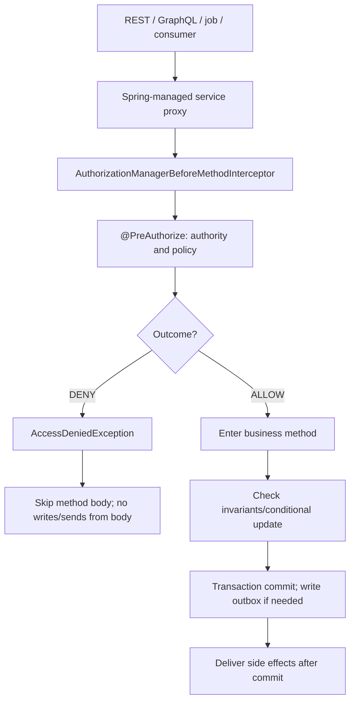

# Placing Checks Before Data Writes and External Side Effects

## Lesson Objectives

A system can return HTTP 403 at the right moment yet **still write data or send unauthorized notifications**. This happens when a program checks permissions **after** the business operation, when `@PreAuthorize` does not fire because the call bypasses the Spring AOP proxy, or when external side effects are dispatched before data commits cleanly.

This Knowledge lesson belongs to the **Pre-method checks** group in **Spring Security - authorization** and presents the principle:

**Check authorization first → verify resource/state → write atomically → dispatch external side effects through a controllable mechanism.**

After this lesson, you will:

1. Explain why `@PreAuthorize` suits write/update/delete methods and why `@PostAuthorize` must not be the sole barrier for side effects.
2. Place check boundaries on Spring-managed services, even when invoked via Controllers, GraphQL, queues, schedulers, or other beans.
3. Combine `hasAuthority`, `#invoiceId`, `@P`, policy beans, and owner/tenant/approval-limit checks.
4. Distinguish **access authorization** from **data state invariants** and mitigate TOCTOU risks using conditional updates/appropriate transactions.
5. Understand the practical scope of `@Transactional`, AOP advice ordering, and the difference between database rollback and irreversible actions like sending emails, webhooks, payments, or messages.
6. Know when `@TransactionalEventListener(AFTER_COMMIT)`, the **transactional outbox**, retries/idempotency, and monitoring are needed.
7. Write tests proving DENIED callers **never invoke write repositories or external gateways**, rather than checking only HTTP status codes.

Scope: Spring Security 6.x/7.x on the Servlet stack, Java 17+, Spring-managed services. Spring configuration snippets require framework dependencies; `PrecheckSideEffectDemo.java` is runnable plain Java. Domain illustrations using custom API names are explicitly marked as **integration snippets**, not standalone Java.

## 1. What does checking “before side effects” mean?

Consider an invoice approval service:

```text
approveInvoice(invoiceId)
  1. UPDATE invoice.status = APPROVED
  2. Deduct budget or call payment provider
  3. Send notification email
  4. Check whether caller has invoice:approve?
```

This order is **unsafe**. By the time step 4 returns DENY, the system may already have modified the database, initiated a payment, or sent an email. An `AccessDeniedException` or 403 response **cannot retract** already-sent data or messages.

Proper conceptual flow:

```text
approveInvoice(invoiceId)
  1. Verify caller/authority/identity
  2. Check whether caller may approve this exact invoiceId
  3. Verify state, limits, and business invariants
  4. Write data via transaction / conditional update
  5. Record intent to emit event if needed (transactional outbox)
  6. After commit, deliver external side effects reliably
```

**Denying before the method body** protects against effects inside the body when the caller lacks permission. It **does not** replace transactions, write-time state checks, or deduplication in external systems.

### What counts as a side effect

| Side effect | Example | Can DB `@Transactional` roll it back? |
| --- | --- | --- |
| Database write | INSERT, UPDATE, DELETE | Possibly, if uncommitted in the same transaction |
| Payment API call | `paymentGateway.charge(...)` | **No** by default |
| Sending email/SMS | `mailer.send(...)` | **No** |
| Publishing message | Kafka/RabbitMQ publish | **Not automatically** with DB transaction |
| Object storage/file write | Upload/delete file | **Not automatically** |
| Sending webhook/push | HTTP POST to another system | **No** |
| Cache eviction | `cache.evict(...)` | Not automatically |
| Saving DENY audit | Recording “actor denied” | May be an **intentional** side effect |
| Reading policy data | SELECT permissions, tenant, state | Not a business write, yet still needs performance and security |

Do not interpret “pre-check” as “zero I/O before allowing”: policies normally must **read** trusted data sources. What must be avoided is **unauthorized business side effects**.

## 2. @PreAuthorize flow before the method body



This is a **logical** diagram. Order between method-security advice and transaction advice can vary with configuration, so never claim `@PreAuthorize` is guaranteed to run **before opening a transaction**. Yet when the Spring Security method interceptor actually runs and denies, **the protected method body is not invoked**.

### Enabling Method Security

```java
import org.springframework.context.annotation.Configuration;
import org.springframework.security.config.annotation.method.configuration.EnableMethodSecurity;

@Configuration
@EnableMethodSecurity
public class MethodSecurityConfig {
}
```

Spring Boot Starter Security **does not automatically enable** method security annotations. `@EnableMethodSecurity` registers interceptors; `@PreAuthorize` is handled by the before-method authorization manager. Merely placing annotations in source code is not enough.

### Functional authority example

```java
import org.springframework.security.access.prepost.PreAuthorize;
import org.springframework.stereotype.Service;

@Service
public class ApprovalService {

    @PreAuthorize("hasAuthority('invoice:approve')")
    public void approve(long invoiceId) {
        // Business code runs only if pre-authorization allows.
    }
}
```

This is a Spring snippet without repo/database/controller. `hasAuthority` requires the exact matching `GrantedAuthority`. `ROLE_ADMIN` **is not automatically** equivalent to `invoice:approve` unless the project configures an explicit mapping/hierarchy.

### Why not replace it with @PostAuthorize?

```java
// WRONG: post-checking permissions for a side-effecting method.
@PostAuthorize("hasAuthority('invoice:approve')")
public void approve(long invoiceId) {
    repository.markApproved(invoiceId);
    emailClient.sendApproval(invoiceId);
}
```

`@PostAuthorize` evaluates **after the method returns**. A DENY can occur after `markApproved` and `sendApproval` have already executed. Official Spring Security documentation advises against `@PostAuthorize` for database-writing methods because security invariants are checked too late.

```java
// CORRECT timing for blocking the body:
@PreAuthorize("hasAuthority('invoice:approve')")
public void approve(long invoiceId) {
    repository.markApproved(invoiceId);
    emailClient.sendApproval(invoiceId);
}
```

The second example blocks the body when lacking permission, yet still does not solve **DB rollback while the email already went out**. We need to separate authorization checks, transactions, and side-effect delivery.

## 3. Placing guards on services beyond the Controller

An HTTP rule such as:

```java
http.authorizeHttpRequests(auth -> auth
    .requestMatchers(HttpMethod.POST, "/api/invoices/*/approve")
        .hasAuthority("invoice:approve")
    .anyRequest().denyAll()
);
```

only protects HTTP requests passing through `SecurityFilterChain` and that matcher. The exact same `ApprovalService.approve` can be invoked from:

- `POST /api/batch-approve` with a different HTTP rule.
- GraphQL resolvers or RPC adapters.
- Message listeners, event handlers, or workflow engines.
- `@Scheduled`/`@Async` jobs.
- Another Spring bean.
- Admin endpoints or internal integrations.

If the service lacks a guard, a new entrypoint might forget the permission check. Putting `@PreAuthorize` on the **Spring-managed service method** protects the shared operation regardless of Controller URLs.

**Defense in depth:** keep enforcing URL/method, authentication, and CSRF/CORS at HTTP; protect service operations with method security; verify owner/tenant/ACL in resource policies and transaction conditions in the database.

| Layer | Question | Example |
| --- | --- | --- |
| HTTP authorization | Which endpoints/methods are reachable? | POST approve requires `invoice:approve` |
| Method security | May caller use this business operation? | `ApprovalService.approve` |
| Object-level policy | Permitted on this specific invoice? | Tenant, approver group, amount limit |
| Transaction/domain | Does state allow the transition? | Only PENDING → APPROVED |
| External delivery | Are events/emails/payments sent logically once? | Outbox, idempotency |

An HTTP 403 can stem from CSRF or HTTP rules and therefore **does not prove** the service guard ran; direct service tests in section 12 address that.

## 4. Functional authorities and per-record permissions

A user holding `invoice:approve` must not automatically approve **every invoice**. Suppose Alice belongs to tenant A and Bob belongs to tenant B; both hold the approve authority, yet neither may approve the other tenant's invoices.

A complete policy looks like:

```text
mayApprove =
    trusted authentication
    AND hasAuthority("invoice:approve")
    AND invoice.tenant within actor's scope
    AND invoice.amount within approval limit
    AND invoice.status == PENDING
    AND actor satisfies separation-of-duties rules (if any)
```

Spring Security SpEL can call a policy bean:

```java
import org.springframework.security.access.method.P;
import org.springframework.security.access.prepost.PreAuthorize;
import org.springframework.stereotype.Service;
import org.springframework.transaction.annotation.Transactional;

@Service
public class InvoiceService {

    private final InvoiceRepository invoices;
    private final OutboxRepository outbox;

    public InvoiceService(
            InvoiceRepository invoices,
            OutboxRepository outbox) {
        this.invoices = invoices;
        this.outbox = outbox;
    }

    @PreAuthorize(
        "hasAuthority('invoice:approve') and " +
        "@invoicePolicy.mayApprove(authentication, #invoiceId)"
    )
    @Transactional
    public void approve(@P("invoiceId") long invoiceId) {
        String actor =
            org.springframework.security.core.context
                .SecurityContextHolder.getContext()
                .getAuthentication()
                .getName();

        // Domain API must implement conditional update
        // scoped by real invoice, tenant, approver, and state.
        int changed = invoices.approveIfPendingAndVisible(
            invoiceId, actor
        );

        if (changed != 1) {
            throw new ApprovalConflictException(invoiceId);
        }

        // Saved in the same DB transaction as the invoice.
        outbox.saveInvoiceApproved(invoiceId, actor);
    }
}
```

**This is an integration snippet, not a standalone program.** `InvoiceRepository`, `OutboxRepository`, `ApprovalConflictException`, and approval logic must be implemented by the project. `approveIfPendingAndVisible` must verify the real caller, scope, and state inside the query or transaction; method names do not guarantee safety by themselves.

Illustrative policy bean:

```java
import org.springframework.security.core.Authentication;
import org.springframework.stereotype.Component;

@Component("invoicePolicy")
public class InvoicePolicy {

    private final InvoiceRepository invoices;

    public InvoicePolicy(InvoiceRepository invoices) {
        this.invoices = invoices;
    }

    public boolean mayApprove(
            Authentication authentication,
            long invoiceId) {
        if (authentication == null
                || !authentication.isAuthenticated()) {
            return false;
        }
        return invoices.isApprovalAllowed(
            invoiceId, authentication.getName()
        );
    }
}
```

`isApprovalAllowed` is a business query that must verify tenant, limit, approver role, and state from server-side data. `Authentication.isAuthenticated()` alone may not distinguish all anonymous tokens across every setup; the preceding `hasAuthority` in the expression and proper identity policies provide layered guards. Never trust client-sent `tenantId`/`ownerId`.

`@P("invoiceId")` lets SpEL bind `#invoiceId` without relying on Java `-parameters` metadata. Using `#p0` works positionally, yet can break if a new parameter is prepended to the signature.

## 5. TOCTOU: checked before, yet permission/state changed

Even when `@invoicePolicy.mayApprove` returns true, state can change before the method writes:

```text
T1: Policy reads invoice PENDING and permits approval.
T2: Another request CANCELS invoice / revokes permission.
T3: Method runs UPDATE invoice with no state condition.
T4: Invoice gets APPROVED even though no longer valid.
```

This is **Time-of-Check to Time-of-Use (TOCTOU)**. `@PreAuthorize` is a necessary boundary yet **does not lock** all data after checking. Solutions typically include:

1. **Conditional UPDATE** with state, tenant, owner/approver scope, and version.
2. **Optimistic locking** with `version` when multiple actors update concurrently.
3. **Pessimistic locking/transactions** when business logic requires serialization.
4. Checking **updated row counts** and emitting events only when the transition succeeded.
5. Keeping critical invariants **close to the write point**, not solely in a pre-transaction check.

Structural SQL example:

```sql
UPDATE invoices
SET status = 'APPROVED',
    approved_by = :trustedActor,
    approved_at = CURRENT_TIMESTAMP
WHERE id = :invoiceId
  AND tenant_id = :trustedTenant
  AND status = 'PENDING'
  AND approved_by IS NULL;
```

If the UPDATE affects 0 rows, never emit “approved” as a success. `:trustedTenant`/`:trustedActor` must come from server-side identity and authorization, never filled in by the client. Depending on your database and security needs, the query must include exact authorization logic; SQL here is a sample and does not replace full domain policies.

### Ordering of @PreAuthorize and @Transactional

`@PreAuthorize` uses a pre-method interceptor. `@Transactional` is Spring AOP transaction advice. Advisor ordering depends on configuration, so never claim transactions are always opened **only after** the pre-check.

- DENY before the body prevents all side effects **inside the body** of the protected method.
- If a policy or a custom advisor running before security advice has side effects, risk remains.
- A pre-check issuing a `SELECT` **outside the transaction** does not guarantee state will not change before the `UPDATE`.
- To control advisor ordering or isolation, consult documentation for your exact version and write integration tests rather than relying on source annotation order.

**Write-time invariants** must be enforced independently of when the pre-check ran.

## 6. @Transactional is not a global undo button

A database transaction can roll back changes on **the same transactional resource**, yet normally cannot undo:

- Already-sent emails/SMS.
- HTTP calls that already reached a payment gateway.
- Messages published to a broker outside coordinated transactions.
- Deleted or uploaded object-storage files.
- Webhooks or push notifications already acted upon by receivers.

Example:

```java
@PreAuthorize("hasAuthority('invoice:approve')")
@Transactional
public void approve(long invoiceId) {
    invoices.markApproved(invoiceId);
    mailer.sendApproval(invoiceId);
    throw new IllegalStateException("database must roll back");
}
```

This is a **warning snippet** with dependencies omitted. Under default Spring transactions, an unchecked exception rolls back the DB; the **already-sent** email cannot roll back automatically. If the client retries, the email can be sent multiple times.

### Post-checks are even more dangerous on writes

```java
// Do not use as the sole permission barrier.
@PostAuthorize("hasAuthority('invoice:approve')")
@Transactional
public void approve(long invoiceId) {
    invoices.markApproved(invoiceId);
}
```

`@PostAuthorize` runs after the body. Whether DB commit occurs before or after the post-check depends on advisor ordering; never gamble on rollback luck instead of pre-authorization. For operations invoking external APIs, post-checks **definitely cannot provide atomic rollback** on remote providers.

Spring Security officially notes `@PostAuthorize` is **not recommended for database-writing methods** because security invariants are verified after mutations occurred. `@PostAuthorize` fits **read/result authorization**, such as checking the owner of a returned object.

### Before calling external APIs

When a user lacks permission, a valid active `@PreAuthorize` must deny **before calling** `paymentGateway.charge(...)` or `mailer.send(...)`. Yet for authorized users, you must also handle transaction/partial failures, retries, timeouts, duplicates, and compensation. Authorization is one safety requirement, not a substitute for orchestration.

## 7. Patterns for delivering side effects after commit

### 7.1. Calling directly inside the transaction

```text
UPDATE invoice
SEND message/email
COMMIT database
```

Pros: simple to write. Cons: if COMMIT fails, the message was already sent; if the network fails after the DB update, state becomes inconsistent. Unsuitable for high-value side effects requiring guaranteed delivery.

### 7.2. @TransactionalEventListener(AFTER_COMMIT)

Spring Framework lets listeners bind to transaction phases; `AFTER_COMMIT` executes once the transaction commits cleanly:

```java
import org.springframework.stereotype.Component;
import org.springframework.transaction.event.TransactionPhase;
import org.springframework.transaction.event.TransactionalEventListener;

@Component
public class InvoiceApprovedListener {

    private final MailClient mailClient;

    public InvoiceApprovedListener(MailClient mailClient) {
        this.mailClient = mailClient;
    }

    @TransactionalEventListener(
        phase = TransactionPhase.AFTER_COMMIT
    )
    public void onApproved(InvoiceApprovedEvent event) {
        mailClient.sendApproved(event.invoiceId());
    }
}
```

And inside the service once authorized:

```java
// Snippet inside a @Transactional method.
repository.markApproved(invoiceId);
events.publishEvent(new InvoiceApprovedEvent(invoiceId));
```

`events` is `ApplicationEventPublisher`; `InvoiceApprovedEvent` and `MailClient` are project types. The example listener must be Spring-managed; events must be published inside an active transaction.

**Limitations:** an after-commit event listener is not a durable queue by itself, does not guarantee execution if the process crashes right after commit, and does not automatically retry until email delivery succeeds. Nor does it replace downstream idempotency.

### 7.3. Transactional outbox

When external events/commands require **reliable delivery**, store an **outbox record in the same database transaction** as the state update:

```text
Transaction:
  CONDITIONAL UPDATE invoice IF approvable
  INSERT outbox(event_id, aggregate_id, type, payload, status)
  COMMIT

Independent dispatcher:
  LOAD pending outbox entries
  SEND external message / webhook
  ON success: mark delivered
  ON failure: retry with backoff
```

If the transaction rolls back, neither the update nor the outbox row commits. If the dispatcher crashes **after sending yet before marking delivered**, retries may redeliver; downstream consumers must deduplicate by `event_id`/idempotency key or support at-least-once delivery semantics.

An outbox solves **durability of send intent after DB commit**, without promising exactly-once external effects or undoing provider APIs. For payments, combine with provider-supported idempotency keys, reconciliation, and business compensating actions.

### Quick comparison

| Pattern | Complexity | Send timing | Main risk |
| --- | --- | --- | --- |
| Direct send in body | Low | Before/during commit | DB rolls back while side effect already occurred |
| `TransactionalEventListener` AFTER_COMMIT | Medium | After commit | Crash/listener error can drop delivery |
| Outbox + dispatcher | Higher | After outbox commit | At-least-once; requires retry/dedup/monitoring |

Do not force every low-stakes email into an outbox, yet **never pick a lightweight pattern** when business rules demand reliable delivery.

## 8. Idempotency, retries, and authorization timing

An HTTP request may be retried after a timeout. A message broker may redeliver an event. If two calls execute the same approval without deduplication, the app could:

- Deduct budget twice.
- Send two payment commands.
- Send two emails mistaken for two approvals.
- Create two outbox events for the same transition.

A safe operation should evaluate:

```text
CanApply(request) =
    caller authenticated
    AND caller authorized on resource
    AND current state permits transition
    AND same idempotency key has not already produced the equivalent business effect
    AND update/emit remain consistent
```

**An idempotency key is not an authorization credential.** Never return another user's cached response simply because the key matches; scope keys by tenant/principal/action or re-check policy before disclosing results.

### Test scenarios

1. User lacks `invoice:approve` → write repository not called, outbox not enqueued.
2. User has general authority but wrong tenant → no write, no send.
3. Invoice already APPROVED → conditional update returns 0 and no second approval event is recorded.
4. Valid request → one transition succeeds and one logical business outbox record is written.
5. Transaction rolls back → neither invoice update nor outbox row commits.
6. Dispatcher sends successfully then crashes → retry does not double-charge thanks to downstream idempotency.
7. Permissions change between request and dispatch → explicitly define whether the worker executes an intent authorized at request time or requires re-authorization; never assume one rule fits every workflow.

### Fail closed when the policy backend errors

If `invoicePolicy.mayApprove` calls a service or DB that times out, **never default to true**. You may distinguish “unable to verify due to system error” from “missing permission” to return appropriate responses/metrics, yet never proceed with business writes without proof of permission.

## 9. Spring AOP traps that skip the pre-check

`@PreAuthorize` relies on interceptors on a **Spring-managed proxy**. Dangerous pitfalls:

- Instantiating the service with `new` outside the Spring container.
- Calling `this.approve(...)` from another method in the same class (**self-invocation**).
- Using `private`/`static`/`final` methods in ways the proxy cannot intercept.
- Testing the service itself as a Mockito mock instead of the real bean.
- Adapters calling the repository or payment gateway directly, bypassing the protected service.
- Custom AOP advice with side effects running before the security advisor.

Self-invocation example:

```java
@Service
public class ApprovalService {

    public void batchApprove(long id) {
        // Under default proxy-based AOP, this.approve()
        // does not pass back through @PreAuthorize on approve.
        this.approve(id);
    }

    @PreAuthorize("hasAuthority('invoice:approve')")
    public void approve(long id) {
        repository.markApproved(id);
    }
}
```

This is an illustrative snippet; `repository` must be injected. **Fix:** protect `batchApprove` as a business entrypoint, or move `approve` into a separate service bean and call it through an injected Spring proxy. Do not manually hack proxies or self-inject just to “work around” design without tests; keep trust boundaries clear.

### Background jobs and message consumers

A `@Scheduled` job or message handler **does not automatically hold** a user's HTTP `SecurityContext`. It must use a least-privilege **system identity** or a separately protected and audited internal service operation. User-triggered async work needs proper identity propagation and policies covering permission revocation.

Never trust `ROLE_ADMIN`/`userId` inside a message body as authorization proof if the message source is unauthenticated. `AccessDeniedException` outside HTTP does not automatically become HTTP 403; non-HTTP callers must handle errors and run no side effects after receiving DENY.

## 10. Enforcing separation of duties, approval limits, and tenants

Some business rules cannot be protected by `hasAuthority` alone:

- An invoice creator must not self-approve their own invoice.
- The approver must belong to the same tenant or hold cross-org delegation.
- Approval level must cover the invoice amount.
- Resource state must be `PENDING`, not `CANCELLED`.
- Certain actions require MFA/re-authentication or dual signatures.
- Policies can be time-bounded and revocable.

These belong in a clear Java domain policy like `invoicePolicy.mayApprove(authentication,invoiceId)`, or a custom `AuthorizationManager<MethodInvocation>` if complex. SpEL stays readable while the policy bean verifies data.

**Never implement authorization by attempting the operation and rolling back if unauthorized.** “Trial writes” can trigger DB triggers, queues, audits, and external APIs, and create races; they are not a safe check step.

### Service authorization and validation are not the same thing

Validation checks inputs like `invoiceId > 0` or format; authorization checks who may act on **that ID**; domain validation checks whether the invoice is still approvable. A method with only `@Valid` can still let a syntactically valid yet unauthorized user trigger side effects.

### Self-protecting logic at the DB layer

Query scoping (tenant-aware repositories) and conditional updates reduce the blast radius if a method bypasses policy, yet are no excuse to omit method security. Enforce invariants at the write boundary to prevent TOCTOU while keeping annotations/policies at the service entrypoint to stop unauthorized work early.

## 11. Another mistake: @PostAuthorize on write operations

Example:

```java
@PostAuthorize("hasAuthority('invoice:approve')")
@Transactional
public void approve(long id) {
    repository.markApproved(id);
    externalClient.notifyApproved(id);
}
```

A user holding `invoice:read` yet **lacking** `invoice:approve`:

1. The method body may call `markApproved`.
2. The external service may already have received the message.
3. `@PostAuthorize` discovers the missing permission **after the method executes**.
4. Spring Security throws `AccessDeniedException`; the HTTP layer may return 403.
5. Yet remote side effects do not vanish automatically.

This is an example **never to deploy**. Even if a transaction rolls back the DB under a specific advisor order, you cannot rely on it for all side effects.

### Where post-checks fit better: read operations

```java
@PreAuthorize("hasAuthority('invoice:read')")
@PostAuthorize(
    "returnObject.owner() == authentication.name"
)
public InvoiceView read(long invoiceId) {
    return repository.findById(invoiceId).orElseThrow();
}
```

For read results, a post-check can block returning data when the owner mismatches the principal. Because the method already ran, querying up front scoped by tenant/owner is usually safer and more efficient; never use post-checks as the sole barrier for data-exporting or outbound-pushing commands.

## 12. Standalone Java 17: comparing pre-checks vs. checking too late

The example below uses two **simulated counters** representing DB writes and message sends; it performs **no real** database/email operations. Save with the exact filename **`PrecheckSideEffectDemo.java`**:

```java
import java.util.Set;

public class PrecheckSideEffectDemo {

    record Actor(String name, Set<String> authorities) {
        boolean canApprove() {
            return authorities.contains("invoice:approve");
        }
    }

    static class Effects {
        int writes;
        int messages;

        void persistApproval() {
            writes++;
        }

        void notifySupplier() {
            messages++;
        }
    }

    static void requirePermission(Actor actor) {
        if (!actor.canApprove()) {
            throw new SecurityException("approval forbidden");
        }
    }

    static void unsafeLateCheck(Actor actor, Effects effects) {
        effects.persistApproval();
        effects.notifySupplier();
        requirePermission(actor);
    }

    static void safeEarlyCheck(Actor actor, Effects effects) {
        requirePermission(actor);
        effects.persistApproval();
        effects.notifySupplier();
    }

    public static void main(String[] args) {
        Actor reader = new Actor(
            "alice", Set.of("invoice:read")
        );
        Actor approver = new Actor(
            "bob", Set.of("invoice:approve")
        );

        Effects late = new Effects();
        try {
            unsafeLateCheck(reader, late);
        } catch (SecurityException exception) {
            System.out.println(
                "late check: DENIED, writes=" + late.writes
                    + ", messages=" + late.messages
            );
        }

        Effects early = new Effects();
        try {
            safeEarlyCheck(reader, early);
        } catch (SecurityException exception) {
            System.out.println(
                "early check: DENIED, writes=" + early.writes
                    + ", messages=" + early.messages
            );
        }

        Effects authorized = new Effects();
        safeEarlyCheck(approver, authorized);
        System.out.println(
            "authorized: OK, writes=" + authorized.writes
                + ", messages=" + authorized.messages
        );
    }
}
```

Run with JDK 17+:

```bash
javac PrecheckSideEffectDemo.java
java PrecheckSideEffectDemo
```

**Exact stdout:**

```text
late check: DENIED, writes=1, messages=1
early check: DENIED, writes=0, messages=0
authorized: OK, writes=1, messages=1
```

**Explanation:** In the late check, the actor is denied yet side-effect counters already incremented. In the early check, the actor is denied before the body creates any effects. The authorized actor executes exactly once in the example. This is a **logic model**, not a replacement for Spring Security AOP, transactions, or real email systems.

## 13. Spring JUnit test: DENY must neither write nor send

**Do not check only HTTP 403**. With MockMvc, a request can be blocked by HTTP Security or CSRF before reaching the service, so HTTP 403 alone does not prove `@PreAuthorize` on the service works.

Retrieve the **real service** from the Spring Test `ApplicationContext`, enable `@EnableMethodSecurity`, and create principals with `@WithMockUser`. The example below uses a fake-effects bean with counters.

### Spring Security 6.x/7.x test fixture

Requires `spring-context`, `spring-security-config`, `spring-security-test`, `spring-test`, and compatible JUnit 5 dependencies. Not standalone runnable with plain `javac`.

```java
import org.junit.jupiter.api.BeforeEach;
import org.junit.jupiter.api.Test;
import org.springframework.beans.factory.annotation.Autowired;
import org.springframework.context.annotation.Bean;
import org.springframework.context.annotation.Configuration;
import org.springframework.security.access.AccessDeniedException;
import org.springframework.security.access.method.P;
import org.springframework.security.access.prepost.PreAuthorize;
import org.springframework.security.config.annotation.method.configuration.EnableMethodSecurity;
import org.springframework.security.test.context.support.WithMockUser;
import org.springframework.test.context.junit.jupiter.SpringJUnitConfig;

import static org.junit.jupiter.api.Assertions.assertEquals;
import static org.junit.jupiter.api.Assertions.assertThrows;

@SpringJUnitConfig(PrecheckServiceTest.Config.class)
class PrecheckServiceTest {

    @Autowired
    GuardedApprovalService service;

    @Autowired
    FakeEffects effects;

    @BeforeEach
    void resetEffects() {
        effects.reset();
    }

    @Test
    @WithMockUser(
        username = "alice", authorities = "invoice:approve"
    )
    void authorizedCallerCanWrite() {
        assertEquals(
            "approved:42", service.approve("alice", 42L)
        );
        assertEquals(1, effects.writes);
        assertEquals(1, effects.messages);
    }

    @Test
    @WithMockUser(
        username = "alice", authorities = "invoice:read"
    )
    void wrongAuthorityProducesNoEffects() {
        assertThrows(
            AccessDeniedException.class,
            () -> service.approve("alice", 42L)
        );
        assertEquals(0, effects.writes);
        assertEquals(0, effects.messages);
    }

    @Test
    @WithMockUser(
        username = "alice", authorities = "invoice:approve"
    )
    void wrongOwnerProducesNoEffects() {
        assertThrows(
            AccessDeniedException.class,
            () -> service.approve("bob", 42L)
        );
        assertEquals(0, effects.writes);
        assertEquals(0, effects.messages);
    }

    @Configuration
    @EnableMethodSecurity
    static class Config {
        @Bean
        FakeEffects fakeEffects() {
            return new FakeEffects();
        }

        @Bean
        GuardedApprovalService guardedApprovalService(
                FakeEffects effects) {
            return new GuardedApprovalService(effects);
        }
    }

    public static class FakeEffects {
        int writes;
        int messages;

        void reset() {
            writes = 0;
            messages = 0;
        }

        void write() {
            writes++;
        }

        void send() {
            messages++;
        }
    }

    public static class GuardedApprovalService {

        private final FakeEffects effects;

        public GuardedApprovalService(FakeEffects effects) {
            this.effects = effects;
        }

        @PreAuthorize(
            "hasAuthority('invoice:approve') and " +
            "#owner == authentication.name"
        )
        public String approve(
                @P("owner") String owner, long invoiceId) {
            effects.write();
            effects.send();
            return "approved:" + invoiceId;
        }
    }
}
```

**Points to verify:**

- Uses the real Spring-managed `GuardedApprovalService` (not a Mockito mock of the service itself).
- Has `@EnableMethodSecurity` and interceptor active.
- `@P("owner")` binds `#owner` reliably independent of compiler flags.
- DENY tests assert both the exception and **writes = 0** and **messages = 0**.
- ALLOW test proves the body executed when authority and owner input matched.

The fixture uses simple counters; in production, **owner input** must be verified against server-side owner/tenant data, never treating client-supplied `owner` values as proof of permission. `@WithMockUser` supplies a mock identity and does not test real login or JWT signatures.

### Testing with repositories and payment gateways

In Spring Boot integration tests you can mock **dependencies** such as `ApprovalRepository`/`PaymentGateway`, without replacing the service under security interception. After a DENIED call:

```java
// Snippet in a JUnit/Mockito test injecting the real service.
assertThrows(AccessDeniedException.class,
    () -> approvalService.approve(invoiceId));

verifyNoInteractions(writeRepository, paymentGateway);
```

`approvalService` and mocks must be wired in a version-appropriate test fixture; this is not a standalone Java file. With domain policies, note that a policy **may call a read repository** to verify permissions, so `verifyNoInteractions(repository)` on a single mock combining reads and writes could fail wrongly; separate **write operations** from read-only policy lookups.

### Integration testing database, outbox, and rollback

Alongside fake-counter tests, run database integration tests:

1. DENY by authority → invoice status unchanged, outbox unchanged.
2. DENY by tenant → invoice unchanged, external provider not called.
3. Valid ALLOW → one conditional transition and one outbox row committed.
4. Already-approved invoice → updateCount = 0, no new outbox row.
5. Transaction failure → neither DB update nor outbox row committed.
6. Dispatcher retries the same event → no duplicate business effect thanks to downstream idempotency.

An HTTP endpoint test is still needed to verify `SecurityFilterChain`, CSRF, authentication entry point, and response statuses, **in addition to** direct service tests.

## 14. 401/403 and the question “which layer blocked it?”

| Denial source | Timing | Sufficient to prove service caused no side effects? |
| --- | --- | --- |
| HTTP `authorizeHttpRequests` | Before Controller | Blocks that route, yet proves nothing for other callers |
| `CsrfFilter` | Before Controller on token-required requests | Does not prove method security |
| Valid, proxied `@PreAuthorize` | Before body | Blocks side effects **inside the body** |
| Mid-body policy check | Depends on placement | Dangerous if writes/sends already happened before check |
| `@PostAuthorize` | **After body** | No; side effects may already have occurred |
| DB constraint/rollback | At write/commit | Does not roll back remote calls |
| Provider timeout | After sending request | May already have executed on provider; needs reconciliation |

A fully authenticated user lacking permission normally receives HTTP 403 via exception handling, while anonymous callers may receive 401 or a login redirect. For schedulers/consumers, `AccessDeniedException` **does not generate an HTTP status**; non-HTTP callers must handle errors and execute no side effects after DENY.

If you get 403 after a side-effecting method, investigate **pre-check vs. post-check**, whether the security AOP proxy is active, when transactions commit, and whether outbound requests already left the process. Never “fix” it with `permitAll` just to turn tests green.

## 15. Common mistakes and how to prevent them

1. **Placing `@PostAuthorize` as the sole barrier before DB writes:** the method already ran before the post-check.
2. **Assuming HTTP 403 means zero side effects:** check database/outbox/gateway separately.
3. **Protecting only Controllers:** other entrypoints can call the same service.
4. **Forgetting `@EnableMethodSecurity`:** annotations are never intercepted.
5. **Using `new` or mocking the service itself:** bypasses the Spring AOP proxy.
6. **Self-invocation `this.approve()`:** the method interceptor can be bypassed.
7. **Custom advisors running before security and calling external systems:** pre-checks cannot stop side effects from earlier advisors.
8. **Conflating role checks with owner/tenant checks:** general authority does not mean access to every record.
9. **Trusting client-sent tenant IDs:** verify server-side membership/ACLs.
10. **Pre-checking state then running an unconditional UPDATE:** TOCTOU creates races.
11. **Forgetting to check UPDATE row count:** can emit events even when no transition occurred.
12. **Assuming `@Transactional` rolls back emails/webhooks/payments:** remote effects do not roll back automatically.
13. **Publishing messages before commit:** consumers may observe events even if the DB rolls back.
14. **Assuming `@TransactionalEventListener` is always durable:** crashes can lose deliveries.
15. **Outbox without deduplication/idempotency:** retries can create duplicate external effects.
16. **Treating an idempotency key as permission:** keys do not prove identity or authority.
17. **Granting system-wide admin to workers:** violates least privilege and complicates auditing.
18. **Allowing on policy timeout:** creates fail-open behavior.
19. **Testing only authorized users:** fails to catch unauthorized writes.
20. **Asserting only 403 when testing Spring services:** assert write/gateway calls did not happen.
21. **Assuming method-security advice always opens before transactions:** test ordering if the system relies on it.
22. **Having no fallback rule for new routes:** new adapters may invoke side effects unreviewed.

## 16. Pre-merge checklist

- [ ] Sensitive business operations are inventoried: database, payments, emails, webhooks, messages, files, state transitions.
- [ ] `@PreAuthorize` or a pre-invocation authorization manager sits on side-effecting service entrypoints.
- [ ] `@EnableMethodSecurity` is enabled and tested through a real Spring-managed proxy.
- [ ] HTTP rules still guard URLs/methods rather than treating method security as a complete HTTP replacement.
- [ ] Permissions, owner/tenant, approval limits, and state are verified from trusted sources.
- [ ] Zero writes or sends occur before confirming the caller is authorized.
- [ ] `@PostAuthorize` is never used as the sole authorization gate on write methods.
- [ ] Checked for self-invocation, custom AOP advice, and non-Controller adapters.
- [ ] TOCTOU is handled at the write boundary (conditional UPDATE, versions, locking/transactions).
- [ ] Data commits consistently; outbox rows live in the same transaction when needed.
- [ ] External effects dispatch after commit or via outbox/dispatcher per reliability needs.
- [ ] Retries, idempotency, and auditing are designed for irreversible actions.
- [ ] System jobs and consumers have explicit identities/permissions rather than sharing HTTP user contexts.
- [ ] Denial tests verify zero DB writes, zero business event enqueues, and zero provider calls.
- [ ] Happy-path tests verify valid operations execute logically once.
- [ ] Credentials, tokens, and sensitive data are never logged; DENY audits are distinct from business events.
- [ ] CI runs both direct service tests and integration tests aligned with active Spring versions.

### Self-check questions

**Q1.** Why is `@PostAuthorize("hasAuthority('invoice:approve')")` insufficient to protect a method sending an HTTP payment?

**Answer:** Because the post-check runs after the body; the provider may already have received the payment. Pre-authorization and external idempotency/reconciliation are required.

**Q2.** Is `@PreAuthorize` guaranteed to run before a transaction starts?

**Answer:** Not necessarily; it depends on advisor ordering. It blocks **before the body** when the interceptor runs, without guaranteeing transaction start order.

**Q3.** The pre-check returned ALLOW, yet the invoice changed to CANCELLED before the UPDATE. What should you do?

**Answer:** Use an update conditioned on state/tenant/owner or appropriate locking and verify updated row counts. Pre-checks do not eliminate TOCTOU on their own.

**Q4.** If the DB rolls back after an email was sent, is the email rolled back?

**Answer:** No. Use after-commit listeners for lightweight effects or a transactional outbox for reliable delivery; retries/idempotency remain necessary.

**Q5.** Does MockMvc returning 403 suffice to prove the service did not send a message when lacking authority?

**Answer:** No. Test the service bean directly with a mock principal and assert write repositories/external gateways were never called.

**Q6.** Why can an outbox worker emit duplicate events even when the DB update happened once?

**Answer:** The worker can send successfully and then crash before marking the row delivered. Retrying the same event ID must be handled idempotently downstream.

## Official References

- Spring Security, *Method Security*: https://docs.spring.io/spring-security/reference/servlet/authorization/method-security.html
- Spring Security, *Authorization Architecture*: https://docs.spring.io/spring-security/reference/servlet/authorization/architecture.html
- Spring Security, *Authorize HttpServletRequests*: https://docs.spring.io/spring-security/reference/servlet/authorization/authorize-http-requests.html
- Spring Security, *Testing Method Security*: https://docs.spring.io/spring-security/reference/servlet/test/method.html
- Spring Framework, *Using @Transactional*: https://docs.spring.io/spring-framework/reference/data-access/transaction/declarative/annotations.html
- Spring Framework, *Transaction-bound Events*: https://docs.spring.io/spring-framework/reference/data-access/transaction/event.html
- Spring Framework, *AOP Proxying and Self Invocation*: https://docs.spring.io/spring-framework/reference/core/aop/proxying.html
