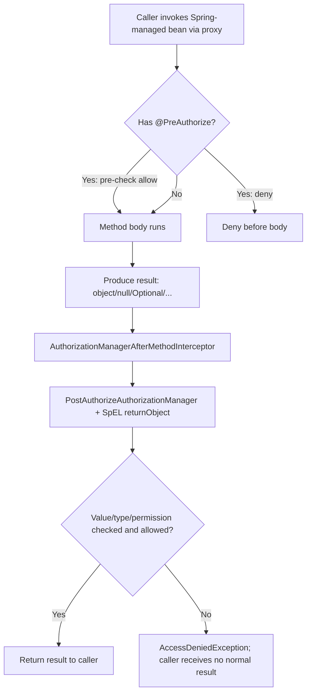

# Null Results, Optional, and Return Types Requiring Verification

In **Spring Security method security**, `@PostAuthorize` lets you check permissions **based on the result a method has just returned**, rather than only on parameters before the method runs. This mechanism is useful when the object fetched from the database is what reveals the **owner, tenant, status, security label, or ACL**.

However, the result is not always a valid single object. A method can return:

- `null`;
- `Optional.empty()`;
- a populated `Optional<Document>`;
- `List<Document>`, an empty collection, or a collection containing multiple resources;
- a DTO different from the type expected by the expression;
- `CompletableFuture<Document>`, `Mono<Document>`, `Flux<Document>`, or a lazy/asynchronous wrapper;
- `void` or a primitive type where an object-property access policy makes no sense.

The challenge of this lesson is **verifying the type, presence, and authorization on returned data**, and then **explicitly denying when conditions are not met**, instead of relying on an expression prone to throwing errors or accidentally permitting inappropriate content.

Basic example, for a service returning `Document`:

```java
@PostAuthorize(
    "returnObject != null and " +
    "returnObject.ownerId() == authentication.name"
)
public Document readDocument(String id) {
    return repository.findById(id).orElse(null);
}
```

If `returnObject == null`, the first condition returns false and `and` short-circuits, so the expression does not try to read `ownerId()`. If an object is present but the owner does not match, the result is also false. **Even when denied, the repository and body already ran**: `@PostAuthorize` prevents **returning the value to the caller**, and cannot undo a side effect that has already occurred.

With `Optional<Document>`, **do not copy verbatim** `returnObject.ownerId()` because `returnObject` may itself be the **Optional wrapper**, not `Document`. Do not call `get()` without checking `isPresent()`. A clear and easily testable approach is moving type checking/unwrapping into a **Java bean**:

```java
@PostAuthorize(
    "@resultPolicy.canReturn(authentication, returnObject)"
)
public Optional<Document> findDocument(String id) {
    return repository.findById(id);
}
```

The `resultPolicy` bean must be implemented by the application so that `null`, `Optional.empty()`, unexpected types, and unauthorized data are all **disallowed** per the concrete policy. In the learning example below, all of those states return `false`.

**Context:** Java 17+, Spring Boot 3.x / Spring Security **6.5.x**, Spring Framework 6.2.x, Servlet applications or imperative applications using Spring-managed beans. Separate notes apply when upgrading to Spring Framework 7 and when using reactive method security; do not equate behavior across versions.

## 1. Where does `@PostAuthorize` sit in the method lifecycle?

Enable method security:

```java
import org.springframework.context.annotation.Configuration;
import org.springframework.security.config.annotation.method.configuration.EnableMethodSecurity;

@Configuration
@EnableMethodSecurity
public class MethodSecurityConfig {
}
```

`@EnableMethodSecurity` enables `@PostAuthorize` by default, alongside `@PreAuthorize`, `@PreFilter`, and `@PostFilter`. Merely adding `spring-boot-starter-security` **does not automatically activate** method security.

Execution flow of an intercepted method:



This is the **Spring Security 6.5 imperative method security** model. `AuthorizationManagerAfterMethodInterceptor` handles `@PostAuthorize` via `PostAuthorizeAuthorizationManager`. `MethodSecurityExpressionHandler` places the returned object into the SpEL context, where it can be referenced as `returnObject`.

Key points to grasp:

1. **The method has already executed** before `@PostAuthorize` checks permissions.
2. `returnObject` describes **the value the method actually returned**; its type dictates how expressions are written.
3. If the expression returns false, the normal flow is denied, typically with `AccessDeniedException`.
4. If the expression throws an error such as `NullPointerException` or a SpEL property access error, that is an **evaluation error**, and must not be treated as an intentionally designed standard denial.
5. Custom denial/return-masking mechanisms (if configured) can alter default behavior; do not assume all projects always throw the same exception.
6. Because the method body has run, `@PostAuthorize` **should not be the sole gate** for write/delete/money-transfer/email operations.

### Differences from `@PreAuthorize`

| Aspect | `@PreAuthorize` | `@PostAuthorize` |
| --- | --- | --- |
| Timing | Before body | After body |
| Has method parameters | Yes | Yes |
| Has `returnObject` of unexecuted method | No | Yes |
| Suitable for general roles/permissions | Yes | Yes, though usually later than necessary |
| Suitable for checking owner on DB-fetched object | Yes, if policy pre-reads object | Yes, checks after method returns object |
| Prevents body side effects when denied | Yes, along interception path | **No** |
| Can error when accessing properties on null | Yes, with nullable parameters | Yes, with nullable return values |
| Used for multi-resource Lists | Custom policy / scoped query | Must decide whole-list vs. per-element filtering |

**Common design:** `@PreAuthorize` checks the user is authenticated and has functional authority **before the body**; `@PostAuthorize` checks whether the returned object is truly permitted to be disclosed **after the body**.

## 2. Distinguishing `null`, `Optional.empty()`, and a populated `Optional`

In Java:

```java
Document missing = null;
Optional<Document> absent = Optional.empty();
Optional<Document> present = Optional.of(document);
```

These are **three distinct states**:

- `null` means no `Document` reference exists. Directly accessing `returnObject.ownerId()` can cause an error.
- `Optional.empty()` is **an existing Optional object**, containing no `Document`. Calling `get()` on an empty Optional throws `NoSuchElementException`.
- `Optional.of(document)` contains a `Document`, which can be unwrapped in a controlled manner and checked for owner/tenant.
- `Optional.ofNullable(null)` yields `Optional.empty()`, **not** an `Optional` containing null.
- A method declared to return `Optional<Document>` that **actually returns `null`** violates good Optional conventions, though Java does not forbid it at runtime; the policy should still fail closed.

Illustrative example:

```java
Optional<Document> x = repository.findById("D-42");

if (x.isEmpty()) {
    // Document absent; API decision: 404/Optional.empty/deny...
} else {
    Document document = x.get();
    // Still must check owner/tenant/permission before returning.
}
```

Never call `x.get()` blindly. Better yet, express the handling in Java:

```java
boolean allowed = x != null
        && x.filter(document -> isAllowed(user, document)).isPresent();
```

`isAllowed(...)` must be an explicit policy: authenticated principal, appropriate authority, trusted tenant/owner, and resource metadata. For lists or nested structures, the policy must also decide **per-element** versus **whole-set**.

### Do not assume “empty is allow” or “empty is deny” for every API

Both policies can be valid **when defined intentionally**:

**Policy A — No resource, no data released:** `null` or `Optional.empty()` → deny from method security or a specific application error. This is the policy in the **runnable example** of this lesson.

**Policy B — Safely allow reporting “not found”:** After authenticating and verifying lookup permission within scope, an `Optional.empty()` may be allowed to return so the caller produces 404. If choosing B, separate the “has permission to look up resources in this scope” condition in a **pre-check** and ensure absence does not leak whether a record exists in another tenant.

**There is no default `@PostAuthorize` rule saying `Optional.empty()` is always safe or always denied.** That decision belongs to the application's expression/policy.

## 3. What object is `returnObject` in SpEL?

Spring Security documentation describes `returnObject` as the method's result; for example:

```java
@PostAuthorize("returnObject.owner == authentication.name")
public Account readAccount(Long accountId) {
    return repository.get(accountId);
}
```

If the method returns `Account` with an `owner` property, the expression checks the Account object itself.

But if the signature changes to:

```java
@PostAuthorize("returnObject.owner == authentication.name")
public Optional<Account> readAccount(Long accountId) {
    return repository.findById(accountId);
}
```

then the expression **must not assume** `returnObject` is Account. With an Optional wrapper, you must inspect the actual returned structure. Conceptual example with Optional:

```java
@PostAuthorize(
    "returnObject != null and " +
    "returnObject.isPresent() and " +
    "returnObject.get().owner == authentication.name"
)
public Optional<Account> readAccount(Long accountId) {
    return repository.findById(accountId);
}
```

On Spring Security/Framework 6.5/6.2, this example should only be used once **verified against the exact version's SpEL, getter/property access, and runtime return type**. With `Optional.empty()`, `isPresent()` being false keeps `and` from reaching `get()`. With a `null` wrapper, the first guard blocks both calls. **For complex logic or evolving return types, a Java policy bean is easier to control**.

### Why shouldn't you put multiple `get()` calls in expressions?

An expression like:

```java
@PostAuthorize(
    "returnObject.get().ownerId() == authentication.name"
)
```

can error when:

- Returning `Optional.empty()`;
- Returning `null` instead of Optional;
- The runtime type is not `Optional` because the return type was refactored;
- A nested owner field is null while logic assumes data exists;
- Getter/property accessors in a DTO change.

If the requirement is **explainable, easily testable denial**, write a helper taking `Object`/`Optional<?>`, checking types, and returning an explicit boolean.

### Do not equate `returnObject` with the HTTP response

The service method's `returnObject` is not always the final JSON. The controller can also:

- Map `Document` to another DTO;
- Wrap in `ResponseEntity<?>`;
- Serialize with a different Jackson view or converter;
- Convert `Optional.empty()` to 404;
- Combine the result with metadata from another service;
- Produce a file/stream.

If the annotation protects a **service returning Document**, yet the controller attaches sensitive data from another source, this policy does not automatically protect the added data. And if a method returns `ResponseEntity<Document>`, `returnObject` may be the **ResponseEntity wrapper**, not the Document body; you must inspect/unwrap the exact type.

## 4. Safe navigation `?.` and a notable difference between Spring 6 and Spring 7

In Spring Expression Language, the **`?.`** operator supports null-safe access:

```java
@PostAuthorize(
    "returnObject?.ownerId() == authentication.name"
)
public Document read(String id) {
    return repository.findOrNull(id);
}
```

If `returnObject` is null, `returnObject?.ownerId()` returns null instead of calling the method; comparing with username typically yields false. However, this expression **does not yet check valid ownerId, tenant, and authority**; use stricter guards/policies for sensitive data.

**Important for Optional:** Spring Framework documentation notes that the ability for `?.` to **transparently unwrap `Optional`** was added **starting in Spring Framework 7.0**. In many Spring Framework **6.2.x** projects, do not write:

```java
@PostAuthorize(
    "returnObject?.ownerId() == authentication.name"
)
public Optional<Document> read(String id) {
    return repository.findById(id);
}
```

expecting `?.` to always strip the `Optional` wrapper and access Document fields. **Verify your specific version**. In Spring 6, it is better to use guarded `returnObject.isPresent()`/`get()` or a policy bean as shown in this lesson.

### Compound expressions can still suffer null dereference

Wrong or missing guard:

```java
@PostAuthorize("returnObject?.owner.ownerId == authentication.name")
```

If `returnObject` is null or `owner` is null, the trailing chain can still error. Use safe navigation at every required step:

```java
@PostAuthorize(
    "returnObject?.owner?.ownerId == authentication.name"
)
```

The snippet above is a **SpEL reference pattern** assuming the DTO has `owner` and `ownerId` properties. The best practice for critical policies is writing an explicit boolean predicate, paired with Java validation protecting object shape.

### Safe navigation does not automatically turn a nullable result into a security policy

A null-safe value can evaluate to `null`, String, or another object, whereas `@PostAuthorize` needs an explicit authorization decision. Do not treat:

```java
@PostAuthorize("returnObject?.ownerId()")
```

as a valid policy design. Write:

```java
@PostAuthorize(
    "returnObject != null " +
    "and returnObject.ownerId() != null " +
    "and returnObject.ownerId() == authentication.name"
)
```

or use the bean `@resultPolicy.canReturn(authentication, returnObject)`.

## 5. Choosing the return type is part of security design

| Return type | `returnObject` seen at method layer | Risks | Recommended check design |
| --- | --- | --- | --- |
| `Document` | A Document object or null | Null dereference, wrong owner | Guard != null, check type/scope |
| `Optional<Document>` | Optional wrapper or null if method violates contract | `get()` on empty, unwrap misunderstanding | Guarded `isPresent()`/`get()` or Java policy |
| `List<Document>` | Entire List | An out-of-tenant item slips through if checking only first item | All-or-nothing policy or per-item filtering |
| `Set<Document>` | Set of results | Unclear policy on empty, null elements | Check null/empty/every item explicitly |
| `Map<String, Document>` | Map, not Document | Checking keys only, ignoring values | Check values and key-resource relationship |
| `Page<Document>` | Page wrapper with metadata | Page items, total count can leak | Scoped DB query, check content/metadata |
| `ResponseEntity<Document>` | ResponseEntity wrapper | Mistaking HTTP status for body access permission | Guard/unwrap body or check inside service |
| `String` | String or null | No owner/tenant property | Policy for exact scalar; avoid object expressions |
| `long/int/boolean` | Boxed value in SpEL or primitive value | No owner; boolean true is not inherently allow | Avoid object-owner `@PostAuthorize` on primitives |
| `void` / `Void` | No useful value, usually null | Checking `returnObject` is meaningless | `@PreAuthorize` checks before side effects |
| `CompletableFuture<Document>` | Work handle, Document may not be complete | Mistaking Future for final value | Async-aware authorization design, test completion |
| `Mono<Document>` / `Flux<Document>` | Publisher/lazy stream | Values emitted later, different context | Use reactive method security for that stack |
| `Object` / generic erased | Runtime type not guaranteed by signature | ClassCast/reflection/SpEL errors | Explicit type check, avoid overly generic APIs |

This table is an **API-design-level analysis**, not a guarantee that every wrapper is handled identically by Spring across all versions. In every case, test **the actual value placed into `returnObject`** and the data actually leaving the response.

### 5.1. Optional does not change the authorization decision

`Optional` merely represents presence or absence of a value. It does not say the user:

- Has permission to look up resources;
- Has permission to view the actual record;
- Has permission to view all fields;
- Is allowed to know whether an ID exists;
- Has permission to export another tenant's data.

A populated `Optional<Document>` must be **unwrapped in a controlled way and checked for owner/tenant/permission**. An `Optional.empty()` must have its own absence policy: deny or safely return empty after a pre-check, never conflating the two.

### 5.2. `@PostFilter` is not `@PostAuthorize`

`@PostAuthorize` normally decides **whether to allow or deny the entire result of a method call**. If a method returns `List<Document>` containing both valid and unauthorized data, a boolean “at least one element is viewable by the user” **does not protect the whole list**.

`@PostFilter` filters result elements using the `filterObject` expression, yet post-filtering after loading data can be inefficient and break total counts/pagination. For multi-tenant data, **the database query must carry scope conditions upfront** instead of reading broadly and filtering at the response.

Conceptual example:

```java
@PostFilter(
    "hasAuthority('documents.read') " +
    "and filterObject.tenantId == @tenantScope.currentTenant(authentication)"
)
public List<Document> findDocuments() {
    return repository.findCandidateDocuments();
}
```

This is a **Spring code fragment**, not a standalone program; it needs policy beans, valid DTO properties, and tenant-matching tests. Do not use `@PostAuthorize("returnObject.size() > 0")` to conclude every element in the list is allowed.

## 6. Fail-closed policy when return type is unexpected

A Java bean can centralize all checks in one place:

```java
@Component("resultPolicy")
public final class ResultPolicy {

    public boolean canReturn(Authentication authentication, Object returned) {
        if (authentication == null || !authentication.isAuthenticated()) {
            return false;
        }

        Object candidate = returned;

        if (candidate instanceof Optional<?> optional) {
            if (optional.isEmpty()) {
                return false;
            }
            candidate = optional.get();
        }

        if (!(candidate instanceof Document document)) {
            return false;
        }

        return "T-1".equals(document.tenantId())
                && authentication.getName().equals(document.ownerId());
    }
}
```

This is a **Spring bean fragment** assuming `Document` has getter/record accessors `tenantId()`, `ownerId()`, and relevant imports. A complete example checking anonymous and authorities appears in section 10.

Useful properties:

1. `null` → not a Document, deny.
2. `Optional.empty()` → deny per illustrative policy.
3. Populated `Optional<Document>` → extract Document and check.
4. Any other type, such as `String` or an unsupported `ResponseEntity<Document>` → **deny** instead of casting arbitrarily.
5. If Document lacks tenant/owner, comparisons against trusted values return false.
6. Method returns primitive `boolean`, never letting `Boolean null` enter an authorization expression.

**Do not** write `catch(Exception e) { return true; }` when permissions are indeterminate. On permission backend errors, you may throw an operational exception and ensure no data is released; if returning false to fail closed, add logs/metrics to distinguish outages from policy denials.

### 6.1. Do not accept a type just because `toString()` looks right

Example:

```java
String returned = "{\"ownerId\":\"alice\"}";
```

This String **is not a verified Document**. A policy should not arbitrarily serialize and re-parse just to match a field. Use typed DTOs, clear mappings from repository/server data, and validation.

### 6.2. Avoid granting access when two properties are both null

Do not use:

```java
Objects.equals(authenticationTenant, documentTenant)
```

as the sole condition if both can be null; `Objects.equals(null, null)` is true. Check both are non-null and valid before comparing. When tenant/owner forms part of a security boundary, “both missing” must never count as matching permission.

### 6.3. Should admins bypass owner checks?

If policy states a global admin may view any Document in scope, write an **intentional exception** while still checking resource shape/tenant. Do not write:

```java
@PostAuthorize("hasRole('ADMIN') or returnObject.ownerId() == authentication.name")
```

and forget `returnObject` might be null, or that an admin role still needs tenant restrictions. A clear form:

```java
@PostAuthorize(
    "returnObject != null " +
    "and @resultPolicy.canReturn(authentication, returnObject)"
)
```

Java policy is where admin/tenant exceptions should be reviewed. When security conditions are hard to express in a short expression, moving logic into Java makes negative testing much stronger.

## 7. Standalone Java 17: checking null, Optional, and unexpected types

Before using Spring, verify the policy semantics in **plain Java 17**, without Maven.

Create **`PostResultPolicyDemo.java`**:

```java
import java.util.Optional;
import java.util.Set;

public class PostResultPolicyDemo {

    record User(String name, Set<String> authorities) {}

    record Document(
            String id,
            String tenantId,
            String ownerId
    ) {}

    static boolean allowed(User user, Object returned) {
        if (user == null || user.name() == null
                || user.authorities() == null
                || !user.authorities().contains("documents.read")) {
            return false;
        }

        Object value = returned;
        if (value instanceof Optional<?> optional) {
            if (optional.isEmpty()) {
                return false;
            }
            value = optional.get();
        }

        if (!(value instanceof Document document)) {
            return false;
        }

        return document.id() != null
                && "T-1".equals(document.tenantId())
                && user.name().equals(document.ownerId());
    }

    static void check(String label, User user, Object value) {
        System.out.println(label + ": "
                + (allowed(user, value) ? "ALLOW" : "DENY"));
    }

    public static void main(String[] args) {
        User alice = new User(
                "alice", Set.of("documents.read"));
        User bob = new User(
                "bob", Set.of("documents.read"));
        User writer = new User(
                "alice", Set.of("documents.write"));

        Document own = new Document("D-1", "T-1", "alice");
        Document otherTenant =
                new Document("D-2", "T-2", "alice");

        check("null object", alice, null);
        check("empty optional", alice, Optional.empty());
        check("optional own", alice, Optional.of(own));
        check("direct own", alice, own);
        check("foreign owner", bob, own);
        check("wrong tenant", alice, otherTenant);
        check("missing authority", writer, own);
        check("unexpected type", alice, "D-1");
        check("bad shape", alice,
                new Document(null, "T-1", "alice"));
    }
}
```

Compile and run with JDK 17+:

```bash
javac PostResultPolicyDemo.java
java PostResultPolicyDemo
```

Stdout output:

```text
null object: DENY
empty optional: DENY
optional own: ALLOW
direct own: ALLOW
foreign owner: DENY
wrong tenant: DENY
missing authority: DENY
unexpected type: DENY
bad shape: DENY
```

Explanation:

- `null` and `Optional.empty()` lack a Document → false.
- `Optional.of(own)` is unwrapped with `get()` **only after verifying non-empty**.
- Direct `own` can still be checked by the same policy.
- Bob has general permission but is not the owner, so denied.
- Alice owns the document in `T-2`, yet the policy only allows scope `T-1` → deny.
- Someone having only `documents.write` does not automatically have `documents.read`.
- A String containing an ID is not a valid Document object.
- A Document missing an ID is denied.

**This is a logic model, not a Spring Security interceptor.** The next example demonstrates combining it with real `@PostAuthorize`.

## 8. When should an empty result return 404 instead of AccessDenied?

A lookup API might be designed as:

```text
GET /documents/D-1
  -> owner may view: 200 + content
  -> not found: 404
  -> found but wrong tenant: 404 or 403 per anti-enumeration policy
```

This is a **decision about API contract and information disclosure**, not a rigid semantic of `Optional`.

A useful pattern:

1. **`@PreAuthorize` checks functional lookup permission and scope** before querying.
2. The query is **scoped by trusted tenant/user** upfront.
3. When a record is outside that scope, the repository can return empty without revealing whether it exists in another tenant.
4. Then, the application/controller maps empty to 404 per contract, or `@PostAuthorize` checks the object when present.
5. If `@PostAuthorize` is enabled with a policy requiring a present Document, **empty will be denied before the controller sees it**; hence you cannot expect the controller to turn it into 404.

**Do not make `@PostAuthorize` return false for empty if the API contract requires the controller to see `Optional.empty()`.** Decide upfront the security policy and how absence is represented, then test both 404 and 403 against the design.

### Do not leak via response differences

If wrong tenant is always 403 while non-existent ID is always 404, an attacker can use those two responses to infer which IDs exist. A product may choose 404 for both states on certain APIs. When doing so, avoid putting real details in error bodies/headers and avoid large timing differences from differing queries.

## 9. Null results and data types: check inline or extract a policy bean?

### 9.1. Inline in `@PostAuthorize`

Suitable for simple DTOs that are non-nullable per contract:

```java
@PostAuthorize(
    "returnObject != null and " +
    "returnObject.ownerId() == authentication.name"
)
public Document findOne(String id) {
    return repository.findOneOrNull(id);
}
```

This expression has the drawback that if the method is later refactored to `Optional<Document>` or `ResponseEntity<Document>` without updating the annotation, it breaks.

### 9.2. Extract to a Spring bean with type-checking

Appropriate when:

- You need to support `Document` and `Optional<Document>` with the same logic.
- You need to validate shape, tenant, status, ACL, and subject.
- You want to log/audit denial reasons without exposing them to clients.
- Policy is reused across multiple methods or API adapters.
- You want to test all null/empty/wrong-type branches with JUnit.

```java
@PostAuthorize(
    "@resultPolicy.canReturn(authentication, returnObject)"
)
public Optional<Document> findOne(String id) {
    return repository.findById(id);
}
```

### 9.3. API design can make the problem easier

If `null` is a business error state, consider returning:

```java
Document getRequired(String id);      // Throws appropriate not-found exception.
Optional<Document> find(String id);   // Clear absence contract.
```

Never return `null` from a method declared as `Optional<Document>`. If a method can return different types at runtime, avoid `Object` or `ResponseEntity<?>` in the service layer; returning a DTO or sealed type with an explicit contract makes policies easier to write and test.

**Note:** Java `Optional` does not fit everywhere (e.g., entity fields, request DTOs, serialization). Type choices should follow the API contract; do not treat Optional as an automatic fix for every null/authorization problem.

## 10. Spring Boot 3.5.16 + Java 17: real `@PostAuthorize` example

A **Spring Boot CLI** example (no HTTP server needed) verifying:

- `@PreAuthorize` blocks callers lacking authority **before the body**.
- `@PostAuthorize` checks `Document` or `Optional<Document>` **after the body**.
- Result policy rejects null, Optional.empty, wrong owner, wrong tenant.
- When denied at `@PostAuthorize`, **body counters still increment**, illustrating the key difference from `@PreAuthorize`.
- Incompatible return types are never automatically turned into allow.

**Environment:** Java 17+, compatible Maven, Spring Boot **3.5.16** (parent manages Spring Security 6.5.x line). This is a fixed version for learning 6.5 behavior; production should check support schedules and use a maintained patch/major release.

Structure:

```text
postauthorize-result-demo/
├── pom.xml
└── src/main/
    ├── java/demo/
    │   ├── AfterMethodApp.java
    │   ├── Document.java
    │   ├── DocumentService.java
    │   └── ResultPolicy.java
    └── resources/
        └── application.properties
```

### 10.1. pom.xml

```xml
<project xmlns="http://maven.apache.org/POM/4.0.0"
         xmlns:xsi="http://www.w3.org/2001/XMLSchema-instance"
         xsi:schemaLocation="http://maven.apache.org/POM/4.0.0
             https://maven.apache.org/xsd/maven-4.0.0.xsd">
    <modelVersion>4.0.0</modelVersion>

    <parent>
        <groupId>org.springframework.boot</groupId>
        <artifactId>spring-boot-starter-parent</artifactId>
        <version>3.5.16</version>
        <relativePath/>
    </parent>

    <groupId>demo</groupId>
    <artifactId>postauthorize-result-demo</artifactId>
    <version>1.0.0</version>

    <properties>
        <java.version>17</java.version>
    </properties>

    <dependencies>
        <dependency>
            <groupId>org.springframework.boot</groupId>
            <artifactId>spring-boot-starter</artifactId>
        </dependency>
        <dependency>
            <groupId>org.springframework.boot</groupId>
            <artifactId>spring-boot-starter-security</artifactId>
        </dependency>
    </dependencies>

    <build>
        <plugins>
            <plugin>
                <groupId>org.springframework.boot</groupId>
                <artifactId>spring-boot-maven-plugin</artifactId>
            </plugin>
        </plugins>
    </build>
</project>
```

There is no `spring-boot-starter-web` because this tests method security via CLI. Authentication is intentionally constructed in the program for illustration; never use this technique to trust client-declared roles in production.

### 10.2. src/main/java/demo/Document.java

```java
package demo;

public record Document(
        String id,
        String tenantId,
        String ownerId
) {}
```

This is a **Java 17 record** with accessors `id()`, `tenantId()`, and `ownerId()`. In a real system, data must come from a tenant/scope-restricted, validated repository, not from a client arbitrarily setting owner.

### 10.3. src/main/java/demo/ResultPolicy.java

```java
package demo;

import java.util.Optional;
import java.util.concurrent.atomic.AtomicInteger;

import org.springframework.security.authentication.AnonymousAuthenticationToken;
import org.springframework.security.core.Authentication;
import org.springframework.stereotype.Component;

@Component("resultPolicy")
public class ResultPolicy {

    private final AtomicInteger checks = new AtomicInteger();

    public boolean canReturn(
            Authentication auth, Object returned) {

        checks.incrementAndGet();

        if (auth == null || !auth.isAuthenticated()
                || auth instanceof AnonymousAuthenticationToken) {
            return false;
        }

        Object candidate = returned;

        if (candidate instanceof Optional<?> optional) {
            if (optional.isEmpty()) {
                return false;
            }
            candidate = optional.get();
        }

        if (!(candidate instanceof Document doc)) {
            return false;
        }

        return doc.id() != null
                && "T-1".equals(doc.tenantId())
                && auth.getName() != null
                && auth.getName().equals(doc.ownerId());
    }

    public int checks() {
        return checks.get();
    }
}
```

**Important:** `canReturn` intentionally accepts `Object` to **accept only a Document or an Optional containing a Document**. Any unexpected type like String, Map, ResponseEntity, or an Optional holding another type returns false. It does not allow `Optional.empty()` per the illustrative policy and performs no unsafe casts.

`checks` counts how many times the post-method policy was invoked, confirming `@PostAuthorize` executed. If the method is blocked by `@PreAuthorize`, this policy is not called.

### 10.4. src/main/java/demo/DocumentService.java

```java
package demo;

import java.util.Optional;
import java.util.concurrent.atomic.AtomicInteger;

import org.springframework.security.access.prepost.PostAuthorize;
import org.springframework.security.access.prepost.PreAuthorize;
import org.springframework.stereotype.Service;

@Service
public class DocumentService {

    private final AtomicInteger reads = new AtomicInteger();
    private final AtomicInteger finds = new AtomicInteger();

    @PreAuthorize("hasAuthority('documents.read')")
    @PostAuthorize("@resultPolicy.canReturn(authentication, returnObject)")
    public Document read(String id) {
        reads.incrementAndGet();
        return lookup(id);
    }

    @PreAuthorize("hasAuthority('documents.read')")
    @PostAuthorize("@resultPolicy.canReturn(authentication, returnObject)")
    public Optional<Document> find(String id) {
        finds.incrementAndGet();
        return Optional.ofNullable(lookup(id));
    }

    private Document lookup(String id) {
        if ("D-1".equals(id)) {
            return new Document("D-1", "T-1", "alice");
        }
        if ("D-2".equals(id)) {
            return new Document("D-2", "T-1", "bob");
        }
        if ("D-3".equals(id)) {
            return new Document("D-3", "T-2", "alice");
        }
        return null;
    }

    public String bodyCalls() {
        return "read=" + reads.get() + ",find=" + finds.get();
    }
}
```

`lookup` is simulated data to run without a database. `DocumentService` is a Spring-managed bean, so callers obtaining the bean via Dependency Injection go through the AOP proxy and both interceptors when configured.

A call lacking `documents.read` is blocked **before** `read`/`find` increments the counter. A caller with the authority who is not permitted to view a specific Document is blocked **after** the body increments the counter.

### 10.5. src/main/java/demo/AfterMethodApp.java

```java
package demo;

import java.util.List;
import java.util.function.Supplier;

import org.springframework.boot.CommandLineRunner;
import org.springframework.boot.SpringApplication;
import org.springframework.boot.autoconfigure.SpringBootApplication;
import org.springframework.context.annotation.Bean;
import org.springframework.security.access.AccessDeniedException;
import org.springframework.security.authentication.UsernamePasswordAuthenticationToken;
import org.springframework.security.config.annotation.method.configuration.EnableMethodSecurity;
import org.springframework.security.core.authority.SimpleGrantedAuthority;
import org.springframework.security.core.context.SecurityContext;
import org.springframework.security.core.context.SecurityContextHolder;

@SpringBootApplication
@EnableMethodSecurity
public class AfterMethodApp {

    public static void main(String[] args) {
        SpringApplication.run(AfterMethodApp.class, args);
    }

    @Bean
    CommandLineRunner run(DocumentService service, ResultPolicy policy) {
        return args -> {
            invoke("read own", "alice", "documents.read",
                    () -> "ALLOW:" + service.read("D-1").id());

            invoke("read foreign", "bob", "documents.read",
                    () -> "ALLOW:" + service.read("D-1").id());

            invoke("read null", "alice", "documents.read",
                    () -> {
                        Document result = service.read("missing");
                        return result == null ? "NULL" : result.id();
                    });

            invoke("optional own", "alice", "documents.read",
                    () -> "ALLOW:" + service.find("D-1")
                            .map(Document::id).orElse("EMPTY"));

            invoke("optional foreign", "bob", "documents.read",
                    () -> "ALLOW:" + service.find("D-1")
                            .map(Document::id).orElse("EMPTY"));

            invoke("optional empty", "alice", "documents.read",
                    () -> "ALLOW:" + service.find("missing")
                            .map(Document::id).orElse("EMPTY"));

            invoke("read wrong tenant", "alice", "documents.read",
                    () -> "ALLOW:" + service.read("D-3").id());

            invoke("read other owner", "alice", "documents.read",
                    () -> "ALLOW:" + service.read("D-2").id());

            invoke("missing authority", "alice", "documents.export",
                    () -> "ALLOW:" + service.read("D-1").id());

            System.out.println("bodyCalls: " + service.bodyCalls());
            System.out.println("policyChecks: " + policy.checks());
        };
    }

    private static void invoke(
            String label,
            String username,
            String authority,
            Supplier<String> action) {

        SecurityContext ctx = SecurityContextHolder.createEmptyContext();
        ctx.setAuthentication(
                new UsernamePasswordAuthenticationToken(
                    username,
                    "demo-only",
                    List.of(new SimpleGrantedAuthority(authority))
                )
        );
        SecurityContextHolder.setContext(ctx);

        try {
            System.out.println(label + ": " + action.get());
        } catch (AccessDeniedException denied) {
            System.out.println(label + ": DENY");
        } finally {
            SecurityContextHolder.clearContext();
        }
    }
}
```

The program uses the three-argument `UsernamePasswordAuthenticationToken` constructor to build a mock **authenticated** Authentication with one authority. Only use this technique in learning/testing environments; real web apps must use trusted authentication providers/JWT validation, never creating trusted users from client-sent role fields.

### 10.6. application.properties and run command

Create `src/main/resources/application.properties`:

```properties
spring.main.web-application-type=none
spring.main.banner-mode=off
logging.level.root=OFF
```

Inside the `postauthorize-result-demo` directory:

```bash
mvn -q spring-boot:run
```

Lines **printed by the program itself** (excluding Maven/JVM logs if any):

```text
read own: ALLOW:D-1
read foreign: DENY
read null: DENY
optional own: ALLOW:D-1
optional foreign: DENY
optional empty: DENY
read wrong tenant: DENY
read other owner: DENY
missing authority: DENY
bodyCalls: read=5,find=3
policyChecks: 8
```

### 10.7. Counter analysis

`read` had **5 body executions**: read own, foreign, null, wrong tenant, other owner. `find` had **3 body executions**: optional own, foreign, empty. Total 8 body calls because all those cases held the `documents.read` authority at `@PreAuthorize`.

`ResultPolicy#canReturn` was called **8 times**, including when returning null/empty or wrong owner/tenant. It denied results **after the body**; therefore callers received DENY rather than an unauthorized Document/Optional.

The **missing authority** call was blocked by `@PreAuthorize` **before the body**: neither `reads` nor `policyChecks` incremented. This is empirical evidence of the difference between pre- and post-authorization.

**Example limitations:** the project contains full code along with logically derived expected output; in real usage you should compile/run and write integration tests with your exact dependencies/versions. It has no HTTP server, data store, or side effects beyond incrementing counters, so it does not replace production review.

## 11. Why isn't `@PostAuthorize` used as the sole check for write/delete?

Consider:

```java
@PostAuthorize(
    "returnObject.ownerId() == authentication.name"
)
@Transactional
public Receipt transferFunds(TransferCommand command) {
    paymentGateway.transfer(command);
    return new Receipt(...);
}
```

Even if `@PostAuthorize` eventually denies, `paymentGateway.transfer(...)` may **already have been called**. A database transaction may roll back under some configurations, yet external side effects (payments, emails, message brokers, file uploads) are not necessarily undone. Transaction/method-security advisor ordering also affects transaction boundaries.

**Never treat a denied result as a reliable business rollback mechanism.**

Instead:

```java
@PreAuthorize(
    "hasAuthority('payments.execute') " +
    "and @paymentPolicy.canExecute(authentication, #command)"
)
public Receipt transferFunds(TransferCommand command) {
    // Execute write after pre-checking permissions.
}
```

This code fragment requires a `paymentPolicy` bean, transaction, and proper authentication. For sensitive operations, recheck conditions that may change at commit/write time, handle TOCTOU, enforce idempotency, and validate input data from trusted sources.

### Short design rules

- **Read-only data access:** `@PostAuthorize` is useful when you need to check the owner of a newly fetched object.
- **Write/delete/payments:** `@PreAuthorize` and transaction/DB constraints must be the primary layer; do not wait until after side effects occur.
- **Streaming responses:** content may already have been emitted before the policy sees all of it; check permissions before streaming.
- **Lazy/publisher:** permission on a wrapper may not check elements emitted later; use a model matching subscription/realization timing.

## 12. `@AuthorizeReturnObject` is not `@PostAuthorize`

Spring Security 6.5 also supports the **`@AuthorizeReturnObject`** annotation. It serves a different purpose from `@PostAuthorize`:

- `@PostAuthorize`: decides **whether to allow or deny the method call after the method returns a result**, usually based on `returnObject`.
- `@AuthorizeReturnObject`: **proxies/wraps the returned object** so methods on that object can be protected by their own method security. It can work with `Optional<User>`, collections, and container types via Spring Security's proxying infrastructure.

Spring documentation example:

```java
class User {
    @PreAuthorize("hasAuthority('user:read')")
    public String getEmail() {
        return email;
    }
}

@AuthorizeReturnObject
public Optional<User> findByName(String name) {
    return repository.findByName(name);
}
```

When calling `getEmail()` on a proxied `User`, Spring Security can check the authority for **that getter**, instead of denying the whole `Optional` right on the `findByName` call.

This is an **illustrative fragment** requiring proper imports, beans, metadata, and stack proxies. Do not assume `@AuthorizeReturnObject` automatically implies owner/tenant checks for every object. It also has implications for AOT, generic erasure, and which types can be proxied (e.g., do not arbitrarily proxy `String`, `Integer`).

**Do not extrapolate from `@AuthorizeReturnObject` supporting Optional to assume `@PostAuthorize` automatically unwraps Optional by the same mechanism.** The two annotations have distinct responsibilities.

## 13. Testing at two layers: Java policy and real interception

### 13.1. Test matrix for return types

For the illustrative `ResultPolicy`:

| Principal / authority | Returned value | Expected |
| --- | --- | --- |
| Alice / documents.read | `Document("D-1","T-1","alice")` | ALLOW |
| Alice / documents.read | `Optional.of(D-1)` | ALLOW |
| Bob / documents.read | `Document("D-1","T-1","alice")` | DENY |
| Alice / documents.read | `Document("D-3","T-2","alice")` | DENY |
| Alice / documents.read | `null` | DENY |
| Alice / documents.read | `Optional.empty()` | DENY per example policy |
| Alice / documents.read | `Optional<String>` | DENY: unexpected type |
| Alice / documents.read | `"D-1"` String | DENY: unexpected type |
| Alice / documents.export | `Document("D-1","T-1","alice")` | DENY at pre-check if applied |
| Anonymous | Valid Document | DENY |
| Missing Authentication | Valid Document | DENY |
| Document missing `ownerId`/`tenantId` | Incomplete Document | DENY |
| `List<Document>` passed to Document-only policy | Any List | DENY instead of bad cast |

### 13.2. Unit testing the policy

JUnit 5 snippet (not included in the CLI project if test dependencies are absent):

```java
@Test
void nullAndEmptyReturnNeverGrant() {
    ResultPolicy policy = new ResultPolicy();
    Authentication alice = new UsernamePasswordAuthenticationToken(
        "alice", "test",
        List.of(new SimpleGrantedAuthority("documents.read"))
    );

    assertFalse(policy.canReturn(alice, null));
    assertFalse(policy.canReturn(alice, Optional.empty()));
    assertFalse(policy.canReturn(alice, "D-1"));
}
```

Requires JUnit, Spring Security dependencies, and matching imports. This is a **unit test of the Java predicate**, insufficient on its own to prove `@PostAuthorize` is executed by Spring AOP.

### 13.3. Integration testing via Spring bean

Add `spring-boot-starter-test` and `spring-security-test` in test scope. In the `@SpringBootTest` context, inject `DocumentService` from Spring; never instantiate with `new`:

```java
@Test
@WithMockUser(username = "alice", authorities = "documents.read")
void ownDocumentIsReturned() {
    assertEquals("D-1", documentService.read("D-1").id());
}

@Test
@WithMockUser(username = "bob", authorities = "documents.read")
void foreignDocumentIsDeniedAfterBody() {
    assertThrows(AccessDeniedException.class,
            () -> documentService.read("D-1"));
}

@Test
@WithMockUser(username = "alice", authorities = "documents.read")
void emptyOptionalIsDeniedByChosenPolicy() {
    assertThrows(AccessDeniedException.class,
            () -> documentService.find("missing"));
}

@Test
@WithMockUser(username = "alice", authorities = "documents.export")
void wrongAuthorityIsDeniedBeforeBody() {
    assertThrows(AccessDeniedException.class,
            () -> documentService.read("D-1"));
}
```

The snippet needs a test class, JUnit `@Test`, `assertEquals`, `assertThrows`, Spring `@Autowired`, and `@WithMockUser` imports. **To prove ordering**, snapshot counters before/after each test or use a mock repository/gateway with `verify(...)`; demo runners may execute when building `@SpringBootTest` context, so separate the runner from the test profile to keep counters independent.

### 13.4. Testing by return type

At a minimum, cover:

1. Method returning non-null Document, valid owner/tenant.
2. Method returning Document of another owner.
3. Method returning null.
4. Method declared `Optional<Document>` returning `Optional.empty()`.
5. Method returning `Optional.of(Document)` with valid owner/tenant.
6. Method returning unauthorized `Optional.of(Document)`.
7. Method returning wrong type after interface/generic/DTO refactor.
8. Method returning a multi-element collection where one element is not viewable.
9. Method returning void or primitive whose annotation attempts to check an owner property.
10. Call missing authority before method, confirming `@PreAuthorize` blocks early.
11. Calling method via Spring-managed proxy and self-invocation cases.
12. Controller/HTTP outcomes per defined policy: 200, 403, 404, 401.

**Do not only test HTTP 403**: this status may come from CSRF or URL authorization before the service ever runs. Direct bean/proxy tests are what prove `@PostAuthorize` receives the right return object and works.

## 14. SpEL, boxed/primitives, and JSON are not the same

A method returning:

```java
public long countDocuments();
```

has a numeric result, with no owner ID. A method returning:

```java
public boolean isShared();
```

has true/false, yet this boolean **is not by itself a decision** `@PostAuthorize` should trust; caller/tenant context and clear semantics are required.

Avoid expressions lacking type guarantees:

```java
@PostAuthorize("returnObject.ownerId == authentication.name")
public Object loadAny(String key) {
    // May return String, Document, or Map.
}
```

The more a security policy depends on an object's shape, the more the API should use **explicitly typed DTOs**, rather than `Object`/`Map<String,Object>` or reflecting properties that may not exist. If multiple types must be accepted, a bean using `instanceof` with an allowlisted set of types is an easier-to-audit fail-closed solution.

### `Page` and metadata can leak information

For example, `Page<Document>` returns an empty page yet `totalElements=10_000`: total document count can leak other tenants' data even if page content was filtered. Thus checking `Page.getContent()` after querying is insufficient; the repository query must be scoped properly from the start and metadata computed within that same scope.

### `ResponseEntity` and status do not replace checking the body

`ResponseEntity.status(200).body(document)` holds Document inside a wrapper; `returnObject.ownerId` is not a property of `ResponseEntity`. If the security boundary is at the service, return Document/DTO from the service and build `ResponseEntity` in the controller after the service permits it. If you genuinely guard a method returning `ResponseEntity`, verify both body and status per an explicit contract rather than relying solely on 200/404.

## 15. Async, `CompletableFuture`, and reactive publishers: when does the value arrive?

Traditional `@PostAuthorize` on an imperative method evaluates after **the method call returns**. However, a `CompletableFuture<Document>` may only be a handle representing a result that will appear later. Checking owner on the **Future** does not equal checking owner on the **completed Document**.

Similarly, `Mono<Document>` and `Flux<Document>` emit data upon subscription; when values appear differs from when the Java method returns the publisher. Spring Security has **reactive method security** for `Publisher`, relying on `ReactiveSecurityContextHolder` and corresponding authorization interceptors.

**Do not conclude “once `@PostAuthorize` checks, every value emitted later is covered”** if the return type is lazy/async. You must:

- Check whether the Spring Security stack has `@EnableReactiveMethodSecurity` enabled where appropriate.
- Determine whether the policy runs at method call time, subscription time, or element emission time.
- Test `Mono.empty()`/`Flux.empty()`, errors, cancellation, context propagation, and unauthorized elements.
- Never carelessly transfer imperative `SecurityContextHolder` (ThreadLocal) into Reactor context.
- For `CompletableFuture`, consider checking permissions **before submitting the job** and rechecking the actual resource before returning/publishing data.

Without integration tests on the reactive/async stack, **do not extrapolate** the Optional/Document example from an imperative program into a publisher contract.

## 16. `SecurityContext`, role snapshots, and revoked permissions

Someone authenticated via JWT/session may hold an authority snapshot from login/token-issue time. `@PostAuthorize` reads the current `Authentication` at interception time; it **does not automatically query the DB** to learn whether a role was just revoked.

Likewise, the returned object may have been queried before owner/tenant changed. When security requirements demand fresh permissions:

- Check token/session freshness or revocation appropriately.
- Read policy from a trusted source at critical business boundaries.
- Use transactions, optimistic versioning, or conditional queries to prevent TOCTOU.
- Do not cache `canReturn` results too long if ownership/shares change frequently.
- Never let an ADMIN role bypass all tenant restrictions by default.
- Audit principal, resource ID, decision, and policy version without leaking sensitive content.

`@PostAuthorize` is useful for **preventing disclosure of an unauthorized read result**, not as a synchronization mechanism for all ACL changes across a distributed system.

## 17. Error handling and HTTP response codes

In a Servlet application, a method security denial can propagate back through security filters/exception translation and become:

| Scenario | Typical outcome | Should not infer |
| --- | --- | --- |
| Unauthenticated user | 401 or login redirect per entry point | Every denial is 403 |
| Authenticated user, post-check returns false | Usually 403 | Body did not run |
| Repository returns null, expression tries calling getter | SpEL/evaluation exception | This is a proper 403 policy |
| `Optional.empty()` and policy intentionally denies | Usually 403 | Resource definitely exists |
| Repository/logic throws NotFound exception before returning | May be 404 via handler | `@PostAuthorize` evaluated `returnObject` |
| Query error/timeout | 5xx or operational error | Should allow because unable to check |
| Controller intentionally maps empty to 404 after a safe pre-check | 404 | Only empty can produce 404 |

If you want to hide the existence of cross-tenant resources, design consistently between 403 and 404, avoiding response differences that reveal record existence. **Never use a null-dereference exception as an anti-enumeration policy.**

When a method is invoked from a job/CLI/message consumer, **there is no automatic HTTP status**. The caller must handle `AccessDeniedException`, retries, DLQ, or fail-safes per system design.

## 18. Common misconceptions and fixes

| Misconception/mistake | Why it is wrong | How to handle it |
| --- | --- | --- |
| `@PostAuthorize` stops the body from executing | It checks **after the body** | Use `@PreAuthorize` for side effects |
| `returnObject` is always Document | Can be null/Optional/Page/ResponseEntity/... | Check return type and object shape |
| `Optional.empty()` is the same as null | Optional is an existing object | Guard `isPresent()`/`isEmpty()` and absence policy |
| `Optional.get()` is always valid | Empty throws `NoSuchElementException` | Guard first or use `filter/map` |
| Spring Framework 6 `?.` auto-unwraps Optional like 7 | Transparent unwrapping is documented from 7.0 | Do not rely on 7 semantics when on 6.2 |
| `returnObject?.owner.id` is safe across the whole chain | Safe navigation does not propagate across steps | Use `?.` at every dereference or Java policy |
| Empty results should auto-allow since there is no data | Still depends on lookup/metadata/contract rules | Build explicit absence policy |
| Empty results should always be 403 | Many APIs legitimately need 404 | Design pre-check/query scope and return contract |
| Checking the first element's owner protects the whole List | Other elements can still be unauthorized | Check all elements or scope query |
| `Page.empty` leaks nothing | Metadata total count can leak | Scope both content and metadata in query |
| Being able to call the method means the result reaches caller | Post-check can deny after body runs | Test exception and body counters |
| Testing only HTTP 403 proves `@PostAuthorize` works | Could be blocked earlier by HTTP/CSRF | Test Spring bean directly via proxy |
| Manually calling `new DocumentService()` still runs `@PostAuthorize` | No Spring AOP proxy | Inject bean from context |
| Self-invocation `this.read()` is always intercepted | May bypass proxy | Call through another bean or design boundary |
| `@AuthorizeReturnObject` and `@PostAuthorize` are identical | One proxies object, one checks method result | Use the right mechanism |
| Owner and tenant both null means same scope | Null-null equality can return true | Non-null + trusted ID source |
| `void` method can check `returnObject.owner` | No useful returned object | Pre-authorize/transaction policy |
| Future/Mono already has result at method return | May not be computed/subscribed yet | Async/reactive-aware authorization |
| Permission backend failure should default allow | Leaks data if unable to verify | Fail safely, metrics, and operational errors |
| Deleting DB permission automatically revokes JWT/session | Snapshot can be stale | Revoke/refresh/live checks |
| High role always bypasses tenant/owner | Not a safe default policy | Explicit exceptions and negative tests |

## 19. Checklist before shipping to production

- [ ] `@EnableMethodSecurity` is enabled in the right Spring ApplicationContext.
- [ ] Service is a Spring-managed bean and calls go through the AOP proxy.
- [ ] `@PreAuthorize` is used for functional authorities checked before the body.
- [ ] `@PostAuthorize` is used when information from the fetched object is genuinely needed.
- [ ] Return type is an explicitly defined DTO/Optional/collection, avoiding unchecked `Object`.
- [ ] `null`, `Optional.empty()`, nested-null, and wrong-type all have explicit policies.
- [ ] `Optional.get()` is never called without verifying non-empty.
- [ ] SpEL behavior is tested on the exact Spring Framework version, especially `?.` with Optional.
- [ ] Role/authority strings match converters, prefixes, and authentication provider.
- [ ] Owner, tenant, share, and ACL are checked from trusted data.
- [ ] If using List/Page, neither content nor metadata leaks out-of-scope data.
- [ ] `@PostAuthorize` is not used as the sole layer for write/delete/payments.
- [ ] When 404 is needed, empty/not-found logic aligns with pre-check and anti-enumeration policy.
- [ ] Unit tests cover the policy and integration tests go through the Spring AOP proxy.
- [ ] Denied tests demonstrate body may run before post-deny and side effects must be managed.
- [ ] Async/reactive systems have tests matching result-production timing.
- [ ] Session/JWT/permission caches have proper permission refresh mechanisms.
- [ ] Tokens, secrets, or unauthorized resource data are not logged into public responses/audits.

## 20. Self-check questions

**1. Does `@PostAuthorize` check before or after the body?**  
After the method body returns a result. Denial afterward does not undo side effects that already occurred.

**2. Are `returnObject == null` and `Optional.empty()` the same?**  
No. One is a null reference; the other is an Optional object containing no value.

**3. Can you call `returnObject.get().ownerId()` on `Optional.empty()`?**  
No. `get()` throws `NoSuchElementException`; a guard or Java policy is required.

**4. Does `?.` in Spring Framework 6.2 auto-unwrap Optional like Spring 7.0?**  
Do not rely on that. Documentation states transparent unwrapping of Optional in null-safe operations starting in Framework 7.0.

**5. Does Spring Security automatically decide `Optional.empty()` must deny?**  
No. That is an application policy; clarify whether you want 403 or to allow empty so the controller produces 404.

**6. Can `@PostAuthorize` protect an entire List if it only checks the first element?**  
No. You need a policy for all data or a scoped query; `@PostFilter` serves a different purpose.

**7. If a method returns `ResponseEntity<Document>`, what is `returnObject`?**  
It is the method's result object (the ResponseEntity wrapper), not automatically guaranteeing SpEL owner property access on the inner Document.

**8. Why should `@PostAuthorize` not be used to block money transfers?**  
Because the money transfer command may already have executed before the post-check denies.

**9. If a method returns null and the expression `returnObject.owner` throws an exception, is that a proper denial?**  
No. You need explicit guards/policies returning false rather than relying on evaluation errors.

**10. How does `@AuthorizeReturnObject` differ from `@PostAuthorize`?**  
`@AuthorizeReturnObject` proxies the returned object to protect the object's methods; `@PostAuthorize` evaluates the result of the method call itself after the body.

**11. Why does an HTTP 403 test not prove `@PostAuthorize` works?**  
An HTTP filter or CSRF may block before the controller/service runs; direct service bean integration tests are required.

**12. If a user lacks read authority, does the body run when a method has both `@PreAuthorize` and `@PostAuthorize`?**  
Along the proper interception path: the pre-check denies so the body does not run and the post-check is never reached.

## Conclusion

When performing **post-method checks**, treat **the return type and value as part of the security contract**:

1. `@PostAuthorize` evaluates **after the body has run**, via `returnObject`.
2. `null`, `Optional.empty()`, and `Optional.of(Document)` are **three distinct states**; check each properly.
3. SpEL `?.` provides null safety but does not solve authorization or unwrap Optional identically across Spring Framework 6 and 7.
4. For multiple result shapes, a Java bean returning primitive `boolean` with `instanceof`/`Optional` guards is easier to audit and test than a complex SpEL string.
5. Intentionally choose **deny** or **return empty to produce 404** per business/API contract; do not infer a universal safe default for every application.
6. Use `@PreAuthorize` to block functions and side effects early; `@PostAuthorize` adds post-checks on already-read data.
7. Test wrong owner/tenant, null/empty/wrong type, body counters, and proxy interception.
8. For collections, Page, ResponseEntity, Future, and Publisher, verify **the exact object being protected and when data is actually emitted**.

**Key takeaway:** *If you cannot obtain a valid result, or cannot prove permission on that result, you must never silently release data*. Yet a decision **not to release** must be expressed by an explicit policy, not an accidental exception thrown by `null` or `Optional.get()`.

## References

- [Spring Security 6.5 – Method Security: Authorizing Method Results with @PostAuthorize](https://docs.spring.io/spring-security/reference/6.5/servlet/authorization/method-security.html)
- [Spring Security 6.5 – PostAuthorizeAuthorizationManager Javadoc](https://docs.spring.io/spring-security/reference/6.5/api/java/org/springframework/security/authorization/method/PostAuthorizeAuthorizationManager.html)
- [Spring Security 6.5 – DefaultMethodSecurityExpressionHandler Javadoc](https://docs.spring.io/spring-security/reference/6.5/api/java/org/springframework/security/access/expression/method/DefaultMethodSecurityExpressionHandler.html)
- [Spring Security 6.5 – AuthorizeReturnObject and proxying results](https://docs.spring.io/spring-security/reference/6.5/servlet/authorization/method-security.html#_authorizing_arbitrary_objects)
- [Spring Framework – Safe Navigation Operator, Optional support from 7.0](https://docs.spring.io/spring-framework/reference/core/expressions/language-ref/operator-safe-navigation.html)
- [Java 17 – Optional API](https://docs.oracle.com/en/java/javase/17/docs/api/java.base/java/util/Optional.html)
