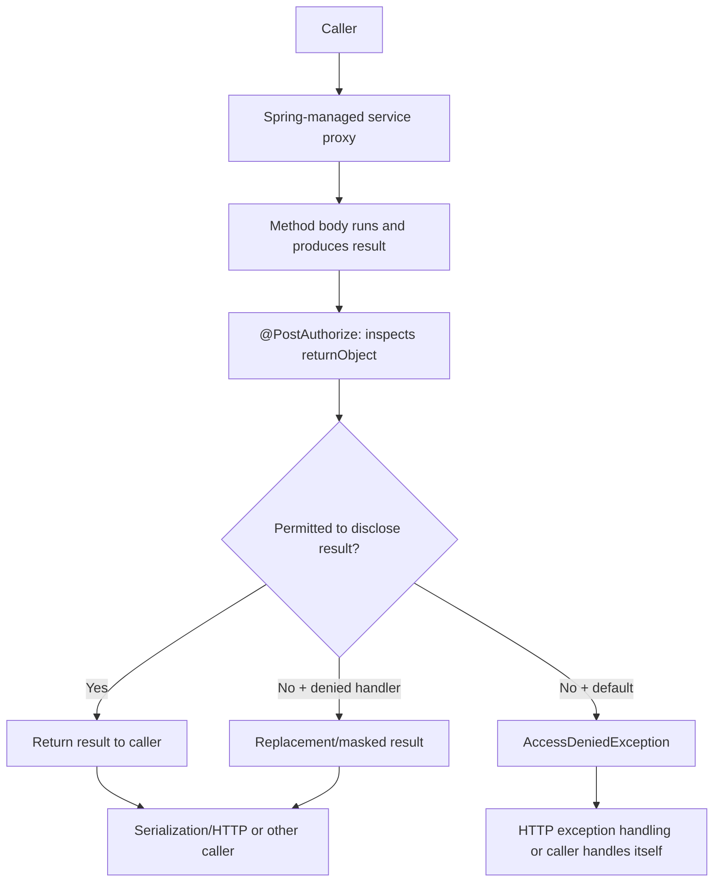

# Masking Data on Denial and Limits of Non-Disclosure

## Lesson objectives

When a caller lacks permission to read a document, customer info, or sensitive data field, the application must decide whether to **deny the entire request** or **return a masked version**. In Spring Security, `@PostAuthorize` can inspect the value returned by a service **after the method body runs**. By default, if the post-check fails, Spring Security refuses to deliver that result to the caller via an authorization exception. On versions supporting `@HandleAuthorizationDenied`, the application can also return **a fallback or masked value** according to policy.

However, “the user does not see the `secret` field in HTTP JSON” **does not mean** “the data was never queried, processed, logged, cached, emailed, or sent to another system”. This lesson places data masking in the exact context of **Post-Method Checks** in **Spring Security authorization**, while explaining the limits of non-disclosure.

You will learn how to:

1. Distinguish **full DENY**, **hiding resource existence**, **filtering result sets**, and **masking data fields**.
2. Understand `@PostAuthorize`/`returnObject` mechanics and differences from `@PreAuthorize`.
3. Use `@HandleAuthorizationDenied` with `MethodAuthorizationDeniedHandler` for fallback/masked results when permitted by business rules.
4. Recognize `@AuthorizeReturnObject` when guarding getters of returned objects, along with proxy/serialization risks.
5. Choose `@PostFilter`, DTOs/projections, and tenant/owner-scoped queries for the right purpose.
6. Design 401/403/404/200 responses with masking without accidentally leaking existence, IDs, metadata, or content via side channels.
7. Test **both direct service beans** and HTTP responses to verify both masked outputs and post-check limits.

**Scope:** Java 17+, Spring Security Servlet Method Security 6.x/7.x. `@HandleAuthorizationDenied` and `MethodAuthorizationDeniedHandler` exist from Spring Security **6.3**; use the BOM and Javadoc matching your deployed version. Spring snippets require dependencies/context. The Java 17 example in section 13 runs standalone and illustrates principles only.

## 1. Scenario: data was queried yet must not be disclosed

Suppose a service returns a report:

```java
public record ReportView(
    long id,
    String tenantId,
    String ownerUsername,
    String title,
    String confidentialNote
) {}
```

Product requirements:

- User with `report:read` authorized for the right tenant/owner: reads the report.
- User allowed to see the public title yet **lacking** `report:note:read`: the note field must be masked.
- User must not learn whether reports belonging to another tenant exist: metadata must not be disclosed.
- No emails, file exports, or audit logs containing `confidentialNote` are emitted when permission is denied.

A naive design returns all data and lets the client hide fields:

```javascript
// WRONG: data already reached the browser even though UI only renders title.
const response = await fetch("/api/reports/42").then(r => r.json());
document.querySelector("#title").textContent = response.title;
// Not rendering response.confidentialNote does not keep it secret.
```

The caller can still read the JSON in the Network tab, browser storage, or JavaScript code. **Data masking must occur before data leaves the server trust boundary**, not just in the UI.

Yet masking at controller serialization is still insufficient if the service already sent the raw note to a shared cache, logs, or an external provider. Therefore, distinguish **where permissions are decided**, **where the permitted data representation is built**, and **where data leaves the system**.

## 2. Four outcome patterns when the user lacks permission

There is no single right handling for every resource. Decide based on security requirements:

| Strategy | Outcome for caller | When appropriate | Risks to check |
| --- | --- | --- | --- |
| **Full DENY** | Throws `AccessDeniedException`; HTTP typically 403 for authenticated user | Not allowed to view object contents | Status/message may disclose resource exists |
| **Conceal existence** | 404 or uniform response for “absent/out-of-scope” | Multi-tenant, IDOR, sensitive resource existence | Pure 404 does not solve timing/cache/error differences |
| **Mask a field** | Returns DTO with `email=null` or `"[REDACTED]"` | Permitted to view general profile yet not email | Keys, null, length, domain may still leak info |
| **Filter list** | Returns only in-scope records | Multi-record lists/searches/exports | Filtering after reading all wastes resources, breaks pagination/counts |
| **Default fallback value** | Fixed string, empty result, or restricted response | Method returns optional value safe to hide | Caller may assume task succeeded; must define contract |

**Do not equate “mask” with “deny”.** If the client must know the operation was denied, returning 403 is more appropriate than returning fake data. If learning the user profile exists is fine while email is private, field masking may fit. When existence itself is sensitive, returning an object with `email="[REDACTED]"` already discloses too much.

### Example per-field API contract

```json
{
  "displayName": "Alice",
  "email": "[REDACTED]"
}
```

The result above indicates the profile **is viewable** while the email is not. It is **not** a contract for users forbidden from knowing that profile exists. In the latter case, handle at query scope and “not found/disclosed” error policy.

## 3. What does `@PostAuthorize` check and when?

With Method Security enabled on a Spring-managed bean, `@PostAuthorize` is handled by the after-method authorization interceptor. Typical flow:



Example:

```java
import org.springframework.security.access.prepost.PostAuthorize;
import org.springframework.stereotype.Service;

@Service
public class ReportService {

    private final ReportRepository reports;

    public ReportService(ReportRepository reports) {
        this.reports = reports;
    }

    @PostAuthorize(
        "returnObject != null and " +
        "returnObject.ownerUsername().equals(authentication.name)"
    )
    public ReportView load(long id) {
        return reports.findViewById(id).orElse(null);
    }
}
```

**This is an integration snippet:** `ReportRepository` is a project-defined interface. `ReportView` from section 1 is a record. With a matching owner, the method returns the result; with a different owner, the result is denied. Because the expression does not let `null` pass, absent results are also denied, so **it does not automatically achieve 404 when a resource is missing**. Clear contracts usually distinguish `NotFound` and `Forbidden` in the service/API.

### Mandatory limits to remember

1. **The method body has already run.** Repository may have read raw data, built objects, cached, or logged.
2. **Default DENY stops the result from returning via the proxy**, yet does not erase copies in memory/logs/caches.
3. Without an HTTP request, `AccessDeniedException` **does not automatically become 403**; the caller handles it.
4. `@PostAuthorize` fits **read/result checks** better; never use it as the sole barrier for methods that write, transfer money, or publish messages.
5. Data leaving a method **not called through a Spring AOP proxy** can bypass the post-check.
6. Another object already sent outward by the service before the method returns is not “recalled” by `@PostAuthorize`.

### Enabling method security

```java
import org.springframework.context.annotation.Configuration;
import org.springframework.security.config.annotation.method.configuration.EnableMethodSecurity;

@Configuration
@EnableMethodSecurity
public class MethodSecurityConfig {}
```

Spring Boot Starter Security does not enable method security automatically. `@EnableMethodSecurity` activates default pre/post interceptors. With beans instantiated via `new` or self-invocation `this.load(...)`, interception can be skipped; call through a real bean proxy and test.

## 4. Combining `@PreAuthorize` and `@PostAuthorize` for their intended purposes

`@PreAuthorize` protects **permission to invoke the operation** before the body; `@PostAuthorize` protects **the returned result** after the body.

```java
@PreAuthorize("hasAuthority('report:read')")
@PostAuthorize(
    "returnObject != null and " +
    "returnObject.ownerUsername().equals(authentication.name)"
)
public ReportView load(long id) {
    return reports.findViewById(id).orElse(null);
}
```

Meaning:

- Lacking `report:read` → body **does not run** thanks to pre-check.
- Having `report:read` yet not owner → body ran, post-check **DENYs**.
- Having general permission and matching owner → passes both checks.
- Returns `null` → this expression DENYs, not properly representing 404; how to handle not-found must be defined separately.

**This is not OR.** The two annotation types are enforced by independent advisors, so the invocation must pass all applicable checks. Never repeat two `@PostAuthorize` annotations expecting them to combine into one expression; consolidate the policy or use a policy bean.

### Why shouldn't object policies live solely in post-checks?

Suppose a client probes 100,000 different IDs; each time `load(id)` queries the DB and only then does `@PostAuthorize` check ownership. Even though raw data is not returned, the system may:

- Consume heavy I/O and create high load.
- Exhibit response timing differences between existing and non-existent IDs.
- Emit audit/cache events containing queried data details.
- Disclose presence/absence via error statuses if null is handled differently from objects.

For **multi-tenant data**, prefer queries constrained by tenant/owner **before materializing results**, such as `findByIdAndTenant(...)`. Use post-checks as an added layer, not an excuse to omit scoped queries.

## 5. `@HandleAuthorizationDenied`: masking or replacing results on DENY

Since **Spring Security 6.3**, `@HandleAuthorizationDenied` lets you specify a `MethodAuthorizationDeniedHandler` to handle denials from `@PreAuthorize` or `@PostAuthorize` and supported denial exceptions. Instead of always throwing `AuthorizationDeniedException`/`AccessDeniedException`, the handler can **return a replacement value**.

### Fixed handler completely masking the value

An easy way to control disclosed info is **not relying on the raw result's content**:

```java
import org.aopalliance.intercept.MethodInvocation;
import org.springframework.security.authorization.AuthorizationResult;
import org.springframework.security.authorization.method.MethodAuthorizationDeniedHandler;

public class FixedRedactionHandler
        implements MethodAuthorizationDeniedHandler {

    @Override
    public Object handleDeniedInvocation(
            MethodInvocation invocation,
            AuthorizationResult decision) {
        return "[REDACTED]";
    }
}
```

This is **Spring code**, requiring `spring-security-core`/AOP dependencies per BOM. `handleDeniedInvocation` is used to handle a denied invocation with a replacement result; by default, `handleDeniedInvocationResult` (for `@PostAuthorize`) delegates to this method unless overridden by the handler.

Register the handler as a Spring bean and enable method security:

```java
import org.springframework.context.annotation.Bean;
import org.springframework.context.annotation.Configuration;
import org.springframework.security.config.annotation.method.configuration.EnableMethodSecurity;

@Configuration
@EnableMethodSecurity
public class SecurityConfig {

    @Bean
    FixedRedactionHandler fixedRedactionHandler() {
        return new FixedRedactionHandler();
    }
}
```

Use on a method returning `String`:

```java
import org.springframework.security.access.prepost.PostAuthorize;
import org.springframework.security.authorization.method.HandleAuthorizationDenied;
import org.springframework.stereotype.Service;

@Service
public class ContactService {

    @PostAuthorize("hasAuthority('contact:email:read')")
    @HandleAuthorizationDenied(
        handlerClass = FixedRedactionHandler.class
    )
    public String getEmail() {
        return "alice@example.test";
    }
}
```

If the caller has `contact:email:read` → returns the real email; if lacking → returns `"[REDACTED]"` per handler, **instead of the default exception**. Never use this pattern for a resource whose **existence the caller must not learn**: the very string `"[REDACTED]"` can confirm existence.

**Important contract rule:** the object returned by the handler must be **compatible with the method's return type**. Returning a `String` for a method declared `long`/`List<Report>` is wrong. Returning `null` for a primitive return type can error. Design type-specific fallbacks and test serialization.

### Handlers for `@PreAuthorize` and `@PostAuthorize` do not run at the same time

```java
@PreAuthorize("hasAuthority('contact:email:read')")
@HandleAuthorizationDenied(
    handlerClass = FixedRedactionHandler.class
)
public String getEmail() {
    return readEmailFromDatabase();
}
```

On DENY **at pre-check**, the body `readEmailFromDatabase()` **does not run**, and the handler returns the replacement string.

```java
@PostAuthorize("hasAuthority('contact:email:read')")
@HandleAuthorizationDenied(
    handlerClass = FixedRedactionHandler.class
)
public String getEmail() {
    return readEmailFromDatabase();
}
```

On DENY **at post-check**, the body **already read the email**, and then the handler replaces the result. For a field needing masking derived from the raw result, a post-check may make sense, yet this is **not “zero data access”**.

## 6. Conditional masking based on the denied result

`MethodAuthorizationDeniedHandler` offers `handleDeniedInvocationResult(MethodInvocationResult, AuthorizationResult)` to access **the result already produced by the method** when `@PostAuthorize` DENYs. This allows partial masking, such as emails:

```java
import org.aopalliance.intercept.MethodInvocation;
import org.springframework.security.authorization.AuthorizationResult;
import org.springframework.security.authorization.method.MethodAuthorizationDeniedHandler;
import org.springframework.security.authorization.method.MethodInvocationResult;

public class EmailMaskHandler implements MethodAuthorizationDeniedHandler {

    @Override
    public Object handleDeniedInvocation(
            MethodInvocation invocation,
            AuthorizationResult decision) {
        return "[REDACTED]";
    }

    @Override
    public Object handleDeniedInvocationResult(
            MethodInvocationResult result,
            AuthorizationResult decision) {
        Object raw = result.getResult();

        if (!(raw instanceof String email)) {
            return "[REDACTED]";
        }

        int at = email.indexOf('@');
        if (at < 1) {
            return "[REDACTED]";
        }

        return email.substring(0, 1) + "***"
            + email.substring(at);
    }
}
```

Register the `EmailMaskHandler` bean and annotate:

```java
@PostAuthorize("hasAuthority('contact:email:read')")
@HandleAuthorizationDenied(handlerClass = EmailMaskHandler.class)
public String getEmail() {
    return "alice@example.test";
}
```

On DENY, the illustrative handler returns `"a***@example.test"`. **This is only partial masking, not complete email hiding.** It still discloses the first letter, domain, email format, and existence. If policy forbids exposing the domain, use fixed `"[REDACTED]"` or `null`/omit the field per contract.

### Risks of result-aware masking

- The handler has **access to the raw result** in memory; never log `raw` or exceptions containing raw data.
- Never return the original input on malformed formats; choose a **fail-closed** fallback.
- Masked emails can reveal private domains, account lengths, and punctuation; define an explicit policy.
- Simple regex masking does not handle Unicode/IDN, email aliases, or malformed data.
- If a method returns an object with nested secrets, returning the old object after mutating a field with a setter can leave the raw reference in caches or other callers. Build a fresh DTO/projection and check **all nested fields**.
- A handler may be invoked due to a `@PreAuthorize` DENY; in that case there is no raw result to mask. `handleDeniedInvocation` must return a safe fallback **without reading unauthorized data**.
- A custom handler returning a fallback can make the API return HTTP 200 instead of 403. This must be an **intentional contract decision**, never treating every denial as “success”.

## 7. `@AuthorizeReturnObject`: guarding getters of returned results

Spring Security supports protecting methods on **return objects** via `@AuthorizeReturnObject`. Useful case: the general profile is viewable, yet a sensitive field's getter returns data only with the corresponding permission.

Structural example:

```java
public class Contact {

    private final String displayName;
    private final String email;

    public Contact(String displayName, String email) {
        this.displayName = displayName;
        this.email = email;
    }

    public String getDisplayName() {
        return displayName;
    }

    @PreAuthorize("hasAuthority('contact:email:read')")
    @HandleAuthorizationDenied(
        handlerClass = NullEmailHandler.class
    )
    public String getEmail() {
        return email;
    }
}
```

`NullEmailHandler` is an implementation like `FixedRedactionHandler` that returns `null`; it must be a bean in the context. When a repository/service method is annotated `@AuthorizeReturnObject` and returns `Contact`, Spring Security can **proxy the result** so methods like `getEmail()` are controlled by method security.

```java
@AuthorizeReturnObject
public Contact findContact(long id) {
    return contactRepository.findById(id).orElseThrow();
}
```

**These are integration snippets, not a standalone project.** You must use Spring-managed intercepted methods, compatible types, and test proxying and serialization/AOT on your actual version.

### Watch out when using return-object proxies

1. **Not every object can be proxied the way you expect** (`final`/value types, records, generic erasure, proxy strategies).
2. Placing `@AuthorizeReturnObject` at class level can make Spring try proxying value types like `String`/`Integer` without appropriate skip configuration; read the `TargetVisitor` API docs.
3. With JSON serialization, **test the actual JSON response**, as serializers may access fields/getters via different mechanisms. Never assume all serializers go through getter proxies.
4. Getters may be called multiple times or outside the `SecurityContext`; do not treat a proxy as a context-independent sanitizer.
5. The raw object still exists in memory; storing it in shared caches/logs before proxying can leak data.
6. With Spring AOT/native images, appropriate runtime hints/proxy generation are required, especially when generic types erase result classes.

**Practical recommendation:** when data is truly sensitive, a **DTO constructed from policy-approved fields** is usually easier to audit than relying solely on lazy entity proxies serialized to JSON.

## 8. `@PostFilter`: filtering results, not masking fields

`@PostFilter` applies an expression to each element of a framework-supported collection/stream/map/array, using the `filterObject` variable to keep or drop elements after the service builds the result.

Example returning only reports owned by the current user:

```java
import java.util.ArrayList;
import java.util.List;
import org.springframework.security.access.prepost.PostFilter;

@PostFilter("filterObject.ownerUsername().equals(authentication.name)")
public List<ReportView> listReports() {
    return new ArrayList<>(reports.findAllViews());
}
```

The example requires `ReportView`, `ReportRepository`, and a Spring method security context. Use a mutable list in the demo to avoid assuming every immutable `List.of(...)` can be filtered identically. `@PostFilter` helps **remove invalid `ReportView` items from the returned result**, yet:

- The method already **read all** records.
- With large data, it can cause N+1 queries, high memory, and CPU usage.
- Pagination/counts can break: querying 20 records then filtering down to 3 does not represent a valid page of 20.
- If the service logged/cached/emitted the raw list before returning, post-filtering does not retract it.
- `@PostFilter` filters **elements**; it does not turn `confidentialNote` into `"[REDACTED]"`.

### Prefer query scoping

Instead of `findAllViews()`, write a query fetching only records the caller is permitted to access:

```java
public List<ReportSummary> listForCurrentUser(
        String trustedTenant, String trustedUsername) {
    return reports.findSummariesByTenantAndOwner(
        trustedTenant, trustedUsername);
}
```

`trustedTenant` and `trustedUsername` must come from verified identity/tenant membership, never trusted unconditionally from client claims. The `ReportSummary` DTO should contain only display-permitted fields. Query scoping protects data **before it is materialized in Java**, while supporting accurate pagination/search/counts.

`@PostFilter` can still serve as an extra layer for small in-memory sets or policy logic hard to express in queries, yet it is **not efficient by default** for large multi-tenant data.

## 9. DTOs/projections are an easy-to-control masking layer

Do not return raw JPA entities holding hashes, tokens, notes, or internal-only attributes when the API only needs a few fields.

A clean design:

```java
public record PublicContactDto(
    String displayName,
    String email
) {}

public PublicContactDto toDto(
        ContactEntity source,
        boolean mayReadEmail) {
    String email = mayReadEmail
        ? source.getEmail()
        : null;
    return new PublicContactDto(
        source.getDisplayName(),
        email
    );
}
```

**This is a Java DTO snippet**; `ContactEntity` must be defined by the project. Crucially:

- `mayReadEmail` **must be computed from server-side authorization policy**, never trusting a client-sent boolean.
- If email is not permitted, you can return `null` or omit the field altogether; JSON serializer/config determines whether a `null` field appears.
- Never copy the entire entity into the DTO and hide it only in the UI.
- If even **fetching email** from the DB is disallowed under your threat model, query a **projection containing only allowed fields** right from the repository instead of materializing the raw entity and masking later.
- For nested objects, check transitive serialization; secrets can hide inside child objects, metadata, `toString()`, logs, or exceptions.

### `@JsonIgnore`, `@JsonView`, and serializer filters

Jackson tools like `@JsonIgnore` or `@JsonView` can control **JSON shape**, yet they are **not an authorization replacement** for Spring Security. A field dropped by a REST serializer can still leak through GraphQL, logs, other methods, file exports, or a different serializer.

When field-level security is needed, combine service/query policy with lean DTOs; add tests for **every adapter permitted to output data**. An attribute masked in a response must not leak via error details, HTTP headers, or caches.

### Never build a response from a raw result when wholly denied

If policy dictates the caller must not learn a record exists, **never** return `PublicContactDto(displayName, null)`. Exposing `displayName` and “a record exists” already violates policy. Use scoped lookups and responses matching your non-disclosure policy.

## 10. 401, 403, 404, or 200 with masked data?

Choose statuses per **business/security contract**, not “always 403 on DENY” or “always 404 to hide”.

| Scenario | Common approach | What to verify |
| --- | --- | --- |
| Unauthenticated | 401/WWW-Authenticate or login redirect per mechanism | No resource info leaked before authentication |
| Authenticated yet missing endpoint permission | 403 | Message does not confirm ID exists, contains no owner/tenant/secret |
| Must not learn resource exists | 404 uniform with in-scope absence | Timing/body/header/cache behavior prevents easy enumeration |
| Permitted to view profile, lacking email permission | 200 with `email=null`/mask if policy permits | Mask leaks no unintended domain, length, or field keys |
| List containing out-of-scope records | 200 with only permitted records | Counts/pagination and sorting do not reflect raw all-tenant data |
| Policy service unavailable | Controlled 5xx or appropriate internal error | **Fail closed**: never fall back to returning raw data |

**The exact outcome is not fixed by `@PostAuthorize` alone.** By default, denial throws an exception; Spring Security filters/exception handlers in an HTTP context typically turn it into 403 for fully authenticated users, while anonymous users may get 401/redirect. With `@HandleAuthorizationDenied` returning a replacement result, callers can receive 200. With custom advice/error mapping, statuses can vary.

### Concealing existence: scoped lookup beats mapping 403 → 404 blindly

Suppose a tenant A user queries `/api/reports/42` in tenant B. One approach:

```java
public ReportSummary loadForTenant(
        long id, String trustedTenant) {
    return reports.findSummaryByIdAndTenantId(id, trustedTenant)
        .orElseThrow(ReportNotFoundException::new);
}
```

`trustedTenant` must be resolved from the authenticated principal and verified membership. With a scoped query, both non-existent IDs and out-of-scope IDs raise the same `ReportNotFoundException` class per contract. There is no need to load another tenant's raw report first.

**Do not globally map every `AccessDeniedException` to 404**: legitimate denials occur for functional permissions, CSRF, or other endpoints where 403 is right; a global mapper can hide bugs and corrupt logging/auditing. Apply the “conceal existence” strategy only to designated resources and threat models.

### Do not leak information via errors

Avoid responses like:

```json
{
  "error": "access_denied",
  "message": "Report 42 belongs to tenant NORTH-WEST",
  "ownerEmail": "alice@example.test"
}
```

A brief, uniform response with a correlation ID that discloses neither owner nor tenant is far better. The backend can still log security events to an **authorized** audit channel, with minimal data and a retention policy.

## 11. Disclosure channels outside the return value

A post-check DENY **only stops data from returning through that exact proxy invocation** (or replaces it with a fallback). It does not guarantee data is absent from the following channels:

| Channel | Risk example | Mitigation |
| --- | --- | --- |
| Application logs | `log.info("Loaded {}", entity)` calls `toString()` containing PII | Never log raw entities/DTOs; redaction and logger policy |
| Error details/stacktraces | Exceptions holding secrets, tenant/owner, SQL parameters | Generic public errors, minimize PII in internal logs |
| Shared caches | Cache key omits tenant or caches raw object before checks | Tenant-aware keys, cache scoping, protect cached values |
| Metrics/tracing | URL labels hold report ID/email; span attributes hold payloads | Low-cardinality labels, mask sensitive attributes |
| Email/SMS/webhooks | Sending secret inside method before `@PostAuthorize` denies | Never place external side effects in post-checked reads |
| File exports | CSV/PDF built with raw columns before response DENYs | Scoped query/projection + check before generating/exporting |
| Pagination/counts | Returning all-tenant total count even when list is filtered | Compute counts/filters within the same authorized scope |
| HTTP headers | `ETag`/`Content-Length`/`Last-Modified` reflect raw resource | Use only metadata matching the authorized representation |
| Timing | Existing ID query is slower than absent ID | Query scoping, rate limiting, consistent error paths |
| Exception status | 403 for existing ID, 404 for non-existent ID | Existence threat model, scoped lookup/concealment |
| Nested DTOs | Parent masks field yet child retains secret | Test full JSON tree, recursive DTO mapping |
| Alternate endpoints | REST hides it yet GraphQL/export returns raw | Shared policy in service and across all adapters |

**Never promise “constant-time” for every database lookup**: that is usually impractical. Instead use query scoping, consistent error policies, rate limiting, auditing, zero data disclosure in responses/headers, and system-level enumeration assessments.

### `Cache-Control` when personal data may appear

A response holding PII must not be accidentally served from a shared proxy cache to another user. Check `Cache-Control`, `Vary`/auth-aware caching, and cache keys. When user A gets a “masked” response while user B gets raw data, they **must not** share a public cache entry without differentiating permissions; best is avoiding shared caches for sensitive personal data.

## 12. Combining method security and multi-tenant data

In multi-tenant applications, policies usually have three levels:

1. **Functional permission:** `hasAuthority("report:read")`.
2. **Tenant/owner visibility:** report is queryable within the principal's tenant.
3. **Field permission:** allowed to view `confidentialNote` or only title/metadata?

Application service structure example:

```java
@PreAuthorize("hasAuthority('report:read')")
public ReportResponse load(
        long id, Authentication authentication) {

    String trustedTenant = tenantResolver.resolve(authentication);
    ReportSummary summary = reports
        .findVisibleSummaryByIdAndTenant(id, trustedTenant)
        .orElseThrow(ReportNotFoundException::new);

    boolean maySeeNote = reportPolicy.canReadConfidentialNote(
        authentication, id
    );

    String safeNote = maySeeNote
        ? reports.findNoteForVisibleReport(id, trustedTenant)
        : null;

    return new ReportResponse(
        summary.id(), summary.title(), safeNote
    );
}
```

**Integration snippet, not standalone**: `TenantResolver`, repository methods, `ReportResponse`, and `ReportPolicy` must be implemented by the project. `Authentication` should normally come from the trusted security context or be passed into internal services by a verified adapter, never constructed from client input. If users can switch tenants, verify membership; never trust a raw `tenantId`.

Design intent:

- Summary query is **strictly in-scope**, avoiding reading raw notes when unnecessary.
- Field permission is checked **before** querying the note.
- The DTO holds no hidden raw note on DENY.
- If `@PostAuthorize`/`@HandleAuthorizationDenied` is needed because a module uses a return-object policy, it acts as a **supporting layer**, not a substitute for scoped queries.

### Avoiding TOCTOU and cross-tenant caching

A `maySeeNote` check runs against one report version, yet ACLs could change before reading the note. For ultra-sensitive data, combine ACL/tenant predicates in the same query, use transaction isolation, or recheck by version. Cache keys must reflect tenant/identity/permission context or cache only public data.

## 13. Standalone Java 17: post-check, result masking, and scoped lookup

This example does not use Spring. It simulates three approaches:

- **Post-check:** service already loaded the raw record, then decided DENY.
- **Mask:** already loaded the raw record, yet returned a replacement string.
- **Scoped lookup:** only materializes the record when both ID and owner match; out-of-scope objects are treated identically to absent ones.

The program prints how many times a raw record was brought into the simulated service, **not SQL query counts**. Save with exact name **`PostAuthorizationDisclosureDemo.java`**:

```java
import java.util.Map;

public class PostAuthorizationDisclosureDemo {

    record Report(
        String id,
        String owner,
        String title,
        String secret
    ) {}

    static final Map<String, Report> STORE = Map.of(
        "42", new Report(
            "42", "alice", "Quarterly report", "internal-note"
        )
    );

    static int rawLoads;

    static Report loadUnscoped(String id) {
        Report report = STORE.get(id);
        if (report != null) {
            rawLoads++;
        }
        return report;
    }

    static String postCheck(String caller, String id) {
        Report report = loadUnscoped(id);
        if (report == null) {
            return "NOT_FOUND";
        }
        if (!report.owner().equals(caller)) {
            return "DENIED";
        }
        return report.secret();
    }

    static String maskPost(String caller, String id) {
        Report report = loadUnscoped(id);
        if (report == null) {
            return "NOT_FOUND";
        }
        return report.owner().equals(caller)
            ? report.secret()
            : "[REDACTED]";
    }

    static String scopedLookup(String caller, String id) {
        Report report = STORE.get(id);
        if (report == null || !report.owner().equals(caller)) {
            return "NOT_FOUND";
        }
        rawLoads++;
        return report.secret();
    }

    public static void main(String[] args) {
        rawLoads = 0;

        System.out.println(
            "post unauthorized: " + postCheck("bob", "42")
                + ", rawLoads=" + rawLoads
        );

        System.out.println(
            "mask unauthorized: " + maskPost("bob", "42")
                + ", rawLoads=" + rawLoads
        );

        System.out.println(
            "scoped unauthorized: "
                + scopedLookup("bob", "42")
                + ", rawLoads=" + rawLoads
        );

        System.out.println(
            "scoped owner: " + scopedLookup("alice", "42")
                + ", rawLoads=" + rawLoads
        );
    }
}
```

Compile/run with **JDK 17 or higher**:

```bash
javac PostAuthorizationDisclosureDemo.java
java PostAuthorizationDisclosureDemo
```

**Exact stdout:**

```text
post unauthorized: DENIED, rawLoads=1
mask unauthorized: [REDACTED], rawLoads=2
scoped unauthorized: NOT_FOUND, rawLoads=2
scoped owner: internal-note, rawLoads=3
```

Takeaways:

- **Post-check** denied the result for Bob, yet the raw object was already loaded into the service.
- **Mask** redacted the returned string for Bob, yet the raw object was still loaded.
- **Scoped lookup** returned `NOT_FOUND` and in the simulation never delivered an out-of-scope raw object to the business layer.
- Alice was allowed to see the raw note in the example because she is the owner.

**Limitations:** Map lookup is a model; a database query may still touch indexes/pages, so in-scope ID queries must also be optimized. The program does not simulate Spring AOP, `@PostAuthorize`, JDBC, logs, or side-channel timing. Never use a client `caller` String as production identity proof: obtain verified principals and real tenant/ACL data.

## 14. Spring JUnit: testing post-checks and data-masking handlers

To verify the framework, you need **a real Spring-managed bean**, `@EnableMethodSecurity`, `@WithMockUser`, direct method invocation, and checks on the actual returned value. Tests should also prove the body **ran** before `@PostAuthorize` DENYs.

The following JUnit 5 example uses Spring Security 6.3+; it needs compatible versions of `spring-test`, `spring-security-test`, `spring-security-config`, Spring AOP, and JUnit Jupiter.

```java
import org.aopalliance.intercept.MethodInvocation;
import org.junit.jupiter.api.BeforeEach;
import org.junit.jupiter.api.Test;
import org.springframework.beans.factory.annotation.Autowired;
import org.springframework.context.annotation.Bean;
import org.springframework.context.annotation.Configuration;
import org.springframework.security.access.AccessDeniedException;
import org.springframework.security.access.prepost.PostAuthorize;
import org.springframework.security.access.prepost.PreAuthorize;
import org.springframework.security.authorization.AuthorizationResult;
import org.springframework.security.authorization.method.HandleAuthorizationDenied;
import org.springframework.security.authorization.method.MethodAuthorizationDeniedHandler;
import org.springframework.security.config.annotation.method.configuration.EnableMethodSecurity;
import org.springframework.security.test.context.support.WithMockUser;
import org.springframework.test.context.junit.jupiter.SpringJUnitConfig;

import static org.junit.jupiter.api.Assertions.assertEquals;
import static org.junit.jupiter.api.Assertions.assertThrows;

@SpringJUnitConfig(RedactionMethodTest.Config.class)
class RedactionMethodTest {

    @Autowired
    SensitiveService service;

    @Autowired
    Counter counter;

    @BeforeEach
    void reset() {
        counter.emailReads = 0;
        counter.summaryReads = 0;
    }

    @Test
    @WithMockUser(authorities = "contact:email:read")
    void authorizedGetsRealEmail() {
        assertEquals("alice@example.test", service.email());
        assertEquals(1, counter.emailReads);
    }

    @Test
    @WithMockUser(authorities = "contact:basic:read")
    void postDeniedReturnsFixedMaskButMethodRan() {
        assertEquals("[REDACTED]", service.email());
        assertEquals(1, counter.emailReads);
    }

    @Test
    @WithMockUser(authorities = "contact:email:read")
    void preDeniedReturnsFixedMaskWithoutRunningMethod() {
        assertEquals("[REDACTED]", service.summary());
        assertEquals(0, counter.summaryReads);
    }

    @Test
    @WithMockUser(username = "bob", authorities = "contact:basic:read")
    void ordinaryPostAuthorizationDeniesOtherOwner() {
        assertThrows(AccessDeniedException.class, service::ownerOnly);
    }

    @Configuration
    @EnableMethodSecurity
    static class Config {
        @Bean
        Counter counter() {
            return new Counter();
        }

        @Bean
        FixedMaskHandler fixedMaskHandler() {
            return new FixedMaskHandler();
        }

        @Bean
        SensitiveService sensitiveService(Counter counter) {
            return new SensitiveService(counter);
        }
    }

    public static class Counter {
        int emailReads;
        int summaryReads;
    }

    public static class FixedMaskHandler
            implements MethodAuthorizationDeniedHandler {

        @Override
        public Object handleDeniedInvocation(
                MethodInvocation invocation,
                AuthorizationResult decision) {
            return "[REDACTED]";
        }
    }

    public static class SensitiveService {

        private final Counter counter;

        public SensitiveService(Counter counter) {
            this.counter = counter;
        }

        @PostAuthorize("hasAuthority('contact:email:read')")
        @HandleAuthorizationDenied(
            handlerClass = FixedMaskHandler.class
        )
        public String email() {
            counter.emailReads++;
            return "alice@example.test";
        }

        @PreAuthorize("hasAuthority('contact:basic:read')")
        @HandleAuthorizationDenied(
            handlerClass = FixedMaskHandler.class
        )
        public String summary() {
            counter.summaryReads++;
            return "Private summary";
        }

        @PostAuthorize(
            "returnObject.owner().equals(authentication.name)"
        )
        public ContactView ownerOnly() {
            return new ContactView("alice");
        }
    }

    public record ContactView(String owner) {}
}
```

**Meaning of the tests:**

- With the right authority, `email()` returns the raw email.
- Without the authority, `@PostAuthorize` DENYs yet the handler returns `"[REDACTED]"`. `emailReads == 1` proves **the body ran**, even though the caller did not receive the real email.
- With pre-authorization DENY on `summary()`, the handler returns the mask **before calling the body**; `summaryReads == 0`.
- `ownerOnly()` has no custom handler: default denial throws `AccessDeniedException`, returning no masked value.
- Tests call the real bean through the proxy; never use `new SensitiveService(...)` in tests to claim security interception works.

**Limitations:** This test uses in-memory data and does not prove JSON serialization, HTTP statuses, cache scoping, DB query scoping, or absence of logs containing raw emails. Additional HTTP/integration tests are required.

## 15. Verifying masked results in HTTP responses and JSON

In Spring Boot MVC, you can test a Controller returning DTOs or invoking `ContactService` via proxy. Essential assertions:

1. User with email permission: JSON contains the real email **if policy permits**.
2. User with only basic permission: JSON contains no real email, showing mask/null per contract.
3. Anonymous or user forbidden from knowing profile exists: response contains no `displayName`/ID/sensitive metadata.
4. Default `AuthorizationDeniedException` produces the agreed response; custom handlers never accidentally leak raw exceptions.
5. Response `Cache-Control`/cache behavior does not serve Alice's masked response to Bob or Bob's raw response to Alice.
6. Nested objects, arrays, pagination metadata, file downloads, GraphQL, and export adapters leak no info.
7. Access logs, application traces, and error responses record no raw notes/emails/tokens.

### A simple response test

```java
// Snippet inside @SpringBootTest + @AutoConfigureMockMvc.
// Requires Controller/route and appropriate test utility imports.
mockMvc.perform(get("/api/contacts/42")
        .with(user("viewer").authorities(
            new SimpleGrantedAuthority("contact:basic:read"))))
    .andExpect(status().isOk())
    .andExpect(jsonPath("$.email").value("[REDACTED]"));
```

**This is only an integration snippet**, not standalone: it requires a controller returning a DTO, serialization config, Spring Security filter setup, `get/user/jsonPath/status` imports, and a real authorization policy. If the contract omits the email field completely, assert `jsonPath("$.email").doesNotExist()` instead of asserting a mask. If policy requires concealing the profile, test a uniform 404 response rather than a 200 test like above.

### Do not confirm safety solely by HTTP 200

A 200 endpoint with a masked field can still leak the raw email in response headers, other JSON fields, logs, or traces. With `@HandleAuthorizationDenied`, returning a masked value is a **business contract**, not automatic proof that the whole system protects data well.

## 16. Authorization, logging, and side effects of post-checks

Because `@PostAuthorize` evaluates after the body, risks arise if a method does:

```java
@PostAuthorize(
    "returnObject.owner().equals(authentication.name)"
)
public ReportView load(long id) {
    ReportView report = reports.findById(id).orElseThrow();
    log.info("Loaded report: {}", report);
    return report;
}
```

**This snippet is unsafe as a production pattern** if `ReportView.toString()` prints `confidentialNote`. When the user is not the owner, the post-check DENYs yet the log already contains raw data. Fixes:

- Avoid logging full entities/DTOs; log event IDs, categories, normalized actor IDs, and correlation IDs per retention policy.
- If policy forbids loading out-of-scope raw data, use `findByIdAndTenant(...)`/scoped queries upfront.
- Place business side effects **after** pre-method checks; never rely on post-checks for writes/emails/file exports.
- Protect secrets in logs, tracing, audits, and metrics; verify DENY never leaks raw values.
- Be careful with `@Cacheable`: cache advice order, key scoping, and raw data can interact with security advisors. Never share resource cache entries by ID **without checking tenant/permissions**.

### Post-checks on write operations are an anti-pattern

```java
// WRONG: side effect may already have happened before authorization.
@PostAuthorize("hasAuthority('payment:execute')")
public void executePayment(PaymentRequest request) {
    gateway.charge(request);
}
```

Replace with `@PreAuthorize` or a suitable pre-invocation policy, plus domain validation and transaction/outbox/idempotency where relevant. A post-check 403 cannot recall a payment already charged by a provider.

## 17. Troubleshooting: why isn't data masking working yet?

### Case A: `@PostAuthorize` does not run

Check:

- Is `@EnableMethodSecurity` enabled?
- Is the service Spring-managed, and do callers go through the Spring proxy?
- Is there self-invocation `this.method()`, `private`/`final`/`static` methods, or an unsupported proxy strategy?
- Did a test replace the service itself with a Mockito mock?
- Was an annotation on an interface/class overridden or conflicting?
- Was the request rejected by an HTTP filter/CSRF before the service was ever called?

### Case B: handler does not return masked result

Check:

- Does your Spring Security version support `@HandleAuthorizationDenied`/`MethodAuthorizationDeniedHandler` (since 6.3)?
- Is the handler class registered as a Spring bean and does `handlerClass` match?
- Does the method have a return type compatible with the replacement?
- Did the caller actually traverse the `@PostAuthorize`/`@PreAuthorize` pointcut?
- Did the denial originate from the relevant method interceptor or from an HTTP filter / another business exception?
- Is a test expecting 403 while the handler is configured to return a mask → 200 response per contract?

### Case C: HTTP response is masked yet logs still leak

Check:

- Is `toString()`/JSON serializer/logging aspect printing the raw object?
- Does a cache store raw entities shared across tenants?
- Do traces/metrics/exception messages contain PII?
- Did the method body send a webhook/message before the post-check?
- Is there an alternate adapter/route exporting raw data?
- Did the query read beyond the necessary scope?

### Case D: list is filtered incorrectly

Check:

- Does `@PostFilter` use the right `filterObject` and collection type?
- Is an immutable list or stream incompatible with the filtering implementation?
- Did the repository paginate before post-filtering, leaving short pages/wrong totals?
- Does the owner/tenant policy receive a trusted principal?
- Is there a field-level information leak inside each remaining record?

**Never fix with `permitAll`, disabling method security, or returning raw results when a filter errors.** Fix the policy, handler, query, or serialization at the right layer.

## 18. Regression testing matrix

| Test | Expectation |
| --- | --- |
| Caller has permission, right owner/tenant | Returns permitted data |
| Caller lacks role, default `@PostAuthorize` | Throws `AccessDeniedException`, returns no raw data |
| Caller lacks permission, has `@HandleAuthorizationDenied` | Returns mask/fallback per contract |
| `@PreAuthorize` DENY + handler | Body does not run, no raw query if check needs none |
| `@PostAuthorize` DENY + handler | Body ran; result replaced; verify zero raw logs/caches/emissions |
| Varying field-level permissions | Sensitive fields masked, public fields remain accurate |
| Must not learn resource exists | 404/uniform response, no metadata aiding enumeration |
| Non-existent ID | Same contract as out-of-scope ID when concealment is required |
| Multi-tenant lists | Only in-scope records, accurate counts/pages |
| Snapshot query/ACL changes | No out-of-scope leaks; check query scoping/transactions as needed |
| Shared cache | No mixing masked and unmasked across users/tenants |
| Export/GraphQL/REST | Every adapter enforces same policy, no raw data bypass |
| Nested serialization | No secrets in JSON tree/headers/streams |
| Error paths | No owner/tenant/PII leaks via messages, stacktraces |
| HTTP 401/403/404/200 | Status per contract, not altered unexpectedly by masks |
| AOP proxy and self-invocation | Post-check truly executes through proxied bean |
| Java 17/Spring version upgrades | Handler/test behavior stable per BOM |

## 19. Deployment checklist

- [ ] Decide whether callers **may know the resource exists** before choosing 403, 404, or masking.
- [ ] Use `@PostAuthorize` only when inspecting results **after the method body** matches acceptable risk.
- [ ] Enable `@EnableMethodSecurity` and test invocations through Spring-managed proxies.
- [ ] Combine `@PreAuthorize` to block functional permissions early; never rely on post-checks for write methods.
- [ ] On Spring Security 6.3+, choose `@HandleAuthorizationDenied` when business genuinely needs masked/fallback results.
- [ ] Ensure handler return types are compatible; use fixed fallbacks when hiding completely, never reading unauthorized raw data.
- [ ] If partially masking, review what still leaks: first letter, domain, length, structure, and existence.
- [ ] When using `@AuthorizeReturnObject`, test proxying, getter interception, JSON serializers, and AOT hints if needed.
- [ ] Never treat `@PostFilter` as a query optimization; use tenant/owner-scoped queries.
- [ ] Return DTOs/projections containing only needed fields, avoiding raw JPA entities sent to clients.
- [ ] Test JSON/GraphQL/export/file serialization to confirm nested secrets do not slip through.
- [ ] Error responses contain no owner/email/tenant IDs or sensitive stacktraces.
- [ ] Apply 404 concealment policies strictly within scope, never mapping every `AccessDeniedException` to 404.
- [ ] Cache keys/header policies distinguish tenant/principal/permissions or disable sensitive shared caching.
- [ ] Never pass raw data into logs, metrics, tracing, or external side effects before the post-check.
- [ ] Include direct service tests for ALLOW, DENY, handler masking, and body invocation timing.
- [ ] Include integration tests for response status, content, counts/pagination, caches, and API adapters.
- [ ] Review ACL trustworthiness/TOCTOU, query scoping, and data consistency between check time and return time.
- [ ] Use 401/403/404/200 per agreed contract, never relying on accidental handler defaults.

### Self-check

**Q1.** `@PostAuthorize` denies a report. Was the data definitely never queried from the DB?

**Answer:** **No.** The method body already ran and may have read raw data. Default post-checks only block returning the result through the invocation on DENY.

**Q2.** When is `@HandleAuthorizationDenied` better than always returning 403?

**Answer:** When the business contract allows viewing an object/value **in a masked form**, such as a null/masked email inside an authorized profile. If the caller must not learn the resource exists, you may need DENY/404 instead of masking.

**Q3.** Why can returning `"a***@example.test"` still violate security requirements?

**Answer:** Because it leaks the first letter, domain, and confirms an email exists; policy may demand full redaction or omitting the field.

**Q4.** Does `@PostFilter` over a 10,000-record List returning 20 records guarantee accurate pages/counts?

**Answer:** **No.** Filtering happens after querying/materialization. Accurate pagination requires constraining owner/tenant in the query.

**Q5.** Does a Method Security test where a handler returns `"[REDACTED]"` prove raw emails do not appear in logs/caches?

**Answer:** **No.** Those channels must be checked separately; with a post-check, the raw result was already produced.

**Q6.** If an API wants to return 404 for both out-of-scope and non-existent IDs, what is better than querying the raw object and converting 403 to 404?

**Answer:** **Scoped queries** by tenant/owner/ACL, returning the same `NotFound` contract when no record lies within the caller's scope.

## Official documentation sources

- Spring Security, *Method Security / post authorization*: https://docs.spring.io/spring-security/reference/servlet/authorization/method-security.html
- Spring Security, *Providing Fallback Values When Authorization is Denied*: https://docs.spring.io/spring-security/reference/servlet/authorization/method-security.html#_providing_fallback_values_when_authorization_is_denied
- Spring Security, *HandleAuthorizationDenied API* (since 6.3): https://docs.spring.io/spring-security/reference/api/java/org/springframework/security/authorization/method/HandleAuthorizationDenied.html
- Spring Security, *MethodAuthorizationDeniedHandler API*: https://docs.spring.io/spring-security/reference/api/java/org/springframework/security/authorization/method/MethodAuthorizationDeniedHandler.html
- Spring Security, *Authorize HttpServletRequests*: https://docs.spring.io/spring-security/reference/servlet/authorization/authorize-http-requests.html
- Spring Security, *Testing Method Security*: https://docs.spring.io/spring-security/reference/servlet/test/method.html
- Spring Framework, *Spring AOP proxying and self-invocation*: https://docs.spring.io/spring-framework/reference/core/aop/proxying.html
