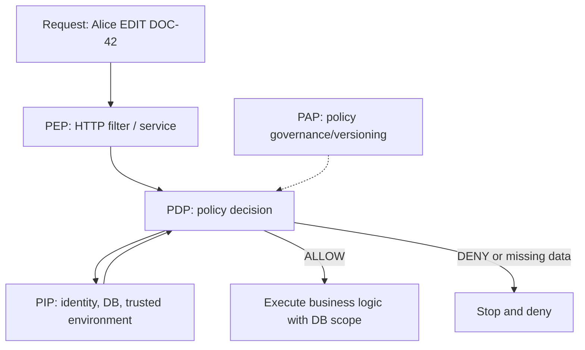

# ABAC: Decisions Based on Subject, Resource, and Environment Attributes

## Learning Objectives

After this lesson, you can explain ABAC (Attribute-Based Access Control), identify subject/resource/action/environment attributes, build a policy with clear conditions, distinguish ABAC from RBAC, read the PEP–PDP–PIP–PAP flow, test decisions in Java 17, and place policies in the right layers in Spring Security. The focus is on **decisions for a specific resource in a specific context**, rather than only checking whether a user has a general role.

## 1. What Is ABAC?

**Attribute-Based Access Control (ABAC)** is an access control model based on evaluating **attributes** related to the subject, object/resource, action to perform, and environmental conditions against a **policy**. This definition is presented in NIST SP 800-162.

Suppose an application stores document `DOC-42`. Alice is logged in and has the `document:edit` permission. The application may still allow Alice to edit only when:

- Alice and the document belong to the **same tenant**.
- Alice is the **owner** of the document.
- The document is in the `DRAFT` state and is not locked.
- The request occurs between **09:00–18:00** in the organization's time zone.
- If the document is labeled `CONFIDENTIAL`, the access environment must be **verified as trusted**.

This is an **example policy**, not a Spring Security default. A user with `ROLE_EDITOR` or `document:edit` is not automatically allowed to edit someone else's document or bypass time/environment restrictions.

An ABAC decision can be described as follows:

```text
Decision = Evaluate(Policy, Subject, Action, Resource, Environment)

ALLOW_EDIT =
    subject.authenticated
    AND subject.active
    AND "document:edit" in subject.permissions
    AND subject.tenantId = resource.tenantId
    AND subject.userId = resource.ownerId
    AND resource.status = DRAFT
    AND environment.time in [09:00, 18:00)
    AND (
        resource.classification != CONFIDENTIAL
        OR environment.trustedNetwork
    )
```

With `AND`, **every required condition must be true**. `OR` only expresses exceptions defined by the policy. If an important attribute is missing, a value cannot be verified, loading the policy fails, or no rule grants access, the safe behavior is to **deny** (*default deny / fail closed*). Never interpret "no deny rule found" as "allowed".

## 2. Four Data Categories That Form a Decision

| Category | Example Attributes | Trusted Source | What to Avoid |
| --- | --- | --- | --- |
| **Subject** | `userId`, `tenantId`, `department`, `active`, `clearance`, `permissions` | Authenticated identity provider, internal permission profile | Trusting `userId` or `admin=true` in the request body |
| **Resource/Object** | `id`, `ownerId`, `tenantId`, `classification`, `status`, share list | Database and resource metadata | Using only `documentId` from the URL without fetching the real resource |
| **Action** | `READ`, `EDIT`, `APPROVE`, `EXPORT`, `DELETE` | The business operation the server is about to execute | Assuming every `GET`/`POST` has the same business meaning |
| **Environment** | Server time, device/network trust level, session risk level, MFA status | Server clock, trusted gateway/identity/risk service | Trusting system time or network headers sent by the client |

**Policy example:** "Finance department employees may read internal reports of their own tenant after MFA and only while the document has not been revoked." `department=FINANCE` is an attribute; `classification=INTERNAL` is an attribute; `MFA verified` is an attribute/context; combining them to permit reading is the **policy**.

ABAC does not require every decision to use every attribute field. For a public resource, time may be irrelevant. For payment approval, amount, approver role, document state, and separation between creator and approver may be the primary conditions.

### Attribute Quality Matters as Much as the Policy

An attribute needs **standardized meaning**, **issuing source**, **freshness**, **data type**, **tenant scope**, and **update/revocation rules**. A validly signed JWT can still hold stale roles or groups if a user's permissions were revoked before the token expired; a document in the DB may have just changed owner or status. Sensitive policies require looking up current state or using an appropriate invalidation strategy.

Do not build authorization on email or display name when those can change; prefer a stable subject ID. For multi-tenancy, identities must be clearly scoped: the same `userId` in two tenants does not imply cross-tenant access.

## 3. Distinguishing RBAC, ACL, and ABAC

| Model | Decision Primarily Based On | Questions Answered Well | Limitations |
| --- | --- | --- | --- |
| **RBAC** | Roles like `ROLE_EDITOR`, `ROLE_REVIEWER` | "Who can access the edit feature?" | Does not inherently know if this person has access to document `DOC-42` |
| **ACL / ownership** | Owner, members, resource share list | "Who is allowed to read this record?" | Does not inherently evaluate time, device, or classification |
| **ABAC** | Policy over subject + action + resource + environment | "Can this person edit this record right now in this environment?" | More complex; relies on trusted attribute and policy management |

RBAC can be **part** of ABAC: check feature-level permission at HTTP, then check owner/tenant/state/environment at the service and DB layers. Using roles as a subject attribute does not mean a policy checking only roles solves dynamic access requirements.

For example, Alice and Bob are both `EDITOR`. Alice owns document 42, while Bob only has shared read access. Both can pass the "allowed to use the document feature" check, but only Alice qualifies to edit under ABAC.

## 4. Writing Accurate Policies: Global Conditions and Exceptions

Allow reading document `D` when:

```text
ALLOW_READ =
    authenticated
    AND subject.active
    AND subject.tenantId = D.tenantId
    AND "document:read" in permissions
    AND (subject.userId = D.ownerId OR subject.userId in D.sharedReaders)
    AND (D.classification != CONFIDENTIAL OR trustedNetwork)
```

Allow editing when:

```text
ALLOW_EDIT =
    authenticated
    AND subject.active
    AND subject.tenantId = D.tenantId
    AND "document:edit" in permissions
    AND subject.userId = D.ownerId
    AND D.status = DRAFT
    AND NOT D.locked
    AND officeHours
    AND (D.classification != CONFIDENTIAL OR trustedNetwork)
```

**The tenant constraint sits outside the `OR` group**, because both the owner and sharedReader must belong to the same tenant. Common mistake:

```text
# WRONG: anyone who is the owner bypasses tenant, permission, and environment
ALLOW = isOwner OR (sameTenant AND hasPermission AND trustedNetwork)

# RIGHT according to the stated policy
ALLOW = sameTenant AND hasPermission AND trustedNetwork
        AND (isOwner OR isSharedReader)
```

When multiple policies apply simultaneously (for example, "shared for reading" vs. "forbid reading confidential documents over untrusted environments"), a consistent **combining strategy** must be defined. A policy engine may distinguish `PERMIT`, `DENY`, `NOT_APPLICABLE`, and `INDETERMINATE`; choices such as "deny overrides" or other precedence rules must be documented and tested. Missing results or evaluation errors must never automatically turn into `PERMIT`.

## 5. The Roles of PEP, PDP, PIP, and PAP

These are **logical roles in an ABAC architecture**; small projects can implement all four inside one Spring Boot application without having to split into microservices:

- **PEP — Policy Enforcement Point:** receives the request, asks for a decision, and **enforces** it. Examples: a Spring Security filter/interceptor or service boundary. If the PDP returns `DENY`, the PEP must stop the operation.
- **PDP — Policy Decision Point:** evaluates rules against verified attributes and returns `ALLOW`/`DENY` or an equivalent result; can be a Java policy bean or a policy engine.
- **PIP — Policy Information Point:** supplies subject/resource/environment attributes: principal from SecurityContext, owner/tenant/status from the DB, time from the server clock, device info from a trusted gateway.
- **PAP — Policy Administration Point:** where policies are managed, approved, versioned, and deployed; in source code this can be a reviewed policy module.



**Flow:** the PEP intercepts the operation; the PDP fetches required attributes via the PIP and applies the policy; the PEP continues only when permitted. The PDP can live directly in the service and does not have to be an HTTP call. When data/policies cannot be read or time out, defined error handling rules are required; the safe default is to block.

## 6. Standalone Java 17 Program: Decision on a Document

The program below illustrates a policy across all four input categories, without Spring or external libraries. The document has `tenant`, `owner`, `readers`, classification level, and lock status. The user has `tenant`, base permissions, and active status; the server-simulated environment has `Instant` and `trustedNetwork`. The edit policy adds a **09:00 to before 18:00** condition in the `Asia/Ho_Chi_Minh` time zone.

Save as **`AbacDemo.java`**:

```java
import java.time.Instant;
import java.time.LocalTime;
import java.time.ZoneId;
import java.util.Set;

public class AbacDemo {
    enum Action { READ, EDIT }
    enum Classification { INTERNAL, CONFIDENTIAL }

    record Subject(
        String userId, String tenantId,
        Set<String> permissions, boolean active
    ) {}

    record Document(
        String id, String tenantId, String ownerId,
        Set<String> readers, Classification classification,
        boolean locked
    ) {}

    record Environment(Instant now, boolean trustedNetwork) {}

    static boolean allowed(
        Subject actor, Action action,
        Document doc, Environment env
    ) {
        if (actor == null || action == null ||
            doc == null || env == null) {
            return false;
        }
        if (!actor.active() ||
            !actor.tenantId().equals(doc.tenantId())) {
            return false;
        }
        if (doc.classification() == Classification.CONFIDENTIAL &&
            !env.trustedNetwork()) {
            return false;
        }

        boolean owner = actor.userId().equals(doc.ownerId());
        boolean shared = doc.readers().contains(actor.userId());

        if (action == Action.READ) {
            return actor.permissions().contains("document:read")
                && (owner || shared);
        }
        if (action == Action.EDIT) {
            LocalTime time = env.now()
                .atZone(ZoneId.of("Asia/Ho_Chi_Minh"))
                .toLocalTime();
            boolean officeHours = !time.isBefore(LocalTime.of(9, 0))
                && time.isBefore(LocalTime.of(18, 0));

            return actor.permissions().contains("document:edit")
                && owner && !doc.locked() && officeHours;
        }
        return false;
    }

    public static void main(String[] args) {
        Subject alice = new Subject(
            "alice", "tenant-a",
            Set.of("document:read", "document:edit"), true
        );
        Subject bob = new Subject(
            "bob", "tenant-a",
            Set.of("document:read", "document:edit"), true
        );
        Subject aliceInTenantB = new Subject(
            "alice", "tenant-b",
            Set.of("document:read", "document:edit"), true
        );
        Subject aliceReadOnly = new Subject(
            "alice", "tenant-a", Set.of("document:read"), true
        );

        Document doc = new Document(
            "DOC-42", "tenant-a", "alice",
            Set.of("bob"), Classification.CONFIDENTIAL, false
        );
        // 03:00 UTC = 10:00 Vietnam time.
        Environment office = new Environment(
            Instant.parse("2026-11-05T03:00:00Z"), true
        );
        // 12:00 UTC = 19:00 Vietnam time.
        Environment evening = new Environment(
            Instant.parse("2026-11-05T12:00:00Z"), true
        );
        Environment untrusted = new Environment(office.now(), false);
        Document locked = new Document(
            doc.id(), doc.tenantId(), doc.ownerId(),
            doc.readers(), doc.classification(), true
        );

        System.out.println("Alice edit at 10:00: "
            + allowed(alice, Action.EDIT, doc, office));
        System.out.println("Bob read shared: "
            + allowed(bob, Action.READ, doc, office));
        System.out.println("Bob edit without ownership: "
            + allowed(bob, Action.EDIT, doc, office));
        System.out.println("Alice read untrusted network: "
            + allowed(alice, Action.READ, doc, untrusted));
        System.out.println("Alice edit at 19:00: "
            + allowed(alice, Action.EDIT, doc, evening));
        System.out.println("Cross-tenant read: "
            + allowed(aliceInTenantB, Action.READ, doc, office));
        System.out.println("Locked document edit: "
            + allowed(alice, Action.EDIT, locked, office));
        System.out.println("Missing edit authority: "
            + allowed(aliceReadOnly, Action.EDIT, doc, office));
    }
}
```

Compile and run with **JDK 17+**:

```bash
javac AbacDemo.java
java AbacDemo
```

**Exact stdout:**

```text
Alice edit at 10:00: true
Bob read shared: true
Bob edit without ownership: false
Alice read untrusted network: false
Alice edit at 19:00: false
Cross-tenant read: false
Locked document edit: false
Missing edit authority: false
```

Result analysis:

1. Alice can edit at 10:00 because she is in the same tenant, is the owner, has the permission, the document is unlocked, and the network is trusted. 19:00 is outside allowed hours, so it is denied.
2. Bob has `document:edit` but is not the owner: **allowed to read** the shared document, **not allowed to edit**.
3. `aliceInTenantB` has the same name and permissions as Alice, but cannot view tenant A's document.
4. `CONFIDENTIAL` requires a trusted environment; even the owner is denied if the request comes from an untrusted environment.
5. The policy uses `Instant` and an IANA time zone, independent of the host machine's clock/time zone. **09:00 is included**, **18:00 is excluded**.
6. The policy applies **deny by default** if subject/action/document/environment is missing or the action is undeclared. Real systems must also deny when required fields have invalid formats or are unverified.

**Sample scope:** Data is created in memory and `trustedNetwork` is only a simulated value for learning, without an authentication source or DB. In real APIs, **never accept `trustedNetwork=true` from the client to grant access**, and never let the client supply its own `tenantId`/`ownerId` as truth. Extract the policy into a testable function with an injectable `Clock` and attributes from trusted sources.

## 7. Using ABAC in Spring Security

Spring Security provides `Authentication`, `GrantedAuthority`, `authorizeHttpRequests`, `@PreAuthorize`, and `AuthorizationManager` to enforce decisions. Spring **does not automatically know** document owner, classification, or office hours: that is application policy.

### 7.1. HTTP Layer: Functional Permissions

For Servlet applications (Spring MVC), an example skeleton configuration:

```java
// Place inside a @Configuration class; corresponding imports are required.
// Example focuses on authorization. Configure authentication,
// CSRF, and session/token separately according to the real application.
@Bean
SecurityFilterChain securityFilterChain(HttpSecurity http) throws Exception {
    http.authorizeHttpRequests(authorize -> authorize
        .requestMatchers(HttpMethod.GET, "/api/documents/**")
            .hasAuthority("document:read")
        .requestMatchers(HttpMethod.PATCH, "/api/documents/**")
            .hasAuthority("document:edit")
        .anyRequest().denyAll()
    );
    return http.build();
}
```

`document:read` or `document:edit` checks **baseline permissions**. They do not check whether the user has access to **DOC-42**. Someone with enough authority to pass the HTTP layer can still be denied in the service by owner, tenant, classification, or context rules. `requestMatchers` rules are evaluated in order; place specific rules first, with a deny fallback. A 403 can also come from CSRF if the application uses a mechanism requiring a CSRF token.

### 7.2. Method Layer: ABAC Before Side-Effecting Operations

Enable method security and delegate object evaluation to a policy bean:

```java
// Snippet for integration into a Spring Boot project.
// Document and DocumentRepository are domain types of the application.
@Configuration
@EnableMethodSecurity
class MethodSecurityConfig {}

@Service
class DocumentService {
    private final DocumentRepository documents;

    DocumentService(DocumentRepository documents) {
        this.documents = documents;
    }

    @PreAuthorize(
        "hasAuthority('document:edit') and " +
        "@documentAbacPolicy.canEdit(authentication, #id)"
    )
    @Transactional
    public void rename(@P("id") long id, String title) {
        Document doc = documents.findById(id).orElseThrow();
        doc.setTitle(title);
    }
}
```

This is **application-dependent illustrative code**, not a standalone runnable program: `Document`, `DocumentRepository`, the `documentAbacPolicy` bean, and the authentication source must be provided. Annotations/APIs require corresponding Spring imports (`Configuration`, `EnableMethodSecurity`, `Service`, `PreAuthorize`, `P`, `Transactional`, etc.).

The `documentAbacPolicy` bean should provide `boolean canEdit(Authentication actor, long id)` and implement the policy: validate authentication; fetch the document from the repository; get the actor's real user ID/tenant; match owner/tenant/status; read time and environment trust from the server; return `false` if unmet or if data is not found. `@P("id")` helps the SpEL expression `#id` reference the right parameter without relying on the compiler preserving parameter names.

Important implementation limitations:

- `@EnableMethodSecurity` must be enabled; adding only the Spring Security starter does not automatically enable `@PreAuthorize`.
- Method security uses Spring AOP: calling the method **through the Spring proxy** is required to go through the interceptor. `this.rename(...)` within the same bean usually bypasses the proxy; objects created manually outside the container do as well.
- `@PreAuthorize` checks **before** writing. `@PostAuthorize` checks **after** the method returns and is unsuitable as the sole protection for side-effecting operations.
- `Authentication.getName()` is not always the user ID stored in the DB. With JWT/OIDC, define clear mapping for stable subject/tenant/authorities; every attribute used in the policy must come from a verified source.
- Because the policy reads the document at one moment and the method writes at a later moment, a **TOCTOU race** can occur. If owner/tenant/status can change concurrently, consider transactions and locking or a **conditional update statement** to re-check at write time.

When many rules/methods share logic, place policies in a dedicated class/component or create a custom `AuthorizationManager` for the corresponding object type. Reorganizing the policy does not change the requirement to check real data and current permissions.

### 7.3. Enforcing Authorization Inside Queries to Protect Lists

If Alice can only view 7 out of 1,000 documents, do not load 1,000 documents and filter after pagination. That easily produces wrong `totalCount`, wrong page counts, wasted memory, and potential metadata leaks.

Push the owner/share/tenant scope into the **query**, for example:

```sql
-- Illustrative SQL: adjust table/column names to match the real schema.
SELECT d.*
FROM documents d
WHERE d.tenant_id = :trustedTenantId
  AND (
       d.owner_id = :authenticatedUserId
       OR EXISTS (
           SELECT 1
           FROM document_readers dr
           WHERE dr.document_id = d.id
             AND dr.user_id = :authenticatedUserId
       )
  )
  AND (
       d.classification <> 'CONFIDENTIAL'
       OR :trustedNetwork = TRUE
  )
ORDER BY d.id
LIMIT :limit OFFSET :offset;
```

The parameters `trustedTenantId`, `authenticatedUserId`, and `trustedNetwork` must be determined by the system from verified identity/context; bind parameters instead of concatenating SQL strings directly. When policies depend on time or dynamic status, apply those same conditions at the corresponding query layer. **Count, export, search, and batch read** need the same policy as read-by-ID. For writes, consider a condition like `WHERE id = ? AND tenant_id = ? AND owner_id = ? AND status = 'DRAFT'` to prevent invalid updates after permissions change.

## 8. Sample Decision Matrix

Suppose DOC-42 belongs to tenant A, owner Alice, shared for reading with Bob, classification `CONFIDENTIAL`, unlocked. Alice and Bob both have `document:read` and `document:edit`.

| Subject/Context | Action | Result | Why |
| --- | --- | --- | --- |
| Alice, tenant A, trusted network, 10:00 | EDIT | **ALLOW** | Sufficient permission, owner, right tenant, valid time/network |
| Bob, tenant A, trusted network, 10:00 | READ | **ALLOW** | Sufficient permission and listed as shared reader |
| Bob, tenant A, trusted network, 10:00 | EDIT | **DENY** | Not the owner |
| Alice, tenant A, untrusted network, 10:00 | READ | **DENY** | Confidential document requires trusted network |
| Alice, tenant A, trusted network, 19:00 | EDIT | **DENY** | Outside allowed edit hours |
| Alice of tenant B | READ | **DENY** | Different tenant |
| Alice with locked DOC-42 | EDIT | **DENY** | Resource state does not permit editing |
| Alice missing `document:edit` | EDIT | **DENY** | Missing baseline permission |

This matrix helps policy authors and testers align on the meaning of each condition. It also shows why **roles alone are not enough** to protect individual objects.

## 9. Trust, Lifecycle, and Performance

### 9.1. Attribute Provenance and Security Context

- **Identity:** subject ID and tenant must be bound to the authenticated account; never accept `X-User-Id` or `X-Tenant-ID` directly as proof. If the protocol lets a client choose an active tenant, verify the subject's membership in the chosen tenant.
- **Resource:** owner/status/classification come from the DB, never trust an `ownerId` field sent by the client. Even with guessable IDs, out-of-scope resources must be denied.
- **Environment:** time from server `Clock`; network/device is trusted only if evaluated by a configured gateway/proxy/attestation. `X-Forwarded-For` can be spoofed if the application accepts headers directly from clients without restricting trusted proxies.
- **Claim freshness:** a validly signed JWT may hold stale roles until expiration; immediate revocation policies need a suitable lookup/revocation notification mechanism, especially for sensitive permissions.

### 9.2. Caching Authorization Decisions

Caching `ALLOW` must account for **subject, tenant, action, resource, policy version, and relevant volatile attributes**. Never reuse "Alice can edit DOC-42 at 10:00" for 19:00 or after the document is locked. Design TTL/invalidation around risk, owner/share/classification changes, group/permission changes, and trusted-environment expiration. When attributes cannot be verified or the cache is stale, prefer denying until refreshed.

### 9.3. Auditing and Policy Governance

Log a standardized reason code (e.g., `TENANT_MISMATCH`, `NOT_OWNER`, `AFTER_HOURS`), policy ID/version, timestamp, and necessary IDs per security policy. Do not return full detailed reasons to clients if they disclose the owner, classification, or existence of another user's document. Many APIs choose `403` for denied permissions; `404` for nonexistent resources or to avoid confirming existence can be a consistent product choice.

Policies need a business owner, review, versioning, a test suite, and rollback capability. When multiple rules conflict, use only the defined combining algorithm and never confuse "no decision" with "allowed".

## 10. Testing ABAC with Proper Coverage

Test **attribute combinations** thoroughly, not just the allow cases:

| Test Category | Required Scenarios |
| --- | --- |
| Subject | Unauthenticated, inactive account, missing permission, invalid subject/tenant, revoked role |
| Resource | Different owner, different tenant, locked document, deleted, changed classification, unshared document |
| Action | READ allowed but EDIT denied; EXPORT/APPROVE have separate rules |
| Environment | 08:59, 09:00, 17:59, 18:00; trusted/untrusted network; different time zones |
| Policy | Missing attributes, PIP/DB error, two conflicting rules, inapplicable policy |
| Enforcement Point | HTTP, service via Spring proxy, internal calls, batch jobs, list/search/export |
| Data State | Denied requests do not mutate data; concurrent permission/status changes still prevent invalid writes |

For pure Java, test `allowed(...)` with table-driven data and a fixed time for deterministic results. For Spring Security, use tests against **Spring-managed beans** to verify `@PreAuthorize`; use `MockMvc` and `spring-security-test` (such as `@WithMockUser` and `csrf()` when needed) for HTTP. If you mock the entire service in HTTP tests, the real service's interceptor may not run, so separate method-security tests are necessary.

For paginated queries, verify **list results, totalCount, and export** consistently; do not test only a single `GET /documents/{id}`. For update commands, verify DB data remains unchanged after a denied request. Test scenarios such as "knows someone else's ID", "same username in different tenant", "permission revoked", and "document changes owner mid-request".

## 11. Common Implementation Mistakes

1. **RBAC only at HTTP:** a user with the authority can read/edit out-of-scope records. Add owner/tenant constraints and environment policies at service/query layers.
2. **Trusting attributes from the request:** clients can declare `trustedNetwork=true` or `ownerId=alice`. Fetch from security context, DB, and trusted gateways.
3. **Miswriting `OR`:** `isOwner OR sameTenant` creates a tenant-bypass path. Keep mandatory conditions inside `AND`.
4. **No deny-default:** missing attributes or a PDP connection failure returns allow. Always define fail-closed behavior.
5. **Forgetting method security proxies:** `@PreAuthorize` does not automatically apply on self-invocation. Test calls through the Spring context.
6. **Checking permissions after writing:** `@PostAuthorize` runs after side effects. Protect beforehand and use conditional writes in persistence.
7. **Filtering only after pagination:** can leak data and skew `count`. Push filters into queries.
8. **Stale caches/claims:** roles, share lists, device status, and documents change while a prior allow is still reused. Design invalidation/TTL.
9. **Times without time zone/boundaries:** ambiguous "office hours" leads to wrong grants. Use an explicit time zone and test at 09:00 and 18:00.
10. **Inconsistent distributed policies:** editing via service is blocked, while export or batch is not. Use shared policies and attribute sources, and check every entry point.

## 12. Checklist for Building an ABAC Policy

1. Clearly state **subject – action – object – environment** for each business operation; specify deny by default.
2. List mandatory attributes and trusted sources; define types, tenant scope, freshness, and missing-data handling.
3. Write the policy expression with clear **AND/OR/exceptions**; define multi-policy combination and reason codes.
4. Place PEPs at appropriate HTTP/service boundaries, put the PDP in a testable component, retrieve data via PIP; manage policies via PAP/review workflow.
5. Apply the policy to **single-record reads, lists, search, count, export, and conditional writes**, avoiding bypasses via alternate call paths.
6. Test the allow/deny matrix, race conditions, revocation, policy engine errors, boundary times, caching; version and audit safely.

**Self-check:** Bob has authority `document:edit` but only shared read access to DOC-42; Alice is the owner but is outside the trusted network at 19:00. Who can edit DOC-42 under the example policy? **No one**: Bob is not the owner; Alice fails both the environment and office-hours conditions. Baseline permission is only one input to ABAC.

## References

- NIST SP 800-162, *Guide to Attribute Based Access Control (ABAC) Definition and Considerations*: https://csrc.nist.gov/pubs/sp/800/162/upd2/final
- Spring Security, *Authorization Architecture*: https://docs.spring.io/spring-security/reference/servlet/authorization/architecture.html
- Spring Security, *Method Security*: https://docs.spring.io/spring-security/reference/servlet/authorization/method-security.html
- Spring Security, *Authorize HttpServletRequests*: https://docs.spring.io/spring-security/reference/servlet/authorization/authorize-http-requests.html
