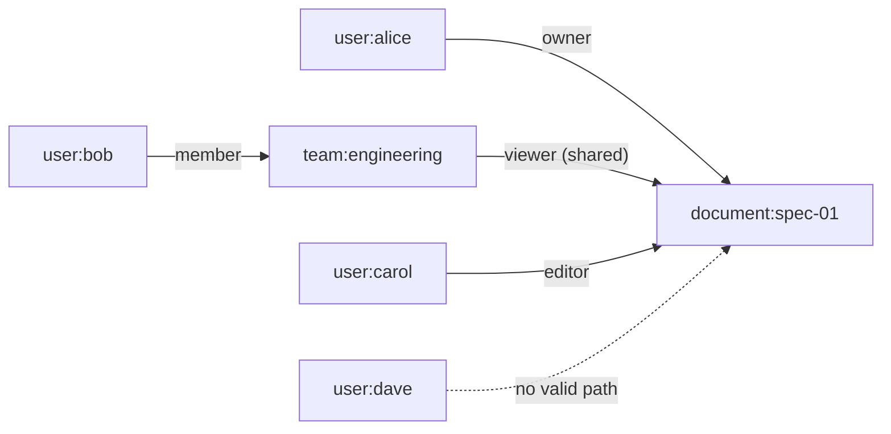
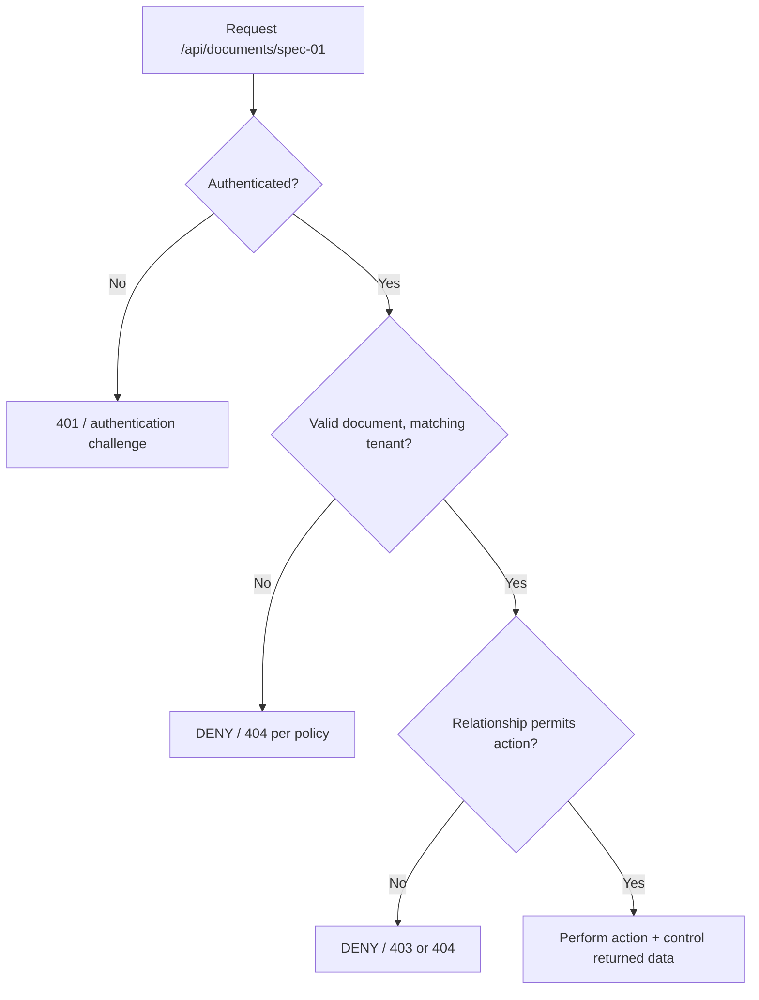

# ReBAC: Decisions Based on Ownership, Membership, and Sharing Relationships

**Relationship-Based Access Control (ReBAC)** is an access control model in which the **allow or deny** decision depends on the **relationships between the subject and the resource**. The question is not just "what role does this person have?", but rather: **"what relationship, direct or indirect, does this person have with the exact resource being accessed?"**

Example in a document management application:

- Alice is the **owner** of document `spec-01`, so she can read, edit, and share it according to policy.
- Bob is a **member of the group** `engineering`; document `spec-01` has view access shared with that group, so Bob can read it even though he does not own the document.
- Carol has been **directly shared** edit access to the document, so she can read and edit it.
- Dave has no valid relationship with the document; even though logged in, Dave is still denied.
- If Bob leaves `engineering`, the access derived from membership must disappear once the relationship change takes effect.

This lesson focuses on how to **model, infer, enforce, and test** ReBAC for ownership, membership, and sharing in a Java/Spring Security application.

## 1. Where Does ReBAC Fit in Access Control?

### 1.1. Comparing RBAC, ABAC, and ReBAC

| Model | Primary Decision Question | Example |
| --- | --- | --- |
| **RBAC** – Role-Based Access Control | Does the subject have a role permitted to perform the action? | `ROLE_EDITOR` can edit articles |
| **ABAC** – Attribute-Based Access Control | Do the attributes of the user, resource, and context satisfy the policy? | Only employees during working hours may approve transactions below a threshold |
| **ReBAC** – Relationship-Based Access Control | Does the subject have a permitting relationship with **this specific object**? | Only the owner, a shared editor, or a member of an authorized group can view the document |

Models can be **combined**. For instance, a system may require the user to have authority `documents.read` **and** have a `viewer` relationship with `document:spec-01` **and** be accessing within the right tenant. RBAC/coarse-grained permissions do not replace relationship checks on each record; likewise, ReBAC does not automatically replace all ABAC conditions such as document status or share expiration.

### 1.2. The Relationship Graph

Imagine ReBAC as a graph with:

- **Subject:** `user:alice`, `user:bob`, or a set of users such as `team:engineering#member`.
- **Object:** `document:spec-01`, `folder:project-x`, `team:engineering`, `organization:acme`.
- **Relation:** `owner`, `editor`, `viewer`, `member`, `parent`, `shared_with`.
- **Permission:** `can_read`, `can_edit`, `can_share` – **computed from relationships** according to specific rules.

An edge is commonly represented as a triple **(object, relation, subject)**. Illustrative relationship-tuple syntax:

```text
document:spec-01#owner@user:alice
team:engineering#member@user:bob
document:spec-01#viewer@team:engineering#member
document:spec-01#editor@user:carol
```

Interpretation:

1. `document:spec-01` has Alice as its owner.
2. Bob is a member of the engineering team.
3. **The entire member set** of the engineering team is designated as a viewer of the document.
4. Carol is granted editor access directly.

This is a way of representing the model, **not required Spring Security syntax**. Each authorization engine has its own format and rules; by default, Spring Security does not automatically create or query relationship tuples from a database.

### 1.3. Access Decisions Are Graph Queries



A direct relationship enables fast inference; an indirect relationship requires a **policy-compliant path**. Simply having any path in the graph does not grant access: edge names, edge direction, depth, and object types all matter.

## 2. Three Key Relationship Sources: Ownership, Membership, Sharing

### 2.1. Ownership

Example relationship: `document:spec-01#owner@user:alice`.

An owner usually has read, edit, or share rights, **but that must be defined in the policy**. "Owner" is not a primitive that automatically grants every permission: an application might forbid an owner from deleting finalized documents, require two approvers to transfer ownership, or restrict sharing outside the organization.

Clearly decide:

- **Single or multiple owners?** Are co-ownership, ownership transfer, or organizational ownership instead of individual ownership allowed?
- **Who can change the owner?** Never trust a client-supplied `ownerId` and grant access immediately.
- **What is the trusted source of ownership?** Relationships must be read from server-managed data stores and updated in valid transactions.
- **Does ownership cross tenant boundaries?** Usually no, unless a cross-tenant policy is deliberately designed.

### 2.2. Membership

Example relationship: `team:engineering#member@user:bob`.

Membership usually **does not directly grant access to every document**. Bob becomes a viewer of `spec-01` because **two relationships combine**:

1. Bob is a `member` of `engineering`.
2. `spec-01` is shared with `viewer` access to the **member set** of `engineering`.

If the group has not been shared the document, Bob cannot read it merely by being a group member. If Bob leaves the group, the inference path is severed and the corresponding access disappears. For nested groups such as `team:backend` belonging to `team:engineering`, you must **explicitly define** whether membership is inherited, restrict which edge types may be traversed, and guard against cycles.

**Organization membership** works the same way: "belongs to company Acme" does not mean "allowed to read all Acme documents". It can be a **necessary condition**, while reading still requires a relationship with the specific object.

### 2.3. Sharing

A "Share" operation typically adds or updates a relationship:

| User Action | Relationship Change | Effect Under Example Policy |
| --- | --- | --- |
| Alice shares view with Bob | Add `document:spec-01#viewer@user:bob` | Bob can read, cannot edit yet |
| Alice shares edit with Carol | Add `document:spec-01#editor@user:carol` | Carol can read and edit |
| Alice shares view with engineering team | Add `document:spec-01#viewer@team:engineering#member` | Valid members of the team can read |
| Alice revokes Carol's share | Remove the corresponding `editor` edge | Carol loses editor access, unless another granting path exists |
| Bob leaves engineering | Remove `team:engineering#member@user:bob` | Bob loses access from the team share, **but may still have another direct share** |

Revoking **one edge** does not necessarily mean removing **all access paths**. For example, if Bob leaves engineering after Alice directly shared viewer access with him, Bob can still read via the direct share. Revoking all access must account for remaining relationships.

**Link sharing** is a distinct case: a secret link can act as a *capability* with an expiration time, allowed actions, and usage conditions. Do not treat "having a URL" as being a member of a group by default, or turn a guessable link into a public `viewer`. Manage sufficiently strong link tokens, limit permissions, support revocation, audit usage, and prevent leakage via logs/referrers.

## 3. Defining the Policy Before Writing Code

For document `D` and user `U`, suppose the business specifies:

- **Read:** owner **or** editor **or** direct viewer **or** member of a team shared as viewer/editor.
- **Edit:** owner **or** direct editor **or** member of a team shared as editor.
- **Share:** owner only (can be extended to admin roles by a separate policy).
- **Tenant boundary:** user and document must belong to the same valid tenant in this example.
- **Default:** if no valid relationship path is found, **DENY**.

The conditions can be written as:

```text
can_read(U, D) =
    same_tenant(U, D)
    AND (
         owner(U, D)
      OR editor(U, D)
      OR viewer(U, D)
      OR exists team T:
            member(U, T)
        AND shared_as_viewer_or_editor(D, T)
    )

can_edit(U, D) =
    same_tenant(U, D)
    AND (
         owner(U, D)
      OR editor(U, D)
      OR exists team T:
            member(U, T)
        AND shared_as_editor(D, T)
    )

can_share(U, D) =
    same_tenant(U, D)
    AND owner(U, D)
```

**Note:** Here `viewer(U, D)` and `editor(U, D)` are direct relationships; paths through a team are evaluated separately. An engine may express them as userset unions, but the authorization semantics must remain consistent.

| Subject | Relationship with `spec-01` | Read | Edit | Share |
| --- | --- | --- | --- | --- |
| Alice | Owner | Yes | Yes | Yes |
| Bob | Member of engineering; engineering shared as viewer | Yes | No | No |
| Carol | Directly shared as editor | Yes | Yes | No |
| Dave | No valid edge | No | No | No |
| Bob after leaving engineering | No other access path | No | No | No |

If the system has **explicit deny**, define precedence: does deny always win over grant or are there exceptions? Not every ReBAC engine natively supports "deny overrides"; **do not assume** this behavior just from relation names.

### Folder Permission Inheritance Must Also Be Declared

Suppose a document resides in folder `project-x`, and the folder is shared with a team. If you want the document to **inherit the folder's view permission**, a policy like the following is needed:

```text
document.can_read = document.local_read OR document.parent_folder.can_read
```

This is an **explicit design rule**, not something that appears automatically just because a document and folder have a `parent` relation. Consider inheritance blocking, moving folders, nested folders, cycles, and unintended privilege expansion when moving documents.

## 4. Processing Flow of a ReBAC Request

For example, Bob calls `GET /api/documents/spec-01`:

1. **Authentication:** Spring Security validates the session or Bearer token. Determine Bob's **stable subject ID** from verified principal/claims. Never take an arbitrary user ID from the request body to spoof a subject.
2. **Load resource metadata:** query `spec-01` from the trusted store to get tenant ID, state, and parent relationships. If it does not exist, return 404 per the API contract.
3. **Check boundary:** confirm Bob is operating within an allowed tenant and satisfies required authentication/coarse-grained permissions.
4. **Check relationships:** ask the relationship service whether Bob is directly owner/editor/viewer; if not, whether the document is shared with a team Bob belongs to; if policy allows, evaluate other inherited relationships.
5. **Decision:** return allow/deny. Return **403** when authenticated without sufficient permission, or **404** if policy hides resource existence; apply consistently to avoid ID enumeration.
6. **Enforcement:** only when allowed does the service read/return data or perform the mutation. Write audit logs as needed, especially for share/revoke/transfer.



This is **resource-level authorization**. A rule like `hasRole('USER')` or `hasAuthority('SCOPE_documents.read')` at the HTTP layer can serve as an initial guard, but **does not prove** the user has access to `spec-01`.

## 5. Standalone Java 17 Example: Owner, Team Membership, Share, and Revoke

The following example uses an in-memory `Set<Edge>` to simulate relationship tuples. It demonstrates:

- Owner has read/edit/share rights.
- Viewer comes from a direct share or team membership.
- Editor can also read.
- Same tenant is a mandatory condition in the illustrative policy.
- Leaving a group removes group-derived access.
- Access is denied when no matching relationship is found.

This is an **authorization simulation**, not a Spring Boot application or production storage system.

Create the file **`RebacDemo.java`**:

```java
import java.util.HashSet;
import java.util.Set;

public class RebacDemo {

    record User(String id, String tenantId) {}
    record Document(String id, String tenantId) {}

    record Edge(
            String objectType,
            String objectId,
            String relation,
            String subjectType,
            String subjectId
    ) {}

    private static final Set<Edge> EDGES = new HashSet<>();

    private static Edge edge(
            String objectType,
            String objectId,
            String relation,
            String subjectType,
            String subjectId
    ) {
        return new Edge(objectType, objectId, relation, subjectType, subjectId);
    }

    private static boolean hasRelation(User user, Document document, String relation) {
        Edge direct = edge("document", document.id(), relation, "user", user.id());
        if (EDGES.contains(direct)) {
            return true;
        }

        for (Edge share : EDGES) {
            if (share.objectType().equals("document")
                    && share.objectId().equals(document.id())
                    && share.relation().equals(relation)
                    && share.subjectType().equals("team")) {

                Edge membership = edge(
                        "team", share.subjectId(), "member", "user", user.id()
                );
                if (EDGES.contains(membership)) {
                    return true;
                }
            }
        }
        return false;
    }

    private static boolean sameTenant(User user, Document document) {
        return user.tenantId().equals(document.tenantId());
    }

    static boolean canRead(User user, Document document) {
        return sameTenant(user, document)
                && (hasRelation(user, document, "owner")
                    || hasRelation(user, document, "editor")
                    || hasRelation(user, document, "viewer"));
    }

    static boolean canEdit(User user, Document document) {
        return sameTenant(user, document)
                && (hasRelation(user, document, "owner")
                    || hasRelation(user, document, "editor"));
    }

    static boolean canShare(User user, Document document) {
        return sameTenant(user, document)
                && hasRelation(user, document, "owner");
    }

    public static void main(String[] args) {
        User alice = new User("alice", "acme");
        User bob = new User("bob", "acme");
        User carol = new User("carol", "acme");

        Document spec = new Document("spec-01", "acme");
        Document privateDoc = new Document("private-02", "acme");
        Document otherTenantDoc = new Document("partner-03", "other");

        EDGES.add(edge("document", "spec-01", "owner", "user", "alice"));
        EDGES.add(edge("document", "private-02", "owner", "user", "alice"));
        EDGES.add(edge("document", "spec-01", "viewer", "team", "engineering"));
        EDGES.add(edge("document", "spec-01", "editor", "user", "carol"));
        EDGES.add(edge("document", "partner-03", "viewer", "user", "bob"));

        Edge bobMembership = edge(
                "team", "engineering", "member", "user", "bob"
        );
        EDGES.add(bobMembership);

        System.out.println("Alice shares spec: " + canShare(alice, spec));
        System.out.println("Bob reads spec: " + canRead(bob, spec));
        System.out.println("Bob edits spec: " + canEdit(bob, spec));
        System.out.println("Carol edits spec: " + canEdit(carol, spec));
        System.out.println("Bob reads private: " + canRead(bob, privateDoc));
        System.out.println("Bob reads other tenant: " + canRead(bob, otherTenantDoc));

        EDGES.remove(bobMembership);
        System.out.println("Bob reads after revoke: " + canRead(bob, spec));
    }
}
```

Compile and run with **JDK 17 or later**:

```bash
javac RebacDemo.java
java RebacDemo
```

Exact stdout output:

```text
Alice shares spec: true
Bob reads spec: true
Bob edits spec: false
Carol edits spec: true
Bob reads private: false
Bob reads other tenant: false
Bob reads after revoke: false
```

**Explanation of two subtle points:**

- `document:spec-01#viewer@team:engineering` is a share edge to a **group**. `hasRelation` only expands one level: from document → team → user via `member`. This is a **fixed simulation rule**; it does not support nested teams, folder inheritance, deny rules, expiration, or share-write permissions.
- `partner-03` has a direct viewer edge for Bob, but Bob belongs to tenant `acme` while the document belongs to `other`. `sameTenant` blocks cross-tenant access. In a real system, user/document tenants must come from trusted sources and handle users with multiple tenant memberships.

Do not use this global in-memory relationship set to replace a real database. Scanning the entire edge set in a loop is only suitable for examples; large systems need indexes, queries scoped by object/relation, or a dedicated authorization engine.

## 6. Integrating ReBAC Policies into Spring Security

In Spring Boot 3.x / Spring Security 6.x (or compatible versions), implementing ReBAC usually means **combining Spring Security with a domain authorization service**:

- **Authentication:** extract the authenticated principal; JWT/session verification is handled by Spring Security.
- **HTTP authorization:** block unauthenticated requests and require coarse-grained authorities such as `documents.read`.
- **Method/resource authorization:** use `@PreAuthorize` or a custom `AuthorizationManager` that calls a service checking relationships on the **real document ID**.
- **Data-layer enforcement:** filter permitted records or check before reading/updating, reducing the risk of bypass through other endpoints.

### 6.1. Configuring Method Security

In an application with the Spring Security starter, enable method security:

```java
import org.springframework.context.annotation.Configuration;
import org.springframework.security.config.annotation.method.configuration.EnableMethodSecurity;

@Configuration
@EnableMethodSecurity
public class MethodSecurityConfig {
}
```

This class is **a component within a Spring application**, not a standalone Java program to run with `java MethodSecurityConfig`.

When a Spring-managed service has a protected method, you can declare an expression:

```java
@PreAuthorize("@documentPolicy.canRead(authentication, #documentId)")
```

The expression invokes the application-defined `documentPolicy` bean and passes the authenticated `Authentication` along with the **call's document ID**. `canRead` must fetch metadata/relationships from a trusted source, check the tenant, evaluate the policy, and return a boolean. The parameter name `documentId` must be resolvable by Spring (for example, compiled with `-parameters` or annotated with `@P`). The annotation snippet above is an **integration illustration** to place on an appropriate method; copying it alone does not create the bean or repository.

Important: Spring Method Security relies on interception/proxies in typical configurations; **direct internal calls within the same bean** may bypass the proxy. Place checks at clear service/entrypoint boundaries, protect every critical access path, and avoid relying solely on annotations in a single controller.

### 6.2. Relationship Storage Models

Two common approaches exist:

**Application database:** store `document_owner`, `team_member`, and `document_share`; query by document ID, user ID, and tenant ID. Suitable when policies are relatively simple and transactions must be tightly coupled with domain data. Illustrative logical design:

```text
documents(id, tenant_id, owner_user_id, ...)
team_members(tenant_id, team_id, user_id, active)
document_shares(tenant_id, document_id, grantee_type, grantee_id, permission)
```

Here `grantee_type` only allows controlled values like `USER`, `TEAM`; `permission` represents `VIEWER` or `EDITOR`. Proper constraints/indexes (tenant + document, tenant + team + user, tenant + grantee) and deletion/ownership-transfer rules are needed. The model above is an **illustrative data design**, not DDL statements for direct deployment.

**Dedicated authorization service:** store relationship tuples and declare permission models in a ReBAC-capable system such as OpenFGA/SpiceDB. APIs call check operations for user–relation–object and can share the same model across multiple services. This decouples policy from endpoint logic, but requires handling **data synchronization, latency, network errors, revoke/update ordering, and consistency**; do not assume the engine automatically guarantees every desired consistency level.

### 6.3. Consistent CRUD Rules

Do not check only on `GET /documents/{id}`:

- **Read one:** check the exact `documentId` of the object to be returned.
- **List/search:** return **only permitted documents**, using relationship-filtered queries or an API listing authorized objects. Do not return the full list and merely hide buttons in the UI.
- **Update/delete:** evaluate specific `can_edit`/`can_delete` permissions; do not infer them from read permission.
- **Create child/share:** check `can_create_in_folder` or `can_share` on the parent/document, verify the recipient is valid, then write the new edge.
- **Export/download/thumbnail/preview:** apply the same policy on secondary data paths; direct download URLs or caches/CDNs can become bypasses.
- **Background jobs/message handlers:** require an appropriate system principal and policy, since not every access goes through an HTTP controller.

When paginating, permission filtering must be part of the query/listing itself or follow a controlled strategy. Filtering after pagination can produce empty pages, wrong total counts, or metadata leaks; `@PostFilter` is not a default solution for large datasets.

## 7. Notes on Sharing, Revocation, and Consistency

### 7.1. Who Can Create/Delete a Relationship?

**Permission to modify ACLs must be checked independently.** Never accept a request like:

```json
{
  "documentId": "spec-01",
  "relation": "owner",
  "userId": "attacker"
}
```

and write the relationship just because the JSON contains a `relation` field. The server must check that the caller has `can_share` or `can_transfer_owner`, verify valid relationship/object/tenant, restrict allowed relations, and record an audit log. **The ability to grant permissions to others** is often more sensitive than viewing content.

### 7.2. Revocation May Not Appear Immediately with Caches/Stale Reads

Deleting a relationship from the database does not guarantee everywhere sees the change simultaneously if the system has caches or lagging replicas. Determine:

- Target time for revocation to take effect; sensitive operations may require strong/at-least-as-fresh reads.
- How to refresh/invalidate caches when owner, share, member, or parent folder changes.
- Consistency between **ACL and content**: prevent a recently revoked user from reading new data versions during an inconsistency window.
- Strategy when the authorization service fails/times out: for protected access, **fail closed** per policy, never allow merely because of a connection failure.
- When a user still has access through **another path**, model revoke-all-access instead of deleting only one known edge.

An access token or JWT carrying old roles/scopes **does not immediately reflect** dynamic relationship changes. If the system makes ReBAC decisions on dynamic relationships, evaluate them at access time or use appropriate freshness/TTL; do not freeze long-lived shares inside tokens and assume instant revocation.

### 7.3. Cycles and Unintended Derived Permissions

With nested teams/folders, a graph like `team-a → team-b → team-a` can form cycles. The relationship resolver must enforce a visited set, recursion depth limits, clear inheritance rules, and path tests. The system must not grant access just because **some path exists** between a user and a document: only relations declared in the policy carry effect.

Major relationship changes (moving folders, deleting groups, changing owners, transferring tenants) require re-verifying derived permissions to prevent **privilege escalation**.

## 8. Common Design Pitfalls

| Mistake | Consequence | How to Avoid |
| --- | --- | --- |
| Checking only `hasRole('USER')` before reading a document | Any user with the same role can view others' data | Check `can_read(user, documentId)` on the record itself |
| Assuming tenant/team members can view all content by default | Excessive privilege expansion | Require share/owner relationships per policy |
| Checking client-sent owner ID | Subject/resource spoofing possible | Derive principal and ownership from the server |
| Revoking one direct share and declaring full revocation | Paths via team/owner still remain | Compute all valid access paths |
| Not checking tenant on every edge or resource | Cross-tenant data leak | Scope relations by tenant boundary and verify from DB |
| Letting every viewer-shared member edit | Broken permission separation | Separate `can_read`, `can_edit`, `can_share` |
| Assuming folder shares automatically inherit | Unpredictable outcomes | Define explicit relations and parent rules |
| Enforcing detailed checks only in the UI | API/export/jobs still expose data | Enforce server-side on every read/write path |
| Caching allow results too long | Delayed revocation; stale permissions | Appropriate cache keys/versions/TTLs and invalidation |
| Turning "anyone with link" into an unlimited public user | Hard to control/revoke links | Scoped capabilities, strong tokens, audit, expiry |

## 9. Testing ReBAC with a Relationship Matrix

At minimum, test the following scenarios in both policy unit tests and critical endpoint/repository integration tests:

1. **Owner:** read/edit/share succeed in the right tenant; ownership transfer does not grant illegitimate access.
2. **Direct share:** viewer can only read, editor can read/edit; direct revocation removes access when no other path exists.
3. **Group share:** only members of the shared group can read; unshared groups grant no access.
4. **Membership change:** joining grants access per policy; leaving removes access; test also when another direct share exists.
5. **Multiple paths:** removing one relationship while another remains valid matches policy expectations.
6. **Tenant isolation:** identical group IDs/names in different tenants never merge; invalid cross-tenant edges grant no access.
7. **Nested team/folder:** verify configured inheritance, cycles, depth limits, and parent changes.
8. **List vs detail:** objects returned in lists never exceed directly readable objects; pagination/total count do not leak unauthorized documents.
9. **Mutation:** users without `can_share` cannot grant themselves owner/editor; races during share/revoke/update; fail closed when the relationship service is down.
10. **Anonymous/expired authentication:** cannot view protected resources; return 401/403/404 per policy without leaking sensitive details.

Especially important scenario: after Bob leaves engineering, **re-read the updated relationships** and verify `GET /documents/spec-01` is denied, unless Bob still holds a direct share or another valid access path.

## 10. Putting the Right Mental Model Together

Given the requirement "Alice owns the document; Bob is a member of a shared team; Carol has a direct share", proceed in order:

1. **Identify** subjects and resources with stable IDs, verifying the tenant from a trusted source.
2. **Represent relationships** owner/member/viewer/editor; know exactly which relation was granted by whom.
3. **Declare the policy**: which relationship paths compute read/edit/share; which cases deny by default.
4. **Compute decisions on the backend** for the exact object/action, combining authentication and other business conditions.
5. **Enforce consistently** across detail, list, export, update, and share; clarify consistency/revocation guarantees.

**Core takeaway:** ReBAC decides based on **valid relationships in the graph**, not by inferring access from a general role or authentication alone. Ownership, membership, and sharing are distinct relationship sources; effective permissions result from **applying the policy across all permitted relationship paths**, alongside security conditions such as tenant and resource state. Spring Security can enforce that decision via method/resource authorization, while the relationship model and data must be supplied by the application or an authorization service.

## References

- [Spring Security – Method Security](https://docs.spring.io/spring-security/reference/servlet/authorization/method-security.html)
- [Spring Security – Authorize HTTP Requests](https://docs.spring.io/spring-security/reference/servlet/authorization/authorize-http-requests.html)
- [OpenFGA – Modeling Your Authorization](https://openfga.dev/docs/modeling)
- [OpenFGA – Relationship Tuples](https://openfga.dev/docs/concepts)
- [Zanzibar: Google’s Consistent, Global Authorization System (USENIX ATC 2019)](https://www.usenix.org/conference/atc19/presentation/pang)
