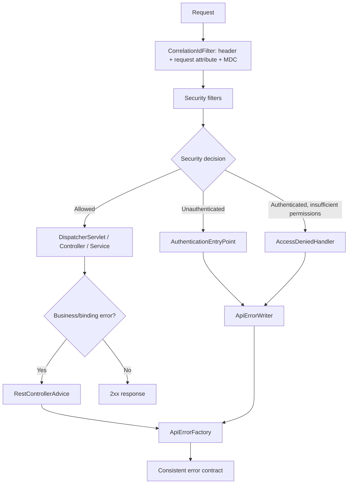

# Standardizing Error Codes, Messages, and Correlation IDs Across Layers

In a REST API using Spring Security, a request can fail before entering the controller (unauthenticated or insufficient permissions), in MVC when receiving invalid input, in the service when violating business rules, or at the gateway/downstream. If each layer returns arbitrary errors, clients struggle to handle them consistently and operations teams struggle to trace requests. The solution is **a common HTTP error contract** and **a correlation ID across the entire request**.

This lesson belongs to **Spring Security – authorization → Access Denial Handling**, so the focus is on ensuring responses from `AuthenticationEntryPoint` (typically 401) and `AccessDeniedHandler` (typically 403) align consistently with `@RestControllerAdvice` and services. The example below targets **Java 17+, Spring Boot 3.x, Spring Security 6.x, Servlet/MVC**; WebFlux uses different APIs such as `ServerAuthenticationEntryPoint` and `ServerAccessDeniedHandler`.

## 1. Common Error Contract

Example when an unauthenticated request calls `/api/data`:

```http
HTTP/1.1 401 Unauthorized
Content-Type: application/json;charset=UTF-8
WWW-Authenticate: Basic realm="learning-api"
X-Correlation-ID: req-20261105-0001
```

```json
{
  "code": "AUTHENTICATION_REQUIRED",
  "message": "Authentication is required to access this resource.",
  "correlationId": "req-20261105-0001",
  "path": "/api/data",
  "timestamp": "2026-11-05T11:00:00Z"
}
```

This is a **structural illustration**; the actual `timestamp` is generated at response time. Do not ignore the HTTP status and important headers when checking only JSON.

| Element | Role | Rules |
| --- | --- | --- |
| HTTP status | Distinguishes outcome categories at the protocol level | Preserve proper 400/401/403/404/500; never turn errors into HTTP 200. |
| `code` | Stable code for client applications to branch on | Named in uppercase such as `AUTHENTICATION_REQUIRED`; follow a versioning policy. |
| `message` | Explanation safe to expose to the client | Brief; never expose internal roles, stack traces, credentials, or SQL details. |
| `correlationId` | Correlates the same request across headers, body, logs, and related systems | Must be consistent and input-validated. |
| `path` | Failing endpoint | Avoid including raw query strings containing tokens/sensitive data. |
| `timestamp` | Time the error was created | Use `Instant`/UTC or a format with an explicit timezone. |

**HTTP status** and **`code`** serve two different purposes. Clients should rely on the status and stable code; they should not match against literal `message` strings, because messages may be translated or reworded for clarity.

| Scenario | Common Status | Suggested `code` | Where Handled |
| --- | --- | --- | --- |
| Unauthenticated, invalid or missing credentials/token | 401 | `AUTHENTICATION_REQUIRED` | `AuthenticationEntryPoint`/authentication filter |
| Authenticated but lacking permissions | 403 | `ACCESS_DENIED` | `AccessDeniedHandler` |
| Invalid input or business constraint violation | 400 | `INVALID_INPUT` | MVC advice |
| Resource does not exist | 404 | `RESOURCE_NOT_FOUND` | MVC/gateway depending on error origin |
| Unexpected server error | 500 | `INTERNAL_ERROR` | Global error handling |
| Upstream failure at gateway | 502/503/504 depending on case | `UPSTREAM_ERROR` | Gateway/integration layer |

**401 and 403 do not simply map one-to-one with Java exception names.** When `ExceptionTranslationFilter` encounters `AccessDeniedException`, Spring Security checks authentication state: an anonymous principal may be routed to the entry point instead of returning 403. When an authenticated principal lacks a role, `AccessDeniedHandler` typically returns 403. CSRF errors can also cause a 403, so diagnose based on the actual root cause.

## 2. How Errors Flow Through the Layers



- `AuthenticationEntryPoint` starts authentication or responds requesting authentication; in Basic APIs it typically returns 401 with `WWW-Authenticate`. In form login applications it may return a 302 redirect.
- `AccessDeniedHandler` handles cases considered authenticated yet lacking permission, typically returning 403.
- `@RestControllerAdvice` handles exceptions from Spring MVC/controllers/services; it **does not replace** the two security handlers because filters can reject requests before controllers run.
- Services throw meaningful business exceptions, such as `InvalidInputException`, leaving the HTTP interface layer to decide status/body.
- Some authentication filters (such as HTTP Basic) may invoke the entry point directly when credentials are wrong. To return the same JSON for both missing credentials and wrong credentials, configure the entry point in **both `exceptionHandling` and `httpBasic`**.

If the application uses OAuth2 Resource Server, preserve the **Bearer challenge** protocol (`WWW-Authenticate: Bearer ...`) when customizing the body. Do not copy Basic headers for JWT/Bearer; `BearerTokenAuthenticationEntryPoint` and `BearerTokenAccessDeniedHandler` serve specialized roles.

## 3. Designing a Trustworthy Correlation ID

An example header name is `X-Correlation-ID`. A filter running before any point that might deny the request will:

1. Read the ID from the request if present. Accept it according to trust boundary policies and specific syntax/length rules; otherwise, generate a UUID.
2. Write the same ID into a **request attribute**, **response header**, and **MDC** (`org.slf4j.MDC`) so controllers, security handlers, and logging all share it.
3. Restore/clear the MDC value in `finally` so thread pools do not leak IDs from previous requests.
4. Never generate a new ID inside `AuthenticationEntryPoint`, `AccessDeniedHandler`, or individual exception handlers.
5. Forward the ID downstream only when permitted. MDC does not propagate automatically across `@Async`, other threads, queues, or scheduled jobs; use intentional context propagation/task decorators.
6. Distinguish `correlationId` from Micrometer/OpenTelemetry `traceId` and `spanId`. All three can be logged; they are not inherently equivalent.

In the example, valid IDs consist of 8–64 ASCII characters `[A-Za-z0-9._-]`; strings containing control characters, newlines, or excessive length are replaced. Real gateways must also specify whether client-supplied headers are trusted or only ingress-issued headers. If multiple headers with the same name appear, normalize/strip them at ingress.

## 4. Runnable Example with Spring Boot 3.x

Create a Spring Boot project with package `com.example.demo`. Use Java 17+, Spring Web, Spring Security, and `spring-boot-starter-test`/`spring-security-test` for testing. Example `build.gradle`:

```groovy
plugins {
    id 'java'
    id 'org.springframework.boot' version '3.3.5'
    id 'io.spring.dependency-management' version '1.1.6'
}

group = 'com.example'
version = '0.0.1-SNAPSHOT'

java {
    toolchain {
        languageVersion = JavaLanguageVersion.of(17)
    }
}
repositories { mavenCentral() }
dependencies {
    implementation 'org.springframework.boot:spring-boot-starter-web'
    implementation 'org.springframework.boot:spring-boot-starter-security'
    testImplementation 'org.springframework.boot:spring-boot-starter-test'
    testImplementation 'org.springframework.security:spring-security-test'
}
tasks.named('test') { useJUnitPlatform() }
```

Place each Java snippet below in a file matching its public class/record/enum name under `src/main/java/com/example/demo/`.

### 4.1. Application Entry Point, Error Codes, and Body

**DemoApplication.java**

```java
package com.example.demo;

import org.springframework.boot.SpringApplication;
import org.springframework.boot.autoconfigure.SpringBootApplication;

@SpringBootApplication
public class DemoApplication {
    public static void main(String[] args) {
        SpringApplication.run(DemoApplication.class, args);
    }
}
```

**ErrorCode.java**

```java
package com.example.demo;

import org.springframework.http.HttpStatus;

public enum ErrorCode {
    AUTHENTICATION_REQUIRED(HttpStatus.UNAUTHORIZED,
            "Authentication is required to access this resource."),
    ACCESS_DENIED(HttpStatus.FORBIDDEN,
            "You do not have permission to access this resource."),
    INVALID_INPUT(HttpStatus.BAD_REQUEST,
            "Request data is invalid."),
    RESOURCE_NOT_FOUND(HttpStatus.NOT_FOUND,
            "Resource not found."),
    INTERNAL_ERROR(HttpStatus.INTERNAL_SERVER_ERROR,
            "A system error occurred. Please try again later.");

    private final HttpStatus status;
    private final String publicMessage;

    ErrorCode(HttpStatus status, String publicMessage) {
        this.status = status;
        this.publicMessage = publicMessage;
    }

    public HttpStatus status() {
        return status;
    }

    public String publicMessage() {
        return publicMessage;
    }
}
```

**ApiError.java**

```java
package com.example.demo;

import java.time.Instant;

public record ApiError(
        String code,
        String message,
        String correlationId,
        String path,
        Instant timestamp) {
}
```

**ApiErrorFactory.java**

```java
package com.example.demo;

import java.time.Instant;
import jakarta.servlet.http.HttpServletRequest;
import org.springframework.stereotype.Component;

@Component
public class ApiErrorFactory {
    public ApiError create(ErrorCode code, HttpServletRequest request) {
        return new ApiError(
                code.name(),
                code.publicMessage(),
                CorrelationIdFilter.requireId(request),
                request.getRequestURI(),
                Instant.now());
    }
}
```

The `ErrorCode` catalog is the single source of truth for `code`/status/public message. Never copy `exception.getMessage()` directly into `ApiError.message` because it may contain security or infrastructure details. `ApiErrorFactory` retrieves the correlation ID already attached to the request rather than generating a new one.

### 4.2. Filter Issuing Correlation IDs

**CorrelationIdFilter.java**

```java
package com.example.demo;

import java.io.IOException;
import java.util.UUID;
import java.util.regex.Pattern;

import jakarta.servlet.FilterChain;
import jakarta.servlet.ServletException;
import jakarta.servlet.http.HttpServletRequest;
import jakarta.servlet.http.HttpServletResponse;
import org.slf4j.MDC;
import org.springframework.web.filter.OncePerRequestFilter;

public final class CorrelationIdFilter extends OncePerRequestFilter {
    public static final String HEADER = "X-Correlation-ID";
    private static final String ATTRIBUTE =
            CorrelationIdFilter.class.getName() + ".id";
    private static final String MDC_KEY = "correlationId";
    private static final Pattern VALID_ID =
            Pattern.compile("[A-Za-z0-9][A-Za-z0-9._-]{7,63}");

    @Override
    protected void doFilterInternal(HttpServletRequest request,
                                    HttpServletResponse response,
                                    FilterChain chain)
            throws ServletException, IOException {

        String supplied = request.getHeader(HEADER);
        String correlationId =
                supplied != null && VALID_ID.matcher(supplied).matches()
                ? supplied
                : UUID.randomUUID().toString();

        request.setAttribute(ATTRIBUTE, correlationId);
        response.setHeader(HEADER, correlationId);

        String previous = MDC.get(MDC_KEY);
        MDC.put(MDC_KEY, correlationId);
        try {
            chain.doFilter(request, response);
        } finally {
            if (previous == null) {
                MDC.remove(MDC_KEY);
            } else {
                MDC.put(MDC_KEY, previous);
            }
        }
    }

    public static String requireId(HttpServletRequest request) {
        Object value = request.getAttribute(ATTRIBUTE);
        if (value instanceof String id) {
            return id;
        }
        throw new IllegalStateException(
                "CorrelationIdFilter must execute before error handling");
    }
}
```

`requireId` intentionally throws a configuration error if the ID is missing, preventing returning two different IDs in headers and body. Every request entering the Security chain must pass through this filter before handlers run. The code uses `request.getHeader()` (first value); in real systems, establish a policy for duplicate or conflicting headers at ingress.

`MDC.put` only populates the context; for logs to actually display the ID, configure Logback's pattern/JSON encoder. Example `src/main/resources/application.properties`:

```properties
logging.pattern.level=%5p [correlationId:%X{correlationId:-none}]
```

An illustrative application log line might look like:

```text
WARN [correlationId:req-20261105-0001] Access denied for /api/admin
```

That is a formatting example, **not** a log automatically generated by Security. Avoid logging sensitive data such as tokens, passwords, cookies, or raw query strings.

### 4.3. Sharing One JSON Writer for Both Security Handlers

**ApiErrorWriter.java**

```java
package com.example.demo;

import java.io.IOException;
import java.nio.charset.StandardCharsets;
import com.fasterxml.jackson.databind.ObjectMapper;
import jakarta.servlet.http.HttpServletRequest;
import jakarta.servlet.http.HttpServletResponse;
import org.springframework.http.MediaType;
import org.springframework.stereotype.Component;

@Component
public class ApiErrorWriter {
    private final ObjectMapper mapper;
    private final ApiErrorFactory factory;

    public ApiErrorWriter(ObjectMapper mapper, ApiErrorFactory factory) {
        this.mapper = mapper;
        this.factory = factory;
    }

    public void write(HttpServletRequest request,
                      HttpServletResponse response,
                      ErrorCode code) throws IOException {
        response.setStatus(code.status().value());
        response.setCharacterEncoding(StandardCharsets.UTF_8.name());
        response.setContentType(MediaType.APPLICATION_JSON_VALUE);
        mapper.writeValue(response.getOutputStream(),
                factory.create(code, request));
    }
}
```

**SecurityConfig.java**

```java
package com.example.demo;

import org.springframework.boot.web.servlet.FilterRegistrationBean;
import org.springframework.context.annotation.Bean;
import org.springframework.context.annotation.Configuration;
import org.springframework.http.HttpHeaders;
import org.springframework.security.config.annotation.web.builders.HttpSecurity;
import org.springframework.security.core.userdetails.User;
import org.springframework.security.core.userdetails.UserDetailsService;
import org.springframework.security.crypto.bcrypt.BCryptPasswordEncoder;
import org.springframework.security.crypto.password.PasswordEncoder;
import org.springframework.security.provisioning.InMemoryUserDetailsManager;
import org.springframework.security.web.AuthenticationEntryPoint;
import org.springframework.security.web.SecurityFilterChain;
import org.springframework.security.web.access.AccessDeniedHandler;
import org.springframework.security.web.context.SecurityContextHolderFilter;

@Configuration
public class SecurityConfig {
    @Bean
    CorrelationIdFilter correlationIdFilter() {
        return new CorrelationIdFilter();
    }

    @Bean
    FilterRegistrationBean<CorrelationIdFilter> correlationRegistration(
            CorrelationIdFilter filter) {
        FilterRegistrationBean<CorrelationIdFilter> registration =
                new FilterRegistrationBean<>(filter);
        registration.setEnabled(false);
        return registration;
    }

    @Bean
    SecurityFilterChain securityFilterChain(
            HttpSecurity http,
            CorrelationIdFilter filter,
            ApiErrorWriter writer) throws Exception {

        AuthenticationEntryPoint unauthorized =
                (request, response, exception) -> {
                    response.setHeader(HttpHeaders.WWW_AUTHENTICATE,
                            "Basic realm=\"learning-api\"");
                    writer.write(request, response,
                            ErrorCode.AUTHENTICATION_REQUIRED);
                };

        AccessDeniedHandler forbidden =
                (request, response, exception) ->
                        writer.write(request, response,
                                ErrorCode.ACCESS_DENIED);

        http
            .authorizeHttpRequests(authorize -> authorize
                .requestMatchers("/api/public").permitAll()
                .requestMatchers("/api/admin").hasRole("ADMIN")
                .requestMatchers("/api/**").authenticated()
                .anyRequest().permitAll())
            .exceptionHandling(exceptions -> exceptions
                .authenticationEntryPoint(unauthorized)
                .accessDeniedHandler(forbidden))
            .httpBasic(basic -> basic
                .authenticationEntryPoint(unauthorized))
            .addFilterBefore(filter, SecurityContextHolderFilter.class);

        return http.build();
    }

    @Bean
    PasswordEncoder passwordEncoder() {
        return new BCryptPasswordEncoder();
    }

    @Bean
    UserDetailsService users(PasswordEncoder encoder) {
        return new InMemoryUserDetailsManager(
                User.withUsername("reader")
                    .password(encoder.encode("demo-pass"))
                    .roles("READER")
                    .build());
    }
}
```

**Important configuration points:**

- `addFilterBefore(..., SecurityContextHolderFilter.class)` ensures the correlation ID exists before authentication/authorization. Configuring `FilterRegistrationBean#setEnabled(false)` prevents Spring Boot from registering the same filter a second time in the servlet container.
- `exceptionHandling.authenticationEntryPoint(...)` handles the unauthenticated case during authorization checks. `httpBasic.authenticationEntryPoint(...)` also handles wrong Basic credentials. Both use `AUTHENTICATION_REQUIRED`.
- `accessDeniedHandler` shares the writer but maps to `ACCESS_DENIED` and HTTP 403.
- HTTP 401 Basic still carries the protocol-compliant `WWW-Authenticate` header; this header is set **before** the writer writes the response.
- The `/api/admin` matcher precedes `/api/**` so role `ADMIN` is not shadowed by the broader matcher.
- The example endpoints are all GET, so CSRF does not need to be disabled. For state-changing methods, design CSRF based on the specific authentication mechanism—do not disable it just because you see a 403.
- The in-memory user and password `demo-pass` are for learning only, not a production configuration.

### 4.4. Service Throws Business Errors; MVC Advice Shapes the Response

**InvalidInputException.java**

```java
package com.example.demo;

public final class InvalidInputException extends RuntimeException {
    public InvalidInputException(String reason) {
        super(reason);
    }
}
```

**ReportService.java**

```java
package com.example.demo;

import org.springframework.stereotype.Service;

@Service
public class ReportService {
    public String calculate(int count) {
        if (count < 0) {
            throw new InvalidInputException("count must be non-negative");
        }
        return "total=" + count;
    }
}
```

**ApiController.java**

```java
package com.example.demo;

import java.util.Map;
import org.springframework.web.bind.annotation.GetMapping;
import org.springframework.web.bind.annotation.RequestParam;
import org.springframework.web.bind.annotation.RestController;

@RestController
public class ApiController {
    private final ReportService service;

    public ApiController(ReportService service) {
        this.service = service;
    }

    @GetMapping("/api/public")
    public Map<String, String> publicApi() {
        return Map.of("result", "public");
    }

    @GetMapping("/api/data")
    public Map<String, String> protectedData() {
        return Map.of("result", "data");
    }

    @GetMapping("/api/admin")
    public Map<String, String> admin() {
        return Map.of("result", "admin");
    }

    @GetMapping("/api/calculate")
    public Map<String, String> calculate(@RequestParam int count) {
        return Map.of("result", service.calculate(count));
    }
}
```

**ApiExceptionAdvice.java**

```java
package com.example.demo;

import jakarta.servlet.http.HttpServletRequest;
import org.springframework.http.ResponseEntity;
import org.springframework.http.converter.HttpMessageNotReadableException;
import org.springframework.web.bind.MethodArgumentNotValidException;
import org.springframework.web.bind.MissingServletRequestParameterException;
import org.springframework.web.bind.annotation.ExceptionHandler;
import org.springframework.web.bind.annotation.RestControllerAdvice;
import org.springframework.web.method.annotation.MethodArgumentTypeMismatchException;

@RestControllerAdvice
public class ApiExceptionAdvice {
    private final ApiErrorFactory factory;

    public ApiExceptionAdvice(ApiErrorFactory factory) {
        this.factory = factory;
    }

    @ExceptionHandler({
        InvalidInputException.class,
        MissingServletRequestParameterException.class,
        MethodArgumentTypeMismatchException.class,
        MethodArgumentNotValidException.class,
        HttpMessageNotReadableException.class
    })
    public ResponseEntity<ApiError> invalidInput(
            HttpServletRequest request) {
        ErrorCode code = ErrorCode.INVALID_INPUT;
        return ResponseEntity.status(code.status())
                .body(factory.create(code, request));
    }
}
```

When the service sees `count < 0`, it throws `InvalidInputException`; the advice returns **400 + `INVALID_INPUT` + the exact correlation ID** already in the request. When `/api/calculate` is missing the `count` parameter, Spring MVC throws `MissingServletRequestParameterException`; the advice returns the same structure. Catching `MethodArgumentTypeMismatchException` covers strings that cannot be converted to numbers. In production, add exception mappings for the real error types supported by your application.

**Do not use an arbitrary `@ExceptionHandler(Exception.class)`** to swallow all errors—especially security errors—and turn 401/403 into 500. The 500/404 contract or gateway errors must be configured separately according to their origin and actual error dispatch. The example here demonstrates the three primary 401/403/400 branches; `INTERNAL_ERROR` and `RESOURCE_NOT_FOUND` in the catalog are for extended mappings.

## 5. Running and Verifying Results

Run on a project with the Gradle wrapper:

```bash
./gradlew bootRun
```

On Windows substitute `gradlew.bat bootRun`. On the default HTTP port 8080, try:

```bash
curl -i -H "X-Correlation-ID: req-20261105-0001" \
  http://localhost:8080/api/data

curl -i -u reader:demo-pass \
  -H "X-Correlation-ID: req-20261105-0002" \
  http://localhost:8080/api/admin

curl -i -u reader:demo-pass \
  -H "X-Correlation-ID: req-20261105-0003" \
  "http://localhost:8080/api/calculate?count=-1"

curl -i -u reader:demo-pass \
  -H "X-Correlation-ID: req-20261105-0004" \
  http://localhost:8080/api/calculate
```

Results to observe:

| Request | Status | `code` | Correlation ID |
| --- | --- | --- | --- |
| `/api/data`, missing credentials | 401 and Basic challenge | `AUTHENTICATION_REQUIRED` | `req-20261105-0001` |
| `/api/admin`, user `reader` authenticated but missing role | 403 | `ACCESS_DENIED` | `req-20261105-0002` |
| `/api/calculate?count=-1`, service rejects | 400 | `INVALID_INPUT` | `req-20261105-0003` |
| `/api/calculate` missing `count`, MVC binding error | 400 | `INVALID_INPUT` | `req-20261105-0004` |
| `/api/data`, valid user `reader` | 200 | No error body | ID still present in response header |

Example 403 body (illustrative timestamp):

```json
{
  "code": "ACCESS_DENIED",
  "message": "You do not have permission to access this resource.",
  "correlationId": "req-20261105-0002",
  "path": "/api/admin",
  "timestamp": "2026-11-05T11:00:01Z"
}
```

When sending `X-Correlation-ID: bad!`, the filter rejects the invalid ID and generates a new UUID. Both the header and body must carry this same ID. If using form login, do not force an HTML redirect into JSON 401 when UX needs a login page; select an entry point appropriate for each URL/client group.

## 6. Integration Testing Across Layers

Place `src/test/java/com/example/demo/ErrorContractTest.java`:

```java
package com.example.demo;

import org.junit.jupiter.api.Test;
import org.springframework.beans.factory.annotation.Autowired;
import org.springframework.boot.test.autoconfigure.web.servlet.AutoConfigureMockMvc;
import org.springframework.boot.test.context.SpringBootTest;
import org.springframework.http.HttpHeaders;
import org.springframework.test.web.servlet.MockMvc;

import static org.hamcrest.Matchers.matchesPattern;
import static org.springframework.security.test.web.servlet.request.SecurityMockMvcRequestPostProcessors.httpBasic;
import static org.springframework.test.web.servlet.request.MockMvcRequestBuilders.get;
import static org.springframework.test.web.servlet.result.MockMvcResultMatchers.header;
import static org.springframework.test.web.servlet.result.MockMvcResultMatchers.jsonPath;
import static org.springframework.test.web.servlet.result.MockMvcResultMatchers.status;

@SpringBootTest
@AutoConfigureMockMvc
class ErrorContractTest {

    @Autowired
    MockMvc mvc;

    @Test
    void unauthenticatedRequestUsesCommonBody() throws Exception {
        String id = "req-test-0001";
        mvc.perform(get("/api/data")
                .header(CorrelationIdFilter.HEADER, id))
            .andExpect(status().isUnauthorized())
            .andExpect(header().string(
                    HttpHeaders.WWW_AUTHENTICATE,
                    "Basic realm=\"learning-api\""))
            .andExpect(header().string(CorrelationIdFilter.HEADER, id))
            .andExpect(jsonPath("$.code")
                    .value("AUTHENTICATION_REQUIRED"))
            .andExpect(jsonPath("$.correlationId").value(id))
            .andExpect(jsonPath("$.path").value("/api/data"))
            .andExpect(jsonPath("$.timestamp").exists());
    }

    @Test
    void authenticatedWithoutRoleUses403() throws Exception {
        String id = "req-test-0002";
        mvc.perform(get("/api/admin")
                .with(httpBasic("reader", "demo-pass"))
                .header(CorrelationIdFilter.HEADER, id))
            .andExpect(status().isForbidden())
            .andExpect(header().string(CorrelationIdFilter.HEADER, id))
            .andExpect(jsonPath("$.code").value("ACCESS_DENIED"))
            .andExpect(jsonPath("$.correlationId").value(id));
    }

    @Test
    void serviceExceptionUses400AndSameId() throws Exception {
        String id = "req-test-0003";
        mvc.perform(get("/api/calculate")
                .param("count", "-1")
                .with(httpBasic("reader", "demo-pass"))
                .header(CorrelationIdFilter.HEADER, id))
            .andExpect(status().isBadRequest())
            .andExpect(header().string(CorrelationIdFilter.HEADER, id))
            .andExpect(jsonPath("$.code").value("INVALID_INPUT"))
            .andExpect(jsonPath("$.correlationId").value(id));
    }

    @Test
    void mvcBindingExceptionUsesSameSchema() throws Exception {
        mvc.perform(get("/api/calculate")
                .with(httpBasic("reader", "demo-pass"))
                .header(CorrelationIdFilter.HEADER, "req-test-0004"))
            .andExpect(status().isBadRequest())
            .andExpect(jsonPath("$.code").value("INVALID_INPUT"))
            .andExpect(jsonPath("$.correlationId")
                    .value("req-test-0004"));
    }

    @Test
    void invalidHeaderTriggersServerGeneratedId() throws Exception {
        mvc.perform(get("/api/data")
                .header(CorrelationIdFilter.HEADER, "bad!"))
            .andExpect(status().isUnauthorized())
            .andExpect(header().string(CorrelationIdFilter.HEADER,
                    matchesPattern("[0-9a-fA-F-]{36}")))
            .andExpect(jsonPath("$.correlationId")
                    .value(matchesPattern("[0-9a-fA-F-]{36}")));
    }

    @Test
    void validUserCanReadProtectedEndpoint() throws Exception {
        mvc.perform(get("/api/data")
                .with(httpBasic("reader", "demo-pass")))
            .andExpect(status().isOk());
    }
}
```

Run:

```bash
./gradlew test
```

The tests confirm each layer returns the proper status and code while both header and body match the **valid client ID**. For server-generated UUIDs, two separate format assertions do not prove **the two strings are equal**. If strictly required, capture `MvcResult`, read `response.getHeader("X-Correlation-ID")`, parse the JSON, and assert exact `correlationId` equality in the same assertion.

Production testing should expand to cover wrong credentials, Bearer challenges, CSRF, 404/500, gateway failures, duplicate headers, async execution, committed responses, and ID retention in logs.

## 7. Propagating Correlation IDs to Other Services

For a REST client running on the same thread, you can pass the ID via an interceptor:

```java
@Bean
RestClient downstreamClient(RestClient.Builder builder) {
    return builder.requestInterceptor((request, body, execution) -> {
        String id = MDC.get("correlationId");
        if (id != null) {
            request.getHeaders().set("X-Correlation-ID", id);
        }
        return execution.execute(request, body);
    }).build();
}
```

This is only an **illustrative method inside a `@Configuration`**, requiring imports for `org.springframework.context.annotation.Bean`, `org.springframework.web.client.RestClient`, and `org.slf4j.MDC`; the demo in section 4 does not call downstream services. If you use `@Async`, schedulers, or queues, the current thread's MDC may not exist on the next processing thread. Use task decorators/context propagation and ensure cleanup. Do not confuse custom correlation IDs with `traceId` generated by tracing; log both when tracing is enabled.

## 8. Common Mistakes

- **Each layer writing its own JSON:** security returns `{"error":"Unauthorized"}`, controllers return HTML/ProblemDetail, services return `200` containing errors. Choose a clear contract and mapping location.
- **Branching on `message`:** changing language or rewording text will break clients. Use `code` and status.
- **Losing challenge headers when customizing 401:** Basic/Bearer need appropriate `WWW-Authenticate`. Never let generic JSON break the protocol.
- **Mixing up 401/403:** anonymous callers need an authentication prompt; authenticated callers lacking roles typically receive 403. Evaluate CSRF, remember-me, and anonymous separately.
- **Believing advice catches all errors:** security filters run before controllers; you must configure the entry point and access-denied handler.
- **Registering the filter twice:** once as an auto-registered Servlet filter and once inside the Security chain. Control registration, ordering, and execution count.
- **Not cleaning up MDC:** thread pools reuse old IDs, corrupting logs; `finally` cleanup and controlled propagation are mandatory.
- **Trusting all external header IDs:** raw strings can cause log injection or spoofing. Validate and enforce trust boundaries.
- **Generating a new ID in each handler:** headers, JSON, and logs will fail to correlate; read from a shared request attribute.
- **Leaking sensitive details:** never put stack traces, SQL, internal permissions, access tokens, raw exception messages, or sensitive query parameters into responses.
- **Testing only JSON:** forgetting status, `Content-Type`, `WWW-Authenticate`, `X-Correlation-ID`, and actual error branches.
- **Disabling CSRF upon seeing 403:** 403 can be the result of CSRF protection; identify the cause before changing policy.
- **Assuming every error passes through this filter:** errors at ingress, container, network, error dispatch, or after the response is committed may require separate handling.

## 9. Design and Operations Checklist

1. Define a schema with stable `code`, status, public message, correlation ID, timestamp, and controlled extra metadata.
2. Map 401/403 properly in Spring Security; map validation/domain errors in MVC; map 404/500 and gateway errors at the right layers, avoiding swallowing security exceptions.
3. Generate/validate the correlation ID before a request can be denied; use the exact same ID in headers, body, and logs.
4. Preserve `WWW-Authenticate`, `Content-Type`, and HTTP semantics for the authentication mechanism.
5. Set MDC and clean it up according to lifecycle; specify context propagation across async/queue/HTTP downstream calls.
6. Thoroughly test unauthenticated, authenticated lacking permission, invalid input, system errors, and invalid headers; verify exact ID values.
7. Avoid leaking sensitive data; monitor errors using stable codes and correlation/trace IDs.

**Core principle:** standardizing errors is not just making JSON bodies look similar. The system must preserve proper **HTTP statuses and protocol headers**, handle **401/403 according to security state**, and connect **the same request** across filter → controller → service → logs.

## Official References

- [AuthenticationEntryPoint API](https://docs.spring.io/spring-security/reference/api/java/org/springframework/security/web/AuthenticationEntryPoint.html)
- [AccessDeniedHandler API](https://docs.spring.io/spring-security/reference/api/java/org/springframework/security/web/access/AccessDeniedHandler.html)
- [ExceptionTranslationFilter API](https://docs.spring.io/spring-security/reference/api/java/org/springframework/security/web/access/ExceptionTranslationFilter.html)
- [Servlet authorization architecture](https://docs.spring.io/spring-security/reference/servlet/authorization/architecture.html)
- [HTTP Basic authentication](https://docs.spring.io/spring-security/reference/servlet/authentication/passwords/basic.html)
- [Spring MVC exception handling](https://docs.spring.io/spring-framework/reference/web/webmvc/mvc-controller/ann-exceptionhandler.html)
- [OncePerRequestFilter API](https://docs.spring.io/spring-framework/docs/current/javadoc-api/org/springframework/web/filter/OncePerRequestFilter.html)