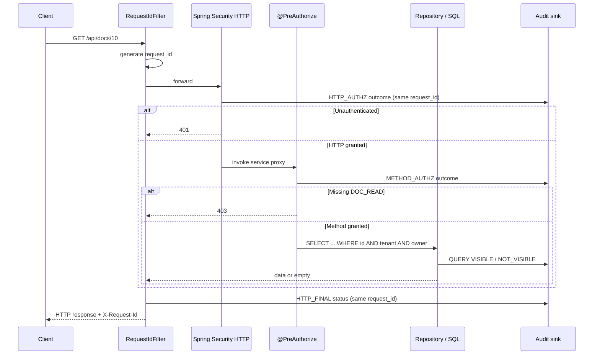

# Correlating HTTP, Method, and Query Decisions Within the Same Request

> **Topic:** Spring Security – authorization. **Group:** Events and Auditing. This lesson explains how to produce **a traceable chain of evidence** across three protection layers: HTTP request checks, method-level permission checks, and data-scope filtering inside the query itself. Examples use Java 17, Spring Boot 3.3.x, Spring Security 6.3.x, Servlet, and H2/JDBC to show both decisions and real queries.

## 1. The Problem: One Request Crossing Multiple Permission Boundaries

Suppose a system exposes `GET /api/docs/{id}`:

- Alice is logged in and has the `DOC_READ` authority.
- Alice belongs to tenant `t1`, and may read documents belonging to tenant `t1` **and** owned by `alice`.
- Bob also has `DOC_READ` but sees only Bob's documents.
- User `viewer` is logged in but does **not** have `DOC_READ`.

A request can pass the HTTP `authenticated()` layer yet fail at `@PreAuthorize`. Or it can pass both layers above and still **find no record within the allowed scope** because the query enforces tenant/owner predicates.

```text
GET /api/docs/10
  │
  ├─ HTTP authorization: authenticated()?   GRANTED
  │
  ├─ Method authorization: DOC_READ?         GRANTED
  │
  ├─ Data visibility: WHERE id, tenant, owner
  │     └─ found within allowed scope?      YES / NO
  │
  └─ HTTP response:                         200 / 404

Another request:
  HTTP GRANTED → Method DENIED → 403
  (SQL query is never executed)

Unauthenticated user:
  HTTP DENIED → 401 via HTTP Basic
  (method and query have not executed)
```

**Audit goal:** when investigating a request, correlate `HTTP_AUTHZ`, `METHOD_AUTHZ`, `QUERY_VISIBILITY`, and `HTTP_FINAL` evidence using **the same correlation ID**, while keeping the meaning of each outcome distinct.

### 1.1. Do Not Collapse Four Concepts into One

| Layer | Question it answers | What it does not prove |
|---|---|---|
| HTTP authorization | Did the request's URL/method/dispatcher pass the policy in `SecurityFilterChain`? | That the caller may view a specific record ID |
| Method authorization | Did the caller satisfy authorities/`@PreAuthorize` expressions or other method rules? | That the DB query ran or returned data |
| Query visibility | Was data returned within the principal's tenant/owner/ACL scope? | That the HTTP request completed or transaction committed |
| HTTP final | What was sent back to the client (401, 403, 404, 200, 500…)? | The full root cause behind the status, or that exactly one check ran |

For example, status 404 can occur when an ID does not exist or when an ID exists outside the **scope the caller is permitted to know about**. Internal audits should simply record `NOT_VISIBLE` when using the same scoped query, never exposing "document belongs to Bob" to an unauthorized caller.

## 2. Correlating Within the Same Execution: Causal Chain

For traceability, separate three kinds of IDs:

1. **`request_id`:** a fresh server-generated ID for one HTTP request. It joins logs emitted by components handling that same request. Never use a raw client-supplied ID as a trusted key.
2. **`trace_id / span_id`:** distributed tracing systems (Micrometer/OpenTelemetry) connect hops across HTTP services, message brokers, JDBC instrumentation… A single trace can contain multiple requests and spans; do not equate a trace ID with a request ID.
3. **`decision_id` or `event_id` (when needed):** distinguishes multiple evaluations **within the same request**, such as one `@PreAuthorize` check per method call. Never use a single `request_id` to assume "only one event".

When constructing analyzable events, minimum fields should include:

| Field | Example | Reason |
|---|---|---|
| `timestamp` | ISO-8601 UTC | Ordering and investigation |
| `request_id` | Server-generated UUID | Join steps of the request |
| `trace_id` / `span_id` | ID from tracing backend, if present | Join across services |
| `phase` | `HTTP_AUTHZ` / `METHOD_AUTHZ` / `QUERY` / `HTTP_FINAL` | Identify which layer produced the evidence |
| `outcome` | `GRANTED` / `DENIED` / `VISIBLE` / `NOT_VISIBLE` / `200`… | Avoid forcing everything into a single enum |
| `policy_id` | `docs.read.http` / `docs.read.method` | Identify which rule was evaluated |
| `resource_type` | `document` | Analyze by object type |
| `principal_ref` | Controlled pseudonym / internal ID | Analyze permissions by identity safely |
| `tenant_ref` | Verified tenant with access policy | Spot tenant-isolation failures |
| `duration_ms`, `error_class` | Appropriate summary level | Distinguish real denials from infrastructure errors |

**Do not put** access tokens, cookies, passwords, full `Authentication` objects, sensitive SQL parameters, request bodies, or document contents into audits. Metric labels should also exclude user IDs, document IDs, raw URLs, or request IDs because cardinality explodes.

### 2.1. Which Events Does Spring Security Actually Publish?

Spring Security Servlet can use `AuthorizationEventPublisher` to publish authorization results via Spring events. `SpringAuthorizationEventPublisher` **publishes denials by default, not every grant** because successful events are typically too frequent.

- `AuthorizationDeniedEvent` can be used to track denied permission evaluations; **not every HTTP 401/403 maps one-to-one to an event**.
- `AuthorizationGrantedEvent` appears only when the publisher is designed to emit those grants.
- `@PreAuthorize` is enforced by an AOP interceptor when `@EnableMethodSecurity` is enabled and the method is called **through a Spring proxy**.
- **Query-level visibility** such as `WHERE tenant_id=:tenant AND owner_id=:owner` belongs to application query code; Spring Security **does not automatically emit a "query allowed" event** for every SQL statement.

Therefore, linking all three layers requires combining authorization events/mechanisms with **deliberately recorded evidence from the repository/service**, correlated by ID. Listeners only receive events that were published; configuring an `@EventListener` does not conjure grants skipped by the publisher.

## 3. Outcome Matrix for the Same Endpoint

Suppose the DB contains:

| id | tenant_id | owner_id | title |
|---:|---|---|---|
| 10 | t1 | alice | Alice note |
| 11 | t1 | bob | Bob note |
| 20 | t2 | carol | Carol note |

And demo accounts:

- `alice`, `bob`, `carol`: authenticated, have `DOC_READ`.
- `viewer`: authenticated, lacks `DOC_READ`.

| Request | HTTP policy | Method policy | Query visibility | Final HTTP |
|---|---|---|---|---|
| Alice reads ID 10 | Granted | Granted | Visible | 200 |
| Alice reads Bob's ID 11 | Granted | Granted | Not visible | 404 |
| Alice reads cross-tenant ID 20 | Granted | Granted | Not visible | 404 |
| Alice reads nonexistent ID 999 | Granted | Granted | Not visible | 404 |
| Viewer reads ID 10 | Granted | **Denied** | Not run | 403 |
| Anonymous reads ID 10 | **Denied** | Not run | Not run | 401 (HTTP Basic) |

Notably, **both HTTP and method are GRANTED while the query is still NOT_VISIBLE**. That does not mean Spring Security "granted the wrong permission": the first two layers answer broader questions, while the specific object is verified in SQL. If business rules require hiding out-of-scope objects, returning the same 404 for "does not exist" and "not visible" is a sound policy.

### 3.1. Expected Sequence



The diagram shows a **synchronous** execution path for learning. With async dispatches, queues, or cross-thread work, `MDC`/request context does not propagate automatically; pass trace context explicitly or copy safe metadata. Avoid inferring ordering solely from timestamps across multiple nodes if clocks are not synchronized.

## 4. Spring Boot Example: Building a Real Chain of Evidence

This is a standalone runnable project with H2; the query in the example **executes real SQL predicates**. Each request uses a filter-generated `request_id`. The publisher records HTTP and method authorization outcomes (logging only a small schema), while the repository records the **within-allowed-scope** outcome of the scoped query.

The demo uses HTTP Basic and `{noop}` passwords **for learning only**. Production apps need secure password encoders, HTTPS, identities/tenants from verified sources, and production-grade policies and audit sinks.

### 4.1. Structure

```text
settings.gradle
build.gradle
src/main/java/demo/AuditDemoApplication.java
src/main/java/demo/SecurityConfiguration.java
src/main/java/demo/RequestIdFilter.java
src/main/java/demo/AuditSink.java
src/main/java/demo/DecisionAuditPublisher.java
src/main/java/demo/IdentityScopes.java
src/main/java/demo/DocumentDto.java
src/main/java/demo/DocumentRepository.java
src/main/java/demo/DocumentService.java
src/main/java/demo/DocumentController.java
src/main/resources/schema.sql
src/main/resources/data.sql
src/test/java/demo/DecisionCorrelationTests.java
```

`settings.gradle`:

```groovy
rootProject.name = 'authorization-audit-correlation'
```

`build.gradle`:

```groovy
plugins {
    id 'java'
    id 'org.springframework.boot' version '3.3.5'
    id 'io.spring.dependency-management' version '1.1.6'
}

group = 'demo'
version = '0.0.1-SNAPSHOT'

java {
    toolchain {
        languageVersion = JavaLanguageVersion.of(17)
    }
}

repositories {
    mavenCentral()
}

dependencies {
    implementation 'org.springframework.boot:spring-boot-starter-web'
    implementation 'org.springframework.boot:spring-boot-starter-security'
    implementation 'org.springframework.boot:spring-boot-starter-jdbc'
    runtimeOnly 'com.h2database:h2'

    testImplementation 'org.springframework.boot:spring-boot-starter-test'
    testImplementation 'org.springframework.security:spring-security-test'
}

tasks.named('test') {
    useJUnitPlatform()
}
```

The example pins versions to present the Spring Security 6.3 API consistently. In real projects, use supported patch releases and check the exact `AuthorizationEventPublisher` method signature for your deployed version.

`src/main/java/demo/AuditDemoApplication.java`:

```java
package demo;

import org.springframework.boot.SpringApplication;
import org.springframework.boot.autoconfigure.SpringBootApplication;

@SpringBootApplication
public class AuditDemoApplication {
    public static void main(String[] args) {
        SpringApplication.run(AuditDemoApplication.class, args);
    }
}
```

### 4.2. Generating Request ID Before Spring Security and Clearing MDC

`src/main/java/demo/RequestIdFilter.java`:

```java
package demo;

import java.io.IOException;
import java.util.UUID;

import jakarta.servlet.FilterChain;
import jakarta.servlet.ServletException;
import jakarta.servlet.http.HttpServletRequest;
import jakarta.servlet.http.HttpServletResponse;

import org.slf4j.MDC;
import org.springframework.core.Ordered;
import org.springframework.core.annotation.Order;
import org.springframework.stereotype.Component;
import org.springframework.web.filter.OncePerRequestFilter;

@Component
@Order(Ordered.HIGHEST_PRECEDENCE)
public class RequestIdFilter extends OncePerRequestFilter {

    private final AuditSink audit;

    public RequestIdFilter(AuditSink audit) {
        this.audit = audit;
    }

    @Override
    protected void doFilterInternal(
            HttpServletRequest request,
            HttpServletResponse response,
            FilterChain chain) throws ServletException, IOException {

        // Server-generated ID: never trust a raw client-supplied X-Request-Id as a correlation key.
        String requestId = UUID.randomUUID().toString();
        request.setAttribute("audit.request_id", requestId);
        response.setHeader("X-Request-Id", requestId);
        MDC.put("request_id", requestId);

        try {
            chain.doFilter(request, response);
        } finally {
            // HTTP_FINAL is the status observed at filter exit, NOT
            // the sole outcome of every authorization check.
            audit.record("HTTP_FINAL",
                Integer.toString(response.getStatus()),
                "route=docs.read");

            // Mandatory cleanup after the request to prevent mixing logs across
            // requests reusing servlet threads from the thread pool.
            MDC.remove("request_id");
        }
    }
}
```

`@Order(Ordered.HIGHEST_PRECEDENCE)` places the demo filter ahead of Spring Boot's standard Security filter chain. `OncePerRequestFilter` runs once per dispatch by default; **that does not mean once across all async/error dispatches**. In production, explicitly decide how `request_id` is preserved/reused across redispatches, async calls, and reverse proxies.

`src/main/java/demo/AuditSink.java`:

```java
package demo;

import org.slf4j.Logger;
import org.slf4j.LoggerFactory;
import org.slf4j.MDC;
import org.springframework.stereotype.Component;

@Component
public class AuditSink {

    private static final Logger log =
        LoggerFactory.getLogger(AuditSink.class);

    public void record(String phase, String outcome, String detail) {
        String requestId = MDC.get("request_id");
        if (requestId == null) {
            requestId = "non-http"; // May be invoked from a job/background task.
        }

        // Log only a bounded set of fields and internally controlled detail strings.
        log.info("request_id={} phase={} outcome={} detail={}",
            requestId, phase, outcome, detail);
    }
}
```

For simplicity, the demo logs synchronously via SLF4J; do not use logs as an immutable or transactional audit store. `detail` in the demo accepts only fixed policy/query labels, never request parameters. Production systems should use a standard event schema, bound cardinality, and use an audit writer with appropriate retention/access controls.

### 4.3. HTTP Policy and Method Security

`src/main/java/demo/SecurityConfiguration.java`:

```java
package demo;

import org.springframework.context.ApplicationEventPublisher;
import org.springframework.context.annotation.Bean;
import org.springframework.context.annotation.Configuration;
import org.springframework.http.HttpMethod;
import org.springframework.security.authorization.AuthorizationEventPublisher;
import org.springframework.security.authorization.SpringAuthorizationEventPublisher;
import org.springframework.security.config.Customizer;
import org.springframework.security.config.annotation.method.configuration.EnableMethodSecurity;
import org.springframework.security.config.annotation.web.builders.HttpSecurity;
import org.springframework.security.core.userdetails.User;
import org.springframework.security.core.userdetails.UserDetailsService;
import org.springframework.security.provisioning.InMemoryUserDetailsManager;
import org.springframework.security.web.SecurityFilterChain;

@Configuration
@EnableMethodSecurity
public class SecurityConfiguration {

    @Bean
    SecurityFilterChain securityFilterChain(HttpSecurity http)
            throws Exception {
        return http
            .authorizeHttpRequests(auth -> auth
                .requestMatchers(HttpMethod.GET, "/api/docs/**")
                    .authenticated()
                .anyRequest().denyAll()
            )
            .httpBasic(Customizer.withDefaults())
            .build();
    }

    @Bean
    AuthorizationEventPublisher authorizationEventPublisher(
            ApplicationEventPublisher springEvents, AuditSink audit) {
        return new DecisionAuditPublisher(
            audit, new SpringAuthorizationEventPublisher(springEvents));
    }

    @Bean
    UserDetailsService userDetailsService() {
        return new InMemoryUserDetailsManager(
            User.withUsername("alice")
                .password("{noop}pw")
                .authorities("DOC_READ")
                .build(),
            User.withUsername("bob")
                .password("{noop}pw")
                .authorities("DOC_READ")
                .build(),
            User.withUsername("carol")
                .password("{noop}pw")
                .authorities("DOC_READ")
                .build(),
            User.withUsername("viewer")
                .password("{noop}pw")
                .authorities("VIEWER")
                .build()
        );
    }
}
```

At the HTTP layer, `authenticated()` lets any authenticated account proceed to the controller. This design allows observing the method-layer decision separately; it does **not** mean every account can read documents.

At the method layer, `@PreAuthorize("hasAuthority('DOC_READ')")` performs fine-grained permission checks. Because `@EnableMethodSecurity` is active, calls to the service bean through the Spring proxy are intercepted. Calling a protected method from **the same class** (`this.readVisible(...)`) can bypass the proxy, so never rely on self-invocation as evidence of permission enforcement.

### 4.4. Observing Both Decisions Through the Same Publisher

`src/main/java/demo/DecisionAuditPublisher.java`:

```java
package demo;

import java.util.function.Supplier;

import jakarta.servlet.http.HttpServletRequest;
import org.aopalliance.intercept.MethodInvocation;

import org.springframework.security.authorization.AuthorizationDecision;
import org.springframework.security.authorization.AuthorizationEventPublisher;
import org.springframework.security.core.Authentication;

public final class DecisionAuditPublisher
        implements AuthorizationEventPublisher {

    private final AuditSink audit;
    private final AuthorizationEventPublisher defaultDeniedPublisher;

    public DecisionAuditPublisher(
            AuditSink audit,
            AuthorizationEventPublisher defaultDeniedPublisher) {
        this.audit = audit;
        this.defaultDeniedPublisher = defaultDeniedPublisher;
    }

    @Override
    public <T> void publishAuthorizationEvent(
            Supplier<Authentication> authentication,
            T securedObject,
            AuthorizationDecision decision) {

        if (decision == null) {
            return; // Do not record GRANTED when there is no decision.
        }

        String outcome = decision.isGranted() ? "GRANTED" : "DENIED";

        if (securedObject instanceof HttpServletRequest request) {
            // Fixed policy label; do not log URI or raw query string.
            String policy = request.getServletPath()
                    .startsWith("/api/docs/")
                ? "docs.read.http" : "other.http";
            audit.record("HTTP_AUTHZ", outcome, "policy=" + policy);
        } else if (securedObject instanceof MethodInvocation invocation) {
            // Log only the recognized method name, never arguments.
            String policy = invocation.getMethod().getName()
                    .equals("readVisible")
                ? "docs.read.method" : "other.method";
            audit.record("METHOD_AUTHZ", outcome, "policy=" + policy);
        }

        // Preserve Spring Security's DENIED event publishing behavior.
        // GRANTED here only logs selectively, without flooding the event system
        // with every AuthorizationGrantedEvent.
        if (!decision.isGranted()) {
            defaultDeniedPublisher.publishAuthorizationEvent(
                authentication, securedObject, decision);
        }
    }
}
```

**Reading the example's semantics accurately:**

- The publisher receives **an authorization evaluation callback** and logs the outcome with the `request_id` currently in MDC. The callback does not perform authorization itself.
- The HTTP secured object is typically `HttpServletRequest` with `authorizeHttpRequests`; the method secured object is `MethodInvocation` for `@PreAuthorize`. If the application adds other interceptors, the target may have another type; handle it explicitly.
- Delegating back to `SpringAuthorizationEventPublisher` on the denied branch preserves `AuthorizationDeniedEvent` for other listeners; grants are not pushed onto the global success-event stream just for this audit lesson.
- Never log `authentication.get()` or `securedObject.toString()`: they can contain sensitive principals, credentials, method arguments, or request details.
- The publisher bean is used by Spring Security where authorization mechanisms support event publishers. When upgrading versions or swapping advisors/security chains, **run tests verifying which layers invoke the callback** rather than assuming every custom mechanism uses this bean.

## 5. Controlling Queries: Tenant and Owner Predicates Live in SQL

HTTP policy and method policy are **two independent fences**; they do not replace row-level constraints. Database records must be queried using predicates derived from the **verified principal**.

`src/main/java/demo/IdentityScopes.java`:

```java
package demo;

import org.springframework.security.access.AccessDeniedException;
import org.springframework.security.core.Authentication;
import org.springframework.stereotype.Component;

@Component
public class IdentityScopes {

    // Demo uses a fixed mapping. Production systems obtain identity/tenant
    // from verified trusted sources, never trusting client-sent headers.
    public Scope resolve(Authentication authentication) {
        return switch (authentication.getName()) {
            case "alice" -> new Scope("t1", "alice");
            case "bob" -> new Scope("t1", "bob");
            case "carol" -> new Scope("t2", "carol");
            case "viewer" -> new Scope("t1", "viewer");
            default -> throw new AccessDeniedException(
                "No verified identity scope");
        };
    }

    public record Scope(String tenantId, String ownerId) {}
}
```

`src/main/java/demo/DocumentDto.java`:

```java
package demo;

public record DocumentDto(long id, String title) {}
```

`src/main/java/demo/DocumentRepository.java`:

```java
package demo;

import java.util.Optional;

import org.springframework.jdbc.core.namedparam.MapSqlParameterSource;
import org.springframework.jdbc.core.namedparam.NamedParameterJdbcTemplate;
import org.springframework.stereotype.Repository;

@Repository
public class DocumentRepository {

    private final NamedParameterJdbcTemplate jdbc;

    public DocumentRepository(NamedParameterJdbcTemplate jdbc) {
        this.jdbc = jdbc;
    }

    public Optional<DocumentDto> findVisible(
            long id, String tenantId, String ownerId) {

        String sql = """
            SELECT id, title
              FROM documents
             WHERE id = :id
               AND tenant_id = :tenantId
               AND owner_id = :ownerId
            """;

        var params = new MapSqlParameterSource()
            .addValue("id", id)
            .addValue("tenantId", tenantId)
            .addValue("ownerId", ownerId);

        return jdbc.query(sql, params, rs ->
            rs.next()
                ? Optional.of(new DocumentDto(
                    rs.getLong("id"), rs.getString("title")))
                : Optional.empty());
    }
}
```

This is **a single SQL query with all three predicates pushed to the DB**, rather than loading all rows and filtering in Java/UI. `NamedParameterJdbcTemplate` binds parameters instead of concatenating input strings. Returning `Optional.empty()` for both nonexistent IDs and out-of-scope IDs lets the API return 404 consistently without leaking document existence.

In real applications, visibility can involve ACLs, groups, projects, delegated access, or cross-tenant permissions. Translate policy into exact predicates (SQL/JPA Specification/RLS) rather than assuming `ownerId` alone suffices. Every list, count, export, search, download, and batch lookup must enforce the matching scope.

`src/main/java/demo/DocumentService.java`:

```java
package demo;

import java.util.Optional;

import org.springframework.security.access.prepost.PreAuthorize;
import org.springframework.security.core.Authentication;
import org.springframework.stereotype.Service;

@Service
public class DocumentService {

    private final IdentityScopes scopes;
    private final DocumentRepository repository;
    private final AuditSink audit;

    public DocumentService(
            IdentityScopes scopes,
            DocumentRepository repository,
            AuditSink audit) {
        this.scopes = scopes;
        this.repository = repository;
        this.audit = audit;
    }

    @PreAuthorize("hasAuthority('DOC_READ')")
    public Optional<DocumentDto> readVisible(
            long id, Authentication authentication) {

        IdentityScopes.Scope scope = scopes.resolve(authentication);

        // This QUERY event is recorded by the APPLICATION; Spring does not create it automatically.
        audit.record("QUERY", "START", "query=docs.visible.v1");

        Optional<DocumentDto> document = repository.findVisible(
            id, scope.tenantId(), scope.ownerId());

        audit.record("QUERY",
            document.isPresent() ? "VISIBLE" : "NOT_VISIBLE",
            "query=docs.visible.v1");

        return document;
    }
}
```

If `@PreAuthorize` denies access, the body of `readVisible` does not execute, so **no QUERY event** is emitted. If SQL returns empty, `NOT_VISIBLE` describes the **scoped query** result rather than asserting the DB has no row at all. This prevents logs from leaking existence.

`src/main/java/demo/DocumentController.java`:

```java
package demo;

import org.springframework.http.ResponseEntity;
import org.springframework.security.core.Authentication;
import org.springframework.web.bind.annotation.GetMapping;
import org.springframework.web.bind.annotation.PathVariable;
import org.springframework.web.bind.annotation.RequestMapping;
import org.springframework.web.bind.annotation.RestController;

@RestController
@RequestMapping("/api/docs")
public class DocumentController {

    private final DocumentService service;

    public DocumentController(DocumentService service) {
        this.service = service;
    }

    @GetMapping("/{id}")
    public ResponseEntity<DocumentDto> read(
            @PathVariable long id, Authentication authentication) {
        return service.readVisible(id, authentication)
            .map(ResponseEntity::ok)
            .orElseGet(() -> ResponseEntity.notFound().build());
    }
}
```

The controller never asks "does this record exist in another tenant?"; it uniformly returns 404 for non-visible entries. For public APIs, do not send internal audit details in the response body or `X-Request-Id` beyond the request UUID; responses carry only the correlation ID and HTTP code.

### 5.1. H2 Data

`src/main/resources/schema.sql`:

```sql
CREATE TABLE documents (
    id BIGINT PRIMARY KEY,
    tenant_id VARCHAR(40) NOT NULL,
    owner_id VARCHAR(40) NOT NULL,
    title VARCHAR(200) NOT NULL
);

CREATE INDEX idx_documents_visibility
    ON documents (tenant_id, owner_id, id);
```

`src/main/resources/data.sql`:

```sql
INSERT INTO documents (id, tenant_id, owner_id, title) VALUES
    (10, 't1', 'alice', 'Alice note'),
    (11, 't1', 'bob',   'Bob note'),
    (20, 't2', 'carol', 'Carol note');
```

Spring Boot runs `schema.sql` / `data.sql` when an embedded H2 DB is auto-configured. In production DBs, migrations and indexes must match real access patterns; never copy test init scripts into production.

## 6. Observing with curl and Log Chains

In a project with the Gradle wrapper, run `./gradlew bootRun`; on Windows, use `gradlew.bat bootRun`. You can check statuses separately:

```bash
curl -s -o /dev/null -w '%{http_code}\n' \
  -u alice:pw http://localhost:8080/api/docs/10

curl -s -o /dev/null -w '%{http_code}\n' \
  -u alice:pw http://localhost:8080/api/docs/11

curl -s -o /dev/null -w '%{http_code}\n' \
  -u viewer:pw http://localhost:8080/api/docs/10

curl -s -o /dev/null -w '%{http_code}\n' \
  http://localhost:8080/api/docs/10
```

In order, the **expected statuses** are `200`, `404`, `403`, `401`. These commands are verification instructions, not claims of having been run on the reader's machine.

For the first request, assuming the server generates UUID `00000000-0000-4000-8000-000000000001`, **illustrative log message lines** look like:

```text
request_id=00000000-0000-4000-8000-000000000001 phase=HTTP_AUTHZ outcome=GRANTED detail=policy=docs.read.http
request_id=00000000-0000-4000-8000-000000000001 phase=METHOD_AUTHZ outcome=GRANTED detail=policy=docs.read.method
request_id=00000000-0000-4000-8000-000000000001 phase=QUERY outcome=START detail=query=docs.visible.v1
request_id=00000000-0000-4000-8000-000000000001 phase=QUERY outcome=VISIBLE detail=query=docs.visible.v1
request_id=00000000-0000-4000-8000-000000000001 phase=HTTP_FINAL outcome=200 detail=route=docs.read
```

In real console logs, SLF4J/Logback also prepends timestamp, thread name, logger, and level. The example shows only the **message**. The UUID is assumed for illustration, not measured output or a required UUID.

### 6.1. When Blocked at Method Level

```text
HTTP_AUTHZ  GRANTED        docs.read.http
METHOD_AUTHZ DENIED        docs.read.method
QUERY        (none)
HTTP_FINAL   403
```

There is no QUERY because the body of `DocumentService.readVisible` is not invoked through the proxy. This is a **very useful security invariant** to test: if a user lacking `DOC_READ` still triggers a data query, inspect the proxy/interceptor, self-invocation, or bypass paths.

### 6.2. When the Query Returns Empty

```text
HTTP_AUTHZ   GRANTED       docs.read.http
METHOD_AUTHZ GRANTED       docs.read.method
QUERY        START         docs.visible.v1
QUERY        NOT_VISIBLE   docs.visible.v1
HTTP_FINAL   404
```

Both "Alice requests Bob's ID 11" and "Alice requests ID 999" produce the same phase/outcome sequence and the same 404 response. If an internal audit sink records specific IDs for investigation, enforce strict read permissions on it; public logs never contain tenants, owners, or unauthorized records.

### 6.3. When Unauthenticated

```text
HTTP_AUTHZ   DENIED        docs.read.http
METHOD_AUTHZ (none)
QUERY        (none)
HTTP_FINAL   401
```

With HTTP Basic, 401 typically includes `WWW-Authenticate: Basic ...`. Form-login systems may redirect with 302; Bearer Resource Servers return Bearer challenges. Do not infer that every denied event must return HTTP 403 or that every 401 is an `AuthorizationFilter` bug.

## 7. Automated Testing: Ensuring Shared request_id and Blocking Order

Both **behavior** and **evidence** must be tested; checking response codes alone does not prove logs share the same request or that the query was prevented.

`src/test/java/demo/DecisionCorrelationTests.java`:

```java
package demo;

import org.junit.jupiter.api.Test;
import org.junit.jupiter.api.extension.ExtendWith;
import org.springframework.beans.factory.annotation.Autowired;
import org.springframework.boot.test.autoconfigure.web.servlet.AutoConfigureMockMvc;
import org.springframework.boot.test.context.SpringBootTest;
import org.springframework.boot.test.system.CapturedOutput;
import org.springframework.boot.test.system.OutputCaptureExtension;
import org.springframework.test.web.servlet.MockMvc;
import org.springframework.test.web.servlet.MvcResult;

import static org.assertj.core.api.Assertions.assertThat;
import static org.springframework.security.test.web.servlet.request.SecurityMockMvcRequestPostProcessors.httpBasic;
import static org.springframework.test.web.servlet.request.MockMvcRequestBuilders.get;
import static org.springframework.test.web.servlet.result.MockMvcResultMatchers.jsonPath;
import static org.springframework.test.web.servlet.result.MockMvcResultMatchers.status;

@SpringBootTest
@AutoConfigureMockMvc
@ExtendWith(OutputCaptureExtension.class)
class DecisionCorrelationTests {

    @Autowired
    MockMvc mvc;

    @Test
    void allowedRequestLinksAllStages(CapturedOutput output)
            throws Exception {
        MvcResult result = mvc.perform(
                get("/api/docs/10").with(httpBasic("alice", "pw")))
            .andExpect(status().isOk())
            .andExpect(jsonPath("$.title").value("Alice note"))
            .andReturn();

        String id = result.getResponse().getHeader("X-Request-Id");
        assertThat(id).isNotBlank();

        String logs = output.toString();
        assertThat(logs)
            .contains("request_id=" + id
                + " phase=HTTP_AUTHZ outcome=GRANTED")
            .contains("request_id=" + id
                + " phase=METHOD_AUTHZ outcome=GRANTED")
            .contains("request_id=" + id
                + " phase=QUERY outcome=VISIBLE")
            .contains("request_id=" + id
                + " phase=HTTP_FINAL outcome=200");
    }

    @Test
    void methodDenyPreventsDatabaseQuery(CapturedOutput output)
            throws Exception {
        MvcResult result = mvc.perform(
                get("/api/docs/10").with(httpBasic("viewer", "pw")))
            .andExpect(status().isForbidden())
            .andReturn();

        String id = result.getResponse().getHeader("X-Request-Id");
        assertThat(id).isNotBlank();

        String logs = output.toString();
        assertThat(logs)
            .contains("request_id=" + id
                + " phase=HTTP_AUTHZ outcome=GRANTED")
            .contains("request_id=" + id
                + " phase=METHOD_AUTHZ outcome=DENIED")
            .contains("request_id=" + id
                + " phase=HTTP_FINAL outcome=403")
            .doesNotContain("request_id=" + id + " phase=QUERY");
    }

    @Test
    void hiddenAndMissingDocumentsReturnSamePublicBody()
            throws Exception {
        MvcResult hidden = mvc.perform(
                get("/api/docs/11").with(httpBasic("alice", "pw")))
            .andExpect(status().isNotFound())
            .andReturn();

        MvcResult missing = mvc.perform(
                get("/api/docs/999").with(httpBasic("alice", "pw")))
            .andExpect(status().isNotFound())
            .andReturn();

        assertThat(hidden.getResponse().getContentAsString())
            .isEqualTo(missing.getResponse().getContentAsString());
    }

    @Test
    void anonymousNeverReachesMethodOrQuery(CapturedOutput output)
            throws Exception {
        MvcResult result = mvc.perform(get("/api/docs/10"))
            .andExpect(status().isUnauthorized())
            .andReturn();

        String id = result.getResponse().getHeader("X-Request-Id");
        assertThat(id).isNotBlank();

        String logs = output.toString();
        assertThat(logs)
            .contains("request_id=" + id
                + " phase=HTTP_FINAL outcome=401")
            .doesNotContain("request_id=" + id + " phase=QUERY")
            .doesNotContain("request_id=" + id + " phase=METHOD_AUTHZ");
    }
}
```

Run `./gradlew test`. The test suite requires the HTTP filter and method security publisher to be wired properly in the pinned Spring Security version. Whenever replacing custom `AuthorizationManager`s, AOP advisors, filter chains, or upgrading versions, re-verify that the event publisher is actually called; these tests catch configuration drift.

**Limits of log-based testing:** `CapturedOutput` works well for this lesson, but it does not replace instrumented probes, DB query counters, or trace collectors in production. For parallel tests, high request volume, async loggers, or custom log formats, use an audit sink with a test adapter and event DTOs rather than relying on console strings.

## 8. Common Pitfalls When Linking Layers

### 8.1. One Request Having Multiple Authorization Evaluations

Do not assume "one HTTP request = one `HTTP_AUTHZ` + one `METHOD_AUTHZ`". There can be:

- Multiple sequential `@PreAuthorize` / `@PostAuthorize` calls.
- A protected method invoked inside a loop or batch.
- Servlet `FORWARD` / `ERROR` / `ASYNC` dispatches with the filter chain applied across multiple dispatcher types.
- A controller calling another service, or a request traversing a gateway across multiple microservices.
- An authorization manager returning null/no-decision in a given context, or other rules applying simultaneously.

For multi-evaluation audits, add `decision_id` (a UUID or request-scoped sequence), `parent_decision_id` when parent-child relationships matter, `surface` (HTTP/METHOD), and a stable `policy_id`. In tracing, use span hierarchy to express causality instead of relying solely on timestamps.

### 8.2. AuthorizationGrant Is Not "HTTP 200"

An HTTP GRANTED only allows the request to proceed. Afterward, method security may DENY, the query may return NOT_VISIBLE, the DB may time out, or the transaction may roll back. Never emit a `document_read_success` business audit inside an HTTP grant callback.

Even `QUERY VISIBLE` only confirms that a scoped query found rows; serialization, networking, or post-processing can still fail. To prove a business action completed, emit the business audit at the right boundary (such as after commit or via a transactional outbox).

### 8.3. Do Not Conclude from "No Event Seen"

A missing `METHOD_AUTHZ` can mean HTTP already blocked it, the method was never called, the proxy was bypassed, the publisher wasn't configured, logging failed, or data was sampled out. Combine status, traces, execution-path coverage, and audit pipeline health before diagnosing a cause.

### 8.4. Never Read Unauthorized Objects Just to Explain a 404

This is a common anti-pattern:

```java
// Illustrative code to avoid, not a standalone program.
var doc = repository.findById(id); // DB reads another tenant's data too.
if (doc.isPresent() && !belongsToCaller(doc.get())) {
    audit.log("exists_but_forbidden=" + id); // Information-leakage risk.
}
return ResponseEntity.notFound().build();
```

Even when HTTP returns 404, logs or timing can reveal existence. The pattern in this lesson uses a DB-scoped query from the start and records `VISIBLE`/`NOT_VISIBLE`. If a system requires detailed reasons for security events, keep them inside a strictly bounded internal audit with dedicated access controls, never sharing them into general analytics/tracing.

### 8.5. Do Not Use ThreadLocal/MDC as an Async Data Bus

In synchronous Servlet requests, thread-bound `MDC` is convenient. However, `@Async`, executors, `CompletableFuture`, Reactor, or message queues can run on different threads. When crossing hops, propagate selected context via framework-supported mechanisms and ensure cleanup in `finally`. Never push `HttpServletRequest`, `SecurityContext`, or the full `Authentication` onto a queue to "keep context".

### 8.6. Do Not Overuse Raw SQL Logging

DEBUG-level SQL logging can print parameters, ID values, or sensitive data depending on the driver/pipeline. In security audits, log the **query identifier, policy version, predicate class, and row count/visibility outcome**. Enable query text and bind parameters only in controlled environments, sanitized and with strict retention limits.

## 9. Connecting Micrometer Tracing / OpenTelemetry

`request_id` in the demo solves **correlation within a single HTTP request**. When an application spans multiple services, use W3C `traceparent` trace context with Micrometer Tracing/OpenTelemetry:

- An HTTP server span wraps the request; the security framework can add observations for filters/authorization when observability is configured.
- Services or repositories can have child spans; DB instrumentation records timing and errors, though **it does not automatically prove the query enforced security predicates**.
- Put `policy_id`, `surface`, and outcome on traces **if your backend permits**, avoiding high-cardinality tags on metrics.
- Audit evidence can store `request_id` and `trace_id` for investigation; sampled traces must not replace mandatory audit stores.
- Maintain propagation across gateways and outbound clients; across cross-tenant boundaries, never trust client-supplied trace headers as permission evidence.

Ideal trace example:

```text
trace=ab... / request_id=R-100
  HTTP GET /api/docs/{id}                   span HTTP
    HTTP_AUTHZ docs.read.http granted       event
    DocumentService.readVisible             span method
      METHOD_AUTHZ docs.read.method granted event
      SQL docs.visible.v1                   span query
        QUERY visibility=not_visible        event
    HTTP_FINAL 404                          response
```

A dedicated audit table can be retained more completely than sampled traces. Depending on data sensitivity, control who can view request IDs, trace IDs, principal references, and query outcomes.

## 10. Schema Design and Operational Failures

A structured audit record should explicitly state **schema version** and **policy version**, for example:

```json
{
  "schema_version": 1,
  "timestamp": "2026-11-05T11:00:00Z",
  "request_id": "00000000-0000-4000-8000-000000000001",
  "trace_id": null,
  "phase": "METHOD_AUTHZ",
  "policy_id": "docs.read.method",
  "policy_version": "v1",
  "outcome": "GRANTED",
  "resource_type": "document",
  "principal_ref": "opaque-user-ref",
  "tenant_ref": "opaque-tenant-ref"
}
```

The JSON above is a **sample schema**, not a payload auto-generated by Spring Security. This example omits document IDs. In practice, store object IDs only when specifically required and backed by access controls/encryption.

### 10.1. Delivery Semantics

- **Telemetry/metrics:** sampling, aggregation, or quota-based dropping under overload is acceptable, provided `event_dropped` is counted to avoid misinterpretation.
- **Mandatory security audits:** do not sample arbitrarily; design durability, retries, deduplication, retention, and post-commit/outbox persistence when tied to business changes.
- **Synchronous listeners:** `ApplicationEventPublisher` / `@EventListener` run inline by default; avoid blocking requests with bulk log exports or network calls to a SIEM.
- **Idempotency:** under retries or message brokers, one operation can produce duplicate records. Design `event_id`, `operation_id`, and deduplication strategies separately from `request_id`.

### 10.2. Invariants Worth Testing Regularly

| Invariant | Test |
|---|---|
| Anonymous never reaches DB | 401, zero query spans/query counters |
| User lacking `DOC_READ` never reaches DB | 403; method denied; query absent |
| Cross-tenant ID and nonexistent ID both return 404 | Uniform public status/body/headers per policy |
| Query is always scoped | Inspect SQL/repository and multi-tenant integration tests |
| Evidence in the same request shares an ID | Extract `X-Request-Id`, match logs/events with the same ID |
| Two requests never mix context | Distinct IDs, MDC cleared after request |
| Multiple method checks are not collapsed into one | Each evaluation carries a `decision_id` or policy attribution |
| Audit pipeline congested | Drop/latency alerts exist, handling policy defined |
| Post-commit events exist | Business audit sits at the right transaction boundary |
| No secrets leaked | Never serialize auth/token/request/raw SQL parameters |

## 11. Common Reasoning Errors

1. **"HTTP authenticated is enough to read a document."** Wrong: method authorities and data-level tenant/owner/ACL rules remain.
2. **"HTTP 200 means all three layers were audited."** Wrong: status is only the final outcome and does not prove complete event collection.
3. **"AuthorizationGrantedEvent appears for every grant."** Wrong: the standard publisher omits grants by default.
4. **"No method event means the method needs no permission."** The method may not have run, the AOP proxy may have been bypassed, or the publisher may not be configured.
5. **"404 means the ID does not exist in the DB."** Under an existence-hiding policy, 404 also means "not visible to the principal".
6. **"Service query filters by owner, so every other API is safe too."** List, count, search, export, and batch endpoints still need the same predicates and tests.
7. **"Logging all SQL and users makes investigation easier."** It can leak PII, tokens, and other tenants' data while increasing cardinality and retention risk.
8. **"One request ID equals one authorization decision."** One request can contain multiple evaluations and multiple queries.
9. **"MDC automatically propagates to `@Async` and downstream services."** False; explicit boundary-aware propagation is required.
10. **"A method grant means the business operation succeeded."** The method can still throw exceptions, get an empty query, roll back, or fail the response.

## 12. Practice Checklist

- [ ] Distinct policies exist for HTTP, method, and data visibility; layers do not blur responsibilities.
- [ ] Request IDs are generated/normalized at a trusted boundary; logs and headers share the same ID.
- [ ] Phase/outcome are categorized cleanly; `AUTHZ`, `QUERY`, and `HTTP_FINAL` are recorded separately.
- [ ] `@EnableMethodSecurity` is active and calls through Spring proxies are tested.
- [ ] SQL enforces tenant/owner predicates from the verified principal; client-supplied tenant inputs are never trusted.
- [ ] Queries do not run when HTTP or method security denies access.
- [ ] 404 responses for "missing" and "not visible" are tested consistently.
- [ ] Raw URIs, document IDs, and user IDs are never used as metric labels.
- [ ] Raw `Authentication`/requests containing secrets are never pushed to audit queues.
- [ ] Grant and denial events are configured purposefully; volume and drops are metered.
- [ ] Sampled telemetry is separated from mandatory audits and post-commit business events.
- [ ] Correlation is re-tested when changing Spring Security versions, filter dispatches, proxies, async code, or tracing.

## 13. Reference Documentation

- [Spring Security – Authorize HttpServletRequests](https://docs.spring.io/spring-security/reference/servlet/authorization/authorize-http-requests.html): HTTP filters and `AuthorizationManager`.
- [Spring Security – Method Security](https://docs.spring.io/spring-security/reference/servlet/authorization/method-security.html): `@EnableMethodSecurity`, `@PreAuthorize`, AOP proxies, and denials.
- [Spring Security – Authorization Events](https://docs.spring.io/spring-security/reference/servlet/authorization/events.html): publishers, denials, and why grants are not published by default.
- [Spring Security 6.3 – AuthorizationEventPublisher Javadoc](https://docs.spring.io/spring-security/site/docs/6.3.5/api/org/springframework/security/authorization/AuthorizationEventPublisher.html): signature accepting `AuthorizationDecision` in the demo.
- [Spring Security – Observability](https://docs.spring.io/spring-security/reference/servlet/integrations/observability.html): security filter chain observations and spans.
- [Spring Framework – Observability Support](https://docs.spring.io/spring-framework/reference/integration/observability.html): Micrometer Observation, traces, and low/high-cardinality attributes.
- [Spring Framework – JDBC Named Parameters](https://docs.spring.io/spring-framework/reference/data-access/jdbc/parameter-handling.html): binding SQL parameters safely.