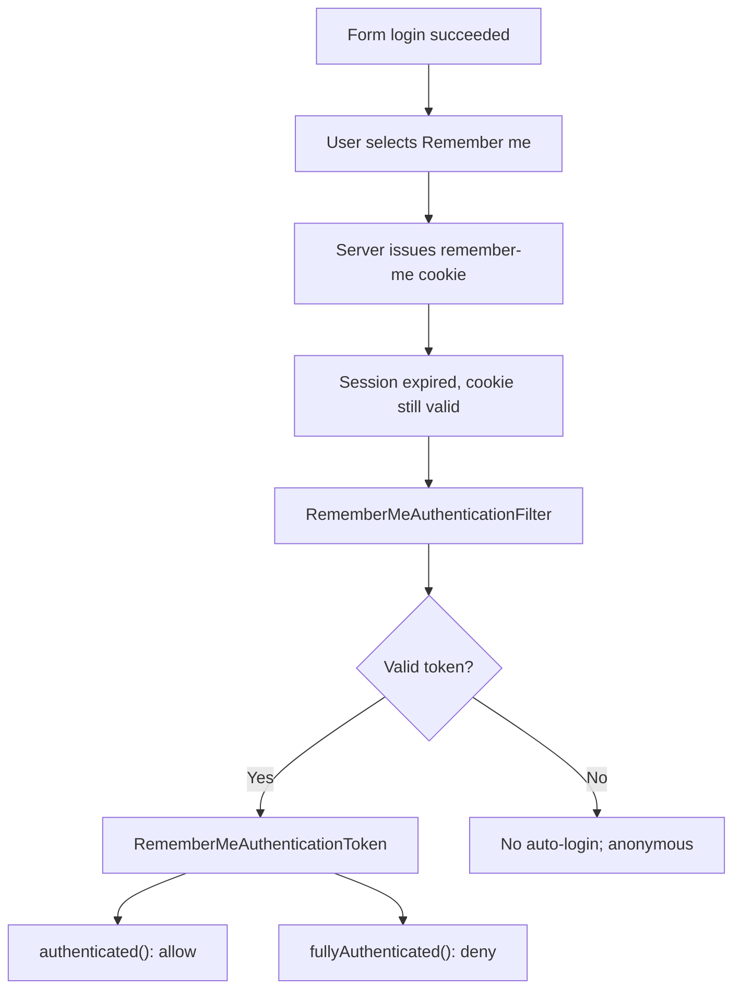

# Anonymous, Authenticated, Remember-Me, and Fully Authenticated in Spring Security

## Lesson goal

This lesson helps you distinguish the four contexts Spring Security uses to **make access decisions** on the Servlet stack: **anonymous**, **authenticated**, **remember-me**, and **fully authenticated**. You will learn when to use `anonymous()`, `authenticated()`, `rememberMe()`, and `fullyAuthenticated()` in `authorizeHttpRequests`; understand `isAnonymous()`, `isAuthenticated()`, `isRememberMe()`, and `isFullyAuthenticated()` in method security; interpret `Authentication` trust levels accurately; and apply them to re-authentication scenarios.

Core focus: **authentication level** is a separate axis from **role/authority**. Someone with `ROLE_ADMIN` can still be denied when using remember-me, whereas someone fully authenticated can still lack permission for a specific business action.

## 1. Foundation: Authentication is more than "logged in" and "not logged in"

Spring Security stores caller information in `SecurityContextHolder`, typically as an `Authentication` object:

- **Principal:** the caller's identity, e.g. `alice`.
- **Authorities:** `GrantedAuthority` instances such as `ROLE_USER`, `account:edit`.
- **Authentication mechanism/token:** how the identity was established, such as `AnonymousAuthenticationToken`, `RememberMeAuthenticationToken`, or a token supplied by a standard login mechanism.
- **Trust level recognized by the authorization checker:** anonymous, remember-me, or *fully authenticated*.

For example, an unauthenticated visitor can still have an `Authentication` in the security context thanks to `AnonymousAuthenticationFilter`. A real user can have their identity restored via a remember-me cookie. Both differ from a fully logged-in state.

Distinguish these questions:

| Question | Check type |
| --- | --- |
| Is this an anonymous guest? | `anonymous()` or `isAnonymous()` |
| Has an authenticated identity, not anonymous? | `authenticated()` or `isAuthenticated()` |
| Was the current identity restored via remember-me? | `rememberMe()` or `isRememberMe()` |
| Authenticated, neither anonymous nor remember-me? | `fullyAuthenticated()` or `isFullyAuthenticated()` |
| Does the user have the matching authority/role? | `hasAuthority(...)`, `hasRole(...)` |
| Does the user have permission on the specific record? | Owner/tenant/ACL business policy in service or query |

A secure system typically combines **multiple conditions**, e.g. `fullyAuthenticated AND account:edit AND ownsAccount`.

## 2. State matrix and exact semantics

Assuming the application has anonymous authentication as commonly configured, and remember-me set up where needed:

| Current Authentication | `anonymous()` | `authenticated()` | `rememberMe()` | `fullyAuthenticated()` |
| --- | :---: | :---: | :---: | :---: |
| `AnonymousAuthenticationToken` | ✅ | ❌ | ❌ | ❌ |
| `RememberMeAuthenticationToken` | ❌ | ✅ | ✅ | ❌ |
| Full login via form/session, Basic, or valid Bearer token not of the types above | ❌ | ✅ | ❌ | ✅ |

The rules in the table rely on how Spring Security classifies tokens through the default `AuthenticationTrustResolver`. If the application uses custom tokens or a custom trust resolver, verify how the system classifies them.

**Core point:** `authenticated()` **includes** remember-me. `fullyAuthenticated()` **excludes** remember-me. `rememberMe()` checks the **current remember-me state**—it does not mean "remember-me or standard login".

### Comparison with permitAll and denyAll

| Rule | Condition to pass authorization | Typical use case |
| --- | --- | --- |
| `permitAll()` | Everyone, including anonymous and logged-in users | Public pages, static resources |
| `anonymous()` | Only guests currently identified as anonymous | Onboarding page strictly for guests |
| `authenticated()` | Remember-me **or** fully authenticated | Basic profile page |
| `rememberMe()` | Only remember-me authentication | "Remembered login" status page |
| `fullyAuthenticated()` | Authenticated without remember-me | Changing sensitive settings, if policy requires |
| `denyAll()` | Nobody | Locked endpoint or policy not yet defined |

`permitAll()` and `anonymous()` **are not synonymous**. Setting `/login` to `anonymous()` can block already-logged-in users from reopening that page; a normal public page should use `permitAll()`.

These are **authorization checks**, and do not by themselves guarantee a controller exists, HTTP 200 is returned, CSRF passes, or data is present.

## 3. Anonymous: a token exists in context, yet the caller is still a guest

### 3.1. What does AnonymousAuthenticationFilter do?

In a typical Servlet security filter chain, if no valid `Authentication` is in the context after authentication mechanisms run, `AnonymousAuthenticationFilter` can populate an `AnonymousAuthenticationToken`. By default, this token usually has principal `anonymousUser` and authority `ROLE_ANONYMOUS`.

This is a **technical representation** for unauthenticated callers, letting authorization and auditing run uniformly. This token does not turn a guest into a real account, nor does it carry business permissions of a logged-in user.

Subtle trap: on an `AnonymousAuthenticationToken`, calling `Authentication.isAuthenticated()` can return **true**. If you write:

```java
Authentication auth =
    SecurityContextHolder.getContext().getAuthentication();

boolean loggedIn = auth != null && auth.isAuthenticated();
```

then `loggedIn` **is not a safe check** to conclude "logged in with a real account". Spring Security uses `AuthenticationTrustResolver` to detect anonymous and remember-me tokens, rather than relying solely on the raw flag.

### 3.2. Using AuthenticationTrustResolver

The following Java snippet **requires Spring Security dependencies** and is meant to integrate into an application with a security context:

```java
import org.springframework.security.authentication.AuthenticationTrustResolver;
import org.springframework.security.authentication.AuthenticationTrustResolverImpl;
import org.springframework.security.core.Authentication;
import org.springframework.security.core.context.SecurityContextHolder;

public class AuthenticationStateInspector {
    private final AuthenticationTrustResolver resolver =
        new AuthenticationTrustResolverImpl();

    public void inspect() {
        Authentication auth =
            SecurityContextHolder.getContext().getAuthentication();

        boolean anonymous = resolver.isAnonymous(auth);
        boolean authenticated = resolver.isAuthenticated(auth);
        boolean remembered = resolver.isRememberMe(auth);
        boolean fullyAuthenticated =
            resolver.isFullyAuthenticated(auth);

        // Evaluate according to business needs.
    }
}
```

`AuthenticationTrustResolver.isAuthenticated(auth)` requires a valid token that is **not anonymous**; `isFullyAuthenticated(auth)` additionally requires **not remember-me**. When `auth == null`, it is not considered authenticated/fully authenticated. The rules `authenticated()` and `fullyAuthenticated()` already handle these distinctions; there is no need to reimplement equivalent checks in every controller.

### 3.3. Difference with Servlet Principal in Spring MVC

Spring MVC can resolve controller `Principal`/`Authentication` parameters via `HttpServletRequest#getPrincipal()`. For anonymous requests, the Servlet principal may be **null**, even though `SecurityContextHolder` still contains `AnonymousAuthenticationToken`. If you genuinely need to inspect the anonymous token in a controller, use `@CurrentSecurityContext`:

```java
@GetMapping("/who-am-i")
public String whoAmI(@CurrentSecurityContext SecurityContext context) {
    Authentication auth = context.getAuthentication();
    AuthenticationTrustResolver trust = new AuthenticationTrustResolverImpl();
    return trust.isAnonymous(auth) ? "anonymous" : "signed-in";
}
```

This snippet requires corresponding Spring MVC/Spring Security imports and a controller bean. The endpoint is strictly illustrative; never expose tokens, permission lists, or internal security details externally.

## 4. Authenticated: not anonymous, yet may still be remember-me

With the `authenticated()` rule, someone automatically logged back in via remember-me **is considered authenticated**. Meanwhile, `fullyAuthenticated()` demands a higher level.

Example:

1. Alice logs in via form at 08:00, holds `ROLE_USER`, and checks "Remember me".
2. The server creates a login session and sends a valid remember-me cookie per policy.
3. Alice closes the browser; the session expires, yet the remember-me cookie remains valid.
4. When Alice returns, Spring Security can use the cookie to log her in automatically and create a `RememberMeAuthenticationToken`.
5. Alice can still have `ROLE_USER` and `profile:read`, yet her **current authentication level is remember-me**.

Therefore:

```text
Alice (RememberMeAuthenticationToken):
    anonymous()          = false
    authenticated()      = true
    rememberMe()         = true
    fullyAuthenticated() = false
```

Never rely on roles to promote remember-me to full; role and authentication level are two distinct conditions. If an endpoint only uses `authenticated()`, remembered users can access it. If an endpoint requires `fullyAuthenticated()`, this user needs an appropriate re-authentication flow.

## 5. Remember-me: automatically restoring identity across sessions

### 5.1. Common mechanism

Remember-me usually relies on a cookie lasting longer than a session:



`RememberMeServices` is the interface supporting cookie creation after login, deletion after logout, and auto-login when needed. Spring Security offers signed-token and server-stored persistent-token approaches. These options differ in storage, revocation capability, and token handling; choose according to application risk. Both require an appropriate `UserDetailsService`.

**Enabling remember-me does not automatically create a user store or a form with a checkbox.** With custom forms, the application must submit the remember-me request parameter (default `remember-me`, configurable); it must also provide a valid user source and secret/key/token repository.

### 5.2. Why not treat remember-me as equal to full login?

A remember-me cookie can reside on a device longer than a login session and could be leaked. When an application only checks a remember-me cookie, the user has not necessarily re-entered their password/OTP recently. Thus a policy might choose:

- **Allowed when authenticated (including remember-me):** viewing personal dashboard, reading low-sensitivity data, viewing notifications.
- **Requires fully authenticated:** changing email/password, altering security settings, performing certain account actions.
- **Requires additional security steps:** transferring funds, disabling MFA, granting admin rights, deleting critical data; here recent re-auth, MFA, device verification, and business permissions may be required.

These examples are **policy suggestions**, not something Spring Security applies automatically by URL sensitivity. `fullyAuthenticated()` only distinguishes authentication type; it **does not automatically verify MFA, recent auth_time, or recent password entry**.

### 5.3. Cookies and secure configuration

When implementing real remember-me, control:

- Cookies over TLS; `Secure`/`HttpOnly` and `SameSite` tailored to the login mechanism and threat model.
- Cookie/token lifetimes, logout, token invalidation when needed, handling password changes or locked accounts.
- Strong, consistent secrets/keys across instances if key-based, never hardcoded in source.
- Server-stored persistent tokens with rotation/invalidation if stronger revocation is required.
- Never log or display cookie contents; enforce CSRF on state-changing requests per web architecture.

Stateless APIs using only Bearer JWTs normally do not have this remember-me cookie mechanism automatically. Do not equate a long-lived JWT with `RememberMeAuthenticationToken`: with the default trust resolver, a successfully verified JWT is normally treated as full unless explicitly represented as remember-me.

## 6. HTTP configuration for all four states

On the Spring Security 6.x Servlet stack, rules can be declared in `SecurityFilterChain`. The example below shows the full Java/Spring structure, though running as a system requires a user store, controllers, and a Spring Boot/Spring Security environment:

```java
import org.springframework.context.annotation.Bean;
import org.springframework.context.annotation.Configuration;
import org.springframework.security.config.Customizer;
import org.springframework.security.config.annotation.method.configuration.EnableMethodSecurity;
import org.springframework.security.config.annotation.web.builders.HttpSecurity;
import org.springframework.security.web.SecurityFilterChain;

@Configuration
@EnableMethodSecurity
public class SecurityConfig {

    @Bean
    SecurityFilterChain securityFilterChain(HttpSecurity http) throws Exception {
        http
            .authorizeHttpRequests(auth -> auth
                .requestMatchers("/", "/login", "/assets/**").permitAll()
                .requestMatchers("/guest/welcome").anonymous()
                .requestMatchers("/profile").authenticated()
                .requestMatchers("/remembered/status").rememberMe()
                .requestMatchers("/account/security").fullyAuthenticated()
                .anyRequest().denyAll()
            )
            .formLogin(Customizer.withDefaults())
            .rememberMe(Customizer.withDefaults());

        return http.build();
    }
}
```

`formLogin` enables interactive login as configured, while `rememberMe` enables remember-me support with its prerequisites such as `UserDetailsService`. In production, configure appropriate keys/token stores and cookies rather than assuming defaults satisfy every operational requirement. The configuration above **does not define** `/profile`, `/account/security` controllers, or user data.

### Outcome for each URL

| URL | Condition | Anonymous | Remembered | Full |
| --- | --- | :---: | :---: | :---: |
| `GET /` | `permitAll` | ✅ | ✅ | ✅ |
| `GET /guest/welcome` | `anonymous` | ✅ | ❌ | ❌ |
| `GET /profile` | `authenticated` | ❌ | ✅ | ✅ |
| `GET /remembered/status` | `rememberMe` | ❌ | ✅ | ❌ |
| `GET /account/security` | `fullyAuthenticated` | ❌ | ❌ | ✅ |
| `GET /other` | `denyAll` | ❌ | ❌ | ❌ |

A ✅ means **passes the authorization rule**, not a guarantee of HTTP 200. The HTTP response also depends on other filters, controllers, data, and exception handling.

Matchers are evaluated **in order**, using the first matching rule. Placing `requestMatchers("/**").authenticated()` before `/account/security` ensures the later full rule never applies. Place specific rules before broad rules; use `anyRequest().denyAll()` to block endpoints without a defined policy.

### Combining roles/authorities

Someone fully authenticated yet lacking business permission must still be denied:

```text
CHANGE_ACCOUNT_SECURITY =
    fullyAuthenticated
    AND hasAuthority("account:edit")
    AND currentUserOwnsTargetAccount
```

Similarly, a `RememberMeAuthenticationToken` holding `ROLE_ADMIN` is still denied if a rule requires full; `ROLE_ADMIN` does not elevate authentication level. For multi-tenant data, add tenant/owner checks in services or queries to prevent cross-resource access.

## 7. Standalone Java 17 example: simulating the authorization table

This program uses no Spring and merely **simulates** default semantics across three known states. It helps cross-check the truth table but does not replace Spring Security integration tests.

Save as **`AuthenticationLevelDemo.java`**:

```java
public class AuthenticationLevelDemo {

    enum State { ANONYMOUS, REMEMBER_ME, FULL }
    enum Rule {
        PERMIT_ALL, ANONYMOUS, AUTHENTICATED,
        REMEMBER_ME, FULLY_AUTHENTICATED
    }

    static boolean allow(State state, Rule rule) {
        return switch (rule) {
            case PERMIT_ALL -> true;
            case ANONYMOUS -> state == State.ANONYMOUS;
            case AUTHENTICATED -> state != State.ANONYMOUS;
            case REMEMBER_ME -> state == State.REMEMBER_ME;
            case FULLY_AUTHENTICATED -> state == State.FULL;
        };
    }

    public static void main(String[] args) {
        for (State state : State.values()) {
            System.out.printf(
                "%s: anonymous=%s, authenticated=%s, "
                + "rememberMe=%s, fullyAuthenticated=%s%n",
                state,
                allow(state, Rule.ANONYMOUS),
                allow(state, Rule.AUTHENTICATED),
                allow(state, Rule.REMEMBER_ME),
                allow(state, Rule.FULLY_AUTHENTICATED)
            );
        }
    }
}
```

Compile/run with JDK 17+:

```bash
javac AuthenticationLevelDemo.java
java AuthenticationLevelDemo
```

Exact stdout:

```text
ANONYMOUS: anonymous=true, authenticated=false, rememberMe=false, fullyAuthenticated=false
REMEMBER_ME: anonymous=false, authenticated=true, rememberMe=true, fullyAuthenticated=false
FULL: anonymous=false, authenticated=true, rememberMe=false, fullyAuthenticated=true
```

Reading the output: `REMEMBER_ME` is neither anonymous nor full; thus `authenticated()` allows it, whereas `fullyAuthenticated()` denies it. `FULL` does not satisfy the remember-me-only rule. To allow **both remembered and full**, use `authenticated()`.

## 8. Method security: isAnonymous, isAuthenticated, isRememberMe, isFullyAuthenticated

In `@PreAuthorize`, use **expression names prefixed with `is`**:

| HTTP DSL | Method Security SpEL |
| --- | --- |
| `.anonymous()` | `isAnonymous()` |
| `.authenticated()` | `isAuthenticated()` |
| `.rememberMe()` | `isRememberMe()` |
| `.fullyAuthenticated()` | `isFullyAuthenticated()` |

Spring service example requiring `@EnableMethodSecurity`:

```java
import org.springframework.security.access.prepost.PreAuthorize;
import org.springframework.stereotype.Service;

@Service
public class AccountService {

    @PreAuthorize(
        "isAuthenticated() and hasAuthority('profile:read')"
    )
    public String profileSummary() {
        return "Profile summary";
    }

    @PreAuthorize(
        "isFullyAuthenticated() and hasAuthority('account:edit')"
    )
    public String requestEmailChange(String newEmail) {
        // Illustrative; real systems must validate and verify the account.
        return "Email change requested";
    }
}
```

`profileSummary()` allows remembered users **if they hold `profile:read`**. `requestEmailChange()` requires both full authentication and `account:edit`. Both conditions in `@PreAuthorize` are joined with `and`, so missing either results in denial.

Understand these limitations:

1. `@EnableMethodSecurity` must be enabled explicitly in configuration. Adding the Spring Security starter does not automatically enable `@PreAuthorize` expressions.
2. Method security uses Spring AOP proxies: calling `this.requestEmailChange(...)` inside the **same bean** can bypass the interceptor; creating services with `new` outside the container is also unprotected.
3. `@PreAuthorize` evaluates before the method. `@PostAuthorize` evaluates after the method returns and must not be used alone for operations that already produced side effects.
4. `fullyAuthenticated()` does not automatically verify the caller has permissions on a specific resource; the application must still check owner/ACL/tenant and business constraints.
5. A method executed from a background job does not automatically have a valid authentication in `SecurityContextHolder`; execution identity must be explicitly designed and tested.

## 9. A "re-login" flow for sensitive operations

Suppose Alice was restored via remember-me and opens `/account/security`:

1. A valid remember-me cookie builds `RememberMeAuthenticationToken`; Alice is `authenticated` but not yet `fullyAuthenticated`.
2. The `fullyAuthenticated()` rule blocks the operation. The application can redirect to a login/re-auth page per exception handling and entry point behavior.
3. Alice completes an interactive authentication flow; the security context holds a non-remember-me authentication.
4. Then the full check can succeed, yet `account:edit` permission and owner/tenant must still be verified separately.
5. If the product requires **recent** authentication (e.g., within 5 minutes) or MFA, there must be **fresh authentication proof** checking timestamp/method. `fullyAuthenticated` does not provide those two guarantees by itself.

Never manually elevate a `RememberMeAuthenticationToken` by flipping `setAuthenticated(true)`; that flag does not change the token type and does not replace real authentication.

## 10. Testing with spring-security-test

### Testing anonymous and full

`@WithAnonymousUser` provides a guest context; `@WithMockUser` creates a standard mocked authenticated identity, not remember-me:

```java
// These annotations are placed on DIFFERENT test methods.
@WithAnonymousUser
// test calling /guest/welcome or /profile

@WithMockUser(username = "alice", roles = "USER")
// test anonymous() denied, authenticated() allowed

@WithMockUser(username = "alice", authorities = "account:edit")
// test hasAuthority() when user is full
```

Do not use `@WithMockUser` to "test remember-me": by default it creates a full authentication type. For remember-me, construct the token explicitly or test cookies end-to-end.

### Testing remember-me directly with MockMvc

```java
// Snippet inside a test method; MockMvc mvc is configured with Spring Security.
// Requires importing get, status, and authentication(...) from spring-security-test.
RememberMeAuthenticationToken remembered =
    new RememberMeAuthenticationToken(
        "test-key",
        "alice",
        AuthorityUtils.createAuthorityList("ROLE_USER", "profile:read")
    );

mvc.perform(get("/profile").with(authentication(remembered)))
    .andExpect(status().isOk());

mvc.perform(get("/account/security")
        .with(authentication(remembered)))
    .andExpect(status().isForbidden());
```

This is test code inside a **Spring/JUnit test**, not a standalone Java program. It requires `MockMvc`, `spring-security-test`, static imports `get`/`status`/`authentication`, and sample endpoints/controllers; `test-key` is merely a mock value. This tests **authorization with a remembered token**. It **does not prove** cookies are issued, persisted, expired, or revoked properly. To test real remember-me integration, log in with remember-me, store the cookie, discard the session, and send the cookie on the next request.

### Recommended test matrix

| Test case | Expected |
| --- | --- |
| Anonymous on public page | Passes `permitAll` |
| Full on public page | Passes `permitAll` |
| Anonymous on guest-only page | Passes `anonymous` |
| Full on guest-only page | Fails `anonymous` |
| Anonymous on `/profile` | Fails `authenticated` |
| Remembered user on `/profile` | Passes `authenticated` |
| Full on `/profile` | Passes `authenticated` |
| Remembered user on `/remembered/status` | Passes `rememberMe` |
| Full on `/remembered/status` | Fails `rememberMe` |
| Remembered user on `/account/security` | Fails `fullyAuthenticated` |
| Full on `/account/security` | Passes `fullyAuthenticated` |
| Full yet missing `account:edit` calling corresponding method | Still denied by method security |
| Invalid or expired remember-me cookie | Remember-me authentication not restored |

Depending on authentication mechanism and exception handling, a denied anonymous caller may receive **401** on APIs or a **redirect** in form login; a remembered user blocked where full is required may be denied or routed to re-authentication. `403` can also stem from CSRF or record permissions, so do not infer root cause solely from status code. Verify the actual HTTP response of the active security filter chain.

## 11. Common mistakes and how to avoid them

1. **Comparing `authentication.isAuthenticated()` directly and assuming anonymous is logged in:** anonymous tokens can have raw flag true. Use `AuthenticationTrustResolver` or built-in rules/expressions.
2. **Confusing `authenticated()` with `fullyAuthenticated()`:** remember-me passes authenticated but fails full.
3. **Confusing `rememberMe()` with "for everyone who checked Remember me":** it checks the **current** authentication type. A full user may have checked the box at login yet not currently hold a remember-me token.
4. **Using `anonymous()` for public content:** logged-in users get blocked. Use `permitAll()` when everyone is allowed.
5. **Assuming full implies MFA or recent re-auth:** dedicated step-up, `auth_time`, and verification mechanisms are required if policy demands them.
6. **Skipping roles/authorities and owners:** full does not imply `ROLE_ADMIN` or permission to view every document.
7. **Adding a `rememberMe` matcher without enabling remember-me services:** `.rememberMe()` in authorization does not issue cookies; configure remember-me authentication.
8. **Not testing session/cookie lifecycles:** after session expiration, remember-me can create a different authentication. Test state transitions.
9. **Assuming JWTs are automatically remember-me:** standard Bearer auth is a different mechanism; the default trust resolver does not infer remember-me status from token age.
10. **Placing broad matchers before sensitive matchers:** `/**` can swallow `/account/security`, disabling the full policy.
11. **Testing with `@WithMockUser` and concluding remember-me works:** requires `RememberMeAuthenticationToken` or end-to-end cookie tests.
12. **Leaking cookies/secrets:** use TLS, proper cookie flags, sensible expiry/invalidation, and never log tokens.

## 12. Application checklist

1. Classify endpoints: **public**, **guest-only**, **authenticated (remember-me allowed)**, **remember-me-only**, or **full**.
2. Add authorities/roles and business rules such as owner, tenant, and resource status in services/queries.
3. Choose login mechanisms and whether remember-me is truly needed; if so, design cookies, token store, keys, lifetimes, and revocation.
4. Place specific matchers before broad matchers; define deny fallback.
5. Enable method security if using `@PreAuthorize` and ensure calls go through Spring proxies.
6. Test anonymous, remembered, full, missing permissions, and cross-record access; test transitioning from remember-me to full authentication if supported.
7. For high-risk actions, enforce fresh re-auth/MFA per explicit policy; do not assume it from the name `fullyAuthenticated`.

**Self-check:**

- Alice has `ROLE_ADMIN` yet currently uses `RememberMeAuthenticationToken`. Is `authenticated()` true? **Yes.** Is `fullyAuthenticated()` true? **No.** Roles do not elevate authentication level.
- Bob logged in via form and is full. Can Bob access a URL marked only `rememberMe()`? **No**, because this rule allows only remembered authentication. To allow both types, use `authenticated()`.
- Why not use raw `Authentication.isAuthenticated()` to conclude a visitor is logged in? Because anonymous tokens can return raw true; inspect **type and trust level** via Spring Security.

## References

- Spring Security, *Anonymous Authentication*: https://docs.spring.io/spring-security/reference/6.3/servlet/authentication/anonymous.html
- Spring Security, *Remember-Me Authentication*: https://docs.spring.io/spring-security/reference/6.3/servlet/authentication/rememberme.html
- Spring Security, *Authorize HttpServletRequests*: https://docs.spring.io/spring-security/reference/6.3/servlet/authorization/authorize-http-requests.html
- Spring Security, *Method Security*: https://docs.spring.io/spring-security/reference/6.3/servlet/authorization/method-security.html
- Spring Security 6.3 API, *AuthenticationTrustResolver*: https://docs.spring.io/spring-security/site/docs/6.3.10/api/org/springframework/security/authentication/AuthenticationTrustResolver.html
