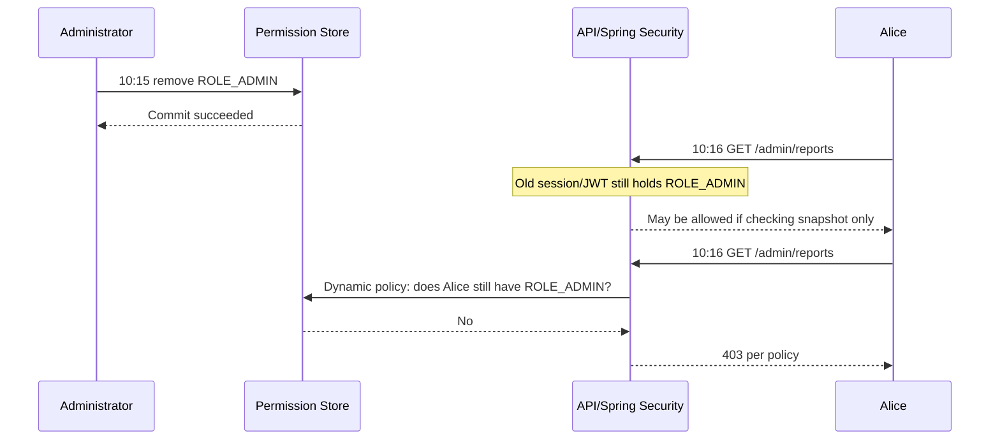

# Permissions Stored in Sessions or Tokens and When Changes Take Effect

In a Spring Security system, an administrator may **revoke** Alice's permissions in the database at 10:15, yet Alice's next request at 10:16 is still permitted to access administrative features. This is not necessarily a bug in `hasRole` or `hasAuthority`: **the permission the application is checking may be a snapshot fetched and stored earlier**.

This lesson explains where permissions live, the lifecycle of `Authentication`, differences between **sessions and tokens**, why permission changes can lag, and designs for defining and meeting grant/revocation effective-time targets.

**Main takeaway:** The moment permissions are updated in the source store **does not automatically match** the moment every request starts using the new permissions. You must identify **which permission source each request actually reads**, the refresh or revocation mechanism, caches, and the consistency level the system requires.

## 1. First: permissions in the source of truth and permissions of a request are two different things

Suppose the system grants Alice the following permissions:

```text
10:00  Database: alice -> ROLE_ADMIN, invoices.read
10:00  Alice logs in.
       Authentication#getAuthorities() -> ROLE_ADMIN, invoices.read

10:15  Administrator removes ROLE_ADMIN from database.
       Database: alice -> invoices.read

10:16  Alice calls GET /admin/reports.
       Outcome depends on where the request gets authorities from.
```

Two common check styles:

- **Checking authorities loaded into `Authentication`:** e.g., `hasRole("ADMIN")` checks for `ROLE_ADMIN` in the current `Authentication`'s `GrantedAuthority` collection. If `Authentication` is still the old snapshot, the rule still sees `ROLE_ADMIN`.
- **Checking dynamic policy:** e.g., a service reads the latest permissions from a trusted repository when Alice requests to export a report. If the repository already reflects the revocation and there is no stale cache, the rule can deny on the very next request.

Both can be combined: coarse authorities at the HTTP layer, dynamic policies for sensitive actions. Yet when combining with **AND**, a stale authority can still block a **newly granted** permission; for new grants to take effect promptly, you must also account for authority refresh paths or suitable policy structure.

### Questions to answer before choosing a solution

1. **Where do permissions live?** Application database, IAM/IdP, authorization service, access token claims, or a permission list inside the session?
2. **What does a request read?** `SecurityContext` in `HttpSession`, verified JWT, opaque-token introspection, DB query, or cache?
3. **When are permissions snapshotted?** At login, token issuance, token refresh, or on every request?
4. **What is the revocation path?** Invalidate session, refresh authentication, revoke token, denylist, shorten TTL, or dynamic permission checks?
5. **What is the SLA for changes taking effect?** Immediately on next request, a few seconds, after token expiry, or next login?

There is no single default right answer for every application. A requirement to "revoke admin roles within 5 seconds" differs from "update display name on next login".

## 2. Sessions: SecurityContext can hold authorities from login time

### 2.1. Authentication is created upon authentication

In a Servlet application using session-based login, after successful authentication Spring Security holds an `Authentication` containing principal info, authentication state, and a `GrantedAuthority` list. For example:

```text
Authentication
  principal      = alice
  authenticated  = true
  authorities    = [ROLE_ADMIN, invoices.read]
```

With HTTP session state storage, the `SecurityContext` containing `Authentication` can be persisted via `SecurityContextRepository`, commonly `HttpSessionSecurityContextRepository`. On subsequent requests, the security context is restored for authorization to use.

**A session cookie is not a role list.** Browsers normally send a cookie containing a **session ID**; `SecurityContext` data resides server-side or in a distributed session store. Preventing cookie tampering does not solve stale authorities inside a server-side session.

### 2.2. What happens when a role is deleted in the database?

Suppose at login time `UserDetailsService` loads `ROLE_ADMIN` and constructs `Authentication`. At 10:15, an admin deletes the role in the DB:

- The DB row may have updated successfully.
- **The `Authentication` inside existing sessions usually does not update automatically** merely because a role record changed in the DB.
- Subsequent requests restore the same security context or equivalent data, so `hasRole("ADMIN")` can still see `ROLE_ADMIN`.
- If Alice **logs in again**, the normal authentication flow can read the new roles, *provided* the authentication source actually queries fresh data without a stale cache.

Do not misinterpret "Spring Security filters run on every request" as "Spring Security re-queries all roles from the DB on every request by default". Restoring `SecurityContext` and refreshing user permissions are two separate operations.

### 2.3. Spring Security 6 and saving SecurityContext

In Spring Security 6, `SecurityContextHolderFilter` reads context from the repository; **custom authentication** flows that create or replace `Authentication` must **explicitly save the context** via `SecurityContextRepository#saveContext` if it should persist across the next request. Built-in login filters/mechanisms handle persistence along their own flows.

This matters when implementing a "refresh session permissions" feature: merely calling `SecurityContextHolder.setContext(newContext)` in one request **does not guarantee** subsequent requests keep using the new context. You must pick the right repository and persist according to the application's contract. Furthermore, updating the context of **one session** does not automatically refresh sessions on other devices.

Illustrative application-layer snippet after re-verifying permissions and creating a valid `Authentication`:

```java
SecurityContext newContext = SecurityContextHolder.createEmptyContext();
newContext.setAuthentication(updatedAuthentication);
SecurityContextHolder.setContext(newContext);
securityContextRepository.saveContext(newContext, request, response);
```

This is an **integration snippet**, not a standalone Java program. `updatedAuthentication` must be built by trusted logic (never taking roles from a request body); `securityContextRepository`, `request`, and `response` are provided by the HTTP/configuration layer. Never use this approach to "elevate privileges" based on client-supplied data.

### 2.4. When will a session use new permissions?

| Event | Impact on permissions in session |
| --- | --- |
| Update role/permission table in DB | **Does not automatically** change authorities of stored `Authentication` instances |
| User logs in again | Usually fetches new permissions if authentication provider reads fresh source |
| User logs out / invalidates that session | Old session is no longer used; next login can load new permissions |
| Server proactively invalidates **all related sessions** | Subsequent requests must re-authenticate, depending on session registry/store and consistency |
| Server rebuilds and saves `SecurityContext` | That session updates **per implemented mechanism**; other sessions do not change automatically |
| API checks dynamic permissions in DB on each action | Dynamic decisions can reflect updates even if the session authority snapshot is stale |
| Session timeout | Old session expires, yet does not guarantee immediate revocation at DB-change time |

**Idle session timeouts** can reset as the user stays active. Therefore, do not assume "permissions will expire automatically after N minutes" if sessions stay alive through continuous requests. If an absolute bound is required, implement appropriate absolute-lifetime/reauthentication policies.

## 3. JWT access tokens: issued claims do not change on their own

In an OAuth2 Resource Server application, clients typically send:

```http
GET /api/reports HTTP/1.1
Authorization: Bearer eyJ...<token>...
```

An illustrative JWT containing claims:

```json
{
  "iss": "https://idp.example.test",
  "sub": "alice",
  "aud": "reports-api",
  "scope": "reports.read",
  "roles": ["ADMIN"],
  "iat": 1790000000,
  "exp": 1790000300
}
```

This is an **illustrative payload**, not a validly signed token. Having a `roles` claim **does not mean** Spring Security automatically maps it to `ROLE_ADMIN`: the common JWT Resource Server default maps `scope`/`scp` into `SCOPE_`-prefixed authorities; to use `roles`, configure an appropriate converter and trust only verified issuers.

### 3.1. A signed token is a snapshot at issuance time

Suppose a token is issued at 10:00 with claim `roles=["ADMIN"]`. By 10:15:

- An admin removes Alice's ADMIN role in IAM/DB.
- The already-issued JWT still contains the same bytes and `roles=["ADMIN"]` claim; it **does not change simply because the source data changed**.
- If the API only verifies signature, configured issuer, audience, expiry, and maps roles from the JWT, the token **can continue carrying old permissions** until rejected by an extra rule or expiration.
- Changing permissions in IAM **does not automatically** mean an independent Resource Server updated the `Authentication` of prior JWT requests.

When a token has `exp`, it is treated as expired per validator rules and allowed `clock skew`. **Token lifetime is the expected bound of the snapshot when no extra revocation exists**; actual rejection timing also depends on validation, caching, configuration, and how the API enforces policy.

### 3.2. Resource Server re-verifies the token, not necessarily querying the permission DB

Common Java/Spring Boot configuration:

```yaml
spring:
  security:
    oauth2:
      resourceserver:
        jwt:
          issuer-uri: https://idp.example.test
```

With a JWT Resource Server, Spring Security verifies the signature and configured time/issuer claims; business policy may need an extra validator checking `aud` matches the API. Building `Authentication` from a JWT on **every request** does not "reload claims from IAM". The old token produces old authorities if the converter keeps reading the same claims.

Whether a JWT is stored in local storage, a cookie, or client memory, it can carry the same snapshot semantics; **storage location / transport** does not determine whether claims inside the token can be updated.

### 3.3. Refresh tokens do not make old access tokens vanish

Refresh tokens are used to request **new access tokens**, not to directly modify already-issued access tokens. If a refresh token is revoked at 10:15:

- The client may no longer obtain new access tokens with that refresh token.
- **Old access tokens** can still work until `exp` if the Resource Server only verifies signatures and has no immediate revocation channel.
- When issuing a new access token, the Authorization Server must define whether it re-reads current roles/permissions. Do not assume a refresh always updates every claim if token issuance policy still reads stale data.

OAuth2 has **token revocation** per RFC 7009; its effect on access tokens, linked tokens, and whether APIs learn of revocation depends on the implementation and token type. Merely calling "revoke" on the Authorization Server **does not prove** every Resource Server verifying JWTs offline will reject immediately.

## 4. Opaque tokens: centralized status checks possible, yet freshness policies still needed

Opaque access tokens are typically strings without a JWT payload for the Resource Server to read directly. With Spring Security OAuth2 Resource Server configured for introspection, upon receiving a token the API can ask the Authorization Server/introspection endpoint:

```text
Resource Server
    -- token --> Introspection endpoint
    <-- active, scope, subject, metadata --
    -> build Authentication/authorities -> authorization
```

If introspection returns `active=false` after revocation and the API performs introspection on the next request, revocation can take effect faster than offline JWTs. However:

- Introspection usually returns token status and metadata; **returned roles/scopes may still be the initial snapshot**, depending on how the Authorization Server is implemented.
- If introspection results are cached, permissions and `active` status can **lag** until cache expiry or invalidation.
- If the Authorization Server or network fails, define a deny/resilience policy; never fall back to allow when a token cannot be verified.
- Per-request introspection increases call volume, latency, and dependency on a central service. The solution balances freshness, criticality, and system capacity.

Key distinction: **offline JWTs** usually do not call the AS on each request; **opaque token introspection** provides a mechanism to check status with the AS, yet does not automatically guarantee all business permissions are recomputed from the live DB.

## 5. Table of when permission changes take effect

Suppose permission `ROLE_ADMIN` or `reports.read` is **revoked** at `t_change`. The table below describes typical behavior, not a hard Spring Security SLA.

| Permission check mechanism | What do requests see after DB change? | When do old permissions end? |
| --- | --- | --- |
| Session holding `Authentication` with login-time authorities | Can still see old permissions | After refreshing that session, invalidating the session, or re-authenticating |
| Pre-signed JWT, API checks token offline + claims only | Can keep using old claims | When JWT expires or is blocked via revocation/denylist/live check |
| Opaque token + uncached introspection | Can see revoked token promptly if AS reports inactive | When AS reflects revocation and API receives updated response |
| Cached opaque introspection | Can see stale active/claims | After cache invalidation/TTL or stronger consistency mechanism |
| API queries permission repository per request | New permissions can appear on the next request | Once permission transaction commits and reads are not stale |
| API caches permissions for 60 seconds | Can still hold old permissions | Per TTL or on eviction/version bump |
| Dynamic authorization via object policy | Reflects new relationship state if data is fresh | Per consistency of policy engine/repository/cache |
| Logout on one browser | Destroys that browser's session per config | Does not automatically destroy all user sessions or access tokens |

**Newly granted permissions experience similar lag.** If Bob is newly granted `ROLE_MANAGER` while his session holds stale authorities, `hasRole("MANAGER")` still denies until data is refreshed. For workflows requiring newly granted permissions to take effect quickly, refresh or dynamic policy queries must be designed upfront.

### A timeline clarifying what "immediately" means



The word "immediately" should generally be phrased as a **contract**, such as "any new request after the revocation commit must be denied within 5 seconds", with explicit expectations for in-flight requests, replicas, networks, caches, and clocks.

## 6. Standalone Java 17 example: snapshot vs live permission data

The program below **does not use Spring Security and does not issue real JWTs**. It accurately simulates one phenomenon: two authority "snapshots" are created at `t0`; after the permission store changes at `t1`, the snapshots keep the old strings while querying the live permission source reflects the update.

Save as **`AuthorityFreshnessDemo.java`**:

```java
import java.util.HashMap;
import java.util.HashSet;
import java.util.Map;
import java.util.Set;

public class AuthorityFreshnessDemo {

    record AuthoritySnapshot(String subject, Set<String> authorities) {
        boolean has(String authority) {
            return authorities.contains(authority);
        }
    }

    static final class AuthorityStore {
        private final Map<String, Set<String>> assigned = new HashMap<>();

        void grant(String subject, String authority) {
            assigned.computeIfAbsent(subject, ignored -> new HashSet<>())
                    .add(authority);
        }

        void revoke(String subject, String authority) {
            Set<String> permissions = assigned.get(subject);
            if (permissions != null) {
                permissions.remove(authority);
            }
        }

        AuthoritySnapshot issueSnapshot(String subject) {
            Set<String> current = assigned.getOrDefault(subject, Set.of());
            return new AuthoritySnapshot(subject, Set.copyOf(current));
        }

        boolean hasNow(String subject, String authority) {
            return assigned.getOrDefault(subject, Set.of()).contains(authority);
        }
    }

    public static void main(String[] args) {
        AuthorityStore store = new AuthorityStore();
        store.grant("alice", "ROLE_ADMIN");

        AuthoritySnapshot sessionAtLogin = store.issueSnapshot("alice");
        AuthoritySnapshot tokenAtIssue = store.issueSnapshot("alice");

        System.out.println("Session at login: "
                + sessionAtLogin.has("ROLE_ADMIN"));

        store.revoke("alice", "ROLE_ADMIN");

        System.out.println("DB after revoke: "
                + store.hasNow("alice", "ROLE_ADMIN"));
        System.out.println("Old session after revoke: "
                + sessionAtLogin.has("ROLE_ADMIN"));
        System.out.println("Old token claims after revoke: "
                + tokenAtIssue.has("ROLE_ADMIN"));
        System.out.println("Live policy after revoke: "
                + store.hasNow("alice", "ROLE_ADMIN"));
        System.out.println("Fresh login after revoke: "
                + store.issueSnapshot("alice").has("ROLE_ADMIN"));

        store.grant("alice", "documents.read");

        System.out.println("New grant in old session: "
                + sessionAtLogin.has("documents.read"));
        System.out.println("New grant in live store: "
                + store.hasNow("alice", "documents.read"));
    }
}
```

With **JDK 17+**:

```bash
javac AuthorityFreshnessDemo.java
java AuthorityFreshnessDemo
```

Stdout:

```text
Session at login: true
DB after revoke: false
Old session after revoke: true
Old token claims after revoke: true
Live policy after revoke: false
Fresh login after revoke: false
New grant in old session: false
New grant in live store: true
```

Explanation:

1. `Set.copyOf(current)` creates an **immutable permission set at snapshot time**. Removing from `AuthorityStore` does not mutate already-captured sets.
2. `sessionAtLogin` simulates session authorities; `tokenAtIssue` simulates authority claims at token issuance. These are two distinct real storage mechanisms, yet both exhibit the **stale snapshot** issue.
3. `hasNow` simulates a policy querying current permissions directly. After revocation, it returns `false`, while old snapshots still return `true`.
4. When `documents.read` is granted, the live store returns `true` yet the old session still lacks the new permission. **Granting also has an effective time**, not just revocation.
5. The program illustrates data freshness only. In real systems, `Authentication`, JWT signatures, issuers, expiry, session repositories, races, and caches must all be handled via corresponding libraries/configurations.

## 7. Enforcing with Spring Security: snapshot rules vs dynamic rules

### 7.1. Checking only authorities in Authentication

Servlet HTTP authorization configuration example:

```java
@Bean
SecurityFilterChain securityFilterChain(HttpSecurity http) throws Exception {
    http.authorizeHttpRequests(authorize -> authorize
        .requestMatchers("/admin/**").hasRole("ADMIN")
        .requestMatchers("/reports/**").hasAuthority("reports.read")
        .anyRequest().authenticated()
    );
    return http.build();
}
```

This is a **Spring Boot/Spring Security configuration fragment**, requiring appropriate imports and beans/configuration; it is not a standalone Java class runnable with `javac`. `hasRole("ADMIN")` by default searches for `ROLE_ADMIN` in `Authentication`'s authorities. If authentication holds a stale snapshot, this rule does not re-read the database itself.

**For JWT Resource Servers**, if roles come from a custom claim, there must be a trusted mapping to `ROLE_ADMIN`; scopes become `SCOPE_...` by default, not `ROLE_...`.

### 7.2. Dynamic policy using current data

For high-impact actions, such as **approving vouchers**, permissions can be checked in the service, bound to the resource ID and a trusted permission datastore. Illustrative example:

```java
@Service("approvalPolicy")
public class ApprovalPolicy {
    private final ApprovalPermissionRepository repository;

    public ApprovalPolicy(ApprovalPermissionRepository repository) {
        this.repository = repository;
    }

    public boolean canApprove(String userId, String invoiceId) {
        return repository.canApproveNow(userId, invoiceId);
    }
}
```

`ApprovalPermissionRepository` is an **application-defined interface**; `canApproveNow` must query current permissions, ownership/tenant, voucher status, and enforce policy as needed. No built-in implementation exists in Spring Security.

In a Spring-managed service with `@EnableMethodSecurity` enabled:

```java
@PreAuthorize(
    "isAuthenticated() and @approvalPolicy.canApprove(authentication.name, #invoiceId)"
)
public void approveInvoice(@P("invoiceId") String invoiceId) {
    // Execute voucher approval business logic.
}
```

`@P` here is `org.springframework.security.access.method.P`, helping SpEL resolve parameter names regardless of whether `-parameters` is enabled at compile time. The snippets above are **integration fragments** that must be placed in classes/services with matching repository beans to run in a real application.

If the policy reads current permissions on every request, deleting a permission can affect the **next request** after commit. Yet if a database replica lags, a permission cache was not evicted, or policy was evaluated in a transaction prior to the permission change, the decision can still lag. A "dynamic check" gives no stronger guarantee than the actual consistency of its underlying read source.

### 7.3. Do not check dynamic permissions at only one endpoint

Apply the same policy to **detail GETs, lists, exports, downloads, batches, updates, background jobs**, and every data entry path. If `GET /invoices/{id}` checks dynamic permissions yet `GET /invoices/export` relies only on JWT authorities, a freshly revoked user can still export data through the other endpoint.

For list queries, filter permissions at the query layer or via permitted-object lookup mechanisms instead of fetching all data and filtering in the UI; avoid leaking counts, metadata, or broken pagination.

## 8. Strategies so permission changes take effect on time

You do not need a single strategy for every permission. Classify by impact, acceptable latency, operational feasibility, and security requirements.

| Strategy | Best suited for | Conditions/risks |
| --- | --- | --- |
| **Re-login / new session** | Infrequent permission changes, no immediate update needed | Old sessions keep permissions until destroyed/expired |
| **Invalidate active user sessions** | Revoking users or sensitive roles in session apps | Must locate all sessions across nodes/devices consistently with session store |
| **Refresh session Authentication** | Updating permissions without forcing user re-login | Must build from trusted source, persist context properly; refresh all related sessions if needed |
| **Short-lived JWT access tokens** | APIs verifying JWTs offline, accepting bounded revocation window | Old JWT stays valid within TTL + skew/policy; refresh tokens must be protected |
| **Refresh token rotation + re-issuance policy** | Limiting long-lived token exposure and refreshing claims on reissue | Does not alter old access tokens; rotation/reuse detection must be solidly implemented |
| **Denylist by `jti`/token ID or user auth-version** | Need to reject old tokens early | API must check live/cache state per request; design TTL, consistency, and storage protection |
| **Opaque token introspection** | Want centralized active-status checks | AS latency/availability; cached checks and claims can still lag |
| **Dynamic permission checks in API** | Object-level rights, sensitive actions, fast revocation | Increases query cost; requires consistency and guarding every access path |
| **Event-driven cache invalidation** | Multiple instances with permission caches | Events can be delayed/lost; needs recovery, versioning, and testing |
| **Centralized policy engine** | Multiple services sharing relationships/rules | Must define consistency, timeouts, fail-closed behavior, and synced data sources |

### 8.1. Implementation guide when fast admin-role revocation is required

Suppose the requirement is: **stop a user's administrative rights within 10 seconds after revocation is confirmed**. A design may include:

1. Write the role/permission change to the source permission store inside a transaction; report success only after commit.
2. Emit a `UserAuthorizationChanged(userId, version)` event or equivalent mechanism with retry/reconciliation; clear related permission caches.
3. For session apps: invalidate active sessions of that user or force reauthentication/authentication refresh on subsequent requests.
4. For JWTs: use a sufficiently short TTL **or** check auth-version/denylist/live policy in the API to close the window offline JWTs cannot cover.
5. Enforce dynamic policies on high-privilege actions uniformly across UI/API/jobs.
6. Measure **time from commit to first denial** on every API/node, including caches, replicas, and concurrent requests. Test missed events, out-of-sync caches, network partitions, and tokens issued prior to revocation.

**Insufficient:** only updating the role in the DB assuming Spring Security automatically updates every `Authentication` or every JWT. Also insufficient: refreshing only the session of the browser performing the revocation action.

### 8.2. Granting new permissions: avoid persistent blocks and accidental grants

Granting new permissions is usually less urgent than revocation, yet still needs clear UX:

- After granting `invoices.approve`, notify the user to log in again if the system intentionally uses login-time snapshots.
- If updating within the current session is needed, refresh `Authentication` or use a trusted dynamic policy layer. Never trust permission data sent up by the browser for a "quick sync".
- Restrict permission issuers; not every user carrying a `roles` claim is entitled to demand a corresponding role.
- If combining both an authority snapshot and a dynamic policy with AND, new permissions can remain blocked by the old snapshot. Check design must reflect the desired effective contract.

## 9. Logout, account locking, and password changes: common misconceptions

### "Once logged out, are all tokens invalidated?"

**Not automatically.** Logging out of a session app typically clears authentication and invalidates the associated session per configuration. If the client still holds an **issued access token**, another Resource Server may continue accepting it until expiry or until blocked by an appropriate revocation policy. Logging out of one application also does not automatically end the entire SSO session at the IdP or on other devices.

### "Is locking an account in the database enough?"

If requests rely completely on session authorities or stale JWT claims, `enabled/locked` checks from login time **are not re-run automatically**. For immediate account lockout, APIs need **live status checks**, auth-version, denylists, or invalidation of related credentials/sessions.

### "Does changing the password clear all old sessions?"

Depends on configuration. Do not assume so. If policy requires "password change ⇒ log out all devices", explicitly revoke/invalidate sessions, refresh tokens, and/or access tokens per architecture. Changing the password hash in the DB does not alter an active valid JWT.

### "Are session cookies and JWTs the same because both sit in the browser?"

No. A cookie is merely a **transport mechanism**. A session ID typically points to server-side state that can be deleted; a JWT is a token with signed claims usually verifiable offline. A JWT can also be sent inside a cookie, and a session ID can also be sent in a header: **transport location** and **persistence/revocation model** are two separate questions.

## 10. Caches, multi-node setups, and race conditions determine the real window

### 10.1. Permissions can be cached at multiple layers

Check each in turn:

- `UserDetails` or user/role caches inside the authentication provider.
- `SecurityContext` inside the HTTP session or session store like Redis.
- Claims inside a JWT or opaque token metadata.
- Introspection `active` and scope caches.
- Permission/relationship caches in services or authorization engines.
- Read replicas with replication lag.
- Client-side caches of UI permission display info (UX only, never replacing server-side enforcement).

A database change may need to propagate across multiple layers. "Cache cleared" must specify **which cache**, **which nodes**, and **whether stale data remains at another layer**.

### 10.2. Two concurrent requests

If Request A reads permissions before an admin commits a revocation, then continues executing while Request B/administration commits the revocation, Request A can finish even though permissions were revoked post-commit. SLAs must specify **new requests** after commit vs **all operations**, including in-flight ones, and whether writes must re-verify permissions close to commit time.

For fund transfers, data deletion, or critical approvals, check permissions at transaction boundaries or design suitable preconditions/versions; never claim "strictly instantaneous revocation" if the system checks permissions only once at the start of a request.

### 10.3. Fail closed and resilience

When a live policy service or introspection endpoint times out, the safe behavior for protected operations is normally to **deny or return a policy error**, never allowing access simply because fresh permissions could not be read. Consider bounded retries, circuit breakers, observability, SLOs, and controlled caching, without turning network failures into open access.

### 10.4. Clocks and consistency

JWTs have `exp`, `nbf`, and may allow clock skew. Saying "token expires at exactly 10:15:00" may not match when every validator rejects it if clock skew settings differ. With caches or replicas, lag can exceed clock skew. **Measure end-to-end** instead of reading only a single component's TTL config.

## 11. Effective-time test matrix

| Scenario | What must be verified |
| --- | --- |
| Revoke role, existing session | Decisions on subsequent requests match refresh/invalidation policy; do not assume session updates automatically |
| Grant role, existing session | New permissions take effect within expected window; not unexpectedly blocked by stale snapshot |
| Revoke role, unexpired JWT | Resource Server rejects via TTL/denylist/live check as designed |
| Expired access token | API rejects expired token; clock skew matches configuration |
| Revoked refresh token | Cannot obtain new tokens under revoked grant; test old access token separately |
| Revoked opaque token | Introspection returns inactive and all related caches expire within SLA |
| Logout on one device | That device's session is unusable; verify other devices independently |
| Admin disables user | Sensitive APIs deny within SLA even if old credentials still exist |
| Multi-node after permission change event | All nodes decide consistently within specified window |
| Resource changed ownership/tenant | Object policy returns updated decision and leaks no data via list/export |
| Request started before revocation | Completion behavior matches rules for in-flight requests |
| Policy store failure | Fail-closed/error handling and logs/audits expose no tokens or sensitive info |

For each test, record the **change commit time (`t_change`)**, **first denied or allowed request (`t_effective`)**, request path, node, credential type, and active caches. Effective latency can be expressed as **`t_effective - t_change`**, though values must be measured on the actual deployed system rather than inferred from library docs.

## 12. Common explanation and implementation errors

| Wrong assumption or practice | Why it is wrong | How to fix |
| --- | --- | --- |
| "Changing a role in the DB makes `hasRole` see it immediately" | `Authentication` in session/JWT may be a snapshot | Identify authority source and refresh/revocation mechanism |
| "Spring Security authenticates every request so it queries roles every time" | Restoring a session or validating a JWT is not equivalent to reloading DB permissions | Inspect the actual authentication pipeline |
| "Signed JWTs cannot be revoked early" | Can combine denylists, auth-version, introspection, or dynamic policies | Choose mechanism matching SLA |
| "Revoking a refresh token invalidates old access tokens immediately" | Old access tokens are independent credentials until validators/policies reject them | Design handling separately for unexpired access tokens |
| "Session logout revokes all JWTs across every API" | Sessions and bearer tokens can have separate lifecycles | Separate logout/session invalidation/token revocation |
| "Clearing permission cache on API A updates API B too" | Caches/replicas can be distributed | Events, versioning, TTL, consistency, and multi-node tests |
| "Just granted the permission so `hasAuthority` definitely allows it" | Old session/token may not carry the new authority yet | Refresh auth or read permissions dynamically |
| "Checking scope `reports.read` is enough" | Coarse scopes do not decide resource owner/tenant/status | Add resource-level policy |
| "Invalidating one session logs out every device" | Multiple sessions and credential types may exist | Identify all linked sessions/tokens |
| "`SecurityContextHolder.setContext` always saves to the session" | Spring Security 6 requires explicit persistence for custom flows | Use `SecurityContextRepository#saveContext` per contract |
| "Cache hits don't need to know when data last changed" | Cache can serve stale permissions after revocation | Track version/freshness and eviction policies |
| "Denying all requests after revocation is completely race-free" | In-flight requests may have passed authorization before commit | Define atomicity and effective boundaries clearly |

## 13. Self-check questions

1. **Alice logs in at 10:00 with `ROLE_ADMIN`. At 10:15 an admin deletes the role in the DB. Must `hasRole("ADMIN")` at 10:16 return false?**  
   **Not by default.** If `Authentication` loaded from the session still holds `ROLE_ADMIN`, the rule can continue allowing access.

2. **Why can a JWT whose signature is validated on every request still carry old roles?**  
   Because the validator checks the issued token and trusted claims/constraints; it does not query the current role table by default.

3. **Does revoking a refresh token mean revoking all issued access tokens?**  
   Not always. Depends on AS policy/implementation and the Resource Server's ability to detect revocation.

4. **Does opaque token introspection guarantee all per-document permissions are always fresh?**  
   No. It can verify token status; object permissions and metadata freshness must be defined separately.

5. **Granted `ROLE_MANAGER` in the DB yet the session still lacks the authority; how do you make it take effect?**  
   Refresh `Authentication` from a trusted source, require reauthentication, or design dynamic policies matching the rule.

6. **To revoke admin permissions within 5 seconds, is setting JWT TTL to 1 hour enough?**  
   No if the API only uses offline JWTs. A fast revocation/status-check mechanism or a TTL matching the requirement is needed.

7. **With Spring Security 6, does custom login replacing `SecurityContextHolder` automatically ensure the next request uses the new Authentication?**  
   No. Explicit persistence is required, typically `SecurityContextRepository#saveContext` when using session storage.

## 14. Practical conclusion

**Login time, token issuance time, and per-request permission evaluation time can be three distinct points in time.**

- **Sessions:** authorities are typically data bound to stored `Authentication`; changing roles in the DB does not automatically refresh every session.
- **JWT access tokens:** claims typically stay fixed until the token is rejected by expiry or supplemental policy; changing roles in the IdP does not modify tokens.
- **Opaque tokens / introspection:** can check status centrally, yet freshness depends on the AS, caches, and business permission decisions.
- **Dynamic policies:** can read fresh permissions on the next request, yet remain subject to transactions, replicas, caches, and races.
- **Good design:** explicitly define **grant/revocation SLAs**, permission sources, refresh/revocation mechanisms, enforcement across every API, and verification methods.

For any requirement to "update user permissions", never stop at asking "did the database update?". Also ask: **"Where does each request obtain its authorities, and what mechanism causes the new permissions to take effect?"**

## References

- [Spring Security 6.5 – Authentication Persistence and Session Management](https://docs.spring.io/spring-security/reference/6.5/servlet/authentication/session-management.html)
- [Spring Security 6.5 – OAuth2 Resource Server JWT](https://docs.spring.io/spring-security/reference/6.5/servlet/oauth2/resource-server/jwt.html)
- [Spring Security – OAuth2 Resource Server Opaque Token](https://docs.spring.io/spring-security/reference/servlet/oauth2/resource-server/opaque-token.html)
- [Spring Security – Method Security](https://docs.spring.io/spring-security/reference/servlet/authorization/method-security.html)
- [RFC 7009 – OAuth 2.0 Token Revocation](https://www.rfc-editor.org/rfc/rfc7009)
