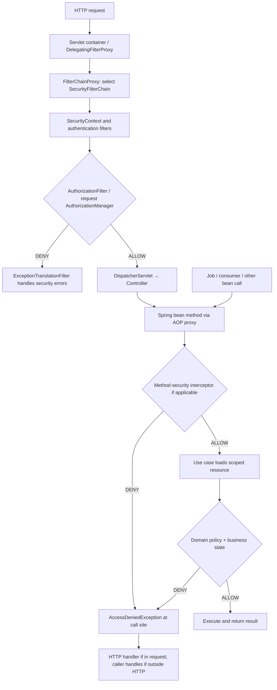

# From HTTP Request or Method Call to Authorization Decision

> **Module:** Spring Security - authorization  
> **Group:** Decision Flow  
> **Objective:** Trace a request from the moment it enters the system until it is allowed or denied; understand the roles of `SecurityFilterChain`, `AuthorizationFilter`, `AuthorizationManager`, `Authentication`, method-security interceptors, and business policies. After this lesson, you can explain **which checkpoint made the decision**, why it made that decision, and how to verify that different call paths are all protected.

## 1. A request can pass through multiple decisions

Suppose the application has an endpoint:

```http
PATCH /api/documents/42
Authorization: Bearer <access-token>
Content-Type: application/json

{"title":"Revised version"}
```

The caller Alice is logged in and has the `document:edit` authority. This **does not yet prove** that Alice is allowed to edit document 42: the document also has its own owner, tenant, state, and sharing rules. A request typically goes through the following stages:

1. **Select security chain:** does the request pass through an appropriate `SecurityFilterChain`?
2. **Obtain trusted identity:** the authentication filter reads the session or bearer token, creates an `Authentication`, and attaches it to the `SecurityContext` according to the application's mechanism.
3. **Request-level authorization:** `AuthorizationFilter` delegates to `AuthorizationManager` to check the URL, HTTP method, role/authority, or custom rules.
4. **Route to the application:** the request is dispatched to the MVC controller after passing the relevant checks.
5. **Method-level authorization:** if method security is enabled and the method is called through an appropriate proxy/interceptor, annotations such as `@PreAuthorize` are evaluated next.
6. **Resource-level authorization:** application/domain policy evaluates the actor, action, actual object, tenant, owner, state, and business conditions.
7. **Execution:** only when the relevant checks allow it is the data modification command executed and the response generated.

Three takeaways to keep in mind:

- **ALLOW at one stage does not mean ALLOW for the entire request.** A subsequent stage can still deny it.
- **DENY at an earlier protective stage** blocks further processing; the endpoint, method, or data operation may not be invoked.
- **Not every call originates from HTTP.** Schedulers, message listeners, batch jobs, and direct service calls can completely bypass HTTP filters, so the design needs appropriate safeguards at the use case level.

## 2. Overall diagram: two entry points that both need control



This diagram is a **conceptual flow**, not a list of every filter or the exact ordering of every advisor: Spring Security modules, custom filters, AOP ordering, CSRF, and transaction configuration can affect the exact order. On the HTTP side, `ExceptionTranslationFilter` is the filter that wraps downstream calls and translates certain security exceptions thrown below it. On the method side, the interceptor only operates if the call goes through a protection mechanism that is actually configured.

An endpoint can have request authorization without method annotations, have method annotations while the URL guard only requires `authenticated()`, or have both. The design must deliberately choose and test this; there is no rule that "enabling Spring Security automatically makes every method safe".

## 3. Step 1 — Which SecurityFilterChain does the Servlet select?

In a Servlet application, a request passes through `DelegatingFilterProxy` to reach Spring Security's `FilterChainProxy` bean. `FilterChainProxy` can manage **multiple `SecurityFilterChain` instances**, each bound to a `RequestMatcher` that determines which requests belong to that chain's scope.

For example, there might be:
- A chain for `/api/**` using bearer tokens.
- A chain for the website using session/form login.
- A fallback chain for the remaining requests.

**Chain order matters:** `FilterChainProxy` selects the **first matching chain**, rather than accumulating all chains and picking the strictest rule. Chain beans are typically ordered with `@Order`. If no chain matches, the request is not protected by the Spring Security filters of those chains; special care is needed when using `securityMatcher(...)` to restrict scope.

Distinguish between:

| Mechanism | Question it answers |
| --- | --- |
| `http.securityMatcher("/api/**")` | Should the request **enter this SecurityFilterChain**? |
| `authorizeHttpRequests(...requestMatchers(...))` | **Once inside the chain**, which authorization rule applies? |
| `requestMatchers(...).permitAll()` | A request passing through this chain is allowed at the configured authorization step, but still goes through the relevant security filters |
| `web.ignoring()` | Bypasses Spring Security for matching requests; should not be used indiscriminately for application endpoints |
| `anyRequest().denyAll()` | Within the scope of this chain and rule set, any request not matching an earlier rule is denied |

A common mistake is configuring two chains that both match `/api/**` and assuming the second chain will continue checking if the first chain allowed the request. That is incorrect: you must check **which chain is selected** before diagnosing authorities or `@PreAuthorize`.

## 4. Step 2 — How are Authentication and SecurityContext established?

Authentication answers "who is the caller?". Authorization answers "is this person allowed to perform this operation?". In Spring Security, the authentication result is typically an `Authentication`:

```text
Authentication
  principal       = identified principal
  authorities     = set of granted GrantedAuthority
  credentials     = authentication credentials; usually cleared or hidden after authentication
  details         = mechanism-specific metadata
  authenticated   = status managed by the authentication mechanism
```

For session-based requests, the context can be loaded from `SecurityContextRepository`; for bearer tokens, a filter can validate the token on each request and set up authentication for the current processing. `SecurityContextHolder` is the context access point in same-thread Servlet code, using a `ThreadLocal` strategy by default.

Distinguish four situations:

| State | What to understand |
| --- | --- |
| No credentials on an endpoint requiring login | The authorization step requiring identity will deny and may trigger the authentication entry point |
| Invalid/expired credentials | Authentication filters/providers handle the error; the request is not treated as a valid user |
| Valid credentials but missing authority | Authentication succeeds, **authorization can still DENY** |
| Has authority but resource is out of scope | The request guard may ALLOW; the resource policy subsequently DENYs |

Do not rely on the client sending `role=ADMIN` in a body/header to construct authorities. Principals, groups/roles, and scopes must be verified and mapped by trusted authentication/authorization infrastructure. Also, do not write `authentication != null && authentication.isAuthenticated()` yourself and immediately conclude it is a real logged-in user: `AnonymousAuthenticationToken` can technically be marked authenticated; use Spring Security's `authenticated()` matcher/DSL or trust resolver instead.

**Subtle point:** in `authorizeHttpRequests`, `AuthorizationManager` receives `Supplier<Authentication>`, meaning it can **defer retrieving the identity** until a rule actually needs it. Rules like `permitAll` or `denyAll` do not necessarily have to access `Authentication` to decide. Do not assume every request loads the user from the database solely for the authorization step.

## 5. Step 3 — AuthorizationFilter decides request access

In modern Servlet configurations using `authorizeHttpRequests`, `AuthorizationFilter` is the component that checks request permissions. The main flow can be described as:

1. `AuthorizationFilter` creates a `Supplier<Authentication>` capable of retrieving the identity from the security context.
2. It passes the supplier and the `HttpServletRequest` to an `AuthorizationManager`.
3. The manager determines the rule applicable to the request, for example based on method, path, and authority.
4. If **DENY**, Spring Security publishes a denial event when supported/configured and throws `AccessDeniedException` or the corresponding specialized exception.
5. If **ALLOW**, the filter invokes the rest of the filter chain to reach the application.

When configuring multiple `requestMatchers`, Spring Security typically uses `RequestMatcherDelegatingAuthorizationManager` to select the authorization manager corresponding to the matcher. **The first matching rule in the rule set is the one selected**; not all matchers are evaluated sequentially as an AND expression.

**Partial** configuration example for Spring Boot 3 / Spring Security 6.x (Servlet):

```java
import org.springframework.context.annotation.Bean;
import org.springframework.context.annotation.Configuration;
import org.springframework.http.HttpMethod;
import org.springframework.security.config.annotation.method.configuration.EnableMethodSecurity;
import org.springframework.security.config.annotation.web.builders.HttpSecurity;
import org.springframework.security.web.SecurityFilterChain;

@Configuration
@EnableMethodSecurity
class SecurityConfiguration {

    @Bean
    SecurityFilterChain apiSecurity(HttpSecurity http) throws Exception {
        http.authorizeHttpRequests(auth -> auth
            .requestMatchers(HttpMethod.GET, "/api/public/**")
                .permitAll()
            .requestMatchers(HttpMethod.GET, "/api/documents/**")
                .hasAuthority("document:read")
            .requestMatchers(HttpMethod.PATCH, "/api/documents/**")
                .hasAuthority("document:edit")
            .requestMatchers("/api/admin/**")
                .hasRole("ADMIN")
            .anyRequest().denyAll()
        );
        return http.build();
    }
}
```

This is an integration snippet, not a complete application: you still need to configure authentication (session, OAuth2 Resource Server, HTTP Basic, etc.), CSRF, controllers, and data policies according to your system. Key points to understand:

- `GET /api/public/help` can proceed past the request authorization step without an identity.
- `GET /api/documents/42` requires the `document:read` authority.
- `PATCH /api/documents/42` requires the `document:edit` authority; **this still does not prove permission on Document 42**.
- `hasRole("ADMIN")` checks `ROLE_ADMIN` using the default prefix; `hasAuthority("document:edit")` performs an exact string match.
- `anyRequest().denyAll()` avoids automatically allowing unlisted routes.
- If a broad matcher like `/api/**.permitAll()` is placed first, more specific matchers after it may never be selected. **Configuration order directly changes the outcome**.

`AuthorizationFilter` is typically at the end of the Spring Security filter chain by default, so authentication filters and many other protections have already had a chance to run before the request enters the application. Do not interpret this as "all custom filters in every position are protected by authorization"; custom filter placement must be examined explicitly.

## 6. AuthorizationManager: inputs, outputs, and the meaning of a decision

`AuthorizationManager<T>` is the central interface for modern authorization. In newer Spring Security 6.x releases, the evaluation API returns `AuthorizationResult` via `authorize(Supplier<Authentication>, T)`; older versions have `check`/`AuthorizationDecision` APIs. The type `T` depends on the point being protected:

| Protected invocation type | Example input data |
| --- | --- |
| HTTP request | `HttpServletRequest` and request context |
| Method invocation before execution | `MethodInvocation`, arguments, and target |
| Method invocation after execution | Return value and invocation context, via the appropriate type |
| Custom integration | Application-defined security object |

A manager can make decisions from a simple authority (`AuthorityAuthorizationManager`), authenticated status, matchers, time, or by calling a policy service to inspect a resource. Depending on the API and manager, there is also the concept of abstaining / making no decision; applications should not treat an unclear result as ALLOW by default.

A proper authorization decision must distinguish:
- **Trusted evidence:** verified Authentication/actor, verified claims, resource data loaded from the server.
- **Action:** READ, EDIT, DELETE, APPROVE, etc., with business meaning.
- **Subject/Object:** the specific resource, its type/ID, and its tenant.
- **Context:** workflow, owner, group, delegation rights, timestamp, or other conditions.

This can be modeled as:

```text
decision = authorize(actor, action, resource, context)
decision ∈ {allow, deny} per the policy contract

ALLOW is only valid when every mandatory condition is met.
Missing mandatory facts => must not guess or assume permission.
```

This mindset applies to request managers, method managers, and domain policies alike; the difference lies mainly in **when** they run and **what facts are already available** at each stage.

## 7. Step 4 — The controller only runs when the request passes prior guards

After the filter chain, the request is handled by Servlet MVC (typically via `DispatcherServlet`) and mapped to a controller. If an HTTP rule returned DENY, the controller method is normally not invoked.

A controller can:
- Bind `@PathVariable`, `@RequestBody`.
- Validate input data structure/format.
- Retrieve the identity through a trusted adapter.
- Invoke the application service containing the use case.

The controller **should not treat a `documentId` in the URL as proof of access permission**. It is merely a client-requested identifier. Values such as `userId`, `tenantId`, and `ownerId` in the body/header must still be cross-checked against a trusted source before being used in policy.

In a controller:

```java
// Illustrative snippet; DocumentService and RenameDocumentRequest are defined by the app.
@PatchMapping("/api/documents/{id}")
public ResponseEntity<Void> rename(
        @PathVariable long id,
        @RequestBody RenameDocumentRequest request) {
    documentService.rename(id, request.title());
    return ResponseEntity.noContent().build();
}
```

If the HTTP guard requires `document:edit`, anyone with this general authority will reach the controller. However, the service must still verify whether the actor is allowed to edit **that exact** document ID from the URL and whether the document can be renamed in its current state.

## 8. Step 5 — Authorization at method invocation (method security)

Method security adds a control point when code calls a method on a Spring-managed bean. It is **not automatically enabled** just by adding the Spring Security starter; it is typically enabled with `@EnableMethodSecurity`.

A typical flow when `@PreAuthorize` is applied:

1. The caller invokes a method **through a Spring AOP proxy**.
2. `AuthorizationManagerBeforeMethodInterceptor` matches the `@PreAuthorize` pointcut.
3. `PreAuthorizeAuthorizationManager` builds an expression evaluation context from `Authentication` and `MethodInvocation`.
4. The expression checks permissions, e.g. `hasAuthority('document:edit')` or a policy bean.
5. **ALLOW:** the interceptor allows calling the actual method.
6. **DENY:** the interceptor throws `AccessDeniedException`; the method body does not run.

Example:

```java
import org.springframework.security.access.prepost.PreAuthorize;
import org.springframework.stereotype.Service;

@Service
public class DocumentReadService {

    @PreAuthorize("hasAuthority('document:read')")
    public String readSummary(long documentId) {
        // Must continue checking resource and scope before returning real data.
        return "Summary of document " + documentId;
    }
}
```

The illustrative class above **does not define a data policy by itself** and is not a full Spring Boot application; the returned string only helps visualize when the body is invoked. If the caller lacks `document:read`, the body will not run when the interceptor is active.

**Why do we need a guard at the method level?** The same service may be called from REST controller A, GraphQL resolver B, a batch job, or another service. If you only block at URL A, another path can bypass authorization logic. Method security is a reusable layer of protection, but it must be placed on the right use cases and tested across all actual call paths.

### @PostAuthorize, @PreFilter, and @PostFilter in the flow

- `@PreAuthorize`: before the method body runs; can use parameters.
- `@PostAuthorize`: after the method returns a result; can inspect `returnObject`.
- `@PreFilter`: filters elements of a supported collection argument before invocation.
- `@PostFilter`: filters the returned collection after invocation.

If multiple annotation types exist on the same invocation, the corresponding interceptors may be applied sequentially; all relevant checks must pass. Do not repeat two `@PreAuthorize` annotations on the same method to express two rules; combine the expression or extract a policy.

**Important warning with `@PostAuthorize`:** the method body **has already executed** before the post-check. If the method has already sent an email, transferred funds, written to the DB, or published an event, denying after execution does not automatically undo all side effects. Use pre-authorization or a domain guard before mutating state for actions with side effects.

`@PostFilter` is also not the default way to protect huge lists: data may have already been loaded, pagination may break, or side effects may have occurred before filtering. Queries must be constrained by tenant/visibility at the data source.

### Proxies, self-invocation, and modifiers

Spring AOP proxies typically only intercept calls **going through the proxy**. If method A of the same bean calls `this.securedMethod()`, the internal call can **bypass interception** on method B. Depending on the proxy type (JDK/CGLIB), visibility, final methods, class structure, and AspectJ configuration impose additional constraints.

Do not assume every annotated method is automatically intercepted in every situation. Test in practice:
- Caller retrieves the bean from the Spring context and calls through the proxy.
- Another bean calls the protected method.
- An internal method calls another annotated method.
- A job or listener calls the same use case.
- The method is final/private or has an incompatible proxy configuration (if applicable).

If you need to protect **domain invariants** regardless of whether AOP runs, placing mandatory checks inside the use case/domain service is also a solid choice.

## 9. Combining request guard, method guard, and domain policy

A typical model:

```text
PATCH /api/documents/42
   |
   | HTTP: has "document:edit" authority?
   v
DocumentController.rename(...)
   |
   | method: has "document:edit" authority?
   v
DocumentService.rename(42, "...")
   |
   | repository: load Document 42 in the actor's tenant
   | domain policy: can the actor edit the current document 42?
   | invariant: valid title, allowed state?
   v
Modify Document 42
```

Repeating a general authority check at HTTP and method levels can be acceptable when they protect **two different call boundaries**. However, you should not maintain **two copies of a complex business rule** in the controller and service: they easily drift apart. Place object-level policy logic in one consistent component, invoked where trusted resource/context are available.

Example structure of a service (integration snippet; entity, repository, `ActorResolver`, and `DocumentPolicy` belong to the application):

```java
import org.springframework.security.access.AccessDeniedException;
import org.springframework.security.access.prepost.PreAuthorize;
import org.springframework.stereotype.Service;
import org.springframework.transaction.annotation.Transactional;

@Service
class DocumentService {
    private final DocumentRepository repository;
    private final ActorResolver actorResolver;
    private final DocumentPolicy policy;

    DocumentService(DocumentRepository repository,
                    ActorResolver actorResolver,
                    DocumentPolicy policy) {
        this.repository = repository;
        this.actorResolver = actorResolver;
        this.policy = policy;
    }

    @Transactional
    @PreAuthorize("hasAuthority('document:edit')")
    public void rename(long documentId, String newTitle) {
        Actor actor = actorResolver.requireAuthenticatedActor();
        Document document = repository
            .findByIdAndTenantId(documentId, actor.tenantId())
            .orElseThrow(DocumentNotFoundException::new);

        if (!policy.mayRename(actor, document)) {
            throw new AccessDeniedException("Rename denied");
        }

        document.rename(newTitle);
    }
}
```

Point-by-point explanation:

1. `@PreAuthorize` blocks missing general permissions **before the method body**, if the proxy applies.
2. `ActorResolver` maps the server-authenticated identity to a domain actor; the client does not populate permissions in `Actor`.
3. The `findByIdAndTenantId` query restricts scope by tenant and reduces the risk of leaking information from another tenant.
4. `DocumentPolicy` checks owner, collaboration grants, tenant, and state.
5. `document.rename` enforces entity invariants such as a valid title and an editable state.
6. `@Transactional` manages the transaction for the use case, but **does not automatically solve every race condition**; optimistic versioning or locking is needed if permissions/state can change concurrently.

Undeclared types in the snippet are project dependencies; this is **not a standalone Java file**. When using `@PreAuthorize` on a method alongside `@Transactional`, the advisor ordering between method security and transaction management must be understood if permission queries require a single transaction. Do not assume the annotations above will make every query execute within the transaction in the exact order you imagine; to maintain data consistency, object checks can be placed **inside** the use case body as in the example.

## 10. Different decisions at each stage: standalone Java 17 example

The following snippet simulates three checkpoints in order: request authorization (if called over HTTP), method authorization, and resource/domain policy. It is **not how Spring Security implements its filters** and does not perform cryptographic authentication; its purpose is to show how the same identity/permission data yields different outcomes depending on the call path and target object.

Save as `DecisionFlowDemo.java`:

```java
import java.util.Set;

public class DecisionFlowDemo {

    record Actor(String id, String tenantId, Set<String> authorities) {}
    record Document(String ownerId, String tenantId, boolean locked) {}
    record Decision(boolean allowed, String checkpoint) {
        @Override
        public String toString() {
            return (allowed ? "ALLOW" : "DENY") + " @" + checkpoint;
        }
    }

    static Decision deny(String checkpoint) {
        return new Decision(false, checkpoint);
    }

    static Decision throughHttp(Actor actor, Document document) {
        if (actor == null) {
            return deny("HTTP_AUTHENTICATION");
        }
        if (!actor.authorities().contains("document:edit")) {
            return deny("HTTP_AUTHORIZATION");
        }
        return throughMethod(actor, document);
    }

    static Decision throughMethod(Actor actor, Document document) {
        if (actor == null
                || !actor.authorities().contains("document:edit")) {
            return deny("METHOD_AUTHORIZATION");
        }
        if (!actor.tenantId().equals(document.tenantId())
                || !actor.id().equals(document.ownerId())) {
            return deny("DOMAIN_POLICY");
        }
        if (document.locked()) {
            return deny("DOMAIN_STATE");
        }
        return new Decision(true, "EXECUTION");
    }

    public static void main(String[] args) {
        Actor alice = new Actor(
            "alice", "tenant-a", Set.of("document:edit"));
        Actor bob = new Actor(
            "bob", "tenant-a", Set.of("document:edit"));
        Actor reader = new Actor(
            "reader", "tenant-a", Set.of("document:read"));

        Document aliceDraft =
            new Document("alice", "tenant-a", false);
        Document aliceLocked =
            new Document("alice", "tenant-a", true);
        Document otherTenant =
            new Document("alice", "tenant-b", false);

        System.out.println("Anonymous HTTP: "
            + throughHttp(null, aliceDraft));
        System.out.println("Reader HTTP: "
            + throughHttp(reader, aliceDraft));
        System.out.println("Bob HTTP: "
            + throughHttp(bob, aliceDraft));
        System.out.println("Alice HTTP: "
            + throughHttp(alice, aliceDraft));
        System.out.println("Alice locked HTTP: "
            + throughHttp(alice, aliceLocked));
        System.out.println("Alice cross-tenant HTTP: "
            + throughHttp(alice, otherTenant));
        System.out.println("Reader direct method: "
            + throughMethod(reader, aliceDraft));
        System.out.println("Bob direct method: "
            + throughMethod(bob, aliceDraft));
    }
}
```

Command to run with JDK 17+:

```bash
javac DecisionFlowDemo.java
java DecisionFlowDemo
```

Expected output:

```text
Anonymous HTTP: DENY @HTTP_AUTHENTICATION
Reader HTTP: DENY @HTTP_AUTHORIZATION
Bob HTTP: DENY @DOMAIN_POLICY
Alice HTTP: ALLOW @EXECUTION
Alice locked HTTP: DENY @DOMAIN_STATE
Alice cross-tenant HTTP: DENY @DOMAIN_POLICY
Reader direct method: DENY @METHOD_AUTHORIZATION
Bob direct method: DENY @DOMAIN_POLICY
```

Analysis:

- Anonymous fails the authentication step of the HTTP flow.
- Reader has `document:read` but lacks `document:edit`, so they are blocked at the request guard.
- Bob has the edit authority, so he passes both the HTTP and method guards, but is not the owner and is denied by the domain policy.
- Alice editing a draft in the right tenant is allowed.
- Alice cannot edit a locked document or one in another tenant, even though her authorities have not changed.
- The direct method call path **does not go through the HTTP guard**; the method guard and domain policy still perform checks.

In a real system, `DENY @HTTP_AUTHENTICATION` is not an HTTP response string; the framework uses `AuthenticationEntryPoint`/`AccessDeniedHandler` to emit status codes and bodies as configured. Similarly, a business invariant can translate into an appropriate domain error code rather than always returning HTTP 403.

## 11. Failure branches: why 401, 403, 404, or a business error?

On the HTTP request path, `ExceptionTranslationFilter` translates security exceptions such as `AuthenticationException` and `AccessDeniedException` into HTTP behavior according to configuration:

- **Insufficient authentication:** invokes `AuthenticationEntryPoint` to initiate an authentication challenge or report an error. Bearer APIs typically return `401`; form-login websites may redirect.
- **Authenticated but denied permission:** `AccessDeniedHandler` typically returns `403 Forbidden`.
- **Anonymous or remember-me with insufficient trust level:** a denial may be routed to the entry point instead of being handled like a fully logged-in user.
- **Resource does not exist or its existence must be hidden:** the application may return `404` according to its contract and anti-enumeration policy.
- **Authorized but fails business invariant:** the application returns a domain error, e.g., `409 Conflict` when the state forbids the operation.

Typical scenarios:

| Stage where failure occurs | Cause | Expected outcome |
| --- | --- | --- |
| Authentication filter | Missing, invalid, or expired token | Not recognized as a valid user; HTTP response per entry point |
| AuthorizationFilter | Missing `document:edit` | Does not enter controller; denied at request layer |
| @PreAuthorize interceptor | Service called directly without `document:edit` | Method body does not execute; denied at method layer |
| Domain policy | Has authority but not owner/same tenant | Data not modified; denied per policy |
| Domain invariant | Has permission but document is locked | Operation blocked; corresponding business error |
| @PostAuthorize | Body already ran, returned data/object ineligible | Response denied; watch out for side effects |

**Outside HTTP requests**, such as a job directly calling a method annotated with `@PreAuthorize`, there is no outer servlet `ExceptionTranslationFilter` to convert `AccessDeniedException` into a response. The caller itself must catch/handle the exception according to the job's responsibilities.

In MVC, `@ControllerAdvice` or an application exception resolver may handle exceptions before they bubble back up through filters. You should designate a single place responsible for standardizing HTTP errors; do not write ad-hoc handlers that turn every error into 200 or leak sensitive information.

## 12. One request does not necessarily equal one authorization check

Several flows can cause you to observe a single request being checked multiple times:

1. **HTTP guard then method guard:** two independent checkpoints applied to the same request.
2. **FORWARD or ERROR dispatch:** the servlet container may perform additional dispatches when rendering views or handling errors.
3. **ASYNC dispatch:** asynchronous tasks can interact differently with security context/dispatches depending on configuration.
4. **Multiple annotated methods:** one method calls another through a proxy, and each corresponding invocation has its own check.
5. **Multiple resources:** a use case processing multiple documents needs a decision for each object or a batch policy proven to be equivalent.

For example, when a Spring MVC controller throws an exception, the container may dispatch to `/error`. If authorization on the ERROR dispatch is denied, the user might see a 403 instead of the original error, making diagnosis difficult. Spring Security allows configuring appropriate dispatcher types, such as considering `dispatcherTypeMatchers(DispatcherType.ERROR, DispatcherType.FORWARD).permitAll()` depending on architecture. **Only permit dispatches that are intentionally appropriate**; do not unconditionally open up sensitive endpoints.

Another mistake is wrapping requests with a custom filter that performs its own security check in a non-standard position and assuming it runs before authentication. Verify the actual filter position and do not insert custom filters based on guesswork.

## 13. SecurityMatcher, requestMatchers, and multiple SecurityFilterChains

Below is a **structural configuration illustration** of two chains: API and web. Authentication and corresponding settings still need to be added; the example focuses on the difference between selecting a chain and selecting a rule:

```java
@Configuration
@EnableMethodSecurity
class TwoChainSecurityConfiguration {

    @Bean
    @Order(1)
    SecurityFilterChain api(HttpSecurity http) throws Exception {
        http.securityMatcher("/api/**")
            .authorizeHttpRequests(auth -> auth
                .requestMatchers(HttpMethod.GET, "/api/public/**")
                    .permitAll()
                .anyRequest().authenticated()
            );
        return http.build();
    }

    @Bean
    @Order(2)
    SecurityFilterChain web(HttpSecurity http) throws Exception {
        http.authorizeHttpRequests(auth -> auth
            .requestMatchers("/", "/login").permitAll()
            .anyRequest().authenticated()
        );
        return http.build();
    }
}
```

This illustration omits Spring imports such as `@Configuration`, `@Bean`, `@Order`, `HttpMethod`, `HttpSecurity`, `SecurityFilterChain`, and `@EnableMethodSecurity`. It does not configure login/token/CSRF mechanisms; when a real application needs web form login and API bearer tokens, each chain must be configured with the appropriate mechanism.

Flow for `GET /api/documents/42`:

1. The first chain has `securityMatcher("/api/**")`, which matches and is selected.
2. The first chain's `authorizeHttpRequests` evaluates: does not match public GET → falls through to `anyRequest().authenticated()`.
3. The request only needs an authenticated identity at this step; **it does not automatically require `document:read`**.
4. The second chain is **not tried next**.
5. Specific protections must be declared additionally in the API chain or at the service/method level.

This illustrates an important principle: **having `anyRequest().authenticated()` is not the same as having sufficient permission rules for every feature and object**. If the API requires `document:read`, it must be placed in the chain that is actually selected or guaranteed by a lower-layer policy.

## 14. Boundaries with CSRF, CORS, authentication, and transactions

Not every 403 error comes from `AuthorizationManager`.

- **CSRF:** for browser apps that send credentials automatically such as cookies/sessions, a state-changing request can be blocked by `CsrfFilter` before reaching the controller. Even with the right authority, a missing CSRF token can still cause a denial.
- **CORS:** an `OPTIONS` preflight can occur before the actual request; misconfigured CORS can prevent the browser from sending the request or block the response. Distinguish browser/CORS errors from role decisions.
- **Authentication:** invalid JWT, credential, or session errors occur before or outside request authorization, depending on the filter chain.
- **Transaction:** permissions checked against a database state can become stale before an update if a concurrent transaction changes the owner/status. Appropriate versioning/locking or conditional updates are needed.
- **Validation:** `@Valid`/Bean Validation and domain invariants return different errors from authorization, even though the client may see the same 4xx status group.

When diagnosing, ask "**which component denied first?**" rather than immediately concluding that `hasAuthority` is wrong.

## 15. Method security without HTTP: schedulers and message consumers

Suppose a message listener receives a task to edit a document:

```text
Kafka message / scheduled job
    |
    v
Listener / Job
    |
    v
DocumentService.rename(...)
    |
    v
Method interceptor if call goes through proxy
    |
    v
Domain policy / transaction / update
```

This flow has no `AuthorizationFilter` and no HTTP request `ExceptionTranslationFilter`. If the use case requires a specific user identity, the job must have a trusted actor model and verified delegation. Do not assume `SecurityContextHolder` contains the right principal on any background thread.

If the job runs under a service account:
- Define what the service account is allowed to do, on which tenants/resources, and with what audit trail.
- You can use a policy handling service actors or a service-specific use case.
- Do not grant system-wide admin privileges by default simply because the job lacks an interactive login session.
- If the job carries a request on behalf of a user, manage delegation proof, expiration, scope, and revocation.

For asynchronous code in Servlet apps, `SecurityContextHolder` typically relies on `ThreadLocal`; moving to another executor/thread requires controlled context propagation such as `DelegatingSecurityContext...` wrappers where appropriate. For WebFlux, the security context resides in the Reactor context via `ReactiveSecurityContextHolder`; do not apply the Servlet `ThreadLocal` model to reactive chains.

## 16. Tests must prove each stage, not just the final status

A test matrix for the document edit PATCH API:

| Scenario | HTTP authorization | Method authorization | Domain policy | Result |
| --- | --- | --- | --- | --- |
| Anonymous | Insufficient identity | Not reached | Not reached | 401/redirect per entry point |
| Alice has only `document:read` | DENY | Not reached | Not reached | Typically 403 |
| Alice has `document:edit`, is owner, same tenant, DRAFT | ALLOW | ALLOW | ALLOW | Edit allowed |
| Bob has `document:edit`, not owner | ALLOW | ALLOW | DENY | Not modified |
| Alice has edit, but different tenant | ALLOW | ALLOW | DENY | No cross-tenant data leak |
| Alice has edit, document LOCKED | ALLOW | ALLOW | DENY or invariant error | Not modified |
| Job calls service, missing edit | Does not run | DENY if interceptor applies | Not reached | Throw/handle denial |
| Job calls service, valid edit, no resource permission | Does not run | ALLOW | DENY | Not modified |
| Internal method self-calls annotated method | Insufficient proof proxy ran | Bypass risk | Guard in use case still needed | Test separately |
| HTTP rejected by CSRF filter | Did not reach expected authorization step | Not reached | Not reached | 403 due to CSRF, does not prove authority rule |

A valid test must specify the **expected checkpoint**. Asserting only 403 can be a false positive if the 403 came from CSRF, another exception handler, or an unmatched endpoint.

### HTTP test example with MockMvc

```java
// JUnit/Spring Security Test snippet; requires real context and MockMvc.
import static org.springframework.security.test.web.servlet.request
    .SecurityMockMvcRequestPostProcessors.csrf;
import static org.springframework.test.web.servlet.request
    .MockMvcRequestBuilders.patch;
import static org.springframework.test.web.servlet.result
    .MockMvcResultMatchers.status;

@Test
@WithMockUser(username = "reader",
              authorities = {"document:read"})
void patchRequiresEditAuthority() throws Exception {
    mvc.perform(patch("/api/documents/42")
            .with(csrf())
            .contentType(MediaType.APPLICATION_JSON)
            .content("{\"title\":\"New title\"}"))
        .andExpect(status().isForbidden());
}
```

This is an **integration snippet**, not a standalone file. It requires `@WithMockUser`, `MediaType`, `MockMvc`, appropriate controller/security configuration, and a test dependency such as `spring-security-test`. If the 403 status comes from the domain policy or another reason, the test could still pass; therefore, add a control test: switch the mock principal to someone with `document:edit` on an allowed resource and expect the request to succeed, while verifying the service does not run when the authority is missing.

### Testing method and object policies

For method security, use an actual Spring-managed bean through its proxy and appropriate mock authentication; a test calling a `@PreAuthorize`-annotated method on an object created directly with `new` can bypass AOP completely, proving nothing about Spring.

In policy tests, hold the principal and authorities constant and vary only the owner/tenant/status to prove the decision is based on the resource. When testing actions with side effects, assert that **data remains unchanged** after denial.

When testing `@PostAuthorize`, keep in mind the method body may have already executed; for writes, test auditing/side effects and change the design if denying occurs too late.

### Measuring and observing during debugging

Enable an appropriate log level in development (avoiding logging tokens/credentials) and observe:
- Which chain was selected for the request?
- Which filter blocked first?
- Which authorities does the current `Authentication` hold?
- Which matcher/rule applied and in what order?
- Did the method invocation go through the proxy?
- Did the object policy return deny because of tenant, owner, or state?
- Which exception was thrown, and which resolver/filter handled it?

You can add `AuthorizationDeniedEvent` and business auditing when needed, but enforce a policy of not logging sensitive data, not exposing detailed denial reasons to outsiders, and limiting log verbosity in production.

## 17. Common misconceptions about the decision flow

| Misconception | What actually happens | How to address |
| --- | --- | --- |
| "Request passes security means every service is protected" | HTTP filters do not automatically protect jobs or non-HTTP method calls | Place guards at the appropriate use case/method |
| "Having `document:edit` allows editing any document" | Authority is only a general permission | Check ACL/owner/tenant/status on the object |
| "All SecurityFilterChains run sequentially" | The first matching chain is selected | Check `securityMatcher` and `@Order` |
| "All matching requestMatchers are ANDed" | Typically the first matching rule is applied | Order matchers properly; use a composite manager if needed |
| "`permitAll` turns off Spring Security" | It only allows at the corresponding authorization step | Distinguish `permitAll` from bypassing the filter chain |
| "`@EnableMethodSecurity` protects every method" | Only applicable interceptors/advisors block | Add annotations/policies at the right points, test via proxy |
| "`this.securedMethod()` definitely triggers `@PreAuthorize`" | Self-invocation can bypass the proxy | Adjust bean boundaries or guard inside the use case |
| "`@PostAuthorize` blocks before writing" | The method already ran before the post-check | Use pre-guards for state changes |
| "Every 403 is due to authorities" | Can be CSRF, another rule, or resource policy | Find the actual denying stage via tests/logs |
| "`isAuthenticated()` on any Authentication means logged-in user" | Anonymous token can technically report authenticated | Use an appropriate matcher/trust resolver |
| "Allowing `GET /api/documents` means download/export is also safe" | Other entry points need their own permissions | Enforce list/detail/export/download consistently |
| "Transactions always prevent state-change races" | A plain transaction does not solve every time-of-check/time-of-use | Use versioning/locking/conditional updates per business rules |
| "When denied, just return 404 for everything" | Hides authentication errors, system errors, and state errors | Design a clear 401/403/404/409 contract |

A systematic diagnostic approach is to trace the **actual path of the request** and record the first point where it stops. Do not fix `@PreAuthorize` before knowing whether the request reaches the method; do not fix the JWT converter before knowing which chain processes the token.

## 18. Checklist for designing a secure endpoint or use case

1. **Identify the entry point:** HTTP, message consumer, scheduler, or method call from another bean?
2. **Trace identity:** where is the actor authenticated and normalized, and how does session/JWT revocation work?
3. **Select the chain:** do `securityMatcher`, `@Order`, and fallback ensure the request passes through the right protection?
4. **Declare HTTP rules:** are method/path clear, matchers properly ordered, and default deny appropriate?
5. **Protect methods:** is `@EnableMethodSecurity` enabled, do annotations actually go through a proxy, and are secondary call paths protected?
6. **Load trusted resources:** are client-supplied IDs queried within the appropriate tenant/visibility scope?
7. **Apply domain policy:** do actor, action, resource, and context have all required facts?
8. **Check invariants and concurrency:** how do state, version, and transaction protect against concurrent changes?
9. **Errors and audit:** is there a clear contract for authentication failure, access denied, not found, and business conflict?
10. **Negative testing:** have missing authority, wrong owner, different tenant, different URL/method, direct method, job, CSRF, FORWARD/ERROR, and self-invocation been tested?

**Self-check questions:**

- A GET is `permitAll` in the selected chain. Does Spring Security automatically skip all authentication filters? → **No**. `permitAll` decides the request authorization step; other filters may still participate depending on configuration.
- A PATCH passes `hasAuthority('document:edit')` but the service `@PreAuthorize` denies. Is the method body called? → **No**, if the interceptor actually applies; HTTP ALLOW does not waive method-level blocking.
- A job calls a service with `@PreAuthorize` directly. Does `AuthorizationFilter` run? → **No**, the job does not create an HTTP request; appropriate method/use-case protection and non-HTTP denial handling are needed.
- Alice has `document:edit` but edits a document in another tenant. Correct outcome? → **DENY** by resource/domain policy; general authority does not replace tenant scope.
- A PATCH request returns 403 in a test without a CSRF token. Has the test proven the authority rule works? → **No**; the 403 could be due to CSRF, so a test controlling for the cause is needed.

**Core mindset:** Spring Security provides multiple **enforcement** points: filter chain selection, authentication, request rule evaluation via `AuthorizationFilter`, and method invocation evaluation via interceptors. Business permissions on specific objects require explainable and testable policies. To know why a request was allowed or denied, follow the **exact decision-making stage** along with the facts and actual configuration at that stage.

## References

- [Spring Security — Servlet Architecture](https://docs.spring.io/spring-security/reference/6.5/servlet/architecture.html)
- [Spring Security — Authorize HTTP Requests](https://docs.spring.io/spring-security/reference/6.5/servlet/authorization/authorize-http-requests.html)
- [Spring Security — Authorization Architecture](https://docs.spring.io/spring-security/reference/6.5/servlet/authorization/architecture.html)
- [Spring Security — Method Security](https://docs.spring.io/spring-security/reference/6.5/servlet/authorization/method-security.html)
- [Spring Security — Authentication Architecture](https://docs.spring.io/spring-security/reference/6.5/servlet/authentication/architecture.html)
- [Spring Security — CSRF](https://docs.spring.io/spring-security/reference/6.5/servlet/exploits/csrf.html)
