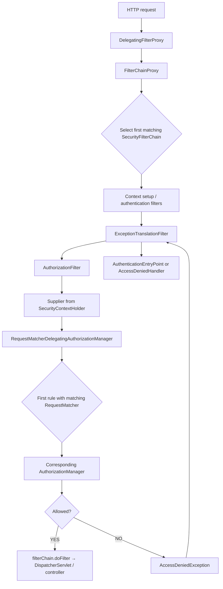

# AuthorizationFilter and RequestMatcherDelegatingAuthorizationManager

In **Servlet** Spring Security, the `authorizeHttpRequests` configuration translates rules such as "`GET /api/orders/**` requires the `orders.read` authority" into an access-control process at the HTTP layer. Two key components are:

- **`AuthorizationFilter`**: a filter sitting in `SecurityFilterChain` that checks whether a request may continue into the application. It uses an `AuthorizationManager<HttpServletRequest>` to make the decision.
- **`RequestMatcherDelegatingAuthorizationManager`**: an implementation of `AuthorizationManager<HttpServletRequest>` that holds ordered **`RequestMatcher → AuthorizationManager`** pairs, finds the **first matching pair**, and delegates the access decision to that pair's manager.

In short, regarding responsibilities: **the filter enforces the request gate; the delegating manager selects the rule; the selected authorization manager evaluates the principal's permissions**. These concepts belong to the application's access-decision flow, not OAuth2 token issuance.

This article uses **Spring Security 6.5.x + Spring Boot 3.x / Java 17+** as the Java API context. Re-check version-matched documentation when moving to another major release.

## 1. Three distinct layers in an HTTP request

A request can pass through three selection steps that beginners often conflate into one:

1. **`FilterChainProxy` selects a `SecurityFilterChain`**: when the application has multiple chains, the first matching chain (per `securityMatcher`/chain order) is chosen. Each chain has its own filter set and security configuration.
2. **The selected chain's `AuthorizationFilter` requests a decision**: after the appropriate authentication/exploit-protection filters run, the authorization filter asks `AuthorizationManager` to decide whether the request may proceed.
3. **`RequestMatcherDelegatingAuthorizationManager` selects a rule within the chain**: uses the first matching `RequestMatcher`, then calls the corresponding `AuthorizationManager` such as `permitAll`, `authenticated`, `hasAuthority`, `hasRole`, or a custom manager.

Both matcher mechanisms examine requests, yet **not at the same level**:

| Component | Where is it used? | Result |
| --- | --- | --- |
| `securityMatcher("/api/**")` | `FilterChainProxy`, selecting one `SecurityFilterChain` | Decides **which chain** protects the request |
| `requestMatchers(HttpMethod.GET, "/api/orders/**")` | Inside `authorizeHttpRequests` of the selected chain | Selects **which authorization rule** applies |
| The rule's `AuthorizationManager` | After a `RequestMatcher` matches | Returns allow/deny decision |
| `AuthorizationFilter` | Inside the selected chain | Enforces the decision: proceed or throw access exception |

Each `RequestMatcher` does not create a separate filter, nor does the application run all `SecurityFilterChain`s simultaneously and combine results. Always distinguish **chain selection** from **rule selection inside a chain**.

## 2. End-to-end request processing flow

Logical model for a servlet application configured with `authorizeHttpRequests`:



The diagram shows **logical roles**, not every possible filter. An actual request also depends on the authentication mechanism (session, HTTP Basic, Bearer JWT, etc.), CSRF, CORS, error handling, multi-chain setup, and dispatcher type.

### 2.1. What does `AuthorizationFilter` receive?

When handling `HttpServletRequest`, the filter uses `SecurityContextHolder` to build **`Supplier<Authentication>`**, then passes the supplier and request to `AuthorizationManager`. Using a supplier **defers reading `Authentication`** until a rule actually needs it.

For example:

- `permitAll()`: inherently needs no identity lookup to return allow.
- `denyAll()`: inherently needs no identity lookup to return deny.
- `hasAuthority("orders.read")`: needs authorities from `Authentication`, so it must retrieve the principal.
- Custom rules can inspect request details, authentication, and application data.

Deferral does not mean "the request always avoids any session access": other filters, the authentication mechanism, or the application itself may still access the session. It only optimizes the **authentication retrieval step for authorization decisions**.

### 2.2. What does `AuthorizationManager` return?

In Spring Security 6.5, the general API is `AuthorizationManager<T>`; for the URL filter, `T` is `HttpServletRequest`. The modern method is:

```java
AuthorizationResult authorize(
    Supplier<Authentication> authentication,
    HttpServletRequest request
);
```

This is a **shortened signature for explanation**, as `AuthorizationManager<T>` uses generic types and default methods; it is not a complete interface to paste over library code. `AuthorizationResult#isGranted()` indicates whether access is allowed. The older `check(Supplier, T)` API returning `AuthorizationDecision` is **marked deprecated in 6.5**; when reading older examples, recognize both as expressing the same decision mechanism.

`RequestMatcherDelegatingAuthorizationManager` can abstain if **no matcher matches**; the 6.5 Javadoc documents `null` in that case. Do not rely on "no decision" as a default blocking mechanism. The most auditable configuration is to **explicitly cover routes and end with `anyRequest().denyAll()`**.

### 2.3. When denied

When the outcome is deny, `AuthorizationFilter` throws `AccessDeniedException` (or a compatible specialized subtype). `ExceptionTranslationFilter` translates the security exception into HTTP behavior based on user state and configuration:

- **Unauthenticated / no valid credentials**: usually initiates authentication via `AuthenticationEntryPoint`, such as returning `401 Unauthorized` for HTTP Basic/Bearer or redirecting to a login page.
- **Authenticated but lacking permission**: usually invokes `AccessDeniedHandler`, resulting in `403 Forbidden`.
- Exact response details depend on `AuthenticationEntryPoint`, `AccessDeniedHandler`, application type, and configuration rules. Never assume every denial produces 403.

`AuthorizationDeniedEvent`/`AuthorizationGrantedEvent` events can be published via `AuthorizationEventPublisher` if configured. Implementations may not emit all grant events to avoid excessive event volume. Never turn an event-logging listener into a component that directly grants access.

### 2.4. When allowed

The filter calls `FilterChain#doFilter(...)` so the request continues processing. **ALLOW at HTTP authorization does not guarantee the controller returns 200**: the controller can return 404, a 400 validation error, a 409 business conflict, or a denial at deeper method security/resource policy layers.

## 3. How does `RequestMatcherDelegatingAuthorizationManager` actually "delegate"?

Imagine a rule table like this:

| Order | RequestMatcher | AuthorizationManager |
| ---: | --- | --- |
| 1 | `/public/**` | `permitAll` |
| 2 | `GET /api/orders/**` | `hasAuthority("orders.read")` |
| 3 | `POST /api/orders/**` | `hasAuthority("orders.write")` |
| 4 | `/admin/**` | `hasRole("ADMIN")` |
| 5 | `anyRequest` | `denyAll` |

When request `GET /api/orders/42` arrives:

1. Check matcher 1 → does not match.
2. Check matcher 2 → matches GET method and path.
3. Invoke **only rule 2's manager** with the authentication supplier and request.
4. If the principal has authority `orders.read`, allow; otherwise deny.
5. **Do not continue checking rules 3, 4, or 5**, even when rule 2 returns deny.

The **first match wins** rule means **"first matching rule"**, not "first allowing rule". It never tries subsequent rules until it finds an easier one to satisfy; this is a critical security distinction.

### Outcome prediction table

Suppose Alice has `orders.read`; Bob has `orders.write`; Carol has `ROLE_ADMIN`. With the 5 rules ordered above:

| Request | Alice | Bob | Carol |
| --- | --- | --- | --- |
| `GET /public/help` | ALLOW | ALLOW | ALLOW |
| `GET /api/orders/42` | ALLOW | DENY | DENY |
| `POST /api/orders` | DENY | ALLOW | DENY |
| `GET /admin/audit` | DENY | DENY | ALLOW |
| `GET /other` | DENY | DENY | DENY |

The table illustrates the **exact assumed authority strings**: having `ROLE_ADMIN` does not automatically grant `orders.read`, unless the application has configured a role hierarchy or separate mapping. With `hasRole("ADMIN")`, Spring Security checks the `ROLE_ADMIN` authority by default.

### 3.1. Order is part of the security policy

Common mistake:

```java
.authorizeHttpRequests(auth -> auth
    .requestMatchers("/api/**").permitAll()
    .requestMatchers(HttpMethod.DELETE, "/api/orders/**").hasRole("ADMIN")
    .anyRequest().denyAll()
)
```

Request `DELETE /api/orders/42` matches `/api/**` and is **allowed at the HTTP layer**. The DELETE rule placed afterward **never gets a chance to run**. A "stricter rule below" does not fix an overly broad rule above.

Fix by **placing specific rules before broad rules** or removing unnecessary broad rules:

```java
.authorizeHttpRequests(auth -> auth
    .requestMatchers(HttpMethod.DELETE, "/api/orders/**").hasRole("ADMIN")
    .requestMatchers(HttpMethod.GET, "/api/orders/**").hasAuthority("orders.read")
    .anyRequest().denyAll()
)
```

Avoid putting `anyRequest()` ahead of detailed rules. When designing policy, check GET/POST/PUT/PATCH/DELETE methods, trailing slashes, public endpoints, and required dispatchers.

### 3.2. HTTP method names matter

`requestMatchers("/api/orders/**")` specifies no method, so it can match multiple HTTP methods. Conversely, `requestMatchers(HttpMethod.GET, "/api/orders/**")` matches only GET; it **does not automatically grant POST**. Combining method and path prevents granting "read" to mutations.

For controllers handling multiple distinct actions on the same URL, prefer policies with sufficiently explicit methods, paths, and resource-specific checks.

### 3.3. RequestMatcher is not necessarily raw string comparison

`RequestMatcher` has many implementations: Spring MVC-aware matchers, path, regex, method, or custom matchers. The library may select an implementation based on classpath/environment. Never treat every string `"/api/**"` as the exact same matching algorithm regardless of version, servlet mappings, and MVC setup.

When precise rules are needed, use an explicit `RequestMatcher` and test real requests with `MockMvc`/integration tests. **Query parameters** are not part of path patterns by default; making decisions on query parameters, headers, or hosts requires appropriate matchers/policies and checking which data is trustworthy.

## 4. Spring Boot example: how rules wire into the filter

This is a **Spring Boot 3.x / Spring Security 6.x Servlet** configuration; it requires Spring Web and Spring Security starters plus an authentication mechanism (existing session, HTTP Basic, or Resource Server). The example uses HTTP Basic to illustrate the auth path, while user/password provisioning is left to the application.

Create `SecurityConfig.java` in your application package:

```java
package com.example.demo;

import jakarta.servlet.DispatcherType;
import org.springframework.context.annotation.Bean;
import org.springframework.context.annotation.Configuration;
import org.springframework.http.HttpMethod;
import org.springframework.security.config.Customizer;
import org.springframework.security.config.annotation.web.builders.HttpSecurity;
import org.springframework.security.web.SecurityFilterChain;

@Configuration
public class SecurityConfig {

    @Bean
    SecurityFilterChain securityFilterChain(HttpSecurity http) throws Exception {
        http
            .authorizeHttpRequests(auth -> auth
                .dispatcherTypeMatchers(
                    DispatcherType.FORWARD,
                    DispatcherType.ERROR
                ).permitAll()
                .requestMatchers("/public/**").permitAll()
                .requestMatchers(HttpMethod.GET, "/api/orders/**")
                    .hasAuthority("orders.read")
                .requestMatchers(HttpMethod.POST, "/api/orders/**")
                    .hasAuthority("orders.write")
                .requestMatchers("/admin/**")
                    .hasRole("ADMIN")
                .anyRequest().denyAll()
            )
            .httpBasic(Customizer.withDefaults());

        return http.build();
    }
}
```

**Exact scope explanation:**

- `authorizeHttpRequests` configures Spring Security's request authorization with `AuthorizationFilter` and the corresponding manager. Most applications do not need to instantiate `AuthorizationFilter` manually.
- Matcher order follows declaration order; `/public/**` passes without an auth lookup at this step; the HTTP Basic filter can still run independently per request.
- `GET /api/orders/**` requests require the exact authority **`orders.read`**; `POST` requires **`orders.write`**. If receiving OAuth2 scopes through the default JWT converter, the authority may be **`SCOPE_orders.read`** instead of `orders.read`; align your rules and mapping accordingly.
- `/admin/**` requires `ROLE_ADMIN` with the default role prefix. The admin role **does not automatically inherit** orders permissions from earlier matchers.
- `anyRequest().denyAll()` applies the deny-by-default principle to undesigned routes.
- `dispatcherTypeMatchers(FORWARD, ERROR).permitAll()` allows those internal dispatches at the **HTTP authorization layer** so the app can render views/error pages. Such permission must suit the architecture; avoid it if forwarding to sensitive endpoints could bypass policy.
- This config lacks controllers, a user store, and business logic. It is a **Spring integration layer**, not a standalone program runnable via `javac SecurityConfig.java`.

**CSRF note:** HTTP Basic with browser/cookie clients still requires evaluating CSRF risk. Because Spring Security enables CSRF protection by default in standard servlet configs, a `curl` POST may receive 403 due to a missing CSRF token **even when the user has `orders.write`**. Never conclude the authorization manager is wrong from a POST 403 alone; identify which filter denied it. For stateless Bearer-token APIs, CSRF choices must rest on the specific credential model and architecture, never disabled blindly.

## 5. Standalone Java 17 example to observe first-match-wins

Before running full Spring, we can simulate how a delegating manager walks a list of matcher/rule pairs. The following example **uses no Spring Security classes**; it models the **ordered-dispatch concept**, not the framework's full handling of `Supplier<Authentication>`, CSRF, dispatchers, servlet paths, or exception handling.

Save file **`AuthorizationRoutingDemo.java`**:

```java
import java.util.List;
import java.util.Set;
import java.util.function.BiPredicate;
import java.util.function.Predicate;

public class AuthorizationRoutingDemo {

    record Request(String method, String path) {}

    record Identity(boolean authenticated, Set<String> authorities) {
        boolean has(String authority) {
            return authenticated && authorities.contains(authority);
        }
    }

    record Rule(
            String name,
            Predicate<Request> matcher,
            BiPredicate<Identity, Request> access
    ) {}

    record Decision(String selectedRule, boolean allowed) {
        @Override
        public String toString() {
            return (allowed ? "ALLOW" : "DENY") + " [" + selectedRule + "]";
        }
    }

    private static final List<Rule> RULES = List.of(
            new Rule(
                    "public",
                    request -> request.path().startsWith("/public/"),
                    (user, request) -> true
            ),
            new Rule(
                    "GET orders",
                    request -> request.method().equals("GET")
                            && request.path().startsWith("/api/orders/"),
                    (user, request) -> user.has("orders.read")
            ),
            new Rule(
                    "POST orders",
                    request -> request.method().equals("POST")
                            && request.path().startsWith("/api/orders/"),
                    (user, request) -> user.has("orders.write")
            ),
            new Rule(
                    "admin",
                    request -> request.path().startsWith("/admin/"),
                    (user, request) -> user.has("ROLE_ADMIN")
            ),
            new Rule(
                    "fallback",
                    request -> true,
                    (user, request) -> false
            )
    );

    static Decision decide(Identity user, Request request) {
        for (Rule rule : RULES) {
            if (rule.matcher().test(request)) {
                return new Decision(
                        rule.name(),
                        rule.access().test(user, request)
                );
            }
        }
        throw new IllegalStateException("Missing fallback");
    }

    public static void main(String[] args) {
        Identity anonymous = new Identity(false, Set.of());
        Identity reader = new Identity(true, Set.of("orders.read"));
        Identity admin = new Identity(true, Set.of("ROLE_ADMIN"));

        System.out.println("public/anonymous: " + decide(
                anonymous, new Request("GET", "/public/help")));

        System.out.println("GET/reader: " + decide(
                reader, new Request("GET", "/api/orders/42")));

        System.out.println("POST/reader: " + decide(
                reader, new Request("POST", "/api/orders/42")));

        System.out.println("GET/admin only: " + decide(
                admin, new Request("GET", "/api/orders/42")));

        System.out.println("admin/admin: " + decide(
                admin, new Request("GET", "/admin/audit")));

        System.out.println("unknown/admin: " + decide(
                admin, new Request("GET", "/other")));
    }
}
```

Run with JDK 17 or higher:

```bash
javac AuthorizationRoutingDemo.java
java AuthorizationRoutingDemo
```

Exact stdout:

```text
public/anonymous: ALLOW [public]
GET/reader: ALLOW [GET orders]
POST/reader: DENY [POST orders]
GET/admin only: DENY [GET orders]
admin/admin: ALLOW [admin]
unknown/admin: DENY [fallback]
```

Key observations:

1. A reader with `orders.read` can access GET, while POST is denied despite sharing the same URL prefix.
2. A caller with `ROLE_ADMIN` **does not bypass** the GET orders rule: the manager already picked `GET orders` and that rule requires `orders.read`; it does not try `admin` next.
3. `/other` hits the `denyAll` fallback rather than being implicitly allowed just because the principal is authenticated.
4. Reordering with an overly broad rule such as `/api/**` → `permitAll` before `GET orders` would shadow the rules below it.
5. The example uses `startsWith` for readability; real request matchers must be chosen per Spring Security's path/method/servlet mapping semantics. Never copy this simple prefix check to replace production matchers.

## 6. Watch out for two levels of "first match": multiple SecurityFilterChains

Suppose an application has two `SecurityFilterChain`s:

```java
@Bean
@Order(1)
SecurityFilterChain apiChain(HttpSecurity http) throws Exception {
    http
        .securityMatcher("/api/**")
        .authorizeHttpRequests(auth -> auth
            .requestMatchers(HttpMethod.GET, "/api/public/**").permitAll()
            .anyRequest().authenticated()
        )
        .httpBasic(Customizer.withDefaults());
    return http.build();
}

@Bean
@Order(2)
SecurityFilterChain siteChain(HttpSecurity http) throws Exception {
    http
        .authorizeHttpRequests(auth -> auth
            .requestMatchers("/public/**").permitAll()
            .anyRequest().denyAll()
        )
        .formLogin(Customizer.withDefaults());
    return http.build();
}
```

This example shows **two Spring configuration bean methods** (requiring annotation imports and appropriate application setup), without users/controllers. Read it accurately:

- Request `GET /api/orders/42` matches priority-1 chain's `securityMatcher("/api/**")`; **only `apiChain`** is chosen, and authorization matchers **inside `apiChain`** make the decision.
- Request `GET /public/help` does not match `apiChain`, so `siteChain` (the fallback without a narrower `securityMatcher`) handles it and applies `permitAll`.
- The `requestMatchers("/public/**")` rule in `siteChain` **has no effect** on `/api/**` once `apiChain` has been selected.
- If the first chain uses an overly broad matcher, later chains may never be selected; if no chain matches a request, that request may fall **outside Spring Security protection** under that configuration. Therefore, ensure a proper fallback chain exists.

`@Order` here governs priority among **chains**, while matcher call order inside `authorizeHttpRequests` governs priority among **rules**. These are two independent orderings. Selecting a different chain can also change CSRF, authentication mechanisms, exception handling, and filter order.

## 7. Where exactly does the filter sit in SecurityFilterChain?

A typical flow may include:

```text
Servlet container
  -> DelegatingFilterProxy
    -> FilterChainProxy
      -> [selected SecurityFilterChain]
           SecurityContextHolderFilter / context repository
           HeaderWriterFilter, CsrfFilter, and other filters
           Authentication filter (HTTP Basic / Bearer / form login...)
           AnonymousAuthenticationFilter
           ExceptionTranslationFilter
           AuthorizationFilter
        -> DispatcherServlet / controller
```

This list is **indicative**; actual order/components can vary by version and configuration. `AuthorizationFilter` is typically the **last filter in the Spring Security chain**. Consequently:

- A filter added via `addFilterBefore(custom, AuthorizationFilter.class)` **runs before URL authorization checks**; if it performs sensitive actions or mutates data, it must enforce its own appropriate policy.
- A filter added after `AuthorizationFilter` executes only when the request has passed that chain's URL authorization step.
- Filters **registered directly with the servlet container** can run outside the Spring Security chain in different positions. Do not equate "filter before/after in container" with "filter before/after in `SecurityFilterChain`".
- Manually adding a second `AuthorizationFilter` without understanding the pipeline can cause double authorization and inconsistent outcomes. Normally, declare rules through the DSL.

### 7.1. Why is `ExceptionTranslationFilter` earlier yet still catches errors from later?

`ExceptionTranslationFilter` calls `filterChain.doFilter` to execute downstream filters inside a try/catch block. When `AuthorizationFilter` throws `AccessDeniedException`, the exception unwinds up the call stack to `ExceptionTranslationFilter` and is converted into an authentication challenge or access-denied response. That explains why the security error handler can handle exceptions thrown by the authorization filter even though `ExceptionTranslationFilter` appears **earlier** in the filter list.

### 7.2. Similar name, different mechanism: `FilterSecurityInterceptor`

Older `authorizeRequests` configurations used a pipeline based on `FilterSecurityInterceptor` and traditional metadata/voters. Modern `authorizeHttpRequests` uses `AuthorizationFilter` together with `AuthorizationManager`. When reading source code or debugging legacy projects, **do not assume the filter and manager of both configuration styles are the same classes**.

## 8. Servlet dispatchers: REQUEST, FORWARD, ERROR, and ASYNC

A single HTTP request can be dispatched multiple times within the servlet container. `AuthorizationFilter` in Spring Security 6.5 can run across multiple dispatcher types; do not assume one network request always equals one URL authorization decision.

Common examples:

- **REQUEST:** initial entry to the controller.
- **FORWARD:** controller forwards to a view or another servlet resource.
- **ERROR:** container dispatches error handling to an error page/endpoint (e.g., Spring Boot `/error`).
- **INCLUDE:** servlet/JSP includes another resource into the response.
- **ASYNC:** asynchronous processing may re-dispatch, depending on servlet and configuration.

If `FORWARD`/`ERROR` face overly strict path rules, you may see 403 errors while rendering views or error pages even though the original request was permitted. One handling approach **when designed safely**:

```java
.authorizeHttpRequests(auth -> auth
    .dispatcherTypeMatchers(
        DispatcherType.FORWARD, DispatcherType.ERROR
    ).permitAll()
    .requestMatchers("/public/**").permitAll()
    .anyRequest().authenticated()
)
```

Verify whether the app uses forwards to reach sensitive endpoints before permitting entire dispatcher types. Another option is explicitly permitting only the required endpoint/error path. Never use `web.ignoring()` merely to fix an error-page 403, because bypassing the Spring Security filter chain also bypasses other protections.

## 9. `permitAll`, `authenticated`, `denyAll`, and specialized managers

Within `authorizeHttpRequests`, each rule can use an appropriate `AuthorizationManager`:

| Rule | Meaning for matching requests | Is identity needed to check? |
| --- | --- | --- |
| `permitAll()` | Passes HTTP authorization step | No need to retrieve `Authentication` for this decision |
| `denyAll()` | Denied at HTTP authorization step | No need to retrieve `Authentication` for this decision |
| `authenticated()` | Requires authentication | Yes |
| `hasAuthority("orders.read")` | Requires exact string authority | Yes |
| `hasRole("ADMIN")` | By default requires `ROLE_ADMIN` | Yes |
| `hasAnyAuthority(...)` | Requires at least one listed authority | Yes |
| `access(customManager)` | Applies application-written policy | Depends on manager |

All of these rules are **request-layer decisions**. They do not replace:

- **Authentication:** verifying identity, passwords/sessions/tokens, and populating `SecurityContext`.
- **CSRF/CORS and other filters:** can deny before or after the relevant step.
- **Method security:** `@PreAuthorize`/custom method authorization for business operations.
- **Resource authorization:** owner/tenant/record-state permissions, e.g., whether Alice is allowed to read order 42 specifically.
- **Controllers and data:** controllers may return validation errors, 404, or 409.

A `permitAll` request still passes through the remaining filters in the selected chain. **`permitAll` differs from excluding the entire request from Spring Security**.

## 10. Custom AuthorizationManager and resource-level authorization

When method/path rules are insufficient, you can attach an `AuthorizationManager<RequestAuthorizationContext>` via `access(...)`. Conceptual example for `GET /api/orders/{orderId}`:

```java
@Bean
AuthorizationManager<RequestAuthorizationContext> orderReadManager(
        OrderPolicy orderPolicy) {
    return (authentication, context) -> {
        Authentication current = authentication.get();
        String id = context.getVariables().get("orderId");
        boolean allowed = orderPolicy.canRead(current, id);
        return new AuthorizationDecision(allowed);
    };
}
```

And wire it into the rule:

```java
.requestMatchers(HttpMethod.GET, "/api/orders/{orderId}")
    .access(orderReadManager)
```

This is a **Spring Security 6.x integration snippet** illustrating the extension point, not a standalone runnable example. `OrderPolicy` is defined by the application, `orderReadManager` must be injected properly, and `orderId` must be extracted by the corresponding matcher. In production code, handle null/unauthenticated `authentication` or missing IDs per policy, verify tenant/owner from a trusted repository, and protect list/export/update endpoints consistently.

**Never read client-supplied `X-User-Role` or `X-Owner` headers to grant access.** When checking records, rely on verified principals and trusted metadata. Even when method security performs deep checks, know which HTTP endpoints can reach the service; an HTTP allow rule never replaces business-layer enforcement.

### Version notes for the `AuthorizationManager` API

In 6.5, the `AuthorizationManager#check(...)` signature is a legacy API marked deprecated, favoring `authorize(...)` for direct callers. Custom lambda managers depend on the interface's abstract method in the version in use; when upgrading to 7.x, review the Javadoc and migration guide. For normal application code, using the `authorizeHttpRequests` DSL minimizes coupling to internal details.

## 11. When two rules both look right, which one does the system pick?

### Case A: specific rule placed after broad rule

```java
.requestMatchers("/api/**").authenticated()
.requestMatchers("/api/admin/**").hasRole("ADMIN")
```

Request `GET /api/admin/audit` matches the first rule: only authentication is required. The `hasRole("ADMIN")` rule **does not run**. This is an authorization exposure bug if no lower layer restricts it.

Fix:

```java
.requestMatchers("/api/admin/**").hasRole("ADMIN")
.requestMatchers("/api/**").authenticated()
```

### Case B: right matcher, insufficient user permissions

```java
.requestMatchers(HttpMethod.GET, "/api/reports/**").hasAuthority("reports.read")
.requestMatchers("/api/**").permitAll()
```

`GET /api/reports/2026` matches the first rule; if `reports.read` is missing, the outcome is **DENY**. It **does not fall through** to `/api/**` to be allowed.

### Case C: earlier chain matches while later chain has stricter rules

Two `SecurityFilterChain`s have `securityMatcher`s `"/api/**"` and `"/api/admin/**"`, with the first chain having higher priority. `/api/admin/audit` enters the first chain and the second chain never runs; to have the admin chain handle it, give the specific admin chain higher priority or consolidate the policy into one chain.

### Case D: scope-based rule while Authentication holds roles

A JWT Resource Server normally converts claim `scope="orders.read"` into authority `SCOPE_orders.read`. The rule `hasAuthority("orders.read")` does not match even with valid authentication. This is an **authority mapping/naming** mismatch, not a request matcher bug if the URL matched correctly.

### Case E: allow rule exists, yet 403 is still returned

This can come from the CSRF filter, method security blocking, access denied in the service, or an `ERROR` dispatch hitting a different policy. Identify the **actual denying component** before changing rules.

## 12. Testing and debugging to confirm which rule ran

### 12.1. Recommended test matrix

| Test case | Expectation |
| --- | --- |
| Anonymous GET `/public/help` | Passes HTTP authorization if endpoint is public |
| Anonymous GET `/api/orders/42` | Challenged/denied per authentication entry point |
| User with `orders.read` calls GET `/api/orders/42` | Passes HTTP authorization |
| Same user calls POST `/api/orders/42` | Denied on write permission once request passes other guards |
| User with `ROLE_ADMIN` but without `orders.read` calls GET orders | Does not bypass rule requiring read |
| Admin calls `/admin/audit` | Passes HTTP authorization |
| Regular user calls `/admin/audit` | Denied |
| Authenticated user calls `/unmapped` | Denied by `anyRequest().denyAll()` |
| `ERROR`/`FORWARD` dispatches with dedicated policy | Behaves per policy without unintended exposure |
| API split across multiple `SecurityFilterChain`s | Chain and rule selected in the right order |
| User with right authority who does not own order 42 | Resource-level policy still denies if required by business rules |

The examples use `@WithMockUser` or `SecurityMockMvcRequestPostProcessors.user(...)` from `spring-security-test` to create test authentication. Note that **mock authentication does not automatically toggle CSRF on or off**.

Example assertions (placed inside a `MockMvc` integration test class configured with JUnit and Spring Security Test):

```java
mvc.perform(get("/api/orders/42")
        .with(user("alice").authorities(
                new SimpleGrantedAuthority("orders.read"))))
    .andExpect(status().isOk());

mvc.perform(get("/api/orders/42")
        .with(user("bob").authorities(
                new SimpleGrantedAuthority("orders.write"))))
    .andExpect(status().isForbidden());
```

This is a **test snippet** requiring an actual `GET /api/orders/42` controller returning 200 on success and proper security context/controller setup. If no controller exists, a permitted request may return 404. Never use 200 as sole proof that authorization allowed access unless the test fixture clearly defines the endpoint.

### 12.2. When debugging 401/403, check in exact order

1. **Which chain was selected?** Check `@Order`/`securityMatcher` configuration. Another chain may have claimed the request.
2. **What filters are in the chain?** Enable DEBUG logging as needed for `org.springframework.security.web.FilterChainProxy` or inspect startup logs for `DefaultSecurityFilterChain`.
3. **Which `RequestMatcher` matched first?** Inspect HTTP method, path, dispatcher type, and context/servlet mappings.
4. **Which `AuthorizationManager` ran?** Was the rule `permitAll`, `authenticated`, `hasAuthority`, or a custom policy?
5. **What does the actual `Authentication` contain?** Check the verified identity and `getAuthorities()`; never log Bearer tokens/passwords.
6. **Who denied?** `CsrfFilter`, `AuthorizationFilter`, `ExceptionTranslationFilter`, a method interceptor, or the controller?
7. **Was the rule tested negatively too?** Test users with different authorities, anonymous callers, similar URLs, different methods, and different dispatchers.

You can observe `AuthorizationDeniedEvent`/observations/traces if configured; grant events are not necessarily emitted every time. In production checks, log only essential metadata without leaking tokens or customer data.

## 13. Misconceptions to avoid

| Misconception | Accurate understanding |
| --- | --- |
| "`AuthorizationFilter` checks a role table by itself" | It calls `AuthorizationManager`; the manager may simply inspect authorities already in `Authentication` |
| "Each `requestMatchers` is a separate filter" | One manager selects the first matching rule within the chain |
| "If the first rule denies, it tries the second rule" | No; the **first matching rule** decides |
| "`anyRequest().authenticated()` is automatically safe for all APIs" | It can expose sensitive endpoints to every logged-in user; consider `denyAll` as appropriate |
| "`securityMatcher` and `requestMatchers` are the same" | One selects the chain; the other selects the rule |
| "`permitAll` bypasses all of Spring Security" | Request remains in the selected chain; other filters still run |
| "Role ADMIN automatically bypasses every permission" | Only if policy/hierarchy allows it; role name carries no magic privilege |
| "Passing `AuthorizationFilter` guarantees 200" | Can still yield 404, 409, or denial at another layer |
| "403 always comes from `AuthorizationFilter`" | CSRF, method security, and other components can also deny |
| "Auth filters must come after `AuthorizationFilter`" | Authentication normally happens **before** authorization |
| "`FORWARD`/`ERROR` are separate requests we can ignore" | Dispatches can be re-evaluated; design policies accordingly |
| "No matching rule means automatic deny" | Never rely on an undecided case; declare an explicit `denyAll` fallback |
| "`authorizeRequests` and `authorizeHttpRequests` use the same internal filter" | Legacy `FilterSecurityInterceptor` differs from modern `AuthorizationFilter` |

## 14. Self-check questions

1. **What does `AuthorizationFilter` do?**  
   Controls request progression by asking `AuthorizationManager` for a decision; if allowed it continues the chain, if denied it throws an exception handled by security error handling.

2. **What does `RequestMatcherDelegatingAuthorizationManager` do when two matchers both match?**  
   Selects the **first matcher in order**. That matcher's manager makes the decision; it never sums or falls through to remaining managers.

3. **Why should `anyRequest().denyAll()` be placed last?**  
   It is the fallback denying any request not matched by preceding rules. Placing it earlier shadows required rules behind it.

4. **Does `securityMatcher("/api/**")` replace `requestMatchers("/api/**")`?**  
   No. The first selects the chain; the second selects a rule inside the chain.

5. **Why can `permitAll` run quickly without reading `Authentication`?**  
   `AuthorizationFilter` passes a `Supplier<Authentication>`, and an always-allow manager can decide without invoking the supplier.

6. **With `ROLE_ADMIN`, is `GET /api/orders/42` guaranteed to be allowed?**  
   No. If the first matching rule for GET orders requires `orders.read`, the admin needs that exact authority or a declared mapping/hierarchy.

7. **Why might POST return 403 with `authorizeHttpRequests` enabled despite having the right authority?**  
   `CsrfFilter` may have denied for a missing CSRF token, or another policy layer denied. Inspect the filter/exception trace.

8. **Once the controller runs after `AuthorizationFilter`, can the request still be denied?**  
   Yes. Method security and service/resource permission checks can still deny, or the controller can return a business error.

9. **Is `AuthorizationManager#check` still the recommended API in 6.5?**  
   No. The 6.5 Javadoc marks it deprecated in favor of `authorize(Supplier, object)`.

10. **With multiple `SecurityFilterChain`s, what are the two orderings to verify?**  
    **Chain** selection order in `FilterChainProxy` and **rule** selection order in the chain's delegating manager.

## Conclusion

To read an `authorizeHttpRequests` configuration accurately, separate three questions:

1. **Which `SecurityFilterChain` does the request enter?** → `FilterChainProxy` and `securityMatcher`.
2. **Which rule in the chain matches the request?** → `RequestMatcherDelegatingAuthorizationManager` and `requestMatchers` order.
3. **Does that rule grant access?** → The selected `AuthorizationManager`, enforced by `AuthorizationFilter`.

**`AuthorizationFilter` is the HTTP-layer enforcement point; `RequestMatcherDelegatingAuthorizationManager` is the rule selector.** Matcher ordering is part of the security policy, authorities must match accurately, and data entry points still need resource/business controls where required.

## References

- [Spring Security 6.5 — Authorize HttpServletRequests](https://docs.spring.io/spring-security/reference/6.5/servlet/authorization/authorize-http-requests.html)
- [Spring Security 6.5 — Servlet Architecture](https://docs.spring.io/spring-security/reference/6.5/servlet/architecture.html)
- [Spring Security 6.5 — AuthorizationFilter Javadoc](https://docs.spring.io/spring-security/reference/6.5/api/java/org/springframework/security/web/access/intercept/AuthorizationFilter.html)
- [Spring Security 6.5 — RequestMatcherDelegatingAuthorizationManager Javadoc](https://docs.spring.io/spring-security/reference/6.5/api/java/org/springframework/security/web/access/intercept/RequestMatcherDelegatingAuthorizationManager.html)
- [Spring Security 6.5 — AuthorizationManager Javadoc](https://docs.spring.io/spring-security/reference/6.5/api/java/org/springframework/security/authorization/AuthorizationManager.html)
