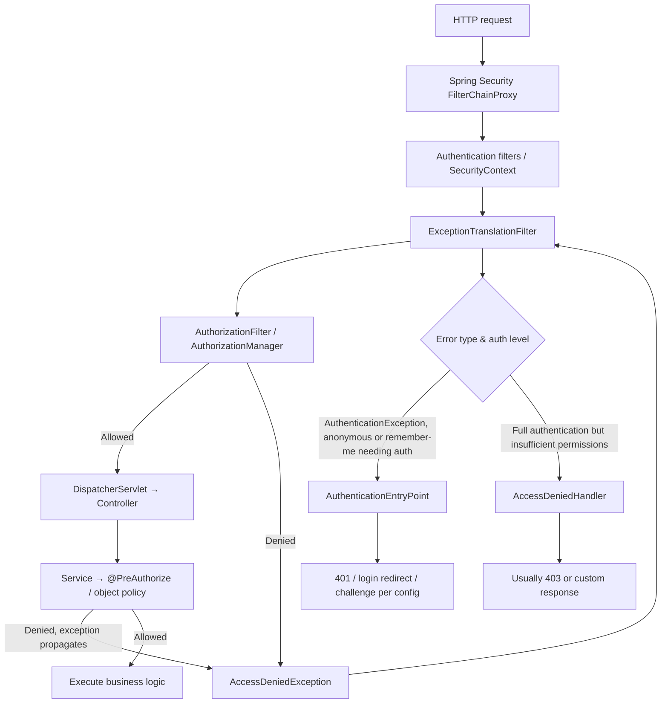

# AccessDeniedException and the Path of Authorization Errors in Spring Security

## Learning objectives

After this lesson, you will be able to explain the meaning of `AccessDeniedException`, distinguish **unauthenticated** errors from **authenticated but lacking permission** errors, trace the path from `AuthorizationManager`/`AuthorizationFilter` or `@PreAuthorize` to `ExceptionTranslationFilter`, and understand why the same denial can lead to **401, 403, or a redirect to the login page**. You will also learn how to configure `AccessDeniedHandler`, diagnose the root cause of a 403 during testing, and handle authorization errors when a service is called outside an HTTP request.

This lesson applies to **Spring Security on the Servlet stack** (Spring MVC/Spring Boot, Spring Security 6.x APIs). Names like `SecurityFilterChain`, `AuthorizationFilter`, and `ExceptionTranslationFilter` below are not the names of the equivalent filters in WebFlux. The focus is on the flow **decision → exception → response**, without equating returning HTTP 403 with the entire authorization mechanism.

## 1. What is AccessDeniedException?

`org.springframework.security.access.AccessDeniedException` is a **Spring Security RuntimeException** signaling that the requested operation **is not authorized**. It can occur when:

- An HTTP rule in `authorizeHttpRequests` disallows the request.
- Method security such as `@PreAuthorize` or `@PostAuthorize` denies the invocation.
- The application enforces its own per-resource/tenant policy and throws this exception.
- Another security mechanism uses the corresponding exception type to report insufficient permissions.

Do not confuse `AccessDeniedException` with a dropped connection, a `NullPointerException` bug, nonexistent data, or invalid login credentials. It is an **authorization denial signal**; how it turns into a response belongs to the **exception-handling context**.

In modern Spring Security versions, many authorization components can throw `AuthorizationDeniedException`, a **subclass of `AccessDeniedException`** carrying the authorization decision result. Thus catching `AccessDeniedException` still handles those subclasses; when logging or inspecting, do not assume every instance is strictly the base class.

### Lacking permission differs from not being logged in

| Condition | Typical signal | Meaning |
| --- | --- | --- |
| Request lacks valid login, while endpoint requires authentication | `AuthenticationException`, or `AccessDeniedException` when evaluating an anonymous request | Need to start/continue authentication |
| Fully authenticated user, but missing `document:read` | `AccessDeniedException` | Identity is known; permission not granted |
| Remember-me user calling feature requiring full login | `AccessDeniedException` or insufficient-authentication signal | Identity present, but re-authentication required per policy |
| Principal has `document:read` yet reads another tenant's document | `AccessDeniedException` from object policy | Functional permission is not enough to view that specific record |
| Query with nonexistent ID | Usually `NoSuchElementException`/domain exception or 404 in API | Not automatically an authorization error |

**A request accepted at the HTTP layer can still be denied at the method or data layer.** For example, `GET /api/documents/42` passes `hasAuthority("document:read")`, yet the policy in `DocumentService.read(42)` detects the document belongs to another tenant and throws `AccessDeniedException`.

## 2. Three components responsible in the flow

### AuthorizationFilter: decision at the HTTP level

When using `authorizeHttpRequests`, `AuthorizationFilter` inspects the request, retrieves `Authentication` when needed, and asks `AuthorizationManager` to evaluate the corresponding policy. If the decision disallows access, it throws an `AccessDeniedException` (typically the appropriate subclass in the version in use). If allowed, the request continues to the controller and application.

### ExceptionTranslationFilter: bridge from exceptions to HTTP

`ExceptionTranslationFilter` **does not check permissions itself**. It invokes the downstream filter chain/application and catches `AuthenticationException` or `AccessDeniedException` **propagating back out to it**. Based on the error type and authentication level, it chooses the appropriate HTTP handling.

For `AccessDeniedException`, the filter relies on `AuthenticationTrustResolver` to distinguish **anonymous/remember-me** callers from fully authenticated users. If the authentication level is insufficient per the filter's handling, it invokes `AuthenticationEntryPoint`. If the user is fully authenticated yet lacks permission, it invokes `AccessDeniedHandler`.

### AuthenticationEntryPoint and AccessDeniedHandler: producing the client result

- **`AuthenticationEntryPoint`**: initiates the authentication mechanism. For instance, HTTP Basic may return **401** with a `WWW-Authenticate` header; form login typically returns a **redirect** to the login screen; OAuth2 Bearer has its own challenge mechanism.
- **`AccessDeniedHandler`**: handles denial for a user who is authenticated yet not granted permission. The default handler typically returns **403 Forbidden**; it can be customized for JSON responses, error pages, or audit event codes if required by design.

It is the **configured entry point/handler and authentication mechanism** that determine the final response. Never hardcode rules like "every `AccessDeniedException` = 403" or "every unauthenticated user = 401".

## 3. Processing flow for a Servlet request



The diagram shows the **common path** of authorization errors. In `FilterChainProxy`, `ExceptionTranslationFilter` sits **before `AuthorizationFilter`** in incoming request order, so it can catch exceptions thrown by `AuthorizationFilter` deeper in the chain. It can also catch method-security errors raised in the application **if the exception propagates back out through the filter chain**.

**Not every 403 goes through `ExceptionTranslationFilter`.** For example, `CsrfFilter` enforces CSRF protection earlier than `AuthorizationFilter` and has its own `AccessDeniedHandler` path. An authentication filter can also handle login errors itself. If the response is already committed, or the exception was already handled by another layer, the translation filter no longer has the chance to build the normal HTTP response.

### Equivalent description in pseudocode

```text
try:
    continue filter chain and application
catch AuthenticationException:
    start authentication via AuthenticationEntryPoint
catch AccessDeniedException:
    if caller is anonymous or remembered and considered insufficiently authenticated:
        start/continue authentication via AuthenticationEntryPoint
    else:
        use AccessDeniedHandler to deny
```

This is **pseudocode describing the algorithm**, not exact line-for-line source code. `AuthenticationTrustResolver` determines trust status, while `ExceptionTranslationFilter` configuration and token types determine the actual branch. Before invoking the entry point, the filter typically clears the security context and may save the request for post-login restoration depending on `RequestCache`/configuration.

## 4. Why does AccessDeniedException sometimes become 401 or a redirect?

Consider an API `GET /api/reports` requiring `report:read`:

| Caller | Authorization evaluation result | Common HTTP handling |
| --- | --- | --- |
| No credentials; request treated as anonymous | No permission | `AuthenticationEntryPoint`: HTTP Basic/Bearer usually 401 or form-login redirect |
| Credentials sent but password/Bearer token invalid | Authentication failed | Authentication filter or entry point: usually 401/challenge |
| Fully logged in, but has only `ROLE_USER` | Missing `report:read` | `AccessDeniedHandler`: usually 403 |
| Fully logged in and has `report:read` | Passes rule | Continues to controller; not guaranteed HTTP 200 |
| Remember-me user has `report:read` but service requires full | Denied at authentication level | May be directed to re-login via entry point |
| Logged in with `report:read` but lacks access to report 42 | Service/policy denies | Usually 403 or intentional 404 policy |

In Spring Security, standard `ExceptionTranslationFilter` behavior treats **anonymous and remember-me** as insufficient authentication when handling `AccessDeniedException`, invoking the entry point instead of the access-denied handler. This prompts the flow to **re-authenticate** when a remembered user hits a policy that does not accept their current state. The **exact HTTP behavior** still depends on the entry point: redirect, 401, or another response.

### 401 and 403 are not merely exception names

- **401 Unauthorized**: client must provide/verify credentials to proceed; with HTTP authentication, a challenge header is usually included.
- **403 Forbidden**: the server understood the request and refuses to authorize the operation. For fully authenticated callers lacking permission, this is the common outcome.
- **302/303 to login**: a web app using form login may redirect instead of returning JSON 401.
- **404 Not Found**: the application may choose not to confirm the existence of an unauthorized resource (anti-enumeration), provided it is an explicit and consistent API policy.

Never inspect the HTTP status alone and conclude the cause: **403 can stem from CSRF, an HTTP rule, method security, or owner/tenant policy**. To diagnose, trace how far the request progressed.

## 5. Three throw points: request, method, and business policy

### 5.1. HTTP layer: authorizeHttpRequests

Minimal configuration example for a Servlet API with a safe JSON 403 handler. This is a Spring Java snippet with full imports for the config class; it requires Spring Security dependencies, an account/authentication source, and application controllers to run as a full system.

```java
import jakarta.servlet.http.HttpServletResponse;

import org.springframework.context.annotation.Bean;
import org.springframework.context.annotation.Configuration;
import org.springframework.http.HttpMethod;
import org.springframework.security.config.Customizer;
import org.springframework.security.config.annotation.method.configuration.EnableMethodSecurity;
import org.springframework.security.config.annotation.web.builders.HttpSecurity;
import org.springframework.security.web.SecurityFilterChain;

@Configuration
@EnableMethodSecurity
public class SecurityConfig {

    @Bean
    SecurityFilterChain securityFilterChain(HttpSecurity http) throws Exception {
        http
            .securityMatcher("/api/**")
            .authorizeHttpRequests(auth -> auth
                .requestMatchers(HttpMethod.GET, "/api/public/**")
                    .permitAll()
                .requestMatchers(HttpMethod.GET, "/api/documents/**")
                    .hasAuthority("document:read")
                .requestMatchers(HttpMethod.PATCH, "/api/documents/**")
                    .hasAuthority("document:edit")
                .anyRequest().denyAll()
            )
            .httpBasic(Customizer.withDefaults())
            .exceptionHandling(errors -> errors
                .accessDeniedHandler((request, response, ex) -> {
                    if (!response.isCommitted()) {
                        response.setStatus(HttpServletResponse.SC_FORBIDDEN);
                        response.setCharacterEncoding("UTF-8");
                        response.setContentType("application/problem+json");
                        response.getWriter().write(
                            "{\"title\":\"Forbidden\",\"status\":403}"
                        );
                    }
                })
            );

        return http.build();
    }
}
```

**Meaning:** a `GET /api/documents/42` request lacking `document:read` is denied by `AuthorizationFilter`; when the caller is fully authenticated, `ExceptionTranslationFilter` delegates to the configured `AccessDeniedHandler` to return **403 + JSON body**. For anonymous callers without credentials, the standard HTTP Basic mechanism initiates a **401 challenge** via the entry point.

Configuration notes:

1. `securityMatcher("/api/**")` limits the scope of **this filter chain**. If the application has pages outside `/api/**`, configure another suitable chain and understand multi-`SecurityFilterChain` ordering.
2. `httpBasic` is only an illustrative authentication mechanism; it does not create an application user store. OAuth2 Resource Server, sessions, and form login use their respective entry points/handlers.
3. `PATCH` or state-changing requests can be blocked by **CSRF** when CSRF protection applies. A CSRF failure does not prove `document:edit` is missing; confirm the root cause.
4. The JSON body should stay generic and never reveal internal accounts, tenants, owners, or policies. In real systems, consider `ProblemDetail`/RFC 9457 for a consistent error contract.
5. `AccessDeniedHandler` does not alter the authorization decision logic. If a handler returns HTTP 200 for a denied request, clients will misinterpret the outcome; never "swallow errors to let them pass".

### 5.2. Method security layer: @PreAuthorize

When `@EnableMethodSecurity` is enabled, Spring creates method interceptors for managed beans. If `@PreAuthorize` is not satisfied, the interceptor throws `AccessDeniedException` or a corresponding subclass **before executing the method body**.

```java
import org.springframework.security.access.prepost.PreAuthorize;
import org.springframework.stereotype.Service;

@Service
public class DocumentService {

    @PreAuthorize("hasAuthority('document:read')")
    public String readSummary(long id) {
        return "Document " + id;
    }

    @PreAuthorize("hasAuthority('document:edit')")
    public String rename(long id, String newTitle) {
        return "Renamed " + id;
    }
}
```

When a controller calls `documentService.readSummary(42)` **through the Spring proxy**, a caller lacking `document:read` is blocked before receiving a result. If the exception propagates out of `DispatcherServlet` and reaches `ExceptionTranslationFilter`, Spring Security can translate it into the appropriate HTTP response. When calling `documentService.readSummary(42)` directly from a job without an HTTP request, there is **no `ExceptionTranslationFilter` to return 403**; calling code must handle the exception within the job's workflow.

Note: `@PreAuthorize` does not run merely because the annotation is present; `@EnableMethodSecurity` and calling through the proxy are required. Self-invocation like `this.rename(...)` within the same bean normally bypasses the interceptor. `@PostAuthorize` runs **after** the method returns, so never rely on it as the sole barrier for operations with side effects.

### 5.3. Object layer: business policy catches out-of-scope IDs

```java
// Snippet inside application service, not standalone Java.
// repository and Document are project-defined types.
public Document requireReadableDocument(long id, Authentication actor) {
    Document doc = repository.findById(id)
        .orElseThrow(() -> new NoSuchElementException("Document not found"));

    if (!doc.getTenantId().equals(tenantOf(actor))
            || !policy.canRead(actor, doc)) {
        throw new AccessDeniedException("Document access denied");
    }

    return doc;
}
```

`tenantOf` and `policy` must obtain identity/permissions from verified authentication and server data; never trust client-supplied `ownerId` or `tenantId`. Even if the caller holds `document:read`, accessing a record outside their tenant must be denied. Many APIs intentionally return **404** for out-of-scope resources to avoid disclosing existence, provided it aligns consistently with list/count/export queries and never leaks secret data.

## 6. Tracing the exception through HTTP and application layers

### Case A: missing permission right at AuthorizationFilter

```text
GET /api/documents/42
Authentication: alice, authorities = [ROLE_USER]
Rule: hasAuthority("document:read")

SecurityContext already has alice
    ↓
AuthorizationFilter / AuthorizationManager
    ↓ DENY
AccessDeniedException
    ↑
ExceptionTranslationFilter
    ↓ full authentication
AccessDeniedHandler
    ↓
HTTP 403 Forbidden
```

The controller **does not run**, because the request was blocked before entering the application. If logs only show 403, inspect URL/method/authority rules and matcher order before looking at the service.

### Case B: HTTP passes, but service denies

```text
GET /api/documents/42
Authentication: bob, authorities = [document:read]
Rule HTTP: hasAuthority("document:read")  → ALLOW
    ↓
DispatcherServlet → DocumentController.read(42)
    ↓
DocumentService / @PreAuthorize / ownership policy
    ↓ DENY: document belongs to another tenant
AccessDeniedException
    ↑ (if not handled in MVC/service)
ExceptionTranslationFilter
    ↓
AccessDeniedHandler (full user) → HTTP 403
```

This is why **HTTP authorization does not replace per-record permissions**. If the service runs inside a transaction, ensure a denied operation **leaves no data changes behind**. Check permissions before side effects; for sensitive writes, consider conditional update queries to prevent races.

### Case C: anonymous or remember-me requires authentication

```text
GET /api/documents/42
anonymous + missing permission (or remembered user fails policy)
    ↓
AccessDeniedException
    ↑
ExceptionTranslationFilter + AuthenticationTrustResolver
    ↓
AuthenticationEntryPoint
    ├─ HTTP Basic API: 401 + WWW-Authenticate
    └─ Form login web: redirect to /login
```

In the authentication-initiation branch, the filter may **clear `SecurityContext`** and save the request via `RequestCache` to support returning to the URL after login; exact saving behavior depends on configuration. Never assume every POST will be safely replayed after login.

### Case D: exception occurs outside filter scope

If a background task calls a `@PreAuthorize`-annotated service, there is no HTTP response or `ExceptionTranslationFilter` in the path. Catch `AccessDeniedException` at the worker/consumer boundary, record an audit log per policy, and fail/quarantine/retry according to business semantics. Do not try to "return HTTP 403" in a non-HTTP job; nor treat a permission error as a transient failure to retry forever.

## 7. What ExceptionTranslationFilter does not solve automatically

### 7.1. Does not handle every exception type

`ExceptionTranslationFilter` targets `AuthenticationException` and `AccessDeniedException`. It does not automatically turn `NullPointerException`, `IllegalArgumentException`, SQL errors, or network errors into 403. Never write `catch (Exception) { throw new AccessDeniedException(...); }` for all errors; that hides bugs and makes operations hard to diagnose.

### 7.2. Does not catch errors already handled by Spring MVC

If `@ControllerAdvice` or a `HandlerExceptionResolver` catches `AccessDeniedException` **inside `DispatcherServlet`** and writes a response, the exception may never propagate to the filter. This can be useful when intentionally designing an error contract, yet it easily creates two divergent 403 paths between **HTTP filter denials** and **service denials**. Align with `exceptionHandling(...)` and test both error sources.

`@ControllerAdvice` does not directly handle exceptions thrown by `AuthorizationFilter` **before the controller is invoked**. To customize HTTP errors at the security layer, use the appropriate `AuthenticationEntryPoint` / `AccessDeniedHandler` instead of expecting MVC advice to catch them.

### 7.3. Cannot guarantee modifying an already-committed response

If the application has already flushed headers/body before throwing `AccessDeniedException`, the filter may no longer be able to change the status or redirect. Therefore, enforce policies **before streaming results or writing data**, especially for large file downloads/exports, streaming responses, and side effects. With `@PostAuthorize`-based protection, the decision arrives after the method runs; understand this boundary.

### 7.4. Does not bypass other security filters

A request can return 403 because of:

- Missing/invalid CSRF token;
- `AuthorizationFilter` rule missing an authority;
- `@PreAuthorize`/owner/tenant policy denying;
- CORS, firewall, session, or another protective mechanism handling the request;
- Application/controller explicitly returning 403, even without throwing `AccessDeniedException`.

Thus **HTTP 403 is an observation**, while the **root cause must be traced**. This lesson focuses on `AccessDeniedException`, yet real systems should never attribute every 403 to this exception.

## 8. Configuring error responses: EntryPoint and DeniedHandler

### 8.1. AccessDeniedHandler for JSON APIs

The config snippet in section 5 used an inline `AccessDeniedHandler` lambda for a simple response. You can extract the handler as a bean if multiple filter chains share it:

```java
@Bean
AccessDeniedHandler apiAccessDeniedHandler() {
    return (request, response, denied) -> {
        response.setStatus(HttpServletResponse.SC_FORBIDDEN);
        response.setCharacterEncoding("UTF-8");
        response.setContentType("application/json");
        response.getWriter().write(
            "{\"error\":\"access_denied\",\"message\":\"Forbidden\"}"
        );
    };
}
```

This is a snippet inside a `@Configuration` class requiring imports for `AccessDeniedHandler` and `HttpServletResponse`. Never return raw exception messages to clients, as they can leak resource names, principals, tenants, policy expressions, or internal logic.

### 8.2. AuthenticationEntryPoint for unauthenticated requests

In a JSON API, you can select an entry point returning 401:

```java
// Config snippet if the app wants a simple 401:
// requires importing org.springframework.security.web.authentication.HttpStatusEntryPoint
// and org.springframework.http.HttpStatus
.exceptionHandling(errors -> errors
    .authenticationEntryPoint(
        new HttpStatusEntryPoint(HttpStatus.UNAUTHORIZED)
    )
)
```

This is **only an example DSL fragment**, not wired into every existing mechanism. HTTP Basic, OAuth2 Bearer, and form login have entry points/challenges that must preserve protocol semantics; arbitrary customization can strip required headers or break login flows. For apps with multiple auth mechanisms, select entry points **per request matcher** when needed.

### 8.3. Response contract and auditing

An API can return minimal JSON:

```json
{
  "type": "about:blank",
  "title": "Forbidden",
  "status": 403
}
```

In a real API, consider `ProblemDetail`/RFC 9457, correlation IDs, and stable error codes if clients must branch on error types. Never let a public response reveal "document 42 belongs to Alice" when Bob lacks permission to know. Server-side audits can record timestamp, principal ID, action, resource ID, policy version, and decision code; avoid logging tokens/passwords or sensitive payloads.

### 8.4. Never use a Handler to replace policy

`AccessDeniedHandler` only decides the **response** after access has already been denied. It does not let you rewrite a `hasAuthority` rule into another role. Never write a handler saying "if ADMIN, change status to 200", because the application operation was already blocked and the response would misrepresent reality. If admins deserve an exception, declare that exception in the **`AuthorizationManager`/policy** and test it.

## 9. Standalone Java 17 example: simulating the routing path

This program simulates **how a handler is chosen**, without Spring dependencies and without producing real HTTP responses. It intentionally separates **identity trust level** from **exception type** so learners see why status codes cannot be inferred from the name `AccessDeniedException` alone.

Save with exact filename **`AccessDeniedFlowDemo.java`**:

```java
public class AccessDeniedFlowDemo {

    enum Identity { ANONYMOUS, REMEMBER_ME, FULL }
    enum Failure { AUTHENTICATION_ERROR, ACCESS_DENIED }
    enum Route { START_AUTHENTICATION, HANDLE_FORBIDDEN }

    static Route route(Identity identity, Failure failure) {
        if (failure == Failure.AUTHENTICATION_ERROR) {
            return Route.START_AUTHENTICATION;
        }
        return switch (identity) {
            case ANONYMOUS, REMEMBER_ME -> Route.START_AUTHENTICATION;
            case FULL -> Route.HANDLE_FORBIDDEN;
        };
    }

    static void explain(Identity who, Failure failure) {
        System.out.println(
            who + " + " + failure + " -> " + route(who, failure)
        );
    }

    public static void main(String[] args) {
        explain(Identity.ANONYMOUS, Failure.ACCESS_DENIED);
        explain(Identity.REMEMBER_ME, Failure.ACCESS_DENIED);
        explain(Identity.FULL, Failure.ACCESS_DENIED);
        explain(Identity.FULL, Failure.AUTHENTICATION_ERROR);
    }
}
```

Run with **JDK 17 or higher**:

```bash
javac AccessDeniedFlowDemo.java
java AccessDeniedFlowDemo
```

Exact stdout:

```text
ANONYMOUS + ACCESS_DENIED -> START_AUTHENTICATION
REMEMBER_ME + ACCESS_DENIED -> START_AUTHENTICATION
FULL + ACCESS_DENIED -> HANDLE_FORBIDDEN
FULL + AUTHENTICATION_ERROR -> START_AUTHENTICATION
```

Interpreting the output:

- Anonymous denied → must **start authentication**; with HTTP Basic this can return 401.
- Remember-me denied with insufficient trust level → may be prompted to **log in again**; in Spring Security Servlet, `ExceptionTranslationFilter` handles this branch.
- Full authentication denied for missing permission → **access-denied handler**, usually 403.
- `AuthenticationException` → initiates authentication even if a prior authentication existed; never turn it into valid access.

Fixed enums cannot model custom trust resolvers, multiple filter chains, already-committed responses, user stores, CSRF, or exceptions handled by MVC. Use them to **learn the logic**, then test with real Spring Security.

## 10. Testing 401/403 and exception propagation

### 10.1. Testing HTTP with MockMvc

In an app with `spring-security-test`, `MockMvc`, and endpoint `GET /api/documents/42` protected by `hasAuthority("document:read")`:

```java
// Snippet inside JUnit tests; mvc is injected from Spring context.
// Requires importing get, status, user from spring-security-test / MockMvc.

@Test
void anonymousCannotReadDocument() throws Exception {
    mvc.perform(get("/api/documents/42"))
       .andExpect(status().isUnauthorized());
}

@Test
void loggedInWithoutAuthorityIsForbidden() throws Exception {
    mvc.perform(get("/api/documents/42")
           .with(user("bob").roles("USER")))
       .andExpect(status().isForbidden());
}
```

**Limitation:** the 401 outcome for anonymous relies on the example's **HTTP Basic entry point** config. If the app uses form login, the test may need to expect a redirect. If the controller or method security enforces another policy, a request with sufficient HTTP authority can still get 403/404. Include `.with(csrf())` when testing POST/PATCH/DELETE under CSRF protection to avoid confusing the cause.

To verify a JSON handler, assert `status`, `Content-Type`, and the `status` field in the body rather than asserting 403 alone. With OAuth2 Bearer, test challenges/headers per configuration.

### 10.2. Testing method security directly

```java
// Snippet in a Spring/JUnit test with @Autowired DocumentService service.
// @EnableMethodSecurity is enabled; this is a real proxied bean.

@Test
@WithMockUser(authorities = "ROLE_USER")
void methodDeniesMissingDocumentReadAuthority() {
    assertThrows(
        AccessDeniedException.class,
        () -> service.readSummary(42L)
    );
}

@Test
@WithMockUser(authorities = "document:read")
void methodAllowsReadAuthority() {
    assertEquals("Document 42", service.readSummary(42L));
}
```

This is a test snippet for a JUnit class, not a standalone Java file. It requires importing `org.junit.jupiter.api.Test`, `Assertions`, `org.springframework.security.test.context.support.WithMockUser`, and `AccessDeniedException`, plus a real service bean. Calling a `new`-instantiated service or mocking the whole service skips the interceptor and **fails to verify `@PreAuthorize`**.

### 10.3. Recommended test matrix

| Scenario | Denial point | What to verify |
| --- | --- | --- |
| Anonymous calls GET requiring `document:read` | HTTP authorization | Entry point, usually 401 Basic or form redirect |
| Full user missing `document:read` | `AuthorizationFilter` | 403 handler |
| Full user has `document:read` but doc is another tenant | Method/policy | 403/404 per policy; no data leak |
| Full user has permission for the exact document | Not denied | Controller handles normally |
| Remember-me fails `fullyAuthenticated` | Method/authorization | Appropriate re-authentication flow |
| Full user sends PATCH without CSRF token when CSRF is on | `CsrfFilter` | 403 from CSRF, not confused with roles |
| Service called from background job without permission | Method security | Exception handled by consumer, no HTTP 403 |
| ControllerAdvice catches `AccessDeniedException` | MVC exception resolver | Diverges from `AccessDeniedHandler`; check consistency |
| Response streaming already started when denied | Too late | Prevent data leak; move permission checks before streaming |
| New endpoint without explicit matcher, deny fallback | HTTP authorization | Denied by `anyRequest().denyAll()` |

Add tests confirming **no data is written** upon denial; a 403 status does not prove a transaction rolled back if business side effects ran earlier.

## 11. Diagnosing a 403 in practice

1. **Verify the filter chain:** did the request actually enter the intended `SecurityFilterChain`? With multiple chains, check `securityMatcher` and order.
2. **Verify authentication:** does the user have a valid principal and what are its authorities? Anonymous, remember-me, or full? Never use raw `Authentication.isAuthenticated()` as sole proof against anonymous.
3. **Inspect HTTP rules:** which matcher matched the HTTP method and URL? Does the rule use `hasRole("ADMIN")` (`ROLE_ADMIN`) or exact `hasAuthority("document:read")`?
4. **Check CSRF and early filters:** if POST/PATCH returns 403 despite valid permissions, verify the CSRF token before modifying permissions.
5. **Locate where the error originated:** `AuthorizationFilter`, `@PreAuthorize`, data policy, controller returning status, or another filter? Never guess from status alone.
6. **Trace the exception:** was it caught by `@ControllerAdvice`, `HandlerExceptionResolver`, an application filter, or a custom `catch` before reaching `ExceptionTranslationFilter`?
7. **Inspect handler/entry point:** does the final response have the right status, headers, body, and zero sensitive data leaks?
8. **Re-test thoroughly:** write separate cases for anonymous, full without permission, full with permission, remember-me, cross-tenant data, and CSRF errors.

In development, you can enable Spring Security `DEBUG` logging to observe rules/chains; `TRACE` can emit additional sensitive details, so restrict it to controlled environments and never log tokens, cookies, or credentials. When `AuthorizationDeniedException` is used, decision metadata can aid investigation, but never expose policy expressions or sensitive attributes in public response bodies.

## 12. Common design mistakes

1. **Assuming every `AccessDeniedException` must return 403:** anonymous/remember-me can route to the entry point for re-authentication.
2. **Confusing `AuthenticationException` with `AccessDeniedException`:** invalid tokens/passwords need the authentication flow, while logged-in callers missing authorities need the denial flow.
3. **Using `@ControllerAdvice` to handle all security:** HTTP errors from `AuthorizationFilter` occur before `DispatcherServlet` and never reach controller advice.
4. **Catching `AccessDeniedException` and returning 200:** the API reports success even though the operation was blocked, corrupting audits and client logic.
5. **Using `catch(Exception)` and turning every bug into 403:** hides system failures, masks bugs, and complicates monitoring.
6. **Overlooking CSRF:** a 403 from `CsrfFilter` can happen before HTTP authorization; do not fix it by adding roles.
7. **Assuming `@PreAuthorize` runs on every call:** self-invocation and non-Spring-proxied objects can bypass the interceptor.
8. **Returning raw exception messages:** easily exposes resource IDs, tenants, policies, and other users' identities.
9. **Checking only URLs and skipping object permissions:** having `document:read` does not grant access to another tenant's document 42.
10. **Checking after streaming/writing:** by the time `AccessDeniedException` is thrown, the response or DB may already have side effects; check early and use conditional writes.
11. **Misunderstanding multiple filter chains:** a URL hitting an unexpected chain can have a different entry point, CSRF setup, or handler.
12. **Not testing workers/async:** method security outside web requests does not produce HTTP responses automatically; a dedicated denial-handling procedure is required.

## 13. Pre-deployment checklist

- **Permission rules:** HTTP matchers and method/object policies are placed at the right checkpoints; fallbacks do not accidentally expose endpoints.
- **Authorization outcome:** `DENY` origins are identified; authentication errors and authorization errors are clearly separated.
- **Response flow:** entry point for guests/remembered users and access-denied handler for full users match the API/web protocol.
- **Consistency:** security filters, controller advice, service exceptions, and consumers do not emit conflicting responses.
- **Data:** zero side effects when denied, zero owner/tenant leakage, and proper ID/row-scope checks.
- **Testing:** anonymous, remember-me, full without permission, full with permission, CSRF failure, non-HTTP exceptions, and already-committed responses.
- **Operations:** safe logs and audits with correlation IDs, never hiding programming bugs behind a "Forbidden" label.

### Self-check questions

**1.** Bob is fully logged in with `ROLE_USER` but lacks `document:read`. `AuthorizationFilter` denies `GET /api/documents/42`. What typically produces the HTTP 403?

**Answer:** `AccessDeniedException` is handled by `ExceptionTranslationFilter`, which then invokes `AccessDeniedHandler`; the default handler typically returns 403.

**2.** The same request is sent by an anonymous guest to an API using HTTP Basic. Why might it return 401 instead of 403?

**Answer:** `ExceptionTranslationFilter` detects an insufficient authentication level and invokes `AuthenticationEntryPoint`, typically producing a 401 Basic challenge.

**3.** If `@PreAuthorize` in a service denies access during a scheduler run, does it automatically produce HTTP 403?

**Answer:** No. There is no HTTP filter chain wrapping that call; the scheduler/consumer must handle `AccessDeniedException` in its own flow.

**4.** Why can a PATCH missing a CSRF token return 403 even with `ROLE_ADMIN`?

**Answer:** `CsrfFilter` can block the request under its own CSRF policy before reaching authorization rules; granting a role does not replace a CSRF token.

## Official reference documentation

- Spring Security, *Servlet Architecture — Handling Security Exceptions*: https://docs.spring.io/spring-security/reference/6.5/servlet/architecture.html
- Spring Security, *Authorize HttpServletRequests*: https://docs.spring.io/spring-security/reference/6.5/servlet/authorization/authorize-http-requests.html
- Spring Security, *Method Security*: https://docs.spring.io/spring-security/reference/6.5/servlet/authorization/method-security.html
- Spring Security, *ExceptionTranslationFilter API*: https://docs.spring.io/spring-security/reference/6.5/api/java/org/springframework/security/web/access/ExceptionTranslationFilter.html
- Spring Security, *AuthenticationEntryPoint API*: https://docs.spring.io/spring-security/reference/6.5/api/java/org/springframework/security/web/AuthenticationEntryPoint.html
- Spring Security, *AccessDeniedHandler API*: https://docs.spring.io/spring-security/reference/6.5/api/java/org/springframework/security/web/access/AccessDeniedHandler.html
- Spring Security, *CSRF*: https://docs.spring.io/spring-security/reference/6.5/servlet/exploits/csrf.html
