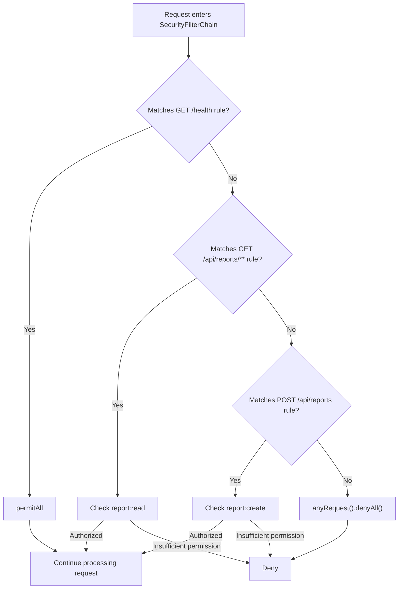

# anyRequest as the Terminal Policy and Default-Deny Choice

## Learning objectives

After this lesson, you will be able to: understand `anyRequest()` in Spring Security's `authorizeHttpRequests`; explain why it belongs at **the end of the rule list**; distinguish `anyRequest().denyAll()`, `anyRequest().authenticated()`, and `anyRequest().permitAll()`; verify the **first matching rule** mechanism; recognize the scope of `anyRequest` when multiple `SecurityFilterChain`s exist; and design a test suite ensuring new endpoints, new HTTP methods, or unannounced routes are **not accidentally granted access**.

Context: **HTTP authorization** on the Servlet stack (Spring MVC/Spring Boot, Spring Security 6.x and corresponding APIs). The examples use `SecurityFilterChain`, `HttpSecurity`, `authorizeHttpRequests`, and `AuthorizationFilter`. They are not WebFlux configurations. The main topic is **terminal catch-all policies and default deny (fail closed)**, rather than a guide to every authentication model.

## 1. Three questions every HTTP authorization config must answer

For an HTTP request arriving at the server, Spring Security needs to determine:

1. **Does the request belong to a Spring Security filter chain?** `FilterChainProxy` selects the first `SecurityFilterChain` whose matcher matches. An application may have one or more filter chains.
2. **Inside the selected chain, which authorization rule matches first?** `authorizeHttpRequests` evaluates `RequestMatcher → AuthorizationManager` pairs in **declaration order**. Only the first matching rule is used to make the decision.
3. **What if the request does not match any specific rule?** That is the role of `anyRequest()`: catching **all remaining requests within this chain's scope**, after preceding rules have been checked.

An easily verifiable policy:

```text
GET /health               → permitAll
GET /api/reports/**       → requires "report:read" authority
POST /api/reports          → requires "report:create" authority
all remaining requests    → denyAll
```

When there is no rule yet for `PATCH /api/reports/7` or `GET /api/new-feature`, the request is **denied by default**, even if the principal is logged in and has `ROLE_ADMIN`. That is desirable when new endpoints must be reviewed before opening access.

### Decision diagram



**Crucial point:** once a request matches `GET /api/reports/**`, failing the `report:read` check leads to **DENY**. Spring **does not** try the `POST` rule or `anyRequest` as a second chance. The matcher selects **one** policy, not a list of policies tried until an `ALLOW` is found.

## 2. What is anyRequest()?

In the DSL:

```java
http.authorizeHttpRequests(authorize -> authorize
    .requestMatchers("/health").permitAll()
    .anyRequest().denyAll()
);
```

- `requestMatchers("/health")` describes a **subset** of requests by matcher.
- `anyRequest()` is the matcher **covering all remaining requests** within that exact `HttpSecurity`/`SecurityFilterChain`.
- `denyAll()` is the **authorization decision** bound to the matcher; it does not authenticate, compare roles, or return HTTP 403 by itself in every scenario.

**Do not conflate the two concepts:** `anyRequest()` only specifies **which requests** are matched; `denyAll()` specifies **what decision** applies when those requests are matched.

For instance, you could write `anyRequest().authenticated()`; remaining requests would then be **allowed** if the caller is authenticated. However, that is **not** a default-deny strategy. A newly deployed API missing its own rule could accidentally open to every logged-in user.

### anyRequest must normally come last

In `authorizeHttpRequests` configuration, `anyRequest()` is a **terminal matcher**. Once declared, you cannot continue adding `requestMatchers(...)` as if creating further rules; Spring Security detects configuring matchers after a catch-all and can throw a configuration error when building the filter chain.

```java
// RIGHT ordering:
.authorizeHttpRequests(auth -> auth
    .requestMatchers("/public/**").permitAll()
    .requestMatchers("/admin/**").hasRole("ADMIN")
    .anyRequest().denyAll()
)
```

```java
// WRONG: adding specific rules after the catch-all.
.authorizeHttpRequests(auth -> auth
    .anyRequest().denyAll()
    .requestMatchers("/admin/**").hasRole("ADMIN")
)
```

Do not expect an `/admin/**` rule placed afterward to "override" `anyRequest`. The right organization is **specific first, catch-all last**, not relying on an override mechanism.

## 3. Why choose denyAll as the terminal policy?

The **default deny / fail closed** principle: grant access only to explicitly stated and reviewed actions; everything else is denied. In web applications, this is especially useful because endpoints, HTTP methods, servlet mappings, and API versions evolve over time.

Suppose you already have:

```text
GET  /api/invoices/**      → invoice:read
POST /api/invoices         → invoice:create
anyRequest                 → denyAll
```

Later a developer adds `DELETE /api/invoices/42` but forgets to update the Security configuration. With `denyAll`, the DELETE action is blocked, forcing the team to establish an explicit policy. With `authenticated()`, any ordinary logged-in user could reach the DELETE controller despite lacking functional checks at the HTTP layer.

**Default deny does not mean "lock down the entire application."** You can `permitAll` public pages, `hasAuthority`/`hasRole` for APIs, `authenticated` for personal features, and then `denyAll` for the remaining routes.

### Comparing the three terminal styles

| Terminal rule | Meaning for requests not matching prior rules | Risks / applicability |
| --- | --- | --- |
| `anyRequest().denyAll()` | No remaining requests are allowed | **Safe default** when an explicit allowlist is desired |
| `anyRequest().authenticated()` | All remaining requests are allowed if authenticated, including remember-me where applicable | Convenient, but can expose new endpoints to every logged-in user |
| `anyRequest().permitAll()` | All remaining requests are allowed right at the authorization layer | Risky for apps with sensitive endpoints; only suitable when opening the entire remainder intentionally |

The conditions above apply only **within the chain under consideration**; they make no claims about endpoints blocked by CSRF, method security, roles/authorities at another layer, or missing controllers.

### denyAll does not depend on a principal

With `denyAll`, Spring Security can conclude denial **without fetching `Authentication` from the session**, just as `permitAll` can allow without fetching the principal for that decision. This is a property of unconditional allow/deny rules; it does not mean authentication filters are disabled or earlier filters do not run.

**Be careful with HTTP status:** a request rejected by `denyAll` can raise an `AccessDeniedException`; `ExceptionTranslationFilter` decides whether to invoke `AuthenticationEntryPoint` or `AccessDeniedHandler` based on authentication state. With Basic APIs, anonymous callers usually receive **401**, while fully logged-in users receive **403**. With form login, callers may be redirected to the login page. Thus "default deny" is a security decision, **not a promise to always return HTTP 403**.

## 4. Complete Spring Security configuration for an API

The configuration example below declares HTTP rules in order and ends with `denyAll`. This is a **configuration snippet for a Spring Boot/Spring Security project**, not a standalone Java file runnable with `javac` alone; the project must supply an authentication source and corresponding controllers.

```java
import org.springframework.context.annotation.Bean;
import org.springframework.context.annotation.Configuration;
import org.springframework.http.HttpMethod;
import org.springframework.security.config.Customizer;
import org.springframework.security.config.annotation.web.builders.HttpSecurity;
import org.springframework.security.web.SecurityFilterChain;

@Configuration
public class SecurityConfig {

    @Bean
    SecurityFilterChain securityFilterChain(HttpSecurity http) throws Exception {
        http
            .authorizeHttpRequests(auth -> auth
                // Genuinely public health check.
                .requestMatchers(HttpMethod.GET, "/health")
                    .permitAll()

                // Both collection and resource paths.
                .requestMatchers(
                    HttpMethod.GET, "/api/reports", "/api/reports/**"
                ).hasAuthority("report:read")

                // Only creation permission may POST to the collection.
                .requestMatchers(HttpMethod.POST, "/api/reports")
                    .hasAuthority("report:create")

                // Undeclared endpoints/methods → DENY.
                .anyRequest()
                    .denyAll()
            )
            .httpBasic(Customizer.withDefaults());

        return http.build();
    }
}
```

Detail-by-detail explanation:

1. `@Bean SecurityFilterChain` is the modern Servlet Security configuration style; not the legacy `WebSecurityConfigurerAdapter`.
2. `requestMatchers(HttpMethod.GET, ...)` only selects HTTP GET; `POST`/`PATCH`/`DELETE` do not automatically inherit the read rule.
3. `"/api/reports"` and `"/api/reports/**"` are listed explicitly to clarify the collection path and sub-resource paths; do not rely on one pattern form automatically covering the other across every matcher setup.
4. `hasAuthority("report:read")` matches the **exact `GrantedAuthority` string**; it is not automatically inferred from `ROLE_USER` or `ROLE_ADMIN`.
5. `anyRequest().denyAll()` stands last, guarding paths/methods not yet added to the allowlist.
6. `httpBasic` only illustrates one login mechanism; declare a user/credential source or integrate a real identity provider. In production, configure TLS and appropriate session/CSRF/OAuth2 settings.
7. `anyRequest` only checks **HTTP permissions**. For `GET /api/reports/42`, the service still must check which tenant owns the report, who may read it, and its status.

### Request comparison table

Assume full authentication with the authorities shown in the table:

| Request | Caller's authority | First matching rule | Decision at HTTP layer |
| --- | --- | --- | --- |
| `GET /health` | None needed | `GET /health` | **ALLOW** |
| `GET /api/reports/7` | `report:read` | `GET /api/reports/**` | **ALLOW** |
| `GET /api/reports/7` | Only `report:create` | `GET /api/reports/**` | **DENY** |
| `POST /api/reports` | `report:create` | `POST /api/reports` | **ALLOW** |
| `POST /api/reports` | Only `report:read` | `POST /api/reports` | **DENY** |
| `PATCH /api/reports/7` | `report:read`, `report:create` | `anyRequest` | **DENY** |
| `GET /admin/panel` | `ROLE_ADMIN` | `anyRequest` | **DENY** |
| `GET /api/new-feature` | Logged in with `ROLE_USER` | `anyRequest` | **DENY** |
| `POST /health` | Any | `anyRequest` | **DENY** |

**ALLOW** only means "passed this chain's HTTP authorization"; controllers, databases, CSRF, other filters, and method-level security can still deny or return 404. **DENY** means not permitted to proceed past the applicable HTTP permission rule.

## 5. Request matchers in order: the first rule wins

Spring Security evaluates `requestMatchers(...)` in `authorizeHttpRequests` in declaration order. If multiple matchers match, **the earlier matcher decides**. There is no concept of "automatically picking the most specific rule" or "trying the next rule after an earlier rule returns DENY."

### Bug example: broad rule shadows narrow rule

```java
// WRONG if /api/admin/** must require ROLE_ADMIN.
.authorizeHttpRequests(auth -> auth
    .requestMatchers("/api/**").authenticated()
    .requestMatchers("/api/admin/**").hasRole("ADMIN")
    .anyRequest().denyAll()
)
```

For `GET /api/admin/users`, `/api/**` already matches and only requires authentication. The `/api/admin/**` rule below is **not evaluated**, even though it is clearly more specific.

**Correct fix following "specific first, general last":**

```java
.authorizeHttpRequests(auth -> auth
    .requestMatchers("/api/admin/**").hasRole("ADMIN")
    .requestMatchers("/api/public/**").permitAll()
    .requestMatchers("/api/**").authenticated()
    .anyRequest().denyAll()
)
```

However, the fixed config **still allows every new API under `/api/**` once logged in** because the broad `authenticated` rule is matched. If the requirement is **do not open unapproved endpoints**, replace `.requestMatchers("/api/**").authenticated()` with matchers for specific features so `anyRequest().denyAll()` catches everything else.

### Bug example: two duplicate matchers do not create OR

```java
// WRONG: does not mean (report:read OR report:export).
.requestMatchers(HttpMethod.GET, "/api/reports/**")
    .hasAuthority("report:read")
.requestMatchers(HttpMethod.GET, "/api/reports/**")
    .hasAuthority("report:export")
```

The first rule already matched the request, so the second rule does not give someone lacking `report:read` another chance. If the business logic accepts **either authority**, declare **one** rule:

```java
.requestMatchers(HttpMethod.GET, "/api/reports/**")
    .hasAnyAuthority("report:read", "report:export")
```

And end the list with `anyRequest().denyAll()`. Do not use duplicate matchers to try expressing OR/AND of permissions.

## 6. "anyRequest catches everything" only holds inside the selected SecurityFilterChain

This is the most critical security boundary after putting `anyRequest` last.

`FilterChainProxy` selects the **first `SecurityFilterChain` whose matcher matches**; only then are that chain's `requestMatchers` evaluated. If a chain is scoped with:

```java
http.securityMatcher("/api/**")
    .authorizeHttpRequests(auth -> auth
        .requestMatchers("/api/public/**").permitAll()
        .anyRequest().denyAll()
    );
```

then `anyRequest().denyAll()` only catches remaining requests **within `/api/**`**. It **does not automatically protect `/admin`, `/actuator`, or `/secret` outside this chain**. If no other filter chain matches those URLs, they may sit outside Spring Security filter chain protection.

### Multiple SecurityFilterChains: scope-based protection with a fallback

Example with a dedicated chain for `/api/**` and a fallback chain without a narrow `securityMatcher`:

```java
import org.springframework.context.annotation.Bean;
import org.springframework.context.annotation.Configuration;
import org.springframework.core.annotation.Order;
import org.springframework.http.HttpMethod;
import org.springframework.security.config.Customizer;
import org.springframework.security.config.annotation.web.builders.HttpSecurity;
import org.springframework.security.web.SecurityFilterChain;

@Configuration
public class MultipleChainsConfig {

    @Bean
    @Order(1)
    SecurityFilterChain apiChain(HttpSecurity http) throws Exception {
        http
            .securityMatcher("/api/**")
            .authorizeHttpRequests(auth -> auth
                .requestMatchers(HttpMethod.GET, "/api/public/**")
                    .permitAll()
                .requestMatchers(HttpMethod.GET, "/api/reports/**")
                    .hasAuthority("report:read")
                .anyRequest()
                    .denyAll()
            )
            .httpBasic(Customizer.withDefaults());
        return http.build();
    }

    @Bean
    @Order(2)
    SecurityFilterChain fallbackChain(HttpSecurity http) throws Exception {
        http
            .authorizeHttpRequests(auth -> auth
                .requestMatchers(HttpMethod.GET, "/health")
                    .permitAll()
                .anyRequest()
                    .denyAll()
            )
            .httpBasic(Customizer.withDefaults());
        return http.build();
    }
}
```

The pattern above highlights **scope partitioning**, without creating a user store, controllers, or full production behavior. For `GET /api/reports/7`, `apiChain` is selected and `fallbackChain` is **not tried afterward** if a rule in the first chain returns DENY. For `GET /admin`, the API chain does not match, so the fallback chain handles it with `denyAll`. **Do not think of multiple chains as stacked policies**: for each request, `FilterChainProxy` uses the first matching chain.

| Request | Selected chain | Terminal rule applied |
| --- | --- | --- |
| `GET /api/reports/7` | `apiChain` | `apiChain`'s `anyRequest`, if no report rule matches |
| `DELETE /api/reports/7` | `apiChain` | `apiChain`'s `denyAll` |
| `GET /health` | `fallbackChain` | Public health rule |
| `GET /admin` | `fallbackChain` | `fallbackChain`'s `denyAll` |

**The fallback chain's scope** does not depend on the API chain's patterns. If you customize `securityMatcher` on **every** chain and miss a path, `anyRequest().denyAll()` inside those chains **cannot protect the missed URL**. Therefore, a suitable catch-all chain or equivalent measure is required and must be tested.

## 7. How is anyRequest different from requestMatchers("/**")?

Both may look like broad matchers, yet **they should not be treated as completely identical APIs**:

- `anyRequest()` is the catch-all **marked by the DSL as final** for the current chain's rules. It indicates no further specific rules are declared after it.
- `requestMatchers("/**")` creates a rule based on a **path matcher**, following the configuration's pattern-matching mechanism. It remains a URL pattern matcher subject to servlet path, matcher implementation, and ordering details.
- `anyRequest` means "all remaining requests of the chain," without assuming the `/**` path pattern maps identically across every servlet/dispatcher setup.
- `anyRequest` does not expand the scope of `http.securityMatcher`. If the chain is not selected, neither `anyRequest` nor `requestMatchers("/**")` inside it runs.

For designing a **terminal default deny**, `anyRequest().denyAll()` is clearer and less dependent on URL pattern specifics.

### Do not blindly use web.ignoring instead of permitAll

For static resources like CSS/JS, `permitAll` makes resources publicly accessible **while still passing through the Spring Security filter chain**, where security headers and related protections can apply. With `WebSecurityCustomizer#ignoring`, requests skip the entire Spring Security filter chain for that matcher. Only use bypasses when you understand the purpose and consequences; in most applications, prefer `requestMatchers("/assets/**").permitAll()` followed by `anyRequest().denyAll()`.

## 8. Dispatcher types: why denyAll can block FORWARD/ERROR

In Servlets, requests have `DispatcherType`s such as `REQUEST`, `FORWARD`, `ERROR`, and `INCLUDE`. Depending on configuration and handling, `AuthorizationFilter` may evaluate **subsequent dispatches** as well, not only the initial request.

An already-authorized HTTP request can trigger:

- `FORWARD` to an internal view in the application;
- `ERROR` dispatch to render an error page;
- another MVC/servlet handling path outside the allowlisted URLs.

If every dispatch is re-checked and there is no rule for the forwarded/error path, `anyRequest().denyAll()` can deny that dispatch. When debugging, you may see a **403 while rendering an error**, masking the original HTTP 404 or exception.

One option when **aligned with the threat model** is permitting dispatcher types used for rendering:

```java
import jakarta.servlet.DispatcherType;

http.authorizeHttpRequests(auth -> auth
    // Only when intending to trust internal FORWARD/ERROR in this design.
    .dispatcherTypeMatchers(
        DispatcherType.FORWARD, DispatcherType.ERROR
    ).permitAll()
    .requestMatchers("/public/**").permitAll()
    .requestMatchers("/admin/**").hasRole("ADMIN")
    .anyRequest().denyAll()
);
```

**Do not apply mechanically:** a `dispatcherTypeMatchers(FORWARD).permitAll()` rule is very broad for all internal forwards and can affect internal path protection in multi-servlet architectures. Identify which dispatches genuinely need permission, consider narrow matchers, and test directly/indirectly to avoid creating bypasses. When allowing all FORWARD/ERROR is unnecessary, keep the policy tight and fix the specific failing dispatcher/path.

## 9. Why denyAll at HTTP is not enough to protect data

`anyRequest().denyAll()` addresses **undeclared HTTP entry paths**, yet already-permitted endpoints can still serve multi-user/multi-tenant resources. For example:

```java
.requestMatchers(HttpMethod.GET, "/api/documents/**")
    .hasAuthority("document:read")
.anyRequest().denyAll()
```

If Bob has `document:read`, Bob is allowed to **enter the document-reading feature**. Still, `GET /api/documents/42` must verify:

- whether document 42 exists;
- which tenant owns the document;
- whether Bob is the owner or in the ACL;
- whether the document is locked or in a restricted state;
- whether any additional environment/time constraints apply.

You can combine HTTP authorization with `@PreAuthorize` and a dedicated service policy:

```java
// Illustrative code in an application service with @EnableMethodSecurity.
// documentPolicy is an application-provided bean.
@PreAuthorize(
    "hasAuthority('document:read') and " +
    "@documentPolicy.canRead(authentication, #documentId)"
)
public Document read(@P("documentId") long documentId) {
    return repository.findById(documentId).orElseThrow();
}
```

This snippet is **not a standalone Java file**: `Document`, `repository`, and `documentPolicy` must be implemented; `@P` is from `org.springframework.security.access.method.P`. The policy should load owner/tenant from the DB, read the subject from the verified authentication, and block cross-tenant access. `@EnableMethodSecurity` must be explicitly enabled; `@PreAuthorize` must be called through a Spring-managed proxy.

**In short:** default deny protects **routes without a rule**, while object-level protection must be decided per **actual record**. Never let a general authority mean permission to view every ID.

## 10. Standalone Java 17: simulating first-match and fallback

The Java snippet below can be **compiled/run with JDK 17+ without Spring**. It simulates iterating through a matcher list in order and placing an `anyRequest` rule returning DENY at the end. The goal is clarifying the **decision idea**, not replicating Spring Security's real matchers/path canonicalization.

Save file **`AnyRequestDenyDemo.java`**:

```java
import java.util.List;
import java.util.Set;
import java.util.function.Predicate;

public class AnyRequestDenyDemo {

    record Request(
        String method,
        String path,
        boolean authenticated,
        Set<String> authorities
    ) {}

    record Rule(
        String name,
        Predicate<Request> matches,
        Predicate<Request> allows
    ) {}

    static String decide(Request request, List<Rule> policy) {
        for (Rule rule : policy) {
            if (rule.matches().test(request)) {
                return rule.name() + " -> "
                    + (rule.allows().test(request) ? "ALLOW" : "DENY");
            }
        }
        return "NO_RULE -> DENY";
    }

    public static void main(String[] args) {
        List<Rule> policy = List.of(
            new Rule(
                "GET /health",
                r -> r.method().equals("GET")
                    && r.path().equals("/health"),
                r -> true
            ),
            new Rule(
                "GET /api/reports",
                r -> r.method().equals("GET")
                    && (r.path().equals("/api/reports")
                        || r.path().startsWith("/api/reports/")),
                r -> r.authenticated()
                    && r.authorities().contains("report:read")
            ),
            new Rule(
                "POST /api/reports",
                r -> r.method().equals("POST")
                    && r.path().equals("/api/reports"),
                r -> r.authenticated()
                    && r.authorities().contains("report:create")
            ),
            new Rule(
                "anyRequest",
                r -> true,
                r -> false
            )
        );

        System.out.println(decide(
            new Request("GET", "/health", false, Set.of()), policy
        ));
        System.out.println(decide(
            new Request("GET", "/api/reports/7", true,
                Set.of("report:read")), policy
        ));
        System.out.println(decide(
            new Request("GET", "/api/reports/7", true,
                Set.of("report:create")), policy
        ));
        System.out.println(decide(
            new Request("POST", "/api/reports", true,
                Set.of("report:create")), policy
        ));
        System.out.println(decide(
            new Request("PATCH", "/api/reports/7", true,
                Set.of("report:read", "report:create")), policy
        ));
        System.out.println(decide(
            new Request("GET", "/new-feature", true,
                Set.of("ROLE_ADMIN")), policy
        ));
    }
}
```

Run:

```bash
javac AnyRequestDenyDemo.java
java AnyRequestDenyDemo
```

**Exact stdout:**

```text
GET /health -> ALLOW
GET /api/reports -> ALLOW
GET /api/reports -> DENY
POST /api/reports -> ALLOW
anyRequest -> DENY
anyRequest -> DENY
```

Things to observe:

1. The first request matches `GET /health` and is permitted even when unauthenticated.
2. The report-read request with `report:read` is permitted; another request to the **same URL** carrying only `report:create` is denied.
3. Once the GET matcher selects the request lacking `report:read`, Spring-like evaluation **does not check `anyRequest` for a different outcome**.
4. Both undeclared `PATCH` and unlisted `/new-feature` are **denied**, even when the principal holds multiple authorities or `ROLE_ADMIN`.
5. Even if the `anyRequest` rule is removed, the illustrative function has a guard `NO_RULE -> DENY` to avoid returning allow; **that is a safeguard of the demo Java program**, not a description that a Spring config omitting `anyRequest` always defaults to `denyAll`.

**Simulation limits:** Java `String.equals/startsWith` is no substitute for Spring MVC/`PathPattern` request matching, servlet paths, dispatcher types, role hierarchies, CSRF, or multi-filter-chain selection. The example solely confirms **rule order + first match + terminal deny**.

## 11. HTTP response when hitting denyAll

Denial by `anyRequest().denyAll()` is an **authorization outcome**. On the Servlet stack, `AuthorizationFilter`/`AuthorizationManager` can throw `AccessDeniedException` or a subclass such as `AuthorizationDeniedException`. If the exception reaches `ExceptionTranslationFilter`, the framework picks the handling branch:

| Caller / auth method | Common flow | Typical HTTP response |
| --- | --- | --- |
| Anonymous to an HTTP Basic API | `AuthenticationEntryPoint` starts authentication | 401 challenge |
| Anonymous to a form-login web app | Form-login entry point | Redirect to login |
| Fully authenticated on an unlisted URL | `AccessDeniedHandler` handles DENY | 403 |
| Remember-me user failing policy | May be prompted to re-authenticate via entry point | 401/redirect per config |
| State-changing request missing CSRF token | May be blocked by `CsrfFilter` **before authorization** | 403 from CSRF handling |

Do not conclude that every 403 response comes from `anyRequest`: it can come from **CSRF, authentication, method security, object policy, controller**, or another filter. When a request passes authorization but no controller exists, the framework may return **404**, without turning it into a `denyAll` error.

## 12. Testing default deny with Spring Security Test

A fail-closed policy must test **both permitted endpoints and undeclared endpoints**. Testing only "allowed" paths does not prove `anyRequest().denyAll()` is working.

### 12.1. Key test matrix

| Scenario | Expected |
| --- | --- |
| Anonymous `GET /health` | Passes `permitAll` rule |
| User with `report:read` calls `GET /api/reports/7` | Passes HTTP authorization |
| User with only `report:create` calls GET report | Denied by GET rule, **does not** try other rules |
| User with `report:create` calls `POST /api/reports` | Passes HTTP authorization; CSRF may still apply |
| Logged-in user calls `GET /new-feature` | Blocked by `anyRequest().denyAll()` |
| Admin with `ROLE_ADMIN` calls `GET /admin/panel` with no admin rule | Still denied by default |
| User calls `PATCH /api/reports/7` when only GET/POST declared | Denied by default |
| User calls `POST /health` when only GET declared | Denied by default |
| Request outside `securityMatcher("/api/**")` in multi-chain setup | Must be handled by catch-all chain; must not bypass Spring Security |
| Request triggering ERROR/FORWARD dispatch | Verify dispatcher policy and proper response |
| Endpoint passes HTTP rule yet accesses cross-tenant data | Method/object policy must deny |

### 12.2. MockMvc with privileged principal must still deny unknown routes

The `spring-security-test` sample below is a **snippet inside a Spring/JUnit test** (not a standalone Java file). It assumes `MockMvc mvc` is injected, the `SecurityConfig` from section 4 is loaded, and tests use `@WithMockUser` or `user(...)`:

```java
import org.junit.jupiter.api.Test;
import org.springframework.beans.factory.annotation.Autowired;
import org.springframework.boot.test.autoconfigure.web.servlet.AutoConfigureMockMvc;
import org.springframework.boot.test.context.SpringBootTest;
import org.springframework.test.web.servlet.MockMvc;

import static org.springframework.security.test.web.servlet.request
    .SecurityMockMvcRequestPostProcessors.user;
import static org.springframework.test.web.servlet.request
    .MockMvcRequestBuilders.get;
import static org.springframework.test.web.servlet.request
    .MockMvcRequestBuilders.patch;
import static org.springframework.test.web.servlet.result
    .MockMvcResultMatchers.status;

@SpringBootTest
@AutoConfigureMockMvc
class HttpAuthorizationTest {
    @Autowired
    MockMvc mvc;

    @Test
    void loggedInUserCannotAccessUnknownRoute() throws Exception {
        mvc.perform(get("/new-feature")
                .with(user("alice").roles("USER")))
            .andExpect(status().isForbidden());
    }

    @Test
    void adminCannotBypassTerminalDeny() throws Exception {
        mvc.perform(get("/admin/panel")
                .with(user("admin").roles("ADMIN")))
            .andExpect(status().isForbidden());
    }

    @Test
    void previouslyUnlistedPatchIsDenied() throws Exception {
        mvc.perform(patch("/api/reports/7")
                .with(user("alice")
                    .authorities(() -> "report:read")))
            .andExpect(status().isForbidden());
    }
}
```

Depending on the application's specific configuration, `PATCH` may be blocked by CSRF before reaching `anyRequest`. To test **actual terminal authorization**, supply a CSRF token if CSRF is enabled (e.g., `.with(csrf())`) or design the filter chain to fit the API model. Otherwise, receiving 403 **does not yet prove** `denyAll` was what rejected it. In the tests above, `get("/new-feature")` and `get("/admin/panel")` are clearer examples for verifying the terminal rule with a fully authenticated user.

If the app has no controller for a `permitAll` URL, requests can pass authorization yet return **404**. When asserting 200 for an allowed route, create a corresponding controller stub/handler, or verify the authorization decision with an appropriate test approach. Do not use "404 due to missing controller" as proof that access was blocked.

### 12.3. Regression tests when adding endpoints

Whenever adding an API route:

- Add a specific rule for the **path + HTTP method** to be opened.
- Write tests for granted permissions and **denied permissions**, including unrelated authorities.
- Add tests that other methods (GET/POST/PATCH/DELETE) **remain denied by default** if not opened.
- Check path patterns, encoded URLs, trailing slashes, servlet paths, and matcher implementations in the real app.
- With multiple filter chains, test URLs outside the main chain's scope so no area goes **unprotected**.
- Run security tests in CI so controller changes cannot silently introduce unintended access.

**Do not "turn tests green" by changing terminal `denyAll` to `authenticated` or `permitAll`:** that alters the security policy for all unannounced URLs.

## 13. Common mistakes and how to fix them

1. **Placing `anyRequest` before specific rules:** the catch-all is terminal; you cannot keep adding `requestMatchers` after it. Move it to the end.
2. **Thinking a more specific matcher wins automatically:** declaration order decides the first matching rule; put narrow matchers before broad matchers.
3. **Leaving `anyRequest().authenticated()` while expecting fail-closed:** new endpoints can open to every logged-in principal. Use `denyAll` when policy requires an allowlist.
4. **Using `anyRequest().permitAll()` as fallback on APIs with private data:** accidentally exposes features lacking rules. Only open URLs intentionally.
5. **Believing one chain's `denyAll` protects the whole app:** `securityMatcher` restricts chain scope. Add a catch-all chain or protective measure for the remaining scope.
6. **Creating multiple filter chains without checking order:** the first matching priority chain decides; later chains do not "rescue" a request denied by an earlier chain.
7. **Using two identical-URL `requestMatchers` to express OR:** the first matcher already selects the policy. Use `hasAnyAuthority` or an appropriate composite `AuthorizationManager`.
8. **Forgetting HTTP methods:** permitting GET does not grant POST/PATCH/DELETE; test unopened methods.
9. **Using `"/**"` assuming it is identical to `anyRequest` as a terminal marker in all cases:** prefer `anyRequest` when expressing the DSL's catch-all.
10. **Granting `ROLE_ADMIN` and expecting to bypass `denyAll`:** `denyAll` denies everyone regardless of role. If admins need access, write an explicit admin rule before the catch-all.
11. **Seeing 403 and concluding it came from denyAll:** check CSRF, authentication, method security, object policy, dispatchers, and handlers.
12. **Forgetting `ERROR`/`FORWARD` dispatches:** strict catch-alls can block valid render flows; only add exception policies after analyzing bypass potential.
13. **Skipping data-level authorization because an HTTP rule exists:** `hasAuthority("document:read")` does not replace per-ID owner/tenant/ACL checks.
14. **Using `WebSecurityCustomizer#ignoring` to expose static resources without understanding consequences:** when only public access is needed, prefer `permitAll` so you do not skip the filter chain.
15. **Not checking new endpoints in CI:** controller changes can expose features when the fallback is `authenticated`. Keep regression tests for undeclared routes.

## 14. Checklist for designing default-deny HTTP authorization

1. List actual endpoints by **HTTP method + URL pattern**; clearly identify public endpoints, authenticated-only endpoints, and role/authority-required endpoints.
2. Put **specific matchers first**, general matchers after; avoid broad rules swallowing narrow rules.
3. Put **`anyRequest().denyAll()` at the end of each chain** when wanting default-deny for unpolicy'd requests.
4. Define the **`securityMatcher` scope** of each `SecurityFilterChain` and `@Order` priority; ensure no URL slips outside all chains.
5. Inspect `REQUEST`, `ERROR`, and `FORWARD` dispatcher types when the app uses forwarding/error rendering; do not permit more broadly than necessary.
6. For state-changing APIs, check CSRF, authentication, transactions, and business permissions beyond HTTP rules.
7. Test permitted endpoints, unknown endpoints, unknown HTTP methods, missing authorities, admin roles not exempted from `denyAll`, and URLs outside specialized chains.
8. Enforce policy/versioning in code review and CI: **adding an endpoint must accompany adding a rule and tests**, rather than loosening the fallback to silence errors.

### Self-check

**Question 1.** In a single chain, you place `requestMatchers("/api/**").authenticated()`, then `requestMatchers("/api/admin/**").hasRole("ADMIN")`, and finally `anyRequest().denyAll()`. Can a logged-in user without the admin role pass the HTTP rule for `GET /api/admin/users`?

**Answer:** Yes, they can **bypass the HTTP rule** because the earlier `/api/**` matcher already matched; the admin rule behind it is never evaluated. Fix by putting the admin matcher first and scoping broad matchers to policy.

**Question 2.** `GET /api/new` has no matcher yet, but the user has `ROLE_ADMIN`. If the terminal rule is `anyRequest().denyAll()`, what is the outcome?

**Answer:** **DENY**, even for admin. `denyAll` does not check roles.

**Question 3.** The API chain has `securityMatcher("/api/**")` and `anyRequest().denyAll()`. Is `/internal/export` guaranteed to be blocked by that chain?

**Answer:** **No**. The URL lies outside the chain's scope. Another chain or app-covering configuration must protect it; otherwise, the request may bypass Spring Security.

**Question 4.** A user lacks `report:read` but has `report:create` and calls `GET /api/reports/7`. Does Spring try the POST rule next to allow it?

**Answer:** **No**. The GET rule is the first matching matcher; its DENY decision is applied. There is no policy retry looking for ALLOW.

## References

- Spring Security, *Authorize HttpServletRequests*: https://docs.spring.io/spring-security/reference/servlet/authorization/authorize-http-requests.html
- Spring Security, *Java Configuration — Choosing securityMatcher or requestMatchers*: https://docs.spring.io/spring-security/reference/servlet/configuration/java.html
- Spring Security, *Servlet Architecture and Security Filters*: https://docs.spring.io/spring-security/reference/servlet/architecture.html
- Spring Security, *Testing Servlet Security*: https://docs.spring.io/spring-security/reference/servlet/test/index.html
