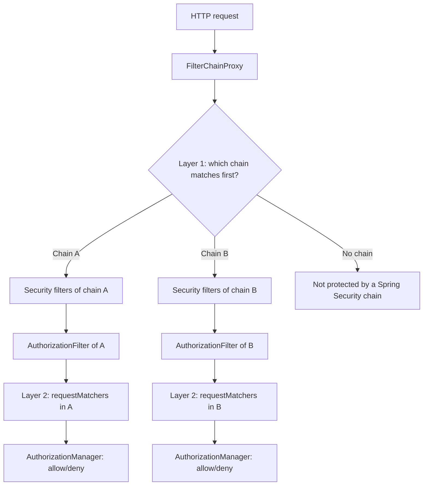

# Distinguishing securityMatcher Selecting a Filter Chain vs requestMatchers Selecting a Rule

When configuring **HTTP authorization in Spring Security (Servlet)**, two similarly named APIs answer **two different questions**:

- **`http.securityMatcher(...)`:** Does this request belong to the **`SecurityFilterChain` currently being defined**?
- **`http.authorizeHttpRequests(auth -> auth.requestMatchers(...))`:** Once the request **has entered this chain**, which **authorization rule** does it match to allow or deny?

This difference is not just syntax. Wrong ordering or scope confusion can cause requests to use the **wrong authentication mechanism**, skip desired protective filters, or worse, have **no Spring Security filter chain protecting them at all**.

**Quick rule of thumb:**

> **`securityMatcher` selects the *chain*; `requestMatchers` selects the *rule inside the chain*.** Both use the `RequestMatcher` mechanism, yet run at **two different layers** and two different times.

This lesson explains the mechanism, match ordering, multi-chain examples, effects on login endpoints, common pitfalls, how to test, and a standalone Java 17 simulation program.

## 1. Two selection layers for a single request

In a Spring MVC application running on the Servlet stack, Spring Security connects to the Servlet container via `DelegatingFilterProxy` and `FilterChainProxy`. `FilterChainProxy` holds an ordered list of `SecurityFilterChain`s by priority.

**Layer 1 – selecting the chain:**

1. The request arrives at `FilterChainProxy`.
2. `FilterChainProxy` iterates through `SecurityFilterChain`s in order.
3. Selects the **first chain whose chain-level RequestMatcher matches**.
4. Runs **the security filters belonging to the selected chain**. It does not combine filters from every matching chain.

**Layer 2 – selecting the rule:**

1. Inside the selected chain, `AuthorizationFilter` enforces URL access control when `authorizeHttpRequests` is configured.
2. The chain's `AuthorizationManager`, typically `RequestMatcherDelegatingAuthorizationManager`, iterates through **`requestMatchers` in order**.
3. Picks the **first rule whose matcher matches** and uses that rule's manager (`permitAll`, `authenticated`, `hasRole`, custom policy, etc.).
4. The result decides whether the request proceeds or is denied at the URL authorization step.



**There is no step "if the first chain's rule denies, switch to another chain."** Once `FilterChainProxy` has chosen a chain, Spring Security **does not try a second chain** just because the user lacks a role or the first chain's rule denied access.

### Comparison table

| Criterion | `securityMatcher` | `requestMatchers` in `authorizeHttpRequests` |
| --- | --- | --- |
| Decision level | Selects **`SecurityFilterChain`** | Selects an **authorization rule** of the selected chain |
| Where configured | On `HttpSecurity` of a `SecurityFilterChain` bean | Inside the `authorizeHttpRequests` DSL |
| Executing selector | `FilterChainProxy` | `RequestMatcherDelegatingAuthorizationManager` (commonly) |
| What is selected | The entire set of filters and security mechanisms of the chain | An `AuthorizationManager` such as `hasRole`, `permitAll` |
| Ordering | Priority among chains: `@Order` / `Ordered` | Declaration order of rules within the same chain |
| Default matcher | `HttpSecurity` matches **every request** by default unless narrowed | Rules must be declared; should end with `anyRequest()` |
| When not matching | Tries the **next chain**, if any | Tries the **next rule in the same chain**, if any |
| Scope of `anyRequest()` | At the rule layer, **only for requests that entered that chain** | Covers remaining requests **of the selected chain** |
| Security consequence | Chain may not apply, leaving gaps if there is no fallback | Rule may have wrong/missing permissions; never switches chains |

## 2. One `HttpSecurity` produces one `SecurityFilterChain`

In Java configuration:

```java
@Bean
SecurityFilterChain apiChain(HttpSecurity http) throws Exception {
    http
        .securityMatcher("/api/**")
        .authorizeHttpRequests(auth -> auth
            .requestMatchers(HttpMethod.GET, "/api/orders/**")
                .hasAuthority("orders.read")
            .anyRequest().authenticated()
        )
        .httpBasic(Customizer.withDefaults());
    return http.build();
}
```

This is a **Spring configuration fragment**, not a standalone plain Java class. It requires imports for `@Bean`, `HttpSecurity`, `SecurityFilterChain`, `HttpMethod`, `Customizer`, a Spring Boot/Spring Security application, and a corresponding authentication provider.

Exact interpretation:

1. The bean returns **one `SecurityFilterChain`**.
2. `securityMatcher("/api/**")` restricts the chain to URLs matching the `/api/**` pattern.
3. If a request is under `/api/**`, this chain can run HTTP Basic filters, `SecurityContext` handling, CSRF, authorization, and other configured filters.
4. Inside the chain, `GET /api/orders/42` matches the GET rule and requires the `orders.read` authority.
5. **Other requests still inside `/api/**`** match `anyRequest().authenticated()`.
6. `GET /about` **does not enter this chain**; the `anyRequest()` rule above **is not applied** to `/about`.

Conclusion 6 is the most frequently misunderstood: **`anyRequest()` does not turn a chain scoped by `securityMatcher` into a chain protecting every URL in the application.**

### `requestMatchers` does not shrink the chain

If `securityMatcher` is omitted entirely:

```java
@Bean
SecurityFilterChain oneChain(HttpSecurity http) throws Exception {
    http.authorizeHttpRequests(auth -> auth
        .requestMatchers("/api/**").authenticated()
        .anyRequest().permitAll()
    );
    return http.build();
}
```

With an unrestricted chain, the default chain-level matcher **matches every request**. That means:

- `GET /api/orders/42` enters the chain and is checked by `authenticated()`.
- `GET /public/help` **also enters the same chain**, yet is allowed by `anyRequest().permitAll()` at the HTTP authorization step.
- Other protective filters in the chain can still run for public requests (such as security headers, or CSRF where applicable).

Thus, **`requestMatchers("/api/**")` does not mean "secure only `/api/**`."** It only selects which rule applies inside a chain that has its own scope.

## 3. Each request gets a chain selected exactly once in `FilterChainProxy`

With multiple `SecurityFilterChain`s, `FilterChainProxy` iterates by priority and takes the **first matching chain**:

```text
Request GET /api/admin/audit
   |
   +--> Chain @Order(1): securityMatcher("/api/admin/**")   MATCH
   |      => selects admin chain; does not evaluate further chains
   |
   +--> Chain @Order(2): securityMatcher("/api/**")         does not run
   |
   +--> Fallback chain: default anyRequest matcher          does not run
```

This is **first-match-wins at the chain level**. If priority-1 chain has a denying rule, the request does not fall through to priority-2 chain looking for an easier rule.

### `@Order` is chain order, not rule order

`@Order(1)` has higher priority than `@Order(2)`. This order decides **which chain is evaluated first**. Inside each chain, `requestMatchers` order is decided by **declaration order in the DSL**, not by `@Order`.

If two chains both match a URL, the higher-priority chain wins. With multiple chains, place **more specific matchers on higher-priority chains**, or design non-overlapping matchers.

## 4. Three-chain configuration with fallback: Spring Security example

Suppose the application needs:

- `/api/admin/**`: administrative APIs, requiring `ROLE_ADMIN`.
- Remaining `/api/**`: HTTP Basic; GET orders require `orders.read`, POST orders require `orders.write`; other API endpoints require login.
- `/public/**` and `/health`: public.
- All undeclared URLs: deny.

Using **three chains** (the code below is a **configuration class in a Spring Boot Servlet project**, not runnable standalone with `javac`):

```java
package com.example.security;

import org.springframework.context.annotation.Bean;
import org.springframework.context.annotation.Configuration;
import org.springframework.core.annotation.Order;
import org.springframework.http.HttpMethod;
import org.springframework.security.config.Customizer;
import org.springframework.security.config.annotation.web.builders.HttpSecurity;
import org.springframework.security.web.SecurityFilterChain;

@Configuration
public class SecurityConfig {

    @Bean
    @Order(1)
    SecurityFilterChain adminChain(HttpSecurity http) throws Exception {
        http
            .securityMatcher("/api/admin/**")
            .authorizeHttpRequests(auth -> auth
                .anyRequest().hasRole("ADMIN")
            )
            .httpBasic(Customizer.withDefaults());

        return http.build();
    }

    @Bean
    @Order(2)
    SecurityFilterChain apiChain(HttpSecurity http) throws Exception {
        http
            .securityMatcher("/api/**")
            .authorizeHttpRequests(auth -> auth
                .requestMatchers(HttpMethod.GET, "/api/orders/**")
                    .hasAuthority("orders.read")
                .requestMatchers(HttpMethod.POST, "/api/orders/**")
                    .hasAuthority("orders.write")
                .anyRequest().authenticated()
            )
            .httpBasic(Customizer.withDefaults());

        return http.build();
    }

    @Bean
    SecurityFilterChain fallbackChain(HttpSecurity http) throws Exception {
        http
            .authorizeHttpRequests(auth -> auth
                .requestMatchers("/public/**", "/health").permitAll()
                .anyRequest().denyAll()
            );

        return http.build();
    }
}
```

### Reading each chain accurately

**adminChain – `@Order(1)`**

`securityMatcher("/api/admin/**")` claims administrative paths, even though they could also match `/api/**`. Inside this chain, `anyRequest().hasRole("ADMIN")` checks **every request that entered adminChain**, not every request in the application. With the default role prefix, `hasRole("ADMIN")` looks for `ROLE_ADMIN`.

**apiChain – `@Order(2)`**

Evaluated only if priority-1 chain did not match. Because `/api/**` covers regular APIs, GET and POST requests to `/api/orders/**` match the two specific rules. Other API requests entering this chain are handled by `anyRequest().authenticated()`. If the project needs to block undeclared APIs, change the fallback **inside apiChain** to `denyAll()` and grant explicit permissions.

**fallbackChain – evaluated by default after higher-priority `@Order` beans**

With no narrow `securityMatcher`, its chain-level matcher matches all remaining requests by default. `requestMatchers("/public/**", "/health")` permits public routes; `anyRequest().denyAll()` blocks undeclared URLs.

**Important:** The configuration above only defines rules and filters to use. To run as an application, add dependencies, user/authentication providers, controllers, and HTTP request handling. HTTP Basic does not provide production accounts by itself; Spring Boot may generate a default user in simple setups, but real deployments must configure it explicitly. POST via browser/cookies may require a CSRF token; a 403 from `CsrfFilter` does not prove the `orders.write` rule is wrong.

### Chain selection and rule selection matrix

| Request | Selected chain | Selected rule in chain | HTTP authorization condition |
| --- | --- | --- | --- |
| `GET /api/admin/audit` | `adminChain` | `anyRequest().hasRole("ADMIN")` | `ROLE_ADMIN` |
| `DELETE /api/admin/users/7` | `adminChain` | `anyRequest().hasRole("ADMIN")` | `ROLE_ADMIN` |
| `GET /api/orders/7` | `apiChain` | GET orders `hasAuthority` | `orders.read` |
| `POST /api/orders/7` | `apiChain` | POST orders `hasAuthority` | `orders.write` |
| `PATCH /api/orders/7` | `apiChain` | `anyRequest().authenticated()` | Authenticated; note access may be **too broad** |
| `GET /api/profile` | `apiChain` | `anyRequest().authenticated()` | Authenticated |
| `GET /public/help` | `fallbackChain` | `permitAll()` | No authentication required at HTTP authorization |
| `GET /health` | `fallbackChain` | `permitAll()` | No authentication required at HTTP authorization |
| `GET /internal/debug` | `fallbackChain` | `denyAll()` | Denied |
| `GET /unknown` | `fallbackChain` | `denyAll()` | Denied |

The table describes **chain and rule selection results**, without promising exact HTTP status codes or controller existence. A request passing authorization can still return 404/400/409; a POST can be blocked by CSRF before reaching `AuthorizationFilter`.

## 5. Rules have their own ordering inside a chain

`requestMatchers` follows the **first matching rule wins** principle. Example:

```java
.authorizeHttpRequests(auth -> auth
    .requestMatchers("/api/**").permitAll()
    .requestMatchers("/api/admin/**").hasRole("ADMIN")
    .anyRequest().denyAll()
)
```

With a chain covering `/api/**`, `GET /api/admin/users` matches the **first rule** `/api/**`, so the admin rule placed later **does not run**. As a result, the administrative endpoint can be permitted at HTTP authorization even though `hasRole("ADMIN")` is written below.

Fix by placing specific rules first:

```java
.authorizeHttpRequests(auth -> auth
    .requestMatchers("/api/admin/**").hasRole("ADMIN")
    .requestMatchers("/api/**").authenticated()
    .anyRequest().denyAll()
)
```

However, once **adminChain** at priority 1 is separated as in the previous example, the admin rule lives in its own chain; `requestMatchers` in `apiChain` has no chance to process `/api/admin/**`. Keep the **two levels of order** distinct:

- Chain order: `@Order` bean priority and chain-level `securityMatcher`.
- Rule order: `requestMatchers` order within the **selected chain**.

**There is no principle that "a stricter rule placed later always wins."** In reality, only the **first matching** matcher at the corresponding layer is chosen.

## 6. Four common misconfigurations and their consequences

### 6.1. Using `securityMatcher` alone and forgetting a fallback chain

```java
@Bean
SecurityFilterChain onlyApi(HttpSecurity http) throws Exception {
    http
        .securityMatcher("/api/**")
        .authorizeHttpRequests(auth -> auth
            .anyRequest().authenticated()
        );
    return http.build();
}
```

If **this is the only chain**, `/api/orders` requests are protected by the Spring Security chain, yet `/admin/secret` matches no chain at all. Spring Security **provides no filter-chain protection** for requests outside `/api/**`; the final response is up to the app/container.

The danger is that the application may still deploy a `/admin/secret` controller while you assume `anyRequest().authenticated()` protects it. **`anyRequest` applies only to requests that entered this chain.**

**Fix:** add an unrestricted fallback `SecurityFilterChain` with `anyRequest().denyAll()` or an explicit policy; verify every URL needing protection.

### 6.2. Using `requestMatchers` and thinking filters were split

```java
@Bean
SecurityFilterChain combined(HttpSecurity http) throws Exception {
    http
        .authorizeHttpRequests(auth -> auth
            .requestMatchers("/api/**").authenticated()
            .anyRequest().permitAll()
        )
        .httpBasic(Customizer.withDefaults());
    return http.build();
}
```

`requestMatchers("/api/**")` only defines an authorization rule. It **does not** create two `SecurityFilterChain`s; every URL still passes through the **same set of filters** in `combined`. If you want session/form login for web and JWT/HTTP Basic for API, arrange **separate chains** with `securityMatcher` or design a chain with mechanisms supporting both goals.

### 6.3. Broad chain shadows specific chain

```java
@Bean
@Order(1)
SecurityFilterChain broad(HttpSecurity http) throws Exception {
    http.securityMatcher("/api/**")
        .authorizeHttpRequests(auth -> auth.anyRequest().authenticated());
    return http.build();
}

@Bean
@Order(2)
SecurityFilterChain admin(HttpSecurity http) throws Exception {
    http.securityMatcher("/api/admin/**")
        .authorizeHttpRequests(auth -> auth.anyRequest().hasRole("ADMIN"));
    return http.build();
}
```

`/api/admin/audit` enters chain `broad` because `/api/**` matched first. Chain `admin` is **not evaluated**, rendering its `hasRole("ADMIN")` ineffective. This is an **inter-chain ordering** bug, and cannot be fixed by reordering rules inside `admin`.

**Fix:** reverse chain order (admin first, broad second), design non-overlapping chain-level matchers, or declare the admin rule in the proper order inside one shared chain.

### 6.4. A rule inside a chain has an unreachable scope

```java
http.securityMatcher("/api/**")
    .authorizeHttpRequests(auth -> auth
        .requestMatchers("/admin/**").hasRole("ADMIN")
        .anyRequest().authenticated()
    );
```

`/admin/**` **is not inside `/api/**`**, so `requestMatchers("/admin/**")` is never applied to those requests: it sits outside the chain. When reading code, **always ask "does this path pass the chain's `securityMatcher` first?"** before evaluating rules.

One way to spot this bug is tabulating the **chain-level match set** against the **rule-level match set**. If a rule can only match URLs outside the chain's selected request set, it has no effect.

## 7. Standalone Java 17: simulating the two selection levels

The program below simulates:

1. An ordered list of chains by priority.
2. Each chain having its own ordered list of rules.
3. Selecting the **first matching chain**, then selecting the **first matching rule of that chain**.
4. When a fallback chain is absent, returning diagnostic state `NO_SECURITY_CHAIN`; **never treat that as a safe allow decision**.

The program uses **Java SE 17** APIs with no Spring dependency. Its goal is clarifying the algorithm, **not accurately replicating every Spring Security path matcher, filter, authentication, CSRF, servlet dispatch, and exception handling behavior**.

Create file **`ChainVsRuleDemo.java`**:

```java
import java.util.List;
import java.util.Set;
import java.util.function.BiPredicate;
import java.util.function.Predicate;

public class ChainVsRuleDemo {

    record Request(String method, String path) {}

    record Identity(boolean authenticated, Set<String> authorities) {
        boolean has(String authority) {
            return authenticated && authorities.contains(authority);
        }
    }

    record Rule(
            String name,
            Predicate<Request> matches,
            BiPredicate<Identity, Request> allows
    ) {}

    record Chain(
            String name,
            Predicate<Request> matches,
            List<Rule> rules
    ) {}

    static final Chain ADMIN = new Chain(
            "adminChain",
            request -> request.path().startsWith("/api/admin/"),
            List.of(new Rule(
                    "admin role",
                    request -> true,
                    (user, request) -> user.has("ROLE_ADMIN")
            ))
    );

    static final Chain API = new Chain(
            "apiChain",
            request -> request.path().startsWith("/api/"),
            List.of(
                    new Rule(
                            "read orders",
                            request -> request.method().equals("GET")
                                    && request.path().startsWith("/api/orders/"),
                            (user, request) -> user.has("orders.read")
                    ),
                    new Rule(
                            "write orders",
                            request -> request.method().equals("POST")
                                    && request.path().startsWith("/api/orders/"),
                            (user, request) -> user.has("orders.write")
                    ),
                    new Rule(
                            "other api",
                            request -> true,
                            (user, request) -> user.authenticated()
                    )
            )
    );

    static final Chain FALLBACK = new Chain(
            "fallbackChain",
            request -> true,
            List.of(
                    new Rule(
                            "public",
                            request -> request.path().startsWith("/public/")
                                    || request.path().equals("/health"),
                            (user, request) -> true
                    ),
                    new Rule(
                            "default deny",
                            request -> true,
                            (user, request) -> false
                    )
            )
    );

    static String evaluate(
            List<Chain> chains,
            Identity user,
            Request request
    ) {
        for (Chain chain : chains) {
            if (!chain.matches().test(request)) {
                continue;
            }

            for (Rule rule : chain.rules()) {
                if (rule.matches().test(request)) {
                    boolean granted = rule.allows().test(user, request);
                    return chain.name() + " -> " + rule.name()
                            + " -> " + (granted ? "ALLOW" : "DENY");
                }
            }

            // A chain was already selected: DO NOT go back to try another chain.
            return chain.name() + " -> NO_RULE";
        }

        // Not an "allow" authorization outcome.
        return "NO_SECURITY_CHAIN";
    }

    public static void main(String[] args) {
        List<Chain> all = List.of(ADMIN, API, FALLBACK);
        List<Chain> noFallback = List.of(ADMIN, API);

        Identity anonymous = new Identity(false, Set.of());
        Identity reader = new Identity(true, Set.of("orders.read"));
        Identity writer = new Identity(true, Set.of("orders.write"));
        Identity admin = new Identity(true, Set.of("ROLE_ADMIN"));

        System.out.println("Admin path, admin: "
                + evaluate(all, admin,
                        new Request("GET", "/api/admin/audit")));

        System.out.println("Admin path, reader: "
                + evaluate(all, reader,
                        new Request("GET", "/api/admin/audit")));

        System.out.println("Read order, reader: "
                + evaluate(all, reader,
                        new Request("GET", "/api/orders/7")));

        System.out.println("Write order, reader: "
                + evaluate(all, reader,
                        new Request("POST", "/api/orders/7")));

        System.out.println("Write order, writer: "
                + evaluate(all, writer,
                        new Request("POST", "/api/orders/7")));

        System.out.println("Read order, admin only: "
                + evaluate(all, admin,
                        new Request("GET", "/api/orders/7")));

        System.out.println("Other api, reader: "
                + evaluate(all, reader,
                        new Request("GET", "/api/profile")));

        System.out.println("Health, anonymous: "
                + evaluate(all, anonymous,
                        new Request("GET", "/health")));

        System.out.println("Unknown path, admin: "
                + evaluate(all, admin,
                        new Request("GET", "/internal/debug")));

        System.out.println("Unknown without fallback: "
                + evaluate(noFallback, admin,
                        new Request("GET", "/internal/debug")));
    }
}
```

Use **JDK 17+** to compile and run:

```bash
javac ChainVsRuleDemo.java
java ChainVsRuleDemo
```

**Exact** expected stdout:

```text
Admin path, admin: adminChain -> admin role -> ALLOW
Admin path, reader: adminChain -> admin role -> DENY
Read order, reader: apiChain -> read orders -> ALLOW
Write order, reader: apiChain -> write orders -> DENY
Write order, writer: apiChain -> write orders -> ALLOW
Read order, admin only: apiChain -> read orders -> DENY
Other api, reader: apiChain -> other api -> ALLOW
Health, anonymous: fallbackChain -> public -> ALLOW
Unknown path, admin: fallbackChain -> default deny -> DENY
Unknown without fallback: NO_SECURITY_CHAIN
```

### Analysis of important lines

- `/api/admin/audit` matches **both** `/api/admin/**` and `/api/**` conceptually; because `adminChain` appears first, **only `adminChain`** is chosen.
- Reader lacking `ROLE_ADMIN` is **DENIED by `adminChain`**; it is not forwarded down to `apiChain` with its `other api → authenticated` rule.
- `GET /api/orders/7` enters `apiChain`; a user with only `ROLE_ADMIN` does not automatically satisfy `orders.read`. Role hierarchy/mapping exists only when configured by the application.
- `/health` falls into `fallbackChain` and matches the `public` rule, independent of whether the caller is logged in.
- `/internal/debug` with fallback receives a deny decision. Removing the fallback makes the simulation return `NO_SECURITY_CHAIN`, meaning **Spring Security protection is missing in that scope**, not a "deny by default" algorithm.

In the simulation, `startsWith("/api/")` is just an easy-to-read way to illustrate layers. **Never use string prefix checks in place of real `RequestMatcher`s in production**: slashes, context paths, servlet paths, URL encoding, and Spring MVC matchers must be tested against the framework.

## 8. Why using `securityMatcher` affects both authentication and filter-created endpoints

Many developers assume `securityMatcher` only changes authorization. In fact, it decides **the entire filter chain applied**, which can include:

- Filters restoring `SecurityContext`.
- Authentication filters like HTTP Basic, Bearer token, or form login.
- CSRF handling, headers, session management, request cache, and exception handling per configuration.
- `AuthorizationFilter` with its declared rules.
- Custom filters added by the application to that specific chain.

For example, using two chains: `/api/**` for Bearer tokens and the rest for form login. `GET /api/orders/7` enters `apiChain` and is authenticated by that chain's mechanism. `GET /dashboard` enters `webChain`, which can use session/form login. Changing only `requestMatchers` inside one chain **never turns HTTP Basic into JWT or changes sessions to stateless**.

### Login and logout endpoints can fall outside the chain

Some Spring Security filters expose endpoints directly, e.g., `POST /login` handled by the form-login filter. If an application has only one chain:

```java
http.securityMatcher("/secured/**")
    .formLogin(Customizer.withDefaults())
    .authorizeHttpRequests(auth -> auth.anyRequest().authenticated());
```

With only this chain, `/login` **does not match `/secured/**`**. The filter handling login sits inside a chain that never receives `/login` requests; the default login endpoint may not exist and return 404. This is **not** a bug in `hasRole` or `requestMatchers`.

Ways to resolve it:

- Keep a suitable fallback web chain covering `/login`; **or**
- Set the form-login processing path to `/secured/login`, ensure that URL enters the chain, provide an appropriate page/controller, and permit the login endpoint per policy.

Never assume calling `formLogin()` alone makes every `/login` request enter the chain. URLs served by security filters must match the **chain-level matcher** receiving them.

### `securityMatcher` affects filters, `requestMatchers` affects decisions

Scenario summary:

| Change | What actually changes |
| --- | --- |
| Adding `securityMatcher("/api/**")` to a chain | Narrows **which requests use the chain's filter set** |
| Adding `requestMatchers("/api/**").authenticated()` | Adds an **authorization rule for requests already in the chain** |
| Replacing `httpBasic` with `oauth2ResourceServer` on `apiChain` | Changes the **authentication method** on the selected chain |
| Changing `anyRequest().authenticated()` to `denyAll()` in `apiChain` | Changes handling of **remaining URLs inside `apiChain`** |
| Adding a fallback chain without a narrow `securityMatcher` | Covers remaining requests with Spring Security filters |
| Swapping `@Order(1)`/`@Order(2)` between overlapping chains | Can swap the **entire set of filters and rules** used by a request |

## 9. Matchers using methods, paths, and custom conditions

`securityMatcher` and `requestMatchers` both use the `RequestMatcher` concept. Beyond path patterns, matchers inspecting HTTP methods or other request properties can be used where appropriate.

Example specifying GET-only access for orders:

```java
.authorizeHttpRequests(auth -> auth
    .requestMatchers(HttpMethod.GET, "/api/orders/**")
        .hasAuthority("orders.read")
    .requestMatchers(HttpMethod.POST, "/api/orders/**")
        .hasAuthority("orders.write")
    .anyRequest().denyAll()
)
```

`GET /api/orders/7` and `POST /api/orders/7` can **enter the same chain** yet match two different rules. Conversely, if you need to split GET and POST authentication filters into two separate chains (rare), you need corresponding **chain-level `RequestMatcher`s** and ordering, not just rule-level matchers.

**Pay attention to how matchers are built:** with Spring MVC on the classpath, Spring Security may use MVC-aware matchers or other matcher mechanisms depending on version/configuration. Do not assume pattern strings are raw regexes or `String.startsWith`. When an app has multiple servlets, custom servlet mappings, or special path contexts, verify rules use the proper implementation (`MvcRequestMatcher` / `PathPatternRequestMatcher` / custom matcher per Spring Security version) and write integration tests.

### Multiple matchers in one chain

`securityMatcher("/api/**")` accepts a pattern or a `RequestMatcher` depending on overload. Spring Security also has the **`securityMatchers(...)`** DSL to configure a set of matchers depending on version; do not confuse this with **`authorizeHttpRequests`'s `requestMatchers`**. When multiple paths enter the same chain, composite matchers can be used, keeping the intent clear: **selecting the chain**, not granting permissions.

Conceptual example for a chain accepting only `/api/v1` and `/api/v2`:

```java
http.securityMatcher(
    new OrRequestMatcher(
        new AntPathRequestMatcher("/api/v1/**"),
        new AntPathRequestMatcher("/api/v2/**")
    )
);
```

**This example illustrates matcher selection for 6.x**, requiring imports and checking which classes remain recommended/supported in your deployment version. Avoid locking onto an older matcher API across major releases. More important than the class name is that both paths enter **one chain** while internal rules stay independent.

## 10. Having a fallback chain does not automatically block everything right

You should have a `SecurityFilterChain` not narrowed by `securityMatcher` to prevent URLs from falling outside Spring Security scope. Still, **how the fallback authorizes** remains a design decision:

```java
// Strict for undeclared APIs:
.anyRequest().denyAll()

// Website section requiring login:
.anyRequest().authenticated()

// Only use when genuinely wanting all remaining URLs public:
.anyRequest().permitAll()
```

`anyRequest().permitAll()` in the fallback does not open requests already claimed and denied by a higher-priority chain. For example, `/api/admin/audit` does not fall through to the permitAll fallback once it matches `adminChain`. Conversely, a new URL `/internal/debug` belonging to no specific chain **will** reach the fallback, and `permitAll` could expose it unintentionally.

### `permitAll` is not skipping the security filter chain

In the fallback chain, `requestMatchers("/public/**").permitAll()` still passes requests through other filters in the selected chain. That differs from excluding requests from the Spring Security chain via `web.ignoring()` or matching no chain at all. If you need public URLs that still keep security headers/CSRF by design, usually keep them inside a chain and use `permitAll`.

## 11. Returning 401/403/404 and other control layers

When a request is denied by HTTP authorization in the selected chain:

- **Unauthenticated:** depending on config, `ExceptionTranslationFilter` may invoke `AuthenticationEntryPoint`: e.g., HTTP Basic/Bearer returns a 401 challenge or form-login redirects.
- **Authenticated yet lacking authority:** usually `AccessDeniedHandler` leads to 403.
- **No chain matches:** no Spring Security filter chain applies; the controller or servlet container can still return 404, 200, or another response. **Never use 404 as proof an endpoint is protected.**
- **Permitted past HTTP authorization:** controllers, method security, or the data layer can still return 404, 403, 409, etc. Never treat an HTTP-layer allow as a guarantee of 200.
- **CSRF:** a POST/PUT/DELETE may be blocked by the CSRF filter before the authorization step, depending on session/cookie/token and configuration. Distinguish CSRF errors from wrong rules.

**URL authorization alone is insufficient for object-level authorization.** A `hasAuthority("orders.read")` rule does not prove the user owns order 7 or belongs to the same tenant. Pair it with method/service policies like `canReadOrder(authentication, orderId)` over trusted data, and protect list/export/update endpoints too.

### `FORWARD` and `ERROR` cases

Servlet requests can be dispatched again when rendering views or error pages. `AuthorizationFilter` may check authorization on those dispatches depending on configuration. Define policies for `DispatcherType.FORWARD`/`ERROR` only when truly needed, rather than blindly opening everything or using `web.ignoring()` just to silence 403s. Remember that chain-level matchers still decide **which chain** the dispatch enters first, and then rule-level matchers inspect the path/dispatch type.

## 12. Chain design: when one chain, when multiple chains?

**Prefer one chain** when all URLs share the same authentication/session/CSRF model and differ mainly in permissions. In that case declare `requestMatchers` in specific-before-fallback order; there is no need to split chains just because each endpoint has a different role.

**Use multiple chains** when there are significant differences in **security mechanisms** or deployment scopes, for example:

- `/api/**` uses OAuth2 Resource Server with Bearer tokens, stateless.
- `/admin/**` uses form-login sessions and special constraints.
- `/actuator/**` has dedicated requirements for operational endpoints.
- Certain URLs belong to chains with intentionally different CSRF/session/security headers.

When using multiple chains, verify in parallel:

1. **Chain-level matchers:** which requests must pass through which filters?
2. **Priority:** when a request fits multiple chains, which chain is chosen first?
3. **Rule-level matchers:** which role/permission does a request inside the chain need?
4. **Fallback:** could any URL lack a chain, or hit a fallback with an overly broad policy?
5. **Filter-generated endpoints:** are login/logout/OAuth callbacks in the right chain?
6. **Consistency:** do all critical business entry points have appropriate server-side policies?

Do not split into too many chains if the chains are identical; it complicates ordering and increases the risk of a URL hitting an unintended matcher.

## 13. Testing both decision levels properly

A good test suite should verify **which chain was selected** and **which rule was selected**, rather than seeing "200/403" alone and jumping to conclusions.

### 13.1. Three-chain test matrix

| Request and principal | Expected chain | Expected rule | HTTP authorization outcome |
| --- | --- | --- | --- |
| Anonymous `GET /api/admin/audit` | adminChain | ADMIN role | Not allowed; challenge per config |
| `ROLE_ADMIN` `GET /api/admin/audit` | adminChain | ADMIN role | Allowed past URL authorization |
| `orders.read` `GET /api/admin/audit` | adminChain | ADMIN role | Denied, **does not try apiChain** |
| `orders.read` `GET /api/orders/7` | apiChain | GET read | Allowed past URL authorization |
| `orders.write` `GET /api/orders/7` | apiChain | GET read | Denied, **does not try fallback rule** |
| `orders.write` `POST /api/orders/7` with valid CSRF if needed | apiChain | POST write | Allowed past URL authorization |
| Anonymous `GET /health` | fallbackChain | public permitAll | Allowed past URL authorization |
| Admin `GET /internal/debug` | fallbackChain | denyAll | Denied |
| `GET /internal/debug` without fallback | No chain | No rule | **Unprotected by Spring Security** |

Also test boundary paths like `/api/adminx`, encoded paths, trailing slashes, methods other than GET/POST, and relevant internal dispatches. Do not infer from `startsWith` in the Java example that Spring path matchers behave identically.

### 13.2. Testing Spring Security with MockMvc

When controllers and configuration run in a test context, `spring-security-test` can supply identities and authorities. Illustrative **test snippet**, placed inside a JUnit class with `MockMvc` configured:

```java
mvc.perform(get("/api/admin/audit")
        .with(user("bob").authorities(
            new SimpleGrantedAuthority("orders.read"))))
    .andExpect(status().isForbidden());

mvc.perform(get("/api/orders/7")
        .with(user("alice").authorities(
            new SimpleGrantedAuthority("orders.read"))))
    .andExpect(status().isOk());
```

This is **not a standalone Java file**. The `isOk()` assertion only holds if the fixture has a corresponding GET endpoint returning 200; without a controller it may return 404 even when URL authorization allows it. Project setup needs static imports for `get`, `user`, `status`, and `MockMvc`/`spring-security-test`. For POST/PATCH/DELETE when CSRF applies, add `with(csrf())` to test **authority** instead of mistaking a CSRF 403.

Testing should cover missing roles, missing tokens, wrong scope prefixes, nonexistent endpoints, and missing fallbacks. Security response tests may expect 401/403 matching the entry point config; do not hard-code one status across all auth types.

### 13.3. Debugging when a chain or rule behaves unexpectedly

1. Enable DEBUG logging selectively for `org.springframework.security.web.FilterChainProxy` and relevant authorization classes; inspect chains/filters at startup and per request.
2. Verify `@Order` of `SecurityFilterChain` beans, especially chains with broad matchers.
3. Record actual method/path/dispatcher type after container/matcher processing, rather than guessing from browser URLs.
4. Check `securityMatcher` of the selected chain before reading its `requestMatchers`.
5. Verify the first matching rule **inside that chain**, without looking for similar rules in other chains.
6. Inspect `Authentication#getAuthorities()` on the authenticated principal; watch `ROLE_`, `SCOPE_`, and exact permission names.
7. Distinguish failures from `CsrfFilter`, authentication filters, `AuthorizationFilter`, method security, and controllers.
8. Check whether requests to filter-provided URLs like `/login`/`/logout` actually match the intended chain.
9. Never log raw Bearer tokens, session IDs, or secrets just to debug.

## 14. Misconceptions to eliminate

| Misconception | Accurate understanding |
| --- | --- |
| "`securityMatcher` and `requestMatchers` differ only in name" | They select at **two different layers**: chain then rule |
| "`requestMatchers("/api/**")` makes all other URLs skip filters" | It only declares a rule; chain scope is still decided by `securityMatcher` |
| "`securityMatcher("/api/**")` and `anyRequest().authenticated()` protect the whole site" | `anyRequest` sees only requests that entered the `/api/**` chain |
| "If the first chain denies, it automatically tries the next chain" | No; once the first matching chain is chosen, chain selection stops |
| "If the first rule denies, it tries the next rule" | No; the first matching rule is the rule applied |
| "`@Order` controls `requestMatchers` ordering" | `@Order` orders chains; rule order depends on the DSL |
| "If a URL matches multiple chains, all their filters run" | `FilterChainProxy` runs **the single first matching chain** |
| "`anyRequest().denyAll()` in `apiChain` protects `webChain`" | No; `apiChain`'s fallback applies only inside `apiChain` |
| "Without a fallback chain, all other URLs are denied by default" | If no chain matches, no Spring Security chain protects the request |
| "`permitAll` skips security filters" | It permits at the authorization layer while requests still traverse the selected filter chain |
| "Login 404 means the authentication provider is broken" | The login URL may lie outside the `securityMatcher` of the chain providing it |
| "API returning 403 must be `hasAuthority`" | CSRF, authentication, method security, and other policies can also deny |
| "One authority suffices to view every record on an endpoint" | Record access still depends on owner/tenant/dynamic policies |
| "Changing a matcher string needs no testing" | Path syntax, servlet mappings, case, and encoding can alter decisions |

## 15. Self-check questions

**1. Given two chains `@Order(1) securityMatcher("/api/**")` and `@Order(2) securityMatcher("/api/admin/**")`. Where does `/api/admin/audit` go?**  
Into **chain 1**, because `/api/**` matches first. Chain 2 is not evaluated, even though its matcher is more specific.

**2. Does `securityMatcher("/api/**").authorizeHttpRequests(auth -> auth.anyRequest().denyAll())` block `GET /public/help`?**  
Not via that chain, because `/public/help` lies outside `/api/**`. It may be handled by another chain or the app/container.

**3. What happens if a `SecurityFilterChain` bean has no `securityMatcher`?**  
Its default chain-level matcher matches every request, so it can act as a fallback. It is still selected only if no higher-priority chain matches first.

**4. Does using one chain with `requestMatchers("/admin/**").hasRole("ADMIN")` create a separate admin chain?**  
No. That is a **rule** inside the existing chain.

**5. Given `/api/** permitAll` before `/api/admin/** hasRole ADMIN`, what happens?**  
The first rule matches `/api/admin/**` first, so HTTP authorization may wrongly allow it; fix the order or put specific chains/rules first.

**6. Why should `anyRequest().denyAll()` be the last rule?**  
To act as fallback for **requests that entered the chain** without matching specific rules; placing it earlier shadows later rules.

**7. Does a request lacking permission in `adminChain` "fall down" into `apiChain` if `apiChain` has `authenticated()`?**  
No. The selected chain **never changes** due to a deny decision from a rule inside that chain.

**8. Two chains use different authentication: API uses JWT, web uses form login. Which API separates their scopes?**  
Use `securityMatcher` on each `HttpSecurity`, with appropriate ordering and fallback. Use `requestMatchers` inside to set individual rules.

**9. `POST /api/orders/7` has `orders.write` yet still gets 403; should you edit `requestMatchers` right away?**  
Not yet. Check CSRF, entry point/authentication, selected chain, actual authorities, and method/resource policies first.

**10. Why might a lone `/secured/**` chain using form login fail to serve `/login` by default?**  
Because `/login` does not match the chain matcher, so the form-login filter never receives that request. Arrange the URL or fallback chain properly.

## 16. Practical summary

When examining a request getting 401/403 or hitting the wrong policy, trace **from outside in**:

1. **Which `SecurityFilterChain` does `FilterChainProxy` select?** Check `@Order` and `securityMatcher`.
2. **Which filters are in that chain?** Confirm the right authentication/CSRF/session setup.
3. **Which rule does `AuthorizationFilter` select?** Check `requestMatchers` in order inside that exact chain.
4. **What permissions does the rule require?** Inspect `Authentication` and authorities/roles/scopes.
5. **Are there deeper policies?** Method security, tenant, ownership, business rules.
6. **Are remaining URLs protected?** A fallback chain is required if you do not want URLs outside Spring Security.

**Final takeaway:** `securityMatcher` decides **which filter set is responsible**; `requestMatchers` decides **which access conditions apply inside that filter set**. Keeping the two layers clearly separated prevents broad chains from swallowing narrow chains, broad rules from swallowing narrow rules, login URLs from falling outside chains, and endpoints from going unprotected.

## References

- [Spring Security – Java Configuration: Multiple HttpSecurity, securityMatcher vs requestMatchers](https://docs.spring.io/spring-security/reference/servlet/configuration/java.html)
- [Spring Security – Authorize HttpServletRequests](https://docs.spring.io/spring-security/reference/servlet/authorization/authorize-http-requests.html)
- [Spring Security – Servlet Architecture / FilterChainProxy](https://docs.spring.io/spring-security/reference/servlet/architecture.html)
- [Spring Security – Testing Spring Security with MockMvc](https://docs.spring.io/spring-security/reference/servlet/test/mockmvc/index.html)
