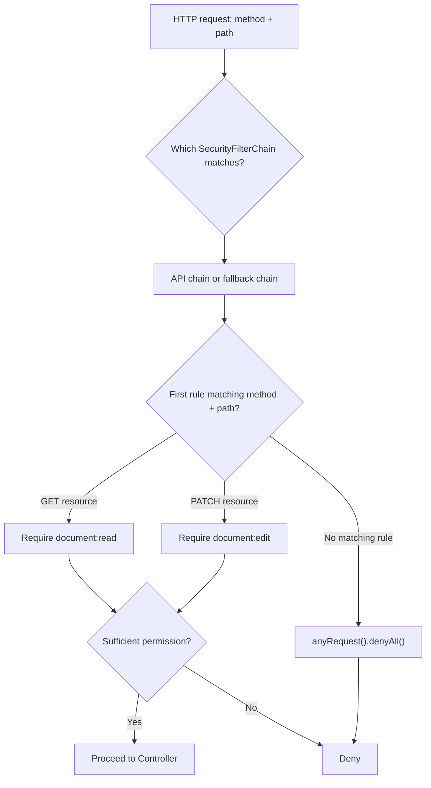

# Matching Both Path and HTTP Method in Spring Security

## Learning Objectives

This lesson helps you understand `RequestMatcher` on the Servlet stack, distinguish **selecting a request** from **making an access decision**, build rules with **both HTTP method and path**, avoid accidentally opening PATCH/DELETE after permitting GET, and thoroughly test HTTP methods that do not have an explicit policy. You will learn when to use `requestMatchers(HttpMethod.GET, "/api/...")`, how matcher ordering affects the outcome, the role of `anyRequest().denyAll()`, the difference between `securityMatcher` and `requestMatchers`, as well as key considerations regarding CORS preflight, CSRF, servlet paths, and object-level permissions.

Scope: Spring Security **Servlet/Spring MVC** with `SecurityFilterChain` and `authorizeHttpRequests`. The Spring snippets are **framework-dependent integration code**; the standalone Java 17 section provides `javac` and `java` commands to directly demonstrate the logic without other libraries.

## 1. Why Does the Same URL Need Multiple Rules?

A REST resource can support multiple HTTP methods, and each method represents an operation:

| Request | Assumed business action | Required authority |
| --- | --- | --- |
| `GET /api/documents` | View list | `document:list` |
| `POST /api/documents` | Create document | `document:create` |
| `GET /api/documents/42` | Read document 42 | `document:read` |
| `PATCH /api/documents/42` | Partial update | `document:edit` |
| `PUT /api/documents/42` | Replace content | `document:edit` |
| `DELETE /api/documents/42` | Delete document | `document:delete` |

If you only write:

```java
.requestMatchers("/api/documents/**").authenticated()
```

then the rule sets no HTTP method condition. Any method whose path matches the pattern can pass the **HTTP authorization layer** simply by being authenticated. The controller, CSRF, or service may still block it later, but the security rule fails to express different permissions per action.

What needs to be expressed is a logical **AND**:

```text
Match(request) =
    (request.method = SPECIFIED_HTTP_METHOD)
    AND (request.path matches PATH_PATTERN)

Authorize(request) =
    Match(request)
    AND user satisfies AUTHORITY/POLICY of that rule
```

The first group decides **which rule the request selects**; the second group decides **whether the rule allows it or not**. Never mistake `RequestMatcher.matches` for a function that automatically verifies roles/permissions.

## 2. RequestMatcher and requestMatchers(HttpMethod, path)

`RequestMatcher` is a Spring Security interface used to match an `HttpServletRequest` against a condition. When you write:

```java
.requestMatchers(HttpMethod.GET, "/api/documents/**")
    .hasAuthority("document:read")
```

Spring Security creates/registers a matcher for the corresponding **GET method and path**, then attaches a policy requiring the `document:read` authority. For `GET /api/documents/42`, the GET/path matcher can match; for `PATCH /api/documents/42`, the method condition **does not match**, so Spring continues evaluating subsequent rules.

Syntax table:

| Syntax | Request selection condition |
| --- | --- |
| `requestMatchers("/api/documents/**")` | Path matches, **no method restriction** |
| `requestMatchers(HttpMethod.GET, "/api/documents/**")` | Path matches **and** HTTP method is GET |
| `requestMatchers(HttpMethod.POST, "/api/documents")` | Collection path matches **and** POST |
| `requestMatchers(HttpMethod.PATCH, "/api/documents/**")` | Resource path matches **and** PATCH |
| `requestMatchers(HttpMethod.GET, "/api/documents", "/api/documents/**")` | GET **and** one of the two listed paths |
| `requestMatchers(customMatcher)` | According to the logic of the `RequestMatcher` object supplied by the application |

In the multi-path line, the main condition is:

```text
method == GET
AND (pathMatches("/api/documents")
     OR pathMatches("/api/documents/**"))
```

Multiple paths in a single call are **OR between paths**; combining paths with a method is **AND**. Each path is still evaluated by the matcher implementation appropriate to the environment, not necessarily a literal `equals` string comparison.

## 3. Configuring a SecurityFilterChain for Different Actions

The following example has basic imports for Java/Spring Security 6.x. It does not create a user store, controller, database, or tokens; the application must supply an appropriate authentication mechanism.

```java
import org.springframework.context.annotation.Bean;
import org.springframework.context.annotation.Configuration;
import org.springframework.http.HttpMethod;
import org.springframework.security.config.Customizer;
import org.springframework.security.config.annotation.web.builders.HttpSecurity;
import org.springframework.security.web.SecurityFilterChain;

@Configuration
public class SecurityConfig {

    @Bean
    SecurityFilterChain securityFilterChain(HttpSecurity http)
            throws Exception {
        http
            .authorizeHttpRequests(auth -> auth
                // Health endpoint is public only for GET.
                .requestMatchers(HttpMethod.GET, "/health")
                    .permitAll()

                // Collection: list and create have separate permissions.
                .requestMatchers(HttpMethod.GET, "/api/documents")
                    .hasAuthority("document:list")
                .requestMatchers(HttpMethod.POST, "/api/documents")
                    .hasAuthority("document:create")

                // Resource: each method has its own permission.
                .requestMatchers(HttpMethod.GET, "/api/documents/**")
                    .hasAuthority("document:read")
                .requestMatchers(HttpMethod.PATCH, "/api/documents/**")
                    .hasAuthority("document:edit")
                .requestMatchers(HttpMethod.PUT, "/api/documents/**")
                    .hasAuthority("document:edit")
                .requestMatchers(HttpMethod.DELETE, "/api/documents/**")
                    .hasAuthority("document:delete")

                // Undeclared methods/paths are not opened automatically.
                .anyRequest()
                    .denyAll()
            )
            .httpBasic(Customizer.withDefaults());
        return http.build();
    }
}
```

**Explanation:**

1. `HttpMethod.GET`, `POST`, `PATCH`, `PUT`, and `DELETE` are the method part of the matcher; Spring does not infer the method from the authority name.
2. The path `/api/documents` is the collection, `/api/documents/**` is for resources. The example states both explicitly because pattern semantics for collections and trailing slashes also depend on matcher type and configuration.
3. `hasAuthority("document:edit")` checks for the exact string granted in `GrantedAuthority`. `ROLE_EDITOR` or `ROLE_ADMIN` **does not automatically** include `document:edit` unless explicitly granted/mapped.
4. `anyRequest().denyAll()` is the closing policy: undeclared URLs or methods are denied at the HTTP layer.
5. `httpBasic` only illustrates authentication. Systems using form login, sessions, or OAuth2 Bearer must replace it with the right configuration; each mechanism leads to its corresponding 401/403/redirect behavior.
6. `authorizeHttpRequests` protects requests passing through this chain; record-level owner/tenant authorization remains an additional responsibility of the service/repository.

### Decision Table per Request

Suppose the user is fully authenticated but only has the `document:read` authority:

| Request | First matching rule | Outcome |
| --- | --- | --- |
| `GET /api/documents/42` | GET resource → requires `document:read` | **ALLOW** |
| `PATCH /api/documents/42` | PATCH resource → requires `document:edit` | **DENY** |
| `PUT /api/documents/42` | PUT resource → requires `document:edit` | **DENY** |
| `DELETE /api/documents/42` | DELETE resource → requires `document:delete` | **DENY** |
| `GET /api/documents` | GET collection → requires `document:list` | **DENY** |
| `POST /api/documents` | POST collection → requires `document:create` | **DENY** |
| `GET /health` | GET health → `permitAll` | **ALLOW** |
| `POST /health` | `anyRequest().denyAll()` | **DENY** |
| `GET /admin` | `anyRequest().denyAll()` | **DENY** |

**ALLOW** only means passing the chain's **HTTP authorization rule**, not guaranteeing a 200. The controller might not exist, the method might not be supported, or the service might enforce an object-level policy. **DENY** is an authorization decision, and the final HTTP status is not always 403: anonymous requests typically hit a 401/redirect entry point.

## 4. First Match: Why Does Rule Order Matter?

Spring Security uses the **first rule whose matcher matches** in `authorizeHttpRequests`. Once a matcher matches, if the policy returns DENY, the framework **does not try subsequent rules** to look for an alternative permission.

Example of a **wrong** configuration:

```java
.authorizeHttpRequests(auth -> auth
    // Too broad: path matches every method.
    .requestMatchers("/api/documents/**")
        .hasAuthority("document:read")
    .requestMatchers(HttpMethod.DELETE, "/api/documents/**")
        .hasAuthority("document:delete")
    .anyRequest().denyAll()
)
```

A `DELETE /api/documents/42` request will match the earlier path-only rule, so the HTTP layer will **check read permission** and never reach the later DELETE rule. Someone with only `document:read` can pass the HTTP authorization layer for DELETE: a serious authorization bug.

The **correct approach** is to specify the corresponding methods and avoid placing overly broad path-only matchers before them:

```java
.authorizeHttpRequests(auth -> auth
    .requestMatchers(HttpMethod.GET, "/api/documents/**")
        .hasAuthority("document:read")
    .requestMatchers(HttpMethod.DELETE, "/api/documents/**")
        .hasAuthority("document:delete")
    .anyRequest().denyAll()
)
```

If an endpoint has a specific rule and a general rule with the same method/path, place the **specific rule first**. Spring does not automatically choose a "more specific" pattern when an earlier pattern has already matched.

### Do Not Use Duplicate Matchers to Create an OR

```java
// WRONG if you want report:read OR report:export.
.requestMatchers(HttpMethod.GET, "/api/reports/**")
    .hasAuthority("report:read")
.requestMatchers(HttpMethod.GET, "/api/reports/**")
    .hasAuthority("report:export")
```

If a GET request matches both, the second rule is never evaluated. Write instead:

```java
.requestMatchers(HttpMethod.GET, "/api/reports/**")
    .hasAnyAuthority("report:read", "report:export")
```

This is different from the method+path problem: **one of several authorities** is an OR at the permission layer, while "method and path" is an AND at the request selection layer.

## 5. Multiple Paths or Multiple Methods Sharing the Same Policy

### 5.1. One Method, Multiple Paths

If the API allows reading both the collection and resource with the same authority:

```java
.requestMatchers(
    HttpMethod.GET, "/api/documents", "/api/documents/**"
).hasAuthority("document:read")
```

The condition is **GET AND (path A OR path B)**. Share a rule only when the two endpoints **truly share the same policy**; if listing is more sensitive than reading a single record, separate the rules.

### 5.2. Two Methods Sharing the Same Permission

If both `PUT` and `PATCH` are opened by `document:edit`:

```java
.requestMatchers(HttpMethod.PUT, "/api/documents/**")
    .hasAuthority("document:edit")
.requestMatchers(HttpMethod.PATCH, "/api/documents/**")
    .hasAuthority("document:edit")
```

Repeating two method-specific rules is clearer than one path-only rule, because a path-only rule could accidentally open GET/DELETE. The order between these two rules does not matter for the same path since the methods differ, but grouping by resource is still good practice for review.

### 5.3. Unspecified Methods

`HEAD`, `OPTIONS`, `TRACE`, or HTTP extension methods are distinct method values. Do not assume `HEAD` is automatically allowed just because Spring MVC can handle HEAD via a GET handler. In a security matcher `HttpMethod.GET`, the request's actual method is still a condition to be checked. If you want HEAD to fetch header metadata, define and declare an explicit `HttpMethod.HEAD` rule and test header and data policies.

For endpoints that do not support DELETE/PUT, use `anyRequest().denyAll()` to block early instead of relying solely on MVC returning `405 Method Not Allowed`.

## 6. RequestMatcher Differs from RequestMapping on Controllers

In Spring MVC, `@GetMapping` and `@PostMapping` select a controller method. In Spring Security, `RequestMatcher` selects an **authorization rule**.

```java
@GetMapping("/api/documents/{id}")
public DocumentDto getDocument(@PathVariable long id) {
    return documentService.read(id);
}

@DeleteMapping("/api/documents/{id}")
public void deleteDocument(@PathVariable long id) {
    documentService.delete(id);
}
```

This is an illustrative controller snippet, not a standalone file: `DocumentDto`, `documentService`, and imports must be defined. The existence of `@DeleteMapping` **does not automatically generate** a `hasAuthority("document:delete")` rule. Conversely, a permissive security rule does not guarantee a controller endpoint exists; when there is no handler, the request may pass security and then return 404/405.

### When Method and Path Diverge Between MVC and Security

Several factors complicate matching: a non-root servlet path, context path, trailing slashes, URL encoding, `;` matrix parameters, multiple servlets, reverse proxies, and the `RequestMatcher` type the framework selects based on dependencies. Therefore:

- Do not build a matcher with `request.getRequestURI().startsWith("/api/docs")`: it also matches `/api/docs-archive` without segment checks.
- Prefer `requestMatchers(HttpMethod, String...)` with verified paths.
- For applications with multiple servlets, custom servlet paths, or complex URL patterns, use the matcher/builder appropriate to your framework version and test the real path.
- Never rely on manual URL matching to verify permissions on data objects.

## 7. Two Levels of RequestMatcher: Selecting a Chain vs Selecting an Authorization Rule

`http.securityMatcher(...)` selects the **scope of an entire `SecurityFilterChain`**. `requestMatchers(...)` inside `authorizeHttpRequests` selects the **authorization rule inside the chosen chain**.



When there are multiple chains, `FilterChainProxy` only uses the **first matching chain** in priority order. Subsequent chains are not tried if the first chain already selected the request and its internal authorization rule denied it.

Example:

```java
http
    .securityMatcher("/api/**")
    .authorizeHttpRequests(auth -> auth
        .requestMatchers(HttpMethod.GET, "/api/public/**")
            .permitAll()
        .requestMatchers(HttpMethod.POST, "/api/documents")
            .hasAuthority("document:create")
        .anyRequest().denyAll()
    );
```

Here `anyRequest` only catches remaining requests **within the `/api/**` scope**. It does not automatically protect `/admin` or `/internal` outside the chain's matcher. If **no other chain** matches, those URLs could bypass Spring Security. In a multi-chain system, have an appropriate fallback chain or ensure an equivalent mechanism protects the remaining paths.

### Multi-Chain Example with Fallback

```java
import org.springframework.context.annotation.Bean;
import org.springframework.context.annotation.Configuration;
import org.springframework.core.annotation.Order;
import org.springframework.http.HttpMethod;
import org.springframework.security.config.Customizer;
import org.springframework.security.config.annotation.web.builders.HttpSecurity;
import org.springframework.security.web.SecurityFilterChain;

@Configuration
public class MultipleChainsConfig {

    @Bean
    @Order(1)
    SecurityFilterChain api(HttpSecurity http) throws Exception {
        http
            .securityMatcher("/api/**")
            .authorizeHttpRequests(auth -> auth
                .requestMatchers(HttpMethod.GET, "/api/status")
                    .permitAll()
                .requestMatchers(HttpMethod.GET, "/api/documents/**")
                    .hasAuthority("document:read")
                .requestMatchers(HttpMethod.POST, "/api/documents")
                    .hasAuthority("document:create")
                .anyRequest().denyAll()
            )
            .httpBasic(Customizer.withDefaults());
        return http.build();
    }

    @Bean
    @Order(2)
    SecurityFilterChain fallback(HttpSecurity http) throws Exception {
        http
            .authorizeHttpRequests(auth -> auth
                .requestMatchers(HttpMethod.GET, "/health").permitAll()
                .anyRequest().denyAll()
            )
            .httpBasic(Customizer.withDefaults());
        return http.build();
    }
}
```

In this example, `GET /api/documents/42` enters the API chain; `DELETE /api/documents/42` also enters the API chain but hits `denyAll`; `GET /health` enters the fallback chain. **There is no permission accumulation** between the two chains. The example does not create users/controllers and is not a standalone application.

## 8. CORS Preflight: OPTIONS Is Not POST

When a cross-origin browser frontend wants to send a JSON POST, it may send a preflight request:

```http
OPTIONS /api/documents
Origin: https://client.example
Access-Control-Request-Method: POST
Access-Control-Request-Headers: Content-Type, Authorization
```

The actual method of the preflight request is **OPTIONS**, even though the `Access-Control-Request-Method` header specifies POST. Therefore:

```java
.requestMatchers(HttpMethod.POST, "/api/documents")
    .hasAuthority("document:create")
```

**does not match** OPTIONS. This is expected, not a `RequestMatcher` bug.

CORS must be handled **before normal authentication mechanisms block the preflight**, because preflight requests typically lack session cookies. Spring Security supports `.cors(Customizer.withDefaults())` integration when the application declares a `CorsConfigurationSource` or appropriate Spring MVC CORS configuration:

```java
http
    .cors(Customizer.withDefaults())
    .authorizeHttpRequests(auth -> auth
        .requestMatchers(HttpMethod.POST, "/api/documents")
            .hasAuthority("document:create")
        .anyRequest().denyAll()
    );
```

**This is a configuration snippet**, not a complete CORS policy: the application must still restrict allowed origins, allowed methods/headers, and credentials. Do not blindly `permitAll` all `OPTIONS /**` for every origin without understanding the consequences. Allowing a CORS preflight **does not grant permission** for the actual POST; the subsequent POST still requires authentication, authorization, and CSRF where applicable.

### CSRF Can Also Cause 403 Before Authorization

For state-changing requests with CSRF protection enabled, `POST`/`PATCH`/`DELETE` missing a CSRF token can be blocked by `CsrfFilter` **before method+path authorization runs**. When testing a PATCH rule, supply a valid CSRF token in MockMvc via `.with(csrf())` if the app requires it; otherwise, a 403 does not prove `document:edit` was checked.

## 9. HTTP Authorization Does Not Replace Object-Level Permissions

`GET /api/documents/42` matching the GET/path rule with `document:read` only proves **permission to access the read feature**. You must still verify whether the user is allowed to view **document 42**:

- Which tenant does the document belong to?
- Is the requester the owner or shared with?
- Does the document's state allow reading/editing?
- Are there classification, time, or environment constraints?

Therefore, in addition to `RequestMatcher` and `hasAuthority` at the HTTP layer, check at the service/repository layer using an appropriate policy. You can use `@PreAuthorize` on a Spring-managed service:

```java
// Integration snippet; documentPolicy and repository are separate domain beans.
@PreAuthorize(
    "hasAuthority('document:read') and " +
    "@documentPolicy.canRead(authentication, #id)"
)
public Document read(@P("id") long id) {
    return repository.findById(id).orElseThrow();
}
```

`@EnableMethodSecurity` must be enabled; `@P` is from `org.springframework.security.access.method.P`. `documentPolicy` must fetch tenant/owner from the server and identity from verified authentication, not from a client-supplied `ownerId`. For write operations, besides checking before side effects, consider conditional updates/locking to prevent permissions from changing between check and write.

## 10. Standalone Java 17: Demonstrating Method AND Path

The following example only simulates **first-match rule selection** and **per-method permissions**, without Spring. It uses `Set<String>` to represent GrantedAuthorities, and `Predicate` for matchers and policies. It does not replace Spring Security's normalized URL/path matching; never copy this simple `startsWith` into production security.

Save with the exact filename **`MethodPathMatchDemo.java`**:

```java
import java.util.List;
import java.util.Set;
import java.util.function.Predicate;

public class MethodPathMatchDemo {

    record Request(String method, String path, Set<String> authorities) {}

    record Rule(
        String name,
        Predicate<Request> matcher,
        Predicate<Request> permission
    ) {}

    static String decide(Request request, List<Rule> rules) {
        for (Rule rule : rules) {
            if (rule.matcher().test(request)) {
                return rule.name() + " -> "
                    + (rule.permission().test(request) ? "ALLOW" : "DENY");
            }
        }
        return "NO_RULE -> DENY";
    }

    public static void main(String[] args) {
        List<Rule> rules = List.of(
            new Rule(
                "GET document",
                r -> r.method().equals("GET")
                    && r.path().startsWith("/api/documents/"),
                r -> r.authorities().contains("document:read")
            ),
            new Rule(
                "PATCH document",
                r -> r.method().equals("PATCH")
                    && r.path().startsWith("/api/documents/"),
                r -> r.authorities().contains("document:edit")
            ),
            new Rule(
                "DELETE document",
                r -> r.method().equals("DELETE")
                    && r.path().startsWith("/api/documents/"),
                r -> r.authorities().contains("document:delete")
            ),
            new Rule(
                "POST collection",
                r -> r.method().equals("POST")
                    && r.path().equals("/api/documents"),
                r -> r.authorities().contains("document:create")
            ),
            new Rule("anyRequest", r -> true, r -> false)
        );

        System.out.println(decide(
            new Request("GET", "/api/documents/42",
                Set.of("document:read")), rules));
        System.out.println(decide(
            new Request("PATCH", "/api/documents/42",
                Set.of("document:read")), rules));
        System.out.println(decide(
            new Request("PATCH", "/api/documents/42",
                Set.of("document:edit")), rules));
        System.out.println(decide(
            new Request("DELETE", "/api/documents/42",
                Set.of("document:read")), rules));
        System.out.println(decide(
            new Request("POST", "/api/documents",
                Set.of("document:create")), rules));
        System.out.println(decide(
            new Request("PUT", "/api/documents/42",
                Set.of("document:read", "document:edit")), rules));
    }
}
```

Compile and run on JDK 17+:

```bash
javac MethodPathMatchDemo.java
java MethodPathMatchDemo
```

**Exact stdout:**

```text
GET document -> ALLOW
PATCH document -> DENY
PATCH document -> ALLOW
DELETE document -> DENY
POST collection -> ALLOW
anyRequest -> DENY
```

The output shows `PATCH` selects the PATCH rule and cannot use GET's `document:read`. `PUT` has no declared rule so `anyRequest` denies it even with edit permission. This simulator **knows nothing about Spring MVC routes, servlet paths, CSRF, or CORS**; its purpose is to clarify method+path+policy along with first-match.

## 11. Testing with MockMvc and spring-security-test

A proper test must prove both **same path, different method** and **same method, different path**. Do not just test that GET succeeds and assume PATCH/DELETE are protected.

| Scenario | Expected HTTP layer result |
| --- | --- |
| `GET /api/documents/42`, with `document:read` | Passes GET rule |
| `GET /api/documents/42`, only `document:edit` | DENY |
| `PATCH /api/documents/42`, with `document:edit` | Passes PATCH rule |
| `PATCH /api/documents/42`, only `document:read` | DENY |
| `DELETE /api/documents/42`, only `document:read` | DENY |
| `DELETE /api/documents/42`, with `document:delete` | Passes DELETE rule |
| `GET /api/documents`, only `document:read` | DENY because collection needs `document:list` |
| `POST /api/documents`, with `document:create` | Passes POST rule |
| `POST /api/documents`, only `document:read` | DENY |
| `PUT /api/documents/42`, with `document:edit` | Passes PUT rule if declared; otherwise fallback DENY |
| `HEAD /api/documents/42` if not opened | Does not automatically inherit GET |
| `POST /health`, authenticated | DENY because only GET is opened |
| `GET /api/new`, with `ROLE_ADMIN` but no rule | DENY via `anyRequest` |
| `OPTIONS /api/documents` preflight | Handled separately by CORS, not treated as POST |

### Test Snippet for Denied Cases

The following example requires `spring-security-test`, JUnit 5, and Spring Boot test. This is an integration test snippet, not standalone Java. It uses the configuration from Section 3 and a `MockMvc` configured with Spring Security:

```java
import org.junit.jupiter.api.Test;
import org.springframework.beans.factory.annotation.Autowired;
import org.springframework.boot.test.autoconfigure.web.servlet.AutoConfigureMockMvc;
import org.springframework.boot.test.context.SpringBootTest;
import org.springframework.test.web.servlet.MockMvc;
import org.springframework.security.core.authority.SimpleGrantedAuthority;

import static org.springframework.security.test.web.servlet.request
    .SecurityMockMvcRequestPostProcessors.user;
import static org.springframework.security.test.web.servlet.request
    .SecurityMockMvcRequestPostProcessors.csrf;
import static org.springframework.test.web.servlet.request
    .MockMvcRequestBuilders.*;
import static org.springframework.test.web.servlet.result
    .MockMvcResultMatchers.status;

@SpringBootTest
@AutoConfigureMockMvc
class MethodPathAuthorizationTest {
    @Autowired MockMvc mvc;

    @Test
    void readerCannotPatch() throws Exception {
        mvc.perform(patch("/api/documents/42")
                .with(user("alice").authorities(
                    new SimpleGrantedAuthority("document:read")))
                .with(csrf()))
            .andExpect(status().isForbidden());
    }

    @Test
    void readerCannotDelete() throws Exception {
        mvc.perform(delete("/api/documents/42")
                .with(user("alice").authorities(
                    new SimpleGrantedAuthority("document:read")))
                .with(csrf()))
            .andExpect(status().isForbidden());
    }

    @Test
    void readerCannotListWithoutListPermission() throws Exception {
        mvc.perform(get("/api/documents")
                .with(user("alice").authorities(
                    new SimpleGrantedAuthority("document:read"))))
            .andExpect(status().isForbidden());
    }

    @Test
    void unknownRouteDeniedEvenForAdmin() throws Exception {
        mvc.perform(get("/api/unknown")
                .with(user("admin").roles("ADMIN")))
            .andExpect(status().isForbidden());
    }
}
```

`.with(csrf())` prevents PATCH/DELETE tests from failing merely due to a missing CSRF token; only then do you verify the right permissions. If using stateless OAuth2 or a different CSRF setup, apply appropriate test logic. Cases that **pass the HTTP rule** do not guarantee a 200 if no controller exists or the service denies it; when testing ALLOW, prepare the controller/data or assert the decision at the appropriate layer.

### When 401, 403, 404, 405 Appear

- **401:** typically anonymous/invalid credentials with Basic/Bearer entry points.
- **403:** usually an authenticated user lacking authority; can also be CSRF or object-level permissions.
- **404:** no controller/resource, or the API deliberately hides the existence of unauthorized resources.
- **405:** MVC knows the path but has no handler for the method; however, Spring Security may deny earlier, so 405 is not guaranteed.

Never judge a matcher's correctness solely by a status code without identifying which layer caused it.

## 12. Common Mistakes

1. **Using path-only rules for all methods:** read permission can open PATCH/DELETE. Use `HttpMethod` in rules.
2. **Placing broad matchers before narrow matchers:** first-match shadows subsequent method-specific rules.
3. **Assuming a DENIED rule falls through to the next rule:** Spring uses the first matching rule; it does not retry to find an ALLOW.
4. **Using duplicate matchers to express an OR of permissions:** use `hasAnyAuthority` in a single rule when policy allows.
5. **Not distinguishing collection and resource:** `/api/documents` and `/api/documents/42` may need different permissions and differ in pattern matching.
6. **Assuming GET always covers HEAD in Security:** the request method is independent data; declare HEAD if needed.
7. **Opening OPTIONS indiscriminately:** handle CORS preflight with reviewed origin/method/header policies.
8. **Seeing 403 on PATCH and granting more permissions:** check CSRF first; 403 does not automatically mean the matcher is wrong.
9. **Writing path matchers with `startsWith`:** can accidentally match similar paths and ignores URL normalization.
10. **Confusing `securityMatcher` with `requestMatchers`:** one selects the filter chain, the other selects authorization rules inside it.
11. **Testing only GET:** add tests for PATCH/PUT/DELETE, other paths, and unsupported methods.
12. **Omitting fallback `denyAll`:** new endpoints/methods can get unintended permissions if rules are too broad.
13. **Treating HTTP authority as full data permission:** you still need owner, tenant, ACL, and resource state checks.
14. **Testing only status without checking side effects:** denied operations must not produce DB updates.
15. **Not checking security chains for out-of-scope URLs:** requests may bypass filter chains completely when no chain matches.

## 13. Implementation Checklist

1. List **HTTP method + path + business action + authority** for every endpoint.
2. Use `requestMatchers(HttpMethod, path)` instead of path-only when permissions differ by method.
3. Declare separate rules for collection and resource if permissions or semantics differ; test the actual matcher.
4. Place specific rules before broad rules, and use `anyRequest().denyAll()` as the default-deny choice.
5. Distinguish `securityMatcher` of `SecurityFilterChain` from `requestMatchers` in `authorizeHttpRequests`; protect URLs outside specialized chains too.
6. Check GET, HEAD, OPTIONS, POST, PUT, PATCH, DELETE as needed; do not assume inherited permissions across methods.
7. Integrate CORS preflight properly; configure CSRF according to your cookie/token mechanism and supply tokens in tests.
8. Protect records in services/queries using owner/tenant/ACL, not just URL blocking.
9. Write ALLOW/DENY tests for same path/different method, different path/same method, fallback, anonymous, and full integration; verify denials cause no side effects.

### Self-Check

**Question 1.** Alice only has `document:read`. `GET /api/documents/42` and `DELETE /api/documents/42` share the same path. If the GET rule requires `document:read` and DELETE requires `document:delete`, can Alice DELETE?

**Answer:** **No.** The DELETE matcher selects a separate policy, and she lacks delete permission.

**Question 2.** If `requestMatchers("/api/documents/**").hasAuthority("document:read")` is placed before the DELETE rule, what happens?

**Answer:** The path-only rule can match DELETE first, causing the HTTP layer to check read permission instead of delete permission. This is a bug caused by an overly broad matcher and first-match semantics.

**Question 3.** A browser sends `OPTIONS /api/documents` with `Access-Control-Request-Method: POST`; does the rule `requestMatchers(HttpMethod.POST, "/api/documents")` match?

**Answer:** **No.** The actual method is still OPTIONS. CORS preflight must have its own corresponding configuration.

**Question 4.** A chain is scoped by `securityMatcher("/api/**")`. Does `anyRequest().denyAll()` in that chain necessarily protect `/admin`?

**Answer:** **No.** `/admin` lies outside the chain; a fallback chain or another protective mechanism is required.

## References

- Spring Security, *Authorize HttpServletRequests*: https://docs.spring.io/spring-security/reference/servlet/authorization/authorize-http-requests.html
- Spring Security, *Java Configuration: securityMatcher vs requestMatchers*: https://docs.spring.io/spring-security/reference/servlet/configuration/java.html
- Spring Security, *Servlet CORS integration*: https://docs.spring.io/spring-security/reference/servlet/integrations/cors.html
- Spring Security, *Servlet CSRF*: https://docs.spring.io/spring-security/reference/servlet/exploits/csrf.html
- Spring Security, *Servlet Testing*: https://docs.spring.io/spring-security/reference/servlet/test/index.html
