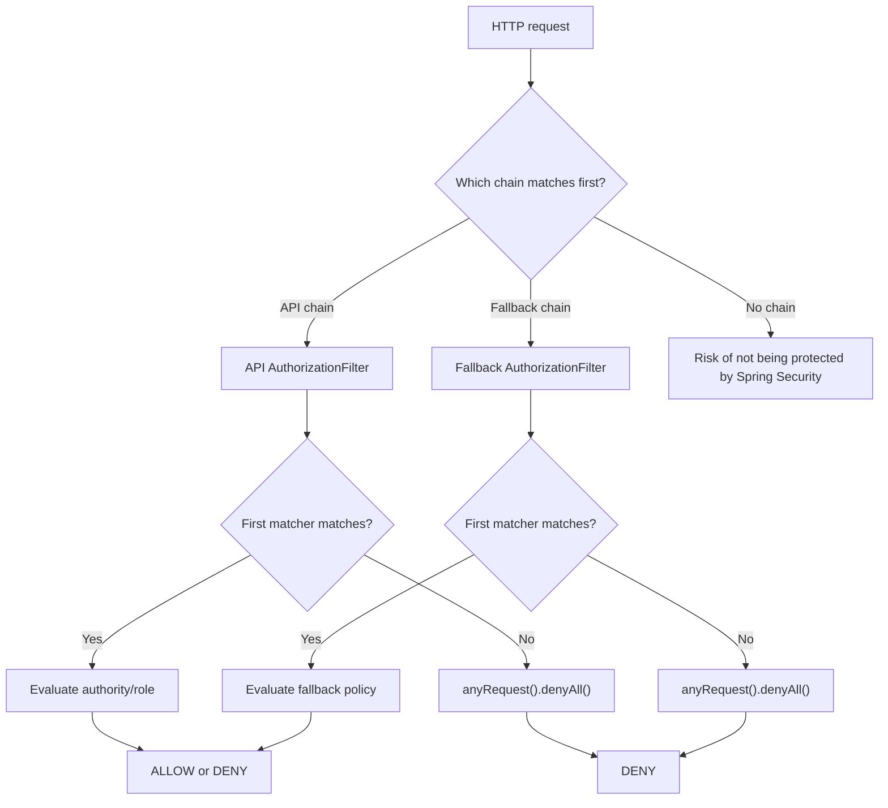

# Testing RequestMatcher When Changing Routes or Upgrading Spring Security

## Lesson Objectives

A change to a route, HTTP method, servlet path, or Spring Security version can cause a **previously protected** URL to be evaluated by a different matcher. The most dangerous bug is not merely a valid request being rejected, but a request that **must be denied becoming allowed** when a matcher is too broad, selects the wrong `SecurityFilterChain`, or path rules shift.

This lesson explains how to establish a **RequestMatcher test contract**, test allowed and denied requests via `MockMvc`, evaluate matchers in isolation, guard against regressions when changing routes or upgrading from Spring Security 6.x to 7.x, and organize regression tests in CI.

Context: **Spring Security authorization on the Servlet stack**, using `SecurityFilterChain`, `authorizeHttpRequests`, `AuthorizationFilter`, `RequestMatcher`, and `spring-security-test`. Spring code snippets are **integration code requiring framework dependencies**; the standalone Java 17 example in Section 12 runs with `javac`/`java` without Spring.

## 1. Why Regression Tests for Matchers Are Mandatory

Suppose a system has this contract:

```text
GET   /health                 → public
GET   /api/reports            → report:list
GET   /api/reports/{id}       → report:read
POST  /api/reports            → report:create
PATCH /api/reports/{id}       → report:edit
all remaining requests        → denyAll
```

Changes that seemingly do not touch permissions can still introduce regressions:

| Change | Security risk |
| --- | --- |
| Renaming `/api/reports/{id}` to `/api/v2/reports/{id}` | Old matcher misses the new route; it may be denied or accidentally fall into a broad rule |
| Moving `requestMatchers("/api/**").authenticated()` above specific permission rules | Authenticated users can pass the broad rule instead of checking `report:edit` |
| Adding `DELETE` on a URL that already has GET | A path-only matcher can permit DELETE using GET permission |
| Replacing `AntPathRequestMatcher`/`MvcRequestMatcher` with `PathPatternRequestMatcher` | Pattern syntax, servlet paths, and match semantics may change |
| Using a new context path `/app` | Matchers built with the wrong path to check |
| Adding a servlet prefix `/mvc` | In-application URL differs from the path the matcher was configured for |
| Changing reverse-proxy rewrites/URL encoding | Security and controllers may see different path forms |
| Adding a higher-priority filter chain | A URL may route into another chain or fall outside all chains |

A single test "GET document 42 returns 200" cannot control these risks. You must test both **allowed requests and blocked requests**, including lookalike paths and undeclared methods.

## 2. Two Matching Layers to Observe

`FilterChainProxy` first uses `securityMatcher` to select the **first matching `SecurityFilterChain`** in order. Inside the chosen chain, `AuthorizationFilter` uses the `requestMatchers` declared in `authorizeHttpRequests` and applies the **first matching authorization rule**.



Notes:

- `RequestMatcher.matches(request)` only answers **whether the request matches the condition**. It does not evaluate roles/authorities by itself.
- If a rule **matches** and the authorization outcome is DENY, Spring **does not try later rules** to look for ALLOW.
- `anyRequest().denyAll()` inside one chain **does not protect URLs outside that chain's `securityMatcher`**.
- Passing HTTP authorization can still be blocked by CSRF, method security, owner/tenant policies, or controllers.

### Correct Code and Common Bug

```java
// RIGHT: specific method and path first; fallback deny.
http.authorizeHttpRequests(auth -> auth
    .requestMatchers(HttpMethod.GET, "/api/reports/{id}")
        .hasAuthority("report:read")
    .requestMatchers(HttpMethod.PATCH, "/api/reports/{id}")
        .hasAuthority("report:edit")
    .anyRequest().denyAll()
);
```

```java
// WRONG: path-only matcher placed before PATCH rule.
http.authorizeHttpRequests(auth -> auth
    .requestMatchers("/api/reports/**")
        .hasAuthority("report:read")
    .requestMatchers(HttpMethod.PATCH, "/api/reports/{id}")
        .hasAuthority("report:edit")
    .anyRequest().denyAll()
);
```

In the wrong configuration, `PATCH /api/reports/42` matches the first path-only rule. A user with only `report:read` can pass the **HTTP authorization layer** instead of needing `report:edit`. Matcher tests must catch this case.

## 3. Lock Down the Test Contract Before Changing Code

Each row in the test suite needs: HTTP method, URL, authorities, authentication state, **expected permission decision**, and special servlet/context path conditions if any. Example:

| ID | Request | Authorities | Desired HTTP decision |
| --- | --- | --- | --- |
| A01 | `GET /health` | None | ALLOW, public |
| A02 | `GET /api/reports` | `report:list` | ALLOW |
| D03 | `GET /api/reports` | Only `report:read` | DENY |
| A04 | `GET /api/reports/42` | `report:read` | ALLOW |
| D05 | `GET /api/reports/42` | Only `report:list` | DENY |
| A06 | `POST /api/reports` | `report:create` | ALLOW when CSRF is satisfied if applicable |
| D07 | `POST /api/reports` | Only `report:read` | DENY |
| A08 | `PATCH /api/reports/42` | `report:edit` | ALLOW when CSRF is satisfied |
| D09 | `PATCH /api/reports/42` | Only `report:read` | DENY |
| D10 | `DELETE /api/reports/42` | `ROLE_ADMIN` but no DELETE rule | DENY by fallback |
| D11 | `GET /api/reports/42/export` | `report:read` | DENY: sensitive extra segment |
| D12 | `GET /api/reports-old/42` | `report:read` | DENY: lookalike path |
| D13 | `GET /api/new-feature` | `ROLE_ADMIN` | DENY if not whitelisted |
| D14 | `POST /health` | Authenticated | DENY |
| D15 | `GET /api/reports/42` | Anonymous | Fails authority requirement |
| V16 | `GET /app/api/reports/42`, context root `/app` | `report:read` | ALLOW after stripping context root properly |
| V17 | `GET /api/reports/42/` | `report:read` | Lock down per application's slash policy |
| V18 | `HEAD /api/reports/42` | `report:read` | Do not automatically infer from GET permission |
| V19 | `OPTIONS /api/reports` preflight | No cookie | Check against dedicated CORS policy |

Group A must be allowed; Group D must be denied; Group V needs **explicit decisions per product contract** before upgrading versions. Never let a new framework implicitly decide whether trailing slashes or uppercase letters are permitted.

**Do not equate an ALLOW decision with HTTP 200:** a missing controller returns 404, and an unsupported method returns 405. Conversely, HTTP 403 can come from CSRF rather than the matcher. Tests should combine responses, controller outputs, and proof the service is not invoked on DENY.

## 4. Spring Security Configuration Used as Test Fixture

This is a Spring Boot 3.x / Spring Security 6.x style Java configuration, using a DSL familiar in newer releases as well. The example requires `spring-security-config`, `spring-security-web`, Spring MVC, and an application context; it does not compile standalone with plain JDK.

```java
import org.springframework.context.annotation.Bean;
import org.springframework.context.annotation.Configuration;
import org.springframework.http.HttpMethod;
import org.springframework.security.config.Customizer;
import org.springframework.security.config.annotation.web.builders.HttpSecurity;
import org.springframework.security.web.SecurityFilterChain;

@Configuration
public class SecurityConfig {

    @Bean
    SecurityFilterChain securityFilterChain(HttpSecurity http)
            throws Exception {
        http
            .authorizeHttpRequests(auth -> auth
                .requestMatchers(HttpMethod.GET, "/health")
                    .permitAll()
                .requestMatchers(HttpMethod.GET, "/api/reports")
                    .hasAuthority("report:list")
                .requestMatchers(HttpMethod.GET, "/api/reports/{id}")
                    .hasAuthority("report:read")
                .requestMatchers(HttpMethod.POST, "/api/reports")
                    .hasAuthority("report:create")
                .requestMatchers(HttpMethod.PATCH, "/api/reports/{id}")
                    .hasAuthority("report:edit")
                .anyRequest().denyAll()
            )
            .httpBasic(Customizer.withDefaults());
        return http.build();
    }
}
```

Explanation:

- `requestMatchers(HttpMethod.GET, "/api/reports/{id}")` requires **both GET method and a path matching the pattern**.
- `hasAuthority` checks the exact `GrantedAuthority` string. `ROLE_ADMIN` does not automatically grant `report:edit` unless the application maps it.
- `anyRequest().denyAll()` catches all remaining routes/methods **within this chain**.
- `httpBasic` illustrates an authentication entry point and can produce 401 for anonymous requests. `spring-security-test` can supply a mock authenticated principal without real users/passwords.
- For POST/PATCH/DELETE, CSRF can still apply. Never disable CSRF mechanically just to make tests pass.

### Stub Controller to Distinguish "Passed Security" from "Handler Exists"

```java
import org.springframework.web.bind.annotation.GetMapping;
import org.springframework.web.bind.annotation.PatchMapping;
import org.springframework.web.bind.annotation.PathVariable;
import org.springframework.web.bind.annotation.PostMapping;
import org.springframework.web.bind.annotation.RestController;

@RestController
public class ReportController {

    @GetMapping("/health")
    public String health() {
        return "ok";
    }

    @GetMapping("/api/reports")
    public String list() {
        return "list";
    }

    @GetMapping("/api/reports/{id}")
    public String read(@PathVariable String id) {
        return "report:" + id;
    }

    @PostMapping("/api/reports")
    public String create() {
        return "created";
    }

    @PatchMapping("/api/reports/{id}")
    public String edit(@PathVariable String id) {
        return "edited:" + id;
    }
}
```

This fixture uses no database and simulates no owner/tenant policies. Return strings let tests confirm the request **actually reached the controller** when authorized.

## 5. Integration Testing with MockMvc

To test real authorization, `FilterChainProxy` must be attached to `MockMvc`. In Spring Boot 3.x, `@SpringBootTest` and `@AutoConfigureMockMvc` normally wire the chain. If building manually via `MockMvcBuilders.webAppContextSetup(...)`, call `.apply(springSecurity())` to enable filters and test security context support.

The test example below relies on `SecurityConfig` and `ReportController` above. The `@AutoConfigureMockMvc` import package may change in newer Spring Boot major versions: when upgrading to Boot 4/Spring Security 7, adjust per the matching BOM/test docs rather than copying Boot 3 imports blindly.

```java
import org.junit.jupiter.api.Test;
import org.springframework.beans.factory.annotation.Autowired;
import org.springframework.boot.test.autoconfigure.web.servlet.AutoConfigureMockMvc;
import org.springframework.boot.test.context.SpringBootTest;
import org.springframework.security.core.authority.SimpleGrantedAuthority;
import org.springframework.test.web.servlet.MockMvc;

import static org.springframework.security.test.web.servlet.request
    .SecurityMockMvcRequestPostProcessors.csrf;
import static org.springframework.security.test.web.servlet.request
    .SecurityMockMvcRequestPostProcessors.user;
import static org.springframework.test.web.servlet.request
    .MockMvcRequestBuilders.get;
import static org.springframework.test.web.servlet.request
    .MockMvcRequestBuilders.patch;
import static org.springframework.test.web.servlet.request
    .MockMvcRequestBuilders.post;
import static org.springframework.test.web.servlet.result
    .MockMvcResultMatchers.content;
import static org.springframework.test.web.servlet.result
    .MockMvcResultMatchers.status;

@SpringBootTest
@AutoConfigureMockMvc
class MatcherContractTest {

    @Autowired MockMvc mvc;

    @Test
    void healthIsPublic() throws Exception {
        mvc.perform(get("/health"))
            .andExpect(status().isOk())
            .andExpect(content().string("ok"));
    }

    @Test
    void readerCanReadOneReport() throws Exception {
        mvc.perform(get("/api/reports/42")
                .with(user("alice").authorities(
                    new SimpleGrantedAuthority("report:read"))))
            .andExpect(status().isOk())
            .andExpect(content().string("report:42"));
    }

    @Test
    void listAuthorityDoesNotGrantReadingOneReport() throws Exception {
        mvc.perform(get("/api/reports/42")
                .with(user("bob").authorities(
                    new SimpleGrantedAuthority("report:list"))))
            .andExpect(status().isForbidden());
    }

    @Test
    void readerCannotPatchSamePath() throws Exception {
        mvc.perform(patch("/api/reports/42")
                .with(user("alice").authorities(
                    new SimpleGrantedAuthority("report:read")))
                .with(csrf()))
            .andExpect(status().isForbidden());
    }

    @Test
    void editorCanPatchSamePath() throws Exception {
        mvc.perform(patch("/api/reports/42")
                .with(user("editor").authorities(
                    new SimpleGrantedAuthority("report:edit")))
                .with(csrf()))
            .andExpect(status().isOk())
            .andExpect(content().string("edited:42"));
    }

    @Test
    void creatorCanPostCollection() throws Exception {
        mvc.perform(post("/api/reports")
                .with(user("writer").authorities(
                    new SimpleGrantedAuthority("report:create")))
                .with(csrf()))
            .andExpect(status().isOk())
            .andExpect(content().string("created"));
    }

    @Test
    void unknownExtraSegmentIsDenied() throws Exception {
        mvc.perform(get("/api/reports/42/export")
                .with(user("reader").authorities(
                    new SimpleGrantedAuthority("report:read"))))
            .andExpect(status().isForbidden());
    }

    @Test
    void lookalikePathIsDenied() throws Exception {
        mvc.perform(get("/api/reports-old/42")
                .with(user("reader").authorities(
                    new SimpleGrantedAuthority("report:read"))))
            .andExpect(status().isForbidden());
    }

    @Test
    void unlistedRouteIsDeniedEvenForAdmin() throws Exception {
        mvc.perform(get("/api/new-feature")
                .with(user("admin").roles("ADMIN")))
            .andExpect(status().isForbidden());
    }
}
```

The `PATCH`/`POST` cases include `.with(csrf())` so CSRF failures are not confused with matcher denials. Mock user `.with(user(...))` simulates a verified authentication; it does not test real login, JWT tokens, issuers, or password encoders. If the application has multiple filter chains, tests must load the real chains and configurations.

### Why Do Tests Need Negative Cases?

ALLOW tests only show the matcher permits **an expected URL**. DENY tests catch overly broad boundaries:

- `/api/reports/42/export` is not a simple report ID.
- `/api/reports-old/42` does not belong to the reports path.
- PATCH must not use read authority.
- Users with `ROLE_ADMIN` must still hit `denyAll` on non-whitelisted endpoints.
- POST `/health` must not open automatically just because GET `/health` is public.

If a route has no controller, the response may be 404/405 **after passing authorization**. In the negative cases above, a fully authenticated user lacking the policy makes the 403 expectation from Security unambiguous.

## 6. Unit Testing Matchers to Isolate Path Parser Issues

`MockMvc` tests the whole filter chain, but sometimes you need to isolate why a **pattern did not match**. With Spring Security **7.x**, you can instantiate `PathPatternRequestMatcher` and `MockHttpServletRequest` directly:

```java
import org.junit.jupiter.api.Test;
import org.springframework.http.HttpMethod;
import org.springframework.mock.web.MockHttpServletRequest;
import org.springframework.security.web.util.matcher.RequestMatcher;
import org.springframework.security.web.servlet.util.matcher.PathPatternRequestMatcher;

import static org.junit.jupiter.api.Assertions.assertFalse;
import static org.junit.jupiter.api.Assertions.assertTrue;

class PathPatternMatcherTest {

    private final RequestMatcher readOne =
        PathPatternRequestMatcher.withDefaults()
            .matcher(HttpMethod.GET, "/api/reports/{id}");

    @Test
    void oneSegmentMatches() {
        MockHttpServletRequest req =
            new MockHttpServletRequest("GET", "/api/reports/42");
        assertTrue(readOne.matches(req));
    }

    @Test
    void wrongMethodDoesNotMatch() {
        MockHttpServletRequest req =
            new MockHttpServletRequest("PATCH", "/api/reports/42");
        assertFalse(readOne.matches(req));
    }

    @Test
    void extraSegmentDoesNotMatch() {
        MockHttpServletRequest req =
            new MockHttpServletRequest("GET", "/api/reports/42/export");
        assertFalse(readOne.matches(req));
    }
}
```

This is a JUnit test needing `spring-security-web`, `spring-test`, and compatible dependencies. A mock request representing configurations with `contextPath`/`servletPath` must set both URI and related Servlet attributes; do not merely change the URI string and assume the real app matches identically.

Unit tests prove `matches(...)` only for the constructed input; they **do not** prove `AuthorizationManager` grants the right permission or `FilterChainProxy` selects the right chain. Use them to complement MockMvc, not replace MockMvc.

## 7. Major Changes When Upgrading Spring Security 6.x → 7.x

Per the Spring Security migration guide, version 7 no longer supports `AntPathRequestMatcher` and `MvcRequestMatcher` in the old way; the DSL moves to `PathPatternRequestMatcher`. URI patterns in the Java DSL must start with **`/`**, excluding the context root. This change can affect **authorization outcomes**, not merely class imports.

| Aspect | What to check |
| --- | --- |
| Matcher implementation | Do old Ant/MVC matchers and new PathPattern matchers satisfy the same contract? |
| Pattern syntax | `**` structure, dynamic `{id}` segments, trailing slashes, trailing-only wildcards |
| Context path | Public URL has `/app` while matchers must omit context root per PathPattern API |
| Servlet path | `/mvc/*`-style mappings need matching prefix/`basePath` |
| MVC path parser | Security matchers and handler mappings share compatible parsers without differing interpretations |
| Filter chains | Does changed `securityMatcher` semantics cause URLs to slip out of their prior chain? |
| Legacy custom matchers | Places manually constructing Ant/MVC matchers must be audited rather than only updating DSL |
| Test imports | Spring Boot/Security test dependencies and packages must align with the same version/BOM |

### Using PathPatternRequestMatcher in 7.x

```java
import org.springframework.http.HttpMethod;
import org.springframework.security.web.util.matcher.RequestMatcher;
import org.springframework.security.web.servlet.util.matcher.PathPatternRequestMatcher;

RequestMatcher read =
    PathPatternRequestMatcher.withDefaults()
        .matcher(HttpMethod.GET, "/api/reports/{id}");

RequestMatcher create =
    PathPatternRequestMatcher.withDefaults()
        .matcher(HttpMethod.POST, "/api/reports");
```

This is an integration Java snippet to place inside a configuration/component with dependencies. It can be wired into `HttpSecurity`:

```java
http.authorizeHttpRequests(auth -> auth
    .requestMatchers(read).hasAuthority("report:read")
    .requestMatchers(create).hasAuthority("report:create")
    .anyRequest().denyAll()
);
```

For many applications, the version's `requestMatchers(HttpMethod.GET, "/...")` DSL remains simpler. Build explicit matchers only when controlling behavior/builder settings directly.

### Context Path and Servlet Path

Suppose the external URL is:

```text
https://example.com/app/mvc/api/reports/42
contextPath = "/app"
servletPath = "/mvc"
resource path = "/api/reports/42"
```

In Spring Security 7, matchers use paths **excluding the context root** `/app`. For servlet path `/mvc`, use builder `basePath` if the real setup matches:

```java
import org.springframework.http.HttpMethod;
import org.springframework.security.web.servlet.util.matcher.PathPatternRequestMatcher;

PathPatternRequestMatcher.Builder mvc =
    PathPatternRequestMatcher.withDefaults()
        .basePath("/mvc");

var matcher = mvc.matcher(HttpMethod.GET, "/api/reports/{id}");
```

The intent is to match the request path corresponding to `/mvc/api/reports/{id}` below the context root. If the server has reverse-proxy rewrites, multiple Servlets, or special mappings, verify real Servlet request metadata instead of guessing matcher paths from browser URLs.

### Do Not Alter Patterns Just to Compile

An Ant-style pattern with `**` in a position rejected by PathPattern may force a rewrite. Decide **which set of paths must match** first, then pick a valid pattern. For example, `/api/reports/{id}` protects a single record and must not be casually replaced by `/api/reports/**` if doing so exposes export or admin routes.

In particular, test `/api/reports`, `/api/reports/`, `/api/reports/42`, `/api/reports/42/export`, encoded URLs, and paths with context/servlet prefixes. Spring MVC handler mappings and Spring Security matchers must never be assumed "identical" across every environment.

## 8. Migration Workflow with Before/After Contracts

1. **Pin versions before editing:** Spring Boot, Spring Framework, Spring Security, JDK, Servlet container; use the BOM to manage dependencies.
2. **Build a route inventory:** method + path + authority + chain + ALLOW/DENY outcome, covering old and new URLs.
3. **Run baseline on the old branch:** outcomes must reflect reviewed policy, not merely snapshotted HTTP statuses.
4. **Audit matcher code:** find manual `AntPathRequestMatcher`/`MvcRequestMatcher` instantiation, matchers in authentication filters, `securityMatcher`, custom request matchers, and URL rewrites.
5. **Update code to new matchers:** preserve path/method contracts; never relax to `authenticated` or `permitAll` to "fix" a 403.
6. **Re-run the exact test cases:** compare permission decisions, controller outputs, chain selection, method mismatches, and unusual URLs.
7. **Verify real environments:** context path, servlet path, reverse proxy, CORS, CSRF, and URL encoding.
8. **Review every DENY → ALLOW shift:** approve only with a clear business requirement and new tests.
9. **Enforce tests in CI:** adding a route must update both security matchers and tests so new endpoints never open accidentally.

### Example: Renaming a Route

Changing `GET /api/reports/{id}` to `GET /api/v2/reports/{id}`:

- Test `report:read` permission on the **new route** is allowed.
- Test users lacking `report:read` on the **new route** are denied.
- Test `PATCH` on the new route still requires separate edit permission.
- The old route needs an explicit decision: keep supporting under old policy, intentionally redirect, or retire. Redirects do not replace authorization on the target URL.
- Test `GET /api/v2/reports/42/export` is not automatically permitted merely by a single-report read rule.
- Test URLs matching no chain cannot be accessed freely.

## 9. Path Boundaries Prone to Bugs After Upgrades

### Slashes, Segments, Case, and Encoded URLs

Test paths according to policy:

```text
/api/reports/42
/api/reports/42/
/api/reports/42/export
/api/reports-old/42
/API/REPORTS/42
/api/reports/%34%32
/api/reports/42;v=1
/api/reports//42
```

Do not assume every variant must return 403. Decide canonical paths, trailing slashes, case sensitivity, encoded slashes, matrix parameters, and expected HTTP statuses **before** running tests. For sensitive security policies, a variant should be allowed only intentionally.

`PathPatternRequestMatcher` and Spring MVC may use different parsers/path representations from legacy matchers. Isolated `RequestMatcher` tests establish pattern semantics; tests through an embedded Servlet container/reverse proxy verify how requests are decoded/rewritten.

### Query Parameters

`GET /api/reports/42?format=csv` has the **same path** as `GET /api/reports/42`. If `format=csv` is an export operation requiring `report:export`, do not assume path-only matchers distinguish queries automatically. Use an explicit export endpoint or a custom request matcher/policy on normalized queries with negative tests. Never trust request parameters to determine identity/tenant without server-side verification.

### Avoid Manual `startsWith` in Production Security

`request.getRequestURI().startsWith("/api/reports")` also matches `/api/reports-old`. It also handles context paths, canonicalization, and encoded URL variants poorly. Use official Spring Security matchers, and write negative tests for lookalike paths.

## 10. HTTP Methods, CORS, CSRF, and Dispatchers

### HTTP Methods

`requestMatchers(HttpMethod.GET, "/api/reports/{id}")` does not automatically match PATCH or POST. Spring MVC sometimes supports HEAD via GET handlers, yet you must not infer HTTP authorization for HEAD from a GET rule. If HEAD is permitted, declare a dedicated rule and verify which metadata could be exposed.

### CORS Preflight

Browsers may send:

```http
OPTIONS /api/reports
Origin: https://client.example
Access-Control-Request-Method: POST
Access-Control-Request-Headers: Authorization, Content-Type
```

The actual HTTP method is **OPTIONS**, not POST; preflight does not match the POST rule merely because `Access-Control-Request-Method` says POST. Configure CORS with proper allowed origins/methods/headers to handle preflight before regular authentication. After preflight, the real POST request must still pass authorization and CSRF where applicable.

### CSRF

With cookie/session authentication and CSRF enabled, POST/PATCH/DELETE can be rejected by `CsrfFilter` **before** `AuthorizationFilter`. In tests verifying PATCH authorities, use `.with(csrf())` to avoid misdiagnosing a CSRF failure as a matcher DENY. Include separate CSRF tests ensuring tokenless requests remain blocked.

### ERROR and FORWARD Dispatches

Spring Security can evaluate dispatcher types like `ERROR` and `FORWARD`. Error pages or forwarded views may be blocked by a fallback rule, turning the original error into a masking 403. If allowing a specific internal dispatch, configure `dispatcherTypeMatchers(...)` based on a threat model rather than opening all FORWARD/ERROR dispatches without testing for bypasses.

## 11. Multiple SecurityFilterChains and Unprotected Gaps

`http.securityMatcher("/api/**")` scopes the chain; `anyRequest().denyAll()` inside that chain applies **only after the chain is selected**. `/internal/metrics` outside `/api/**` needs another chain or equivalent protection.

```java
// Snippet in @Configuration; requires Spring Security imports.
@Bean
@Order(1)
SecurityFilterChain apiChain(HttpSecurity http) throws Exception {
    http
        .securityMatcher("/api/**")
        .authorizeHttpRequests(auth -> auth
            .requestMatchers(HttpMethod.GET, "/api/status")
                .permitAll()
            .requestMatchers(HttpMethod.GET, "/api/reports/{id}")
                .hasAuthority("report:read")
            .anyRequest().denyAll()
        )
        .httpBasic(Customizer.withDefaults());
    return http.build();
}
```

An `@Order(2)` fallback chain can omit `securityMatcher` and end with `anyRequest().denyAll()`. Test:

- `GET /api/reports/42` selects the API chain.
- `GET /api/new` is denied inside the API chain.
- `GET /internal/metrics` is handled by the fallback chain and denied.
- When the API chain matches and returns DENY, execution does not fall through to the fallback chain as a second try.

**Matcher unit tests are insufficient to verify chain coverage**: run Spring Security integration tests with the full multi-chain configuration.

## 12. Standalone Java 17: A Miniature Regression Test Suite

This code simulates **method + path conditions**, **first-match**, and **default deny**. It does not use Spring and **does not replace real matchers**: the regex in this example is a simplified contract and does not handle Servlet metadata or URL encoding.

Save file **`MatcherRegressionDemo.java`**:

```java
import java.util.List;
import java.util.Set;
import java.util.function.Predicate;

public class MatcherRegressionDemo {

    record Request(String method, String path, Set<String> authorities) {}

    record Rule(
        String name,
        Predicate<Request> matches,
        Predicate<Request> allows
    ) {}

    static String decision(Request request, List<Rule> rules) {
        for (Rule rule : rules) {
            if (rule.matches().test(request)) {
                return rule.name() + " -> "
                    + (rule.allows().test(request) ? "ALLOW" : "DENY");
            }
        }
        return "UNMATCHED -> DENY";
    }

    static void check(
        String label, Request request, List<Rule> rules,
        String expected
    ) {
        String actual = decision(request, rules);
        if (!actual.equals(expected)) {
            throw new AssertionError(
                label + ": expected=" + expected + ", actual=" + actual
            );
        }
        System.out.println(label + ": " + actual);
    }

    public static void main(String[] args) {
        List<Rule> rules = List.of(
            new Rule(
                "health",
                r -> r.method().equals("GET")
                    && r.path().equals("/health"),
                r -> true
            ),
            new Rule(
                "list",
                r -> r.method().equals("GET")
                    && r.path().equals("/api/reports"),
                r -> r.authorities().contains("report:list")
            ),
            new Rule(
                "read-one",
                r -> r.method().equals("GET")
                    && r.path().matches("/api/reports/[0-9]+"),
                r -> r.authorities().contains("report:read")
            ),
            new Rule(
                "create",
                r -> r.method().equals("POST")
                    && r.path().equals("/api/reports"),
                r -> r.authorities().contains("report:create")
            ),
            new Rule("fallback", r -> true, r -> false)
        );

        check("public",
            new Request("GET", "/health", Set.of()),
            rules, "health -> ALLOW");

        check("read allowed",
            new Request("GET", "/api/reports/42",
                Set.of("report:read")),
            rules, "read-one -> ALLOW");

        check("read denied",
            new Request("GET", "/api/reports/42",
                Set.of("report:list")),
            rules, "read-one -> DENY");

        check("wrong method",
            new Request("PATCH", "/api/reports/42",
                Set.of("report:read")),
            rules, "fallback -> DENY");

        check("extra segment",
            new Request("GET", "/api/reports/42/export",
                Set.of("report:read")),
            rules, "fallback -> DENY");

        check("create allowed",
            new Request("POST", "/api/reports",
                Set.of("report:create")),
            rules, "create -> ALLOW");

        check("unknown path",
            new Request("GET", "/api/reports-old",
                Set.of("ROLE_ADMIN")),
            rules, "fallback -> DENY");
    }
}
```

Run with JDK 17 or newer:

```bash
javac MatcherRegressionDemo.java
java MatcherRegressionDemo
```

**Exact stdout:**

```text
public: health -> ALLOW
read allowed: read-one -> ALLOW
read denied: read-one -> DENY
wrong method: fallback -> DENY
extra segment: fallback -> DENY
create allowed: create -> ALLOW
unknown path: fallback -> DENY
```

`check` throws `AssertionError` if any outcome differs from expectation. It illustrates how to **lock the contract** so new routes cannot open accidentally. Real verification on Spring Security must run the same matrix against `MockMvc`/HTTP server, because the plain Java model knows nothing about `PathPatternRequestMatcher`, Servlet containers, context paths, CSRF, CORS, or proxy rewrites.

## 13. Diagnosing Failing Tests After a Version Upgrade

### Previously ALLOWED Becomes 403

Check:

1. Did `MockMvc` apply `springSecurity()` and load the right filter chain?
2. Which chain did the request enter; does `securityMatcher` still cover the path after upgrading?
3. Which rule is the **first matching matcher**? Did a broad rule shadow a narrow rule?
4. Did pattern syntax/semantics, servlet path, or context root change?
5. Does the principal hold the expected `GrantedAuthority`, or did role/JWT scope mapping change?
6. Was POST/PATCH blocked by CSRF before HTTP authorization?
7. Did service `@PreAuthorize`, owner/tenant policy, or controller produce 403/404 after passing the rule?

Never change `denyAll` to `permitAll` or `authenticated` just to make tests green. First identify where access was denied.

### Previously DENIED Becomes ALLOWED

This is a high-priority regression: check overly broad `/**`, path-only matchers, public rules before admin rules, URLs outside chains, disabled filter chains, switching from `hasAuthority` to `authenticated`, and altered path-parser semantics. Every **DENY → ALLOW** transition must be approved against business requirements and backed by corresponding negative tests.

### HTTP Status Changes While Authorization Does Not

Anonymous users may receive 401 (HTTP Basic) or a redirect (form login). Authenticated users lacking permission typically receive 403. After passing Security, missing controller handlers may return 404/405. 403 can also come from CSRF. Therefore inspect **response + controller output + service interactions + security diagnostics**, rather than inferring from a single status code.

## 14. CI and Code Review Checklist

- [ ] Matrix of **method + path + authority/role + ALLOW/DENY** exists for affected routes.
- [ ] Tests verify allowed when authorized and denied when unauthorized, including `ROLE_ADMIN` on non-whitelisted routes.
- [ ] Tests cover lookalike paths, extra segments, new routes, old routes, and trailing slash/case per policy.
- [ ] Tests cover same path with different HTTP methods; GET never implies PATCH/DELETE/HEAD.
- [ ] No broad matcher sits before sensitive matchers; `anyRequest().denyAll()` provides default-deny where needed.
- [ ] Tests verify `securityMatcher`/filter-chain selection and URLs outside all specialized chains.
- [ ] Context path, servlet path, and URL rewrites are tested in a production-like environment.
- [ ] When upgrading to Spring Security 7, legacy Ant/MVC matchers are audited and aligned with PathPattern semantics.
- [ ] CSRF and CORS preflight are tested **separately** from authorization.
- [ ] Tests verify denied requests invoke no write services / cause zero side effects.
- [ ] Baseline runs on the old version and the exact same matrix runs on the new version; all differences reviewed.
- [ ] Dependency versions are pinned/managed and regression tests run in CI so route-changing PRs cannot bypass security review.

### Self-Check

**Question 1.** After an upgrade, `GET /api/reports/42/export` is unexpectedly allowed with `report:read`. Is that acceptable because the program still returns 200?

**Answer:** **No.** Check broad path rules/first-match or the new parser; add negative tests so the export endpoint does not inherit report-reading permission.

**Question 2.** PATCH returns 403 when the user has only `report:read`. Does that guarantee the PATCH matcher denied it?

**Answer:** **Not necessarily.** Without a CSRF token, `CsrfFilter` may have blocked the request earlier. Pass `.with(csrf())` in authorization tests.

**Question 3.** The API chain has only `securityMatcher("/api/**")` and `anyRequest().denyAll()`. Is `/internal/metrics` guaranteed to be protected by that chain?

**Answer:** **No.** Routes outside the chain's scope need a fallback chain or equivalent protection.

**Question 4.** Why is a passing `PathPatternRequestMatcher.matches` test insufficient?

**Answer:** It does not test filter-chain selection, rule ordering, authorities, CSRF, controllers, or proxies. Supplement with MockMvc/HTTP integration tests.

## Official Documentation

- Spring Security, *Authorize HttpServletRequests*: https://docs.spring.io/spring-security/reference/servlet/authorization/authorize-http-requests.html
- Spring Security, *Java Configuration / Security Matchers*: https://docs.spring.io/spring-security/reference/servlet/configuration/java.html
- Spring Security, *MockMvc integration and setup*: https://docs.spring.io/spring-security/reference/servlet/test/mockmvc/
- Spring Security 6.5, *Preparing for Spring Security 7 Web Migrations*: https://docs.spring.io/spring-security/reference/6.5/migration-7/web.html
- Spring Security 7.0 API, *PathPatternRequestMatcher*: https://docs.spring.io/spring-security/reference/7.0/api/java/org/springframework/security/web/servlet/util/matcher/PathPatternRequestMatcher.html
- Spring Security 7.0 API, *PathPatternRequestMatcher.Builder*: https://docs.spring.io/spring-security/reference/7.0/api/java/org/springframework/security/web/servlet/util/matcher/PathPatternRequestMatcher.Builder.html
- Spring Security, *CORS*: https://docs.spring.io/spring-security/reference/servlet/integrations/cors.html
- Spring Security, *CSRF*: https://docs.spring.io/spring-security/reference/servlet/exploits/csrf.html
