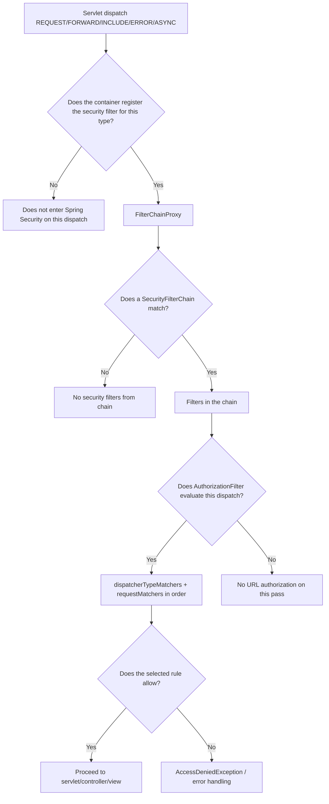

# Authorization by DispatcherType REQUEST, FORWARD, INCLUDE, ERROR, and ASYNC

In **Spring Security Servlet**, an HTTP request from a browser does not necessarily pass through the application only once. The Servlet container can **re-dispatch the same request** to forward to an internal resource, include content, render an error page, or complete asynchronous processing. Each processing pass carries a value from the **`jakarta.servlet.DispatcherType`** enum:

- **`REQUEST`** – the normal request processing pass sent by the client.
- **`FORWARD`** – *server-side* forwarding to another resource using `RequestDispatcher.forward(...)`.
- **`INCLUDE`** – embedding the output of another servlet/JSP/resource into the response being generated using `RequestDispatcher.include(...)`.
- **`ERROR`** – the container dispatches to an error-handling page/endpoint.
- **`ASYNC`** – handling an asynchronous dispatch via `AsyncContext.dispatch(...)` or a related MVC async mechanism.

This is a **Servlet dispatch type**, not an HTTP method like GET/POST, nor a "token type" or "role". A `FORWARD` dispatch may still use the GET method; an `ASYNC` dispatch may continue processing work started from a POST. When making access decisions, the application needs to know **the dispatcher type, URL, identity, and business data**.

**Key takeaway:** Simply writing `dispatcherTypeMatchers(FORWARD, ERROR).permitAll()` **does not guarantee** that Spring Security actually receives every `FORWARD`/`ERROR` dispatch. You must distinguish **Servlet filter registration** from **authorization rules**. And unconditionally allowing all `FORWARD`/`INCLUDE` dispatches can become a bypass to sensitive resources.

Primary technical context: **Java 17+, Jakarta Servlet 6, Spring Boot 3.x, and Spring Security 6.5.x**. For Spring Security 7 or custom filters, re-verify the specific behavior according to your actual version, container, and configuration.

## 1. Where Is DispatcherType Determined?

`DispatcherType` is an enum determined by the **Servlet container** on the request object. When code executes in a corresponding servlet, filter, or controller, it can query:

```java
DispatcherType type = request.getDispatcherType();
```

You need to import `jakarta.servlet.DispatcherType` and use the `HttpServletRequest` or `ServletRequest` object obtained from the web layer. Do not use `javax.servlet.DispatcherType` in Spring Boot 3/Jakarta Servlet projects because the namespace has moved to `jakarta.servlet`.

An initial call pass:

```text
Client
  GET /reports/42
    |
    v
Servlet container: DispatcherType.REQUEST
    |
    v
Filter registrations for REQUEST (if configured)
    |
    v
Spring Security FilterChainProxy -> SecurityFilterChain -> AuthorizationFilter
    |
    v
DispatcherServlet -> Controller -> Service
```

If a controller/servlet triggers a new dispatch, the container can create **another pass through the filters registered for the new dispatcher type**, not a new TCP connection or a new client GET request.

### 1.1. The Same Request Can Be Seen Multiple Times

Example:

```text
REQUEST  GET /reports/42           -> Controller selects view
FORWARD  GET /WEB-INF/views/report -> JSP/view is rendered
```

If the Spring Security filter is registered for both `REQUEST` and `FORWARD`, and `AuthorizationFilter` is configured to evaluate those dispatches, the authorization step can appear **twice**. Both passes may need their own policies:

- `REQUEST /reports/42`: is the caller allowed to view report 42?
- `FORWARD /WEB-INF/views/report.jsp`: is this internal view allowed to be rendered from a forward pass?

Do not assume "an HTTP request from the client only needs authorization once" is true across all Servlet processing paths. Conversely, do **not conclude** that every FORWARD definitely runs Spring Security, as it still depends on the container's filter registration.

### 1.2. Meaning Table of the Five Values

| DispatcherType | In what situation is it created? | Example | What to check for authorization |
| --- | --- | --- | --- |
| `REQUEST` | Container begins processing a request from a client | `GET /api/orders/42` | Resource/HTTP method protection, authentication, and permission |
| `FORWARD` | Currently executing resource calls `RequestDispatcher.forward` | Controller forwards to `/WEB-INF/views/detail.jsp` | Should the target URL be re-checked? Is all FORWARD opened too broadly? |
| `INCLUDE` | Currently executing resource calls `RequestDispatcher.include` | JSP includes `/fragments/navigation.jsp` | Are fragment contents, user-specific data, and separate include rules protected? |
| `ERROR` | Container dispatches to error page after error/status per configuration | `/error` in a Spring Boot application | Avoid 403 masking the original error, while not leaking data in the error page |
| `ASYNC` | AsyncContext dispatch or framework completes async | Request re-processed after `Callable`/`DeferredResult` result | Is Authentication/context still valid? Do permissions need re-checking? How about in-flight/revocation? |

**`DispatcherType` is different from HTTP status:** `ERROR` does not mean an "ERROR" HTTP method; `REQUEST` can still end with status 500; `ASYNC` does not inherently mean "anonymous" or "authenticated".

## 2. Three Gates to Distinguish Before Evaluating Permissions

When asking "Does Spring Security run for FORWARD?", you must separate three questions:

**Gate A — Servlet filter registration.** Is `DelegatingFilterProxy`/`springSecurityFilterChain` **registered by the container** for `DispatcherType.FORWARD`? If not, the container does not invoke that filter when a `FORWARD` pass occurs; a Spring Security rule for FORWARD will **have no chance to run** on that pass.

**Gate B — SecurityFilterChain selection.** Once inside `FilterChainProxy`, does the request match a `SecurityFilterChain`? `securityMatcher` and chain ordering determine this. If no chain matches, none of the chain's Spring Security filters run for that request.

**Gate C — AuthorizationFilter + authorization rule.** Inside the selected chain, is `AuthorizationFilter` applied to this dispatch; and which rule does `RequestMatcherDelegatingAuthorizationManager` select? `dispatcherTypeMatchers(...)` belongs to the **rule level**, not registration or chain selection.



Security point: **`permitAll` at Gate C cannot open Gate A on its own**, nor can it add a missing filter at Gate B. Conversely, **bypassing the filter at Gate A or B is not safely equivalent to a deny rule at Gate C**.

## 3. How Does Spring Security AuthorizationFilter Handle Multiple Dispatches?

With the modern DSL:

```java
http.authorizeHttpRequests(auth -> auth
    .requestMatchers("/admin/**").hasRole("ADMIN")
    .anyRequest().authenticated()
);
```

Spring Security uses **`AuthorizationFilter`** and an `AuthorizationManager` to inspect requests. In the Spring Security 6.5 model, this filter is designed to be able to execute authorization **across multiple dispatch passes**, not only the initial request. The `AuthorizationFilter` 6.5 Javadoc states:

- `setObserveOncePerRequest(...)` defaults to **`false`**: the filter is not fixed to "check only once per request" as many people assume from `OncePerRequestFilter`.
- Filtering for `ASYNC` and `ERROR` is enabled by default in 6.5.
- `setShouldFilterAllDispatcherTypes(...)` is an older API marked deprecated; the recommended design direction is to **write explicit rules using `dispatcherTypeMatchers(...)`**.

These details describe **the filter once it has been invoked**. They **do not replace** registering `springSecurityFilterChain` with dispatcher types in the Servlet container. In addition, each other filter in the chain may have its own dispatcher handling rules; do not extrapolate from AuthorizationFilter to the entire filter chain.

### 3.1. Rule Order Is Still First-Match-Wins

Example:

```java
http.authorizeHttpRequests(auth -> auth
    .dispatcherTypeMatchers(DispatcherType.ERROR).permitAll()
    .requestMatchers("/admin/**").hasRole("ADMIN")
    .anyRequest().denyAll()
);
```

If an `ERROR` dispatch actually passes through the security chain, **the ERROR rule is evaluated before** the remaining URL rules. It allows the `ERROR` pass to proceed at the HTTP authorization layer. A `REQUEST` dispatch to `/admin/report` does **not** match the ERROR rule, so it still requires `ROLE_ADMIN`.

If you place `anyRequest().permitAll()` **before** `dispatcherTypeMatchers(ERROR)`, the later rule will be shadowed because every request already matched the earlier rule. Conversely, if you place `dispatcherTypeMatchers(FORWARD).permitAll()` at the top, **every FORWARD** processed by the filter can be allowed at HTTP authorization **even if the target URL is a sensitive path**. You must evaluate allowance by **dispatch type and path scope**.

### 3.2. `dispatcherTypeMatchers` Can Combine with HTTP Method

Spring Security 6.5 has an overload for dispatcher type and `HttpMethod`:

```java
http.authorizeHttpRequests(auth -> auth
    .dispatcherTypeMatchers(HttpMethod.GET, DispatcherType.ASYNC)
        .authenticated()
    .requestMatchers("/admin/**").hasRole("ADMIN")
    .anyRequest().denyAll()
);
```

This is a **configuration snippet** in a Spring application, not a standalone Java program. The first rule only applies when **both ASYNC and GET method match**. Allowing GET ASYNC on every path solely because the user is authenticated can be **too broad** for admin resources; you should add URL/resource-based policies when needed.

Explaining this overload helps show there are **two independent condition axes**: `getDispatcherType()` and `getMethod()`. Changing the dispatcher type does not automatically turn a GET into a POST.

## 4. REQUEST: The Initial Pass Must Have a Clear Protection Policy

`REQUEST` is usually where authentication and permission checks happen for the client's first request. Example:

```text
REQUEST GET /reports/42
  -> protected by authority "reports.read"
  -> service checks owner/tenant if needed
  -> controller returns view or JSON response
```

At the HTTP layer you can use:

```java
.requestMatchers(HttpMethod.GET, "/reports/**")
    .hasAuthority("reports.read")
```

That step **does not yet guarantee** the user is allowed to view report 42 specifically: checking owner, tenant, report status, sharing, or permissions in the service remains important.

**Do not apply `dispatcherTypeMatchers(REQUEST).permitAll()` as a shortcut to "avoid checking twice".** Doing so can open every client request at HTTP authorization. If you want internal dispatches to render more easily, define appropriate policies for the needed dispatch types rather than dropping checks on `REQUEST`.

## 5. FORWARD: Internal Forwarding Is Not Inherently Safe

### 5.1. FORWARD Differs from a Browser Redirect

A controller returns a redirect:

```text
HTTP 302 Location: /login
Browser sends new request GET /login -> new REQUEST
```

Whereas `RequestDispatcher.forward` is **server-side forwarding**, without requiring the browser to send a second HTTP request:

```text
REQUEST GET /reports/42
  -> controller
  -> RequestDispatcher.forward("/WEB-INF/views/report.jsp")
  -> FORWARD /WEB-INF/views/report.jsp
  -> render view
```

The Servlet API stores the original URI in attributes such as `jakarta.servlet.forward.request_uri` so the target resource can know the forward source; the path used by matchers on the FORWARD pass may reflect the **new target** depending on the servlet mapping mechanism.

### 5.2. Why Do Views Sometimes Receive 403?

If rules only declare:

```java
.authorizeHttpRequests(auth -> auth
    .requestMatchers("/reports/**").hasAuthority("reports.read")
    .anyRequest().denyAll()
)
```

The `REQUEST /reports/42` pass can succeed, but the `FORWARD /WEB-INF/views/report.jsp` pass **does not match `/reports/**`** and hits the deny fallback. When the Spring Security filter is registered for FORWARD, the user sees a 403 error while rendering the view even though the initial request had permission.

The Spring Security documentation illustrates a common way to handle this:

```java
.dispatcherTypeMatchers(DispatcherType.FORWARD).permitAll()
```

However, note the **important warning**: that policy allows **all FORWARD dispatches** at the HTTP authorization layer. If the application permits forwarding to a sensitive controller or has a vulnerability allowing control of the FORWARD target, it can become a bypass around URL rules. This approach is more suitable when all FORWARDs are strictly for **trusted internal views with no sensitive operations**, and business logic has already been fully authorized before forwarding.

### 5.3. Allow Only Valid View Paths, Not All FORWARDs

In an application wanting a stricter policy, you can combine **dispatcher type** with a **path matcher**:

```java
RequestMatcher forwardedView = new AndRequestMatcher(
    new DispatcherTypeRequestMatcher(DispatcherType.FORWARD),
    PathPatternRequestMatcher.withDefaults()
        .matcher("/WEB-INF/views/**")
);
```

Then:

```java
.authorizeHttpRequests(auth -> auth
    .requestMatchers(forwardedView).permitAll()
    .requestMatchers("/admin/**").hasRole("ADMIN")
    .anyRequest().denyAll()
)
```

These are **two Spring Security 6.5 configuration snippets**, not a standalone Java program. They require imports and must be placed in an actual bean configuration; the path matcher must be verified against the servlet mapping/forwarded URL provided by the real container.

Meaning: only `FORWARD` to **allowed view paths** matches the first rule; `FORWARD /admin/delete` is not opened by that rule and still goes through the remaining policies. Do not assume URLs starting with `/WEB-INF/views/` definitely contain no sensitive processing: inspect the view/servlet architecture and test it.

## 6. INCLUDE: Embedding Fragments Has Special Semantics

`INCLUDE` occurs when a servlet/JSP calls:

```java
RequestDispatcher dispatcher =
    request.getRequestDispatcher("/fragments/menu.jsp");
dispatcher.include(request, response);
```

**The snippet above** assumes `request`/`response` are available in a web handler. The purpose is to merge fragment content into the response being generated; it is not an HTTP redirect or a new client request.

According to the Jakarta Servlet specification:

- The included resource can contribute **body** content to the response being written.
- Include must not modify the HTTP status code or headers of the original response; such changes are normally ignored.
- `request.getDispatcherType()` on the include pass is `DispatcherType.INCLUDE`.
- The Servlet API provides attributes such as `jakarta.servlet.include.request_uri`, `jakarta.servlet.include.servlet_path`, and `jakarta.servlet.include.path_info` to identify the **included target**.

### 6.1. Why Does INCLUDE Differ from FORWARD When Matching URLs?

During an `INCLUDE` pass, many methods that read the URI/path on the request object retain the **caller's path context**, while the included target path is provided in the **include attributes**. Do not assume `request.getServletPath()` during INCLUDE has the same meaning as the fragment's servlet path. If you write a path-based matcher to protect an include, you must verify whether it inspects the **caller path** or the **include target** in the actual container and request wrapper.

Example:

```text
REQUEST /dashboard
  -> INCLUDE /fragments/account.jsp
     (included target is in jakarta.servlet.include.*)
```

If you protect `/fragments/account.jsp` with a standard URL path matcher, yet the matcher sees `/dashboard`, the policy may **not apply the way you think**. In particular, a fragment displaying user or tenant data should not rely solely on URL rules during the INCLUDE pass. Enforce authorization in the **service that produces the fragment's data** and protect every other endpoint that can access that data.

### 6.2. Do Not Allow All INCLUDEs Out of Habit

You can configure:

```java
.dispatcherTypeMatchers(DispatcherType.INCLUDE).permitAll()
```

But that is a **broad security decision**, not a mandatory technical requirement. If fragments are always public menus/resources, that policy can be acceptable **after reviewing the architecture**. If a fragment contains account information, reports, or permission-gated data, you must apply the proper subject-level policy.

**Operational note:** if an INCLUDE is denied after the response has already sent part of the body, the exception handler mechanism may **be unable to change the status/headers** as it would for an uncommitted response. Therefore, authorization for sensitive data must occur **before emitting content** and must not rely on changing the status after an include fails.

## 7. ERROR: Avoid Masking the Original Error, Without Opening Sensitive Endpoints

`DispatcherType.ERROR` typically appears when the servlet container dispatches to an error page after an exception or container-handled error.

For example, a Spring Boot app with an error-handling endpoint:

```text
REQUEST /reports/42
  -> controller throws exception or sends error status
  -> container dispatches ERROR /error
  -> render error page
```

If the original request was permitted, yet `ERROR /error` does not match an allow rule and hits `denyAll`, the application can generate a **second** `AccessDeniedException`, masking diagnostic details of the original error, changing the error page, or leading to recursive error handling.

A configuration commonly illustrated by the Spring Security documentation:

```java
.dispatcherTypeMatchers(DispatcherType.ERROR).permitAll()
```

**Scope:** allows the **URL authorization step of the ERROR dispatch**. It does not guarantee the error page will definitely return the original 500/404, nor does it permit skipping other security controls.

### 7.1. Be Careful When an ERROR Handler Displays Data

An error page should:

- Not expose stack traces, secrets, access tokens, queries containing sensitive data, or denied resource details to external users.
- Not display another user's permissions or business-retrieved data just because it is in an ERROR dispatch.
- Have an appropriate policy if the error controller itself accesses protected data.
- Not let an attacker freely control the URL/functionality invoked during error handling.

If a stricter policy is required, you can allow `ERROR` only for **the expected error endpoint**, using a matcher combining dispatcher type + path, and then apply deny fallback.

### 7.2. Distinguish the Original Error from a Secondary Authorization Error

When debugging an unexpected 403 or 500 response, log safely:

```text
dispatcherType=REQUEST path=/reports/42
dispatcherType=ERROR   path=/error
```

You can read `jakarta.servlet.error.status_code`, `jakarta.servlet.error.request_uri`, and `jakarta.servlet.error.exception` per the Servlet contract to find the root error. Avoid logging full exceptions that may contain tokens or sensitive data in the response sent to the client.

## 8. ASYNC: Distinguish Running on Another Thread from an Async Dispatch

**`DispatcherType.ASYNC` is not synonymous with "code running on another thread".** It is a **container dispatch type**, typically triggered by `AsyncContext.dispatch(...)` or by a framework's asynchronous request completion flow.

Two separate events:

1. **Work running in another executor/thread:** `Callable`, `CompletableFuture`, `DeferredResult`, or a custom worker can process data without **a new servlet ASYNC dispatch occurring at that moment**.
2. **Container re-dispatch:** when it needs to continue the Servlet/MVC pipeline, the container creates a processing pass that can carry `DispatcherType.ASYNC`. Only when the filter is registered for ASYNC and the chain receives that pass can the corresponding URL authorization occur.

### 8.1. Timeline Example

```text
REQUEST GET /reports/42
   |
   +-> Spring MVC returns Callable<String> or DeferredResult<String>
   |
   +-> Work is performed asynchronously
   |
   +-> When result is ready, container/MVC resumes processing
            |
            v
        ASYNC dispatch (if flow creates async dispatch)
            |
            v
        security filter mapping for ASYNC?
            |
            v
        AuthorizationFilter + render response
```

A request allowed on REQUEST is **not necessarily** automatically allowed on ASYNC if the subsequent pass's request/context/policy differs. Conversely, just because a response is completed in ASYNC does not mean authorization should be skipped for this dispatch type.

### 8.2. SecurityContext in Async Is Not Automatically the Same Across All APIs

Spring Security integrates **`WebAsyncManagerIntegrationFilter`** with Spring MVC `Callable` to propagate the appropriate `SecurityContext` into `Callable` execution. However, with `DeferredResult` or a self-managed executor, do not assume every thread automatically sees the same `SecurityContextHolder`.

The common `SecurityContextHolder` mechanism uses `ThreadLocal`; a new thread does not necessarily inherit the right context. When managing background tasks yourself, use `DelegatingSecurityContextRunnable`, `DelegatingSecurityContextCallable`, or appropriate executor wrappers, and **review identity propagation/decisions at the right security boundaries**.

**Do not** fix lost-context errors by making every `ASYNC` dispatch `permitAll` if there are paths returning sensitive data. What needs to be solved is **context propagation and timely policy enforcement**, not broadening permissions.

### 8.3. Permission Revocation While an ASYNC Request Is Running

Suppose Alice starts a request at 10:00 with authority `reports.read`, and has her permission revoked at 10:01 while the report task is still running. The ASYNC pass finishing at 10:03 may use a **stale authority snapshot** or re-read policy, depending on the architecture.

If the requirement is "permission revocation must affect in-flight results", you need clear policies for:

- When permissions are checked before querying data or sending the response.
- Whether an in-flight task is cancelled upon revocation.
- What latency caches and authority sources have.
- Dynamic permission checks before exporting files or publishing data.
- How to handle cases where the response is already partially committed.

`DispatcherType.ASYNC` **does not solve** permission revocation on its own, nor does it re-authenticate tokens automatically. You must check data/context at the business boundaries that actually matter.

## 9. Servlet Filter Registration Configuration: The Frequently Forgotten Prerequisite

This is a layer **outside** `authorizeHttpRequests` rules.

### 9.1. Spring Boot Property for Configuring Dispatcher Types

In Spring Boot versions supporting this property, you can configure **which dispatcher types the security filter registration accepts**:

```yaml
spring:
  security:
    filter:
      dispatcher-types: request, async, error, forward, include
```

**This configuration has application-wide impact** and must be chosen according to need. Do not enable all types just to make 403 errors go away; each additional dispatch can cause security filters to run multiple times, trigger extra policy checks, and expose issues in custom filters.

In many common Spring Boot Servlet releases, the default configuration for security filter registration typically includes `REQUEST`, `ASYNC`, and `ERROR`; **`FORWARD` and `INCLUDE` should not be assumed to always be present**. Defaults can differ when deploying a WAR, manually registering `DelegatingFilterProxy`, replacing `FilterRegistrationBean`, or using a different Boot version. **Verify the running filter registration** rather than trusting that every dispatch in the enum is always handled by default.

### 9.2. Jakarta Servlet Filter Mapping

When not using auto-registration or when assembling a WAR/web.xml manually, the Servlet container only invokes a filter for the mapped dispatcher types. For example, configuration might need:

```xml
<filter-mapping>
    <filter-name>springSecurityFilterChain</filter-name>
    <url-pattern>/*</url-pattern>
    <dispatcher>REQUEST</dispatcher>
    <dispatcher>FORWARD</dispatcher>
    <dispatcher>INCLUDE</dispatcher>
    <dispatcher>ERROR</dispatcher>
    <dispatcher>ASYNC</dispatcher>
</filter-mapping>
```

This is a **web.xml snippet**, appropriate only when actually managing registration via web.xml; in Spring Boot auto-config, adjust the corresponding property or registration instead of adding overlapping configurations. For a filter to handle async, both `async-supported` and appropriate mapping per the Servlet contract are required.

### 9.3. Two Misleading Scenarios

| Scenario | Result |
| --- | --- |
| Has `dispatcherTypeMatchers(FORWARD).permitAll()` but filter registration **lacks FORWARD** | Rule never runs on FORWARD passes; cannot be treated as proof of enforcement |
| Filter registration has FORWARD but authorization rule only has `anyRequest().denyAll()` | A FORWARD pass to a view may be denied unless the path/type is permitted earlier |
| Filter registration has ERROR but rules do not allow `/error`/ERROR | Can mask the original error with an authorization error during ERROR dispatch |
| Filter registration has ASYNC but context is not propagated properly | Rules requiring Authentication may deny due to missing/different security context |
| Filter registration has INCLUDE but data policy relies only on caller URL | Can skip data protection for the included resource |
| Filter registration has all five types and a broad `permitAll` rule | Filter is invoked, yet authorization policy can still over-grant access |

## 10. Illustrative Configuration: Strict REQUEST Rules, Bounded View Forward

**Spring Boot 3.x / Spring Security 6.5.x Servlet** example. Goals:

- `/public/**` is public on REQUEST.
- `GET /reports/**` requires `reports.read`.
- `/admin/**` requires `ROLE_ADMIN`.
- Allow `FORWARD` only to `/WEB-INF/views/**` to render internal views.
- Allow `ERROR` to serve the error page **under the assumption that the error page is safe**.
- Do not bypass authorization by default for `INCLUDE` or `ASYNC`.
- Default deny for undeclared URLs.

```java
package com.example.security;

import jakarta.servlet.DispatcherType;
import org.springframework.context.annotation.Bean;
import org.springframework.context.annotation.Configuration;
import org.springframework.http.HttpMethod;
import org.springframework.security.config.annotation.web.builders.HttpSecurity;
import org.springframework.security.web.SecurityFilterChain;
import org.springframework.security.web.servlet.util.matcher.PathPatternRequestMatcher;
import org.springframework.security.web.util.matcher.AndRequestMatcher;
import org.springframework.security.web.util.matcher.DispatcherTypeRequestMatcher;
import org.springframework.security.web.util.matcher.RequestMatcher;

@Configuration
public class SecurityConfig {

    @Bean
    SecurityFilterChain web(HttpSecurity http) throws Exception {
        RequestMatcher safeViewForward = new AndRequestMatcher(
                new DispatcherTypeRequestMatcher(DispatcherType.FORWARD),
                PathPatternRequestMatcher.withDefaults()
                        .matcher("/WEB-INF/views/**")
        );

        http.authorizeHttpRequests(auth -> auth
                .requestMatchers(safeViewForward).permitAll()
                .dispatcherTypeMatchers(DispatcherType.ERROR).permitAll()
                .requestMatchers("/public/**").permitAll()
                .requestMatchers(HttpMethod.GET, "/reports/**")
                        .hasAuthority("reports.read")
                .requestMatchers("/admin/**").hasRole("ADMIN")
                .anyRequest().denyAll()
        );

        return http.build();
    }
}
```

This is **a Spring configuration class** and cannot be compiled standalone with `javac SecurityConfig.java`. It requires a Spring Boot project with Spring Security dependencies, a servlet container, an authentication provider, controllers, a view resolver, and a version supporting `PathPatternRequestMatcher`. The example **does not intentionally disable CSRF**, and only illustrates URL authorization, not a complete production configuration.

**Condition for the example to work as intended:** the container must register the security filter for `FORWARD`/`ERROR` if those two rules are to actually have a chance to run. If views are handled via a different path or the matcher sees a different servlet prefix, adjust and test accordingly. `ERROR` permitAll here must be re-evaluated if the application error handler involves sensitive business logic.

### 10.1. If INCLUDE Is Truly Needed

Do not reflexively add:

```java
.dispatcherTypeMatchers(DispatcherType.INCLUDE).permitAll()
```

Only do so when **all included resources are deemed safe to include**, and sensitive data is already checked at the business layer. If only a few public fragments are needed, you can write a **custom RequestMatcher** checking `DispatcherType.INCLUDE` combined with **include target attributes**, or enforce authorization directly in the service used to render the fragment.

Do not simply assign `PathPatternRequestMatcher("/fragments/**")` and assume the matcher inspects the include target; verify against the actual request. If a custom matcher reads attributes, always handle null, context path/servlet mapping, and nested includes, and never use any client-supplied value as an authorization source.

### 10.2. If Only ERROR /error Needs to Be Permitted

You can combine:

```java
RequestMatcher safeErrorDispatch = new AndRequestMatcher(
    new DispatcherTypeRequestMatcher(DispatcherType.ERROR),
    PathPatternRequestMatcher.withDefaults().matcher("/error")
);
```

Then use:

```java
.requestMatchers(safeErrorDispatch).permitAll()
```

This is an **illustrative code snippet**; you must verify the actual context path and error mapping. It avoids opening all `ERROR` dispatches if the application has multiple error-handling endpoints with different trust levels. Protecting data inside the error handler remains a separate responsibility.

### 10.3. FORWARD to Sensitive Endpoints Still Needs a Policy

With the illustrative configuration, if a controller executes `forward("/admin/reports")`, this FORWARD request **does not match `/WEB-INF/views/**`**; it will hit `/admin/**` and require the ADMIN role. This is a meaningful difference from placing `dispatcherTypeMatchers(FORWARD).permitAll()` at the top, which lets any forwarded path bypass URL role checks.

Do not use **a single rule allowing both FORWARD and INCLUDE** just as a quick fix for view rendering errors. The two dispatch types have different path/response semantics and must be evaluated separately.

## 11. Testing: Separate "Correct Rule" and "Filter Runs" into Two Groups

A common mistake is testing only a `RequestMatcher` with a mock request set to `DispatcherType.FORWARD`, seeing allow, and concluding the system protects FORWARD in production. That test **only verifies rule logic**, not whether the container registers the security filter for FORWARD.

### 11.1. Unit Testing a Dispatcher Type Matcher

With `spring-security-test` and Spring Mock Servlet (placed in a JUnit 5 test class with appropriate imports):

```java
MockHttpServletRequest request =
        new MockHttpServletRequest("GET", "/reports/42");

request.setDispatcherType(DispatcherType.FORWARD);

RequestMatcher matcher =
        new DispatcherTypeRequestMatcher(DispatcherType.FORWARD);

assertTrue(matcher.matches(request));
assertFalse(new DispatcherTypeRequestMatcher(
        DispatcherType.REQUEST).matches(request));
```

This is a **Spring test snippet**, not standalone-runnable, requiring `MockHttpServletRequest`, `RequestMatcher`, `DispatcherTypeRequestMatcher`, `DispatcherType`, and JUnit assertions. It verifies the matcher recognizes FORWARD; it does not check `FilterRegistrationBean` or whether the filter chain is actually invoked by the container.

### 11.2. Integration Tests Must Trigger Real Dispatches

With an embedded Servlet container or integration environment:

1. `REQUEST /reports/42` hits an authenticated controller; the controller performs a `FORWARD` to the view.
2. Observe whether `springSecurityFilterChain`/`AuthorizationFilter` runs on the FORWARD pass.
3. Configure bounded view forward allowance; test that the view renders without a spurious 403.
4. Test an **intentional** forward to `/admin/secret` with a user lacking ROLE_ADMIN; it must be blocked if policy disallows bypassing.
5. Controller throws an exception, container dispatches `ERROR /error`; test that the error response is not replaced by a second 403 and the error page leaks no sensitive data.
6. JSP/servlet performs `INCLUDE`; test that a fragment containing personal data is not allowed merely because the caller was allowed to view the public page.
7. Test `ASYNC` with real `Callable`/`DeferredResult`, valid/invalid principal, missing context, and error handling.
8. Toggle `spring.security.filter.dispatcher-types` in test config to demonstrate the difference between **filter registration** and **matcher rules**.

`MockMvc` can verify many MVC/authorization cases, but **does not always fully reproduce Servlet container forward, include, and async dispatch behavior**. Combine unit tests with integration tests running on a real container for behaviors depending on dispatcher registration.

### 11.3. Expected Authorization Matrix

Assuming the policy from the example in section 10:

| DispatcherType | Path / Condition | Expectation at HTTP authorization layer |
| --- | --- | --- |
| REQUEST | `GET /reports/42` with `reports.read` | ALLOW |
| REQUEST | `GET /reports/42` lacking `reports.read` | DENY |
| REQUEST | `GET /public/help` anonymous | ALLOW |
| REQUEST | `GET /admin/secret` lacking `ROLE_ADMIN` | DENY |
| FORWARD | `/WEB-INF/views/report.jsp` | ALLOW if filter registration and matcher match |
| FORWARD | `/admin/secret` lacking `ROLE_ADMIN` | DENY, no bypass |
| INCLUDE | Sensitive fragment, no separate policy | Should not auto-allow; must check where data resides |
| ERROR | `/error` when error handler is safe | ALLOW per sample policy; do not mask original error |
| ASYNC | `GET /reports/42` with context containing `reports.read` | ALLOW if dispatch pass is checked and context is valid |
| ASYNC | `GET /reports/42` lacking permission | DENY when real rule is applied |
| Any type | Path matching no rule | DENY from `anyRequest().denyAll()` if entering chain |
| FORWARD/INCLUDE | Security filter not registered for that type | **No Spring Security authorization on dispatch**, regardless of DSL rules |

The results above are predictions at the **URL authorization step**, not a guarantee of HTTP 200/403 responses in all situations. CSRF, exception translation, method security, servlet mapping, and controllers can also affect the outcome.

## 12. Standalone Java 17: Simulating Authorization Across Five DispatcherTypes

The following example **does not use Spring/Jakarta Servlet**, so it can run with JDK 17. It simulates a **safe policy by type + target + authority**:

- REQUEST and ASYNC still check the authority corresponding to the URL.
- FORWARD only bypasses URL role checks for an internal view area `/WEB-INF/views/`.
- INCLUDE only allows a public fragment area `/fragments/public/`.
- ERROR only allows the `/error` handler.
- FORWARD/INCLUDE to `/admin/` must still satisfy ROLE_ADMIN.
- Undeclared paths are denied.

**Limitation:** This is a learning algorithm **using test-provided dispatch targets** and does not reflect the exact way `HttpServletRequest#getServletPath()` or `jakarta.servlet.include.*` are populated by the container. To simulate real runtime behavior, you must use actual Servlet/Spring Security tests.

Create file **`DispatcherAuthorizationDemo.java`**:

```java
import java.util.List;
import java.util.Set;

public class DispatcherAuthorizationDemo {

    enum Kind {
        REQUEST, FORWARD, INCLUDE, ERROR, ASYNC
    }

    record Dispatch(
            Kind kind,
            String targetPath,
            boolean authenticated,
            Set<String> authorities
    ) {
        boolean has(String authority) {
            return authenticated && authorities.contains(authority);
        }
    }

    static String decide(Dispatch event) {
        if (event.kind() == Kind.ERROR
                && event.targetPath().equals("/error")) {
            return "ALLOW:ERROR_PAGE";
        }

        if (event.kind() == Kind.FORWARD
                && event.targetPath().startsWith("/WEB-INF/views/")) {
            return "ALLOW:VIEW";
        }

        if (event.kind() == Kind.INCLUDE
                && event.targetPath().startsWith("/fragments/public/")) {
            return "ALLOW:PUBLIC_FRAGMENT";
        }

        if (event.targetPath().startsWith("/admin/")) {
            return event.has("ROLE_ADMIN")
                    ? "ALLOW:ADMIN"
                    : "DENY:ADMIN";
        }

        if (event.targetPath().startsWith("/reports/")) {
            return event.has("reports.read")
                    ? "ALLOW:REPORTS"
                    : "DENY:REPORTS";
        }

        return "DENY:DEFAULT";
    }

    public static void main(String[] args) {
        Set<String> reportReader = Set.of("reports.read");

        List<Dispatch> events = List.of(
            new Dispatch(
                Kind.REQUEST, "/reports/42", true, reportReader),
            new Dispatch(
                Kind.FORWARD, "/WEB-INF/views/report.jsp", true, reportReader),
            new Dispatch(
                Kind.INCLUDE, "/fragments/public/menu.jsp", false, Set.of()),
            new Dispatch(
                Kind.ERROR, "/error", false, Set.of()),
            new Dispatch(
                Kind.ASYNC, "/reports/42", true, reportReader),
            new Dispatch(
                Kind.ASYNC, "/reports/42", false, Set.of()),
            new Dispatch(
                Kind.FORWARD, "/admin/secret", false, Set.of()),
            new Dispatch(
                Kind.INCLUDE, "/admin/secret", false, Set.of()),
            new Dispatch(
                Kind.REQUEST, "/unknown", true, Set.of("ROLE_ADMIN"))
        );

        for (Dispatch event : events) {
            System.out.println(
                event.kind() + " " + event.targetPath()
                + " -> " + decide(event)
            );
        }
    }
}
```

With **JDK 17+**, run:

```bash
javac DispatcherAuthorizationDemo.java
java DispatcherAuthorizationDemo
```

Stdout output:

```text
REQUEST /reports/42 -> ALLOW:REPORTS
FORWARD /WEB-INF/views/report.jsp -> ALLOW:VIEW
INCLUDE /fragments/public/menu.jsp -> ALLOW:PUBLIC_FRAGMENT
ERROR /error -> ALLOW:ERROR_PAGE
ASYNC /reports/42 -> ALLOW:REPORTS
ASYNC /reports/42 -> DENY:REPORTS
FORWARD /admin/secret -> DENY:ADMIN
INCLUDE /admin/secret -> DENY:ADMIN
REQUEST /unknown -> DENY:DEFAULT
```

Takeaways:

1. **FORWARD** is not automatically allowed: only forwards to the trusted view area pass the allow rule.
2. **INCLUDE** has an allowed public fragment area, but includes to admin are not treated as "internal resource so safe".
3. **ERROR /error** is permitted to handle errors under the assumed policy, without opening normal client URLs.
4. **ASYNC** is evaluated with the same authority checks as REQUEST for reports, so it does not become a bypass; missing authority is still denied.
5. Undeclared paths fall into **default deny**.
6. This simulation code **does not create real dispatchers, sessions, or security contexts**. In a real application, only filter registration + Servlet dispatch + Spring authorization determine exactly which rule runs.

## 13. Debugging: Why Is It Still Wrong After Configuring dispatcherTypeMatchers?

When hitting a 403 on a view page or a 500 turning into a 403, do not tweak rules randomly. Follow this sequence:

1. **Did the Servlet create a new dispatch?** Observe `getDispatcherType()` where it is invoked. A browser redirect is a new REQUEST, not a FORWARD.
2. **Does filter registration include that type?** Check `spring.security.filter.dispatcher-types`, custom registration, web.xml, or WAR/container.
3. **Does the request enter `FilterChainProxy` and the right chain?** With multiple chains, `securityMatcher` and `@Order` can route to a different chain or no chain.
4. **Which filters actually run on the new dispatch?** Do not assume every `OncePerRequestFilter` behaves like AuthorizationFilter.
5. **Which rule matches first?** `dispatcherTypeMatchers` and `requestMatchers` are evaluated in declaration order.
6. **What path does the matcher see?** For FORWARD/INCLUDE, distinguish caller URI, forwarded target, included target attributes, servlet path, and context path.
7. **Is SecurityContext still valid?** Especially in async, executors, DeferredResult, and revoked requests.
8. **What generated the error?** `AuthorizationFilter`, CSRF, authentication, method security, resource policy, or controller/error handler?
9. **Is the response already committed?** INCLUDE and async streaming can prevent handlers from changing the status after data has been sent.
10. **Is there integration evidence?** A passing matcher unit test does not prove real filter mapping.

### 13.1. Logging Dispatcher Type for Diagnostics

A diagnostic filter **for development/test environments only**, registered with the dispatcher types to observe:

```java
@Bean
FilterRegistrationBean<Filter> dispatchTraceFilter() {
    FilterRegistrationBean<Filter> bean = new FilterRegistrationBean<>();

    Filter logger = (request, response, chain) -> {
        HttpServletRequest http = (HttpServletRequest) request;
        System.out.println(
            "dispatch=" + http.getDispatcherType()
            + " path=" + http.getRequestURI()
        );
        chain.doFilter(request, response);
    };

    bean.setFilter(logger);
    bean.setUrlPatterns(List.of("/*"));
    bean.setDispatcherTypes(EnumSet.allOf(DispatcherType.class));
    return bean;
}
```

This is a **Spring Boot Servlet snippet**, requiring imports for `FilterRegistrationBean`, `Filter`, `HttpServletRequest`, `DispatcherType`, `List`, `EnumSet`, and a `@Configuration` class. This filter **does not grant permissions** and must not be used to replace Spring Security. It is registered separately in the Servlet container for observation, not automatically added to `SecurityFilterChain`. If the project auto-registers `Filter` beans elsewhere, avoid double registration.

In production, do not log raw URIs containing sensitive data, queries containing tokens, cookies, or session IDs. Enabling logging for all dispatches can sharply increase log volume.

## 14. Common Security Mistakes and Misconceptions

| Misconception / Error | Consequence | How to Handle |
| --- | --- | --- |
| "FORWARD is a new REQUEST from the browser" | Confuses redirect with server-side forward | Rely on `getDispatcherType()` and the Servlet API |
| "Spring Security automatically runs all dispatcher types because the enum has 5 values" | Ignores container registration | Check the types registered for `springSecurityFilterChain` |
| "Having `dispatcherTypeMatchers(FORWARD)` means the filter is already registered for FORWARD" | Rule never runs if registration is missing | Distinguish registration from rules |
| "`FORWARD permitAll` is always safe" | Can bypass URL rules when forwarding to sensitive endpoints | Only allow trusted view paths or retain resource policies |
| "`INCLUDE` is protected by the fragment's exact path matcher in every container" | Matcher may see caller path instead of include target | Inspect include attributes, test real stack, protect service data |
| "`ERROR` always means a harmless endpoint" | Can leak data or overwrite the original error | Minimal error handler, dedicated policy, never expose secrets |
| "`ASYNC` means every thread has a SecurityContext" | Custom executors may not propagate context | Use appropriate async integration/wrappers |
| "`ASYNC permitAll` avoids 403 so it is right" | Can open a path returning sensitive data | Check context, permissions, and business boundaries |
| "AuthorizationFilter is a OncePerRequestFilter" | Incorrect assumptions about authorization frequency | Read filter semantics for the exact version |
| "Enabling all dispatcher types is enough" | Can still hit chain mismatch or wrong rules | Check registration → chain → authorization |
| "MockMvc unit tests prove container filter registration" | Does not fully reflect real servlet dispatches | Add embedded-container integration tests |
| "Having permission on REQUEST means always having permission on ASYNC after revocation" | May use stale authority snapshot or missing context | Design freshness and re-check before outputting data |
| "`permitAll` equals skipping the entire security filter chain" | Skipping differs from allowing in HTTP authorization | Use explicit policies, do not arbitrarily use web.ignoring |
| "Status 403 proves wrong role" | Could be CSRF or denied ERROR/FORWARD dispatch | Log dispatch type, filter, and selected rule |

## 15. Self-Check Questions

**1. The browser receives 302 and automatically sends GET /login. Is the subsequent GET a FORWARD?**  
No. That is normally a **new `REQUEST`**. FORWARD happens inside the server with `RequestDispatcher.forward`.

**2. Does `dispatcherTypeMatchers(ERROR).permitAll()` make Spring Security receive ERROR when the container has not registered the filter for ERROR?**  
No. It is only a rule if the ERROR pass **already enters** the Spring Security filter chain.

**3. Why can a JSP view rendered via FORWARD get a 403 even though the initial REQUEST was allowed?**  
Because the FORWARD pass to the view path can be authorized again; if it hits fallback deny without allowing the appropriate view forward, it can be denied.

**4. Should `dispatcherTypeMatchers(FORWARD).permitAll()` be placed in every application?**  
Not automatically. You must be certain all FORWARDs are permitted by design, and never use it to open a path into sensitive controllers.

**5. Is INCLUDE /fragments/account.jsp always protected by the `/fragments/**` matcher?**  
Cannot be assumed. The included target may be represented via `jakarta.servlet.include.*` attributes; you must test the matcher/runtime and enforce permissions in the service.

**6. For ASYNC, does every piece of code running on another thread have `getDispatcherType()==ASYNC`?**  
No. Async execution threads and **Servlet async dispatch** are two related but distinct mechanisms.

**7. Does Spring Security automatically propagate SecurityContext into every `DeferredResult` executor?**  
Not by default. `Callable` is supported by WebAsyncManager integration; self-managed DeferredResult/executors must handle context propagation appropriately.

**8. Why can a denied ERROR /error mask the original error?**  
Because the error-handling dispatch is also inspected by `AuthorizationFilter`; a new AccessDeniedException can alter how the error response is produced.

**9. Can `DispatcherTypeRequestMatcher` be used to combine FORWARD and GET?**  
Yes, Spring Security provides suitable constructors/DSL; matching type+method does not replace checking URLs/resources.

**10. What is the most important test to prevent bypass via FORWARD?**  
Trigger an actual FORWARD to a sensitive endpoint with a user lacking permission, ensuring the policy denies it and filter registration runs for the right type.

## 16. Conclusion

When authorizing Servlet requests by dispatcher type, you must follow the **correct inspection order**:

1. **Does the Servlet container invoke the security filter for `REQUEST/FORWARD/INCLUDE/ERROR/ASYNC`?** → Filter registration.
2. **Which `SecurityFilterChain` does this dispatch pass enter?** → `FilterChainProxy` / `securityMatcher`.
3. **Does `AuthorizationFilter` evaluate it and which rule matches first?** → `dispatcherTypeMatchers` / `requestMatchers`.
4. **Is the rule tight enough for the actual path and data being processed?** → Authenticated user, authority, and resource-level policy.
5. **Are context and permission timing still valid?** → Especially for `ASYNC` and long-running work.
6. **Can errors/responses be handled safely?** → `INCLUDE`/`ERROR`/streaming when the response is already committed.

**Remember:** `REQUEST` protects entry points; `FORWARD`/`INCLUDE` involve internal resources; `ERROR` protects error-handling paths; `ASYNC` involves async re-processing. **No dispatcher type is automatically exempt from permission checks**. Only allow the dispatch types, targets, and data that the application has evaluated as appropriate; keep a deny fallback to prevent unintended endpoints.

## References

- [Spring Security 6.5 – Authorize HttpServletRequests: All Dispatches / Matching by Dispatcher Type](https://docs.spring.io/spring-security/reference/6.5/servlet/authorization/authorize-http-requests.html)
- [Spring Security 6.5 – AuthorizationFilter Javadoc](https://docs.spring.io/spring-security/reference/6.5/api/java/org/springframework/security/web/access/intercept/AuthorizationFilter.html)
- [Spring Security 6.5 – DispatcherTypeRequestMatcher Javadoc](https://docs.spring.io/spring-security/reference/6.5/api/java/org/springframework/security/web/util/matcher/DispatcherTypeRequestMatcher.html)
- [Spring Security – Servlet API Integration / Async Support](https://docs.spring.io/spring-security/reference/servlet/integrations/servlet-api.html)
- [Spring Security – Spring MVC Async Integration](https://docs.spring.io/spring-security/reference/servlet/integrations/mvc.html)
- [Spring Security – Servlet Architecture](https://docs.spring.io/spring-security/reference/servlet/architecture.html)
- [Jakarta Servlet – RequestDispatcher API (forward/include)](https://jakarta.ee/specifications/servlet/6.0/apidocs/jakarta.servlet/jakarta/servlet/RequestDispatcher.html)
