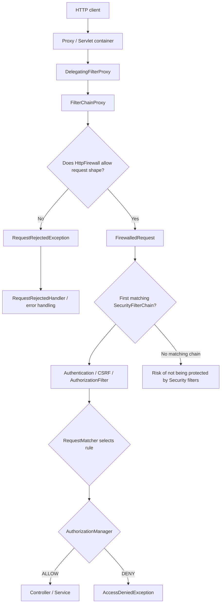

# HttpFirewall, Path Normalization, and Matcher Limits

## Learning Objectives

To protect an endpoint, Spring Security does not merely compare a URL against a string like `"/admin/**"`. A request passes through a reverse proxy, Servlet container, `FilterChainProxy`, `HttpFirewall`, `SecurityFilterChain`, `RequestMatcher`, `AuthorizationFilter`, and finally reaches the controller. These layers **do not necessarily interpret URLs the exact same way**. Variants such as `//`, `..`, `;`, `%2F`, control characters, or unusual HTTP methods can skew authorization outcomes.

After this lesson, you can:

- Identify the roles of `HttpFirewall`, `StrictHttpFirewall`, `DefaultHttpFirewall`, `FirewalledRequest`, and `FilterChainProxy`.
- Distinguish an **invalid request** rejected with `RequestRejectedException` from an **unauthorized user** denied with `AccessDeniedException`.
- Understand path normalization, URL decoding, and differences among `requestURI`, `contextPath`, `servletPath`, `pathInfo`, and query string.
- Recognize **the limits of path matchers**: they do not solve every ambiguous URL form, nor replace authority and owner/tenant policies.
- Configure `StrictHttpFirewall` cautiously, test genuinely needed exceptions, and avoid disabling protection just to silence a 400 error.
- Write unit tests, MockMvc tests, and HTTP integration tests when upgrading Spring Security or changing proxies/containers/routes.

The context is **Spring Security authorization on the Servlet stack** (Spring MVC/Spring Boot, Spring Security 6.x/7.x). Spring snippets in this lesson are integration code requiring dependencies. The standalone Java 17 section simulates decisions for comprehension and is **not an actual firewall implementation**.

## 1. Why Is HttpFirewall Needed?

Consider requests with varying shapes:

```text
GET /api/reports/42
GET /api/reports//42
GET /api/reports/./42
GET /api/reports/private/../42
GET /api/reports/42;v=1
GET /api/reports/%2F42
GET /api/reports/%252F42
GET /api/reports%2F42
```

These strings are **not inherently equivalent**. Depending on Servlet container, reverse proxy, URL decoder, and matcher:

- One layer rejects the request right away.
- One layer strips path parameters or normalizes `/` characters.
- One layer percent-decodes once, while another uses an already-decoded path differently.
- One layer sees the request URI including context path, while another matches only the servlet path.
- A matcher may select a policy for `/public/**` while the controller resolves the accessed resource via a different path.

If layers disagree, an attacker can craft a path that looks "public" at the Security layer yet maps to sensitive data at the application layer.

**HttpFirewall's goal is to validate and provide a more trustworthy request representation for matching**, while rejecting many suspicious URL/request forms. It is **not** a role- or ACL-based authorization system.

## 2. Position in the Request Flow

In a typical Servlet setup, `DelegatingFilterProxy` passes the request to `FilterChainProxy`. `FilterChainProxy` applies `HttpFirewall` to inspect/wrap the request, selects the matching `SecurityFilterChain`, and then runs authentication and authorization filters within that chain.



Two distinct questions:

1. **Firewall:** is the request valid enough for the system to evaluate further?
2. **Authorization:** has the request entered the filter chain with suitable identity and permissions?

A `ROLE_ADMIN` user cannot "elevate" `/admin/%2Fsecret` past `StrictHttpFirewall` if encoded slashes are rejected. Conversely, an entirely normal URL `/admin/users` can still be denied if authentication lacks admin rights.

### HttpFirewall Is Not Another RequestMatcher

`HttpFirewall` is an interface processing requests/responses before chain selection. Conceptually, it takes `HttpServletRequest` and produces `FirewalledRequest` or throws `RequestRejectedException`:

```java
// Conceptual API illustration; not a standalone Java file.
FirewalledRequest firewalled =
    httpFirewall.getFirewalledRequest(httpServletRequest);
```

`FirewalledRequest` is an `HttpServletRequestWrapper` with `reset()`. `FilterChainProxy` uses it during the security phase and can reset path values after the security chain. Hence never assume `servletPath`/`pathInfo` always keep the same representation across all stages.

## 3. StrictHttpFirewall: Rejecting Instead of Risky Normalization

`StrictHttpFirewall` is the strict default implementation in Servlet Spring Security in standard setups. It rejects suspicious requests with `RequestRejectedException`.

Checked categories include:

| Category | Example | Risk |
| --- | --- | --- |
| Non-normalized paths | `/a/../admin`, `/a//b` | Directory traversal or matching discrepancy |
| URL path parameters | `/secure;v=1/data` | Semicolons handled differently by container vs. matcher |
| Encoded slash | `/files/a%2Fb` | `%2F` may be treated as a slash or literal data |
| Backslash | `\`, `%5C` | Some parsers treat as path separator |
| Encoded percent | `%25` | Double encoding can alter paths after multiple decodes |
| Encoded period | `%2E` | Dot segments/traversal interpreted ambiguously |
| Null/control | `%00` or encoded CR/LF | Malformed input / request splitting |
| HTTP methods outside allowlist | `TRACE`, custom methods | HTTP verb tampering / XST |
| Invalid host/header/parameter names | Header containing control chars | Parser disagreement or malformed input |

Per the `StrictHttpFirewall` API, key defaults are:

- **Disallows** semicolons in URLs.
- **Disallows** URL-encoded slashes `%2F`, encoded percents `%25`, backslashes, and several other dangerous characters.
- **Rejects** non-normalized URLs; there is no toggle to arbitrarily allow non-normalized URLs because it is very risky.
- **Default allowed HTTP methods:** DELETE, GET, HEAD, OPTIONS, PATCH, POST, PUT. That is **only** acceptance at the HTTP method check, and does not grant DELETE/PUT rights to any user.
- Enforces policies on certain hostnames, headers, and parameter values/names; exact APIs should be checked against your version's Javadoc.

**Important:** a raw URL may already have been rejected/normalized by the Servlet container, proxy, or WAF **before** Spring receives it. These examples describe what the firewall checks **if the corresponding request reaches it**, not a promise that every Internet request arrives at Spring in that raw form.

### StrictHttpFirewall vs. DefaultHttpFirewall

`DefaultHttpFirewall` handles/wraps paths within its supported scope, such as stripping path parameters during matching; it also rejects many non-normalized paths. `StrictHttpFirewall` has an **explicitly stricter rejection policy** for many variants like semicolons and encoded slashes.

`FilterChainProxy` documentation notes that the request wrapper may adjust `servletPath`/`pathInfo` for matching and then restore them. **Do not conclude from that that Strict allows semicolons by default and strips them:** under Strict, semicolons are normally **rejected** first.

When a URL is blocked, switching to `DefaultHttpFirewall` just to "clear the error" can alter the entire application's security boundary. First check whether business requirements genuinely need that URL.

## 4. Reading Servlet Request Paths Accurately

Suppose a user sends:

```text
https://example.com/app/mvc/api/reports/42?format=json
```

And the app runs under context root `/app`, with DispatcherServlet mapped to `/mvc/*`:

| API / concept | Example | Meaning |
| --- | --- | --- |
| `getRequestURI()` | `/app/mvc/api/reports/42` | Request URI path, **excluding query string** |
| `getContextPath()` | `/app` | Application prefix in servlet container |
| `getServletPath()` | `/mvc` | Path portion used by servlet mapping in example |
| `getPathInfo()` | `/api/reports/42` | Remaining path after servlet mapping |
| `getQueryString()` | `format=json` | Query string, not a URL path |
| Path under context root | `/mvc/api/reports/42` | Path matched by appropriate matcher/builder |

The values above represent **one Servlet mapping scenario**. When a servlet is mapped to `/`, or a proxy rewrote the path, `servletPath`/`pathInfo` can differ. For percent-encoded URLs, received values also depend on the container.

### getRequestURI Is Not a "Context-Free Path"

If you manually write:

```java
// Unsuitable as a general Security matcher.
request.getRequestURI().startsWith("/api/private")
```

a request under `/app` might never match, because `requestURI` starts with `/app`. Fixing it with `endsWith` or ad-hoc substring logic can create bypasses via similar-looking paths.

**Use official RequestMatchers** and test with real context paths/servlet paths. In Spring Security 7, `PathPatternRequestMatcher` requires patterns starting with `/`, **excludes context root**, and provides a `basePath` mechanism when servlet prefixes exist.

### Query Is Not Treated as a Path Segment

`GET /api/reports/42?format=csv` normally still has path `/api/reports/42`. If `format=csv` is an export operation requiring `report:export`, a path-only matcher `/api/reports/{id}` **cannot tell that difference on its own**. Use a dedicated export endpoint, or enforce policies checking query/operation at the service layer with validated data and explicit permissions.

## 5. Limits of RequestMatcher

`RequestMatcher` answers "does the request match this condition?", **not** "is it completely safe from all malicious paths" and **not** "does the user have permission?".

`securityMatcher(...)` on `HttpSecurity` decides **which entire SecurityFilterChain** is selected. `requestMatchers(...)` inside `authorizeHttpRequests` decides **which authorization rule** is used inside the selected chain.

`FilterChainProxy` selects **the first matching chain**; inside a chain, `authorizeHttpRequests` selects **the first matching rule**. It does not try the next rule just because the matched rule returned DENY.

### Overly Broad Matchers Are Bugs Even When Firewall Works

```java
// WRONG: broad path-only rule can let PATCH/DELETE pass through.
http.authorizeHttpRequests(auth -> auth
    .requestMatchers("/api/**").authenticated()
    .requestMatchers(HttpMethod.DELETE, "/api/admin/**")
        .hasRole("ADMIN")
    .anyRequest().denyAll()
);
```

For `DELETE /api/admin/users/42`, `/api/**` matches first and a normal logged-in user can bypass **HTTP authorization**. The URL here is completely ordinary; the firewall has no responsibility for fixing wrong policy ordering.

A more appropriate approach:

```java
http.authorizeHttpRequests(auth -> auth
    .requestMatchers(HttpMethod.DELETE, "/api/admin/**")
        .hasRole("ADMIN")
    .requestMatchers(HttpMethod.GET, "/api/public/**")
        .permitAll()
    .anyRequest().denyAll()
);
```

Furthermore, even a matcher with exact path/method does not verify **owner/tenant/ACL** for each document. `hasAuthority("document:read")` only allows the read operation at a functional level; services/repositories must check whether this request has rights on document 42.

### Do Not Use String.startsWith as a Path Policy

`startsWith("/api/public")` also matches `/api/publications` and `/api/public-secret`. It understands neither servlet roots, encoded slashes, normalization, nor segment boundaries. In production, prefer `requestMatchers(HttpMethod, pathPattern)` for your Spring Security version, then test patterns and rule order.

## 6. RequestRejectedException Differs from AccessDeniedException

| Attribute | `RequestRejectedException` | `AccessDeniedException` |
| --- | --- | --- |
| Common origin | `HttpFirewall` / `StrictHttpFirewall` | `AuthorizationFilter`, method security, or domain policy |
| Cause | Unacceptable request shape, URL, method, or header | Caller lacks sufficient permission/authentication level |
| Timing | Before many rule-selection and authorization steps | After reaching authorization evaluation |
| Can `ROLE_ADMIN` bypass it? | No, because request shape remains invalid | Only if policy grants permission |
| Handling component | `RequestRejectedHandler` or container/proxy layer | `ExceptionTranslationFilter` → entry point/denied handler when exception propagates |
| Typical HTTP status | **400** if handled by corresponding handler; may vary per config | **403** for full authentication lacking permission; anonymous may get 401/redirect |

A `RequestRejectedException` is not resolved by adding `.permitAll()` for that URL. Nor is it an `AccessDeniedException` handled by `AccessDeniedHandler` by default.

Spring Security has `RequestRejectedHandler` and `HttpStatusRequestRejectedHandler`, the latter sending status 400 per configuration. Yet proxies/Servlet containers can also reject requests before Spring. Thus **HTTP 400 does not prove which layer rejected**; inspect logs/correlation IDs appropriately.

### Example: Two Requests Sharing the Same Business Path

```text
GET /api/reports/42
  → valid path, firewall accepts
  → user lacks report:read
  → AuthorizationManager DENY
  → AccessDeniedException / typically HTTP 403 for full user

GET /api/reports/%2F42
  → request has encoded slash
  → Default StrictHttpFirewall rejects if it receives this URL
  → RequestRejectedException / handler, typically 400
  → report:read not yet evaluated
```

Not every 403 is due to missing roles: `CsrfFilter` or tenant policies can also produce 403. Not every 400 is due to the firewall: HTTP parsers and proxies can also return 400.

## 7. Configuring StrictHttpFirewall Cautiously

Normally **keep the default Strict configuration**, changing it only for reviewed and tested technical requirements.

### Example: Restricting HTTP Methods

If an app genuinely accepts only GET/POST, you can declare a bean:

```java
import java.util.List;
import org.springframework.context.annotation.Bean;
import org.springframework.context.annotation.Configuration;
import org.springframework.security.web.firewall.StrictHttpFirewall;

@Configuration
public class FirewallConfig {

    @Bean
    StrictHttpFirewall httpFirewall() {
        StrictHttpFirewall firewall = new StrictHttpFirewall();
        firewall.setAllowedHttpMethods(List.of("GET", "POST"));
        return firewall;
    }
}
```

This is a **Spring** configuration snippet requiring dependencies/context and proper `FilterChainProxy` wiring; it does not run via `javac` alone. If constructing `FilterChainProxy` manually, ensure it uses this firewall instance. In real apps, test actual behavior rather than merely seeing a bean created.

**Impact:** `HEAD`, `OPTIONS`, `PATCH`, `PUT`, and `DELETE` are also blocked if omitted from the allowlist. That can break **CORS preflight OPTIONS**, HEAD health checks, or update APIs. This restriction example is explanatory, **not recommended by default**.

Default Strict lets DELETE/GET/HEAD/OPTIONS/PATCH/POST/PUT pass the **method check step**. You still need `AuthorizationManager` to grant permissions per HTTP method/path.

### Relaxing for Semicolons Requires Justification

```java
@Bean
StrictHttpFirewall httpFirewall() {
    StrictHttpFirewall firewall = new StrictHttpFirewall();
    firewall.setAllowSemicolon(true);
    return firewall;
}
```

Use only if **matrix variables/path parameters** are required and you have verified how the proxy, Servlet container, matchers, and MVC controllers all handle `;`. Consider moving data to query/body instead; **never put session IDs in URLs** as they leak via logs, browser history, or referrers.

The API also includes `setAllowUrlEncodedSlash`, `setAllowBackSlash`, `setAllowUrlEncodedPercent`, `setAllowNull`, `setAllowUrlEncodedPeriod`, and `setUnsafeAllowAnyHttpMethod`. These are **check-relaxation switches**, not a checklist to enable. Especially never use `setUnsafeAllowAnyHttpMethod(true)` to let exotic HTTP methods past the firewall.

## 8. Authorization Policies Must Still Be Explicit

The following HTTP rules distinguish GET and DELETE:

```java
import org.springframework.context.annotation.Bean;
import org.springframework.context.annotation.Configuration;
import org.springframework.http.HttpMethod;
import org.springframework.security.config.Customizer;
import org.springframework.security.config.annotation.web.builders.HttpSecurity;
import org.springframework.security.web.SecurityFilterChain;

@Configuration
public class SecurityConfig {

    @Bean
    SecurityFilterChain securityFilterChain(HttpSecurity http)
            throws Exception {
        http
            .authorizeHttpRequests(auth -> auth
                .requestMatchers(HttpMethod.GET, "/health")
                    .permitAll()
                .requestMatchers(HttpMethod.GET, "/api/reports/{id}")
                    .hasAuthority("report:read")
                .requestMatchers(HttpMethod.DELETE, "/api/reports/{id}")
                    .hasAuthority("report:delete")
                .anyRequest().denyAll()
            )
            .httpBasic(Customizer.withDefaults());
        return http.build();
    }
}
```

This is a Spring configuration snippet and does not create a user store, database, or controller. `/api/reports/{id}` must be tested with your actual matcher implementation: path patterns in Spring Security 6.x/7.x can differ across versions or Servlet mappings.

| HTTP request | Selecting step | Meaning |
| --- | --- | --- |
| `GET /health` | Firewall accepts, `permitAll` | Public when URL is valid |
| `GET /api/reports/42` with `report:read` | GET rule | Passes HTTP authorization; service still checks data |
| `DELETE /api/reports/42` with only `report:read` | DELETE rule | Lacks `report:delete` → DENY |
| `POST /api/reports/42` | `denyAll` | Undeclared endpoint/method → DENY |
| `TRACE /api/reports/42` | Strict method allowlist | REJECT before authorization |
| `GET /api/reports/42;v=1` | Strict disallows `;` by default | REJECT if input reaches firewall |
| `GET /api/reports/%2F42` | Strict disallows encoded slash by default | REJECT if input reaches firewall |
| `GET /api/reports//42` | Firewall/container may reject non-normalized path | Does not prove GET rule |

**Looking only at HTTP status outcomes is insufficient** to assert a request was rejected by the right layer. Separate tests for firewall, authorization, controllers, and record-level policies.

## 9. Unit Testing StrictHttpFirewall

With JUnit 5, `spring-test`, and `spring-security-web`, you can assert the exception type directly:

```java
import org.junit.jupiter.api.Test;
import org.springframework.mock.web.MockHttpServletRequest;
import org.springframework.security.web.firewall.RequestRejectedException;
import org.springframework.security.web.firewall.StrictHttpFirewall;

import static org.junit.jupiter.api.Assertions.assertNotNull;
import static org.junit.jupiter.api.Assertions.assertThrows;

class StrictHttpFirewallTest {

    private final StrictHttpFirewall firewall = new StrictHttpFirewall();

    @Test
    void normalGetIsAccepted() {
        MockHttpServletRequest request =
            new MockHttpServletRequest("GET", "/api/reports/42");
        assertNotNull(firewall.getFirewalledRequest(request));
    }

    @Test
    void semicolonIsRejected() {
        MockHttpServletRequest request =
            new MockHttpServletRequest("GET", "/api/reports/42;v=1");
        assertThrows(RequestRejectedException.class,
            () -> firewall.getFirewalledRequest(request));
    }

    @Test
    void encodedSlashIsRejected() {
        MockHttpServletRequest request =
            new MockHttpServletRequest("GET", "/api/reports/%2F42");
        assertThrows(RequestRejectedException.class,
            () -> firewall.getFirewalledRequest(request));
    }

    @Test
    void traceMethodIsRejected() {
        MockHttpServletRequest request =
            new MockHttpServletRequest("TRACE", "/api/reports/42");
        assertThrows(RequestRejectedException.class,
            () -> firewall.getFirewalledRequest(request));
    }
}
```

This is a **JUnit/Spring test**, not a standalone Java program. For paths with context roots/servlet prefixes, `MockHttpServletRequest` must accurately mirror `requestURI`, `contextPath`, `servletPath`, and `pathInfo`. A test passing a raw URL string only to the constructor does not replace real Servlet container decoding/normalization behavior.

### Test Every Exception Before Relaxing

If an app truly needs `setAllowSemicolon(true)`, test **both** standard URLs and URLs with `;`, then test matchers at the Security/Servlet layers to ensure semicolon URLs do not lose protection. Do not assert only "does not throw RequestRejectedException", because the request might enter **a different authorization rule** than designed.

When adjusting allowed methods, add tests for OPTIONS preflight, HEAD, and real POST/PATCH/DELETE calls. Firewall rejection of OPTIONS happens **before** any downstream CORS filter can process it.

## 10. MockMvc Testing Authorization Behind the Firewall

With Spring Boot 3.x + Spring Security 6.x and `spring-security-test`, use `@SpringBootTest`/`@AutoConfigureMockMvc` or apply `springSecurity()` to `MockMvcBuilders.webAppContextSetup(...)`. When upgrading Spring Boot major versions, update test annotation imports per the actual BOM/version.

```java
import org.junit.jupiter.api.Test;
import org.springframework.beans.factory.annotation.Autowired;
import org.springframework.boot.test.autoconfigure.web.servlet.AutoConfigureMockMvc;
import org.springframework.boot.test.context.SpringBootTest;
import org.springframework.security.core.authority.SimpleGrantedAuthority;
import org.springframework.test.web.servlet.MockMvc;

import static org.springframework.security.test.web.servlet.request
    .SecurityMockMvcRequestPostProcessors.user;
import static org.springframework.test.web.servlet.request
    .MockMvcRequestBuilders.get;
import static org.springframework.test.web.servlet.result
    .MockMvcResultMatchers.status;

@SpringBootTest
@AutoConfigureMockMvc
class AuthorizationBoundaryTest {

    @Autowired
    MockMvc mvc;

    @Test
    void normalPathWithoutAuthorityIsForbidden() throws Exception {
        mvc.perform(get("/api/reports/42")
                .with(user("alice").authorities(
                    new SimpleGrantedAuthority("ROLE_USER"))))
            .andExpect(status().isForbidden());
    }

    @Test
    void newEndpointDeniedEvenForAdmin() throws Exception {
        mvc.perform(get("/api/unknown")
                .with(user("admin").roles("ADMIN")))
            .andExpect(status().isForbidden());
    }
}
```

The two tests above target **authorization** of section 8's configuration. They do not test encoded URIs or Servlet containers outside MockMvc. To test a permitted GET returning 200, you need a controller fixture and data; without a controller, the request can pass Security and return 404.

Add a **data policy** test group: a user holding `report:read` must not view another tenant's report even with a valid report URL. `HttpFirewall` does not resolve owner/tenant/ACL permissions.

## 11. Raw URL Tests Must Traverse the Servlet Container/Proxy Too

`MockMvc` builds `MockHttpServletRequest` and **does not** execute the full HTTP parser, URL rewriting, and normalization logic of a web server. For sensitive cases, add embedded-server integration tests and staging tests through the real gateway.

Check:

- At which layer are `/api/reports//42` and `/api/reports/../admin` blocked?
- Are `%2F`, `%252F`, `%2E`, and `%5C` decoded before reaching Java or rejected at the proxy?
- Do `getRequestURI()`, `getServletPath()`, and `getPathInfo()` match production context/servlet paths?
- Does the CDN/ingress strip prefixes or rewrite paths? Do security matchers and MVC controllers see the same resource?
- Is `OPTIONS` preflight validly handled by CORS before authentication while real POSTs remain policed?
- Is `getQueryString()` accidentally fed into a path matcher?
- Are URLs outside `securityMatcher("/api/**")` protected by a fallback chain?

A **400** response may come from the Servlet container or proxy, not proving `StrictHttpFirewall` was invoked. Use controlled logs/metrics/correlation IDs to identify which layer produced the result; **never log cookies/tokens/credentials**, and never expose full sensitive URLs to clients.

## 12. Standalone Java 17: Simulating Two Decision Layers

The runnable example below uses **intentionally simple** rules and does not replicate Spring's parser. It illustrates the difference between `REJECT_FIREWALL` (request has a disallowed shape) and `DENY_AUTHZ` (valid request yet insufficient permissions).

Save with the exact filename **`FirewallDecisionDemo.java`**:

```java
import java.util.Locale;
import java.util.Set;

public class FirewallDecisionDemo {

    record Request(
        String method, String path, Set<String> authorities
    ) {}

    enum Decision {
        REJECT_FIREWALL,
        DENY_AUTHZ,
        ALLOW
    }

    static Decision decide(Request request) {
        String path = request.path();
        String encoded = path.toLowerCase(Locale.ROOT);

        // Simulated allowlist INTENTIONALLY allows only GET/POST.
        // This is NOT StrictHttpFirewall's default.
        if (!Set.of("GET", "POST").contains(request.method())
                || path.contains("//")
                || path.contains(";")
                || path.contains("..")
                || encoded.contains("%2f")) {
            return Decision.REJECT_FIREWALL;
        }

        if (request.method().equals("GET")
                && path.matches("/api/reports/[0-9]+")
                && request.authorities().contains("report:read")) {
            return Decision.ALLOW;
        }

        return Decision.DENY_AUTHZ;
    }

    static void show(
        String label, String method, String path, Set<String> authorities
    ) {
        Decision decision = decide(
            new Request(method, path, authorities)
        );
        System.out.println(label + " -> " + decision);
    }

    public static void main(String[] args) {
        show("read allowed", "GET", "/api/reports/42",
            Set.of("report:read"));
        show("read no permission", "GET", "/api/reports/42",
            Set.of("ROLE_USER"));
        show("double slash", "GET", "/api/reports//42",
            Set.of("report:read"));
        show("encoded slash", "GET", "/api/reports/%2F42",
            Set.of("report:read"));
        show("semicolon", "GET", "/api/reports;v=1/42",
            Set.of("report:read"));
        show("unknown method", "TRACE", "/api/reports/42",
            Set.of("report:read"));
        show("not declared method", "POST", "/api/reports/42",
            Set.of("report:read"));
    }
}
```

Compile and run with JDK 17 or higher:

```bash
javac FirewallDecisionDemo.java
java FirewallDecisionDemo
```

Stdout:

```text
read allowed -> ALLOW
read no permission -> DENY_AUTHZ
double slash -> REJECT_FIREWALL
encoded slash -> REJECT_FIREWALL
semicolon -> REJECT_FIREWALL
unknown method -> REJECT_FIREWALL
not declared method -> DENY_AUTHZ
```

Reading the output:

1. Normal URL and valid authority → `ALLOW`.
2. Normal URL lacking authority → `DENY_AUTHZ`.
3. URL with unusual path pattern or method outside the model's allowlist → `REJECT_FIREWALL`, **without evaluating authority**.
4. POST to a valid URL lacking a POST policy → `DENY_AUTHZ`.

**Never use this simulation code as a production firewall.** `String.contains("..")` and `contains("%2f")` fail to cover URL decoding, container parsing, or encoded traversal; they can also produce false positives. Use `StrictHttpFirewall` and official matchers, tested on a real server.

## 13. Regression Test Matrix When Changing Routes or Upgrading

A test suite should include **permitted**, **unauthorized**, and **firewall-rejected** requests:

| Input / test case | Check expectation |
| --- | --- |
| Standard GET path + `report:read` | Passes firewall; authorization allows; service checks further |
| Standard GET path lacking `report:read` | Passes firewall; HTTP authorization DENY |
| Standard DELETE path lacking `report:delete` | HTTP authorization DENY |
| Undeclared POST endpoint | Fallback `denyAll` DENY |
| GET containing `//` | Verify container/firewall handling, no bypass |
| GET containing `/../` | Must not normalize into a permitted path against policy |
| GET with `;` | Default Strict rejects semicolon if reaching firewall |
| GET containing `%2F` | Default Strict rejects encoded slash if reaching firewall |
| GET containing `%252F` | Test encoded percent and multi-pass decoding |
| GET with backslash or `%5C` | Prevent path-separator ambiguity bypass |
| HTTP method TRACE | Default Strict rejects method |
| Similar URL `/api/reports-old` | Does not falsely match `/api/reports/{id}` |
| Context path `/app` | Policy does not confuse paths with/without context root |
| Servlet prefix `/mvc` | Matchers align with servlet mapping |
| Reverse proxy path rewrite | Clear contract between public URL and servlet path |
| CORS OPTIONS preflight | Not confused with POST; CORS handled separately |
| POST/PATCH missing CSRF token | CSRF policy rejects properly; not confused with firewall |
| URL outside API chain | Protected by fallback chain or equivalent control |

When upgrading Spring Security, Spring Framework, or the Servlet container, run **the exact same matrix** before and after. Any transition **REJECT → ALLOW** or **DENY → ALLOW** must be treated as a security change and reviewed. Never relax `setAllow...` or swap `denyAll` for `permitAll` just to make tests green.

### How to Analyze a Failing Test

1. Did the request reach Spring or get handled earlier by the gateway/container?
2. Is there a `RequestRejectedException` or only an HTTP status?
3. Which firewall bean/config is actually active?
4. After the firewall, which chain does `FilterChainProxy` select? Are any URLs outside all chains?
5. Inside `AuthorizationFilter`, which rule matched first and why?
6. Did CSRF, method security, or an object policy generate a 403?
7. Does the controller exist and return a valid response?
8. Did path decoding, context path, servlet path, or gateway rewriting differ from baseline?

Do not guess causes solely from 401/403/404/405 or 400; **pinpoint the deciding layer** using unit + integration tests.

## 14. Common Implementation Mistakes

1. **Turning off StrictHttpFirewall for "easier routing":** can open irregular URLs handled differently by security matchers and MVC.
2. **Confusing DefaultHttpFirewall with Strict:** URL-handling semantics and rejection thresholds differ.
3. **Manually normalizing every suspicious path before authorization:** can make the controller see a different resource than the matcher.
4. **Using `getRequestURI()` as a context-rootless path:** breaks when deployment changes context.
5. **Using `startsWith` for admin/public checks:** falsely matches similar paths and lacks segment boundaries.
6. **Treating RequestMatcher as total URL defense:** it only selects rules; firewall and policies have other responsibilities.
7. **Confusing RequestRejectedException with AccessDeniedException:** misconfigures handlers and mislogs root causes.
8. **Relaxing `setAllowSemicolon`/`setAllowUrlEncodedSlash` untested:** easily causes container/proxy mismatches.
9. **Letting all HTTP methods past the firewall and relying only on route names:** HTTP verb tampering becomes a risk.
10. **Accidentally blocking OPTIONS preflight:** restricting firewall methods can block CORS ahead of its filter.
11. **Forgetting CSRF:** a 403 POST does not prove the HTTP matcher or firewall ran.
12. **Assuming 400 is always Spring Security:** proxies/containers can generate 400 too.
13. **Testing raw URL encoding only with MockMvc:** lacks a real HTTP parser/proxy; test through the server.
14. **Omitting a fallback chain:** `anyRequest().denyAll()` in an API chain does not protect URLs outside `securityMatcher`.
15. **Forgetting owner/tenant:** valid URL + `report:read` still might not authorize viewing record 42.
16. **Skipping version-upgrade tests:** parser/Servlet mapping changes can create unintended DENY→ALLOW transitions.

## 15. Application Checklist

- [ ] Confirmed `FilterChainProxy` uses the expected `HttpFirewall`.
- [ ] Kept default `StrictHttpFirewall` unless a reviewed exception is required.
- [ ] Distinguished `RequestRejectedException` and `AccessDeniedException` in logs/tests.
- [ ] Understood paths after proxy, context root, servlet mapping, and URL decoding.
- [ ] Avoided using `String.startsWith`/`substring` to build security path matchers.
- [ ] Placed specific HTTP method/path rules first, with `anyRequest().denyAll()` fallback where required.
- [ ] Verified multiple SecurityFilterChains and URLs outside specialized chains.
- [ ] Tested `//`, `..`, `;`, `%2F`, `%25`, backslashes, and unexpected HTTP methods.
- [ ] Tested CORS OPTIONS and CSRF separately without mixing causes with the firewall.
- [ ] Added HTTP integration tests through real Servlet container/proxy for encoded URLs.
- [ ] Enforced owner/tenant/ACL policies beyond HTTP authorization.
- [ ] Never altered firewall or relaxed permissions just to turn HTTP status tests green.
- [ ] Reviewed every REJECT/DENY-to-ALLOW shift during version upgrades.

### Self-Check Questions

**Question 1.** A user holding `ROLE_ADMIN` calls a URL containing an encoded slash `%2F`, and StrictHttpFirewall rejects it. Will adding `hasRole("ADMIN")` fix it?

**Answer:** No. The request is rejected **before** role evaluation.

**Question 2.** `GET /api/reports/42` is normal, yet the user lacks `report:read`. How should the error be classified?

**Answer:** An authorization error, typically `AccessDeniedException`; not a malformed request.

**Question 3.** Why does a MockMvc `%2F` test returning 400 not prove production is safe?

**Answer:** MockMvc does not simulate full proxy/container URL parsing/normalization; end-to-end tests are needed to identify which layer blocks it.

**Question 4.** Configuring Strict to allow only `GET` and `POST` can break which feature even if POST API permissions are right?

**Answer:** CORS **OPTIONS preflight**, HEAD, or other REST methods if the application needs them.

## References

- Spring Security, *HttpFirewall / Servlet HTTP Requests*: https://docs.spring.io/spring-security/reference/servlet/exploits/firewall.html
- Spring Security, *Servlet Architecture / FilterChainProxy*: https://docs.spring.io/spring-security/reference/servlet/architecture.html
- Spring Security, *StrictHttpFirewall API*: https://docs.spring.io/spring-security/reference/api/java/org/springframework/security/web/firewall/StrictHttpFirewall.html
- Spring Security, *DefaultHttpFirewall API*: https://docs.spring.io/spring-security/reference/api/java/org/springframework/security/web/firewall/DefaultHttpFirewall.html
- Spring Security, *RequestRejectedHandler API*: https://docs.spring.io/spring-security/reference/api/java/org/springframework/security/web/firewall/RequestRejectedHandler.html
- Spring Security, *HttpStatusRequestRejectedHandler API*: https://docs.spring.io/spring-security/reference/api/java/org/springframework/security/web/firewall/HttpStatusRequestRejectedHandler.html
- Spring Security, *Authorize HTTP Requests*: https://docs.spring.io/spring-security/reference/servlet/authorization/authorize-http-requests.html
