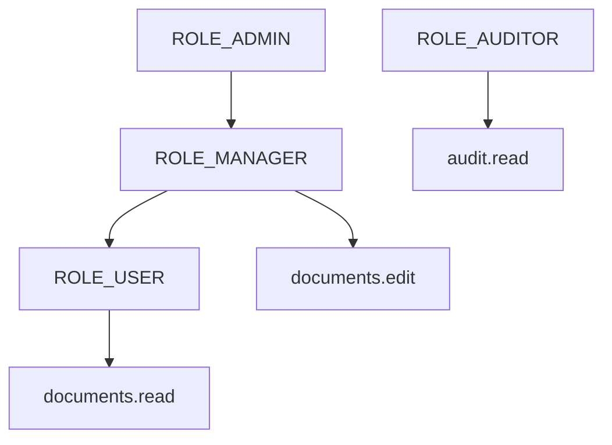

# Role Inheritance Relationships and the Authority Implication Problem

In an application with multiple roles such as `ADMIN`, `MANAGER`, and `USER`, a common requirement is: **a user holding a higher-level role should be permitted to perform operations granted to certain lower-level roles**, without having to store every lower role on each user or write long `OR` clauses in every rule.

**Role hierarchy** is a mechanism for declaring **implication relationships between authorities**. With Spring Security, you can write:

```text
ROLE_ADMIN > ROLE_MANAGER
ROLE_MANAGER > ROLE_USER
```

The notation **`A > B` means “A implies B”**, **not** “A is promoted to B”. When the authorization mechanism integrates `RoleHierarchy`, a user assigned `ROLE_ADMIN` is treated as having `ROLE_MANAGER` and `ROLE_USER` **during hierarchy-aware authorization checks**. A user who only has `ROLE_USER` is **not** automatically elevated to `ROLE_MANAGER`.

The idea is very useful, but it easily causes over-privileged access bugs if the arrow direction is misunderstood, overly broad relationships are created, or a single global hierarchy is used for permissions that actually depend on tenant, object, or business state.

**Lesson scope:** Spring Security authorization on Servlet, `GrantedAuthority`/`hasRole`/`hasAuthority`, `RoleHierarchy`/`RoleHierarchyImpl`, HTTP and method checks, Java 17+, graph modeling, and operational considerations. Framework examples focus on **Spring Security 6.5.x**; when using Spring Security 7.x, check the version documentation because `AuthorizationManager` creation APIs have changed.

## 1. The problem: does one role imply another role?

Suppose a document management application has three roles:

| Role | Business purpose |
| --- | --- |
| `ROLE_USER` | View public/granted documents |
| `ROLE_MANAGER` | Perform USER tasks and manage documents within permitted scope |
| `ROLE_ADMIN` | Perform MANAGER tasks and administer the system according to policy |

Without an inheritance mechanism, the system must choose one of the following approaches:

**Approach A – directly assign multiple roles to each user:**

```text
Alice: ROLE_ADMIN, ROLE_MANAGER, ROLE_USER
Bob:   ROLE_MANAGER, ROLE_USER
Carol: ROLE_USER
```

When the USER role gains a new capability, the system must ensure every higher-level account also receives that role. Management complexity grows with the number of roles, users, and groups.

**Approach B – write all permitted roles in every rule:**

```java
.requestMatchers("/dashboard").hasAnyRole("USER", "MANAGER", "ADMIN")
```

When adding `ROLE_SUPERVISOR` or changing policy, many rules must be updated. There is a risk that an endpoint is forgotten and either wrongly denied or wrongly exposed.

**Approach C – declare implication relationships once:**

```text
ROLE_ADMIN > ROLE_MANAGER
ROLE_MANAGER > ROLE_USER
```

Now a rule requiring `ROLE_USER` can evaluate successfully for `ROLE_ADMIN` or `ROLE_MANAGER` **when the authorization manager is wired with the role hierarchy**:

```java
.requestMatchers("/dashboard").hasRole("USER")
```

This mechanism lets the rule express the **minimum required authority level**, instead of listing every higher-level role that satisfies the condition.

### What does NOT happen automatically?

- Spring Security **does not automatically infer** the relationship `ADMIN > MANAGER > USER` from role names.
- A string `ROLE_ADMIN` inside `SimpleGrantedAuthority` **does not inherently contain** other authorities.
- A hierarchy **does not automatically turn a user into the owner** of a document or a member of another tenant.
- `ROLE_USER` will **never** “reverse-inherit” `ROLE_ADMIN` simply by coexisting in the same graph.
- Simply declaring a `RoleHierarchy` bean is not proof that every custom authorization manager, every token consumer, and every service in the system uses that hierarchy.

## 2. Reading the `>` sign correctly: directed authority implication

Consider:

```text
ROLE_ADMIN > ROLE_MANAGER
ROLE_MANAGER > ROLE_USER
ROLE_USER > documents.read
ROLE_MANAGER > documents.edit
ROLE_AUDITOR > audit.read
```



The arrow goes **from the source authority with broader power to the implied target authority**. `ROLE_ADMIN` implies `ROLE_MANAGER`, and therefore transitively implies `ROLE_USER`, `documents.read`, and `documents.edit`. `ROLE_AUDITOR` is a separate branch: with no edge between auditor and manager, **no permissions are inherited in either direction**.

### 2.1. Direct implication and transitive implication

Given the edges:

```text
A > B
B > C
```

We have:

- **Direct:** A implies B, B implies C.
- **Transitive:** A implies C through B.
- **Asymmetric:** B does not implicitly imply A.
- **No unstated edges added:** Without `C > D` or another path to D, A does not automatically imply D.

In graph theory, `RoleHierarchy` finds the **set of reachable authorities** from the assigned authorities. You can picture it as:

```text
reachable(ROLE_ADMIN)
  = { ROLE_ADMIN,
      ROLE_MANAGER,
      ROLE_USER,
      documents.read,
      documents.edit }
```

The strings in this set are **authority names**; they do not represent a verified user context or an access policy for a specific record.

### 2.2. Why include the original authority as well?

If a user is assigned `ROLE_MANAGER`, they must still satisfy rules requiring `ROLE_MANAGER` itself, in addition to inherited authorities. `RoleHierarchy#getReachableGrantedAuthorities(...)` returns **the original authorities together with the reachable ones**, not only newly derived target nodes.

### 2.3. A diamond graph does not “double” permissions

A hierarchy can have converging branches:

```text
ROLE_ADMIN > ROLE_EDITOR
ROLE_ADMIN > ROLE_REVIEWER
ROLE_EDITOR > documents.read
ROLE_REVIEWER > documents.read
```

`documents.read` is reachable via two paths, yet it remains **a single authority**; there is no rule where “two paths grant twice the permission”. When computing the closure, duplicate authority names are treated as elements of an authority set.

### 2.4. Avoiding cycles

A sensible graph for hierarchical relationships generally **has no cycles** such as:

```text
ROLE_ADMIN > ROLE_MANAGER
ROLE_MANAGER > ROLE_USER
ROLE_USER > ROLE_ADMIN
```

Cycles break the meaning of “higher” and “lower”. `RoleHierarchyImpl` in Spring Security 6.5 detects cycles during construction/pre-calculation and can throw `CycleInRoleHierarchyException`. Validate that the graph is a DAG (directed acyclic graph), especially if configuration is generated from a database or external file.

## 3. A role is not a separate Java type inside Authentication

In Spring Security, authorities are attached to a user via `GrantedAuthority`:

```java
GrantedAuthority authority =
        new SimpleGrantedAuthority("ROLE_ADMIN");
```

`SimpleGrantedAuthority` simply holds a string. A role is conventionally an authority prefixed with `ROLE_`; a permission might be `documents.read`, `documents.edit`, or `invoice:approve`. The string argument to `SimpleGrantedAuthority` **does not automatically classify** it as a role or a permission.

In the default configuration:

- `hasRole("ADMIN")` checks for the authority `ROLE_ADMIN`.
- `hasAuthority("ROLE_ADMIN")` checks the full string.
- `hasAuthority("documents.read")` checks the business permission named `documents.read`.
- `hasRole("documents.read")` is **not** equivalent to `hasAuthority("documents.read")`, because the default role prefix is `ROLE_`.

A hierarchy can connect **both roles and regular authorities**, for example:

```text
ROLE_MANAGER > documents.edit
ROLE_USER > documents.read
```

However, this is an **explicitly declared** relationship, not a feature where Spring infers meaning from the words “manager” or “read”. Every authority in the hierarchy must use the **exact string name** queried by the authorization check.

### Prefix and case sensitivity

`ROLE_ADMIN`, `ROLE_admin`, `ADMIN`, and `role_admin` are distinct identifiers. When using the `RoleHierarchyImpl.withDefaultRolePrefix()` builder, you can pass short names like `ADMIN`/`USER` and the builder prepends `ROLE_`. When using `RoleHierarchyImpl.fromHierarchy(String)`, definition lines use **full authority strings** such as `ROLE_ADMIN`.

If the application customizes the role prefix via `GrantedAuthorityDefaults` or a custom policy, verify every place where roles are created, hierarchy is declared, and `hasRole` is used to avoid prefix mismatches.

## 4. What does RoleHierarchy do in Spring Security?

Spring Security provides the interface:

```java
public interface RoleHierarchy {
    Collection<? extends GrantedAuthority> getReachableGrantedAuthorities(
            Collection<? extends GrantedAuthority> authorities);
}
```

The signature above is a **type-equivalent illustration**; when integrating into a project, import the real interface `org.springframework.security.access.hierarchicalroles.RoleHierarchy` and use the signature of your active version.

Common implementation: **`RoleHierarchyImpl`** at:

```text
org.springframework.security.access.hierarchicalroles.RoleHierarchyImpl
```

It takes edge definitions and computes transitively reachable authorities. When a hierarchy-aware manager evaluates `hasRole` or `hasAuthority`, it uses the **reachable set** to determine whether the user satisfies the required authority.

**Data model notes:**

- `Authentication#getAuthorities()` still typically holds the **originally granted authorities** created by the authentication provider.
- `RoleHierarchyImpl#getReachableGrantedAuthorities(...)` returns an **effective set resolved through the hierarchy**.
- A role being treated as implying another authority during **an authorization step** does not mean the `Authentication` object was mutated or new claims were added to a JWT.
- If a service manually runs `authentication.getAuthorities().contains(...)` without using a hierarchy-aware manager, it may **fail to see** implied authorities.
- If the application uses multiple authorization layers (HTTP, method, custom endpoints, standalone resource servers), align where the same hierarchy definition is used and where only raw authorities are checked.

### Use a bean, not the deprecated setter

Spring Security 6.5 supports:

```java
@Bean
static RoleHierarchy roleHierarchy() {
    return RoleHierarchyImpl.fromHierarchy("""
        ROLE_ADMIN > ROLE_MANAGER
        ROLE_MANAGER > ROLE_USER
        ROLE_USER > documents.read
        ROLE_MANAGER > documents.edit
        ROLE_AUDITOR > audit.read
        """);
}
```

`fromHierarchy(...)` builds the object from the definition. The older pattern using `new RoleHierarchyImpl()` followed by `setHierarchy(...)` is marked **deprecated** in Spring Security 6.5; prefer the new factory methods. The snippet is a **bean configuration fragment** in a Spring Boot 3/Java 17+ application and requires importing `@Bean`, `RoleHierarchy`, and `RoleHierarchyImpl`.

## 5. Java 17 + Maven: running directly against the real RoleHierarchyImpl

This complete example uses the **actual Spring Security implementation**, not a graph simulation. It prints a sorted reachable set so stdout is deterministic regardless of the library's returned collection order.

Project structure:

```text
role-hierarchy-demo/
├── pom.xml
└── src/
    └── main/
        └── java/
            └── demo/
                └── RoleHierarchyDemo.java
```

Create **`pom.xml`**:

```xml
<project xmlns="http://maven.apache.org/POM/4.0.0"
         xmlns:xsi="http://www.w3.org/2001/XMLSchema-instance"
         xsi:schemaLocation="http://maven.apache.org/POM/4.0.0
             https://maven.apache.org/xsd/maven-4.0.0.xsd">
    <modelVersion>4.0.0</modelVersion>
    <groupId>demo</groupId>
    <artifactId>role-hierarchy-demo</artifactId>
    <version>1.0.0</version>

    <properties>
        <maven.compiler.release>17</maven.compiler.release>
        <project.build.sourceEncoding>UTF-8</project.build.sourceEncoding>
    </properties>

    <dependencies>
        <dependency>
            <groupId>org.springframework.security</groupId>
            <artifactId>spring-security-core</artifactId>
            <version>6.5.11</version>
        </dependency>
    </dependencies>

    <build>
        <plugins>
            <plugin>
                <groupId>org.apache.maven.plugins</groupId>
                <artifactId>maven-compiler-plugin</artifactId>
                <version>3.14.0</version>
            </plugin>
            <plugin>
                <groupId>org.codehaus.mojo</groupId>
                <artifactId>exec-maven-plugin</artifactId>
                <version>3.5.1</version>
                <configuration>
                    <mainClass>demo.RoleHierarchyDemo</mainClass>
                </configuration>
            </plugin>
        </plugins>
    </build>
</project>
```

Create **`src/main/java/demo/RoleHierarchyDemo.java`**:

```java
package demo;

import java.util.List;
import java.util.TreeSet;
import org.springframework.security.access.hierarchicalroles.RoleHierarchy;
import org.springframework.security.access.hierarchicalroles.RoleHierarchyImpl;
import org.springframework.security.core.GrantedAuthority;
import org.springframework.security.core.authority.SimpleGrantedAuthority;

public class RoleHierarchyDemo {

    static String visible(
            RoleHierarchy hierarchy, String directlyAssigned) {

        List<GrantedAuthority> original = List.of(
                new SimpleGrantedAuthority(directlyAssigned)
        );

        TreeSet<String> names = new TreeSet<>();
        for (GrantedAuthority authority :
                hierarchy.getReachableGrantedAuthorities(original)) {
            names.add(authority.getAuthority());
        }
        return names.toString();
    }

    static boolean has(
            RoleHierarchy hierarchy, String assigned, String required) {

        return hierarchy.getReachableGrantedAuthorities(List.of(
                new SimpleGrantedAuthority(assigned)
        )).stream().anyMatch(authority ->
                required.equals(authority.getAuthority()));
    }

    public static void main(String[] args) {
        RoleHierarchy hierarchy = RoleHierarchyImpl.fromHierarchy("""
                ROLE_ADMIN > ROLE_MANAGER
                ROLE_MANAGER > ROLE_USER
                ROLE_USER > documents.read
                ROLE_MANAGER > documents.edit
                ROLE_AUDITOR > audit.read
                """);

        System.out.println("ADMIN: " + visible(hierarchy, "ROLE_ADMIN"));
        System.out.println("MANAGER: "
                + visible(hierarchy, "ROLE_MANAGER"));
        System.out.println("USER: " + visible(hierarchy, "ROLE_USER"));
        System.out.println("AUDITOR: "
                + visible(hierarchy, "ROLE_AUDITOR"));

        System.out.println("ADMIN has ROLE_USER: "
                + has(hierarchy, "ROLE_ADMIN", "ROLE_USER"));
        System.out.println("USER has ROLE_ADMIN: "
                + has(hierarchy, "ROLE_USER", "ROLE_ADMIN"));
        System.out.println("MANAGER can documents.edit: "
                + has(hierarchy, "ROLE_MANAGER", "documents.edit"));
        System.out.println("AUDITOR can documents.read: "
                + has(hierarchy, "ROLE_AUDITOR", "documents.read"));
        System.out.println("USER can documents.edit: "
                + has(hierarchy, "ROLE_USER", "documents.edit"));
    }
}
```

Inside the `role-hierarchy-demo` directory with **JDK 17+ and compatible Maven**, run:

```bash
mvn -q compile exec:java
```

Expected stdout of the **program**, sorted ascending by `TreeSet`:

```text
ADMIN: [ROLE_ADMIN, ROLE_MANAGER, ROLE_USER, documents.edit, documents.read]
MANAGER: [ROLE_MANAGER, ROLE_USER, documents.edit, documents.read]
USER: [ROLE_USER, documents.read]
AUDITOR: [ROLE_AUDITOR, audit.read]
ADMIN has ROLE_USER: true
USER has ROLE_ADMIN: false
MANAGER can documents.edit: true
AUDITOR can documents.read: false
USER can documents.edit: false
```

**How to read the output:**

1. `ROLE_ADMIN` gains `ROLE_USER` by traversing through `ROLE_MANAGER`: this is **transitive inheritance**.
2. `ROLE_USER` does **not** gain `ROLE_ADMIN` because the graph is directed.
3. `ROLE_MANAGER` sees both `documents.edit` directly and `documents.read` via `ROLE_USER`.
4. `ROLE_AUDITOR` only has the declared `audit.read` permission; it does not implicitly gain document access.
5. `TreeSet` is only used to **sort stdout** for easy comparison; element order inside a collection carries no authority level meaning.
6. This program **does not create a verified Authentication, protect HTTP endpoints, or issue tokens**. It only demonstrates the behavior of `RoleHierarchyImpl`.

## 6. Defining a hierarchy with the Builder

Spring Security 6.5 provides an explicit role-name builder; use it when you want to declare individual edges with a Java fluent API instead of a multi-line string:

```java
@Bean
static RoleHierarchy roleHierarchy() {
    return RoleHierarchyImpl.withDefaultRolePrefix()
        .role("ADMIN").implies("MANAGER")
        .role("MANAGER").implies("USER")
        .role("USER").implies("GUEST")
        .build();
}
```

This snippet generates implication relationships between these authorities:

```text
ROLE_ADMIN > ROLE_MANAGER
ROLE_MANAGER > ROLE_USER
ROLE_USER > ROLE_GUEST
```

Distinguish the two approaches:

- `withDefaultRolePrefix()`: pass **role names without `ROLE_`** in `role(...).implies(...)` calls.
- `fromHierarchy(...)`: write **exact full authority strings** on each line; this can include permissions without the `ROLE_` prefix.
- `withRolePrefix("CUSTOM_")` is available if the system uses a custom prefix convention; keep it synchronized with where authorities are created and where rules are checked, rather than only changing the builder.

**Do not write** `.role("ROLE_ADMIN")` assuming the `withDefaultRolePrefix()` builder will guess you already added the prefix; check the builder contract and use the short name `ADMIN` to avoid malformed authority names.

## 7. Wiring RoleHierarchy into HTTP authorization

In Spring Security Servlet, `authorizeHttpRequests` uses `AuthorizationManager` to evaluate rules. Spring Security 6.5 documentation supports applying a `RoleHierarchy` bean for standard URL-based managers.

Spring Boot 3.x configuration class example:

```java
package com.example.security;

import org.springframework.context.annotation.Bean;
import org.springframework.context.annotation.Configuration;
import org.springframework.http.HttpMethod;
import org.springframework.security.access.hierarchicalroles.RoleHierarchy;
import org.springframework.security.access.hierarchicalroles.RoleHierarchyImpl;
import org.springframework.security.config.annotation.web.builders.HttpSecurity;
import org.springframework.security.web.SecurityFilterChain;

@Configuration
public class WebSecurityConfig {

    @Bean
    static RoleHierarchy roleHierarchy() {
        return RoleHierarchyImpl.fromHierarchy("""
            ROLE_ADMIN > ROLE_MANAGER
            ROLE_MANAGER > ROLE_USER
            ROLE_USER > documents.read
            ROLE_MANAGER > documents.edit
            """);
    }

    @Bean
    SecurityFilterChain filterChain(HttpSecurity http) throws Exception {
        http.authorizeHttpRequests(auth -> auth
            .requestMatchers("/admin/**").hasRole("ADMIN")
            .requestMatchers("/manager/**").hasRole("MANAGER")
            .requestMatchers(HttpMethod.GET, "/documents/**")
                .hasAuthority("documents.read")
            .requestMatchers(HttpMethod.PATCH, "/documents/**")
                .hasAuthority("documents.edit")
            .anyRequest().denyAll()
        );
        return http.build();
    }
}
```

**This is integration code inside a Spring project**, not a standalone Java program. You still need an authentication mechanism (session/JWT/HTTP Basic depending on the system), controllers, dependencies, and appropriate CSRF/security headers. Real applications should verify that `RoleHierarchy` is wired into the chain's **authorization manager**; custom managers do not automatically pick up the hierarchy bean unless wired.

Suppose Alice is authenticated with **only** `ROLE_ADMIN`, Bob with `ROLE_MANAGER`, and Carol with `ROLE_USER`:

| Rule | Alice / ADMIN | Bob / MANAGER | Carol / USER |
| --- | --- | --- | --- |
| `hasRole("ADMIN")` | ALLOW | DENY | DENY |
| `hasRole("MANAGER")` | ALLOW via hierarchy | ALLOW | DENY |
| `hasRole("USER")` | ALLOW via hierarchy | ALLOW via hierarchy | ALLOW |
| `hasAuthority("documents.read")` | ALLOW via hierarchy | ALLOW via hierarchy | ALLOW via hierarchy |
| `hasAuthority("documents.edit")` | ALLOW via hierarchy | ALLOW via hierarchy | DENY |

This table reflects **authorization rules when the hierarchy is properly applied**; it does not guarantee that a controller exists, that a request passed CSRF checks, or that the user is authorized to view a specific document.

### Note: hierarchy does not replace URL ordering rules

With matchers:

```java
.requestMatchers("/documents/**").permitAll()
.requestMatchers(HttpMethod.PATCH, "/documents/**")
    .hasAuthority("documents.edit")
```

The `permitAll` rule can shadow the PATCH rule placed after it. **Role hierarchy cannot rescue a misordered request matcher.** Place specific rules first, fallbacks later, and use `anyRequest().denyAll()` for undesigned endpoints.

## 8. Applying it to method security: @PreAuthorize, @Secured, JSR-250

URL-level permissions are not sufficient for many systems. When business logic is invoked from HTTP, message listeners, scheduled jobs, or other services, **method security** enforces checks at the service layer.

In Spring Boot 3.x/Spring Security 6.5, enable method security via:

```java
@Configuration
@EnableMethodSecurity
public class MethodSecurityConfig {
    // Method security configuration beans can be declared here.
}
```

**Spring Boot starter security does not enable `@EnableMethodSecurity` automatically**. Additionally, `@EnableMethodSecurity` applies to Spring-managed beans and proxies/advisors; calling `this.someProtectedMethod()` from within the same bean may bypass the proxy under default Spring AOP configuration.

### 8.1. @PreAuthorize requires configuring an expression handler

Per Spring Security 6.5 documentation, when using pre/post method expressions, publish an expression handler configured with `RoleHierarchy`:

```java
@Bean
static MethodSecurityExpressionHandler methodSecurityExpressionHandler(
        RoleHierarchy roleHierarchy) {

    DefaultMethodSecurityExpressionHandler handler =
            new DefaultMethodSecurityExpressionHandler();

    handler.setRoleHierarchy(roleHierarchy);
    return handler;
}
```

Corresponding imports:

```java
import org.springframework.context.annotation.Bean;
import org.springframework.security.access.expression.method.DefaultMethodSecurityExpressionHandler;
import org.springframework.security.access.expression.method.MethodSecurityExpressionHandler;
import org.springframework.security.access.hierarchicalroles.RoleHierarchy;
```

Making the bean `static` ensures Spring registers the handler before initializing the method security infrastructure. In Spring Security 6.5, managers backing `@Secured`/JSR-250 have hierarchy support mechanisms as documented, though **you should not assume every custom manager will automatically use this bean**.

### 8.2. Service example

```java
@Service
public class DocumentService {

    @PreAuthorize("hasRole('USER')")
    public String listDocuments() {
        return "list";
    }

    @PreAuthorize("hasAuthority('documents.edit')")
    public void updateMetadata(String id) {
        // Still need to check tenant/owner and the status of document id.
    }

    @PreAuthorize("hasRole('ADMIN')")
    public void manageUsers() {
        // Account management; may require MFA per separate policy.
    }
}
```

**This snippet belongs inside a Spring application with method security enabled** and does not run standalone. With a properly wired hierarchy, `ROLE_MANAGER` passes `listDocuments()` and `updateMetadata(...)`, but fails `manageUsers()`. `ROLE_USER` passes `listDocuments()` and fails `updateMetadata(...)`.

A method checking only `documents.edit` still does not guarantee the user is allowed to edit **document `id`**. Combine it with `@PreAuthorize("@docPolicy.canEdit(authentication, #id)")` or a service-level check using trusted owner, tenant, status, and sharing data.

### 8.3. Custom managers must handle it explicitly

If you write:

```java
boolean allowed = authentication.getAuthorities().stream()
    .anyMatch(a -> a.getAuthority().equals("ROLE_USER"));
```

This snippet **checks only the raw authorities** present in `Authentication` and ignores the hierarchy unless you previously expanded them into `Authentication`. To achieve the same hierarchy-aware semantics:

```java
boolean allowed = roleHierarchy
    .getReachableGrantedAuthorities(authentication.getAuthorities())
    .stream()
    .anyMatch(a -> "ROLE_USER".equals(a.getAuthority()));
```

This is a **logic snippet** assuming `roleHierarchy` and a verified `authentication` are present, not a standalone runnable program. Avoid expanding and permanently storing the derived authorities onto the user when policy expects hierarchy evaluation at check time; this architectural choice affects permission updates.

## 9. From role to permission: two layers of implication are not always identical

**Role hierarchy** describes “A implies B” between authorities. **Permission mapping** describes which actions a role is allowed to perform. You can implement permission mapping directly inside `RoleHierarchyImpl` if authority names are clear:

```text
ROLE_USER > documents.read
ROLE_MANAGER > ROLE_USER
ROLE_MANAGER > documents.edit
ROLE_ADMIN > ROLE_MANAGER
```

Or split them into **two explicit structures**:

```text
Role hierarchy:
  ROLE_ADMIN   > ROLE_MANAGER
  ROLE_MANAGER > ROLE_USER

Role -> permission:
  ROLE_USER    -> documents.read
  ROLE_MANAGER -> documents.edit
  ROLE_ADMIN   -> users.manage
```

The two approaches have different operational trade-offs:

| Design | Benefits | Considerations |
| --- | --- | --- |
| All edges in `RoleHierarchy` | Single simple graph; `hasAuthority` rules can leverage closure | Every consumer must understand the hierarchy; easy to blur roles and fine-grained permissions |
| Expand permissions at authentication | `Authentication#getAuthorities()` shows concrete permissions directly | Sessions/JWTs may hold stale snapshots; mapping updates do not affect existing tokens |
| Check permissions via dynamic service/policy | Fits frequently changing or resource-dependent permissions | Introduces DB/cache/service consistency and query cost |
| Combine role hierarchy + resource policy | Readable, reduces duplicated rules while still protecting objects | Must clearly separate coarse-grained checks from owner/tenant checks |

**No single approach is mandatory** for every system. Choose based on permission characteristics: static vs. dynamic, global vs. per-record, and fast revocation requirements vs. tolerance for token/session snapshots.

### Example of scoping permissions by resource

Suppose `ROLE_MANAGER > documents.edit`. That **does not mean** a manager in tenant A can edit documents in tenant B. A realistic policy might look like:

```text
canEditDocument(user, document) =
    authenticated(user)
    AND hasEffectiveAuthority(user, "documents.edit")
    AND user.tenantId == document.tenantId
    AND (isOwner(user, document) OR isAssignedEditor(user, document))
    AND document.status != "LOCKED"
```

`hasEffectiveAuthority` here is conceptual and can rely on a hierarchy-aware authorization manager. Conditions regarding tenant, ownership, and status must be read from a trusted data store, **not inferred from the role**.

## 10. Implying a role does not mean “everyone else's permissions”

A hierarchy does not have to be a **linear list of authorities**. In an organization, there are independent roles:

```text
ROLE_FINANCE_APPROVER > invoices.approve
ROLE_AUDITOR > audit.read
ROLE_SUPPORT > tickets.read
```

There is no default reason for:

```text
ROLE_FINANCE_APPROVER > ROLE_AUDITOR
ROLE_SUPPORT > ROLE_FINANCE_APPROVER
ROLE_ADMIN > everything
```

The last one is only true **if the organization intentionally designs it that way** and has assessed the risk. In financial systems, **separation of duties** may require that the person creating a payment order and the person approving it be two different individuals, even including system administrators. A global hierarchy where “ADMIN implies every role” can break this control.

### Principles for designing a safe hierarchy

1. Only add edges when permissions are **genuinely implied** by business semantics, not because a title sounds higher.
2. Specify clearly which permissions are **read**, **write**, **approve**, **export**, or **delete**; do not dump everything unconditionally under `ROLE_MANAGER`.
3. Avoid transitive chains that unintentionally grant sensitive permissions across multiple hops.
4. Avoid cycles; automatically validate the graph before deployment.
5. Edge changes must go through code review, audit, and **negative case** testing.
6. Determine whether a **multi-tenant** role applies organization-wide or only within the current tenant.
7. Distinguish “functional permissions” from “resource permissions”; a hierarchy does not replace scoped RBAC, ABAC, or ReBAC.
8. For sensitive operations, enforce MFA, fresh authentication, or dual control as required instead of treating roles as sufficient.

## 11. Implication with multiple directly assigned roles

A user can hold multiple root authorities:

```text
Assigned:
  ROLE_MANAGER
  ROLE_AUDITOR

Hierarchy:
  ROLE_MANAGER > ROLE_USER
  ROLE_USER > documents.read
  ROLE_AUDITOR > audit.read
```

Effective set:

```text
ROLE_MANAGER
ROLE_USER
documents.read
ROLE_AUDITOR
audit.read
```

This is the **union of the reachable sets** from each root role. If a policy checks `hasAuthority("documents.read")`, the user is permitted via the manager role; if it checks `hasAuthority("audit.read")`, the user is permitted via the auditor role.

If **both** permissions are required, use an explicit AND rule (`hasAllAuthorities` where supported by the API, or the expression `hasAuthority('documents.read') and hasAuthority('audit.read')`). `hasAnyAuthority` only requires **one of** the listed authorities, not all of them.

**There is no precedence where “an original role overrides an inherited role”** as a denial mechanism. `RoleHierarchy` is strictly about **granting additional reachable authorities**; it does not model explicit denies, dynamic revocation, or time-bound constraints.

## 12. Freshness of permissions: when do role or hierarchy changes take effect?

Two kinds of changes must be separated:

**A. Changing the roles assigned to a user.** For example, removing `ROLE_ADMIN` from Alice in the database. If Alice is using a session holding an old `Authentication` or a JWT carrying old roles, deleting the DB row **does not immediately update** the authorities on incoming requests. You need session/token refresh or revocation, or live authorization checks per policy.

**B. Changing the hierarchy definition.** For example, removing the edge `ROLE_MANAGER > documents.edit` in configuration. If an application uses a `RoleHierarchyImpl` built at startup, updating the config file or DB definition without **rebuilding the hierarchy object** (or performing a proper reload/redeploy) means the old instance will continue using the old relationships.

`RoleHierarchyImpl` precomputes the closure from declared edges for fast authorization checks. Do not treat it as an authority registry that auto-syncs with the database. If the hierarchy changes at runtime, design a mechanism to construct a new instance, manage lifecycle, handle caching, synchronize across nodes, and test update ordering.

### Fast revocation example

The `invoices.approve` permission is removed from `ROLE_MANAGER` in a new policy. If an existing token already contains `invoices.approve` directly (because permissions were expanded at issuance), removing the hierarchy edge in the API **does not remove that claim**. If requests only inspect token claims, the old permission remains accepted until the token expires or is revoked.

Therefore, specify clearly: **are permissions resolved at token issuance, at login, or at every authorization check?** This directly impacts revocation SLAs and policy rollout plans.

## 13. Large organizations: domain hierarchy and multi-tenancy

In a multi-organization system, the same string `ROLE_MANAGER` may only mean **“manager within tenant A”**. If the application builds a global graph:

```text
ROLE_MANAGER > ROLE_USER
```

It only describes the **role type**, not the **scope of application**. If a user is a manager in tenant A and calls an API for tenant B, checking `hasRole("MANAGER")` alone may be insufficient.

A safe design typically includes:

- **An authenticated principal** with a stable subject/identity.
- **A trusted source of tenant context** from a verified session/token or DB, validating the active tenant selection.
- **Tenant/project-scoped roles/permissions**, storing scope explicitly at the source or when resolving authorities.
- **A resource policy** verifying which tenant/project the target belongs to and whether the user has an appropriate relationship.
- **Deny by default** if the tenant is outside the permitted set.

Some permissions can be represented with namespaced authorities, but simply using strings like `tenantA:ROLE_MANAGER` is insufficient if the policy fails to verify the resource's tenant and prevent client spoofing. With large tenant counts and dynamic permissions, ABAC/ReBAC or a scoped permission service is usually a better fit than an overly complex global role hierarchy.

### Role hierarchy does not replace “direct manager”

`ROLE_MANAGER > ROLE_USER` does not state that Alice is Bob's manager or that Alice manages project P. Those are **data-level relationships**: manager-of, member-of, owner-of, shared-with, and so on. Check them in a record-level policy. Never confuse a “manager role” with a specific relationship.

## 14. Common pitfalls when configuring a hierarchy

| Symptom | Cause | Resolution |
| --- | --- | --- |
| `ROLE_ADMIN` fails `hasRole("USER")` | Hierarchy not declared/wired into manager, or mismatched role names | Check the bean, active manager, and `ROLE_` strings |
| `ROLE_USER` unexpectedly passes admin checks | Edge declared backwards, or `ROLE_ADMIN` assigned directly by mistake | Inspect the graph and test the reverse direction too |
| Custom service returns false while HTTP rule allows | Service only iterates raw `getAuthorities()` | Use a hierarchy-aware manager or expand in the right place |
| Has `ROLE_ADMIN` but `hasAuthority("documents.read")` fails | No path from admin to permission, or manager does not use hierarchy | Add intentional edges, test closure and wiring |
| Overly broad access after a small change | Transitive closure reaches a sensitive permission | Review transitive reachability and negative tests |
| Application fails to start after editing graph | Cycle present or invalid edge configuration | Validate DAG structure and formatting before deploy |
| Sees `ADMIN` but rule expects `ROLE_ADMIN` | Inconsistent prefix/string naming | Standardize `ROLE_` and `GrantedAuthorityDefaults` |
| JWT lacks roles while HTTP expects ROLE_USER | JWT converter only produces `SCOPE_...` by default | Map roles from verified claims or use an appropriate scope policy |
| Hierarchy updated in DB but API still uses old rules | `RoleHierarchyImpl` was not rebuilt/reloaded | Design reload + consistency and verify across all nodes |
| Role removed in DB but session still keeps old access | Authentication/token is a snapshot | Implement invalidation, refresh, or live checks |
| Admin edits another tenant's document | Only checked coarse role, skipped owner/tenant | Add object-level authorization |
| All roles nested under ADMIN | Violates separation of duties | Separate non-implied roles and add policy controls |
| Role comparisons mix lowercase/uppercase | Authority matching is exact string equality | Normalize names and test case sensitivity |
| `@PreAuthorize` methods do not see the hierarchy | `MethodSecurityExpressionHandler` not configured properly | Enable method security, declare a static handler, and wire hierarchy |
| Spring Security API differs from online examples | Different major/minor version | Read Javadoc for your exact version and update tests before migrating |

## 15. Testing role hierarchy: include both allow and deny directions

Do not only test “ADMIN can access USER”; also test “USER cannot access ADMIN” and all independent branches.

### 15.1. Logic test matrix

Given the definition:

```text
ROLE_ADMIN > ROLE_MANAGER
ROLE_MANAGER > ROLE_USER
ROLE_USER > documents.read
ROLE_MANAGER > documents.edit
ROLE_AUDITOR > audit.read
```

| Initially assigned authority | Required rule | Result with hierarchy |
| --- | --- | --- |
| `ROLE_ADMIN` | `ROLE_ADMIN` | ALLOW |
| `ROLE_ADMIN` | `ROLE_MANAGER` | ALLOW – direct |
| `ROLE_ADMIN` | `ROLE_USER` | ALLOW – transitive |
| `ROLE_ADMIN` | `documents.read` | ALLOW – transitive |
| `ROLE_ADMIN` | `documents.edit` | ALLOW – transitive |
| `ROLE_MANAGER` | `ROLE_USER` | ALLOW |
| `ROLE_MANAGER` | `ROLE_ADMIN` | DENY |
| `ROLE_USER` | `documents.read` | ALLOW |
| `ROLE_USER` | `documents.edit` | DENY |
| `ROLE_AUDITOR` | `audit.read` | ALLOW |
| `ROLE_AUDITOR` | `documents.read` | DENY |
| `ROLE_SUPPORT` | `ROLE_USER` | DENY if there is no related edge |

Note: **These results represent hierarchy-aware authorization logic**, not guaranteed HTTP status codes. A request can still be rejected by CSRF, authentication, resource policy, or the controller at another layer.

### 15.2. Direct unit test for RoleHierarchyImpl

JUnit 5 test snippet (requires `spring-security-core`, JUnit, and appropriate imports):

```java
@Test
void adminImpliesUserButUserDoesNotImplyAdmin() {
    RoleHierarchy hierarchy = RoleHierarchyImpl.fromHierarchy("""
        ROLE_ADMIN > ROLE_MANAGER
        ROLE_MANAGER > ROLE_USER
        """);

    Set<String> admin = hierarchy.getReachableGrantedAuthorities(
        List.of(new SimpleGrantedAuthority("ROLE_ADMIN"))
    ).stream().map(GrantedAuthority::getAuthority)
     .collect(Collectors.toSet());

    Set<String> user = hierarchy.getReachableGrantedAuthorities(
        List.of(new SimpleGrantedAuthority("ROLE_USER"))
    ).stream().map(GrantedAuthority::getAuthority)
     .collect(Collectors.toSet());

    assertTrue(admin.contains("ROLE_USER"));
    assertFalse(user.contains("ROLE_ADMIN"));
}
```

This is a **test snippet** in a project using JUnit 5; it requires importing `@Test`, `Set`, `List`, `Collectors`, `GrantedAuthority`, `RoleHierarchy`, `RoleHierarchyImpl`, `SimpleGrantedAuthority`, and assertions.

### 15.3. HTTP and method security integration tests

After configuring the `RoleHierarchy` bean, create a principal with only `ROLE_ADMIN` and verify:

- `GET /manager/...` with `hasRole("MANAGER")` passes HTTP authorization.
- `GET /admin/...` with a principal having only `ROLE_USER` is denied.
- `GET /documents/42` with `documents.read` implied from a role passes the **HTTP authority check**; the service still checks owner/tenant.
- A method with `@PreAuthorize("hasRole('USER')")` passes for `ROLE_MANAGER` when the handler has the hierarchy wired.
- A method with `@PreAuthorize("hasAuthority('documents.edit')")` is blocked for `ROLE_USER`.
- Custom managers using the hierarchy are tested separately; do not assume automatic application to custom code.
- A principal with `ROLE_AUDITOR` is tested to access audit endpoints only, not documents.
- Hierarchy/role changes and existing sessions/tokens are tested if fast permission updates are required.

`MockMvc`/Spring Security Test can build authentication via `user("alice").roles("ADMIN")` or `@WithMockUser(roles="ADMIN")`. These helpers attach `ROLE_ADMIN` per builder rules, but **do not automatically grant all inherited authorities** if the system has not configured `RoleHierarchy` for the active manager.

**For POST/PATCH/DELETE**, use `with(csrf())` when CSRF is enabled to separate CSRF errors from hierarchy errors.

### 15.4. Validating graphs loaded from external config

If edges are loaded from a DB or config file, include an automated validation step:

1. Every source/target role or permission follows valid naming conventions.
2. There are no empty edges, typos, or policy contradictions.
3. There are no cycles.
4. A new edge does not accidentally let `ROLE_USER` reach administrative permissions.
5. Roles that must stay isolated for internal controls are not implied.
6. Node/edge counts and transitive closure grow as expected; guard against abnormal permission expansion.
7. Reloads update consistently across all instances and log/audit the policy version.

## 16. Before–after scenario: reducing duplicate rules without over-granting

**Before hierarchy:**

```java
.requestMatchers("/workspace").hasAnyRole("USER", "MANAGER", "ADMIN")
.requestMatchers("/team").hasAnyRole("MANAGER", "ADMIN")
.requestMatchers("/admin").hasRole("ADMIN")
```

**After configuring**:

```text
ROLE_ADMIN > ROLE_MANAGER
ROLE_MANAGER > ROLE_USER
```

Rules become clearer:

```java
.requestMatchers("/workspace").hasRole("USER")
.requestMatchers("/team").hasRole("MANAGER")
.requestMatchers("/admin").hasRole("ADMIN")
```

Effect:

- `/workspace` simply states the minimum required role is USER.
- `/team` simply states the minimum required role is MANAGER.
- `/admin` still requires ADMIN and is not accidentally exposed to MANAGER/USER.
- When adding a new role, you can decide its inheritance edges and test the graph instead of editing every URL.

**However**, if `/admin` also includes financial approval operations requiring dual control, there is no reason to assume every system admin automatically satisfies business requirements. Role hierarchy reduces syntax, **it does not define organizational policy by itself**.

## 17. Self-check questions

**Question 1. Does `ROLE_ADMIN > ROLE_MANAGER` mean MANAGER is granted ADMIN?**  
No. It means **ADMIN implies MANAGER**; the reverse direction does not exist automatically.

**Question 2. Given `ROLE_ADMIN > ROLE_MANAGER` and `ROLE_MANAGER > ROLE_USER`, does ADMIN satisfy `hasRole("USER")`?**  
Yes, **when the authorization manager applies the hierarchy**, through transitive inheritance.

**Question 3. Does Spring Security automatically know that `ADMIN` is “higher than” `USER`?**  
No. All relationships must be explicitly defined.

**Question 4. Why is `ROLE_USER > ROLE_ADMIN` dangerous?**  
It causes regular users to imply admin, leading to privilege escalation if managers apply the hierarchy.

**Question 5. Does `SimpleGrantedAuthority("ROLE_ADMIN")` automatically return `ROLE_USER` from `getAuthority()`?**  
No. It returns `ROLE_ADMIN` literally; hierarchy-aware checks evaluate the reachable set.

**Question 6. Can you declare `ROLE_ADMIN > permission:read`?**  
Yes; `RoleHierarchy` works with **authorities**, not just strings starting with `ROLE_`, provided the wiring is configured properly.

**Question 7. Is `RoleHierarchyImpl.setHierarchy(...)` the recommended API in Spring Security 6.5?**  
No. The no-arg constructor and setter are deprecated; use `fromHierarchy(...)` or the builder.

**Question 8. Can a MANAGER of tenant A automatically edit tenant B's data via the hierarchy?**  
It should not be allowed. A hierarchy does not replace tenant/owner checks and resource-level permissions.

**Question 9. Does deleting ADMIN in the DB immediately strip permissions from all issued JWTs?**  
Not by default. JWTs/sessions may cache an old role snapshot; a revocation or re-check mechanism is required.

**Question 10. Why must you also test the USER → ADMIN direction?**  
To catch reversed edge declarations, cycles, and changes that cause low-privilege users to escalate privileges.

## Conclusion

- **A role hierarchy is a directed implication relationship** between authorities. `A > B` means holding A is treated as holding B when checking permissions through a hierarchy-aware manager.
- **Inheritance is transitive and asymmetric**. Higher-level authorities can imply lower-level ones, but the reverse does not exist automatically.
- **`RoleHierarchyImpl`** in Spring Security computes the reachable set; use `fromHierarchy(...)` or the appropriate builder, and validate against cycles and authority naming errors.
- **Declaring a hierarchy is not enough** for every access path: ensure HTTP/method authorization managers use the hierarchy and custom code does not bypass it.
- **Roles and permissions differ in business meaning**, though both can be represented as `GrantedAuthority`; a role does not automatically grant access based on owner, tenant, sharing relationships, or state.
- **Design for least privilege, test negative cases, manage session/token updates, and review the implication graph** so that inheritance convenience does not turn into over-privileged access bugs.

## References

- [Spring Security 6.5 – Authorization Architecture: Hierarchical Roles](https://docs.spring.io/spring-security/reference/6.5/servlet/authorization/architecture.html)
- [Spring Security 6.5 – Method Security](https://docs.spring.io/spring-security/reference/6.5/servlet/authorization/method-security.html)
- [Spring Security 6.5 – RoleHierarchyImpl Javadoc](https://docs.spring.io/spring-security/reference/6.5/api/java/org/springframework/security/access/hierarchicalroles/RoleHierarchyImpl.html)
- [Spring Security 6.5 – RoleHierarchy Interface Javadoc](https://docs.spring.io/spring-security/reference/6.5/api/java/org/springframework/security/access/hierarchicalroles/RoleHierarchy.html)
- [Spring Security 6.5 – GrantedAuthority Javadoc](https://docs.spring.io/spring-security/reference/6.5/api/java/org/springframework/security/core/GrantedAuthority.html)
- [Spring Security 6.5 – Authorize HttpServletRequests](https://docs.spring.io/spring-security/reference/6.5/servlet/authorization/authorize-http-requests.html)
