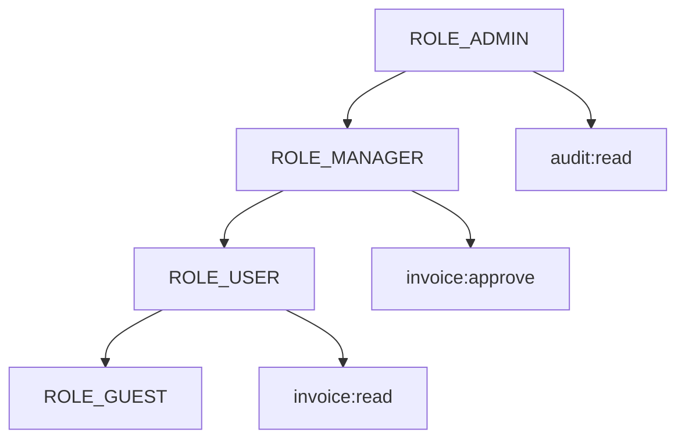

# RoleHierarchy and RoleHierarchyImpl

> **Module:** Spring Security - authorization  
> **Group:** Role hierarchy  
> **Objective:** Understand graph-based role inheritance, distinguish directly assigned authorities from hierarchy-reachable authorities, use `RoleHierarchy` and `RoleHierarchyImpl` properly in Spring Security 6.5+/7.x, configure them for HTTP and method authorization, write tests proving both allowed access and non-escalation, and recognize the limits of hierarchies against owner/tenant/ACL rules.

## 1. The problem: a higher-level role needs the permissions of lower-level roles

Suppose a system has these roles:

- `ROLE_ADMIN`: system administrator.
- `ROLE_MANAGER`: department manager.
- `ROLE_USER`: regular user.

Most features intended for USER should also be usable by MANAGER and ADMIN. If each rule is written separately, code gets duplicated:

```java
@PreAuthorize(
    "hasAnyRole('USER', 'MANAGER', 'ADMIN')"
)
public String viewDashboard() {
    return "Dashboard";
}
```

Elsewhere, a developer might forget to add ADMIN to a `hasAnyRole` list, locking admins out of USER features; or add roles too broadly, exposing sensitive endpoints. Another option is assigning `ROLE_USER`, `ROLE_MANAGER`, and `ROLE_ADMIN` to every admin account at login, but that scatters inheritance logic across providers, JWT converters, and user stores.

`RoleHierarchy` eliminates that repetition by defining:

```text
ROLE_ADMIN   > ROLE_MANAGER
ROLE_MANAGER > ROLE_USER
```

The `>` sign is **not** a numeric comparison or Spring filter priority. In hierarchy syntax, it means “the role on the left **implies** the role on the right”. When an authorization component uses this hierarchy, a holder of `ROLE_ADMIN` can be evaluated as having `ROLE_MANAGER` **and** `ROLE_USER`.

Do not forget: *a hierarchy only expands the authority set used in checks that are configured to understand the hierarchy*. It does not verify that a user owns every record, does not cross tenant isolation, does not mutate data, and does not automatically ensure every custom authorization manager uses the hierarchy.

## 2. Directed graph model and transitivity

A hierarchy can be viewed as a directed graph:



The edges specify **one-way authority implication**:

- `ROLE_ADMIN` implies `ROLE_MANAGER`.
- `ROLE_MANAGER` implies `ROLE_USER`.
- By **transitivity**, `ROLE_ADMIN` also implies `ROLE_USER`.
- If the edge `ROLE_ADMIN > audit:read` exists, admin is treated as having the audit permission in hierarchy-aware checks.
- If `ROLE_MANAGER > invoice:approve` and `ROLE_USER > invoice:read` exist, admin/manager can hold both approve and read permissions.

There is no reverse direction:

```text
ROLE_ADMIN -> ROLE_MANAGER -> ROLE_USER

ROLE_ADMIN can satisfy the ROLE_USER condition.
ROLE_USER must NOT imply ROLE_MANAGER.
ROLE_MANAGER must NOT imply ROLE_ADMIN.
```

To distinguish authority sources:

| Actor's direct authority | Authorities reached via hierarchy | `hasRole("USER")` when hierarchy applies | `hasRole("ADMIN")` |
| --- | --- | --- | --- |
| `ROLE_ADMIN` | ADMIN, MANAGER, USER, GUEST... | Allow | Allow |
| `ROLE_MANAGER` | MANAGER, USER, GUEST... | Allow | Deny |
| `ROLE_USER` | USER, GUEST... | Allow | Deny |
| `ROLE_GUEST` | GUEST | Deny | Deny |
| No matching role | Does not reach USER | Deny | Deny |

This is a **result model** assuming the hierarchy contains the edges above, the authentication source is trusted, and the manager/expression handler is actually wired with the hierarchy. It is not an automatic outcome in every configuration.

## 3. Roles and GrantedAuthority: the prefix is just a convention

Spring Security represents both roles and permissions via `GrantedAuthority`. A `SimpleGrantedAuthority("ROLE_ADMIN")` holds the authority string `ROLE_ADMIN`.

Two different conditions:

```java
hasRole("ADMIN")                 // searches for ROLE_ADMIN by default
hasAuthority("ROLE_ADMIN")        // searches for exact ROLE_ADMIN
```

With the default `ROLE_` prefix, `hasRole("ADMIN")` adds the prefix for you. Do not habitually pass `"ROLE_ADMIN"` into `hasRole`; many APIs will double-prefix or reject a pre-prefixed string. `hasAuthority` matches the exact string.

Note also:

- `ROLE_ADMIN` does not automatically become `ROLE_USER` **without a hierarchy or equivalent mapping**.
- `ROLE_ADMIN` does not automatically become `invoice:approve` just because the role name sounds “high”.
- `SCOPE_read` generated by OAuth2/JWT converters differs from `ROLE_USER` and `invoice:read`.
- `hasAnyAuthority("a","b")` is OR; `hasAnyRole("ADMIN","USER")` is also OR after applying the prefix.
- If the hierarchy includes role → permission edges, hierarchy-aware checks can recognize that permission without attaching the permission string directly to `Authentication`.

A role hierarchy is an **explicitly defined transitive grant policy**, not a built-in Spring Security rule where “ADMIN always has every permission”.

## 4. What is the RoleHierarchy interface responsible for?

Package:

```java
org.springframework.security.access.hierarchicalroles.RoleHierarchy
```

The central method in Spring Security 6.5 is:

```java
Collection<? extends GrantedAuthority>
    getReachableGrantedAuthorities(
        Collection<? extends GrantedAuthority> authorities
    );
```

The input is the set of **directly granted** authorities or the current authorities presented for checking. The output is the authorities reachable from them, including **the input authorities themselves** plus those implied by the hierarchy.

Example:

```text
Hierarchy:
    ROLE_ADMIN > ROLE_MANAGER
    ROLE_MANAGER > ROLE_USER

Input authorities:
    [ROLE_ADMIN]

Reachable:
    [ROLE_ADMIN, ROLE_MANAGER, ROLE_USER]
```

The element order in the returned collection is **not a permission contract**. When comparing in tests, convert to a set of strings or use `containsExactlyInAnyOrder` instead of relying on implementation-specific ordering.

What `RoleHierarchy` **does not do**:
- Does not verify credentials or issue JWTs.
- Does not mutate `Authentication#getAuthorities()` as a side effect when you simply call `getReachableGrantedAuthorities`.
- Does not decide whether someone has access to `Document#42` without knowing owner/tenant.
- Does not block URLs automatically; the caller must be an authorization component using the hierarchy.
- Does not automatically synchronize a user's active session/JWT permissions with the database.

## 5. RoleHierarchyImpl: the standard implementation

Package:

```java
org.springframework.security.access.hierarchicalroles.RoleHierarchyImpl
```

`RoleHierarchyImpl` is the built-in implementation of `RoleHierarchy`. It stores role/authority relationships and precomputes transitive relations to return reachable sets efficiently. Two important construction paths:

1. `RoleHierarchyImpl.fromHierarchy(String)`: text-based definition, each relation written as `higher > lower`.
2. `RoleHierarchyImpl.withDefaultRolePrefix()` or `withRolePrefix(String)`: fluent hierarchy builders, introduced in **Spring Security 6.3**.

Both are available in 6.5. When a project is on Spring Security 6.2 or earlier, this builder does not exist; check your active version's API before copying snippets. `setHierarchy(String)` was used in older code but is **deprecated** in 6.5; prefer `fromHierarchy` for new declarations.

Example via `fromHierarchy`:

```java
import org.springframework.security.access.hierarchicalroles.RoleHierarchy;
import org.springframework.security.access.hierarchicalroles.RoleHierarchyImpl;

RoleHierarchy hierarchy = RoleHierarchyImpl.fromHierarchy("""
    ROLE_ADMIN > ROLE_MANAGER
    ROLE_MANAGER > ROLE_USER
    ROLE_USER > ROLE_GUEST
    """);
```

Java text blocks `"""` require Java 15+; Spring Boot 3 typically runs on Java 17+, which fits well. This example only constructs the hierarchy and does not include authentication/request authorization. Text lines must contain **full authority names** with the `ROLE_` prefix.

### Why write each relationship on its own line?

It makes reviewing implication paths straightforward: `ROLE_ADMIN > ROLE_MANAGER`, `ROLE_MANAGER > ROLE_USER`. If there are multiple branches, you can add:

```text
ROLE_ADMIN > ROLE_AUDITOR
ROLE_AUDITOR > audit:read
ROLE_MANAGER > invoice:approve
ROLE_USER > invoice:read
```

The graph does not have to be linear; one role can imply multiple roles/permissions, and a child role can be implied by multiple parent roles.

## 6. Fluent Builder with withDefaultRolePrefix()

This is the configuration shown in Spring Security's hierarchical roles documentation:

```java
import org.springframework.context.annotation.Bean;
import org.springframework.context.annotation.Configuration;
import org.springframework.security.access.hierarchicalroles.RoleHierarchy;
import org.springframework.security.access.hierarchicalroles.RoleHierarchyImpl;

@Configuration
public class RoleHierarchyConfiguration {

    @Bean
    static RoleHierarchy roleHierarchy() {
        return RoleHierarchyImpl.withDefaultRolePrefix()
            .role("ADMIN").implies("STAFF")
            .role("STAFF").implies("USER")
            .role("USER").implies("GUEST")
            .build();
    }
}
```

The key is `withDefaultRolePrefix()`: the builder uses the default `ROLE_` prefix. You pass `ADMIN`/`STAFF`/`USER`/`GUEST` to `role`/`implies`; the result is equivalent to:

```text
ROLE_ADMIN > ROLE_STAFF
ROLE_STAFF > ROLE_USER
ROLE_USER  > ROLE_GUEST
```

Do not simultaneously include the prefix like this:

```java
// Wrong intent when the builder is already configured to prepend ROLE_ automatically:
RoleHierarchyImpl.withDefaultRolePrefix()
    .role("ROLE_ADMIN").implies("ROLE_USER")
    .build();
```

Because the builder configuration may treat those names as needing another prefix, the code risks creating authorities that do not match real data. Stick to one convention: **the builder takes unprefixed role names**, while `fromHierarchy` takes full authority strings.

### Multiple branches with the builder

```java
RoleHierarchy hierarchy = RoleHierarchyImpl.withDefaultRolePrefix()
    .role("ADMIN").implies("MANAGER", "AUDITOR")
    .role("MANAGER").implies("USER")
    .role("AUDITOR").implies("VIEWER")
    .build();
```

This forms a branching graph. `implies(String... impliedRoles)` lets one role imply multiple roles; the method returns the builder so you can continue defining other branches.

When permission strings without `ROLE_` are involved, it is usually clearer to write `fromHierarchy("ROLE_ADMIN > invoice:read")`. The prefix builder is a convenience for **role-to-role** edges; do not mistake it for the entirety of domain permission modeling.

## 7. withRolePrefix(String) and prefix alignment

Spring Security 6.3+ also provides:

```java
RoleHierarchy hierarchy = RoleHierarchyImpl.withRolePrefix("APP_")
    .role("ADMIN").implies("USER")
    .build();
```

Here the hierarchy uses authority names `APP_ADMIN` and `APP_USER`. However, `hasRole("USER")` in many components still uses the default `ROLE_` prefix **unless reconfigured**.

**Pitfall:** custom hierarchy prefixes and role checks must share the same convention. A user with `APP_ADMIN` will not pass `hasRole("USER")` if the rule looks for `ROLE_USER`.

In supported versions/mechanisms, you can declare `GrantedAuthorityDefaults("APP_")` for supported expression handlers, or use `hasAuthority("APP_USER")` to state the exact expected string. Spring Security 7 also adds `AuthorizationManagerFactory`/role prefix configuration points depending on release. **Verify the exact version and managers you use**; do not expect changing one bean to automatically switch prefixes across every custom manager, JWT converter, and `hasRole` check.

Design recommendations:
- Unless there is a specific reason, keep the `ROLE_` prefix and use `hasRole("...")`.
- If a different prefix is required, write tests for both HTTP and method security.
- Never override the role prefix just to patch over an undiagnosed authorization failure.
- For permissions like `invoice:read`, use `hasAuthority` with explicit permission strings instead of forcing every permission into a role.

## 8. What does transitive authority inference mean for security?

Given:

```text
ROLE_ADMIN > ROLE_MANAGER
ROLE_MANAGER > ROLE_USER
ROLE_USER > invoice:read
ROLE_MANAGER > invoice:approve
ROLE_ADMIN > audit:read
```

A user holding only `ROLE_ADMIN`, when checked through the hierarchy, has effective authorities:

```text
ROLE_ADMIN
ROLE_MANAGER
ROLE_USER
invoice:read
invoice:approve
audit:read
```

A user holding only `ROLE_MANAGER` has:

```text
ROLE_MANAGER
ROLE_USER
invoice:read
invoice:approve
```

A user holding only `ROLE_USER` has:

```text
ROLE_USER
invoice:read
```

There is no edge from `ROLE_USER` to `ROLE_MANAGER`, so `ROLE_USER` cannot approve. There is no edge from `ROLE_MANAGER` to `ROLE_ADMIN`, so managers lack audit permission.

**A single wrong edge is a global authorization change.** For example, adding `ROLE_USER > audit:read` grants every user audit read access wherever authorization consumers apply the hierarchy. Review hierarchy edits as security policy changes, not harmless config tweaks.

## 9. Wiring hierarchy into HTTP authorization

Spring Security 6.5 documentation describes using `RoleHierarchy` in `HttpSecurity#authorizeHttpRequests`. When a `RoleHierarchy` bean is declared in the appropriate context, standard components can be configured to use it. **Do not extrapolate this to every custom manager or every overload across all versions.**

Spring Boot 3 / Spring Security 6.5 Servlet integration example:

```java
import org.springframework.context.annotation.Bean;
import org.springframework.context.annotation.Configuration;
import org.springframework.security.access.hierarchicalroles.RoleHierarchy;
import org.springframework.security.access.hierarchicalroles.RoleHierarchyImpl;
import org.springframework.security.config.annotation.web.builders.HttpSecurity;
import org.springframework.security.web.SecurityFilterChain;

@Configuration
class HttpAuthorizationConfiguration {

    @Bean
    static RoleHierarchy roleHierarchy() {
        return RoleHierarchyImpl.withDefaultRolePrefix()
            .role("ADMIN").implies("MANAGER")
            .role("MANAGER").implies("USER")
            .build();
    }

    @Bean
    SecurityFilterChain securityFilterChain(HttpSecurity http)
            throws Exception {
        http.authorizeHttpRequests(auth -> auth
            .requestMatchers("/api/admin/**")
                .hasRole("ADMIN")
            .requestMatchers("/api/manage/**")
                .hasRole("MANAGER")
            .requestMatchers("/api/profile/**")
                .hasRole("USER")
            .anyRequest().denyAll()
        );
        return http.build();
    }
}
```

This snippet does not configure authentication, session/JWT, CSRF, controllers, or resource-specific policies, so it is **not a complete application**. When the hierarchy is properly wired to the rules' managers:

- Holders of `ROLE_ADMIN` can access admin/manage/profile.
- Holders of `ROLE_MANAGER` can access manage/profile, not admin.
- Holders of `ROLE_USER` can access profile, not manage/admin.

A custom manager may still check raw strings directly and **will not automatically pick up** the `RoleHierarchy` bean. If you construct an `AuthorityAuthorizationManager` manually, configure the hierarchy on that instance; details follow in the next section.

### Specific rules still must precede general rules

```java
// Wrong when /api/** comes first and only requires authenticated:
.requestMatchers("/api/**").authenticated()
.requestMatchers("/api/admin/**").hasRole("ADMIN")
```

Hierarchy does not fix first-match ordering bugs. `/api/**` matches admin requests before the admin rule is ever reached, allowing any authenticated user past HTTP authorization on a sensitive route. Always order narrow matchers before broad matchers or use tested composite policies.

## 10. Using RoleHierarchy in a manual AuthorityAuthorizationManager

`AuthorityAuthorizationManager<T>` has offered `setRoleHierarchy(RoleHierarchy)` since Spring Security 5.8. Its Javadoc notes that the manager defaults to `NullRoleHierarchy` if you do not provide one.

For a **manually created** manager:

```java
import org.springframework.security.authorization.AuthorityAuthorizationManager;
import org.springframework.security.web.access.intercept.RequestAuthorizationContext;
import org.springframework.security.access.hierarchicalroles.RoleHierarchy;

AuthorityAuthorizationManager<RequestAuthorizationContext> manager =
    AuthorityAuthorizationManager.hasRole("USER");

manager.setRoleHierarchy(roleHierarchy);
```

`roleHierarchy` is an already created and injected `RoleHierarchy` bean/object. Without calling `setRoleHierarchy` on this standalone manager, **do not assume** it understands `ROLE_ADMIN > ROLE_USER`.

You can attach it to request authorization:

```java
http.authorizeHttpRequests(auth -> auth
    .requestMatchers("/api/profile/**").access(manager)
    .anyRequest().denyAll()
);
```

This is an integration snippet requiring `HttpSecurity` and an appropriate Spring configuration method. Key takeaway: `.access(manager)` uses the manager instance you supply; it does not automatically retrofit a custom manager you instantiated manually.

In systems with multiple `SecurityFilterChain` beans or method interceptors, verify that **every actual evaluation path** uses the same hierarchy if consistent behavior is expected.

## 11. Using RoleHierarchy in method security

Method security allows annotations like:

```java
@PreAuthorize("hasRole('USER')")
public ProfileView readProfile(String accountId) {
    return service.readProfile(accountId);
}
```

When the hierarchy is applied, an actor with `ROLE_ADMIN` can pass `hasRole('USER')`. However, you must enable `@EnableMethodSecurity` and wire the hierarchy into the expression handler for pre/post expressions.

Configuration shown in Spring Security 6.5 documentation:

```java
import org.springframework.context.annotation.Bean;
import org.springframework.context.annotation.Configuration;
import org.springframework.security.access.expression.method.DefaultMethodSecurityExpressionHandler;
import org.springframework.security.access.expression.method.MethodSecurityExpressionHandler;
import org.springframework.security.access.hierarchicalroles.RoleHierarchy;
import org.springframework.security.access.hierarchicalroles.RoleHierarchyImpl;
import org.springframework.security.config.annotation.method.configuration.EnableMethodSecurity;

@Configuration
@EnableMethodSecurity
public class MethodHierarchyConfiguration {

    @Bean
    static RoleHierarchy roleHierarchy() {
        return RoleHierarchyImpl.withDefaultRolePrefix()
            .role("ADMIN").implies("MANAGER")
            .role("MANAGER").implies("USER")
            .build();
    }

    @Bean
    static MethodSecurityExpressionHandler
            methodSecurityExpressionHandler(RoleHierarchy hierarchy) {
        var handler = new DefaultMethodSecurityExpressionHandler();
        handler.setRoleHierarchy(hierarchy);
        return handler;
    }
}
```

In real code, declare **only one** appropriate `RoleHierarchy` bean in the Spring context rather than duplicating it across classes as in this lesson's two standalone examples. Using `static @Bean` ensures the framework sees the expression handler when initializing method-security configuration.

**AOP boundary:** `@PreAuthorize` applies only when the method-security interceptor actually runs through the corresponding Spring proxy/AspectJ weaving; an internal call `this.securedMethod()` can bypass the proxy. Hierarchy does not fix self-invocation bypasses. For services with side effects, always enforce business policies inside the use case too.

### @Secured and JSR-250

Method security also supports `@Secured` and `@RolesAllowed` (JSR-250) when enabled appropriately. Documentation notes that `SecuredAuthorizationManager` and `Jsr250AuthorizationManager` can use `RoleHierarchy`. However, these annotations have their own enablement flags; do not assume adding `@EnableMethodSecurity` enables all annotation types by default.

Example:

```java
@EnableMethodSecurity(
    securedEnabled = true,
    jsr250Enabled = true
)
```

If a project uses `@PreAuthorize`, the expression handler above is the explicit wiring path. For `@Secured`/JSR-250 or custom managers, use tests inside a real Spring context to prove the hierarchy is applied.

## 12. Distinguishing hierarchy from authentication-time authority mapping

A user holds `ROLE_ADMIN` at authentication. There are two architectural styles:

### Style A — Expand authorities at authorization time

```text
Authentication#getAuthorities():
    [ROLE_ADMIN]

RoleHierarchy (used by consumer):
    ROLE_ADMIN > ROLE_MANAGER > ROLE_USER

Authorization:
    hasRole("USER") -> ALLOW via reachable set
```

`Authentication#getAuthorities()` **can still return only `ROLE_ADMIN`**. This is normal: the hierarchy is applied when managers/expression handlers evaluate checks.

### Style B — Expand authorities when creating Authentication

A `GrantedAuthoritiesMapper` or provider/adapter can produce:

```text
Authentication#getAuthorities():
    [ROLE_ADMIN, ROLE_MANAGER, ROLE_USER]
```

Then managers doing direct string comparisons still let the user pass `hasRole("USER")`, because expansion happened during **authentication mapping**. This architecture requires careful planning for caching, role refresh, revocation, and JWT/session size.

Not every authentication provider automatically invokes `RoleHierarchyImpl` simply because a bean is registered. Explicitly configure and test every path that should use it. Avoid accidentally **double-expanding** or producing uncontrolled authority lists.

### When is NullRoleHierarchy used?

`NullRoleHierarchy` is a no-op implementation that does not expand roles. It serves as the default behavior for managers without configured role inheritance. If a `hasRole("USER")` check for `ROLE_ADMIN` results in DENY, check whether the manager is using `NullRoleHierarchy` before hastily modifying JWTs to emit extra roles.

## 13. Role hierarchy and JWT/OAuth2 scopes

In an OAuth2 Resource Server, a JWT access token typically has its scopes converted into authorities like `SCOPE_read` and `SCOPE_write`, depending on `JwtAuthenticationConverter`/`JwtGrantedAuthoritiesConverter` configuration.

A token containing:

```json
{
  "sub": "alice",
  "scope": "reports.read reports.write"
}
```

may be mapped to:

```text
SCOPE_reports.read
SCOPE_reports.write
```

If you want to use `hasRole("ADMIN")`, you need a trusted strategy to map claims/groups into `ROLE_ADMIN`. Role hierarchy does **not** automatically turn `SCOPE_reports.write` into `ROLE_ADMIN`; it only performs inference along edges that are declared and applied by the consumer.

You might declare:

```text
ROLE_ADMIN > reports:read
ROLE_ADMIN > reports:export
```

so that `@PreAuthorize("hasAuthority('reports:read')")` or a hierarchy-aware manager recognizes that admins hold that permission. However:
- Intentionally align role-to-permission mappings with IAM/JWT mapping.
- Tokens must have signature, issuer, audience, expiration, and resource server policy verified.
- When roles/scopes change over time, old tokens can remain valid until expiry or revocation.
- Never trust role/scope strings sent by clients in request bodies or headers.

**Warning:** adding `ROLE_ADMIN > SCOPE_write` is a powerful grant; it opens access across every component that uses the hierarchy and checks `SCOPE_write`. Only do this when it is an explicitly approved policy, never to force a failing test to pass.

## 14. Hierarchy is not an ACL, owner check, or tenant isolation

Suppose:

```text
ROLE_ADMIN > ROLE_EDITOR
ROLE_EDITOR > ROLE_VIEWER
```

What does this state? An admin can pass rules requiring EDITOR or VIEWER **if the manager is hierarchy-aware**. It does not state:

- An admin of tenant A may read tenant B's data.
- An editor may edit every document.
- A manager may approve transactions they created themselves.
- A `ROLE_VIEWER` user may view CONFIDENTIAL documents.
- Anyone with `ROLE_ADMIN` may execute payment transfers regardless of monetary limits.

A use case must still enforce policy across actor–action–resource–context:

```java
@PreAuthorize("hasRole('EDITOR')")
public void renameDocument(long documentId, String title) {
    Actor actor = actorResolver.requireAuthenticatedActor();

    Document document = repository
        .findByIdAndTenantId(documentId, actor.tenantId())
        .orElseThrow(DocumentNotFoundException::new);

    if (!documentPolicy.canRename(actor, document)) {
        throw new AccessDeniedException("Rename not permitted");
    }

    document.rename(title);
}
```

This is an **integration snippet**; `Actor`, `Document`, `actorResolver`, `repository`, `documentPolicy`, and domain exceptions must be defined by the application. Proper transactions/locking are needed to prevent state changes between check and update.

A sound design typically combines:
- HTTP or method coarse checks using the hierarchy.
- Tenant-scoped queries.
- Policies checking owner, ACL, grants, and state.
- Domain invariants and concurrency control.
- Auditing actor/resource/action to explain decisions.

Role hierarchy **reduces repetitive coarse-grained rules**; it does not replace object-level authorization.

## 15. Multi-tenancy: prevent high roles from “leaking” across tenants

In multi-organization SaaS, a user can be ADMIN in tenant A while only VIEWER in tenant B. If `Authentication` holds `ROLE_ADMIN` globally while the hierarchy implies all USER rights, a tenant-unaware manager will grant overly broad access in tenant B.

Distinguish clearly:

```text
User identity: alice
Membership:
    Tenant A -> ADMIN
    Tenant B -> VIEWER
Active request:
    Tenant B /documents/42
```

Checking only:

```java
@PreAuthorize("hasRole('ADMIN')")
```

is insufficient if roles are assigned globally without tenant context. Common design patterns include:
- Build `Authentication`/actor authorities within a **verified tenant context**; never trust client-supplied `X-Tenant` headers.
- Use tenant-scoped permission strings or an `AuthorizationManager`/policy taking both actor and tenant.
- Query resources scoped to authorized tenants and perform object checks.
- Never use a single shared hierarchy that allows tenant A roles to carry over into tenant B.
- For service-to-service calls and background jobs, use service identities scoped strictly to the target tenant.

A hierarchy is a **relationship between authority strings**; if authority strings do not encode scope, the hierarchy cannot infer tenant constraints that the system never supplied.

## 16. Role hierarchies can include permissions, but need governance

Example:

```java
RoleHierarchy h = RoleHierarchyImpl.fromHierarchy("""
    ROLE_ADMIN > ROLE_MANAGER
    ROLE_MANAGER > ROLE_USER
    ROLE_USER > dashboard:read
    ROLE_MANAGER > invoice:approve
    ROLE_ADMIN > audit:read
    """);
```

When checking `hasAuthority('dashboard:read')` via a hierarchy-aware component, admin, manager, and user all resolve to that permission.

Benefits:
- Endpoint rules state the exact capability needed, such as `dashboard:read`.
- Role administration is centralized in one graph instead of repeating OR clauses per rule.
- Individual edges can be verified in unit tests.
- You can audit which roles imply which permissions.

Risks:
- An edge from a high role to a write permission expands access in many places simultaneously.
- Similar permission names like `invoice:read` vs. `invoices:read` lead to confusing DENY results due to string mismatches.
- Overusing the hierarchy for every object rule bloats the graph and hurts maintainability.
- If different subsystems maintain separate hierarchies, HTTP, method, and downstream service permissions can drift.
- Where admins must satisfy separation-of-duties or approval limits, role edges cannot replace those policies.

An easy-to-review guideline: **role → role** fits structured inherited role models; **role → permission** fits permissions that are genuinely global to that role. Conditions tied to resource/tenant/state belong in domain policies.

## 17. Standalone Java 17 example: simulating reachable computation

The following program is **pure Java** to illustrate graph closure and implication direction. It does not use Spring Security, `Authentication`, or JWT verification. It simulates the math behind `getReachableGrantedAuthorities` using BFS and prints sorted output so stdout can be verified deterministically.

Save as `RoleHierarchyDemo.java`:

```java
import java.util.ArrayDeque;
import java.util.Deque;
import java.util.Map;
import java.util.Set;
import java.util.TreeSet;

public class RoleHierarchyDemo {

    private static final Map<String, Set<String>> IMPLIES = Map.of(
        "ROLE_ADMIN", Set.of("ROLE_MANAGER", "audit:read"),
        "ROLE_MANAGER", Set.of("ROLE_USER", "invoice:approve"),
        "ROLE_USER", Set.of("invoice:read")
    );

    static Set<String> reachable(Set<String> direct) {
        Set<String> result = new TreeSet<>(direct);
        Deque<String> queue = new ArrayDeque<>(direct);

        while (!queue.isEmpty()) {
            String current = queue.removeFirst();

            for (String next : IMPLIES.getOrDefault(
                    current, Set.of())) {
                if (result.add(next)) {
                    queue.addLast(next);
                }
            }
        }
        return result;
    }

    static boolean hasAuthority(Set<String> direct, String required) {
        return reachable(direct).contains(required);
    }

    static boolean hasRole(Set<String> direct, String roleName) {
        return hasAuthority(direct, "ROLE_" + roleName);
    }

    public static void main(String[] args) {
        Set<String> admin = Set.of("ROLE_ADMIN");
        Set<String> manager = Set.of("ROLE_MANAGER");
        Set<String> user = Set.of("ROLE_USER");
        Set<String> guest = Set.of();

        System.out.println("Admin reachable: " + reachable(admin));
        System.out.println("Manager reachable: " + reachable(manager));
        System.out.println("User reachable: " + reachable(user));

        System.out.println("Admin has USER: "
            + hasRole(admin, "USER"));
        System.out.println("Manager can approve: "
            + hasAuthority(manager, "invoice:approve"));
        System.out.println("User can approve: "
            + hasAuthority(user, "invoice:approve"));
        System.out.println("User has ADMIN: "
            + hasRole(user, "ADMIN"));
        System.out.println("Guest can read: "
            + hasAuthority(guest, "invoice:read"));
    }
}
```

Compile and run with JDK 17+:

```bash
javac RoleHierarchyDemo.java
java RoleHierarchyDemo
```

**Exact** stdout:

```text
Admin reachable: [ROLE_ADMIN, ROLE_MANAGER, ROLE_USER, audit:read, invoice:approve, invoice:read]
Manager reachable: [ROLE_MANAGER, ROLE_USER, invoice:approve, invoice:read]
User reachable: [ROLE_USER, invoice:read]
Admin has USER: true
Manager can approve: true
User can approve: false
User has ADMIN: false
Guest can read: false
```

Because `TreeSet` is used, output is sorted lexicographically for stable order. Using `Set` for input and a queue while inserting each authority once via `result.add` computes the same reachable set regardless of initial traversal order.

Meaning:
- ADMIN receives MANAGER, USER, and both roles' permissions transitively.
- MANAGER has approve permission, while USER does not.
- There is no path from USER up to ADMIN.
- A user lacking a matching role/permission is still denied.

**Mandatory limitations:** this program does not validate configuration cycles like `RoleHierarchyImpl`, has no Spring AOP/filters, does not map OAuth2 scopes, and does not protect databases. Do not copy `reachable` into production in place of `RoleHierarchyImpl`; use the framework API and tests.

## 18. Direct unit tests for RoleHierarchyImpl

Spring Security provides `SimpleGrantedAuthority` to build inputs and test results without HTTP.

```java
import java.util.Collection;
import java.util.List;
import java.util.Set;
import java.util.stream.Collectors;

import org.junit.jupiter.api.Test;
import org.springframework.security.access.hierarchicalroles.RoleHierarchy;
import org.springframework.security.access.hierarchicalroles.RoleHierarchyImpl;
import org.springframework.security.core.GrantedAuthority;
import org.springframework.security.core.authority.SimpleGrantedAuthority;

import static org.assertj.core.api.Assertions.assertThat;

class RoleHierarchyTest {

    private final RoleHierarchy hierarchy =
        RoleHierarchyImpl.fromHierarchy("""
            ROLE_ADMIN > ROLE_MANAGER
            ROLE_MANAGER > ROLE_USER
            ROLE_USER > invoice:read
            """);

    Set<String> reachable(String authority) {
        Collection<? extends GrantedAuthority> result =
            hierarchy.getReachableGrantedAuthorities(
                List.of(new SimpleGrantedAuthority(authority))
            );
        return result.stream()
            .map(GrantedAuthority::getAuthority)
            .collect(Collectors.toSet());
    }

    @Test
    void adminTransitivelyIncludesUserAndRead() {
        assertThat(reachable("ROLE_ADMIN"))
            .contains("ROLE_ADMIN", "ROLE_MANAGER",
                      "ROLE_USER", "invoice:read");
    }

    @Test
    void userDoesNotGainAdmin() {
        assertThat(reachable("ROLE_USER"))
            .contains("ROLE_USER", "invoice:read")
            .doesNotContain("ROLE_ADMIN", "ROLE_MANAGER");
    }

    @Test
    void unrelatedAuthorityIsNotEscalated() {
        assertThat(reachable("ROLE_AUDITOR"))
            .contains("ROLE_AUDITOR")
            .doesNotContain("ROLE_ADMIN", "invoice:read");
    }
}
```

This is a **JUnit 5/AssertJ + Spring Security test snippet** and will not compile standalone with `javac` without dependencies. These tests only verify the **graph**. To confirm that HTTP/method security actually applies the hierarchy, integration tests are required.

### Valuable invariants to test

- **Reflexive:** direct authority remains in the reachable result.
- **Transitive:** if A implies B and B implies C, A implies C.
- **Directional:** C does not imply A unless a corresponding path exists.
- **No accidental grant:** authorities outside the graph do not gain sensitive roles.
- **No cycle:** configurations from admin sources contain no cycles.
- **No tenant bypass:** tenant A roles do not apply in tenant B.
- **Stable policy:** changing an edge triggers regression tests for affected endpoints.

## 19. Integration tests for @PreAuthorize

Suppose a Spring bean has:

```java
import org.springframework.security.access.prepost.PreAuthorize;
import org.springframework.stereotype.Service;

@Service
public class ProfileService {

    @PreAuthorize("hasRole('USER')")
    public String currentProfile() {
        return "profile";
    }

    @PreAuthorize("hasRole('ADMIN')")
    public String auditConfiguration() {
        return "audit";
    }
}
```

Once `@EnableMethodSecurity` and `DefaultMethodSecurityExpressionHandler` are configured with the hierarchy, you can write Spring integration tests:

```java
// JUnit 5 + Spring Security Test snippet. Calls the bean through the Spring proxy.
@Test
@WithMockUser(roles = {"ADMIN"})
void adminCanEnterUserMethodViaHierarchy() {
    assertThat(profileService.currentProfile())
        .isEqualTo("profile");
}

@Test
@WithMockUser(roles = {"USER"})
void userCannotEnterAdminMethod() {
    assertThatThrownBy(profileService::auditConfiguration)
        .isInstanceOf(AccessDeniedException.class);
}
```

Tests must use the `profileService` bean from the application context, not `new ProfileService()`. Instantiating manually skips the method-security proxy, so the test will fail to prove hierarchy authorization.

**Avoid false positives:** if a mock admin has both `ROLE_ADMIN` and `ROLE_USER`, an ALLOW test does not prove transitivity. Use `roles={"ADMIN"}` only, verify direct authorities, and confirm that the hierarchy-aware handler is what makes the USER check pass.

## 20. HTTP integration tests with hierarchy

Suppose the configuration is:

```java
http.authorizeHttpRequests(auth -> auth
    .requestMatchers("/api/admin/**").hasRole("ADMIN")
    .requestMatchers("/api/manage/**").hasRole("MANAGER")
    .requestMatchers("/api/profile/**").hasRole("USER")
    .anyRequest().denyAll()
);
```

Test matrix for hierarchy `ADMIN > MANAGER > USER`:

| Direct role in Authentication | GET profile | GET manage | GET admin |
| --- | --- | --- | --- |
| `ROLE_ADMIN` | ALLOW | ALLOW | ALLOW |
| `ROLE_MANAGER` | ALLOW | ALLOW | DENY |
| `ROLE_USER` | ALLOW | DENY | DENY |
| `ROLE_GUEST` | DENY | DENY | DENY |
| Anonymous | DENY | DENY | DENY |

MockMvc example:

```java
import static org.springframework.security.test.web.servlet.request
    .SecurityMockMvcRequestPostProcessors.user;
import static org.springframework.test.web.servlet.request
    .MockMvcRequestBuilders.get;
import static org.springframework.test.web.servlet.result
    .MockMvcResultMatchers.status;

@Test
void adminCanAccessUserProfileViaHierarchy() throws Exception {
    mvc.perform(get("/api/profile/me")
            .with(user("alice").roles("ADMIN")))
        .andExpect(status().isOk());
}

@Test
void managerCannotAccessAdminApi() throws Exception {
    mvc.perform(get("/api/admin/users")
            .with(user("bob").roles("MANAGER")))
        .andExpect(status().isForbidden());
}
```

These are **integration snippets**: they require MockMvc, a real controller mapping returning 200 when permitted, Spring Security Test, JUnit, and a filter chain configured with the hierarchy. If no controller exists, requests may return 404/405; if a business policy blocks the resource, a user with sufficient role may still receive 403. Tests must separate **HTTP hierarchy** from rejections at other stages.

You should also test WRITE endpoints with valid CSRF tokens if CSRF is enabled; a 403 due to a missing CSRF token does not prove the role rule denied access.

## 21. One RoleHierarchy bean does not mean every manager uses it

Distinguish the components:

| Component | Role | What to verify |
| --- | --- | --- |
| `RoleHierarchyImpl` bean | Defines the inheritance graph | Valid definition, no cycles, matching prefix |
| `DefaultMethodSecurityExpressionHandler` | Provides hasRole/hasAuthority in pre/post method expressions | Whether `setRoleHierarchy` and `@EnableMethodSecurity` are active |
| `AuthorityAuthorizationManager` | Manager capable of using hierarchy | If instantiated manually, whether `setRoleHierarchy` was called |
| `HttpSecurity#authorizeHttpRequests` | Enforces request authorization | Whether framework version/config wired the hierarchy into rules |
| `@Secured`/JSR-250 managers | Alternative method protection | Whether those annotation types are enabled and managers use hierarchy |
| `JwtAuthenticationConverter` | Converts JWT claims to authorities | Maps scopes/roles from trusted claims; does not infer hierarchy |
| Domain policy | Resource/tenant permissions | Checks owner/ACL/state; does not treat roles as default bypass |

In Spring Security 7, `AuthorizationManagerFactory`/`DefaultAuthorizationManagerFactory` APIs add ways to configure role prefixes and hierarchies for factory-created managers. Do not assume version 7 configuration options exist in all 6.x releases. In large systems, centralizing manager creation reduces the risk that some endpoints honor the hierarchy while others do not.

A definitive test creates an actor with only `ROLE_ADMIN`, hits **every real checkpoint type**, and confirms `hasRole("USER")` ALLOWs while `ROLE_USER` fails `hasRole("ADMIN")`.

## 22. Cycles and configuration validity

An invalid hierarchy:

```text
ROLE_ADMIN > ROLE_MANAGER
ROLE_MANAGER > ROLE_USER
ROLE_USER > ROLE_ADMIN
```

This is a **cycle**. If accepted, every role in the loop can reach every other role; a USER implies ADMIN — the exact opposite of what you want. `RoleHierarchyImpl` detects cycles during graph construction and throws an error (Javadoc documents `CycleInRoleHierarchyException`). Never try to suppress hierarchy configuration errors just to make the app start.

Check that:
1. No role implies itself via a mistyped edge.
2. There is no path from a lower role back up to a higher role.
3. Sensitive permissions cannot accidentally act as sources implying higher roles.
4. `ROLE_ADMIN` and `ADMIN` are not accidentally mixed.
5. No typos or whitespace issues cause authority names to mismatch.
6. Hierarchies loaded from DB/config are validated and tested prior to deployment.

If the hierarchy is managed through a GUI, display the graph/closure before approving changes. One small edge can affect hundreds of URLs and service methods.

## 23. Avoid “ADMIN implies everything” under separation of duties

In payment workflows, a system ADMIN **should not necessarily** approve payments they created themselves. If the hierarchy contains:

```text
ROLE_ADMIN > ROLE_FINANCE_APPROVER
```

then `hasRole("FINANCE_APPROVER")` lets an admin pass the **role** check. Yet the use case must still verify:
- The actor differs from the payment creator.
- The payment belongs to an authorized tenant/fund.
- Limits are appropriate for the actor.
- Status is PENDING and the record version is still valid.
- Dual-approval or MFA rules if required by the system.

Example:

```java
@PreAuthorize("hasRole('FINANCE_APPROVER')")
@Transactional
public void approve(long paymentId) {
    Actor actor = actorResolver.requireActor();
    Payment payment = repository
        .findForUpdate(paymentId, actor.tenantId())
        .orElseThrow(PaymentNotFoundException::new);

    if (!policy.mayApprove(actor, payment)) {
        throw new AccessDeniedException("Approval denied");
    }

    payment.approve(actor.id());
}
```

This snippet depends on application-specific types and domain logic, **not a standalone Java program**. The role only allows **entering the use case**, while business policy can still DENY. Proper transactions/locking are needed for concurrency; `@Transactional` alone does not prevent every TOCTOU race.

If an emergency admin bypass truly exists, it should be a dedicated capability with extra conditions and explicit auditing — never an implicit byproduct of a broad role hierarchy.

## 24. Misleading testing mistakes when using hierarchies

**Mistake A:** testing an admin user that has both ROLE_ADMIN and ROLE_USER; `hasRole("USER")` ALLOWs even if the hierarchy is broken.  
**Fix:** mock only ROLE_ADMIN; verify reachability via the hierarchy bean and integration behavior.

**Mistake B:** calling `RoleHierarchyImpl#getReachableGrantedAuthorities` directly, seeing it pass, and concluding all URLs/methods honor the hierarchy.  
**Fix:** add HTTP and method-security integration tests; individual consumers may still be unwired.

**Mistake C:** testing an anonymous request to an admin URL, getting 401, and assuming the role rule is right.  
**Fix:** verify an authenticated user missing the role (e.g., ROLE_USER) gets 403 while ROLE_ADMIN is allowed.

**Mistake D:** a PATCH endpoint returns 403 and you assume the hierarchy denied it.  
**Fix:** rule out CSRF using a valid test request so you know the status came from the authorization rule.

**Mistake E:** using `@WithMockUser(roles={"ADMIN"})` and getting 404 from the controller, concluding the role hierarchy failed.  
**Fix:** ensure the handler exists and fixture/domain policy permits access; separate HTTP/method checks from routing.

**Mistake F:** a ROLE_MANAGER user accesses profile successfully, leading you to think transitivity works when the user store actually granted ROLE_USER too.  
**Fix:** inspect direct roles and ensure `TestAuthentication` carries strictly one role.

**Mistake G:** testing only ALLOW cases without verifying low roles cannot escalate to high roles.  
**Fix:** add negative tests for every reverse direction and sensitive permission.

## 25. Version awareness: apply based on actual dependencies

| Topic | Older Spring Security | Spring Security 6.3–6.5 | Spring Security 7.x |
| --- | --- | --- | --- |
| `RoleHierarchy` and `RoleHierarchyImpl` | Available for a long time | Available | Available |
| Hierarchy string declaration | `setHierarchy` commonly used | Prefer `fromHierarchy`; `setHierarchy` deprecated in 6.5 | Prefer factory/builder |
| Fluent builder | Not available prior to 6.3 | `withDefaultRolePrefix`/`withRolePrefix` from 6.3 | Available |
| HTTP authorization | Voters/access decision managers in legacy code | `authorizeHttpRequests` + `AuthorizationManager` | `AuthorizationManager` and factory APIs further evolved |
| Method security | Legacy `@EnableGlobalMethodSecurity` | `@EnableMethodSecurity` and expression handler | Configured per new version |
| Wiring hierarchy into manual managers | Depends on API version | `AuthorityAuthorizationManager#setRoleHierarchy` supported | Still supported; factory options added in 7.x |
| JWT role mapping | Depends on authentication converter | Does not auto-map scopes to roles | Does not auto-map scopes to roles |

Do not copy a recipe from a different Spring Security version and conclude Spring “does not understand roles”. Verify first:
- Framework and Spring Boot dependency versions.
- Whether the hierarchy bean is instantiated.
- Which manager/expression handler is actually active.
- Whether prefixes are consistent.
- Which direct authorities the user holds.
- Whether the request hits the intended `SecurityFilterChain`.
- Whether method calls go through the Spring proxy.

## 26. Plan for introducing a hierarchy into a live system

A safe migration:

1. **Inventory existing rules:** catalog `hasRole`, `hasAnyRole`, `hasAuthority`, custom managers, annotations, and service policies.
2. **Design the target graph:** which lower roles do higher roles imply? Should certain permissions remain separate edges?
3. **Audit business constraints:** tenant, ACL, SoD, limits, and resource ownership must never be bypassed.
4. **Pick a single configuration:** one reviewed `RoleHierarchy` bean; prefer `fromHierarchy` or the builder depending on version.
5. **Wire the right consumers:** HTTP managers, method expression handler, `@Secured`/JSR-250 if used, and custom managers.
6. **Standardize prefixes:** `ROLE_`/custom prefix/permission strings must be consistent.
7. **Test the graph:** direct, transitive, directional, unrelated authority, and cycle/invalid config checks.
8. **Test HTTP:** admin → user route ALLOW, user → admin DENY; test first-match ordering and chain selection.
9. **Test methods:** invoke through Spring proxies using an actor holding only the higher role.
10. **Test object policies:** users with the same role in a different tenant/owner still receive DENY.
11. **Evaluate performance and revocation:** graphs are typically built at startup; tokens/sessions may cache stale roles and need a sync strategy.
12. **Observability:** audit role conditions and resource denials without logging raw JWTs, passwords, or sensitive data.
13. **Deploy with rollback:** edge edits equate to permission changes; require approval/review and regression tests before rollout.

Do not change hierarchy, prefixes, JWT converters, servlet paths, and all method annotations together in an untested migration; when something breaks, isolating the cause becomes difficult.

## 27. Diagnosing an unexpected deny

Suppose an admin cannot call `GET /api/profile/me` despite having `ROLE_ADMIN > ROLE_USER` in the hierarchy:

1. Is the actor actually authenticated with `ROLE_ADMIN`, or do they only have an unmapped `admin=true` claim?
2. Does `RoleHierarchyImpl#getReachableGrantedAuthorities([ROLE_ADMIN])` include `ROLE_USER`?
3. Does `hasRole("USER")` in the rule use `ROLE_` or another custom prefix?
4. Did the HTTP request enter the filter chain containing this rule, or did a higher-priority chain match first?
5. Is `/api/profile/**` shadowed by an earlier `/api/**.authenticated()` or `denyAll` rule?
6. Is the selected manager using the hierarchy bean or a `NullRoleHierarchy` instance?
7. If failing at `@PreAuthorize`, is `DefaultMethodSecurityExpressionHandler` wired with the hierarchy and is the call going through the proxy?
8. Is a domain policy returning 403 or 404 after HTTP ALLOW?
9. If the request is POST/PATCH, is it a CSRF error?
10. Does the JWT role converter configuration differ between local tests and production?

When debugging, enable appropriate Spring Security logging in development and inspect authorities and decision reason codes **without logging secrets**. A single HTTP 403 does not tell you which layer denied the request.

## 28. Common mistakes table

| Mistake | Consequence | Fix |
| --- | --- | --- |
| Assuming ADMIN implies USER without declaring it | ADMIN is denied by USER rules | Declare edges or mappings intentionally |
| Reading `ROLE_ADMIN > ROLE_USER` backwards | USER is assumed to be ADMIN | Understand `>` as one-way “implies” |
| Cycle in hierarchy | Invalid graph, privilege escalation risk | Eliminate cycles; validate config |
| Builder prefix mismatches role strings | Fails to match real authorities | Pass unprefixed role names to builder, or full strings in `fromHierarchy` |
| Writing `hasRole("ROLE_USER")` | Wrong prefix or API error | Use `hasRole("USER")` by default |
| Declaring hierarchy bean while custom manager uses `NullRoleHierarchy` | Transitive permissions do not apply to that rule | Call `setRoleHierarchy` and test the consumer |
| Forgetting method security handler | `@PreAuthorize` ignores hierarchy | `@EnableMethodSecurity` + proper handler |
| Testing service via `new` | AOP interception is skipped | Call the Spring-managed bean |
| Mapping roles from client-supplied headers | Privilege escalation | Validate authentication/claims from trusted sources |
| Mixing JWT scopes and roles carelessly | Broader permissions than intended | Manage role/permission mappings explicitly |
| Treating coarse role as object permission | IDOR/BOLA, cross-tenant access | Enforce owner/tenant/ACL policies in use cases |
| Broad URL rule placed before admin rule | HTTP authorization skips admin check | First-match ordering, narrow matchers first |
| Testing ALLOW using a user who already has all roles | Does not prove hierarchy works | Use minimal direct authority + negative tests |
| Expecting hierarchy lookup to mutate `Authentication#getAuthorities` | Confusion during debugging/tracing | Distinguish direct vs. reachable authorities |
| Changing hierarchy without audit | One edge exposes many permissions | Require approval, graph diff, regression tests |
| Using `setHierarchy` from old snippets on 6.5 | Deprecation/migration friction | Use `fromHierarchy` or builder |

## 29. Mastery checklist for RoleHierarchy/RoleHierarchyImpl

- I can explain the role inheritance graph and the direction of `>`.
- I distinguish **direct** authorities from **reachable** authorities.
- I know `RoleHierarchy` is the interface and `RoleHierarchyImpl` is the implementation.
- I understand `getReachableGrantedAuthorities` returns the closure without mutating `Authentication`.
- I can write `RoleHierarchyImpl.fromHierarchy(...)`.
- I know the `withDefaultRolePrefix()` and `withRolePrefix(...)` builders introduced in 6.3.
- I do not confuse `hasRole("ADMIN")` with `hasAuthority("ADMIN")` or `hasAuthority("ROLE_ADMIN")`.
- I can configure the hierarchy bean and `DefaultMethodSecurityExpressionHandler`.
- I know manually created managers may require `setRoleHierarchy`.
- I do not assume every JWT converter, custom manager, or provider automatically uses the hierarchy.
- I know how to write negative tests: USER must not escalate to ADMIN.
- I check for cycles, typos, prefixes, and permission edges.
- I keep owner/tenant/SoD/domain policies outside the pure role graph.
- I test against real HTTP filter chains and Spring method-security proxies.
- I treat hierarchy graph changes as security policy edits requiring review.

### Self-check

**Question 1.** Given `ROLE_ADMIN > ROLE_MANAGER` and `ROLE_MANAGER > ROLE_USER`, does a user with only `ROLE_ADMIN` pass `hasRole("USER")`?  
→ **Yes**, provided the authorization component checking the permission is configured to use that hierarchy.

**Question 2.** Does a user with only `ROLE_USER` pass `hasRole("ADMIN")`?  
→ **No**. A hierarchy is directional; it does not infer backwards.

**Question 3.** After calling `RoleHierarchyImpl#getReachableGrantedAuthorities`, must `Authentication#getAuthorities()` be mutated to the expanded list?  
→ **No**. Reachability returns a collection; `Authentication` only changes if the app configures an explicit mapping step when creating `Authentication`.

**Question 4.** What are the two common factories for creating a hierarchy in 6.5?  
→ `RoleHierarchyImpl.fromHierarchy(String)` and the `RoleHierarchyImpl.withDefaultRolePrefix()`/`withRolePrefix(String)` builder.

**Question 5.** With a `RoleHierarchy` bean present, does a manually instantiated `AuthorityAuthorizationManager` use it automatically?  
→ **Do not assume so**. Configure `setRoleHierarchy` or use a properly wired factory, and test it.

**Question 6.** A tenant A admin holds `ROLE_ADMIN`, and document 42 belongs to tenant B. Does `ADMIN > USER` let the admin read document 42?  
→ **Not automatically**. Domain policies must still verify the real tenant/resource.

**Question 7.** Does a test where an admin has both ADMIN and USER roles pass `@PreAuthorize("hasRole('USER')")` prove the hierarchy works?  
→ **No**, because `ROLE_USER` was directly assigned. Test with `ROLE_ADMIN` only and verify through the proxy.

**Question 8.** A graph accidentally contains `ROLE_USER > ROLE_ADMIN`. Why is this dangerous?  
→ USER can imply ADMIN and receive elevated permissions in components using the hierarchy; prevent misconfigurations through review and negative tests.

**Question 9.** A hierarchy contains `ROLE_ADMIN > invoice:approve`. Do you still need to check who created the invoice and its status before approving?  
→ **Yes**. A coarse authority does not replace separation-of-duties or resource policies.

**Question 10.** Why might an admin still get 403 on an endpoint even though inheritance to USER is declared?  
→ The manager may not be wired with the hierarchy, prefixes may mismatch, another first-match rule may hit first, the method proxy may be bypassed, CSRF may fail, or a domain policy denied it. Identify the exact checkpoint.

## Conclusion

`RoleHierarchy` defines the contract for resolving reachable `GrantedAuthority` instances from an input authority set. `RoleHierarchyImpl` provides the transitive inheritance graph implementation along with convenient APIs such as `fromHierarchy` and the builder added in Spring Security 6.3. Proper configuration simplifies `hasRole`/`hasAuthority` rules and keeps role policies consistent, but **only in authorization components that actually apply the hierarchy**. For complete security, you still need tenant/owner/ACL checks, safeguards on side-effecting commands, negative tests ensuring lower roles cannot escalate to higher roles, and code review of every edge as an access-control change.

## Official references

- [Spring Security 6.5 — Authorization Architecture: Hierarchical Roles](https://docs.spring.io/spring-security/reference/6.5/servlet/authorization/architecture.html) — model, bean configuration, and method handler.
- [Spring Security 6.5 — RoleHierarchy API](https://docs.spring.io/spring-security/reference/6.5/api/java/org/springframework/security/access/hierarchicalroles/RoleHierarchy.html) — `getReachableGrantedAuthorities`.
- [Spring Security 6.5 — RoleHierarchyImpl API](https://docs.spring.io/spring-security/reference/6.5/api/java/org/springframework/security/access/hierarchicalroles/RoleHierarchyImpl.html) — `fromHierarchy`, `withDefaultRolePrefix`, `withRolePrefix`.
- [Spring Security 6.5 — RoleHierarchyImpl.Builder API](https://docs.spring.io/spring-security/reference/6.5/api/java/org/springframework/security/access/hierarchicalroles/RoleHierarchyImpl.Builder.html).
- [Spring Security 6.5 — AuthorityAuthorizationManager API](https://docs.spring.io/spring-security/reference/6.5/api/java/org/springframework/security/authorization/AuthorityAuthorizationManager.html) — `setRoleHierarchy` and default NullRoleHierarchy.
- [Spring Security 6.5 — Method Security](https://docs.spring.io/spring-security/reference/6.5/servlet/authorization/method-security.html) — `@EnableMethodSecurity`, `@PreAuthorize`, and expression handler.
- [Spring Security 6.5 — Authorize HTTP Requests](https://docs.spring.io/spring-security/reference/6.5/servlet/authorization/authorize-http-requests.html) — request rules and first-match.
- [Spring Security 7 — Authorization Architecture](https://docs.spring.io/spring-security/reference/7.0/servlet/authorization/architecture.html) — version-specific authorization manager/factory APIs.
