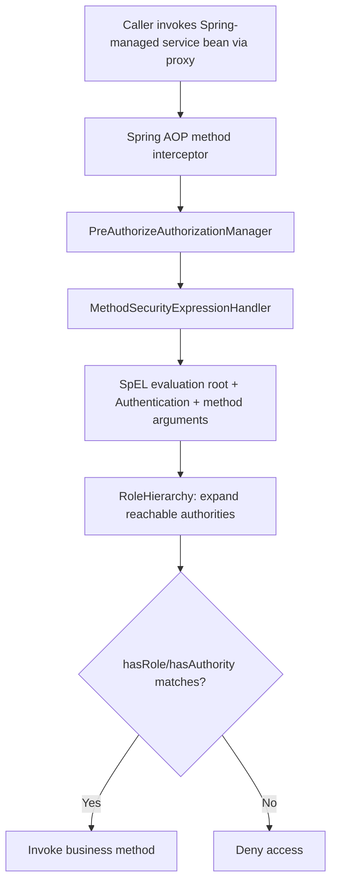

# Wiring Role Hierarchy into MethodSecurityExpressionHandler

In Spring Security, a user may be directly assigned **`ROLE_ADMIN`** while the application checks **`hasRole('USER')`** on a service method. If policy defines `ROLE_ADMIN > ROLE_MANAGER > ROLE_USER`, the administrator must satisfy `USER` without storing every lower role on their account.

For this to work with **SpEL-based method security** (especially `@PreAuthorize`, `@PostAuthorize`, `@PreFilter`, `@PostFilter`), declaring the role graph alone is not enough: you must ensure the active **`MethodSecurityExpressionHandler` has the corresponding `RoleHierarchy` wired in**.

Core configuration for **Spring Security 6.5.x, Spring Boot 3.x, and Java 17+**:

```java
@Bean
static RoleHierarchy roleHierarchy() {
    return RoleHierarchyImpl.fromHierarchy("""
            ROLE_ADMIN > ROLE_MANAGER
            ROLE_MANAGER > ROLE_USER
            ROLE_USER > documents.read
            ROLE_MANAGER > documents.edit
            """);
}

@Bean
static MethodSecurityExpressionHandler methodSecurityExpressionHandler(
        RoleHierarchy roleHierarchy) {
    DefaultMethodSecurityExpressionHandler handler =
            new DefaultMethodSecurityExpressionHandler();
    handler.setRoleHierarchy(roleHierarchy);
    return handler;
}
```

And you must **enable method security**:

```java
@Configuration
@EnableMethodSecurity
class MethodSecurityConfig {
    // Place the @Bean definitions here or in a component-scanned configuration.
}
```

Once wired properly, `@PreAuthorize("hasRole('USER')")` is satisfied by a `ROLE_ADMIN` holder through transitive relationships. This **does not make every method public**, **does not mutate the direct authorities inside `Authentication`**, and **does not grant access across every document or tenant**.

This lesson dives into **practical wiring**, the difference between the hierarchy and the handler, bean registration timing in Spring, effects on each annotation, a **runnable Spring Boot + Java 17 example**, testing strategies, and misconfigurations that break enforcement.

## 1. Three layers to distinguish

### 1.1. `Authentication` holds the assigned authorities

After authentication, `Authentication#getAuthorities()` may hold:

```text
principal = alice
authorities = [ROLE_ADMIN]
authenticated = true
```

`SimpleGrantedAuthority("ROLE_ADMIN")` is an authority represented by a string. It does not inherently contain `ROLE_MANAGER` or `ROLE_USER`, nor does it know anything about `>`.

When a service checks:

```java
@PreAuthorize("hasRole('USER')")
public String viewDashboard() {
    return "ok";
}
```

Spring Security must determine whether `ROLE_ADMIN` **implies** `ROLE_USER` under the policy. That is the job of hierarchy-aware authorization, not of `SimpleGrantedAuthority`.

### 1.2. `RoleHierarchy` computes the reachable authority set

`org.springframework.security.access.hierarchicalroles.RoleHierarchy` has the core contract:

```java
Collection<? extends GrantedAuthority> getReachableGrantedAuthorities(
        Collection<? extends GrantedAuthority> authorities);
```

With the definition:

```text
ROLE_ADMIN > ROLE_MANAGER
ROLE_MANAGER > ROLE_USER
ROLE_USER > documents.read
ROLE_MANAGER > documents.edit
```

Input `[ROLE_ADMIN]` produces the conceptual reachable set:

```text
ROLE_ADMIN
ROLE_MANAGER
ROLE_USER
documents.read
documents.edit
```

**Edge direction matters:** `ROLE_ADMIN > ROLE_MANAGER` means *ADMIN implies MANAGER*, **not** that MANAGER is granted ADMIN. Edges are **transitive**; ADMIN reaches USER via MANAGER, and reaches `documents.read` via USER. A user with only `ROLE_USER` does not gain `ROLE_ADMIN` or `documents.edit`.

`RoleHierarchyImpl` implements this graph; when called, it returns both the original authorities and inherited ones. It **does not mutate `Authentication`**, **does not edit JWT claims**, and is not responsible for fetching fresh permissions from a database.

### 1.3. What does `MethodSecurityExpressionHandler` do?

`MethodSecurityExpressionHandler` provides the infrastructure to parse and evaluate **Spring Expression Language (SpEL)** expressions on methods, including:

- Creating an `EvaluationContext` for each method invocation.
- Exposing variables/objects such as `authentication`, `principal`, method parameters like `#documentId`, and `@PostAuthorize`'s return value when needed.
- Providing the **expression root** with helpers like `hasRole`, `hasAuthority`, `hasAnyRole`, `hasPermission`, and so on.
- Allowing integration of `RoleHierarchy`, `PermissionEvaluator`, role prefixes, and other expression strategies.

The standard implementation for servlet/imperative method security is **`DefaultMethodSecurityExpressionHandler`**. Calling:

```java
handler.setRoleHierarchy(roleHierarchy);
```

gives the **expression root** authority/role checks access to the permission graph. This is **wiring a dependency**, not “copying roles onto the user” or “magically enabling hierarchy across the whole system”.

## 2. Authorization flow on a method invocation

For `@PreAuthorize` in an application using Spring AOP:



The real flow includes additional interceptors, caching, argument discovery, and authorization result handling; the diagram highlights the path relevant to hierarchy evaluation.

**Which step makes the difference?** When the handler has `RoleHierarchy` wired, the expression:

```java
@PreAuthorize("hasRole('USER')")
```

is evaluated against **reachable authorities**, not just directly assigned roles. However, if custom code reads directly from:

```java
authentication.getAuthorities()
```

to look for the string `ROLE_USER`, it may **fail to see** `ROLE_USER` because that collection is not expanded automatically.

### Two equivalent checks under the default prefix convention

If the system uses the default `ROLE_` prefix:

```java
@PreAuthorize("hasRole('MANAGER')")
@PreAuthorize("hasAuthority('ROLE_MANAGER')")
```

Both conditions can allow a user with `ROLE_ADMIN` **when the handler uses the configured hierarchy** and the graph contains `ROLE_ADMIN > ROLE_MANAGER`. Never place both duplicate annotations on the same method; these two lines are **alternative ways of writing the rule**.

`hasRole('MANAGER')` resolves to the role identifier with the default prefix `ROLE_MANAGER`; `hasAuthority('ROLE_MANAGER')` checks the exact string. Permissions are usually checked with:

```java
@PreAuthorize("hasAuthority('documents.read')")
```

A hierarchy can also imply a permission without the `ROLE_` prefix if an edge is explicitly declared, such as `ROLE_USER > documents.read`.

## 3. Configure three things properly: enable method security, define the graph, wire the handler

A properly wired configuration includes:

1. **`@EnableMethodSecurity`**: registers the method security interceptor infrastructure.
2. **`RoleHierarchy` bean**: holds the authority implication policy.
3. **`MethodSecurityExpressionHandler` bean**: instantiates `DefaultMethodSecurityExpressionHandler`, calls `setRoleHierarchy(...)`, and exposes the bean for method security infrastructure to use.

Example:

```java
import org.springframework.context.annotation.Bean;
import org.springframework.context.annotation.Configuration;
import org.springframework.security.access.expression.method.DefaultMethodSecurityExpressionHandler;
import org.springframework.security.access.expression.method.MethodSecurityExpressionHandler;
import org.springframework.security.access.hierarchicalroles.RoleHierarchy;
import org.springframework.security.access.hierarchicalroles.RoleHierarchyImpl;
import org.springframework.security.config.annotation.method.configuration.EnableMethodSecurity;

@Configuration
@EnableMethodSecurity
public class MethodAuthConfig {

    @Bean
    static RoleHierarchy roleHierarchy() {
        return RoleHierarchyImpl.fromHierarchy("""
                ROLE_ADMIN > ROLE_MANAGER
                ROLE_MANAGER > ROLE_USER
                ROLE_USER > documents.read
                ROLE_MANAGER > documents.edit
                """);
    }

    @Bean
    static MethodSecurityExpressionHandler methodSecurityExpressionHandler(
            RoleHierarchy roleHierarchy) {
        DefaultMethodSecurityExpressionHandler handler =
                new DefaultMethodSecurityExpressionHandler();
        handler.setRoleHierarchy(roleHierarchy);
        return handler;
    }
}
```

This class is **real configuration usable in Spring Boot 3.x/Spring Security 6.5.x**; it is not a standalone application since it lacks `main`, dependencies, and protected services.

### 3.1. Why use `static @Bean`?

Spring Security documentation recommends declaring `MethodSecurityExpressionHandler` with a **`static` bean method** so Spring publishes the bean **before initializing method security configuration classes**. Method security constructs certain advisors/interceptors early; if the handler is published too late, those components may bind the default handler instead of your configured one.

```java
@Bean
static MethodSecurityExpressionHandler methodSecurityExpressionHandler(
        RoleHierarchy roleHierarchy) {
    DefaultMethodSecurityExpressionHandler handler =
            new DefaultMethodSecurityExpressionHandler();
    handler.setRoleHierarchy(roleHierarchy);
    return handler;
}
```

Notes:

- `static` is a **recommendation for the expression handler bean**, not a requirement that every `@Service` bean be static.
- You can declare the `RoleHierarchy` bean as static too for clarity, though the **early lifecycle** concern specifically targets the handler bean.
- **The return type should be the `MethodSecurityExpressionHandler` interface**, matching the official docs so the infrastructure selects the right type.
- Do not instantiate `new DefaultMethodSecurityExpressionHandler()` inside a utility without registering it as a bean; otherwise method security infrastructure will not use that instance.
- Never construct a new handler per business call; the handler is reusable infrastructure configuration.

### 3.2. Why is `@EnableMethodSecurity` required?

Spring Boot starter security typically secures the HTTP layer in a web application, but **does not enable method security by default**.

Without:

```java
@EnableMethodSecurity
```

`@PreAuthorize` on a service may **not be enforced at all**, even if the annotation sits in source code and the handler bean exists. Modern method security uses `AuthorizationManager` and Spring AOP; the older `@EnableGlobalMethodSecurity` was replaced in the Spring Security 6 line.

By default, `@EnableMethodSecurity` activates `@PreAuthorize`, `@PostAuthorize`, `@PreFilter`, and `@PostFilter`. `@Secured` and JSR-250 are not enabled just by enabling pre/post; enable them explicitly when needed:

```java
@EnableMethodSecurity(securedEnabled = true, jsr250Enabled = true)
```

They have separate authorization infrastructure; read section 10 before assuming wiring the expression handler controls every annotation type.

## 4. Complete runnable Spring Boot example: method security using hierarchy

This example actually boots a **Spring ApplicationContext**, retrieves the service **via bean/proxy**, sets a simulated `Authentication` per user, and invokes `@PreAuthorize`-annotated methods. There is no controller or HTTP server because the exercise demonstrates **method authorization**.

Use **Java 17+, Maven 3.6.3+ or compatible Maven, and Spring Boot 3.5.16** (managing Spring Security 6.5.x dependencies), inside a dedicated directory. The Boot version is pinned here for reproducible dependencies; in production, keep up with supported security patches for your Spring release line.

Directory layout:

```text
method-hierarchy-demo/
├── pom.xml
└── src/
    └── main/
        ├── java/
        │   └── demo/
        │       ├── MethodHierarchyApp.java
        │       └── DocumentService.java
        └── resources/
            └── application.properties
```

### 4.1. pom.xml

```xml
<project xmlns="http://maven.apache.org/POM/4.0.0"
         xmlns:xsi="http://www.w3.org/2001/XMLSchema-instance"
         xsi:schemaLocation="http://maven.apache.org/POM/4.0.0
                             https://maven.apache.org/xsd/maven-4.0.0.xsd">
    <modelVersion>4.0.0</modelVersion>

    <parent>
        <groupId>org.springframework.boot</groupId>
        <artifactId>spring-boot-starter-parent</artifactId>
        <version>3.5.16</version>
        <relativePath/>
    </parent>

    <groupId>demo</groupId>
    <artifactId>method-hierarchy-demo</artifactId>
    <version>1.0.0</version>

    <properties>
        <java.version>17</java.version>
    </properties>

    <dependencies>
        <dependency>
            <groupId>org.springframework.boot</groupId>
            <artifactId>spring-boot-starter</artifactId>
        </dependency>
        <dependency>
            <groupId>org.springframework.boot</groupId>
            <artifactId>spring-boot-starter-security</artifactId>
        </dependency>
    </dependencies>

    <build>
        <plugins>
            <plugin>
                <groupId>org.springframework.boot</groupId>
                <artifactId>spring-boot-maven-plugin</artifactId>
            </plugin>
        </plugins>
    </build>
</project>
```

This is a **CLI application using the Spring Boot container**, so `spring-boot-starter-web` is not needed. Only add the web starter when you need real HTTP APIs. You do not specify the Spring Security version in dependencies because the Spring Boot parent manages compatible versions.

### 4.2. src/main/java/demo/MethodHierarchyApp.java

```java
package demo;

import java.util.List;
import java.util.function.Supplier;

import org.springframework.boot.CommandLineRunner;
import org.springframework.boot.SpringApplication;
import org.springframework.boot.autoconfigure.SpringBootApplication;
import org.springframework.context.annotation.Bean;
import org.springframework.security.access.AccessDeniedException;
import org.springframework.security.access.expression.method.DefaultMethodSecurityExpressionHandler;
import org.springframework.security.access.expression.method.MethodSecurityExpressionHandler;
import org.springframework.security.access.hierarchicalroles.RoleHierarchy;
import org.springframework.security.access.hierarchicalroles.RoleHierarchyImpl;
import org.springframework.security.authentication.UsernamePasswordAuthenticationToken;
import org.springframework.security.config.annotation.method.configuration.EnableMethodSecurity;
import org.springframework.security.core.authority.SimpleGrantedAuthority;
import org.springframework.security.core.context.SecurityContext;
import org.springframework.security.core.context.SecurityContextHolder;

@SpringBootApplication
@EnableMethodSecurity
public class MethodHierarchyApp {

    public static void main(String[] args) {
        SpringApplication.run(MethodHierarchyApp.class, args);
    }

    @Bean
    static RoleHierarchy roleHierarchy() {
        return RoleHierarchyImpl.fromHierarchy("""
                ROLE_ADMIN > ROLE_MANAGER
                ROLE_MANAGER > ROLE_USER
                ROLE_USER > documents.read
                ROLE_MANAGER > documents.edit
                """);
    }

    @Bean
    static MethodSecurityExpressionHandler methodSecurityExpressionHandler(
            RoleHierarchy roleHierarchy) {

        DefaultMethodSecurityExpressionHandler handler =
                new DefaultMethodSecurityExpressionHandler();
        handler.setRoleHierarchy(roleHierarchy);
        return handler;
    }

    @Bean
    CommandLineRunner runDemo(DocumentService service) {
        return args -> {
            exercise("ADMIN", "ROLE_ADMIN", service);
            exercise("MANAGER", "ROLE_MANAGER", service);
            exercise("USER", "ROLE_USER", service);
            exercise("GUEST", "ROLE_GUEST", service);
        };
    }

    private static void exercise(
            String label, String authority, DocumentService service) {

        SecurityContext context = SecurityContextHolder.createEmptyContext();
        context.setAuthentication(
                new UsernamePasswordAuthenticationToken(
                    label.toLowerCase(),
                    "demo-credential",
                    List.of(new SimpleGrantedAuthority(authority))
                )
        );
        SecurityContextHolder.setContext(context);

        try {
            check(label + " read", service::read);
            check(label + " edit", service::edit);
            check(label + " manage", service::manage);
            check(label + " admin", service::admin);
        } finally {
            SecurityContextHolder.clearContext();
        }
    }

    private static void check(String label, Supplier<String> invocation) {
        try {
            System.out.println(label + ": " + invocation.get());
        } catch (AccessDeniedException denied) {
            System.out.println(label + ": DENY");
        }
    }
}
```

**Explanation:**

- `@SpringBootApplication` creates the application/context; `@EnableMethodSecurity` enables method interceptors.
- `static RoleHierarchy` defines the permission graph; `static MethodSecurityExpressionHandler` receives that exact hierarchy object and calls `setRoleHierarchy`.
- `CommandLineRunner` **receives the Spring-injected `DocumentService` bean**. Because this bean is proxied for method security, calls like `service::read` and `service::edit` go through interception.
- Each `exercise` creates a fresh `SecurityContext`, sets a `UsernamePasswordAuthenticationToken` marked authenticated by the three-argument constructor with authorities, and **directly assigns strictly one role**.
- `SecurityContextHolder.clearContext()` cleans up between cases to prevent a principal from “leaking” to subsequent cases on the same thread.
- The accounts/credentials above **are strictly a test harness**. Never construct `UsernamePasswordAuthenticationToken` directly from caller-supplied roles in browser/request bodies for production authentication.

### 4.3. src/main/java/demo/DocumentService.java

```java
package demo;

import org.springframework.security.access.prepost.PreAuthorize;
import org.springframework.stereotype.Service;

@Service
public class DocumentService {

    @PreAuthorize("hasAuthority('documents.read')")
    public String read() {
        return "ALLOW";
    }

    @PreAuthorize("hasAuthority('documents.edit')")
    public String edit() {
        return "ALLOW";
    }

    @PreAuthorize("hasRole('MANAGER')")
    public String manage() {
        return "ALLOW";
    }

    @PreAuthorize("hasRole('ADMIN')")
    public String admin() {
        return "ALLOW";
    }
}
```

Methods return the literal string `ALLOW` **only after the interceptor permits invocation**; without sufficient authority, Spring Security throws an exception from the method authorization layer before executing the method body. The example defines no owner/tenant permissions, so use it solely to study **the effect of role hierarchy on the expression handler**.

### 4.4. src/main/resources/application.properties

```properties
spring.main.web-application-type=none
spring.main.banner-mode=off
logging.level.root=OFF
```

This keeps demo stdout focused on the lines printed by `CommandLineRunner`; your Maven/runtime environment may still print build messages, warnings, or errors depending on setup.

### 4.5. Run command and stdout

From the `method-hierarchy-demo` directory:

```bash
mvn -q spring-boot:run
```

**Lines printed by the program** in exact order (excluding any separate Maven/launcher output):

```text
ADMIN read: ALLOW
ADMIN edit: ALLOW
ADMIN manage: ALLOW
ADMIN admin: ALLOW
MANAGER read: ALLOW
MANAGER edit: ALLOW
MANAGER manage: ALLOW
MANAGER admin: DENY
USER read: ALLOW
USER edit: DENY
USER manage: DENY
USER admin: DENY
GUEST read: DENY
GUEST edit: DENY
GUEST manage: DENY
GUEST admin: DENY
```

Why does this output happen?

1. `ROLE_ADMIN` reaches `ROLE_MANAGER`, `ROLE_USER`, `documents.edit`, and `documents.read`, so it passes all four methods.
2. `ROLE_MANAGER` implies `ROLE_USER` and the graph permissions, but **does not** gain `ROLE_ADMIN`.
3. `ROLE_USER` only reaches `documents.read`; it does not get `documents.edit`, `ROLE_MANAGER`, or `ROLE_ADMIN`.
4. `ROLE_GUEST` has no edges in the hierarchy and holds no extra permissions.
5. If the handler were not wired with the hierarchy, a user with only `ROLE_ADMIN` would be denied at `read()`/`edit()`/`manage()` because those authorities were not directly granted. This is a crucial check proving the wiring is actually active.

**Learning purpose:** The code intentionally constructs a context in `CommandLineRunner` to illustrate method security. In a real HTTP application, `Authentication` must come from a trusted source such as an authenticated session, HTTP Basic through an authentication provider, or a Bearer JWT with verified issuer/audience/claims; never trust raw role strings sent by the caller.

## 5. Why “just declaring a RoleHierarchy bean” may not be enough

Learners often write:

```java
@Bean
RoleHierarchy roleHierarchy() {
    return RoleHierarchyImpl.fromHierarchy(
            "ROLE_ADMIN > ROLE_USER"
    );
}
```

and expect `@PreAuthorize("hasRole('USER')")` to expand automatically in every project. That depends on **how method authorization infrastructure is configured and which handler bean is selected**. To be explicit with SpEL method security in Spring Security 6.5, publish the handler:

```java
@Bean
static MethodSecurityExpressionHandler methodSecurityExpressionHandler(
        RoleHierarchy roleHierarchy) {

    DefaultMethodSecurityExpressionHandler handler =
            new DefaultMethodSecurityExpressionHandler();

    handler.setRoleHierarchy(roleHierarchy);
    return handler;
}
```

Especially in applications with multiple configuration classes, these pitfalls easily happen:

| Symptom | Possible cause | Resolution |
| --- | --- | --- |
| ADMIN fails `@PreAuthorize("hasRole('USER')")` | Active handler has no `RoleHierarchy` | Verify `MethodSecurityExpressionHandler` bean and `setRoleHierarchy` |
| `@PreAuthorize` blocks nobody | `@EnableMethodSecurity` missing or call bypasses proxy | Enable the annotation, call bean externally, test denied cases |
| Handler bean exists in project yet config does not apply | Bean initialized too late, or overridden by another custom manager | Make handler bean `static`, inspect active context/manager |
| Two handler beans cause ambiguity | Multiple beans of the same type without clear selection | Keep only the handler the app intends to use; check config |
| Hierarchy bean is right yet checked role does not match | Wrong edge direction, prefix, or casing | Check `ROLE_`, graph, and `Authentication` input |
| HTTP `hasRole` works while `@PreAuthorize` fails | HTTP and method mechanisms use separate wiring | Inspect method expression handler infrastructure |
| `@Secured` fails while `@PreAuthorize` works | `@Secured` uses a different manager than the expression handler | Check `securedEnabled` and `RoleHierarchy` wiring for that manager |
| Direct check in service misses inherited roles | Inspects raw `Authentication#getAuthorities()` | Use a hierarchy-aware manager/handler or call `RoleHierarchy` explicitly |

**Do not fix this by granting `ROLE_USER` directly to every ADMIN when the real bug is missing wiring**, unless that is an intentional architectural choice; doing so masks configuration flaws and creates hard-to-update role snapshots.

## 6. What does the handler bean solve for SpEL expressions?

`DefaultMethodSecurityExpressionHandler` provides common expressions:

| Expression | Meaning once RoleHierarchy is wired |
| --- | --- |
| `hasRole('USER')` | Checks default `ROLE_USER` authority in the reachable set |
| `hasAnyRole('USER','AUDITOR')` | Any one of the listed roles must be reachable |
| `hasAuthority('documents.read')` | Checks exact authority `documents.read` after applying hierarchy |
| `hasAnyAuthority('documents.read','audit.read')` | At least one authority must be found |
| `isAuthenticated()` | Checks authenticated state via security expression root, **not a hierarchy result** |
| `authentication.name` | Principal name on `Authentication`; **not an inherited role** |
| `#documentId` | Method argument identifying the document; **not automatically checked by hierarchy** |
| `hasPermission(#documentId,'Document','read')` | Calls `PermissionEvaluator`, not decided by `RoleHierarchy` alone |
| `returnObject.owner` in `@PostAuthorize` | Inspects property of returned object; depends on object data and policy |

**`RoleHierarchy` only solves authority reachability.** It does not turn `hasPermission` into owner/tenant checks, validate untrusted request inputs, or guarantee returned data is filtered.

### 6.1. Example expression before expansion

Sometimes learners write:

```java
@PreAuthorize(
    "hasRole('ADMIN') or hasRole('MANAGER') or hasRole('USER')"
)
public String listDocuments() {
    return "list";
}
```

Once you have:

```text
ROLE_ADMIN > ROLE_MANAGER
ROLE_MANAGER > ROLE_USER
```

and a hierarchy-wired handler, you can simplify to:

```java
@PreAuthorize("hasRole('USER')")
public String listDocuments() {
    return "list";
}
```

This reduces repetition **without changing the underlying policy if the graph accurately reflects all permitted relationships**. If a specialized role should not be implied, never force it into the graph just to make a rule look cleaner.

### 6.2. Permissions can also be implied

If the graph has:

```text
ROLE_USER > documents.read
ROLE_MANAGER > ROLE_USER
```

then `@PreAuthorize("hasAuthority('documents.read')")` lets a `ROLE_MANAGER` user pass. However, naming a permission `documents.read` is an **application convention**; Spring infers no special relationship from the word “documents”.

### 6.3. Expressions inspecting Authentication directly bypass the hierarchy

Example:

```java
@PreAuthorize(
    "authentication.authorities.?[authority == 'ROLE_USER'].size() > 0"
)
```

This snippet mainly inspects `Authentication`'s raw authority list rather than calling the expression handler's hierarchy-aware `hasRole`. For a user assigned only `ROLE_ADMIN`, it can evaluate to false even though `hasRole('USER')` is true.

Do not write complex direct SpEL loops when `hasRole`/`hasAuthority` expresses the intent cleanly. If a policy needs extra logic, create a dedicated service bean and invoke it from SpEL against trusted data.

## 7. @PreAuthorize, @PostAuthorize, @PreFilter, and @PostFilter

`@EnableMethodSecurity` activates pre/post annotations by default. They all use expression handling, but **execute at different times**:

- **`@PreAuthorize`**: decides **before** the method runs. Suited for general role/permission and parameter checks.
- **`@PostAuthorize`**: evaluates **after** the method returns and can inspect `returnObject`.
- **`@PreFilter`**: filters an input collection/array/stream in supported scenarios using a per-element expression.
- **`@PostFilter`**: filters a returned collection using a per-element expression.

**Hierarchy applies to authority checks in the expression root**, while `@PostAuthorize`/`@PostFilter` still require verifying returned-object correctness and filter semantics.

### 7.1. @PreAuthorize with method parameters

Service snippet in a project with `@EnableMethodSecurity`:

```java
@PreAuthorize(
    "hasAuthority('documents.read') " +
    "and @documentPolicy.canRead(authentication.name, #documentId)"
)
public DocumentDto read(@P("documentId") String documentId) {
    return repository.findDto(documentId);
}
```

In this example:

1. `hasAuthority('documents.read')` can use `RoleHierarchy` via the handler.
2. `@documentPolicy.canRead(...)` must be an application bean/policy checking owner, tenant, share, or document status from a trusted source.
3. `@P("documentId")` from `org.springframework.security.access.method.P` preserves the parameter name for SpEL when compiler parameter-name metadata is absent.
4. `DocumentDto`, `repository`, and `documentPolicy` are **application-defined types**, not provided out of the box by Spring Security.

Having the coarse authority `documents.read` alone is not enough to guarantee the user may read the *specific document ID supplied*.

### 7.2. @PostAuthorize with returnObject

Code snippet:

```java
@PostAuthorize(
    "hasAuthority('documents.read') and " +
    "returnObject.ownerId == authentication.name"
)
public DocumentDto readOwned(String id) {
    return repository.findDto(id);
}
```

`DocumentDto` exposes an `ownerId` property accessed by SpEL. If the method can return null or unexpected data, handle that safely in policy before relying on it in an expression.

**Important note:** `@PostAuthorize` runs **after the method executes**. For methods that write data, send emails, process payments, call external APIs, or leak information via side effects, denying afterwards **does not undo** what already happened. Always check authorization before sensitive side effects. Even for reads, although `returnObject` is blocked before reaching the caller, the method still ran a potentially expensive query; design queries and data access accordingly.

### 7.3. @PreFilter / @PostFilter do not automatically protect every access path

When filtering a collection of documents, understand the mechanics:

- `filterObject` represents the element currently under evaluation.
- Expressions can combine `hasAuthority('documents.read')` (via hierarchy) with owner/tenant checks.
- Only annotated methods **invoked through the proxy** execute the filter.
- On large lists, post-filtering **after loading all rows** is inefficient and breaks pagination. Prefer filtering by policy inside the query itself when needed.

Conceptual example:

```java
@PostFilter(
    "hasAuthority('documents.read') and " +
    "filterObject.ownerId == authentication.name"
)
public List<DocumentDto> findOwnedDocuments() {
    return repository.findCandidates();
}
```

This is an **integration snippet** and cannot replace query filters and access checks across all endpoints. Never rely on this rule while leaving another unannotated endpoint that exports the full dataset.

## 8. Role of the Spring AOP proxy: right handler, yet method is not blocked

Even with `RoleHierarchy` and the handler configured properly, method security only runs when calls **pass through the interception mechanism**.

### 8.1. Invocation through a Spring bean

```java
@Service
public class ExportService {
    private final DocumentService documents;

    public ExportService(DocumentService documents) {
        this.documents = documents;
    }

    public void export() {
        documents.read(); // through Spring-managed bean/proxy
    }
}
```

The call above goes through the method interceptor because `DocumentService` was injected by Spring.

### 8.2. Self-invocation inside the same instance

```java
@Service
public class InternalService {

    public void runBatch() {
        deleteSensitiveData(); // this.deleteSensitiveData(): may bypass proxy
    }

    @PreAuthorize("hasRole('ADMIN')")
    public void deleteSensitiveData() {
        // Sensitive operation.
    }
}
```

In standard Spring AOP proxy mode, calling `this.deleteSensitiveData()` from inside the same bean **does not pass through the proxy**, so the annotation on that method may **not be enforced**. This is a dangerous bug because controller/test paths calling the method directly pass while an internal call path bypasses security.

Fix: move the protected method to another Spring bean and invoke it **through the bean/proxy**, or choose an appropriate weaving mode when architecturally justified and thoroughly tested. Never attempt to fix this by adding extra hierarchy edges.

### 8.3. Common AOP pitfalls

- Instantiating `new DocumentService()` manually: object is not Spring-managed and **has no proxy**.
- Private/final methods or final classes: proxy interception depends on proxy strategy; protect public Spring-managed service methods cleanly.
- Annotations placed on unused methods: provide no implicit protection for other code paths.
- Beans created in a different `ApplicationContext` than the one enabling method security: may miss advisors.
- Async/scheduled invocations: ensure identity and `SecurityContext` propagate properly; hierarchy never fabricates `Authentication` on a new thread.
- Unit tests instantiating services with `new`: test business logic fine, yet **do not test method security**.

**Good tests verify the service is obtained from the Spring context and negative cases are genuinely denied.**

## 9. The ROLE_ prefix and avoiding name mismatches

If the graph defines:

```text
ROLE_ADMIN > ROLE_MANAGER
ROLE_MANAGER > ROLE_USER
```

then assigned authorities must match, e.g.:

```java
new SimpleGrantedAuthority("ROLE_ADMIN")
```

and expressions:

```java
@PreAuthorize("hasRole('MANAGER')")
@PreAuthorize("hasAuthority('ROLE_MANAGER')")
```

Under the default `ROLE_` prefix, both forms align. However, if the login source emits an unprefixed `ADMIN` authority, `hasRole('ADMIN')` looks for `ROLE_ADMIN` by default and will not match `ADMIN`.

**Three places that must stay consistent:**

1. Where `GrantedAuthority` instances are issued/converted into `Authentication`.
2. Edge definitions in `RoleHierarchyImpl`.
3. How `hasRole`/`hasAuthority` in the method expression root computes expected names.

### Changing the role prefix

`DefaultMethodSecurityExpressionHandler#setDefaultRolePrefix(...)` lets you change the prefix used by `hasRole`/`hasAnyRole`. Spring Security also provides `GrantedAuthorityDefaults` or prefix settings in other authorization mechanisms. If you change the prefix:

- Authority strings from users/IdPs must follow the new convention.
- `RoleHierarchyImpl.fromHierarchy(...)` must use exact strings with the expected prefix.
- `hasAuthority(...)` takes full strings without auto-prefixing.
- HTTP and method security may use separate managers; inspect configuration on every layer.
- Never mix `ROLE_ADMIN` and `ADMIN` expecting the framework to normalize them automatically.

In Spring Security 6.5, `RoleHierarchyImpl.withDefaultRolePrefix()` gives a builder taking short role names, whereas `fromHierarchy(String)` takes **full authority strings**. Avoid double-adding `ROLE_` when using the builder.

### JWT Resource Server and SCOPE_

A typical JWT Resource Server maps `scope`/`scp` claims to `SCOPE_docs.read`, not automatically to `ROLE_USER` or `documents.read`. If `@PreAuthorize` checks `documents.read`, you must:

- Map trusted token claims to the appropriate application authorities, **or**
- Write policies checking `SCOPE_docs.read` directly, **or**
- Intentionally declare an implication relationship between the corresponding authorities if security semantics justify it.

Never take an arbitrary client-sent `roles` claim and grant `ROLE_ADMIN` without verifying the token, issuer, audience, and permitted authority mappings.

## 10. @Secured and @RolesAllowed do not share the expression handler mechanism

An important distinction:

| Method security mechanism | Enabled by default via @EnableMethodSecurity? | Primary authorization component |
| --- | --- | --- |
| `@PreAuthorize` | Yes | `PreAuthorizeAuthorizationManager` and `MethodSecurityExpressionHandler` |
| `@PostAuthorize` | Yes | `PostAuthorizeAuthorizationManager` and `MethodSecurityExpressionHandler` |
| `@PreFilter` / `@PostFilter` | Yes | Pre/post filter infrastructure with expression handler |
| `@Secured` | No; requires `securedEnabled=true` | `SecuredAuthorizationManager` |
| `@RolesAllowed` (JSR-250) | No; requires `jsr250Enabled=true` | `Jsr250AuthorizationManager` |

Spring Security **supports `RoleHierarchy`** for `SecuredAuthorizationManager` and `Jsr250AuthorizationManager`, but they **do not run the same SpEL evaluation as `DefaultMethodSecurityExpressionHandler`**. A `RoleHierarchy` bean per Spring Security docs can be picked up by these standard managers; with custom managers or special configurations, verify the actual wiring.

Do not expect `@Bean MethodSecurityExpressionHandler` to turn `@Secured` into SpEL or make `@RolesAllowed` support `hasPermission(#id,...)`. They have distinct contracts.

If starting fresh and needing policies combining method parameters, objects, and authorities, **`@PreAuthorize` is usually more flexible**.

## 11. When PermissionEvaluator or custom expressions are needed

`RoleHierarchy` answers “does role/authority A imply B?”. Business rules may also need:

- Is the user the **owner** of the document?
- Does the user belong to the corresponding **tenant**?
- Is the invoice in an approvable state?
- Is there a “creator cannot self-approve” constraint?
- Does the caller have required MFA or fresh authentication?

These checks sit **outside the global role hierarchy graph**.

You can also attach a `PermissionEvaluator` to the same handler:

```java
@Bean
static MethodSecurityExpressionHandler methodSecurityExpressionHandler(
        RoleHierarchy roleHierarchy,
        PermissionEvaluator permissionEvaluator) {

    DefaultMethodSecurityExpressionHandler handler =
            new DefaultMethodSecurityExpressionHandler();
    handler.setRoleHierarchy(roleHierarchy);
    handler.setPermissionEvaluator(permissionEvaluator);
    return handler;
}
```

This is a **configuration fragment**; `PermissionEvaluator` requires a trustworthy implementation bean, such as one backed by ACLs or repositories. Avoid creating a dummy evaluator that returns true for every `hasPermission` just to “fix” tests.

A complete policy example typically looks like:

```java
@PreAuthorize(
    "hasAuthority('documents.edit') " +
    "and @docPolicy.canEdit(authentication, #documentId)"
)
public void update(@P("documentId") String documentId) {
    // Proceed only after appropriate authorization checks.
}
```

The hierarchy makes `documents.edit` reachable from `ROLE_MANAGER`, while `docPolicy` protects the **specific document**. Tenant and owner contexts must come from verified server-side data, not solely from user-supplied URL parameters.

**Never stuff individual document IDs into the global role hierarchy.** Per-document/project/user permission graphs belong in resource policies, ABAC, or ReBAC rather than a static `ROLE_` hierarchy.

## 12. Debugging: pinpointing where hierarchy wiring is missing

When ADMIN holds `ROLE_ADMIN` yet `@PreAuthorize("hasRole('USER')")` denies access, check in order:

1. **Is method security enabled?** Confirm `@EnableMethodSecurity` is registered in the same context as the service.
2. **Is a proxy/interceptor present?** Was the service retrieved as a Spring bean or created with `new`? Any self-invocation?
3. **What is the actual Authentication?** Does `SecurityContextHolder.getContext().getAuthentication()` hold the authenticated user?
4. **What are the raw authority strings?** Check `ROLE_ADMIN` vs. `ADMIN`, letter case, and prefixes.
5. **Is the RoleHierarchy graph directed properly?** Check `ROLE_ADMIN > ROLE_MANAGER`, not inverted.
6. **Does the reachable set include ROLE_USER?** Call `getReachableGrantedAuthorities` in a unit test to verify.
7. **Is the expression handler bean properly typed and registered early?** Check `static @Bean MethodSecurityExpressionHandler`, `setRoleHierarchy`, and bean count.
8. **Which annotation is on the method?** `@Secured`/`@RolesAllowed` are not equivalent to `@PreAuthorize`.
9. **Are role prefixes consistent?** `hasRole('USER')` searches for `ROLE_USER` by default.
10. **Is another policy denying access?** HTTP filters, CSRF, `@PostAuthorize`, resource policies, or other method annotations.
11. **Does the test context differ from production?** Bean profiles, auto-configuration, package scans, custom authorization managers, or wrongly mocked contexts.
12. **Have role/hierarchy changes been reloaded?** Sessions/JWTs and `RoleHierarchyImpl` may hold stale snapshots.

When debugging, log only **necessary authority names and policy outcomes** at permitted log levels; never write Bearer tokens, session cookies, passwords, or sensitive document data to logs.

### Quick diagnostic diagram

```text
@PreAuthorize has no effect?
  -> @EnableMethodSecurity + proxy/self-invocation

@PreAuthorize blocks, yet ADMIN does not inherit USER?
  -> Authentication authorities
  -> RoleHierarchyImpl graph/ROLE_ prefix
  -> static MethodSecurityExpressionHandler#setRoleHierarchy

@PreAuthorize works, yet @Secured fails?
  -> securedEnabled + SecuredAuthorizationManager wiring

Roles inherit properly, yet other tenant data is exposed?
  -> missing resource/tenant/ownership policy
```

## 13. Integration testing: proving the handler is genuinely wired

Unit testing `RoleHierarchyImpl#getReachableGrantedAuthorities(...)` alone is **not enough**. The graph can be right while the expression handler goes unused, causing the app to still deny inherited permissions.

### 13.1. Expected matrix

With the graph from the main example:

| Directly assigned authority | `hasRole('ADMIN')` | `hasRole('MANAGER')` | `hasRole('USER')` | `documents.read` | `documents.edit` |
| --- | --- | --- | --- | --- | --- |
| `ROLE_ADMIN` | ALLOW | ALLOW | ALLOW | ALLOW | ALLOW |
| `ROLE_MANAGER` | DENY | ALLOW | ALLOW | ALLOW | ALLOW |
| `ROLE_USER` | DENY | DENY | ALLOW | ALLOW | DENY |
| `ROLE_GUEST` | DENY | DENY | DENY | DENY | DENY |

You must test **both allow and deny directions**. Checking only `ADMIN -> USER` without checking `USER -X-> ADMIN` can miss a dangerous reversed edge.

### 13.2. Graph unit test

JUnit 5 example (requires JUnit dependencies and imports):

```java
@Test
void adminCanReachUserButNotTheReverse() {
    RoleHierarchy hierarchy = RoleHierarchyImpl.fromHierarchy("""
            ROLE_ADMIN > ROLE_MANAGER
            ROLE_MANAGER > ROLE_USER
            """);

    var admin = hierarchy.getReachableGrantedAuthorities(
            List.of(new SimpleGrantedAuthority("ROLE_ADMIN")));
    var user = hierarchy.getReachableGrantedAuthorities(
            List.of(new SimpleGrantedAuthority("ROLE_USER")));

    assertTrue(admin.stream().anyMatch(
            a -> "ROLE_USER".equals(a.getAuthority())));
    assertFalse(user.stream().anyMatch(
            a -> "ROLE_ADMIN".equals(a.getAuthority())));
}
```

This test only proves the **graph is valid**; it does not prove Spring's method interceptor uses the handler.

### 13.3. Method proxy integration test

In a Spring test context with `@EnableMethodSecurity`, inject `DocumentService` and use Spring Security Test:

```java
@Test
@WithMockUser(roles = "ADMIN")
void adminCanReadViaInheritedPermission() {
    assertEquals("ALLOW", documentService.read());
}

@Test
@WithMockUser(roles = "USER")
void userCannotEdit() {
    assertThrows(AccessDeniedException.class,
            () -> documentService.edit());
}
```

These are **JUnit/Spring Test snippets**: they require `spring-security-test` in test scope, a `@SpringBootTest` context, an `@Autowired DocumentService` field, JUnit imports, and matching exception types. `@WithMockUser(roles="ADMIN")` assigns `ROLE_ADMIN` without assigning `documents.read`; passing the first test signals method security is applying the hierarchy.

Additional cases to cover:

- ADMIN passes `read`, `edit`, `manage`, `admin`.
- MANAGER passes `read`, `edit`, `manage`, but is denied `admin`.
- USER passes only `read`.
- GUEST is denied all four methods.
- Anonymous is denied protected methods.
- Methods called from another bean are enforced; test self-invocation to detect bypasses.
- Temporarily alter `RoleHierarchy` or disable the handler bean in a separate test to confirm inheritance tests fail for the right reason.
- Test that resource policies reject wrong tenant/owner even when the role is sufficient.
- If using `@Secured`/JSR-250, test their managers and enablement flags separately.

### 13.4. When testing through MockMvc

When a controller calls a proxied service, HTTP tests observe the combined outcome of **request-level authorization** and **method-level authorization**. Distinguish clearly:

- Request blocked by the HTTP filter before reaching the controller.
- Controller entered, then service `@PreAuthorize` denied.
- Service passed, then controller returned 404 or validation failed.
- POST/PATCH/DELETE rejected by CSRF before the method call.

To **verify the handler specifically**, include an integration test calling the **Spring-managed service** directly under a test `Authentication`. HTTP 200/403 status codes through MockMvc alone sometimes obscure which layer made the decision.

## 14. Permission change lifecycle: hierarchy does not refresh sessions/tokens

When an administrator deletes `ROLE_ADMIN` from the DB:

- `RoleHierarchyImpl` still holds the same policy graph.
- `Authentication` in an existing HTTP session or issued JWT may continue carrying `ROLE_ADMIN` without refresh/revocation.
- The handler expands **whatever authorities the request currently carries**. If the request still brings the old `ROLE_ADMIN`, it keeps acting as USER/MANAGER until the system rejects the stale snapshot or refreshes `Authentication`.

Conversely, when editing the graph:

```text
Before: ROLE_MANAGER > documents.edit
After:  remove this edge
```

if `RoleHierarchyImpl` is a startup-built bean, the app **does not automatically rebuild it** when a DB row changes elsewhere. You need a reload/redeploy or a designed graph update workflow keeping nodes and caches consistent.

For sensitive operations, alongside coarse-grained role hierarchies, consider **dynamic permission checks** near business boundaries and session/token revocation strategies matching your permission-change SLA.

## 15. Common mistakes to avoid

| Mistake | Consequence | Recommendation |
| --- | --- | --- |
| Defining `RoleHierarchy` without checking the handler | Method SpEL may ignore the graph | Publish `static MethodSecurityExpressionHandler` with `setRoleHierarchy` |
| Forgetting `@EnableMethodSecurity` | Annotations may not be enforced | Enable method security and test denied cases |
| Instantiating `@PreAuthorize` service with `new` | Bypasses Spring AOP proxy | Call the Spring-managed bean |
| Self-invocation inside the same bean | Bypasses interception in standard proxy mode | Extract protected operation to another bean |
| Inverting `ROLE_USER > ROLE_ADMIN` | Low-privilege users inherit admin | Review edge direction; write negative tests |
| Mixing `hasRole('ROLE_ADMIN')` and `hasAuthority` without checking prefix | Breaks easily if prefixes change | Standardize `ROLE_` convention and test |
| Granting `ADMIN` while hierarchy uses `ROLE_ADMIN` | Strings fail to match | Align `GrantedAuthority` naming |
| JWT has `SCOPE_docs.read` while rule expects `documents.read` | Method denies despite valid token | Map scopes/permissions explicitly |
| Assuming handler configures every custom authorization manager | Custom managers may ignore handler | Wire hierarchy explicitly into custom managers |
| Confusing `@Secured` with `@PreAuthorize` | Different enablement flags and managers | Check `securedEnabled` and relevant wiring |
| Using `@PostAuthorize` to block side-effecting methods | Side effects occur before denial | Authorize before sensitive actions |
| Comparing `authentication.authorities` directly | Skips inherited authorities not directly attached | Prefer `hasRole`/`hasAuthority` via handler |
| Manager role accessing another tenant's document | Hierarchy carries no tenant/owner constraints | Add resource-level policies |
| Writing only positive tests | Misses privilege escalation | Test denials and graph direction |
| Editing hierarchy without reloading | Keeps using stale graph | Manage lifecycle, refresh events, and consistency |
| Checking roles from unverified request data | Clients can spoof admin claims | Trust authentication providers/token validation, never raw input |

## 16. Self-check questions

**Question 1:** Does `ROLE_ADMIN > ROLE_USER` automatically add `ROLE_USER` into `Authentication#getAuthorities()`?  
**Answer:** No. The handler/hierarchy-aware check treats USER as reachable, while direct authorities are not mutated.

**Question 2:** Why should `@Bean MethodSecurityExpressionHandler` be `static`?  
**Answer:** So Spring publishes the bean before initializing method-security configuration classes and interceptors that need it.

**Question 3:** `RoleHierarchyImpl` exists, yet `@PreAuthorize` does nothing at all; what should you check first?  
**Answer:** Check `@EnableMethodSecurity` and whether calls go through the Spring AOP proxy.

**Question 4:** Does MANAGER gain ADMIN under `ROLE_ADMIN > ROLE_MANAGER`?  
**Answer:** No. Implication is directed; the reverse does not exist automatically.

**Question 5:** If `ROLE_USER > documents.read`, does ADMIN have `documents.read`?  
**Answer:** Yes, **if** ADMIN implies USER through declared edges and the expression handler applies the same hierarchy.

**Question 6:** Why is testing `RoleHierarchy#getReachableGrantedAuthorities` directly insufficient?  
**Answer:** It proves the graph, not that `@PreAuthorize` actually uses that handler or that method proxies are active.

**Question 7:** Does `@Secured("ROLE_USER")` run on the same SpEL engine as `@PreAuthorize("hasRole('USER')")`?  
**Answer:** No. `@Secured` uses a separate manager; you must enable `securedEnabled` and verify its `RoleHierarchy` wiring.

**Question 8:** Is `@PostAuthorize` safe for blocking a money transfer after executing it?  
**Answer:** No. It runs after the method; side effects have already occurred. Authorize before performing the action.

**Question 9:** Can a tenant A manager edit tenant B's document via the hierarchy?  
**Answer:** It should not be allowed. Role hierarchy does not replace tenant, owner, and resource-state checks.

**Question 10:** Does Spring Security method hierarchy update automatically when a role inside an old JWT is revoked in the DB?  
**Answer:** Not by default. You must design refresh/revocation or live policy checks.

## Conclusion

To truly use role hierarchy in method security, remember the wiring chain:

```text
Authentication (direct authorities)
         |
         v
@EnableMethodSecurity + Spring AOP proxy
         |
         v
@PreAuthorize / @PostAuthorize / pre/post filter
         |
         v
MethodSecurityExpressionHandler
  -> DefaultMethodSecurityExpressionHandler
  -> setRoleHierarchy(RoleHierarchy bean)
         |
         v
hasRole / hasAuthority
  checks reachable authority set
```

**Three configuration steps must go together:** enable `@EnableMethodSecurity`, create `RoleHierarchy`, and publish a **`static @Bean MethodSecurityExpressionHandler`** with `setRoleHierarchy(...)`.

Done right, `ROLE_ADMIN > ROLE_MANAGER > ROLE_USER` lets `@PreAuthorize("hasRole('USER')")` permit admins and managers without duplicating lower roles in `Authentication`. Still, **hierarchy never replaces authentication, proxies, tenant policies, or per-resource checks**. Test both allows and denies to confirm your system protects methods as intended.

## References

- [Spring Security 6.5 — Method Security](https://docs.spring.io/spring-security/reference/6.5/servlet/authorization/method-security.html)
- [Spring Security 6.5 — Authorization Architecture: Hierarchical Roles](https://docs.spring.io/spring-security/reference/6.5/servlet/authorization/architecture.html)
- [Spring Security 6.5 — DefaultMethodSecurityExpressionHandler Javadoc](https://docs.spring.io/spring-security/reference/6.5/api/java/org/springframework/security/access/expression/method/DefaultMethodSecurityExpressionHandler.html)
- [Spring Security 6.5 — MethodSecurityExpressionHandler Javadoc](https://docs.spring.io/spring-security/reference/6.5/api/java/org/springframework/security/access/expression/method/MethodSecurityExpressionHandler.html)
- [Spring Security 6.5 — RoleHierarchyImpl Javadoc](https://docs.spring.io/spring-security/reference/6.5/api/java/org/springframework/security/access/hierarchicalroles/RoleHierarchyImpl.html)
- [Spring Security 6.5 — EnableMethodSecurity Javadoc](https://docs.spring.io/spring-security/reference/6.5/api/java/org/springframework/security/config/annotation/method/configuration/EnableMethodSecurity.html)
- [Spring Boot 3.5.16 — Documentation](https://docs.spring.io/spring-boot/3.5/documentation.html)
